# 哈佛大学《大数据算法｜Harvard Algorithms for Big Data (COMPSCI 229r) 2016》deepseek - P12：-12-Algorithms for Big Data (COMPSCI 229r), Lecture 12.zh_en - GPT中英字幕课程资源 - BV1yGdNYvEMo

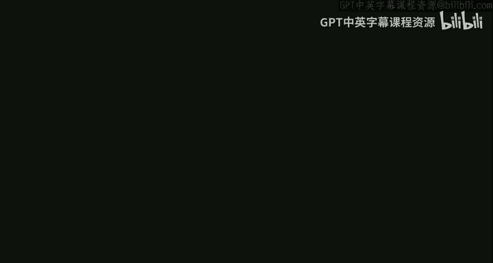

Fellow today， I guess。

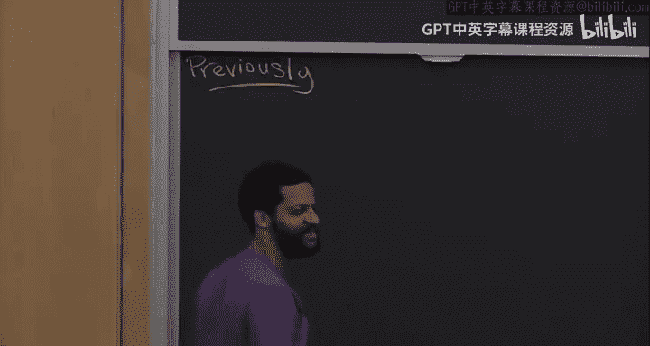

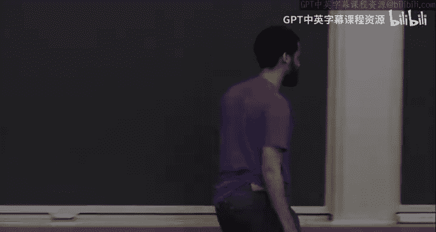

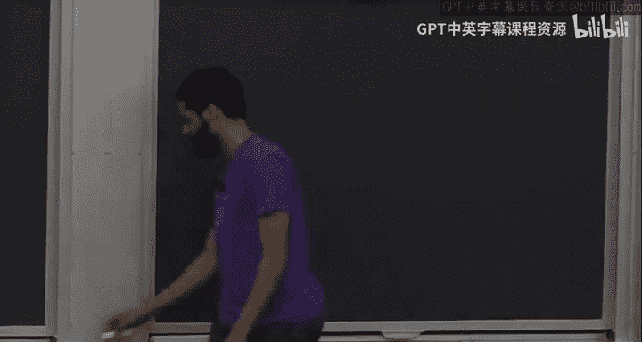

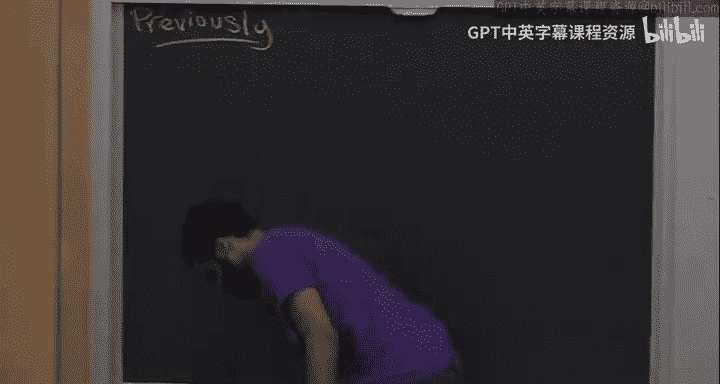

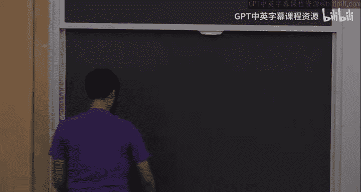

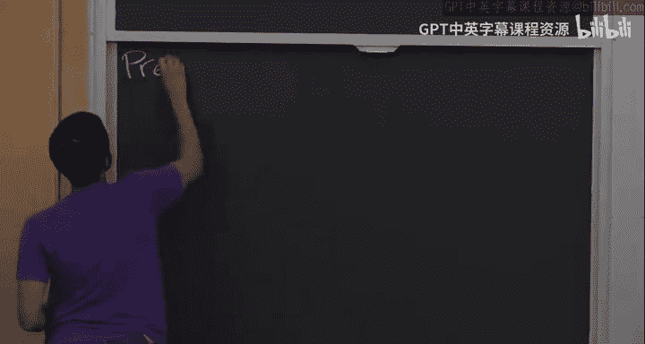

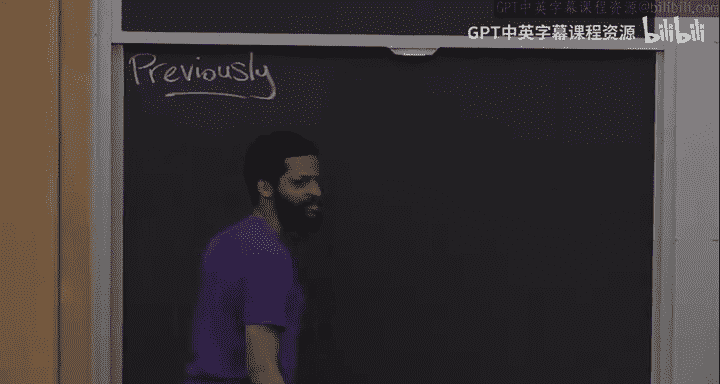

Stick we。

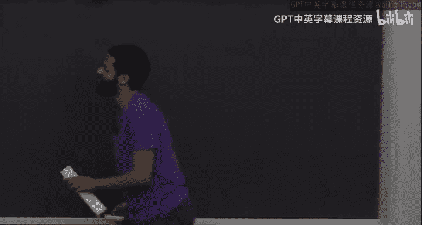

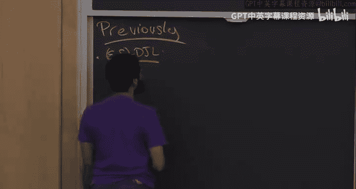

うん。All right， let's get started。ううん。Okay， so last time。I make sure this is on。

Last time we proved distributional jailL， we showed that well。

 we focused mostly on epsilon being less than one。 So the max of these two is one of Epson squared。

 But we showed if you map into one of Epsilon squared log one of Dlta dimensions。

With a random matrix， like a random sign matrix。You're scibing for today， right， Okay。

 you'll have that for any vector X of unit norm， this is vectors in the unit sphere。

With high probability， you'll preserve the norm of x。

 So you'll preserve it up to epsilon with probability 1 minus delta。

 Your failure probability is delta。And we saw an the lecture before that this implies jail。

 Ja says that for any set of finite points。You can map to dimension that only depends logarithmically on the number of points and preserve all the distances up to one sub。

Okay， so this is jail。Today I want to talk about a couple things。So， today。

I want to talk about lower bounds。I'll state a few， I'll only prove one。

And these lower bounds are going be of the form。 Let's say for J L。

 we're going show that there exists for any N for any capital N。

 There exists a set of capital n points in L 2。Such that any embedding requires roughly that M up to a small factor。

Okay， so we're going to show that the jail alema is almost optimal。Okay。

But that's worst case optimality。 It means there is a hard set of vectors。Okay。

So the second thing we're going to do is go beyond worst case。

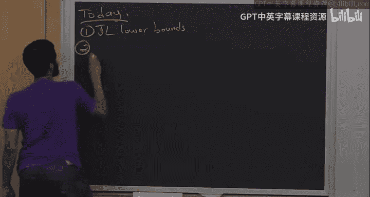

That's kind of a worst case analysis kind of lower bound， there is an input that's hard。Right。

 but if you're actually doing， if you want to actually do dimensionality reduction on some。

Database of vectors that someone gave you。You know。

 maybe you want to do as well as you can do for that database。

You don't want to compare yourself against a worst case lower bound because your data is not a worst case。

Instance， right？

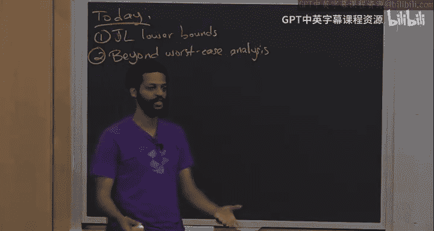

嗯。And this is going to be something called Gordon's theorem。And later in this course。

 when we start talking about。Nummerical linear algebra or dimensionality reduction for linear algebra problems。

 as well as compressed sensing。

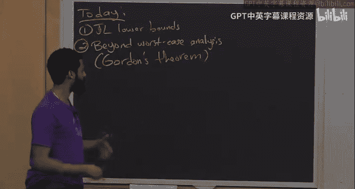

You're going to see that。Some of what we're going to want to do is basically we want a jailL kind of dimensionality reduction for an infinite set。

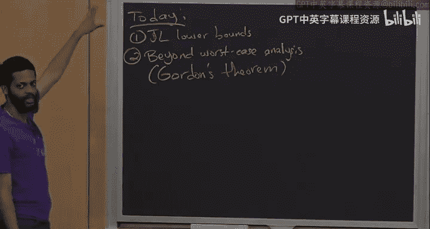

So， for example， for an entire subspace of R N or for the set of all sparse vectors and R N。

 So these are infinite sets of vectors and then log the number of points doesn't make sense anymore。

 That's infinite。But Gordon's theorem will be able to tell us immediately how many dimensions you can get away with。

To do dimensionalality reduction on that set，Yeah， so I want to talk about these two things and kind of。

In order to。Appreciate Gordon's theorem。 I'm gonna spend a little time。 So let's call it 1。5。

 which actually come goes a little bit between before Gordon。 I'll say something about。Bounding。

Soups， su of。Of Gaussian processes， I'll say more what that means when we get there。

But it's just a little preliminary stuff I should cover just so that you can appreciate some of the terminology I'm going to be using in Gordon's theorem。

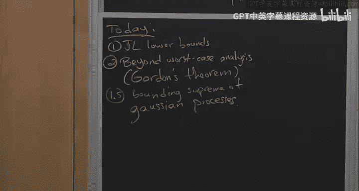

Okay good， so let's start off with lower bounds。对。Good， so。

The first thing I want to say is what about， So there are two different problems here。

 There's distributional jail and there's metric， and there's jail。

 the thing that's usually called jail。 it's。

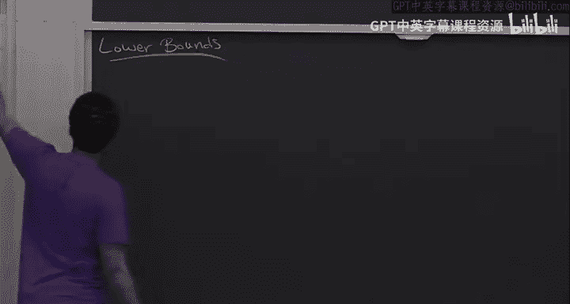

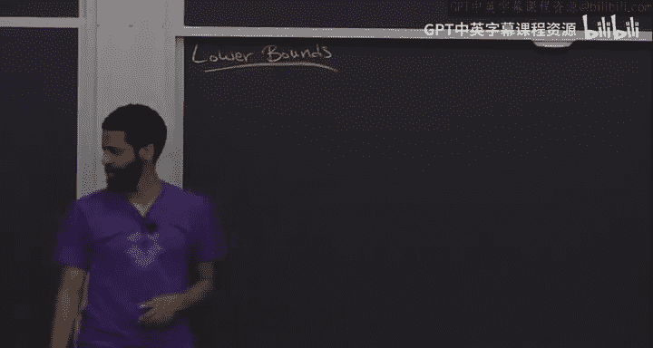

It's good to keep in mind that these are two different problems。

 A lot of the literature out there just just says jail and they could mean either one of these depending on the paper。

 but they are different problems and one of them is resolved and one of them is still unresolved。

 Okay， so it's good to keep in mind that they're open problems here。

 So let me let me first talk about distributional jail。

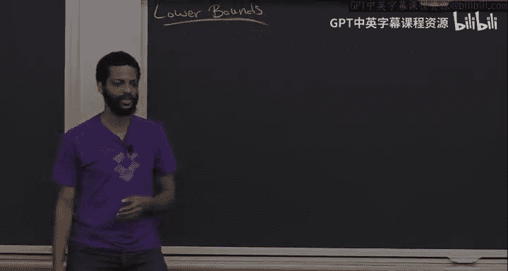

Okay。So you can show that for all。 So this is due to first due to J Ram and Woodruff。

And then there was a。A proof also by。came。Mecca and myself。Okay， which says that。

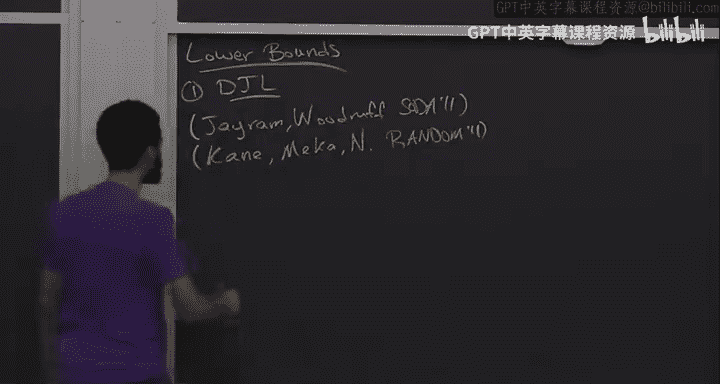

Any。Epsilon Delta。DJL。Distribution。For let's say， Epsilon Delta。呃。Between zero and a half。Must have。

And being at least the men。Of n and1 over epsilon squared log1 over delta。是。

I don't want to go into the details of the analysis， but I'll give you like a proof sketch。

 so I'll show you the proof sketch from here。This work， it basically。

 it doesn't quite get this up to end， but it gets almost there。

 And I think it's shorter to give the sketch of this one。 So let me just give a sketch。嗯。

So it's going to be something like what you saw in actually in one of the communication complexity lower bounds。

So it looks something like this。 What does DJL tell you， DJL says that。For all x。

 the probability over pi that。Pi x squared minus1 is bigger than epsilon is at most delta。

That's what DJL says。Well， if it's true for all X。Then it's true for any distribution over x's as well。

Right， so this implies that。You know， for all distributions。Mu on the sphere。

 we have that the probability over x drawn from this distribution of the probability over pi of that same thing is at most delta。

And then we can swap these two probabilities， right， So this implies that。

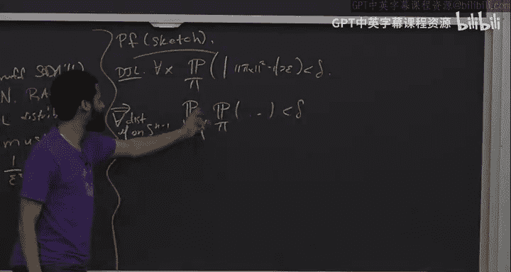

The probability over pi， the probability over x coming from U。

 pi is being drawn according to this distributional jail。

But if a random pie has this probability of being small。Right。

 it means that there exists a pie in the support of the distribution where this probability is small。

 This implies that there exists a pie in the support of the distribution。

Such that the probability of over x is coming from U。早。Right。

And then basically the way that now you have to do some calculations。

 But the way the analysis goes is you say， look， if pi only has M rows。 So first of all。Pick you。

To be， uniform distribution on the sphere。And then what you argue is you say， look。

If you take any fixed matrix pi with only M rows。Then it's not going to be able to preserve a random vector on this sphere unless M is at least1 or Epsilson squared log1 over delta。

I mean that's just I mean， that requires some analysis， but that's the sketch of the proof。

So I'm not going to do the details here。Good， so this is。

I I don't want to write Q E D because I didn't actually prove anything。

 but this is roughly how the proof goes。🤧Okay。So two。Is jail？

So that's that's how roughly how lower bound for D jail goes for distributional jail。

 How about lower bounds for jail， right， So distributional jail。

 you have to pick a random matrix kind of independently of the vector。

 and it has to work for any vector。 a random matrix has to work with high probability for that vector。

Jail is a different problem， right in jail。Actually， I shouldn't even write it this way。嗯。

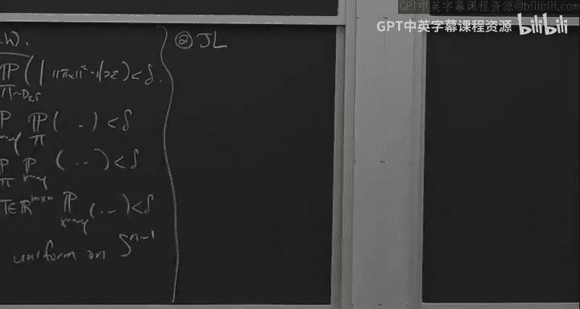

The way I wrote jail。So there exists， let's say。Let's say， a function。Mapping x to L2M。

And let me say that for all X。For all X， Y。An x， if you look at。F of x minus F of y。

This is equal to 1 plus or minus epsilon。s了 me。Okay， so with jail。

 the original statement of jail and their paper looked like this。For all， for all subset of L2。

 there's a function which maps that subset into M dimensional space that preserves distances。

 It just so happens that。You know， when you prove jail。That function F is linear。

 because how do you prove JL， well the ways that we know how to prove jailL right now use DJL。

 and DJL gives you a linear map。Right， but you could。You know， if you're happy to have any map。

 then you can stay jail this way， and the proof happens to give you a linear map。So jail。You know。

 let's say that。You insist。On F。

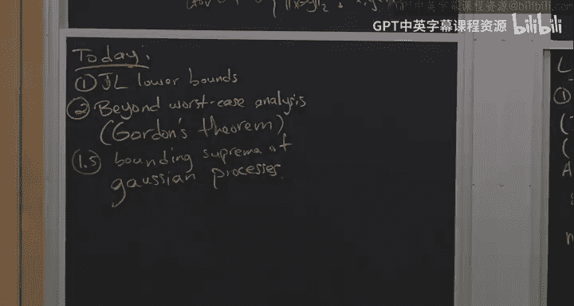

Being a linear map。F of X。Is Px or some pie？Okay， let's suppose you insist on that。

 Then there's a lower bound。 Let me just mention。Yeah， the difference between JL and DJL。

 DJL have to pick pi independently of the point set and has to work with high probability。

 JL F is allowed to depend on the point set for all point sets， there exist in F right。

 So you're allowed to look at the point set and then come up with the best F you can for that point set。

It just so happens that the proofs of jail we have now don't do that。But you are allowed to do that。

So if you insist on that being linear。嗯。Then I have some work with Casper Green Larson。呃在。

Archive to manuscript， it says that。M has to be at least the min of n。

And one of Epsilon squared log in。Okay。So there is a hard point set。

 There is a point set that any linear map， which preserves it， needs at least this many dimensions。

hich is， which is tight because you can always achieve that with the identity matrix。

 and this you can achieve with jail。Okay。And you know。

 we're going to actually revise our manuscript so to have a different proof。

 but now that you know this， actually， there's a quite simple proof of this fact。

Which basically goes as follows。嗯。If we're going be via the probabilistic method。

 we're going to show that there exists a hard set of vectors。Well， how do you do that？

We know that from here， if you take a fixed matrix。A fixed linear map。

The probability that it preserves， if it doesn't have enough rows。

 it's not going to preserve a random Gaussian vector with high probability。Okay。

So the hard set here is basically take like a bunch of random Gaussian vectors。

And you want to preserve all their distances， even their distances to 0。

 You want to preserve their norms。Well。This matrix doesn't even preserve one of them with good probability。

 The fact that it preserves all of them is quite small。

 And then you basically do a union bound over all matrices pi to say no pi works。

There's a little hitch there， which is that they're an infinite number of pies。

So what you do is you take a net over all the pies and you argue that no pi in that net in that finite network。

And then you use that to imply that if no pi in the networks， then no pi at all works。Okay， good。

A lower bound for jail if you insist on F being a linear map。

 What about if you don't have any requirement on F。 And that' that's what I'm going to show today。

 So3。Thiss JL。F can be anything。And then no go alone。Showed in 2003。

That M has to be at least the min of n。And one over epsilon squared log n。Over log。One over epsilon。

So。There's an open problem here， and the open problem is basically remove this。

So open is remove this。We this log went up。Yeah。3子由你就。D见。没。In we actually look at。Yeah， so yeah。

 that's， that is the difference。 So in in DJL， first of all。

 DJL isn't even about a collection of vectors。 DJL is。

I just want open with a distribution that works for any fixed vector with high probability。 J L is。

Or you know J， I guess is a lelemma that answers the following question。 So the question is。

 I give you a set of vectors。Reduce them to the lowest dimension you can while preserving their distances up to one false epsilon。

The GLMma provides a solution to that problem。And it provides solution to that problem where the target dimension is this one of Repsson squared long capital line。

And it happens to provide it with an embedding that's linear。Okay。

 but you could ask that dimensionality reduction question without insisting that the solution be a linear map。

And to this day， no one knows how to take advantage of that。But conceivably。

 you could take advantage of using non nonlinear maps to do better than JL。

 You're not going to do much better because there's a lower bound， but potentially。

 you could save something。And we're gonna， I'm gonna prove this little around for you。

 It's actually quite a。Short proof。嗯。There's an open problem to remove that。So。

A lo lower bound goes something else like this follows。

So it's based on something that you've already seen。 I believe， in Pet。Maybe one or two。

 I think these at one， which is incoherent vectors。

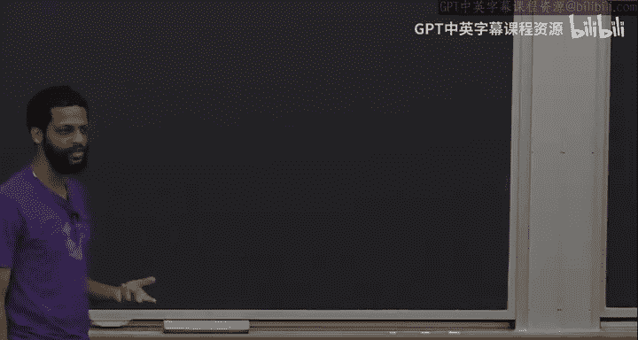

Okay。So。

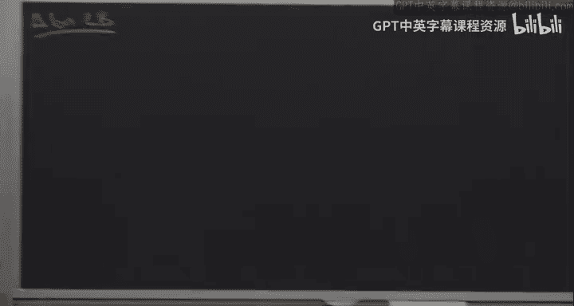

Suppose。In jail， suppose you X there。Is 0 E1 up to E。

So it's zero as well as the standard basis vectors。Okay。And。🤧。Kind of distances are invariant。

Under translation， right？If I， if I have an embedding。

 and then I just translate all those vectors by the same amount。Then the distances stay the same。

 So without loss of generality。F of0， zero。Let translate everything by f of 0。And also right。F of。

FEI is VI。对。So， this implies that。F。Acts as this matrix。V1。The end。Onex。O。

 what can you tell me about these Vs。First of all， what are you tell about the norm of the eye？

Right so remember I have to preserve distances between these pairs of points。 So in particular。

 I have to preserve distances to 0。Right。What is？What is the you know what is？

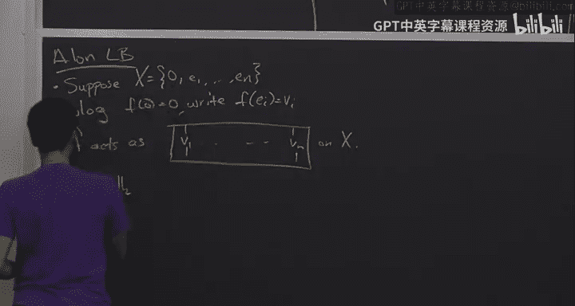

What is F of EI minus f of 0？That's just VI。Right， I translated everything since F of 0， 0。

 This is just V I。But we said that the norm of f of x minus f y has to be roughly the norm of x x minus y。

 So this thing。has to be roughly the norm of EI， which is one， right？

So this thing is one plus or minus epsilon。Okay。Also， for all I not equal to J。If you look at。

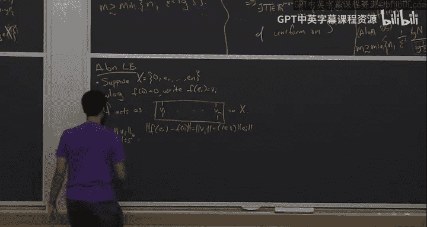

VI minus Vj L2 norm squared。Just remember， the L2 norm squared of a vector is that vector dotted with itself。

😡，So if you expand that out， this thing is equal to V squared plus Vj squared。

Minus twice the dot product of VI and VJ。But。VI minus VJ should have roughly the same norm as E I minus E J。

 That's the J I'll guarantee。So this right here is2 plus or minus epsilon。Right。

This right here is one plus or minus epsilon， This right here is one plus or minus epsilon。嗯。So。

 that implies that。The dot product V。 VJ， if you move things around。

 cancel this one plus one with that two and divide the two， this dot product is O of epsilon。Right。

 so basically， any embedding。The number of rows of this matrix is exactly M where F。

Is mapping from X into L to M， right？So when the number of vectors is n。

 So what this is telling us is。If you have an embedding for this set of vectors。

 this is going to be our hard set。 If you have an embedding for this hard set of vectors。

 then it implies that you have a set of incoherent vectors。That all have roughly unit norm。😡。

And whose dot products are all roughly epsilon。Okay， and， in fact。We can do this set。

WI to be VI over the norm of VI。This implies that。For all IWIs1。And also， for all I not equal to J。

 we still have that。WI。That doesn't。Absolent。Okay。So this is exactly the definition of incoherence you saw earlier in the course when we're talking about deterministic point query and deterministic heavy hitters and on your Pet。

So all we need to show is that you can't have。You can't have too many incoherent vectors in low dimension。

 It's just not possible。That would give a lower bound。

 That would say that if you want to have lots of incoherent vectors， if you want have n of them。

 then your dimension has to be large。RightThat's what we're going to show。So call this matrix pi。

 this is our jail matrix for the simplex。

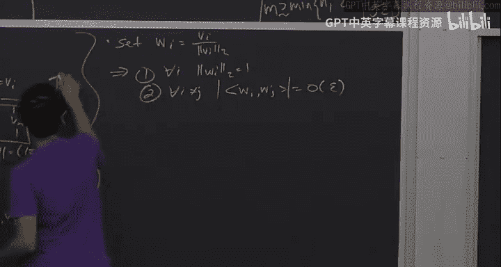

Define。A。ItTo be pi transpoposed pi。Okay。Notice that。The rank。Of A， is that most M？

What does A look like， by the way？😡，It's an end by N matrix。The diagonals。

 every entry is just the dot product WY dot WJ。Well， actually， I shouldn'。 I shouldn't say pi， so。

This is。Theres the pi with the WIs。So。Let me right like this。So。Pi is this matrix。W1 up to W1。

So pi transpose pi H entry is some WY dot WJ， so the diagonals are all one。

And everything that's off the diagonal is plus minus epsilon。 So it's like an almost identity matrix。

And then what alone says。Is that。Any real symmetric？A。Which。Is epsilon near to the identity？

By Epsilon mirror， I mean looks like this。Must have。It's rank。Being at least。The men。

what of Epson squared。Log and。We're log when wraps on。That's really how the loan lower band goes。

 yeah， question。Why is the rankless than M？嗯。Right。And。O of a。So， right， So what do we have。

 We have that。A is equal to pi transpose pi。Right， which is equal to。HowShould I write this？😔。

Some of row。So in general， whenever you have a transpose B。It's equal to the sum over I， AI。

 B transpose。Where A looks something like。A1。A 2， et cetera。 And B looks like。B1， B2， et cetera。

 right？嗯。So。Let's call these rows。Pi 1 up to pi m。Then this thing is equal to the sum I goes from1 to M。

Of pi I， pi I transport。Right， so we've just decomposed it into a sum of M rank1 matrices。

 So it's rank。 is is that most time。Okay， good。 So that's a。 that's what we're gonna to prove。

 Before we prove it， we're going to need a weaker version of thelemma。 And then we're gonna， yeah。

 question。Okay。Yeah。Yeah， so that's the beauty of this hardet X。NEF， any F for this x。

Automatically implies a linear F for this x。By this trick， right， whatever F you give me。

Translate all the embedded vectors so that F of 0 is 0。

 Just subtract F of 0 from every vector in the image of F。

Now that doesn't change anything about the distances。

And then now just define a matrix whose I column is exactly F of EI。😡，Then this matrix acts on x。

 exactly as F did。Yeah。So I mean， in general， whenever your hard set of vectors。

Is linearly independent？You can create without loss of generality， you can assume F is linear。

So a alone's hard set is a linearly independent set。Okay。So， before we approve。A loans thing here。

 We're gonna approve。 this is how he did it。 So we're gonna approve alone。Alone minus， okay？

Which is pre alone。Okay。Which says that。Any。Real。And symmetric。诶。Which is。One over root end。Near。

The identity。Must have。Rannk R， which is at least omega M。对。So we're first going to prove that。

 and then we're going to show that we can then kind of bootstrap from this and get the real thing that we care about。

So let's prove this。So whenever you have a real symmetric matrix。

 you can diagonalize it and you have eigenvalues。So you have real liigenvalue。Lambda one。Lambda N。

These the eigenvalues。And actually， let me just even say lambda R。Be the non zero。Rs the rank here。

 nonze eigenvalues of A。Now。On the one hand， we have that。The sum。Of lambda i squared。

 I goes from 1 to R。So what's one way you could calculate this？So， maybe。Maybe I should just say it。

 I don't know if people are maybe this linear algebra is not on the top of your fingertips， but。

So the sum of lambda i squares is always equal to the Frbenous norm of the matrix。

The sum of the squared entries of the matrix。Okay。So this is just a linear algebra effect。嗯。Well。

 it'll follow from something we'll see on the next line， okay。So this thing is equal to， well。

 what is the from norm squared， All the diagonal entries give you n。

 they give you one each their n of them， and then there are n times n -1 off diagonals that each give you at most epsilon。

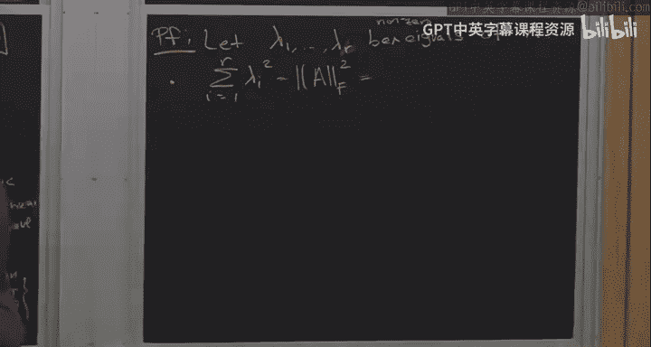

So this is at most。N plus n times。N times n minus1。Epsilon squared。Okay。The next thing is。

 if you look at the sum， let me write it this way， the sum over i from1 to R of lambda I。Okay。Then。

By Koshi Schwartz。First of all， what is the sum of Lambda I？😡，Another linear algebra fact， right。

 This is just the trace of a。Is equal to the trace of a， which is equal to n。

And this thing by Koshi Schwartz is at most root times the sum of lambda I squared to the12。Right。

in general， the sum of AI B is at most the L2 norm of a times the L2 norm of B。So AI is lambda I。

 B is1。 Duohi Schwartz。And then now square all sides。😡，And then divide through by R。

 this implies that。😡，Some of lambda I squared。I goes from1 to R is at least n squared over R。

And then now you just move things around。Okay。So。You have that some of lambda I squared is at most that。

 and it's at least that that implies that n squared over R is at most。N plus N， n -1。

Epsilon squared divide the ends。This implies that R。Is that least？N over。

1 plus n minus1 epsilon squared。But for me now， what was Epsilon， Epsilon was one of a Ru end。

So one over root n squared is1 over n， so this is just omega n。Because Epsilon was one of a root。

Right， so。ButThe way to see this also is the 3D storm squared is just the trace of a transpose a。

And the eigenvalues of a transpose a are just the old eigenvalues squared。So anyway。Okay good。

 so we have a alone minus， and now we want to get the true lower bound over here。

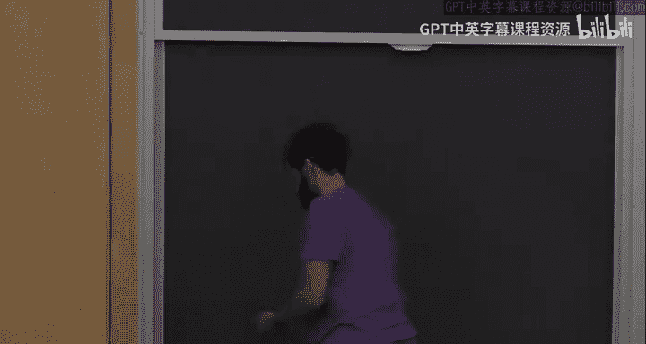

So now I want to prove this thing。

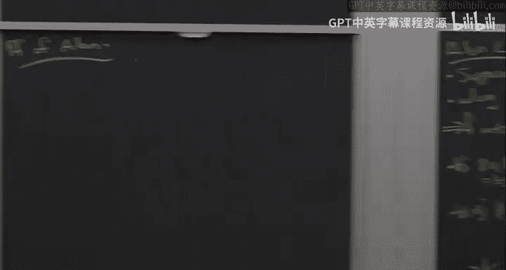

So。This is what we're going to do。嗯。So take define。Let's call it AK。To be the matrix。Where。AK。

IJ is just AIJ。The case power。 We're not taking the matrix to the cavefe power。 We're entry wise。

 We're taking every entry of the cave power。Claim。If the original matrix A had ranked R。😡，Then。

A to the K， the rank。Of AK。It's going to be at most r plus k minus1 choose k or something。Maybe K -1。

Yeah。对。So what are we going to do？OurRA A is epsilon near the identity。

 All all the entries off the di lot most epsilon。If we raise。Epsilon to a sufficiently large power。

Then all the entries would be less than one of a rootan。

Which will imply that the rank of that resulting matrix is omega n。Right。

Let me defer the proof of this claim， and let's just see what this claim gives us。Choose。

K to be something like the ceiling of log base one over epsilon of Ru N。

Which is basically something like。One half log n over log one over uppsilon。

Up up to an additive one or something because of the ceiling。Okay。Then。

Then epsilon to the K is at most one of root n。That's why I chose that K。That implies。

RightThe fact that now this is a one of a root in your identity matrix implies that， well。

 what's the rank of this matrix， The rank of this matrix is at most that。

 That implies that R plus K -1 choose K。has to be at least some constant times n。

That's that's what alone minus gave us。And then you basically just calculate， I mean， from here。

 it's。Straightfor。So now you just say， well。You know。

 you always have a fact because you always have that。And she was Kas at most。E over k to the K。

 this is just a useful estimate to keep in mind， and it's always like at least n over K to the K。

So we're going to use the upper bound。 This thing is at most that。 So we have is that。

E R plus k minus1 over k。To the K is at least some constant times n。Take logs of both sides。

And then you get that。K log。E plus k minus1 over k is going to equal to log of CN。谁。And then。

I I'll leave it to you as an exercise。 This is， this is basically now just a bunch of calculations。

 Okay， so remember what K is and then move things around， yeah。All right。

 so that's a claim which we're going to prove right now。😡，Yeah， so。

RightSo this is a claim we're trying to improve right now。 And then given that this claim is true。

We can complete the proof of a loan lower bound。Yeah。So now we just need to prove the claim。

That' just going to prove So we're all on the same page， sorry。

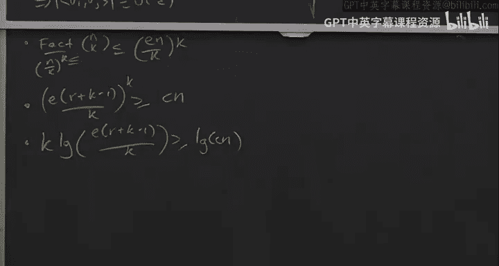

He so。So say that a， the rows of A。R a1。To A。And let。Let's call them。T1 up to T R。Be a basis。

For the row space。对。Which implies that。For all I， there exists some alpha。An RR such that。

AI is equal to the sum。J goes from1 to R， let me say。Let's say  Q goes from1 to R， alpha Q。

So every row is a linear combination of the basis for this row space。So。What happens when we take A？

what happens when we do this K operation on A？😡，Right。

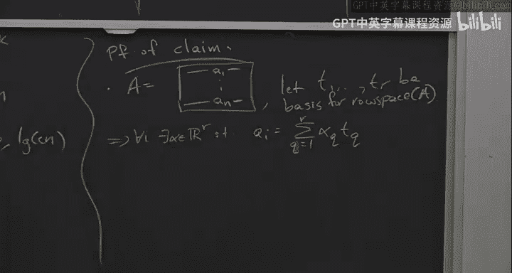

So。AK。IJ is just equal to AI to the J。Or to the K。It's equal to AI J to the K。Cen。

Let me make sure this is。Psable， so take the vector AI， look at a JF entry， raise that to the K。

Which means take the Jth entry of this vector。And raise that to the K。

 so this is equal to the sum overq of alpha Q Tq J raised to the K power。

And then just expand this thing out。 right， Imagine now writing this as a sum of lots of monoomials。

Oh yeah，And what' does this thing look like。This thing basically looks like。

So when you expand this out to the Ca power。You're going to have some Q1， Q2 up to QK。

 and you're going to have a product of a bunch of alpha Qs and then a product of a bunch of TQJs。

Right。So this is going to look like。A sum。Over。Let's call it。Q1。Up to Q K。Product。Z goes from1 to k。

Alpha Q Z。Times a product。Of TQZ。J。To the K。No， not。对。And then now imagine grouping。😡。

The Q's together that are equal， right， So it might happen that Q1 is equal to Q3 is equal to  Q 7 or something。

 Imagine grouping them。Keeping the ones that are equal。So we can sum over。

How many distinct cues are in a particular monoial？😡，So some over y goes from1 to k。

 y is the number of distinct cues。And then the sum over。

 let's say Q1 is less than Q2 is less than QY。Here you'll have some multinoial。

 That's also some over。Some over how many of each we take。So some over D1 up toy。

Such that d1 plus dy is equal to K， and for all Z， Dz is at least one。Basically。

 these are the exponents of the Q's， how many times did we take each Q。

 and then there's some multinoial coefficient， which is K choose D1 up to Dz。Times。

Some product of some alphas。Times of product of。Ts。Okay。So。Don't worry about， you know， I mean。

 the point is I just， I'm just summing over like all possibilities for how many of each queue there are。

谁。And then the takeaway is this。Part right here。So。Create a collection of vectors。T1。S2， et cetera。

Whose injuries？Look like。So these are going to be the same dimension。

 They're going to be n dimensional vectors， just like the T's were。Their injuries look like。You know。

 like that， basically， the product。This goes from z goes1 to Y， sorry。

The product z goes from one to y。Of。T Qzy。J。Or this is now one to the DZ。Product。T Q Z。2 to the D Z。

Et cetera。Look at all vectors that look like this。😡，Okay。What we just showed is that。Any row。

 basically any I row， any row of this k power， not quite power， but K thinkingy operation on a。😡。

Is a linear combination of vectors that look like this。😡，some。

 there's some coefficients that depend on multinomial coefficients and products of alphas and whatever。

But they're all linear combinations of vectors that look like this。

such that the sum of the disease is exactly equal to K。

So now the question is just how many vectors are there that look like this？

So I claim that the answer is r plus k minus1 choose k。Okay， and。If you haven't seen this before。

Ptty simple argument， I'll show it to you。It's just a objectiveive argument。

People sometimes call it stars and bars， at least I think that's what。

when I saw it in my discrete math class， that's what our professor called it。

So the basic idea is as follows。Imagine having K zeros。And then now。

 imagine putting dividers between the zeros。 So imagine having。R plus。K， let's say， R -1。Dividders。

Okay。So I'll put a divider here， and I can put the dividers wherever I want。

I can also put a divider at the beginning。呃。Like this something like。Let's say there are 1 dividers。

And by a divider， I just mean a 1。Okay。Everything to the left。😡，Basically。

The number of zeros to the left of the first divider tells you the power that I'm going to give to T1。

😡，So this is gonna to be like。I'm raising T1 to the number of zeros。

And here's like I'm raising T2 to the number of zero。Et cetera。Right。

 so what this sum is doing is it's asking， how many ways are there to choose。Basically。

 all the powers of these Ts so that they sum up to K。

And that's exactly in by objectiveive correspondence with。

The number of ways of writing down these zeros and dividers。But how many ways are there？

This is just the binary string。😡，Which has。嗯。A total of K plus r -1 digits。

And then you have to choose which of those digits are zeros and which ones are ones。

So you have to choose k of them to be zeros， and the rest will be ones。

 So that's exactly R plus k minus-1 choose k。Okay。So that's basically， that's it。Okay， so。Good。

That's it for jail lower bounds。And now let's move on to beyond worst case analysis。 Right。

 So remember， a alone lower bound。 Yeah， question。After you get this claim。

Because we have a lo minus， right， which tells us that， well， I era it。 But oh， no， there it is。

 A lo minus tells us that if Epsilon， were're actually one of a root end。

So all the off diagonals are one of a Ro end， then the rank has to be linear。

So what we're doing is we're taking our original matrix， the off diagonals aren't one of a root end。

 but they're epsilon。And we're just entry wise powering this matrix。

Until it's below whenever root end。And then now the resulting matrix must have rank linear。

But the question is， what's the rank of the resulting matrix？If the original matrix had rank R。

 the resulting matrix has rank at most this。😡，Therefore， this must be at least n。

So this is at least n that gives us a lower bound on R。😡，So that's the truth。So we're done with。

A jail lower bound， but remember this is a worst case lower bound。This is telling us that。

There exists a hard set of vectors。😡，But maybe， as I said in the beginning of lecture。

 maybe the vectors that are in front of me aren't so hard。

So can I get some better worst case understanding？Theyre beyond worst case understanding。

 like instance wise， good bands。So。嗯。So let me reformulate。We're given。Some T。

 which is a subset of the unit sphere。For example， t is the set of all vectors x minus y normalized a norm。

Like in jail。We want that for all X and T。呃。Pi x L2or squared minus1。Is less than upset。

That's what we want。嗯。And maybe what we want is， you know。Basically。

 pi is random so that the probability over pi。From some distribution that the soup over X and T。

Of pi x squared。in-1 bigger than epsilon is less than Delta or less than something。So。

So we're going to do exactly that。 and make sure I say the correct reference。So theorem。

And the original。Paper was due to Gordon back in '88。Okay。

But then there have been subsequent improvements， so there's Clarktgg and Mendelson。5。

 and there was also Mendelson。Ajo。And Tom Jackck Ygerman。

08 and there's also you can see a paper by Dirken。14。Okay。Which says that。Suppose。

So these usually I usually refer to this as Gordon's theorem。

 people say Gordon's escape through the mesh theorem。It says， suppose。H，IJ。

Is plus minus1 over a root M。Okay， so like the same kinds of gel matrices we were looking at before。

In fact。Even jail， as we described before， like we used the Hanen right in equalityality right。

 which I proved for signs。 But it turns out there are references。 So， for example。

 if you look in the lecture notes， there's a reference to a paper by。Rttleson inversion in。

 but there are all other analyses as well that says you don't even need signs。

 You just need any distribution that decays at least as fast as a Gaussian has mean0 in variance 1。

Okay， if you take dot distribution divided by root M， it'll give you distributional jail。

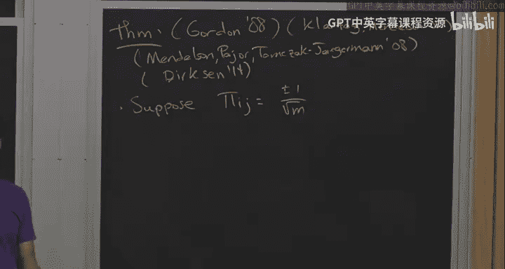

So when I say decays at least as fast the Gaussian， signs do that because signs have awesome tales。

 The probability that a random sign is bigger than 2 is 0， right， So they decay like super well。😊，嗯。

Let's just write down for signs， that。You have pi J being this， and you have M being at least。

 let me write it down， then I'll tell you what it means G squared of T plus1 over epsilon squared。

 Actually， let me write。Plus log1 over deelta。Over epsilon squared。Okay， then。Starhols。Okay。

So if you want to preserve all the vectors in T。It's enough for M to have this number of rows。

What is G squared of T？Definition。The Gausian mean with。GFT。Is defined to be。

The expectation of our Gaussian vector of the soup X and T。Of G dot X。Okay。So。For example。

 if all the vectors in T are orthogonal vectors。So， G。Jesus， the vector of independent Gausians。

 They all have mean 0 in variance 1。Does it get a feel for things。

 supposeose your set T look like this， you add the standard basis of vectors。Right。

Then G1 dot this X is just G G dot E1 is just G1。 G dot E2 is just G2， et cetera。 So you're asking。

 what's the max of G1， G2 up to G N。Okay。The max of those Gaussians you can prove is root log N。对。

So we'll see this in a second。 I'll do something more formal in a second。In that case。

 you'll get root log n， and then G squared becomes log n。So basically， this thing is always。

 it's never worse than jail。It always says you never need more than log T dimensions to embed T。

Just like jailman say。But if your vectors are nice。😡，For example。

Imagine T just looked like vectors that are all basically pointing in almost the same direction。

Then if you take G dot this vector and G dot， that vector。😡，They're actually heavily correlated。

And you can， and you can say like， you know， the max of G dot these xs is gonna be a constant。

 And then you can get away with better dimension。I mean。

A trivial example is imagine T is a multi set with just the same vector over and over again。

Then the super reant t of G dot X is just G dot， whatever that vector is。

Right and and the expectation of G dot， that vector is 0。

So this just says0 plus log and relative reps on squared， so it doesn't even depend on the size。

So the more clustered， the more well clustered your vectors are。

 the better dimension you can get away with。So this is a beyond worst case kind of statement。

 It's the answer depends on T。 If T is nice， you do better。Let's just make this。嗯。

Let me just give you a little feel for things， so claim。For all T substantive unit vectors。GFT。

Is that most？Squa root up to a constant， square root log n。Where n is the size of T。Okay。Purf。Define。

 okay， so let's say t is the set of vectors x1 up to x。Capital F。Define。

ZI to be the dot product of G with Xi。Right。

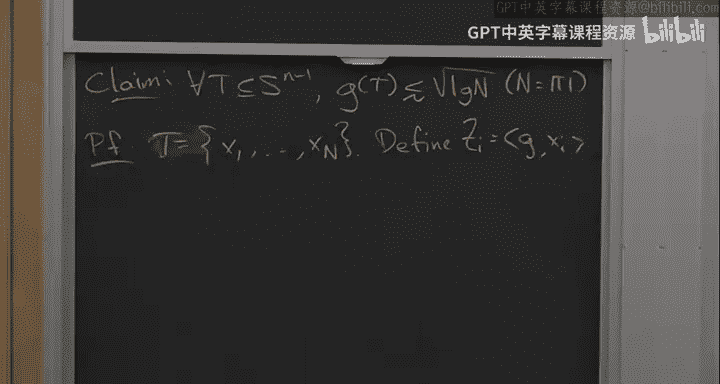

So， GFT。GFT is the max。Of Z1 up to Z。我是。A G is a vector of Gaussians。

So T T is a subset of vectors in R N， And G here is a vector of Gaussians G1 up to GN。

Independent Gaussians， a variance one means zero variance one。

So GFT is the expectation over G of the max of these things。In general。嗯。Well。

 let's actually just write。Let me actually even just put absolute values here。

So these are all non negative。 So GFT is at most this。Right。

And whenever you have the expectation of a non negative random variable。

 it's the integral of the tail bound， right， The expectation of Z of Z is non negative is is the integral of the problem that Z is bigger than U D U。

So this is equal to the probability or the integral。From0 to infinity， the probability。Over G。

That this max。Z1 up to Zn。I's bigger than UDU。Let me break this integral up into two pieces。

 this is at most this is equal to。The integral from zero to log n。Of the probability。Plus。

 the integral from。Root log in。To infinity of that probability。

Probabilities are never bigger than one。😡，So this problem there's DU。

So this probability is at most one。 So we're integrating something that's at most one up to root log n。

 So this thing is at most root log n。Okay。Also by a union bound。

A probability that the problem- so what does it mean that the max is bigger than you？😡，It means that。

For all， for all I， the I is let's see。 So the problem the max is bigger than you。Means that。Oh。

 actually， and I should。No， this is fine。So， this is equal to。The probability that。呃。

There exists in I。Such that。ZI is。And the problem that there exists in eye is at most。

 the sum over eye。By a union bound。This is at most。

The sum of I probability that ZI is bigger than you。So， this whole thing。

Is at most n times e to the minus u squared over 2。This is how a Gaussian taildown behaves。

And because we started our integration at Ro log In。嗯。

Uns even put it as square root of 2 log n or something。

To basically kill this n E to the minus squared root2 log n squared over 2。Is one over n。

 which kills that n。So this whole thing overall is root log n plus a constant， so。

This whole thing is。Ro log in。So this thing is always at least as good as jail， but it can be better。

Question。This。So。嗯。So this probability， probability that the max is bigger than you is to say that that there exists in I。

 such that ZI is bigger than you。😡，Right， and that means that， you know， either， you know。

 it's problem that Z1 is bigger than U or Z2 is bigger than U or Z3 is bigger than U， et cetera。

And the probability of a bunch of ors at most of some of the probabilities by union bound。

And the problem is that ZI is bigger than you， well ZI， what is ZI？😡，ZI is G dot X。

But if you take a Gaussian dot with a fixed vector， it's a Gaussian。Right。

 and it's a Gaussian of variance， the square number of x， which is one。

So what's the probability that Gaussian is bigger than you。

 It's basically something like e to the minus U squared， roughly。So。

 and there are n things that were summing up， capital n things。

 So this probability is at most capital n times e to the minus u squared。And then you integrate it。

Or you。Which is again， something like e the minus u squared。Okay， so。Long story short。

This thing is always， it's never worse than jail。 It's always at least as good as jail because you can always get this to be at most law capital end。

But for some points， since it's better。So now let me say a little bit about 1。5。

I'll inject something into the notes， but I don't want to spend。Too much time。On it in class。

 I'll just give you a little taste of it。I want to understand some way of writing GFT。

 or is there an equivalent formulation of GFT？So you can come up with various upper bounds。Yeah。

So now let's do 1。5 over there。So this is how to bound。GFT。And。So。You know， one possibility。

I going take one， let's say。Is just to say GFT。Is that most square log and the size of T？Like this。

Square root law log to the one half of the size of two。Right。That's what we just proved。

 it's never bigger than that。Take two。

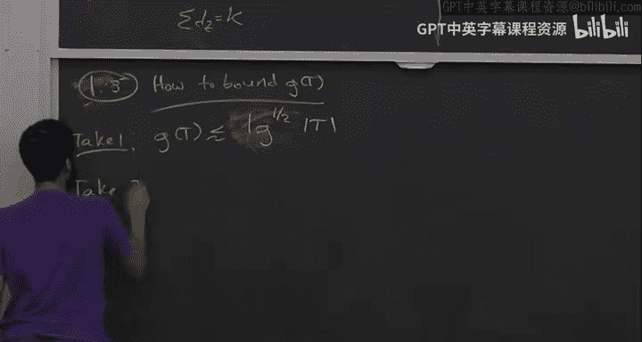

Let T prime。Subet of T be such that。For all x and T， there existent x prime and t prime。With。

X minus x prime is at most epsilon。Suppose we had such a T prime。This implies that G of。G dot X。

Is equal to G dot。X prime plus x minus x prime。I just added 0 in a funny way， which is equal to。

Which is equal to G dot x prime plus G dot x minus x prime。

And this thing is certainly at most the normal。 When you take the do product of two vectors。

 it's at most the product of their norms。 This is at most epsilon， Epsilon times the normal G。Jrry。

Which implies that。GFT。Is that most？GFT prime。Plus。

 epsilon times the expectation of the altinum of G。Right。But this thing here。Is that most？

So in general， the expectation of is most the expectation of z squared square root。

 so this is at most the expectation of G squared square root。What's this expectation？

What's the inside expectation here？This is G1 squared plus G2 squared plus dot dot plus GN squared。

The expectation of G squared is one。So this inside here is little n of the dimension。

So this is Ru end。So this is。Equal to GFT prime。Plus， Epsilon Ro end。

So another way to get a bound on GF T is to take a very good， a very fine net。

 an epsilon net of T called that T prime by a net。 I mean， a set of vectors such that everyone。

Everyone is close to it。不。And then we get this bound。

 why is this good because if the vectors in T are very well clustered if they're all you know they're inal vectors。

 but maybe they're all like really near each other。😡。

Then there's a small T prime that covers everyone。So， instead of paying。And so here now， and finally。

 what we can say is this thing， this thing here is at most。Root log。The size of t prime。Plus Epsilon。

Because in general， GFT is never bigger than root log T。So if the vectors in T are well clustered。

The size of T prime is way less than the size of T。😡，So this is better。

 and we need to just drive epsilon to be small enough。

 Take a fine enough net such that this term doesn't matter。That's another way to go about things。

And let me write two more ways to go about to you。 So these are gonna be progressively better and better ways of。

Of。Bounding GFT。Until we get to。The best way。So take three。Is basically take  two， but just with。

Slightly better。slightlylightly more sophisticated thing， which is。Take。T0， subset T1， subset T2。

Some said tea。Such that。TR。Is1 over2 to the R net？Of tea。And right that x is equal to。X。Zero plus。

X1 minus x0。Plus x2 minus x1。说是。Write an infinite sum。And this thing telescopes。

 and eventually you just get X。So， this implies。That GFT。Is that most？The expectation of。G dot x0。

Well， let' me write it like this。This is this guy is in T0， this guys in T1， et cetera。

This is the most GFT0。Plus。Which is that most root long the size of T0？Plus。The sun。

R goes from one to infinity。Of root log。So question。How many。

 how many possible difference vectors are there， X1 minus x0。Right。

G of the soup over all x0s and t 0 of G dot x 0 is at most root log the size of t 0。

The root long the number of possible vectors that can be here。

How many possible vectors could be here in this difference？It's the size of T1 times the size of T0。

 right。How many different vectors are there of this form， It's the product in the two set sizes。

So log root log， the size of。T R times T R -1。对。And by the triular inequality。😡。

What's the norm of this vector？What's the norm of the vector？😡，X R minus X R -1。Well。

 by trying rank quality， it's at most Xr minus x。Plus xr minus1 minus x。

This is that most1 over two to the R， This is that most one over2 to the R -1。

So this is at most three over2 to the R minus1。Or this is the same thing as saying6 over2 theR or something like that。

So I can put a six over2 VR here。So in general， I guess what I should say is really， in general。

What you really can get is GFT as at most。The radius of tea。Times。The norm of。

Times along the size of T。So this statement follows from the same calculations here。Right。I mean。

 just think about it。 So if you have a set of unit norm vector。

 if you have a set of vectors whose L2 norms are all at most alpha。

Just scale all the vectors by one over alpha。😡，Right。So now they all have unit norm。

And this tells us that。Their mean with will be at most root log the number of vectors。So if you。

 if you did the， if you unscale by the one over alpha， you get alpha times root log。 So in general。

 if all the vectors have nor atmost alpha， then G of Ts at most alpha times root log。

And all these vectors here， all these vectors of the form X R minus X R -1 have norm at most 6 over2 to the R so we can get this。

And notice also that the size of of an of a。Carser net is smaller than the size of a finer net。

So the size of tR minus1 is at most the size of TR。

 so this thing here is at most the size of TR squared。

But log of something squared is that most twice log。So up to a constant， know， this thing is at most。

This thing is at most root two times square root log。Of the size of Tr。Okay so。嗯。

So that implies that。GFT。Is at most a sort constant。Kind of the sum R goes from0 to infinity。

1 over two to the R times root log。The size of here。And this is often written as。

Some argue goes from  zero to infinity，1 over2 to the r times。Root log。

I'll defineine this in a second T L2。Whatever two you are。

So this number n is basically what n just is what's the size of the best epsilon net？😡。

For that point set under this metric。 So this means what's the size of the best one over2 to the Rnet for T under the L2 metric。

That's just the size of TR。And often this is written， this is bounded by an integral。

 the integral from 0 to infinity of root log。TL2 UDU。This is usually called dumies inequality。

So this take three。And I'll just write， take four without actually proving it。

 but I'll put the proof in the notes in case you're curious。嗯。So take four。Right。嗯。

S0 subset of S1 subset of V subset of。S， F SO T。Such that。

The size of S0 is 1 and the size of SR is at most2 to the2 of VR。And define。Okay， then。And show。

That the deadly bound take three。Is the same up to a constant factor is theta of the in。Overall。

 sequences SR is satisfying this thing you hear。Okay。So， you can prove。That。This bound here。

Is up to a constant equivalent。So this bound here。Okay。I'm not going to prove it for you。😡。

But the basic idea is。Here。I wanted a two to the R net。

 So this R and dot R are basically not the same。 So maybe so that it's not confusing。

 Let me say the sum from S goes from 0 to infinitefin。So here。For each R。

 I insist on having a one over two to the R net， and I want you to make the net as small as possible。

😡，Here， it's sort of just an inverted way of looking at it。😡。

I tell you the size of the net that I'm allowing you。😡。

So the SFnet is allowed to have at most two to 2DS points。And using this number of points。

 I want you to minimize this， right， I want you to choose。

 I want you to choose these Ss to minimize the maximum distance to each S。😡。

you want to minimize the soup over x of this， which means make capital S the best net you can make using two to two to low S points。

Right。And you can show that kind of these two formulations are equivalent。

And then take four is define something called gamma2。😡，To be the info over these Ss。

Of the soup over X。Of the sum2 of the S over 2 times the distance L2 from x。So basically。

 define yam would be the same thing but where you pull a soup outside。Okay。And。Theorem。

So the upper bound is due to。The lower bound is due to tall grind。

And the lower bound is due to forique。G ofT。For al T。

GFT is basically equal up to a constant to guarantee of T。

So take four is like the optimal way to bound G of T。So up to a constant factor。

 this thing exactly captures the mean width。Notice that this bound is potentially better than the Duly bound。

 because you always get an upper bound by moving the soup inside the soap。

So I'm not going to prove this， but I'll put the proof of the upper bound in the notes in a reference to the lower bound。

And then。The proof。Maybe I'll say a few words for， for this at the beginning of next lecture。

 The proof of。Of Gordon's theorem。There's a recent paper from this summer due to。こ吗。

Or might be spelling the name wrong。Maybe we should get out very soon， or not correct。

And the so tunnel。嗯。finalnal Katabi， I believe。

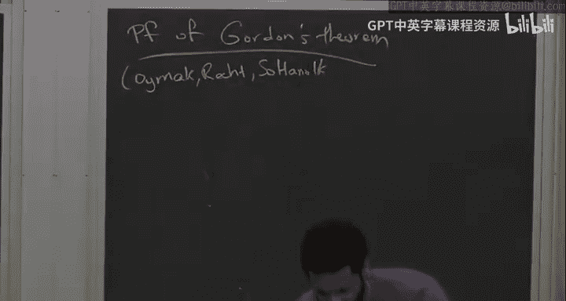

Which says。DJL。With the right parameters。Implies。Gord is there。

So we saw that Gordon's theorem implies jail because GFT is never bigger than log T。

What they showed is actually you can go the other way around。 If you have DJL。

 it implies Gordon's theorem。And basically， what they say is。You know， basically take。DJL。Where。

Epsilon Tilde is something like epsilon over gamma 2， some constant times gamma 2 of T。

Which implies that M just needs to be at least。Log whatever delta。Over epsilon tilde squared。

 which is g squared of t times log1 over delta。So they sort of do it in a black box way。

 they say that if you have a jail distribution with this error。With this kind of error。

It implies that you'll preserve all of tea。How many dimensions do you need to get。Well。

 this is gamma2 squared。How many dimensions do you need to get this kind of error。

 You need one over epsilon tlta squared times log1 over delta。

 So this implies that M needs to be log1 del over epsilon tta squared， which is this。

But by that theorem， tologram and Fique， we know gamma 2 and G are basically the same thing。

 so this is the same thing as G squared of t。Times log went Delta。Over rhpsilon squared。

And I'll say a few words about， I'll say like， you know。

 maybe five minutes of how they prove this in the beginning of next lecture。

 then we'll move on to something else。 But it's nice because it says that J and Gordon are basically equivalent。

Or DJL and Gordon are basically。Well， Gordon implies JL and DJL implies Gordon。嗯。

Its it's a slightly suboptimal result just because this time should really be a plus。

 We know that you can achieve a plus here， but they get with the times。And essentially。

 the way this works is。嗯。Look these these at this infinite collection of nets， these s's。

 you just need to preserve them at different scales。And。It implies that you preserve tea basically。

So。We'll see a little bit about that on Thursday。Anyway。And then we'll do something。呃。Else。

