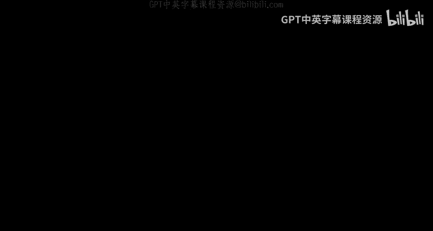
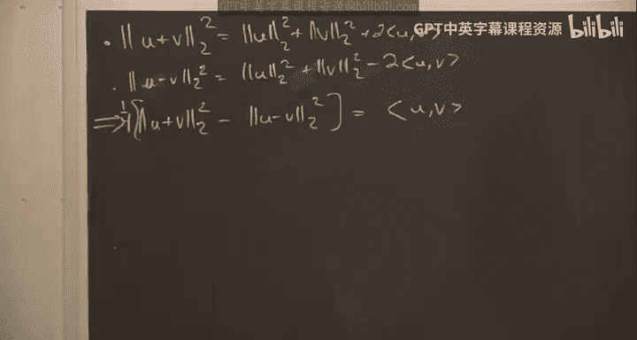
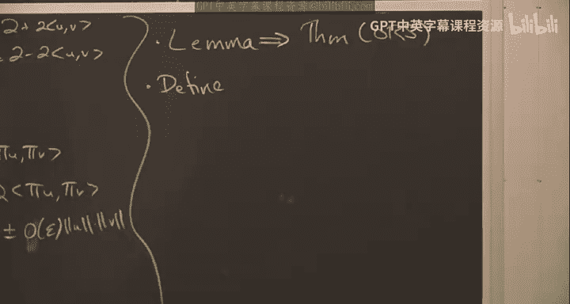
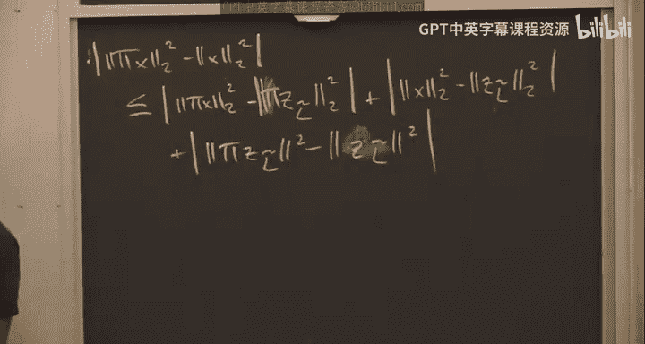

# 哈佛大学《大数据算法｜Harvard Algorithms for Big Data (COMPSCI 229r) 2016》deepseek - P13：-13-Algorithms for Big Data (COMPSCI 229r), Lecture 13.zh_en - GPT中英字幕课程资源 - BV1yGdNYvEMo

Let's get started。Let me just give a little recap of last time。So last time， first。

 we start off by showing lower bounds for for jail。 Okay。

 so we mentioned some lower bounds for distributional jail。 and then we gave。

The full proof for a alone's lower bound for JL itself， preserving a set of vectors。

And the thing about that jail lower bound， as it says。

There exists a set of vectors where you can't do much better than jail。Right。

And from there what we did was we moved into kind of beyond worst case analysis。So yes。

 I can' there exist hard sets of vectors that I can't do better than jail on by much。

But what about the data right in front of me， Maybe I can do better dimensionality reduction on this particular set of vectors。

Right， so how can I get kind of instance wise bounds。🤧嗯。And。

And we ended with a statement of Gordon's theorem。And before we talk about Gordon's theorem。

 we define certain things about soups of Gaussian processes， supreme of Gaussian processes。So。嗯。

So let's say T is a bounded subset of RN。There's something I defined。

 the definition is due to Toron of the gamma 2 functional of T with respect to a distance function D。

诶。Where， let me， actually。I should say something here。So， we have that。T zero is a something。对。

The size of t0。And this side。Okay。So。🤧。We define something called the gamma2 functional。

 which looks like this。It looks a lot like the Dudley bound that we mentioned。Okay。

 where basically you take this infinite sequence of nets where T R is a 1 over two to the R net。

And if that soup had been on the inside of the sum， it would have been exactly the deadly bound。

But it turns out that it's。Even if you pull the soup outside of the sum。

 you still get a meaningful functional。Is highlighted by that theorem。And here， kind of T R。

You can think of T R as being like a high quality net of the set of vectors T。Okay。

And instead of requiring that itd be like an epsilon net。 So usually when you talking about net。

 you talk about how well it approximates the points， right。

 And then you try and make the net as small as possible。Here it's sort of the inverse。

 I give you a budget on how many points you can put in the net。

 namely T A cans have size at most two to2 to V R。And。

One first pass attempt at processing this is given two to the two to the R points。

 what's the best quality net I can make of my points set？If you actually did that。

 you would get the Dudley bound where the soup is on in the inside of the sum。

But it turns out that even if you pull the soup outside， which is a potentially smaller quantity。

 this gamma2 is up to a constant equal to the Gaussian mean width of the set of vectors T。

So GFT is you take a random Gaussian vector。 the entries are。

Normal random variables means zero variance 1。 And you look at this expected soup of G dot X。

And the theorem is that this deterministic quantity is always up to a constant equal to this mean width。

对。So yeah， usually when people talk about an epsilon net with respect to a distance function B。

So an epsilon net is of some set of vectors T。 And what is an epsilon net of a set of vectors T。

 It's a subset of those vectors。Such as a subset T prime of those vectors， such that every X and T。

Is within epsilon under that distance of some vector and T prime。

Everyone in T should be close to someone in T prime。

 That's the usual net that people like to talk about。对啊。Yeah。When did we make that transition？Yeah。

 so。You talking about last lecture？So last lecture take one through take four。

 the different ways of bounding GFT。Yeah， so you're right。

So I'm going to assume from now on that T is finite。Okay， but if T， but even if T is infinite。

 then these things are you can， you can very smart。 So basically。

 the way to think about T being infinite is。Just imagine taking an epsilon net of T where Epsilon is like as small as you'd like。

And then apply this to， to that net， okay。Yeah。Right， so that's， yeah， that's true。

 Although when I start doing proofs， I'm going to assume that。Eventually。

 T R is just equal to T because T is finite。Yeah， we're going to work finite T。

 but even this extends to infinite T， basically by just。Yeah， like。Yeah。

 arbitrarily vacating T by as fine a net as you want。So if you remember。

 there was a take2 from last lecture where one of the ways we bounded GFT was just taking a net。

 just taking a single net Epsilon net， and then we got something like root log the size of that net。

 plus Epsilon root N。Right， so that epsilon root N can you can drive to be as small as you want by taking epsilon as small as you want。

 right， So what you would do is first take such a T prime with a really tiny epsilon。And then。

 you know， apply this to T prime。M T Pri is finite。Okay。And then there's okay。

 so that's a little recap on Ga Supreme of Gaussian processes。 And then Gordon's theorem。

 Gordon's theorem is a strengthening of jail。O。It says that let me highlight this I should have written。

First， so suppose t is a subset of the unit sphere。 So every vector in T has unit norm。O。

Then if you have a matrix with Gaussian entries properly normalized。

 where the number of rows of your matrix depends on the square of the Gaussian mean with over epsilon squared。

 then with good probability， I'm not focusing too much on the failure probability here with good probability you're gonna preserve every vector in T simultaneously the problem that there exists a vector T that you don't preserve as small。

That's Gordon's theorem。Okay。And what we saw last lecture was that Gordon's theorem implies JL。

Because the Gaussian mean width is never bigger than root log the size of the point set。

So Gordon's themeem implies JL and。There is a very nice recent paper that gives like the converse to that theorem as well。

 Actually， JL， distributional JL also implies Gordon's theorem。Which is not the usual way。

 I mean Gordons Theor was proven in the 80s。嗯。That's not how Gordon proved his theorem。

 And there have been subsequent。Papers as well that gave alternate proofs of Gordon's theorem with some stronger guarantees on the failure probability。

They work not just for Gaussian entries。 They work for random signs or other sub Gaussians。

 none of those。As far as I'm aware， none of those go through this way of。

Showing the converse that actually， all you really need is distributional jail。

 And that implies Gordon already。O。So I'm not， I'm going to give you kind of the beginning of the proof of this。

They're kind of a bunch of。Different things you have to bound at some point。

Once you see one or two of the things and how to bound them， the others are very similar。

 So I don't want to do it on the board， but I'll inject it into the notes。And then。

 and then we're gonna to move on to other jail related things。So questions。Yeah。

Vectctors an R N with norm one。Yeah， vectors an RN with norm1， that's right。So like S1 is the circle。

 and S2 is the sphere in three dimension。Yeah， that's right。Also。

 just to make sure we're on the same page with what DJL means。 So recap。On a definition。De satisfies。

You， epsilon Delta。DJL。也。For all x of unit norm。The probability that a random matrix coming from this distribution。

Fails to preserve。X。A top line is at most Delta。Actually， it's going to be useful for me to say。

So when we first talked about DJL， I guess， last week。

 we were really only concerned with Epsilon being less than one。Right。In the proof of， in the O。

 R S proof。嗯。You're going to start needing to care a little bit about epsilons that are bigger than one。

 so you replace the max of epsilon epson squared， you replace epsilon with the max of epsil of epsilon squared。

If Epsilon is bigger than one， epsilon squared is bigger。Just a minor technical detail。Okay， so。🤧看。

Just before I prove this。You know， just think about what this means for， say， a random sign matrix。

Okay。For a random sign matrix。We've seen before already that if pi I J。

Is a random sign signal IJ over root M。We get。Epsilon Delta， DJL。For M being something like。呃。

Log1 over deelta over epsilon squared， right？Here， I'm imagin Epsilon is less than one。

If Epsilon was bigger than one， you really only need to divide by Epsilon that followed from the Hanson right proof。

 okay。notice that log one over delta over epsilon squared。

Is the same thing as2 to the R log whenever delta。Over2 to the R over 2 epsilon squared。

 like for any R。喂。And by our definitions of Epsilon R and Delta R。This is at least。Log。

1 over Delta R。Over epsilon r squared。Right， so kind of subgausian。

Marices that have sub Gaussian entries， like random signs or Gaussians， etc cetera。 They satisfy。

 This is kind of like a multi scale。This is like a multi scale DJL， right。

 We want to satisfy DJL at multiple different scales simultaneously。Has Epsilon。

Epsilon R keeps getting increased as epsilon increases as R increases。

So we want to satisfy these different levels of DJL。But sub Gaussian maps basically do that for free。

Right， so what this is telling us is if you take a sub Gausian map。

And it just satisfies it for Epsilon Tilde and Delta。

Da it'll satisfy for all the epsilon until the R's and Delta R's as well， just because of that。So。

 question。If you have a sub Gaussian map。And you want to satisfy Epsilon Tilde Delta。Right。

 epsilon Tota， Delta， DJL。🤧咳。You need。Weve am to be something like。Gammut， So log。

One over deelta over epsilon squared， epsilon tilde squared。But by the definition of Epsilon tilde。

 that's the same thing as gamma 2 squared of t over epsilon squared。Times long whenever I' Delta。

And then by that theorem， we know gamma 2 and G are basically the same thing。And by the way。

 whenever I don't， from now on， whenever I don't write the distance function in gamma 2。

 I mean L2 distance。系。We're， we're pretty much only going doing gamma2 respectability。So this is。

By the theorem by Perique and Tag Grandand， this thing is the same thing as G squared。A。O。

So this provides a proof of Gordon theorem if you use sub Gaussian maps。I it out， is that clear？Yeah。

Other way around， or S 15， or S 15 says this。那谁？Which is the other way。

 which basically means DJL implies Gordon's theorem。

It says if you satisfy DJL at all these different scales。Then you preserve everything in tea。

But in order。Right， and if which is JL so DJL right。

 So if if D satisfies DJL at all these different scales for for all these different Rs。

 then it's good probability that you'll preserve everything in T simultaneously。

 So now the question is， how many rows does a random signine matrix need to have to satisfy DJL and all these different scales。

But if you satisfy it at the zero scale。You'll satisfy at all the other scales just by this kind of calculation。

 right， just multiply the numerator denominator both by 2 to the R。Right if you， so if you。

 if you have， if you just satisfy it at the base scale， you're satisfy it at all the scales。

 So how many rows do you need to satisfy it at the base scale are equals 0。

You need log whatever Delta。Times。What over Epsilon until the squared。

And when Dta rotates on the squared is exactly what we want it to be。RightIt's gamma 2 squared。

 but gamma 2 and G are the same thing。Yeah。So this， yeah， this is showing that DJL implies。

That's right。 Gordon's theorem is a consequence of that theorem。

 If you take pi to be like a sine matrix or。Yeah。I'm going we're going to probably see some， know。

 there are other pies that you might consider applying this theorem to。 In fact。

 their paper was about applying this theorem to another pie。 In fact， if you look at their paper。

Nowhere in their paper does this theorem actually appear。It's just。

 I just extracted it from their proof。Okay， so。嗯。Yeah。

 they were interested in applying something like this to a specific distribution。

 but if you really unroll their proof。That is hidden in their paper。Or implied by their paper。Okay。

 so let me just。You know， now。たん。嗯。Give you a flavor of how to prove that theorem。 So first of all。

 lemma。To achieve。嗯。To achieve super rex and T。Pi x0 norm squared minus1 is less than epsilon。

Suffices。That。1。嗯。So for all。For all V in T R -1， or actually I should say for all R。

When I write this， what I mean is the set of all different vectors。Okay， a vector in here。

 minus a vector in here。You preserve it。 So pi V。Is at most。

 we don't care about the lower bound here。 We just care about the upper bound。

1 plus2 to the R over 2。Epsilon Tilda。呃，V。so we want that to be true。2。

We also want that for all V in the same set。This holds。This is both the upper bound and lower bound。

That's right。 So Epsilon tilde。Or。Is that thing E？There's a fourth thing we need。

Which is that the operator。哎。I。We think we just need edits。So。

The point of this levelma is kind of isolating where the randomness in the theorem statement is。

 okay？So in the statement of O RRS。It says the probability that pi preserves everything in T is at least1 minus delta。

So the way that it's actually going to go is condition on some certain events。Namely。

 the events1 through four。Okay。And if those events all hold， then。Kind of with certainty。

 we'll have that everything in T is preserved。So really。

 it just reduces to showing that all these events hold simultaneously and showing that these events suffice to say that you preserve everything in tea。

嗯。So I don't want to spend much time on。These things here。 So for。

 we're gonna see a little bit of that later when we talk about subspace embeddings in this course。

If you want to say a random matrix。Has bound an operator norm。 that's saying that。Pi X。

 the norm of pi X is at most something times the norm of x for all x。

 And you can do that by a union bound over a net。 So you can do that by DJL over a net。 Okay。

 a net of all of all of R N。We'll see more of that later so I't want to dwell on that one through three are basically JL right so let's ignore three for a second。

 one and two are pretty much JL right so one says that for all vectors in a certain set。

Pi should not blow up their norm by a certain amount。That's exactly a jailL kind of statement。

So how many to make that happen with good probability？You can apply DJL to that set of vectors。

 T R -1 union， T R， union， T R  T R -1。How big is that set of vectors， or， by the way。

 what are these TRs？😡，In this proof， the Ts are the sequence that achieved that in。

So the definition of gamma 2 says choose the T R is of size at most2 the two of the R。

 which minimizes that soup。In the proof of ORS。These TRs are chosen to be the TRs that achieve the end。

They're the best Ts。We don't need to know what they are。

 just the fact that they exist is enough for the proof。So as long as we。

 as long as we don't blow up any norms of the vectors V in that set。We're good。How big is that set。

 Well T R -1 has size that most 2 to the2 to the R。 T R is size the most 2 to the2 to the R。

 The difference vectors has size that most 2 to the2 to the R squared。

 which is at most forward of the2 to the R。So that you can apply jail to that set of vectors。

 the standard jail that you know。Same thing at the second line。Right。

The second line is what we showed with Hanson Wright。Here I needed here。

 Epsilon Tilde R can sometimes be bigger than one。Right。

 depending on what R is in relation to epsilon。So that's why we need the version where you have to handle also things that are epsilons that are bigger than one。

 but this too is also standard from things you've seen。How about three。

 So three is something about dot products。Okay。So we haven't talked explicitly in this class about preserving dot products with jail。

 We've only talked about preserving norms of vectors。But notice。Notice the following。U plus V。

 or by the way， when I say。T， R minus U， I got confused the first time I read the paper。

 So T R minus U is not。Set difference。 It's not the set T R minus U。It's。Every vector in this set。

Minus every vector in that set。Well， that set only has the vector U。

 So it's all vectors of the form V minus U， where V is something in T R。

So notice that U plus v squared， just by expanding， this is U plus v dot U plus v。

If you expand U plus v dot u plus V， this is u squared。Pluss v squared。Minus plus2 UtV。

But also notice that u minus v。Squared and is equal to u squared。Plus v squared。Minus2 Ut v。

hi implies that。U plus v squared。Minus u minus v squared。Times a quarter。Is equal to U。 B。Right。

And now。嗯。I can。U andV are both unit norm vectors。Right。Then， this is equal to。Two plus2 U dot v。

This is equal to 2 minus2 U dot v。Now， what if pi preserved U plus v and it also preserved u minus v？

Right， we would have that pi U plus pi V。Lti norm squared。

Is equal to one plus or minus epsilon plus one plus or minus epsilon。Plus，2 pi U dot pi V。

And we would also have that。Pi U minus is pi v squared。

Is one plus or minus epsilon plus one plus or minus epsilon-2 pi U got。喂。Which implies that。

A quarter。Pi u plus V。Squared minus pi U minus v squared。Is equal to。嗯。U dot v plus or minus。

Kind of epsilon plus to minus epsilon or plus to minus o of epsilon。This right here。

This right here is。Pi， you dot pi V。Okay。So。If you're using JL to preserve vectors of the form U plus V。

 as well as vectors of the form U minus V。It implies that you also preserve dot products up to additive Epsilon。

And then I assumed here that U V had unit norm。Well， if they don't have unit norm。

 scale both sides by the norm of U and the norm V。And then you'll get here。

You'll get here in the norm view， the norm view。Right。Which is exactly the statement。

So statement 3 also follows by JL。 You just need to apply JL to the set of all vectors that are sums of。

 So here you have U and TR -1， you have V and TR。喂。

What you want to do is you want to preserve all differences， and。And sums of such vectors as well。

This is， again， something you can do with jail。So。I'm not going do all the calculations for this。

 I just want to point out。Satisfying thislemma is something you know how to analyze using jail。

It's like one into two our vanilla jail and three is jail on these because of this kind of calculation。

So I， actually， actually， so I do mean。I so， okay， what I I do mean J L on。Baically， I want a pie。

 So what I want is the deterministic condition to hold。There's no randomness here。Yeah， exactly。

 right。 So we're， so actually， yeah， we're， we're going through DJL。

 But what what we actually need is we just need this lemma to happen。

 We just need one through  four to happen。Right， and the way that we're going to get one through four to happen is by using BJL repeatedly at different scales。

For each R， there's a different epsilon until the R we care about， we're going to apply DJL。

 We're going to union bound over all the R's and all the points and say all of this happens with good probability。

But， you know， actually， we only need a pie that just satisfies one through four。Yeah二。Okay。

 is that clear？So。You know， let's say。嗯。Now。Let's say， like， let's show dilemma。Implies the theorem。

So let's just pretend that everything here holds， okay。All the conditions went through four hold。嗯。

Define。So L， capital L was log n。Right， capital I log in。

I'm going to define。Alililda， which is。Basically。loglog。Of one over epsilon tilde squared。Which。

 by the way。The interesting case is when this is less than L。Right。Because at the end of the day。

At the end of the day， Im， I want to do dimensionality reduction。

I know that my final bound on the number of rows is going to be at least one of uppsal until the squared。

 right？😡，So there's no point in me doing any。 There's no point in me doing this at all。

 If want arepsil until the squared is bigger than N。And is the original dimension。

I'm trying to do dimensionality reduction。So whatever over uppsil until the squared is less than n。

So log of it is less than log n。 So this number is somewhere between between 0 and capital L。

We care about DJL scales up to capital L。 This thing is less than capital L。

And then we're going to do is。看看。Fix。Fix。Some X and T。Willll show。

Pi x L norm squared minus x squared。そして。Condition on all the events of ama occurring。And notally。

 it's going to be useful for me to define。嗯。I see。 a little。Frustration no。Questions。

This is me just setting up some variables， I haven't done anything yet。Okay。

 now let's actually do something。What I want to say is that pi preserves x。 Not that。P。

X also norm squared minus x squared。🤧Okay。I'm just going to do a bunch of triangangle inequalities。

Oh， and also。Let me also define。Okay。So Z R， for me， is the closest point in T R to X。

I fixed a particular x， ZR is the closest point in TR。I want to do what I'm trying inal。

 I'm going to say that this thing is at most。嗯。Saay。Pi x L2 arm squared minus z。Z Altoilda。

Else inar Square。So that's my first triangle inality。

 I subtracted Z to to Ellen that I'm going to add it back。Plus。X L2or squared minus。

D L tilde hel norm squared。🤧う。嗯。Yesす。The pie here。Okay。So trying inality。

 I subtracted Z tilde L and added it back， and I also subtracted pi Z L Tilde and added it back。

And then I did triangle inequality。Now， we can already eliminate some of this。 So we know that。Well。

 we know by item 2。That pi preserves the L tilde squared。

うんうんうん。Sir。Actually， let me， let me do another step before I get there。

I want to say that this is at most。This is a bit of a mouthful。But let's just go over this。

 and let me also define， let me give these some names， that we call this alpha。Let me call this。Data。

 let me call this。嗯。Gammma， and what we call this whole thing。交程。

RightSo what we showed is that this thing we care about is at most the sum of four errors。

 Al beta Gam and delta。 and the goal is to show that kind all of these are small。Okay。

So what did I do here， First step I already said， I did a triang in equality by adding things in and subtracting them。

 And then what did I do next。Well， some of the things I just carried over。

X squared minus the L to the squared is here。Okay。Pek squared minus pis Z Ltilla squared is here。

And then， what I did was。I。I took this term。And I wrote it as a telescoping song。Right。

 notice if you look at this sum， I'm taking something and subtracting something else。

 And in the very next sumand， I'm adding that thing that I subtracted in。Basically。

 this thing just telescopes。And what I'm left with is the last term minus the zeroeth term。

But then I added back into the zero term。对。And I think what I'm going to do is I'm just gonna to bound two of them。

One of them is super easy。 And then the other two， I'm just gonna insert into the notes because theyre twore similar enough that I think there's not much value in me spending time on the board。

So the first term， which of these terms to you looks the easiest to bound？

There's one term here that's like immediate。It's essentially。Y。So between alpha beta again and Delta。

Which thing is immediate。One of them。Yeah， alpha is immediate， right。

 It follows from item 2 in dilemma。We preserve all， we preserve everything。

Up to error Epsilon until the R。So it means we preserve z0 up to epsilon t the 0。But by definition。

 Epsilon Tilde 0 is the same thing as epsilon Tilde。Right， so。For alpha。What we have is。Pi 0。

L2 norms squared minus。It's easier ultra norm squared。Is that most。Epsilon tilde zero。

 but that's just Epsilon。N million。I think the the other one that I'm going to do。Is let me do gamma。

O。Gamma is the next one that is， you know， it's like the second shortest。

 but has all the ideas that you need for Delta and beta。 So I might as well do that one。Okay， so。

Now notice that is what is gamma， it's that thingingy。So first， what I'm going to say is。嗯。

That's a difference of two squares。Right， so what I have is that。X。Squared minus。ZL tilde squared。

This is a squared minus B squared。 So I can write it as a minus B A plus B。 This is equal to。嗯。

X minus z。I'll tell that。Times。呃X plus。Z Alde。And then I'm going to do something funny here。

 I'm going to subtract to Z Altilde， and then add it back。Okay。So， this thing。Here is that most。

X minus Z。I tell的。I subtracted two times this。And then I add it back into do triangle inequality plus。

Two times Z L tilde。So， this whole thing。Is that most？X minus z Altilde。Squared plus。X。Myで。I told。

Times。Two Z， altoga。Right。But T R is a subset of T。Right，So Z L tilde is an element of T。

So it has unit norm。So this thing here is at most two。

So I bounded gamma by this squared something squared plus something times 2。

 So really it just boils down to bounding this thing。So let's do that。It me quite sure。Yeah。

 this whole proof is essentially a bunch of triangle inequalities over and over and over。Yeah， so。

So let's bound that thing that I circled。 We have that。X minus。I tell the。Is that most。

Some are equals。呃。L told that to L。嗯。ZR plus 1 minus ZR。Okay， so。Convention。For this proof。

Just define Zr plus1 to equal。So in this， nowhere in dilemma， do I need to preserve T L plus1。

 T L plus1。If you look at the things I need to preserve in this proof。

I never need to preserve anything beyond level L。's I preserve everything for R between 0 L。

 So let me just for convenience of notation， define Z L plus 1 to be X itself。对。And now。🤧。

This is just a triangle in equality because I write I can write this thing inside as a sum over those R's from L Tilta to L。

Of ZR plus 1 minus Z。That's equal to this。 And then I use trinular equality。嗯。And then again。

 use triangle inequality。This is at most the sum over those Rs。 I'll tell that an L of。

ZR plus1 minus。Minus x。Plus ZR minus x。And now， remember my definition。うんうんうん。

This thing is at most the sum over R2 times the sum over R from L tlde to L of ER R。Okay。

And now I'm in the regime now where R is bigger than L Tilde。😡，Right。

And what isde LTilde is log whenever Epsilon squared。So2 to the L telde。

Two to the L tilde is something like what over Epsilon tilde squared。

Two of the al over two is something like one over epsilon。Or when ofm onto。So this is at most。

Some constant。I'm not going to care about constants。

 some are from L tilde to L of2 to the r over2 times epsilon tilde times ER。

I just artificially inserted this because I'm in the regime for R where this is bigger than bigger than equal to one。

But this is， I can pull this Epsilon Tilde out。 This is at most Epsilon Tilde。

Times sum R goes from L tdeta L 2 to the r over 2 times ER。But this is， by definition。

This thing here is at most gamma2， right。Gamma 2 was the soup overall X of R from 0 to infinity of this sum。

So this thing is less than gamma 2。 So this thing is at most Epsilon tilde。Gative。Okay。

 which is why in the statement of O RRS， I said Epsilon t to be something like Epsilon overgamma 2。

Because then the gammaoo is canceled and I get epsilon。So， again。Again， gamma is bounded by epsilon。

And。The， you know， the bounds for beta and Delta are very similar。

 It's it's a bunch of tri inequalities relating things to ER R and then saying， oh。

 the thing I have is less than gamma2。就。You can check the notes。 I'll insert the details there。

Does the structure of this proof make sense to you。You have a question？Yeah。Oh x minus dl tobo。Oh。

 I see。 This is definitely what they do in their paper。 You're saying。

 why don't I just bound this by E Al Tilda。Yeah， what you actually。

 what you're saying sounds very correct to me。呃。Yeah， maybe， you know。

 it it's this paper just basically just came out on the archive。 so you know。Actually。

 what you're saying makes a lot of sense。 You're saying， why am I bothering with this telescoping。

 I can just bound this by E L Tilda and then say that E L Tilda is at most two to the L Tilde over 2。

 And then I'm done。I think actually you're right。That sounds very that sounds very reasonable to me。

I think this kind of telescoping does。Probably become necessary when you bound the other terms。 they。

 they used it to bound this term， too in their paper。

 But I think you just simplify a section of their papers。So that's good。Yeah。Great point。Anyway。

 so that's all I want to say from that paper。 I don't want to get bogged down by a bunch of triangle inequalities。

It's the basic idea。So we still have we still have about half an hour left。

I want to spend a little time on just。One more jail thing before we started moving into things beyond just jail itself。

O。And it's going to be the following thing。So any questions about this proof。it's very good。

 I guess they they they might have just missed that。 So it seems， you know。嗯。

So the remaining remaininging part of lecture， what I want to talk about is so what have we talked about。

 We've talked about jail。And Gordon's theorem beyond worst case analysis。

There's another aspect of jail， which people often care about， which is， you know。First of all。

 let's go back to dimensionality reduction itself。You know。

 how did I motivate it in the first lecture on dimensionality reduction？ I said。

 we have some high dimensional problem like nearest neighbor search or whatever other thing we're doing。

We want to reduce it to low dimension。And then solve the lower dimensional problem and hope that gives us a good solution to the original problem。

 right。And so there's like two steps here。 One is doing the actual dimensionality reduction。

And two is solving the lower dimensional problem。Now， if， if we map it to really low dimension。

 we've sp up part B quite a lot。The lower presumably the lower the dimension， the better。Right， the。

 the better story is， the faster we can go， etc。But there's also step 1。

 which is actually doing the dimension then dimensionity reduction， right， so。So， one。

Do the reduction。2。Solve lower dimensional problem。d of up until now in the last couple of lectures。

 we've been focusing our attention on this。Right。You know， trying to get， trying to get the， the M。

 the target dimension to be as small as possible， even going beyond worst case to get it even smaller than lower bound in certain cases。

Doing the reduction， though， I mean， what are we doing。

 We're multiplying by a random signine matrix or something like that。喂。So far， this。So far。

 this thing has been。Dense。Matrix vector multiplication。Right。Which。You can do some four loops。Right。

But you could ask， can I do step one faster。Can I maintain the same quality of dimension reduction as JL。

 as we've talked about so far， or maybe worsen it slightly？But for item 1。

 I want that to go as fast as possible。So。Remaining part of lecture。It's going to be do one faster。

🤧So。I think there are two natural ways to go about trying to do one faster。One is make pi fast。

 make pi sparser。😡，If pi is sparse， you can multiply by it faster。We saw that， I think， on Pet 1。

 maybe problem 3 or 4。In in class， we did the A M S sketch for L2 Nor estimation and data streams。

 where it was a random sign matrix with fourwise independent entries。

 And there was a homework assignment where。Instead of using that pi。

 you combine it with some hashing where every column of pi has exactly one nonze entry。

 which is a plus -1。So that was a way of making pi Sprser。

 but still giving you the same guarantees in the streaming model for L2 Nor nation。

We're going to do something like that here。So make pi sparse。 The other， the other is。嗯。Make pie。

Structure。对。So it's not just a dense random matrix。 It is some random matrix。

 but it's going to have a certain structure that allows us to multiply by it faster。

So we're going to cover both of these。Some of this might spill over into Tuesday before we move into other stuff。

So I'm going to start off with the first bullet。So just to give you a little bit of history of this。

🤧嗯。嗯。There was a paper of Occleopus。I believe it was in pods，0，1， maybe。I might'd be off on the year。

Basically， it looks something like pi IJ。Is equal to。Plus，1。哦。Plus one with probability。嗯嗯。A sixth。

inus1 with probability of6。And zero with probability two third。And there's some scale factor。

You need to put some scale factor here just to make sure the norms have the column of unit norm。

 So I think。It's actually this times。You have to divide by。M over three or something like that。可以。

And what he showed is， if you use this distribution。You still have independent entries。

 if you use this distribution。Then。右肩。DJL。distributionalze。

And you'll get it even with kind of the same。 So so far， we've just been using big O's everywhere。

 M can be big O，1 Epsson squared log1 over Delta。 Some of these papers， like Archalopus paper。

 actually is pretty precise。In in its analysis and even gives you a constant factor。

And the constant factor he got using this distribution was the same constant factor other people were getting for using a fully dense matrix。

So essentially， what he's saying is you can keep the same exact number of rows。

 even the constant factor can be the same。But you can make it three times sparser because in expectation。

 only two third of the entries of this matrix are non zero only one third of of the entries of this matrix are non0。

So it's like a factor three speed up。To multiply pi time。Okay。

And Mattusuk gave some evidence that you can't really hope to do much better than this。

 So there's a paper by Mattusuch and 08， which said that if Pi has independent entries。

Then you can't really specify by more than a constant factor。So I think at first。

 people looked at that and said， oh， okay， so I this solve it。 There's nothing to do here。

But then you have to realize it was a condition。If Pi has independent entries。

 then you can't do better。So what do you do， you break the condition。

 come up with a pie that doesn't have independent entries。So the first people to do that。Were。

ItVery nice paper。Just just。kuumor yeah okay so did。Does good的。Kumar。And cha。This is in stock 2010。嗯。

You know， they got something like M can be。Oh， Tilda， also that means one of our uppsilon log cubes。

 whenever。M can be1 rhson squared log， whatever delta。

And then you have S being O Tilde1 over Epsilon， log cubed，1 over Dlta。Non zeros。Her call of pie。

Okay， so they get the same M that we're used to for DJL using a dense random matrix。Okay。

But the number of non zeros per column of pi looks like this。 Oilda hides。Log one of Repslons。

 for example。And maybe also a log log whenever an delta， I don't remember。

 but definitely log went upps logs。Now， if Delta is not too small。You know。

 we improved epsilon from epsilon squared to epsilon， but we worsen Delta。

 So depending on the parameters。You know， this could be better than them。

Was just saying that kind of a non trivialal number like。A lot of entries in the column。

 not just two thirds， but a lot of the entries in the column are 0。

And then what I'm going to talk about today， there were some better analyses of this construction。

 I'm not going to write down the construction。 There were some better analyses later that showed you could get a two here instead of a three。

 but there's still some tension because log is getting log every else is getting worse when our up is getting better。

What I'm going to show you today is due to Daniel and myself。

Where we showed that you can take M to be。What over Epsilon squared log1 over Delta。And has to be。

One of Epsilon log one Delta。Okay， so you could always have an epsilon fraction of every column be nonze。

 So kind of most of most of every column is non0。 There's no tension。 Now。

 The dependence on Delta stays the same。 There's no trade off。 They just get。

 it's just strictly better。And the matrix is very simple。One thing you can do。Is every column。

You pick exactly S locations， and in each location， you put a random sign over root S。

 and then the rest is 0。So this is an M by N matrix。This does not have。

 This does not have independent entries。Every column has exactly S non zeros。Not expected。It exactly。

 that's right。 It had exactly one， non zero per column， not expected one。That's right。

Or you could also choose pi。To be something like this matrix。Where。Right， so。

Kind of divide up the rows into blocks。 There's the first M over S rows， the next M over S rows。

 etctera。In each block， for each column in each block， you'll have exactly one non zero entry。

 which is a random sign scaled appropriately， and the rest is 0。

I claim you've seen this matrix before， by the way。

So is there anywhere you've seen this matrix that you can think of？Pretend that they weren't signs。

 pretend they were just the number one。P I just put ones there。Where have you seen this major？啊。Yeah。

 so okay， so you were saying the way that I got incoherent matrices from codes looked a lot like this。

Okay， so， what if I， so there it was kind of， It was deterministic， right， Once I had the code。

 I would just put， I just put a one corresponding to a code word。But this exact construction， where。

In each place， I put like a random one in a random location。That's exactly the countman sketch。Right。

 so if you write the countman sketch before， when I drew the countman sketch， I drew it as。

 you had this grid of counters。This would be actually S， and this would be something like M over S。

And in each place for each， for each coordinate， you hash it to one place in each row。

 and then you you added it there。So writing it this way， I'm writing the counters that you store。

But if you think of what the algorithm is doing。To get these counters， it's， it's a linear sketch。

 The algorithm is maintaining some matrix times the vector x。

And what is the matrix that it's maintaining， It's exactly this matrix。Where。

Kind of for each of the S rows， you're telling me where he hash to there。So count min sketch。

 you just add them there。 So you just have a one here in count sketch。RightIn count sketch。

 you actually put a sign there because in count sketch， you don't want point query with L1 error。

 you want point query with L2 error。Right， so this， this matrix is exactly the count sketch。

Due to Charlieri Car Chen and Patrick Colton。So we can use either of these two matrices。

I'll show you the analysis。In our original paper， well in that paper。嗯。

We started off with one analysis based on the Hanson right inequality。

 and it wasn't getting us exactly what we wanted， it was off by a square root log。

 so then we did a more unfortunately more calculation heavy analysis which got the right answer。

But kind of more recently over the summer。I was on a long plane ride。To a conference。

 And then the guy next to me was also going to that conference and asked me how it worked。And。

 as I was。Writing it down， I realized that there's actually a simpler proof than what's in the paper。

To get the right button。 So I'll just show you that。Yeah， that's。

 so it does Michaelel Thorpe sitting next to me。SoThanks to him for。

Asking me to show the proof of this。Okay， so。Analysis。嗯嗯。I'm pretty sure。

 So we have about 15 minutes。 I'm pretty sure this analysis can fit。Let's see。

 we might have we're going to see this though probably on Tuesday。The structure of matrix。Alysis。

 so before， by the way， before I do the analysis， note。Pi X。This is the bottom line can be computed。

In time。S times the support size of x。Just by naively using four loops。

So that's why you want S to be as small as possible。

 And notice that kind of the runtime depends on the sparsity of x。

 And there are some applications where X actually sparseity you care about this。

What the structured one is going to do for us is it's going to let us be faster on dense matrices。

 on dense vectors X。So there's an open problem there。

 which is kind of yet something which is the better of both for all vectors。

 whether it's parrsse or dense，I'll take that on Tuesday。 So analysis。

We're going to use the Hanson right inequality。Okay。So remember before。When we did Hanson Wright。

 we said that pi x was actually the same thing as AX sigma。

Remember when we did with dense sine matrices where AX。Looks something like this。X transpose。

 x transpose。X transpose。Does that look familiar？So when we analyzed DJL last week for the random sign matrix。

 we just said that this thing is equal to that。Which implies that。Pi x。

L2 norm squared minus1 is equal to。Sigma transpose A X transpose A X Sigma minus the expectation of sigma transpose A X trans。

Right。And this is exactly the setup of Hanson Wright。 We have a quadratic form here。🤧So。

We're going to do something very similar for Sprse jail。 We're going to use this kind of proof。

So what is。What does PX look like？What does Pax look like when。When we're using this matrix。

So let me introduce some notation。So for sparse jail。Let's say that pi。嗯。

IJ is actually sigma I J Delta I J over root S， where Delta I J。Is in 01。

And Sigma IJ is a random sign。So Delta is just telling me whether or not that entry is non zero。

So Delta is random。The Dltas are not independent， right。

 because you know that theyre exactly S non zeros per column， for example。不案的判。要的。So I claim now。

Pi x is actually equal， So for S JO。Pi x is equal to， again， Ax sigma。

But now AX looks something like this， there's actually a one of a root S here。

 one of a root M for dense J for S theres a one of a root S。🤧嗯。Times this matrix。X1 transpose。

X 2 transpose。X， M。Transpose。Okay， what is this X， What is this thing E X R。I is equal to Delta RX。

So you can verify this。Follows from some computation。So X R is the vector X。

 except you zero out certain entries according to Delta。So you look at the R row。

Look at the artrow of pi。😡，Some of these entries in the R throw are non0 and some are zero。

And the ones that are non zero， you keep x around。 You keep that entry of x around。

 and the ones that are 0， you throw away。对。So are we clear on what this means。You have a question。

 a question。Yeah， so。So I'm not even justified on the board。 It fall from some simple computation。

But。I claim that pi， the matrix pi， like either of these pis times the vector x。

Can still be written as a sub x time Sigma。Where now a sub x is this matrix。

So instead of x transpose， x transpose， X transpose， we have like x 1 transpose， X 2 transpose。

 X M transpose。Where Xr is a vector。So XR looks like。Delta R1 x1， Delta R2， x2， Delta R3 x3。

Et cetera。So we just we only keep entries and xs that correspond to things that are actually non zero in row R pi。

嗯。Com。Yeah。Sigma is like， think of Sigma as being。Yeah。So sigma is like M N dimensional。Yeah。

 that's right， some won't matter because they're zeroed out。嗯。

So now we can again write the same thing here。Right， notice that。Whatever you have。

Sigma transpose is a matrix sigma。The diagonals are always。You have a bunch of like Sigma I squares。

But a random sign squared is one。So what is the expectation of this？

The expectation of this is exactly the trace of this matrix， right。

Because the off diagonals have expectation 0， you have different signs。

 and the diagonals give you one。 So the expectation is the trace of this matrix。And then here。

 the trace survives without any error。And cancels the expectation out， exactly。And really。

 the only thing that matters are the off diagonals。Okay。And actually， that's that's。

That's actually the reason why dependent entries matter so much。The fact that。Yeah， so。

The point is the diagonal entries here always cancel out。The entries here。 So actually。

 if I were to write it out， another way of writing it is you can write pi X。L2 norm squared as being。

嗯。Some R goes from 1 to M， there's a1 over S here。S i goes from1 to n， Delta R X squared。Right。

 and this is equal to one over S。 some R goes from one to。And。Some over I from one to n。

Delta R X squared plus the off diagonals。Plus the case where i is not equal to J。

But if you just reverse the order of summation here。😡，This part here。😡。

Is equal to1 over s times a sum of X squared times a sum over R of deelta R。What's this？It's S。

It's how many non zeros are in the I column。 It's S。

 S cancels that S and you're left with the L two norm squared。

So pi X L2 norm squared is exactly what you want it to be plus some off diagonal error term。

 And really what you have to show is that this term is small。😡。

What happens if you don't have exactly S per column， but you have expected S per column？

This term doesn't disappear exactly。😡，And that's actually what screws you over。

That's why if you go with this kind of this kind of approach。

You're not going to get asymptotic improvement。 It's really the diagonals that screw you。嗯。So。

So good。 So we have this， right， We have that。 we have this thing。So。Pi x L norm squared。

-1 is equal to。AX sigma l norm squared minus the expectation。

So this thing here is sigma transpose Ax transpose Ax sigma。Right。So， that thing。

Looks like Ax transpose A X looks like1 over s times this big block diagonal matrix that has。X1。

 x1 transpose。Up to。XM， XM transpose。But what I actually care about is this thing minus the expectation。

So the diagonals are all zeroed out。😡，Right，Because the the trace exactly gets canceled。

 The daagons exactly get canceled。 So actually， let me write this thing。

So let me write this thing as pi X。L two norm squared。

-1 is exactly equal to sigma transpose B X sigma。Where BX is this matrix。😡。

But with the diagonals canceled out？Okay， does that make sense？BX is AX transpose AX。

With zero diagonals。And remember Hanson Wright。Says that。For all P， bigger than to equal to1。嗯。

If you like have a Por。Of sigma transpose B x sigma。It's at most。呃。It's that most。

P times the operator norm。Plus root P times the Frbenius norm。Right， but actually。

 B is a random matrix that depends on Delta。Right。So。There's actually a p norm again here。

Over the randomness in Delta。So remember what Por means。

 It means I'm taking the expectation to the P of power。 So first， take the expectation over sigma。

Then you can apply Hanson right。But now you're left with。You know。

 the P norm for Hansonite depends on these operator and norms， but those are random。

So now take the p norm over Delta。So let let's bound this thing。

 and then what well is ultimately we will'll say is that the probability that sigma transpose B x sigma is bigger than epsilon is at most。

1 over epsilon to the P times the P norm to the P。This is Markov。Right。

 so it all boils down to bounding the p norm of this thing。 This is Markovson quality。Right。

 this thing is the same thing as the problem that this to the P is bigger than this to the P。

 And then now I did mark on。So let's look at the operator norm。😡，The operator room of BX。Right， well。

Is the max？Over R between1 and M。Of the operator of BXR。Where。Right， this is。I'm calling this。

 this here is like a1。You，Well， this is like B， X1， and this is like B X M。It's the different blocks。

When we have a blocked eagonal matrix， the eigenvalues are the eigenvalues of each block。

And this matrix here is。It is。You knowX1 over s times。XR， X R transpose。嗯。Minus。The diagonals。X。呃。

XR1 squared。X， R。M squared。喂。That's I took that matrix， X， X transpose or X X X transpose。

 and I zeroed out the diagonal。Zing on the diagonal means subtracting off this。

And I would like the operator room of this。So。Whenever you have， I mean。

 one thing you do is just triangle inequality。 The operating arm of the difference is at most the upperor of this。

 plus the upper arm of this。If you take the difference of two PD matrices。Then actually。

 the operating norm is just。So。This is at most 1 over s times the max。

Of the operator norm of XR XR transpose。And the max and this thing。This diagonal matrix。

The operator arm of this is exactly the U norm squared of this matrix。

Which is at most the  ultimate norm squared of x。 It's x with some stuff zero out。

So this thing is at most one。WhatWhat's the operator of this， it's a diagonal matrix。

 it's at most the largest diagonal entry， which is also at most one。Right。

 so this is also at most one。So actually， independently of the randomness in Delta。

This thingy is always at most one over s。😡，Okay。This is always true。

So this thing we've taken care of。The only thing left is to bound the ferenous norm。

And we're going to show， we're going to show on。Tuesday morning that if you set P to B log1 over deelta。

 like we're going to。You can actually bound and you set M And S to be what I said you set them to be。

 You You can actually bound this por by something like roughly one of a root M or a constant of a root M。

So you're going to get P over S plus root P over root M。

And then when you plug that into this markov inequality， you get DJO。So Tuesday we' bound this thing。

Okay， so questions。