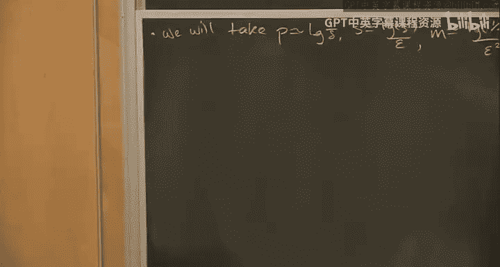
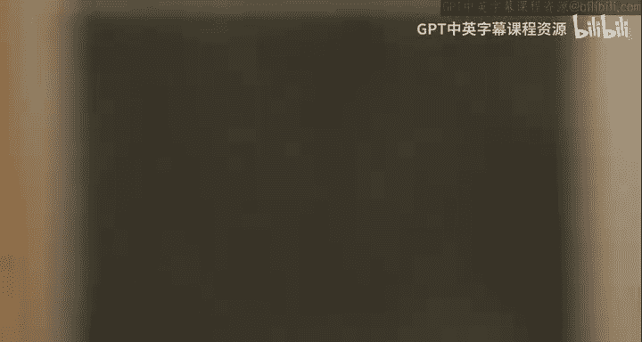
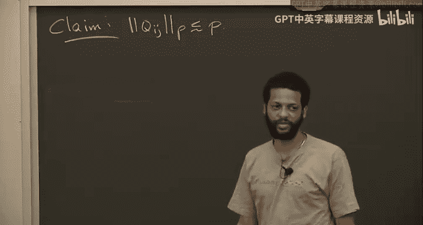
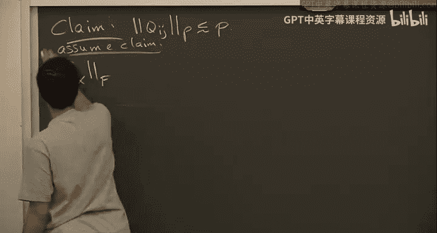
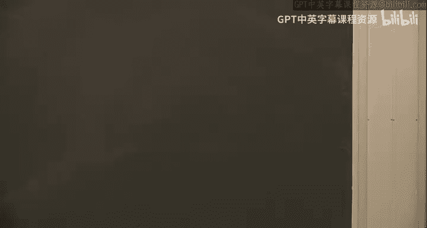
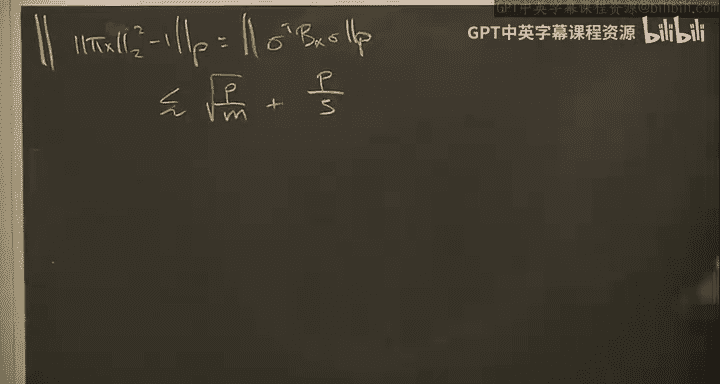
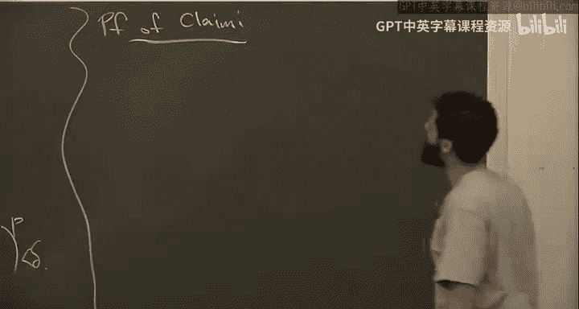
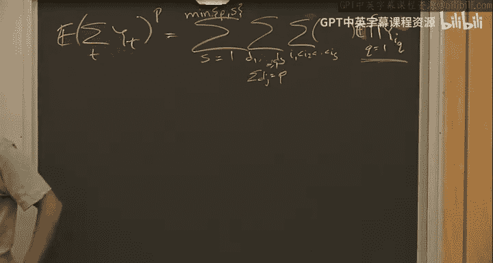
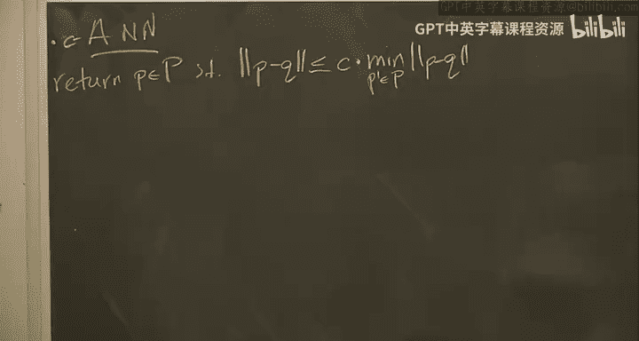

# 哈佛大学《大数据算法｜Harvard Algorithms for Big Data (COMPSCI 229r) 2016》deepseek - P14：-14-Algorithms for Big Data (COMPSCI 229r), Lecture 14.zh_en - GPT中英字幕课程资源 - BV1yGdNYvEMo

呃。So I want to finish off the proof of sparse jail from last time。

 and then I'm going to analyze fast jail， and then we're going to move on to some other well one application and then move on to a new topic。

🤧う。So remember what Sprse gel matrix was from last time it was this matrix pi。

 Okay it's scaled by one over a roots。 Each column has exactly s non zeros in random locations。

those locations have random signs and the rest of the column is zero。

 the columns are independent of each other。You could also use the count sketch matrix。

 as I mentioned last time。You'll see， you'll see soon。What that matrix， what the， you know， the。

 the random process that determines where the non zeros go。

 You'll see what that needs to satisfy soon。 Okay， we haven't actually。

Finish the analysis yet for you to see where that becomes relevant。嗯。

Remember that we wrote pi X L2 norm squared -1。 That's the thing that we got to understand。

 We want a tail down for that。RightThat is a quadratic form。 Sigma transpose B， X Sigma， where B。

 X is this matrix， okay so。It's a block diagonal matrix， it has M blocks。

M is the number of rows of pi。And each block has zeros of the diagonals。And on the off diagonals。

 we have X I X J， if both。I and J are non zero and row R。Okay。So that's that matrix。

 and then the Han and right inequality tells us。Well， here， when I say P norm。

 I mean there's randomness over both。Sigma and Dlta。First， take the expectation over Sigma。

 That's what Hanson Wright lets you do。 When you take the expectation over Sigma。

You'll get root p times the Frminous norm plus p times the operator norm。

But the operating norm for media norms are random because B is random。 It depends on delta。

 So then you have to also take the p norms of those things with respect to Delta。

What we saw last time was regardless of what Delta is。

The operator norm of B is never more than1 over s。😡，So。For that， you know。

 Delta could have been a deterministic thing。Where we're going to actually use the fact that Delta has some randomness in it is to deal with the Frbeius norm。

Yeah。第二。Yeah。Yeah。Okay you're asking why， why did they he。

 So let's let me just go back to this operator room of Bx business。

 So you agree with me that the operator of BX。Is equal to1 over s times the max over R。From1 to M。

Openator B。Well， I should call it BXR。Okay， you agree with that。 this is a block agonal matrix。

 So now I just want to understand this thing。So now notice that BXR。

Is equal to something like I'll call it XR。XR transpose。Yeah， they have unit R minus。Minus deelta r1。

 x1 squared， delta r2。X2 squared， et cetera， Delta R。Delta R， N。

N squared this is a diagonal matrix and everything off diagonal is0。O。Yeah， right。Yeah。

 so then this implies that the operating normal。Sorry。At most。So XR is where you zero out things。

 depending on what non zero and rh are。Well， the max of two things is let's think the max of this。

As well as the Elinfinity norm。But these are both at most one。

And then there's a1 over s that was out here。Okay， great。

 So now we're just left with the herbenous norm。Okay。

So let's write out what the Promeius norm squared is。So the Frenous norm。Okay。

That thing E is equal to。Well， first of all，1 over S squared。

There's the one over S that get squared times。Some are from1 to M。

S over I not equal to J because the diagonals are0， I know。Of Delta R， I， Delta R， J， X。

 I squared and x to J squared。And rewriting this， let me write this as1 over s squared some I not equal to J。

X I squared， Xj squared。Some R goes from 1 to M。Delta R， I， Delta R。 and let me call this thing here。

Q IJ。So what is QIJ in words？Right QIJ is。How many， So there's some。

 you can think of this matrix as being some kind of hashing thing， right， So there are N coordinates。

 And then there are M target。 the the target mentioned is M。

And each coordinate is getting hashed into S locations without replacement。Right。

 so I is getting hash to S locations without replacement。

 J is getting hash S locations without replacement。 And what this。

 what Q I J is is it's counting how many collisions were there。

So that's a random variable that depends on Delta。RightAnd this is where Delta is relevant。

 This is why we need Delta to be somewhat random。Okay。So。And you write down a claim， claim。So。

Remember these values here。Okay， so if S is that， if M is that and if P is that， the claim is that。Q。

 I J Por。Is that most P？Okay。So let's just pretend this claim is true and let's finish the analysis of Sprse jail and then we'll prove the claim。

没人。I mean， this is something you understand， right。You know，Unfortunately。

 the deltas are not fully independent because they're exactly Ss per column。

 but if they had been fully independent。Then this looks like a sum of independent random variables you would use turn off for Bernstein or something。

 So this is standard。So let's pretend the claim is true。 Let's finish the analysis。

Now you went to bound the pen of that thing。The p norm。Of， let's assume。Ac claim。

The p norm of that thingingy。

， remember the definition of P norm， this is the expectation。Of that from venous norm to the P。

To the one overp。But that's the same thing as the expectation of the Frveous norm squared。

To the P over 2。To the2 over P。To the one half。I'm just so this is the trick I guess I've used before in this class。

 So this is equal to this P norm is equal to the P over 2 norm。Other ven norm squared。

To the one half。喂。Which is at most the p norm to the one half。So let's look at this thingy。So。

 this thing is equal to。Something to the one half。哎呀。That。1 over S squared。S I not equal to J。

Xi squared， Xj squared。Q， I J。嗯。诶。And then now I can use the triangle inequality。This is。

 let me pull out that one over S squared square root， This is at most by triangle inequality。嗯。

Some over I not equal to J X squared， Xj squared Q I J。Penorra。

But I said that this thing is at most P up to a constant， Then there's a square root。

 So this is at most。呃。Square root。P over S。嗯。S I not equal to J。Xi squared Xj squared12。

 but this thing here is at most sum of Xi squared squared， right？Which is one。

So this thing is at most repeat。And if I did this right。嗯。Root P is root log winner delta。So。

 this thing should be。Roroup P ofRS is up to a constant the same thing as。Epsilon overroot。

Log whenever over Dlta。Which is the same thing as。W ever root out。Okay。

Just by our choices of PS and M。So。Good， we're done。What we've shown。Is。嗯。The P norm。

Is equal to this penor。

And we've just shown that this thing is at most。Root P over M。OrTo be a little more suggestive。Okay。

 let's say root P over M plus P over S。哎。And。Where， you mean over here？Well， we just。

 we just showed the penome of the for。 we just showed whatever rootam right。Yeah。

 so I put in that rootee。

So we got this。 So this implies。Right by Markov。The probability that this thingingy pi x。

inus1 is bigger than epsilon。 Well， that's at most。The P norm of this thing E。

To the P over epsilon to the P， this is Markovbb。And。I mean。I guess now you're just done， right。

This is at most。Well。The sum is at most twice the max。So if you want to think about this。

 you could save this that most。呃。Two times the max。嗯。POM。And then呢。Yeah，' P over around。P over us。

Over Epsilon。if you just do the calculation and this， I guess， to the P as well。

If you just do the calculation， then this thing is at most delta。For our settings of P SN M。

So now now it's just a matter of proving the claim。诶。So that's the thing we want to argue about。

So remember proof of claim。Remember QIJ is the number of times I and J collide。So。

Let's just fix column I。Remember that columns I and J are independent of each other， right？

So call him I， he has S non0 somewhere。And then there's column J。And。The question is。

 in these matching locations， does he also。Does he also have a nonze？Remember。

 this column is independent of that column， but these entries are not independent of each other。

So let's write。The number of locations here is S。Remember we' on locations。So let's write。Why。

T is equal to- it's an indicator random variable。One。If column J。Colllides。And Teth。You know， row。

By T of row， I mean not actually row number T， but this is row 1， this is row 2， This is row 3。

 This is row T， row， et cetera。 and0 otherwise。This implies that。QIJ。

Ass equal to the sum T goes from 1 to S。Of YT。So as I mentioned before。

 if we actually had independence across these entries， this would just be turn off found。

But the thing is， they're exactly S。 So given that some of these match。

 it changes the probabilities of the future ones。🤧So now what I want to argue is I want to argue。

That。If you look at this random variable。And look at any of its moments。Okay。

The moments are dominated。😡，By the case that they're independent。Okay。So。You know， whatever。

Whatever tail bound you're getting using moments from the independent case automatically hold for this case because the moments are dominated。

And as you know from PSet1， what are turn off and Bernstein， et cetera， other than moment bounds？

So you can apply Bernstein or turn off and you get the same kind of result。So why is that the case。

Moments。Are dominated by independent。Pos of this thing。 Why is that？Well， let's look at。

S over T of Y T。To the P， and let's look at the expectation of that。谁？

This is going to look like some sum。Or some subset of the indices， right？You have lots of monoials。

So sum sum overall， how many distinct indices did you pick S goes from one to to。You know， the men。

Of P and how many are there S， I guess？The sum of all the powers that you raise them to D1。Up to Ds。

Such that the sum of the D's。Is equal to P。And then you have the sum overall choices of indices。

 I1 is less than I2 is less than is less than I。And then here you have some multinomial coefficient for all the ways to choose。

Indices that have these powers， Okay， and then you have the product。Expectation of the product。

Of Y I Q to the DQ。Where Q goes from what to ask。对。The details of what this number are。

 et cea don't really matter。 The point is just imagine。

 imagine actually expanding this out to the piece of power and looking at it monoomial by monoomial。

So a generic monoomial looks something like this。 It was going to be various wises raised to various powers。

And。Some coefficients there from commons。Now。These y's are indicator random variables。

 So raising them to powers， let's say all of these are also bigger than one。

 right These are all at least one。If you raise them to a power bigger than one。

 it doesn't do anything。They're either  zero，1 anyway。So these powers really don't matter。So。

 in the independent case。What is this expectation in the independent case。First of all。

 if you look at any particular why。喂。What's the expectation of a particular why？Right。

 so if you just look at one particular entry and ask， what's the probability that this guy is on。

It's that over。

RightOh， yeah， sorry。 I I shouldn't， I shouldn't have used S again。 let me give me， let me use L。

Right，So in the independent case，'s let's look at this number， called this number alpha。

An independent case。Alpha is S over M。To the L。How about in our case？They're not independent。Right。

The expectation of the product of these YiQs。Q goes from one to L。 Well， that's just equal to。嗯。

The expectation of。Well。It's the probability that they're all one。😡，RightFor this。

 this thing is either gonna be one or0， and it's gonna to be one when they're all one。

So this thing is equal to the probability that。Y i1 is equal to1。

Times the probability that Yi2 is equal to1， given that Yi1 is equal to1。Times the probability。

 et cea， Yi3 is equal to1， given that Yi1 equals Yi2 equals 1， et ceter。Right。

So let's just write what this is。 So what is the probability that y I1 is equal to 1。 It's S over。

What's this probability， given that you know that one of them is one。

 What's the probability that some other guy is one。Yeah， S -1 over M -1。

Time S -1 over m 1 times S minus2 over m minus-2。Et cetera。

Each one of these things is less than S overM。This is at most S over MD theL。对。

So that's pretty much it。So we know now that the moments of this are term by term dominated。Well。

 the monoials here are term by term dominated by the independent case。

 All the sumends are not negative， which means the entire expectation is dominated by the independent case。

So now the question is just。What are the moments of this thing in the independent case？

And that you can get from Bernstein or something。Maybe I'll just put that in notes。So。

There's nothing interesting there。 This is really the only interesting thing is realizing that it's dominated by the independent。

So any questions？This is， that's the analysis。Yeah。Yeah， it tells me that。

So I had this claim that the P norm of QI J is at mustP， and if that were true。

 I could finish the proof。And then now I just， I just needed that over bound to hold。Yeah。Yeah。

 so okay， work。Okay， we're saying why did why didn we just have the Why didn we just have expected S per column。

 Why did we need exactly S per column， And the reason is actually this very first bullet。Okay。If。

If we had expected。嗯。So。Let me just maybe write this down。Makeically。

 this BX matrix wouldn't have zero diagonal otherwise。Okay， so let me。呃。我以为我。Y me。

Let me write it here。If you just expand this thing out， pi x L to norm squared minus1。

This thing is equal to1 over s times the sum R goes from 1 to M。S I from1 to n， delta R， X， Sigma I。

Squared。And this thing is equal to if you do this out。嗯。1 over S some are。From one to。So some I。

 Xi squared。Some。R from1 to M， Delta R。Plus1 over S some R from1 to M， some I not equal to J。

 and then some other stuff。So if youtract oh， and I subtract one。And let me also again， subtract one。

Okay， and the point is， because we have exactly s non zeros per column， this thing is equal to S。

Which then cancels that。 And then this thing cancels that。Okay， if you have expected S。

 then that's not true anymore， which in our picture basically means this matrix B X is the wrong matrix。

So notice when we were looking at the Frbeius norm squared。Where did I go？Yeah， this。

 when we're look at the Frennous norm squared。We only had sum of our I not equal to J。Right。

 and that saved us because if we had to sum over the diagonal as well。Well。

 it always collides with itself。RightAnd that's no good。Yeah。So that's far scale。

So I mentioned last time that there are two ways of getting faster jail embedding matrices。

 One is by sparsifying pi and the other is by using a structured pi。

So now I want to tell you about how to use a structured Pi。And the advantages are。

Here we're getting a runtime。😡，Which is like S times。 So if you want to actually multiply pi times x。

 the run time is something like S times the support size of x。Right， idealally。

 you want something that's linear in the support size of x， right。

 You want big O of support size of x to do the embedding。 You basically just have to read the vector。

 And then in linear time， you can embed it。But we're getting this multiplication by S。

 which is not a constant。So this is not linear time。The runtime。

 so just if you do it with four loops。F， you know， pi times x can be done in time S times the support size of x。

 right， just because。If you write pie。As being this matrix。You know， pi1 is the first row。

 pi n is the sorry P1 is the first column。 P n is the last column。 Then this implies that pi X。

Is just the sum I goes from1 to n of X pi I。喂。So。How many terms are in this sum？I mean。

 the support size of x， you only care about the x sides that are nonze。

And for each I in the support of x， you have to add pi I。Into your into your output vector。

But pi I only has S non0 entries。So for each Xi in the support， you're spending S time。

 so the total time is S times the support size。嗯。Okay。

 so the other approach that I'm going to tell you about， the fast jail approach。

Is based on a structured matrix， and it's going to have the property that I can do the embedding in roughly n log end time。

Now。If the original vector were sparse。Then let's say the original vector sits in n dimensions。

 but it only has 10 non zeros。Then N log n is terrible。But if the original vector is dense。

Then N log N is。Nearly linear time。 So this is this is a better approach when you have dense vectors。

Okay， so let me me use this board over here any other questions before I show you that？Okay， so。

Actually， the approach I'm going to show you now， you know， historically。

 this approach was discovered before the sparse approach。嗯。So let's see this thing。

So this is called the。What I'm going to show you is called the F。JL transform。And call the FjLT。喂。

And the reference for that is the original conference paper was in 06。 The journal paper was in 09。

 Ilan and Chielle。Just because it's slightly easier to analyze， I'm gonna。

 I'm gonna analyze a slight variant of what's in their paper， but the ideas are very similar。 Okay。

 so what's their matrix。So pi。According， I'm going to use the letters in their paper。

 pi is going to be equal to the product of three matrices。呃，PHD。Okay， because。This matrix。

 this this thing was in， I think， Ione's PhD thesis。So he called it PhD。And， I mean， it's sort of。

 well other other than the P。 I don't know about the P。 but the other two fit。 Okay。

 so D is gonna be a diagonal matrix。 Okay， so that's， that's why it's D。So this is a matrix。

That's n by N。 So this is n by N。 This is also n by N。 And this thing here is n by N。

 So the total matrix is n by N。D is going to be a diagonal matrix with random signs in the diagonal。

H。We just needed to have two properties。The first is that。It's an orthogonal matrix。Okay。

 if you forgot what that means， that means that H transpose H is equal to HH transpose is the identity。

And the second property we're going to need。Is that。The max。Overall， IJ of H。Is O of one of a Rette。

So the maximum magnitude of any entry is roughly one of root N。 Were also， we also want。

That H supports fast matrix vector multiplication。After all， we do want this things to be fast。

So do people know it's such an H？The identity is not。It doesn't have the second bullet。 That's right。

 but it doesn't have the other two。So。One such h is the discrete Fourier transform。Okay， so。

The Sc Fourier transform is。orthogonal。Each entry is something like， you know。

 E to the whatever over root n， E to some complex number over root n。

 So all magnitudes are whatever root n。 and you can compute H Xx using the fast Fourier transform。

So that's n log n time。And then P， this is where I'm going to differ a little bit from what's in their paper。

 P is going to be for me。Just because it makes it easy to analyze today。Let's。

It's actually going to be a diagonal matrix。 That's n by n。 and I lie a little bit。

 but you'll see what I mean in a second。And。嗯。Let's say， Ada。1。Eta n0，0。Where A to I。Is equal to。

One with probability。M over over n and0， otherwise。So， kind of。

P is a matrix that selects out in expectation M of the rows of H。So in expectation。

 this matrix has Ms。The number of rows is a random variable。 That's not really important。

 I'm just doing it because it'll make my writing down the analysis a little simpler。

 You could also just sample。Exactly， Mrose。From H， that's also fine。嗯。Technically。

 I also need to scale this by square root of n over M。Together right scale。So that's the matrix。

 Let me say a little bit about the intuition。 Why you know， why do you want to do this construction。

Okay， so。The basic idea。Is。Supp we form an m dimensional vector y， so y is pi x。😡。

And each entry of y is just a random sample of a coordinate of x。Okay。

 so imagine imagine that we had。Why， which was just。呃PX。Okay， ahead with the scaling right over。

It's not too hard to convince yourself。 So let's say that， yeah。

 it's not hard to convince yourself that I'm not gonna do it at the expectation of Y I squared。

Is equal to。You x2 norm squared over m， which is1 over m。Which implies that。

The expectation of y L2 norm squared。One。Okay。So this is great in the sense that the expectation is great。

喂。If we sample coordinates， then we get the right expectation。 What do we actually want from jail。

 We want that the probability that you deviate from the expectation is really small。

They probably deviate by epsilon is really small。So what's the problem here？Yeah。

 the variance is too high， right， And why is the variance too high。 Well。

 what if the vector x had a one in one location and zero is everywhere else。没。Then you're going。

 you know， in order to even see that one， you're going just sample and coordinates an expectation。

So M is going to be like n to even see that one。So。

That's the only thing really killing us is the fact that X might be concentrated in very few coordinates。

Now。So the intuition here is， is actually from physics， is's from from quantum。

 So I don't know if people have heard of。The Heisenberg uncertaintyty principle。

Maybe you even if you don't know what it is， maybe you've heard of it in popular culture or anything。

 or's something like this。Okay， and。What that thing says。That may not be too precise。

 but basically what it says is if you look at for any vector x。

It cannot be the case that both X and Hx。Are concentrated in few coordinates。Okay。

 that's what it says。So for example， if you take the vector x， which is 1，0，0，0，0， and you apply hx。

Well， now it's perfectly spread。's what's h times E1。 It's the first column of H。

The first column of H is basically1 over root n everywhere。And if you're one of a rootin everywhere。

 sampling is perfect， then one sample， there's no variance。嗯。Okay so。Unfortunately。

You might have this opposite effect， what if the original vector was actually perfectly spread？

So now you're saying， okay， instead of using PX， I'm going to use PHX。

 H is going to spread it around and then sampling works。

But if the original vector is perfectly well spread。H might collapse it to a single point。

 and then P doesn't work anymore。And even though I said that a vector and itss， and its H， you know。

 and itss。呃。A vector in its Fourier coefficients can't both be well concentrated in a small mass in a small number of locations。

It can happen that they're sort of mediocre concentrated in both。

So you can come up with an example of a vector that both it and its Fourier transform are concentrated on something like root end coordinates。

There exists such vectors。Okay。So。Even if you do X or H X。

 you're still gonna need to sample root N coordinates to see any mass。

 And I don't want to sample root N。RightWhat do I want to sample。

 I want to sample one over Epsilon squared， log1 over Dlta。 That's my jail down。

And that's where the D comes in。Okay， so the usual way that， well。

 the way that I lo Czeelle analyzed things is they had a following claim。For any X。

Let's say X' unit norm。对。If you take， if you look at this random vector， this random matrix D。

 So if you look at alpha being random sine vectors。The probability that。HDx。Infinity。

Is bigger than something like some constant time square root log。N over delta over n。

Is that most adult。So they have some kind of claim like this。Right。

So what does it mean to be perfectly wellsp？Well， if it has unit norm and it has N coordinates。

Perfectly well spread means one over root an everywhere。So， this is saying。

It'll be almost as good as that。 Up to this root log factor， It'll be perfectly well spread。

 No coordinate will have too much of the mass。And then if you do Bernstein or something， you know。

 yeah， you can do Bernstein and then sampling will。

 you can analyze sampling and then you get something。Okay。So after Bernstein。Can show。

M being something like one over Epsilon squared。Log one over Delta。Log N over Delta。Suffices。

For failure probability。That。So you're not getting exactly what we like to get for JL。

 right there's this extra s。Usually for jail， we want to get M to be something like that。

That extra slot basically comes because there's that。嗯。So what might you do to fix that？

 Supp supposeupp you actually wanted to get the right jail down。What's something？看到。

Without really thinking much， something that just。Gives it to you。So now you have a vector。

 Think about it this way。 Y is equal to PD X， right。And why。

 why is now a vector a vector that's too high dimensional。But it has the right norm。

 so what do you do to why？You do dimension I direction on Y。Right， so your final matrix can be。

PP prime， which is。You know， root end over。PHD， and you and then you also have a matrix G。

 which can be， you know， a Gaussian matrix or your random sign matrix or sparse JL， whatever。

This this will be a matrix that actually has jail with the right parameters。

And so your final run time will be basically the runtime。

 your final bound will actually be this because G has the right number of rows。

And your run time will be， well， linear time to apply D and log n to apply H。Linear time to sample。

And then now you need to actually apply G to that final vector。

 but the dimension of that vector is not n anymore。 It's this。So the total time。Is N log n。Plus。

The product， let's call this now M prime。M prime times M。Plus。

And M prime is going to be the right thing。 M prime is going to be。And that's not squared。

Or you could use sparse jail and same a factor of epsilon there。

And there have been subsequent works which improve。嗯。Which improve this。

Both change the construction a little bit and also do the analysis in a very different way。

呃 question。嗯。Oh， you mean the newer works？So the newer works。Actually， get you and log in。However。嗯。

So they don't get you， you can always do this at the very end。

Let's suppose I don't want to do this at the very end。 Okay， You can view this。

 You can view this construction as getting you。嗯。You can view this construction as getting you。

This kind of bound in n log n time。So one question is just in N log n time。

 what's the best bound that I could put here？And the newer constructions what they give you is log whatever delta Repsilon squared。

Times。Poly logarithmic and N。So they don't depend on Delta here。

 the unfortunate thing here is you have logs squared1 over Delta basically。😡，Right。

And I might not want。 there are some applications which we will see in an upcoming topic very soon where。

Delta is actually going to be exponentially small in some parameter because you want a union bound over a net of some vectors。

 you'll said Dta to be exponentially small and then log squared whatever Delta is kind of a disaster。

So kind of those newer results avoid that issue。Actually， maybe the right thing to say is。

The newer results。One thing is they'， they're less about distributional jail and they're more about no。

 no， no， actually， no no no， Yeah， that's fine。 Yeah， What I said is what I meant to say。

That's right。 So actually。Okay， the actual I loesel paper， P is not going to be a sampling matrix。

 but P is actually this like random sparse matrix， very sparse。O。Like almost a sampling matrix。

 like log instead of one a sampling matrix has one non zero per row。

 theirs might have polylog non zeros per row。 So it's like almost a sampling。嗯。of the newer analyses。

They actually just use a sampling matrix。嗯。But the analysis is totally different。

 They don't go through this claim at all。Okay，They don't it's not viewed。 Actually， it's， let me。

 I can say one thing right now。 I'll say more later about this in future parts of the course。

Kind of the way that we're viewing this right now is。H D is like a random preconition preconditioner。

 such that。嗯。It conditions X。Nicely with high probability， so that P works。

That's how we're viewing it。The later analyses do something kind of the opposite。 They say that。PH。

 look at pH as being a random matrix。And then they condition on pH having a nice property。Namely。

 the restricted isometry property we'll see in compressed sensing later。

And then conditioned on pH having this nice property。

Then they argue that D makes it have the distributional jail property。

So they take a different viewpoint on this thing that viewpoint。

Was kind of first explored by I loan in Liber and really pinned down by Kramer and Ward and kind of all the subsequent improvements go down that path of arguing that P has some property。

 and then you apply D。对啊。Yeah。Oh， you're saying， can I use the wavevelet basis？I， yeah。

 so I'm not sure that the wave the basis has the second bullet property。 Yeah Yeah， actually， I I。

 I think， yeah， I think maybe not。 how you can， you can use things like。嗯。The had had to Mar matrix。

 so。嗯。I mean， I can write one such matrix down。So if you don't want to deal with complex numbers at all。

This matrix also has those three bullets， so。Define HJ。As。嗯。One over none。Negative one。I dot J。

 what do I mean by I dot J？I mean。嗯。Vi I as being a number between 0 and n minus1。

Where n is a power of two。哎。And then now right eye in binary。I as a binary vector of length log in。😡。

And do this dot product over the finite field with two elements。This is like the parody of I dotj。

This matrix also has those three properties。I mean。

 the way to see it is that it satisfies if you look at the end by end version of this matrix。

It actually looks something like this。呃。look at the N2 version of that matrix。

And just repeat it several times and put a minus version of it here。

You can prove that this matrix satisfies this recursive identity。

And then you can use that to prove that it's orthogonal， and you can use that。 Well。

 it gives an easy kind of recursive algorithm to get analog log in time。嗯。It's called the Ha Martin。

And actually， I'll just point something out。嗯。Kind of， I guess I will。 So you're taking the notes。

 So， right， so Ill， I'll inject something to the notes that has an analysis of this。 In fact。

 the original paper。Conditioned on this claim occurring。

 this nice event and then said that sampling works。 and then you get this log n dependence。

If you're a little more careful， you can actually replace this N with an M so that you got an M here。

To get that， though， you don't just condition on this claim。 you do something a little。

 you organize the proof a little differently。 I'll put that in the notes。But。

I think this is the easier thing to see conceptually。We still have some time。I'm going to say one。

 so you're already seeing one application of JL in this Pet。

I'll give you another application right now。And then we're going to start a new topic。嗯。

AndSo we did streaming， we did dimensionality reduction。 We're going to start a new topic。It's。

 again， going to be related to。Both sketching and dimensionality reduction。

 as you're gonna see very soon。 Okay， so all these things use similar ideas。 I guess JL。

 we started off doing random sign matrices， which was basically the AM S sketch。

And an account sketch became relevant for sparse jail。

 So lots of these things are useful in different。Across different domains。

One application that I want to mention right now is。嗯。High dimensional。Approximate。

Nearest neighbor search。Let say foster neighbor。喂以。So。Let's say。Over vectors。RD。And also。Today。

We're going to just look at all two distances。So。If you remember your CRS or undergrad algorithms。

Well， actually， you know， these days， I think I didn't mention this in 124， but。Let me just。Say this。

 So let's say the usual way to do it is to set up what's called a Vonoy diagram。Oh， actually。

 let me define the problem。嗯。We're given。And points。P。P1。To PN。现个一起。D dimensionional。

 it can be another， it can be another distance， another metric that is F L2。

 today we're going talk about L 2。Okay。And we have to create a data structure。😡。

To store these n vectors。Okay。Think of this is a static data structural problem for now。

 meaning that I'm not allowed to insert and delete points。 There's just a fixed database， okay。And。

A query。Is Q。Or Q here is an RD。Should return。The point in your database。Which minimizes。

Which minimizes the distance P minus Q。嗯。So this kind of thing gets used in a lot of places。You。

For example， image retrieval。Okay， so， L2 might not be the right thing there， but you know。

 imagine some other metric。 So I have some metric which somehow encapsulates when two images are are very different。

And I'm。I don't know， Facebook。Okay， and I have lots of images of people and I store it in a database。

 That's the dynamic problem because my database keeps changing。 but let's ignore that for a second。

And。A query comes along， which is someone uploads a new album。And Facebook wants to auto tag it。ok。

So。They're going take that image that you uploaded。 They're gonna to do some。Image recognition。

 they're going to do some face recognition algorithm to find faces inside that image。

 And then they're going to query。 I'm not， I'm not claiming that this is exactly how Facebook does it。

 This is， you know， just a plausible hypothesis， Okay， so。

I'm going to query my database of faces and find the one that's closest to the image that you just uploaded。

And then I'll suggest an auto tag。Or， for example。Maybe I'm the NSA and I want to identify someone in a photo after some terrorist instance。

You can imagine such things getting。Used in various contexts。Another one。They don't use L2。

I have a bunch of documents。 You know， document retrieval is yet another one。O。嗯。Oh yeah。

 So this as I've written it， this is the exact nearest neighbor problem。Okay。

 approximate nearest neighbor。It says return。A point P in capital P。Such that。P minus Q。

I at most some constant C times the min。Over P prime and P。You might as get。And C is my approximate。

C is my approximation factor。 So think of C as potentially。Waterproof upsl。But it can be some other。

Contant as well。Okay I'm willing to have someone who's within a factor two of。

The distance of the actual nearest neighborhood。

Good， so。One way to solve this problem， so。Exact。Your neighbor solution。

You can use what's called vnooid diagrams。And then cleanerer point location。

So what's a Vonooid diagram， Let's imagine that D， the dimension is 2。Okay。I have a bunch of points。

And they live in R2。They divide up the plane into regions。Where， let me try and。Draw the bises。

 So let's say this is。Kind of everything， everything on this side of line is closer to him than to him。

And then each pair has their own bisectors。And then this one said this。I'm very bad at drawing。Okay。

 so。I think what I can say now is。Everyone。Everyone in this region。

Has this guy as their nearest neighbor？Then there's also this。呃。That。Something like that。嗯。Everyone。

Everyone who's like here。嗯。I think has this guy as their nearest neighbor？

And you can keep filling in。 You can keep filling this thing in。

 and you get a division of the plane into regions。Such that anyone in this region has this guy's nearest neighbor。

 et cetera。 Everyone in this region is this guy's nearest neighbor， et ceter。Okay。

 so a construct the  v9 diagram in in two dimensions， you can do that quickly in nearly linear time。

 like n log N。And the second thing is planar point location。 Now that I have this planar subdivision。

 I get a query and I want to figure out which region does it actually belong to。Okay。

 there are fast algorithm that do that too， like log end time。Okay， so these are kind of classic。

Computational geometry problems that people have efficient algorithms for when D is equal to 2。Okay。

 there's a problem。It's called cursive dimensionality。Well。

 this is one manifestation of the cursive dimensionality。Which is that。In D dimensions。Bornoi。

Diagram。Can have complexity。And the fate of the。Something like end of the D over2。

So just to describe all the regions。😡，will take you end of the D over two space to describe what they are。

Okay。So already， your space is， you know， was the space to actually store the data， It's N D。

 They're N vectors， They're D dimensional， but it's like end of the D over 2。

To actually store this void diagram。And that's just you know， if you're working with large data sets。

 you can forget that。Imagine that you're dealing with images that are 1000 by 100 pixels。Right， so。

D is a million。D over2 is 500，00， okay， great， your space is under the 500，000。

 it doesn't make any sense。嗯。Even if you used。Well， yeah， yeah， so let me just put it like that。🤧打。

That's right。That's right。Of course， the other thing you can do is just。

One way to solve the problem is just store the points。Exactly。

Story the points just kind of in a list， and then when you do a query。

 just query over the entire list。That space is great， but then the query time is N D。

 the query time sucks。So。Here's where approximate nearest neighbor comes to save the day。我没。

Start writing over there。嗯。Okay， so this approximate nearest neighbor， it reduces。

To another problem that I'll call。See near neighbor。This reduction， you can find this reduction。

 for example， in the paper。Harpaed。Indy and Motwani。In 2012， so actually。

Kind of the original reduction， there was a paper by Indian Wawani in 98。

 They had some complicated one。Harpaed later had a simpler one。 And then the journal version has。

 I think， an even simpler one。Okay， this reduction。And what is seeing your neighbor？If。

There exists a P。Okay， so let's call it。Let's call it actually CR in your neighbor。

If there exists a P in the point set。Such that。P minus Q is at most R。Then。Return。P prime and P。

Such that。P prime minus Q。That's not equal to CR。If no such P。Fil。こ系啊。可以。

So kind of the easy reduction from approximate nearest neighbor to CR near neighbor is basically just binary search on R。

Okay。So just try some value of R if nothing came up， well， you know， double R。

If that still doesn't work， double or， etctera。 and do a binary search kind of thing。

 kindnd of the only issue。In， you know， in reality， you can probably get away with that depending on。

Kind of the aspect ratio of your data set。 The issue with that is kind of the number of iterations of your binary search。

ItDoesn't depend on n。 It depends on something like aspect ratio of the point set。

 something like that。The reduction in this paper avoids that。

 and it actually gives you some kind of binary search like reduction。

 where the number of iterations is only log n or log squared n or something like that。

So I'm not going to talk about that。 Let's just pretend that you had that。You know。

 imagine just doing a binary search and paying log aspect ratio or something。So then the question is。

 how do you solve this problem？And。There are a couple。I say there are a couple flavors of this。

And we'll just talk about one in the last few minutes， just because's it follows pretty simply from。

From now what we've done with jail。So see our your neighbor。So let me right here。嗯。Space。Time。

And when I say time， I mean the query time。And then say reference。嗯。So， space。

Let's say DN just to store the data plus something like n to the O of1 over uppsilon squared。谁。嗯。

You can get query time to be something like。I think， D plus。You can totally get this。Roughly。Right。

 just be safe， let me say polynomial on that。So， this is。She love it Sostrrovsky and Rabani。

Estrrovskin and Rabani， 98。Also， in the。98。There are a few。 there's some slight different。 I mean。

 there's some difference between these。Two， I'm not going to get into it here。

Then there's kind of the other approach， which is the LSH approach。嗯。

You'll see what I mean in a second。 So here the space is going to be something like DN plus n to the1 plus row of C。

So here， by the way， in this row， c is equal to one pluspsilon。对。Yeah， so。Good。And your query time。

I mean， actually， maybe I should divide this from what was before so。We're now in a new。The new age。

So everything below this line is going to have space， which is this and query time。

 which is something like this。And now the question is what's row， as you've said。

So one thing you can get is robe being something like。1 over C。Okay。So this is。Indicment 1， E，98。呃。

You can also get ro being something like。This is row of C。

You can get rowV C being something like1 over C squared。Plus a little low of one。This is。

And donni and Indyic。906， 2006。Right， imagine， imagine now C is like a big constant。

It's not one pluspsilon。 see is like 10 no。Okay， so I want， this is better， right， want。

 this is one over 10 squared is one over 100。 So my query time is end to the one over 100 as。

 you know， as opposed to end to the one over 10。 So this is better。嗯。

You can also get something like robing seven/8s。C squared plus。Oh of1 over C cubed。This is due to。

An dony。诶。In the。When in Ranstein， I believe this was 2014。And then kind of the latest of these is。

Robing1 over T2 c squared -1 plus a little of1。And this is due to。Wn and Rasnstein。嗯。

The last thing I want to put。The space is something like。Roughly， maybe have to log， I'm not sure DN。

 So it's actually linear space。And Ro is something like。2。06 over C， something like that。

This is due to punre。And kind of all of these。All of these fit into something called LSH。

 which is locality sensitive has。It's kind of a paradigm for designing these。Tins of things。

 by the way， if anyone wants to do an implementation project。I mean， some of these are very new。

 like this one over here and this one。嗯。This is LSH is actually something that you know， people use。

 There's a package online on Andony's website。I think it's called E2 LSH， maybe。

And people who do things like image retrieval， etc cetera， actually download it and use it and。

Occasionally email him with questions。 so they're asking questions because they're using it， right。

If you actually， you know， if you， if you wanted a good implementation project， one thing is。

 maybe try。Try one of these theoretically better ones and see and compare it with。With this one。

 which is implemented。And， if you did a good job oflining that package， people。

 people might actually start using it。嗯。So， good。 So today。呃。I'm actually in the time I have left。

 I'm just going to cover。This one。The first one。对。So the， yeah， the。

 so the data structure uses as a primitive what's called locality sensitive hash functions。

 and the basic idea behind， So what's the idea behind such a family of hash functions。

 You want a family of hash functions， such that。If two vectors are close to each other。

 it's likely that they'll hash to the same place， and if they're far from each other。

 it's not likely that they'll hash to the same place。Okay。

 and then you can use these hash functions to design a data structure to design data structures that。

Kind of help you find close vectors。So here you want things to collide if they're close。Yeah。

 locality sensitive hashing。第二。Oh， with additive error， I'm not so。Sure about that。Because， I mean。

 one thing that makes me a little worried is if I scale all the points， all the distances get scaled。

 right， So what if I scale all the points to something really big。嗯。Is Isrian。Yeah， yeah。 exactly。

 If I scale the distance is something huge， then， then additive starts going to 0。

 right as relative to the actual distance。哎，是。Let me just show you that first bullet。

And I'll show you the， I'll show you the。The version from。Indantment1。诶。So actually。

 what I'm gonna show you is something like N to the O of。

This is what' in their paper or log went uppsilon over epsilon squared。I have D plus that。First。

We'll get space something like DN plus n times001 or epsilon to the D。

Why does this does achieving the space imply that you can achieve that space？

Notice there's no D here。I made it over here。This jail。Right。

 basically what I'm going do is in preproces， I'm going to pick a random jail map and just hit every single vector with it。

Then D becomes log n over Epsilon squared。And one over epsilon to the log n over epsilon squared。

 if you just rewrite， rewrite things is this。So this， I mean， this is， this is a bit。

 I think this is why L stage has taken off more than this。

This is actually quite a large amount of space。 It's nice from the theory point of view。

 for any fixed epsilon。 It's poly poly N， But end of the one Epson square it is actually pretty bad。

 right， whereas these things are actually taking nearly linear space。And pretty good query。嗯。But。

 so we just want to achieve this。And how are we going to do it？Pretend our。Is one。O。

The case for Gen is basically the same thing。What we're going to do is impose。Imose。Uniform。

Epsilon over Ro D grid。On RD。I just mean like。Yeah。

 a grid where all the side linkss are epsilson over Ru D。Why did I choose epsilon over root D。

 Notice that the diameter of any grid cell is at most epsilon。

If you have a box that's epsilon over root D And D dimensions， no length is longer。

 like the diagonal is length epsilon。So， this， this。Grid cell has length， epsilon and L2。Okay。Now。

For each。PI and P。Let BI be。The L2 ball around P of radius 1。来。The I bar be the set of grid cells。

That BI intersects。All we're going to do is we're just going to store。B bar。

 which is the union over all B bars， I goes from one to n。In a hash table。

The key in the hash table is the grid cell。Rid cellll I。Like telling me which grid salad it is。

And the value。Is I。Which point point had a ball that intersected this thing？

And then now how do I answer a query？Okay。Well， if I get a query vector。

 it's pretty easy to tell what grid cell lands in。Right。Okay。

 just divide all the coordinates by epsilon of root D and that'll tell you which grid cell you're in。

And then just check。Right， so doing we're doing C1 near neighbor。Right。

So the assumption is this point is within one of someone。If he's within one of someone。

 then he intersected， then his grid cell intersected that guy's ball。

And then we're going to output that guy。But it might be that。Here's our grid。It might be that。

He intersected our grid， but we're not actually in the ball。

But this grid cell has diameter at most epsilon。So our distance to the ball。

 because someone in that grid cell intersected the ball。

 Our distance to the ball is at most one plus epsilon。

So this solves the C equals one plus epsil in your neighbor。嗯。So querying is very fast。

 Just look up at a hash table。The only question is what's the space？So。Kind of notice that。

If you blow， if you blew up this ball。 So the question is just。

 how many grid cells can this guy touch。Notice that。 if you blew up。This ball to not be radius 1。

 but radius 1 plus epsilon。 It would contain。Every grid saw that， it intersected。

So the number of grid cells。Is that most？Intersected。Is at most the volume？Of a radius。You know。

 one plus epsilon ball。Divided by the volume。Of a grid cell。喂。Call this number R。

You can look up in a book what's the volume of a ball， a unit L2 ball， in D dimensions of a sphere。

 ats some number， and that number happens to behave something like r to the D times2 to the O of D over root D to the D。

I'm just going to use that fact。I just want to say that。Because I what I want， what I want。

 what I want on the numerator is some shape that actually contains， oh， I see。Right sorry said again。

Yeah。Right， so the point。The point is。This this shape right here。Contains all the grid cells。

 But if it contains all the grid cells， its volume has to be bigger than the volume of。

The union of all the grid cells。So how many grid cells can it take。

 can it actually contain the ratio？Right， so this， so this is， this is this， the bottom。

 the bottom of a grid cell。 It's just a box。 It's epsilon over root D。To the root knee。

This cancels that。R is 1 plus epsilon， so at the end of the day， this is oh of1 over Epsilon。这个地。

Well， so let's say this is that most C erups onto the D。for some constancy。So actually。

 I shouldn't have said one over ups line to the day， I should' have said C a rope。这子。Okay。

 any questions？You also have to take into account the time to actually， because when you get a query。

 remember， if we're doing JL， you have to actually apply the jail map to the query before you search in the database。

So you also have to add in for the query time to time to do the jailNe。But you know。

 if you do fast jail or something， that's nearly linear time of the dimension。So。

