# 哈佛大学《大数据算法｜Harvard Algorithms for Big Data (COMPSCI 229r) 2016》deepseek - P15：-15-Algorithms for Big Data (COMPSCI 229r), Lecture 15.zh_en - GPT中英字幕课程资源 - BV1yGdNYvEMo

Okay， so we're done with the dimensionality reduction portion of the class。

 or at least the JL portion of the class。 And now we're gonna move into something else。

 although J will be relevant for this problem， too。 So the next few lectures。

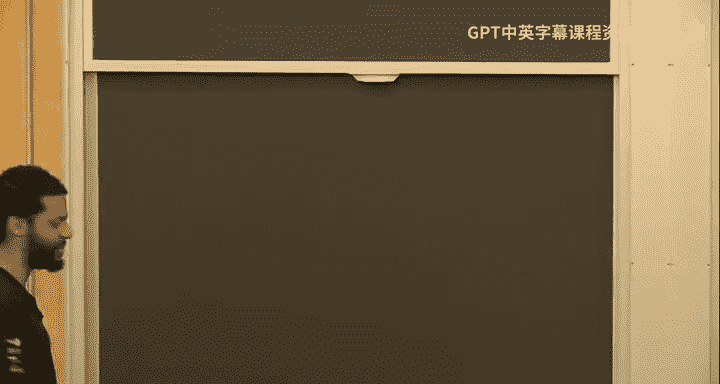

We'll do large scale in your algebra。

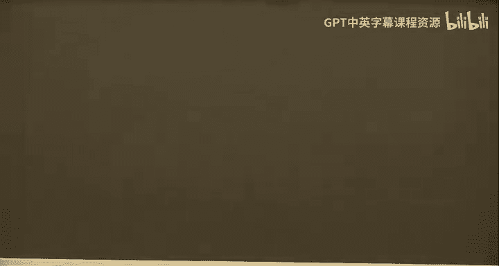

Okay。And today， we're going to focus on。

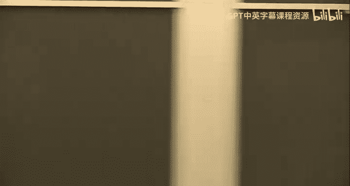

Approximate。Matrix multiplication。So I'm imagining that we're given two matrices A。

A is an N by D matrix。And B。Is an N by P matrix？And think of N。As being big。

 n is much bigger than both D and P。So these matrices look something like this。

And what we want to do is we want to compute the matrix matrix product。A transpose B。

So the straightforward algorithm。

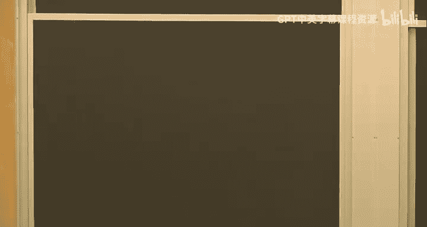

takess time something like O of NDP。Just four loops， right？There are fancyci algorithms。

 So one thing you could do is you could write， let's just。Alternatively， you can do the following。

We could say a transpose like something like this。This is the big dimension。And then here's B。Okay。嗯。

So maybe we should figure out， so he took over ascribing。Since you went here。So。

 so one of you is scibing at it， you guys can who is the one scbing or。Who you're describingibing？嗯。

So let's say this thing is P。And this thing here is D。Right， so one thing you could do is just。

Kind of break this up into D byD blocks。Let is pretend that D divides n。

 if it doesn't just pad the matrix with some zeros， okay， with some extra rows that are 0。嗯。

And also assume D divides P again， padding by zeros。And。You could then。Kind of。This is also。

 is there all D？You can multiply kind of block by block， right？ So if you look at a transpose B。

 A transpose B is also kind of you can， you can break up the output matrix into D by D blocks。

 And each block is a sum of like， for example， So this matrix， the output matrix would be D by P。🤧呃。

And you can break it up into blocks。That are D by D。And then this， this here is basically。

Is basically， you know， this， this times that plus this times that plus this times that plus this times that。

 right， So you， you reduce it to a bunch of square matrix multiplication， and you can use。Fast。

Square。Matrix multiplication， which each one takes something like d the omega time。

Omega is the exponent of fast matrix multiplication。Okay， so we know， for example。

 that mega is less than log base。Two of seven， that's Strawen。

And there have been a bunch of improvements。 So kind of one notable one is omega is less than something like 2。

3。7even，5。Or2。376。This is Co Smith in Winnirad。嗯。And then there were improvements by。呃。

By others as well afterwards。So 2。374。Oh maybe it's less than， I think， 2。373。

And then omega is less than， well， it may be more specific。3，7，2，8。6，4，2。And then 2。37。呃。2，8。6，3，9。

 so these two digits over here got improved。 Okay， so this is Stas。This is。That's the leska Williams。

 so these two were done independently。And there is here， Laal。Okay， so you could do these things。

Kind of ideally， you want to make it a be2， right， The output has size d squared。

You could also reduce to a bunch of。Rectangular matrixresponsibilities。

What does that mean so you can multiply？🤧うん。嗯。Let's say， and。R by R of the alpha。

By r to the alpha by R。In。Let's say。呃。Oh， of。Well， n to the two plus the low1。

 let's say the R plus2 the low one。So the question is， kind of what's the biggest R。

 What's the biggest alpha for which you can do this。

And you can get alpha to be something that's at least。30。This is also to Laal。

I mean there's more history here as well， there was a previous bound by Copper Smith。

 but this is the best bound known， so you can reduce your problem to these fast matrix multiplication problems。

Our algorithm yeah， problems but。You could also kind of go a different route and notice all of these algorithms I mentioned before just now are exact computation。

 right， You actually want a transpose B exactly。 So suppose。So today。

Suppose we're willing to settle for approximation， which is what we've been doing a lot in this class。

 right， So settle for。Computing。Some C， matrix C in。R DP。Such that。A transpose B minus a transpose B。

 minus C， some norm。Sose I'm willing to settle for that kind of thing。For some norm。So some x norm。

And the question is， can we do this faster than these approaches？Okay。Yeah。So。The first。

 so we're going to discuss this today。 And the first method that we're going to look at is using。

Well， is getting fromminious norm error？Forbeience no remember that。The Forben is one of a matrix。

Is the sum of raw IJ。MIj squared， square root。So treat the matrix like a vector and take its cell to norm。

对。So forbeius error。We're going to look at two different approaches。

And we're going to look at another form of error after this。

 and they're also going to bely two different similar looking approaches and two approaches。

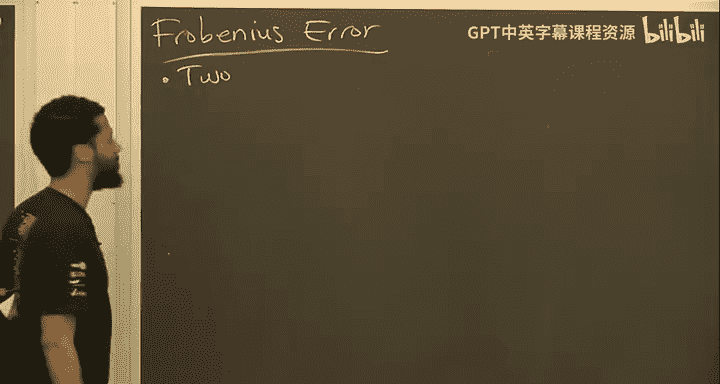

So the first one。Which came first historically， as well as sampling。 So what are reamp。

 you'll see in a second。 this approach， as I'm going to describe it， is due to。Im make sure。

 I think it's Junaez Mahoni and Mrik Krishnan。Oh Junius Kaan and Mahoney， said Junius。看 on。

This is two ends。Ho。This issverse6。And then we're also going to look at kind of。

The jail like approach。Or some you， yeah， you'll see what I mean in a second， so that's due to Char。

ううん。Okay。So what do I mean by sampling？Say the rows of these matrices A and B， let me give them name。

So let's say the first row is A1。To AN and these rows are B1。Up to Bn。I guess transpose。呃。走。For me。

 like all vectors are column vectors。对以。So in general， whenever you can verify this。

 whenever you have a matrix product to a transpose B。

It is exactly the same thing as the sum K goes from1 to n of AK， Bk transpose。So what are we gonna。

 So it's， it's a sum of an outer product。 So when I say sampling， what do I mean， I mean。

 we're gonna sample some ans from this outer product。

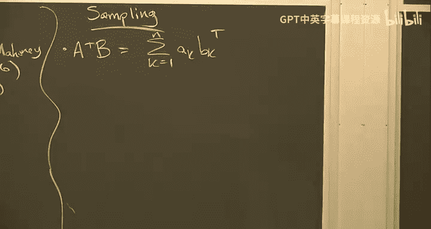

Okay， so。We're going to have C， B。Pi a。P pi a transpose pi V。Okay。Where pi is going to be。

An M by N matrix。🤧Okay， and。嗯。And what we're going to do here is we're going to write pi。

It's going to be a sampling matrix。What I mean by a sampling matrix。

 I mean each row has a one in a random location。对。And。This is not going to be exactly right。

 So let me let me write。So let's say with scaling。Let me tell you what that scaling is。Well。

 actually。The pie is yeah， so good， good。 So let's this is the scaling。 So pi。IJ。So。

Let's look at the rows。Rst R， it's called them pi1 up to pi M。For the rose。H爱。Let's call pi T。

Independent。Across key。And。Let me say that pi。T is equal to。EI。probabilityb。EI over。Square root MP。哎。

With probability proportional to。F proportion。2 AI。Times me。谁。

portal to the product of the al tu norms。Okay so。I claim that if you do this。Notice that this is not。

The sampling probabilities depend on the input matrices。 This is not oblivious to the input， unlike。

 say， JL， for example。Okay。So you'll do some preprocessing， compute all the rowors。

 and then sample according to these rowors， and the roworms you can compute quickly。

 you just kind of scan the matrix， the two matrices。So now let's write。C， this matrix C。

C is going to be equal to the sum。Kind of K goes from1 to n。And。1 over M。A呃KTBKT。Transpo。Over PKT。

So KT。basicallyically there are M rows here， there are M samples that you're sampling from this sum of outer products。

And K T is the row you sampled in the T of row of pi。No， thanks。So。With probability。PI。

So the probability that you sample rh I is PI。And let me call this thing here。Well， actually。嗯。

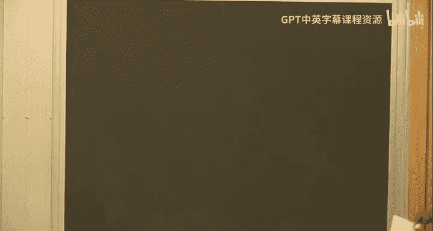

明 by。Well， I mean， probabilities should sum to one， right？

So what I mean is the probability that you sample row I is。That over the sum overall J of that。Yeah。

Okay， so the first thing is why do I scale by， you know， why do I want to scale by this。

 basically kind of claim。 This is an easy claim。The expectation of C is equal to a transpose B。

And the proof is just a linear of expectation。Since。The expectation of ZT。

Is equal to a transpose B over。嗯。This is over pie。Yeah， since kind of for all tea。

Between 1 and M and this is true。So just use linear expectation。Okay， so。This is， you know。

 that's why I divided by P K just to get an unbiased estimator。

So now I want to argue that this thing actually gives me something good with good probability。Okay。

 so。Claim。If let's say。If。Is at least one over epsilon squared delta？Then。The probability。That。

A transpose B minus pi a transpose pi B。Forbenius norm is bigger than let's say epsilon times forbenius A forbeius B。

Is at most Delta？Right。So let's prove that。Well， we know that this probability。

Is by Markov's inequality， first of all， I'm going to raise both sides。

 I'm just going to square both sides。This probability is at most。What over epsilon squared。For me。

 storm squared。Times。Thean terms square B。Times。The expectation。Of this Fermini storm squared。

This is Mark Ho。So that's interesting interesting a。We just need to understand that。

 And that's where our choice of PK is going to come into play。 I mean， so far， I mean。

 to get an unbiased estimator， the PK is could have been anything。Right。

As long as none of them were zero。嗯嗯。But then the， this variance calculation is going to depend on the PKs。

 And， and that's you're gonna to see now why we chose P Ks the way we did。So。First of all。

 let me just say got loss of generality。A for ven norm equals B for Venus norm。Equals one。Okay。

Because you could have just。You can just scale， pretend that A was actually A over its rabenous norm and B was actually B over its raenius norm。

And then just carry that out for this， and since pi is linear。It you can put the scaling back。Okay。

So。We can write。A transpo B minus C。Is a sum over T。Go from1 to M of Zt minus。Expectation， Zt。

So this implies。So expectation of a transpose B minus c for me squared。Well。

 the Fr norm squared is the sum over all I J of the entry squared。

 So this is equal to the sum over I J。And then。Some over T or expectation。Yeah some of the tea or。

And I may not do this。Expectation over。H of。Some of T from1 to M。ZT minus expectation， ZT。IJ。Squared。

对。And this is just equal to some overall IJ of the variance。Of some over tea。Z T I J。嗯。Actually。

 is this so what I want to say， I think this is right。 And by independence of the Z T。

 this equal to sum over all IJ of sum over T。Of the variance。Of Z TIJ。

And all these E Ts are identically distributed。 So this is just。

M times the some overall IJ of the variance of。Kind of ZIJ。

Where ZIJ is kind of just Z is one of them。So let's calculate this。Well。ZIJ。

Is equal to some k goes from1 to n。🤧。We write it as Ada。K。Over PK。AK，Bk transpose。IJ。So。

AK was the K through， so AKI。Is let's say aK。J。Okay， where。Ata k is equal to1。Yeah。Tia throw。A pie。

Samples。B。Okay。So only one of the8 to Ks is one， and all the rest are 0， right。

8ta K is just an indicator of。And of which road did we actually sample from。

From the teetheth row of pie。Yeah， there is one of I。And now notice that the variance。

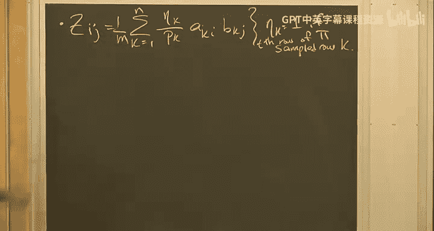

Of ZIJ。Is at most the expectation of Z I J squared？And if you square this thing。You're going to have。

 if you expand the square， you're going to have some。Terms that have that shows the same K twice。

RightAnd then you're going to have some terms that have that chose a different K the in the first and the second。

 kind of off diagonals。Okay， in the off diagonals， notice that8 to k times 8 to k prime is always 0。

Because you only ever sampled one guy。 You're only sampling one guy。

 So the only the diagonal terms are the ones that matter。 So this is equal to one over M squared。

Times sum over k goes from one to n。呃。Many have the expectation。Of8da K over PK squared times aK。

BKJ squared squared。And then the expectation of80 K is P K。So this cancels。And then remember， PK。

This is equal to， I claim。嗯。1 over m squared。Times。呃。Okay， good， so let me leave it like that。

So this implies that。Ging back up there。The expectation of。A transpose B。

Minus c for beius norm squared。Is at most。 So there's an M over M squared at most one over M。Okay。

And then we have a sum over IJ of this。😡，If you sum over IJ of these。😡，Right then。嗯。So， times。

Some over IJ。Some of her k from 1 to n， well let me write it like this。Some over K from1 to N。And。

Some of her IJ。AK I squared B K J。Squaird。There's a one over PK here。You look like you're。自I with。

what are you trying to understand， why only 180K is1？Why it's not case？

It is the case that only 180 Ks 1。Only 180 Ks 1。Right， what is Z T， Z T is corresponding to。

To ourer ZT corresponds to the Teth outer product that we sampled。Right。这个对300。Yeah。

 so the thing of this， this is， yeah Z1 and I J。 I that what you。 That's right。

Z for me was a generic one of the Z's。You believe me。And this here。

This sum Ij of this thing E is just equal to aK L2 norm squared times Bk L2 norm squared。喂。

If you just expand out this product， you get exactly that。 and then now remember what PK is。

 PK is Ak times Bk。Over the sum of all of them。Krry。嗯。So， this thing E。It's equal to。

By definition of Pk。1 over M sum k goes from1 to n。呃。AK L2 norm times Bk L2 norm。Squared。

This is just because。PK is equal to。AK。BK。Over the sum of J。AJB。

That's what I meant by when I saidal to。And then I use Koshhi Schwartz。

This thing is at most1 over M times a sum。Cake equal one to N。AK squared。

Times sum k goes from one to end。Bk squared。Actually， I didn't even I said with loss of generality。

 those ragi storms are one。 I I never really even made use of that。Assumption。

I didn't need to say that。And this is just equal to the Forvenient storm squared。

And this is equal to the previousve form squared。B。So going back here。Let me call this thing。Star。

The tail bound we actually care about。By Markov over there。We have that star， is that most？Well。

 the A， the Frbeus norm squared of A and from norm squared of B cancel。 and that this is at most。2。

Stricly less than one over epsilon squared M。And。I chose m to be bigger than when it ups on square delta。

 so this is。是。And so now notice originally to multiply a transpose B， it took me NDP time。Right。

 just using four loops， or I could have used fast matrix multiplication。

 Now it's taking me instead of MDP。 It's taking me MDP。 But M think of M is like a constant， right。

 Epsilon and Dlta are some constants。So this is much faster。 Of course， also。

 you also have to take into consideration the time it takes to multiply pi times a。

But that's also really fast because。Pi is just a sampling matrix。 It's really sparse， right。

 So you can， you can sample rows in like sublinear time。Okay。Very good。

That's what I wanted to say about that。Now， one thing might strike you here， which。You know。

 coming coming from streaming land and dimensionality reduction， which is。All right。

 this unfortunate。呃。Dependence on Delta。Right， usually we like to get log whenever delta， right。

 I wantan to， I want to succeed with probability。You， 。999999。

 and I don't want my running time to scale like then one over a million or whatever。Or5 million Okay。

 so question， how can we how can we modify this so that we get a log whenever delta instead of a one over delta。

Right， and the usual approach， when we were trying to compute numbers。

The usual thing we did was we set that deelta to be something like a10th。Right。

 and then we repeated this whole scheme， Lo one of deelta times and took the median。

And that worked by a turn off bound。So it's like a median of the basic estimator。

 This is even back from lecture 1 or two。So there's a problem here， which is。

What are we taking median of， These are matrices。 These are not numbers。

 I don't know what median means anymore。Okay。So。But there is， there is a trick。 So improving。

Run time。To depend。On log whenever over delta instead of one over delta。

So we're going to use a trick。That's due to Clarkson and Woodruff。This is from Stock 2009。Okay。

Which is。Se。Or to be something like log whenever Delta。Compute。You know， C1。CR。As before。

Each with failure probability。You know， one over 10。Okay。So what do I know now？Again。

 by a turn off bound， I know that。Two thirds of these C matrices actually work。Right。

So that's just by writing。Using the usual turnoff trick。

Let XI be an indicator and variable for the event that CI worked。That it got small error。

And by turn off， you know， that two thirds of the C。Are good with probability one minus Dlta。

So now the question is just， you know， how do， how do we figure out which of the Cs。

 we just need one C， which is good now。Before the way we did that was we took the median。Okay。

One thing you could do is just check， right？We know by turnoff。At least two thirds。Of the C。

Give a little error。Even say。At most， Epsilon number four。Convenience， A， convenience B。

Imagine the old epsilon was actually epsilon over four。Okay， so。

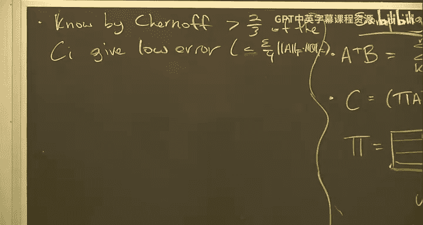

Check。Which one is good？For I goes from1 to R。If。A transpose B minus C。

Is that most epsilone over four times you， whatever？Return C。This would work， right？I is correct。

But what's wrong with this？I need to actually compute a transpose B。

 and not that's exactly what I don't want to do。So instead the clever trick。

Is going to be as follows。Instead we're going to do is for I。Go from1 to R。Okay。And then。

Let's say I'm going to initialize。Some counter。To be 0。For J。Goes from one。To。嗯。R。If。CRA。

Minus Cj for the norm is at most epsilon over two times the product。Then counter and gets increment。

And then what I'll say is。If the counter is at least。Arvor too。Then I'll return。All。谁。

So that's what we're actually going to do。And now I don't need to ever actually compute a transpose B。

Why does that work？The reason。A reason it's pretty simple。So the analysis。Number is good。

I is at least two hour of three。We said right， or actually。

 we just need that as's bigger than R over 2。嗯。If I is good。Then when I say good。

 I just mean the error is small。Then for a good J。We have triangleequ。

CI minus CJ Perminous norm is at most。A transpose B minus C。Plus， a transpose B。Minus CJ。

Which this is at most Epsilon number4。 did I really need Epsilon over 4。

 Maybe I could have gotten away with Epsilon over 2。 But anyway， this is at most。

Epsilon over two times whatever plus epsilon over two times whatever4。

So that's that most epsilon over two times。For being A for me B。Okay， so whenever。

Whenever we enter the main loop with a good eye。We will definitely return that eye。Now。

 the question is， what if before we reach that good eye， maybe some bad eye fools us？Can that happen？

Okay。And I claim that can't happen either by tri inequality。 And the reason is。

If he's close to more than half。Of the Rs。OrIf he's close to more than half of the CJs。Well。

One of those CJs had to have been good。Right because more than half of the CJs are good。

 the majority of CJs are good。So he's close to some good CJ。But if he's close to some good CJ。

 then he's close to a transpose B by triangle inequality。Right。

Because his distance to a transpose B is at most his distance to CJ plus the distance from CJ to A transpose B。

 Both of those are small。So by trying inequality， he's close to a trans speed。Yeah， sorry。Yeah。

 I did need。Epsilon over。Well， I could have probably done something a little better。

So now I'm getting three epson ever before。Right， so his， his distance by triangle equality。

 it's his distance to。It's his distance to this guy。Which is Epsilon number two。Plus。

 that guy's distance to a transpose B， which is Epsilon over 4。

 I probably could have made these uppsilon over two whatever， Okay， changes things very constant。

So thats that's the end okay， that's the analysis。 So questions about this。Okay， yeah。Yeah。Yeah。

Right， so when you yeah。そてばて。So yeah， we're gonna talk about lower rank approximation。

 probably next we'll probably get there by next week。 There are also sampling ways of doing that。

 The the real thing， the real thing that matters a lot here is your what error guarantee you want。

Okay， so we want this forennious norm error guarantee。

 which is not kind of which is not the strongest form of error guarantee we're gonna to look at。

 And for that， all that really matters of the row norms， the the L two norms of the rows。

 We're gonna to see another form of approximation， which is a better form of approximation。

 but then we're gonna end up paying more。Pay more in terms of what， Pay more in terms of M。 So here。

 I guess M is M is basically a constant。Right， so we're going to see that if we boost。

 if we make M bigger， we can get it， we can get better notions of approximation。Okay。Good。So this。

 this says that。Aye good。Relies。We'll return。CI。If loop。Enters I。And also。We won't return。

A bad eye by argument I just said verbally。So that's all I want to say about sampling to get forbe storm error。

Now， I want to tell you about kind of the JL approach to get fordian storm error。

Which is going to be oblivious。To the input， So this pie actually depended on A and B， right？

This one isn't going to depend on A and B。So。So， the JL。Approach。So let me first give a definition。诶。

Pi， let's say pies and。And by N matrix。Satisfies。We call it the epsilon Delta P。JL moment property。

If。The following is true。For all X。呃。So this is the sphere。 so for all x n dimensional x。

 which have unit norm。We have that the expectation。Over pi。So。I should really say that。So there's。

 there's a probability。 So pi is not a fixed matrix， so。D。Okay， D。Is。A distribution。Over pines。

So this probability distribution over pis satisfies this property。If。

When you take a random matrix from this distribution。 So pie is drawn according to this distribution。

 and you take the expectation of。This quantity。Pi x L2 norm squared -1 to the P。

The the moment of this error， this should be at most epsilon to the P times delta。Right。Yeah。

 so there's a distribution over M by N matrices。Okay。

 and that distribution over M by N matrices satisfies。This jail moment property。

 if this expectation is small， where the expectation is taken over a random pie drawn from that distribution。

Okay。嗯。Examples。So suppose that。Hi， IJ is equal to。Plus minus1 over root M。可。

When we analyze the AS cut。What we showed is that it has the。嗯。Epsilon， Delta。2。JL moment property。

Where M had to be at least what to have this。Okay。I don't well， if I take， so p is2 for me right now。

Right。When we analyze the A M S sketch， we basically showed it have this property。

And what did M need to be to have this property？This was basically a variance calculation。

So we're looking at the second moment。 and when you're dealing with the second moment you get something like one over Epsilon squared delta。

Okay。When we did the so this is AMS。We also looked at it from JL。 you know， when were analyzing JL。

 and we showed that。呃。We have Epsil Delta， which moment was relevant for JL？Yeah。

 log one over deelta， right？One way to see that is。Well。

 if you remember how we analyzed jail with Hanson Wright。嗯。We showed that。

The probability that you deviate by more than epsilon via Hanson W was at most E to the minus epsilon squared m plus e to the minus epsilon M。

Which is kind of a mix of Gaussian exponential moments。Gasian exponential tail down。 So by PAT1。

 problem1， that corresponds to， you， using the right moment to get the right failure probability。

Actually， I think there was a piece at。Problem on PSAT2， maybe that。

Asked you basically to figure out which moment was being used in。Moment estimation analysis。

 Remember， we analyzed this algorithm for estimating moments in data streams when the moment was bigger than two。

And we used Bernstein's inequality。 And there was one piece of problem that asked。

Which moment were you really using when you're doing Bernstein again， usually when you。

 when you're getting failure probability， Delta out of Bernstein or out of turn off。

 you're really using the log whenever we're Delta at the moment。And here M could be。

Log whatever deelta。Over up slot squared。Another example。Is the matrix from Pet 1 problem 4。

 I believe。Where each column had a random sign in one location and zeros everywhere else。

This is the Thorpe Jg sketch， which was based on the count sketch。And that。So。

Which what jail womanman property did it have and what did M need to be， So let's say Epsilon Delta。

What was P， What moment did you use？In PS at1。I remember a while ago。Yeah， it was two。 sorry。

 It's norm estimation in data streams。 It was a faster version of the AM M S sketch because an A S sketch。

 you need this den sign matrix。 It turns out you can just use hashing。 And that was， again。

 a variance calculation。 That was the second moment。😊，And M needed to be the same thing。 M could be。

What over Epsilon squared deelta？Okay。Good， so what's the， why did I write down this definition？

 What's the point of this。So now we have a claim。This is the main theorem of the gel approach。

Suppose。supposeuppose。Hi。Comes from。Some distribution that has the Epsilon Delta P jail moment property。

For some。P， that's at least two。Okay。Then。I might switch colors now because the yellow chas are all dying。

 basically。Okay， then。This is equally visible。Very good。Then for all。Marices AB。

Equal number with N roses。Hi also has n columns。We have that。The probability。

Over pi coming from whatever this distribution that has this property。That。A transpose B minus pi。

I suppose。泰y。Is greater than three times。For Ven A for Ven B。that most else。

It's the same kind of guarantee as with the sampling approach。It's just that we're using these。

 this jail moment property instead of sampling。 And this has the advantage that it's oblivious to the input。

 So， for example， if A and B are being updated in a data stream in a turns style data stream。

 someone says I want to add or subtract some amount from some entry of A or B。Then I can。

 I can use this approach because。Well， because oblivious to A And B， right。

 whereas with the sampling approach。I need to know what the final A And B L2 what the final row norms are to pick the sampling probabilities。

 And if A and B are changing， then I don't know what to do at the beginning of the stream。Yeah。Yeah。

 did， sorry。Three epsilon。Okay， actually。So this is what you know， this， this thing is in my。

This things in my paper with Daniel Kane。It's a pretty simple lemma。

I should mention that this three epsilon。Can really be epsilon。This is pointed out to me。By。

Its guy Olivier。So at some point， I guess in the paper。

 Daniel and I were just really sloppy with tri inequalities。 But if you really。

If you really do this properly， you don't actually lose in terms of epsilon。

Maybe I'll make out a homework problem。嗯。Yeah， so I'm not gonna the next homework work is gonna be released next week because I。

 I want you guys to。Have ample time to focus on picking a good project。

 so your project proposals are due next Thursday。So then I'll release the next next week。

 there will only be two more piecess。And so。Okay， good， so let's prove that。So。Let's prove this。

Notice that that probability。The probability that this thingy is bigger than epsilon times。M thingy。

By Markov， this is at most。1 over epsilon to the P times the probenous thing to the P。Times。

The expectation。The norm to the P， this is just moreov。So really。

 it just boils down to bounding that that pith moment of the for。Okay， so let's focus on that。Okay。

You just need to bound。A transpose B minus pi a transpose pi B。Forbenience norm。P norm。

RightThe P of moment is just the p norm to the P of power。Again， A has rows AI， B has R BI。😡，Okay。So。

嗯。A transfers B。Actually， let me write it like this。 This thing is equal to。

Notice that this thing is equal to the p over 2 norm squared to12。Those are the same。

And this is actually why I wanted P to B at least two。

So that the P over2 norm is actually still a norm。So this thing， e forbeous norm squared。嗯。

Is equal to the sum over all IJ。Of let me。Make sure I。I want to break this。Okay， so actually let me。

 so some of are all IJ。Of。AI， Al norm squared times B。L2 norm squared times X， I J squared。

 What is X I J。X Ij is equal to。嗯。Pi AI minus error dot pi。B呀。やビアい。嗯。Over theor of AI。

Over the number of B。More than number。Over than number B。对。So in general。

 what is the IJ and infantry of a matrix？So if you take， if you take a transpose B。

 what is the I J entry of this， It's the I throw of A dotted with D should be Js。

That makes more sense。Is the I throw of A dotted with the Jth of B？

So if you're looking at a transpose B minus pi transpose pi B and looking at its I Jth entry。Right。

 then it's。It's the I J entry of this minus the I entry of this， minus I J entry of this。

 Maybe I should have reversed these， but I'm squing it。 so it doesn't matter。Okay。

And I'm dividing by the norms so that these vectors are actually unit norm vectors。

 but then I'm scaling back by the squared norms。Okay。

So I I'm actually getting AI pi BJ minus AI do BJ。对。Which implies that。看看。Which applies that。

If you look at the P P over2 norm of this thingingy。陈。Then by triangle inequality。

This thing is at most。嗯。Some Ij。HeI。Squared。BJ。Squared times。X Ij squared。P over two norm。

This is just triangle inequality。And。We're going to prove a bound on the norm of the sky。Right。

So this guy is the same for all IJ。The bound we're gonna to prove is the same for all I J。

 so we can pull this out， and we're left with the sum of I J AI squared BJ squared。 But what's that。

 That's just the， yeah。Second that。This one， this one。Yeah，毕G。Sorry。So if you pull this guy out。

You have the sum I J， AI else the， the I throw of a squared， the the J throw of B squared。

 That's just the Frbeius squared of A times the Frbeius squared of B。

RightBecause if you sum up the squared norms of rows， that's just the Frminius squared。

So this thing here is at most the max。Overall all IJ。X Ij squared。

If you have a two norm times the Frenius norm of a squared times the Frenius norm of b squared。

This is not even all。It's not even Kohi Schwartz。 It's actually just。Yeah。

 it's actually just equality。😡，Yeah， it's overall IJ。 Yeah， is this equality。 That's right。

And notice， by the way， kind of I dropped the square root that was out here。Okay， so really。

 when you put that square root back， you get Frbenius of a times Frbenius of B。

So when you look at Markov's inequality。When you looking at Markov's inequality over here。嗯。

You're going to have for vennius of A to the P， forbenius of B to the P。Divided by。

 I didn't write it for B of A that they cancel。 And what you're left with is one over E to the P times something。

So that now just comes to kind of what is this bound here？Just fix。嗯。IJ。And then write， you know。

 X Ij。Is just equal to。嗯。What do we say pi。Let me call it pi x dot pi Y。Minus x dot y。Where。

X and Y have unit norm。Because we scaled AI by its norm and B by BJ by its norm。

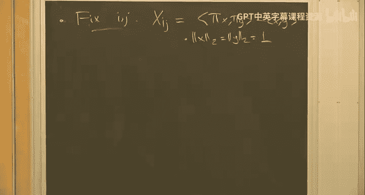

And notice that。Gn backwards now， X J squared pure Ra arm。It just the same thing as。

X I J P norm squared。TheseThis is just an equal。So now let's look at the penome of this thing。

XIj P norm。Well。嗯嗯。🤧咳ん。Don't forget this thing。Notice that。嗯。We have。X minus y。

L2 norm squared is equal to。Squared。Plus y squared。Plus a minus2 x do y。Which implies that。X dot y。

Its equal to1 half。X minus y squared。Minus x squared， minus y squared。

And we can write something similar for Px。Dot piy。So this implies that X I J is equal to。嗯。One half。

🤧あ。Pi。Pi X。Minus y L2 arm squared minus。X minus y L2 norm squared。Plus。These are both one。

 by the way。Plus pi X。Eor squared minus1。Plus pi y altoon norm squared minus1。

And now we're just going to use triangle inequality on the p norm。This implies that。X Ij， P norm。

Is that most one half times？嗯。Let me write。What。嗯。X minus y。L2 norm squared times the P norm of。呃。

Pi x minus y of term squared over x。Squa。-1。Plus。The pum of pi X。Plus2 squared minus1。Plus， the Por。

Hi why。2 square minus one。This is trianglelineality。And then I use my definition。

 I have the jail moment property。So I know the Pth moment is at most epsilon to the P times delta。

 The P norm is just the pth moment to the one over P。So this is at most。One half。

Let me pull out one half times。Epsilon times delta to the 1 over P。Times。

X minus y ein norm squared plus 1 plus 1。I can use triangleality on this。X and Y each have unit norm。

So their difference has Normost2。嗯。So the squared norm is at most four。Okay， so 4 plus1 plus1 is 6。

Divided by two is3。This is at most， that's where the three comes from。

3 epsilon and delta to the one over P。But if you're a little clever。You can do。

 you can get rid of the three。嗯。Good， so what have we just shown。So。

We show that the P norm is at most 3 epsilon1 over P。3 epsilon delta went P。

 And what we actually cared about was the P norm squared。

Because the p norm squared is equal to that thing。Right。So。This implies that。We call the star。

Star is at most。The be of a。Squared。Times per media and B。Squared times。

N epsilon squared delta to the 2 over P。And I just squared that。Okay。And then now going back to。

But I actually cared about。I had see that when I circled over there， I actually had a one half power。

 I actually carried about the P over two norm to the one half power。And then I'm raising it to the P。

 That's the P of moment。So。So the probability that that fy is bigger than three epsilon。

Forminius a timesius B。Is that most？嗯。Well， one over。3， Epsilon。AF bf。

To the P times the square root of this to the P。Which is Della。Okay。Questions。So maybe okay。

 so that's these are the kind of two。Standard ways now of。Of getting。

Of getting approximate matrix multiplication， one is the sampling approach。

 when the other is the litroenous error， and one is this jail moment property。

So now in the last few minutes。Let me introduce what we're going to。Do next time。

Which is going to be relevant， for example， for a question。Yeah。Yeah。Right， you can also do this。

 You could also do this for that。 set Delta actually be。A constant， like a 10。

And then do this kind of median， the matrix median trick。Right， so they both give。

They both give the same M， at least in terms of theta notation， M is one of Rsson squared delta。嗯。

And this one is oblivious to the input。 That's right。呃。Yeah， I mean， I guess。

 I guess it depends on your goal。 What if one of your goals is like。For some reason。

 you care about keeping a sample of your rows。Then the other thing is。is what you want。 But。

 you know， in terms of like computationally， as you say。

 this this has the same band as the other one with the added benefit of。Of being obous。I mean。

 the nice thing about。The nice thing about the sampling one is the matrix is really sparse。

 so you can multiply by pi quickly， but so is this one。This matrix is also really sparse。

We're going to look at kind of spectral approximation。 So let's say。

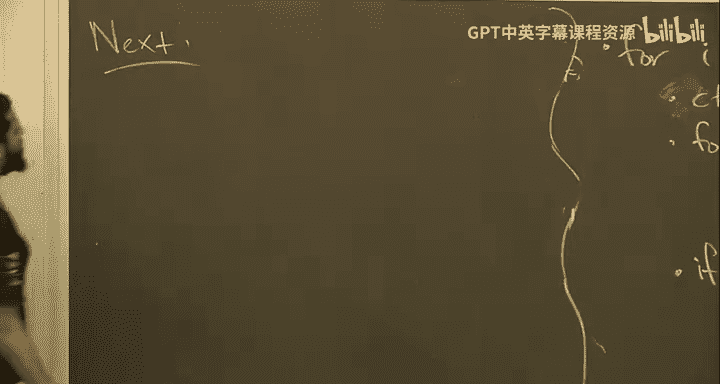

Pi a transpose。海碧。Minus a transpose B。This is now the operator norm。Is that most epsilon？A time z。嗯。

Without loss of generality。So this a is equal to B。Why is that the case。

 Because I can always define a matrix M that looks like this。Okay。Over。

 let's say over the operator norm。Well okay， but first of all， let me say。呃。First of all。

 without awesome generality。Operator norm of A and B are both one again。

 because you can scale down by the operating norm and then scale back up pi's linear。

 and then given that with loss of generality， A equals B。And then I can do the M that I just did。A丽。

First of all。And what I want now is pi M transpose pi M minus M transpose M is at most this。

Why is why is it implied， know， Why does that imply the thing I actually care about。

 Notice that M transposeM。Look something like this。A transpose， A， B， transpose B。Or actually。え。Good。

诶。And this is。A transpose B， I guess。B transpose a。That's what M transpom looks like。 Notice that。

First of all， the operating number of M is also one。Y， because if you at M。

 if you look at M times a vector， and let's break a vector up into two pieces x and y。

This is equal to。Is equal to。AX followed by AY。Or BY。Which implies that。嗯。X，Y， L2 norm。Squared。

Is equal to Ax Ls y squared。Plus By L2 norm squared。But a has operated normal at most one。

 And so it does B or equal to one。 So this is at most。Plusus y squared。

Which is the squared norm of the original vector X Y。So it doesn't blow up norms。

I just been concatenating the columns。2。Allright， A And B might have a different。I see what you mean。

 A and B。Yeah， so A and B have the same number of rows。And they have a different number of columns。

 right。They have the same number of rows N。But A has D columns and B has P columns。

So I just cancatenated the columns。Does that answer your question？In so。诶。Well。

 remember that we've always been looking at a transpose B。So a transpose。

 the number of columns of a transpose equals the number of rows of B。

 which but the number of columns of a transpose is equals the number of rows of a。

So A and B have the thing number over rows。And maybe I'll be running out of time。

 maybe I'll just say so。You know， yet the error on the right hand side is the same for both。

 whether you have the operator room of M squared versus the operator room of A B。

 it's the same thing。And then you just need to make sure if pi M transpose pi B minus a transpose B。

呃。You know， why does that have small operator norm。

If pi M transpose pi M minus M transpose M has small operator norm， why does that。

 Why does that imply that。Pi a transpose pi B minus a transpose B has the same bound on the operator norm。

I'll leave that to you as an exercise， and let me just say one thing。Which is。Oh。

 this is where we were， let me do it here。So we'll get。Actually， something stronger。

Then just thatarrow bone。From now on。A is go to B。so let me stop talking about two matrices。Want。

For all X。嗯。Pi Ax。L2 norm squared。21 plus or minus epsilon。AX。L2 norm squared。Okay。

So we want pi to preserve。We want pi to preserve the norm of every vector that looks like A X simultaneously。

 It's a bit stronger than that error guarantee。Right， because。You know， if you look at this。

 if you look at this matrix。Pi a transpose。派 a。Minus a transpose a and look at the operator norm。

I mean， this is equal to。The soup over x of unit norm。Of。X transpose this matrix X， which is。Pi AX。

Squared minus。AX。Squared。喂。And。What that， what that bound would give us is it would say that the difference is at most。

 That bound would say that this thing is at most。Epsilon times。The soup overall Y。Of Ay squared。

But what I actually want， what I actually want。Is。I just want this to be our most epsilon times Ax quicker。

So next time on Tuesday， we're going look at how to get this guarantee。And again。

 there are going to be two approaches。 One is going be a sampling approach。

 except we're not going to sample by。Road norm squared of a。Okay。

 we're going to sample by something else。And unfortunately。

 the number of samples'll need is not going be a constant。 It's going to depend on D。 So remember。

 A is N by D。 It's going to depend on the small dimension。 More specifically。

 it depends on the rank of a。But at least it's less than n。

So an N by D matrix will get squashed to a D by D matrix， roughly。

And then we'll see there's also a JL kind of approach to also achieving this。And by the way。

 such a pie is called a subspace embedding。Let me write this down。Subspace embedding。So， pi。

Is a subspace embedding。Or the column space。Okay。We're going to see that that's going to be important for a lot of problems。

 like speeding up least where regression and PCA and lots of problems。So I'll see you all Tuesday。

 and I hope everyone got the email with project tip suggestions。

