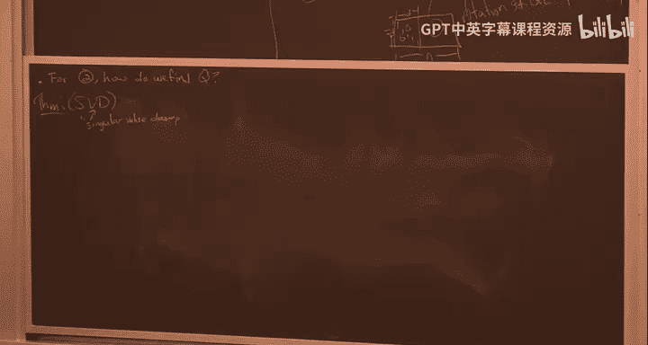
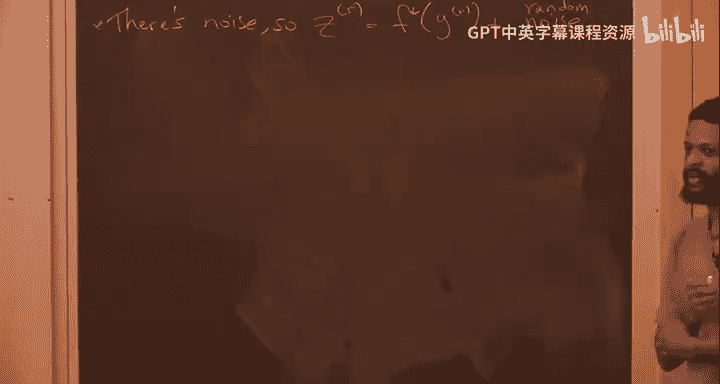

# 哈佛大学《大数据算法｜Harvard Algorithms for Big Data (COMPSCI 229r) 2016》deepseek - P16：-16-Algorithms for Big Data (COMPSCI 229r), Lecture 16.zh_en - GPT中英字幕课程资源 - BV1yGdNYvEMo

Last number one in matrix C such that C is close to a transpose B。 Remember that A was like a tall。

 skinny matrix， and C and B was also a tall skinny matrix。

 and they both have N rows and is huge I'm imagining。

And I don't want to compute a transpose B explicitly because that's expensive。

 So instead I want to somehow quickly compute some C such that C is close to a transpose B in some norm。

 So last time we did Frbeius norm error， and there were two ways sampling and random projections。

And basically， all these norms here were forbemous norms。And today we're going to do operator norms。

 okay？And at the end of last lecture， I mentioned， kind of without loss of generality。

 we can assume that a equals B because instead， what we can do is spectrally approximate this matrix M。

 And if you approximate M， if you approximate M transpose M。

 it implies that you approximate a transpose B。Okay， so from now on， A and B are the same matrix。

 so this is what we want down here。Okay， and today we're gonna show how to get， we're gonna get。

 we're gonna achieve this。 Actually， we're gonna achieve something a little bit stronger than this。

So today。We'll deal with what call subspace embeddings。Okay， so let me first give you a definition。

Okay， so we're given。Some E， which is a subset of RN。Is a linear subspace？Okay。And pie。

An M by N matrix pi。Is an。Epsilon， Subspace embedding。ForE。This is the thing we're defining。

For all vectors x and E， it's the case that pi preserves the norm， so one。

 so we have the usual jail kind of guarantee。Okay。So this is the definition of a subspace embedding。

 Just think JL on this subspace。对。And what does that have to do with that？So for us。

E will be the column space。他诶。Okay。So that implies that。For all X。

 So what is a vector in the column space of a， It's something of the form A X。Right。

 so what does it mean that we preserve everything in the column space。

 It means that for all X in R D。 So let's say a is actually N by D。We have that pi Ax。

L2 norm squared minus is at most。One plus epsilon AX squared。And it's at least one minus epsilon a。

Right， so maybe。What they call this Z。So actually， like Z is AX。

 so we're preserving every z in the subspace while every vector in the subspace is of the form Ax。

Okay。嗯。So。For us， C is just equal to you know， D transpose D， which is equal to。Pi a transport pi it。

Okay。And， but this guarantee is saying is， it implies that。嗯。For all X。We have that x transpose。

That matrix， so x transpose。A transpose a minus pi a transpose pi a。X。Is that most AX。

L2 norm squared times epsilon。Right， so。So star。Is imping this condition。

Which is even stronger than that one。Because that line on the right hand side。

 you have the operating room of a squared。So you're comparing your error to the worst thing that a could do to a vector。

Whereas here you're getting that， it actually preserves X itself。Okay， so。

This is the subspace embedding guarantee。Questions about definitions。Okay。So first question。

 naturally， you know， usually just like jail， we want。

We want it to be the case that M is much less than n。

We're trying to do some kind of dimensionality reduction。Okay。

And before I get into how to come up with subspace embeddings。 Well， actually， okay， first。

 let me convince you that。嗯。There are subspace embeddings with small M。Okay。And then after I do that。

 I'm going to tell you how you can use subspace embeddings for like problems you might care about。

 like least squares regression。Okay， and then we're going to see how to efficiently come up with subspace embeddings。

 So let me write that down rest of today。First， what we're going to do is。So。

Some space embedding exists。For nontrimbuulpsilon， and kind of if。If only if M is at least D。

So you can't have a subspace embedding with less than dros。

 and you can have a zero subspace embedding with Ds。

 you can have a perfect subspace embedding with d rows。Okay。So。How to use。Sspace embedding。

For say least squares regression。And then and then I'm going。You know， find。Somespace embeddings。

Effly。And there're going to be two ways， just like last time sampling。

There's one way and then another way is JL。And then I'm going to wrap up by kind of going back to this。

More efficient ways。To use some beddings。So kind of this bullet is just going to be a proof of concept。

 I mean， it's going to be a legit way to use subs embeddings speed up least squares。

But then it turns out there are even kind of better ways or yeah。

 better ways to use subbeddings for least squares。 So we'll see that at the end。Okay。

So the first bullet is。It is somewhat simple once you know the right theorem。Okay， so。🤧Cla。So。

Any subspace is the column space of some matrix， right。

 Just write a basis for the subspace as columns of a matrix。So from now on。

 we're gonna specify our subspaces by matrices。 that's to column spaces。 So for any。A of rank。

 let's say D。Very。There。1。Does not exist。Any。Epsilon so space embedding。F uppsilon less than one。

M is less than D。Okay， so if you have less than D rows。

 you can't get a sospace embedding with with Epsilon less than one and also。There does exist。

A zero subspace embedding。With M。Equal to be， so proof。Okay。Well。If M is less than D。

🤧Then the rank of。Hi is West D。Right， which implies that。The dimension of the kernel of pi。

Is it at least n minus d plus1？Which implies there exists。An x， which is not equal to zero。In。

The kernel of pie。Interssect。Interssect E， E is E is the column space of a。Right。

So if there' a vector， if there's a nonze vector in the kernel， well you're mapping it。

 So it's after you apply pi， it's normal 0。You're supposed to preserve the norm up to 1 minus epsilon。

So you're not preserving everything in the subspace。Okay。I I'm saying you're losing rank。

How about two？We'll use。Why does there always exist as zero subspace embedding with m equals D？Okay。

Well。the picture to have in mind is just。We have a Ddisional subspace。Of R N， right？

 So here is what pi is going to be。 It's going to be the product of two matrices。

The first matrix to act on the vector will just rotate the subspace。 it's a rotation matrix。

 it'll rotate the subspace。So that the subspace becomes the subspace spanned by E1 up to E， D。Okay。

And then the second matrix that acts on it will just project onto the first deco coordinates。Right。

So。We'll use pi equal。Let's call it SQ。Where。Q is a rotation。To make。呃。Rotation such that。

QE is just the span。Of E1 up to ED。And S。Is equal to this matrix。It's the identity here。

This is the projection of the first D coordinates and the rest is0。 This is a D by D matrix。 Well。

 the whole thing is D by n。对。Okay， so great。 So we know that there's always this perfect subplace embedding。

 right， you can't be zero error。And we know that you can， you know。

 you can get it if and only if M is at least D。 So we know the answer， right， There's D。

 So you can say， well。What's the rest of the lecture about？What's the point then？You know， for two。

 a about right there。How do we find？How do we find Q？So there's a theorem。SVD。

 so this stands for a singular。Value。Decomposition。I'm sort of SVD just。嗯。

It says that for any。Mattrix A for any real matrix。嗯。

There exists u sigma V such that A is equal to u sigma v transpose。Okay。🤧嗯。For any aid。

 let me call it， let I say a rank R。So a is an n by D matrix of rank R。

You can write A as U sigma v transpose where。U is an N byR matrix such that u transpose U is the identity。

Okay， so in other words， you has orthonormal columns。

 the columns of U form an orthonormal basis for the column space of a。Also， sigma looks like this。

It's an R by R matrix。And the entries here are Sigma 1 up to Sigma R。Where for all I。

 Sigma I is at least zero， these are called the singular values。And V is a D by our matrix。

With orthoormal columns。So the columns of a。Form an orthoal basis for the row space。Sorry。

 the columns of V form an orthon basis for the row space of it。So this is just the theorem。

 a you know， it's similar to the spectral theorem。 If people remember the spectral theorem。

 it says that if for any real symmetric matrix， so symmetric is the key thing there。

 you can always diagonalize it using an orthogonal matrix。

 you can always write a as Q Sigma Q transpose where the diagonaries of sigma are the eigenvalues and and the columns of Q are the eigenvectors。

But in general， even if a is not symmetric， you can always write it like this。 Okay， this is。

This is the SVD。So I'll just take this as a given， this is something from linear algebra。Okay， and。

There are algorithms。There exist algorithms。To compute。This， this decomposition。

In O of ND squared time。Or even。U's a log factor。And D to the omega minus1。

Where omega is the exponent of square matrix multiplication。嗯。ThisThis is demo。一们去。And halts。Okay。So。

 you know， once you have this decomposition。Once we have。Use sigma V transpose。Conet。

Pi to just be you transport。Okay。So。嗯。Notice that。For all X。AX is the same thing as an。

Use Sigma of V transpose x。These are L2 norms。Which is equal to。Sigma。V transpose x。Right。

You doesn't change the norm。 right just， I mean， the easy way to see that is if you。

 if you square this thing， you get。X transpose V， Sigma transpose U transpose U， Sigma V transpose X。

But you transpose you as the identity。Right。So you can just remove you and it doesn't change the norm。

So。You can set pi。 You can just set pi to be U transpose。So this is the same。

 so this becomes now pi U。P use the identity。And pi has D rows because you transpose， Well， actually。

 pi has R rows where R is the rank of a。 I'm just assuming that a has full column rank。Okay。

 questions。You look like you have a question。No。Okay， thinking you pondering，嗯。Good， so， in fact。

 there is an algorithm to actually compute a perfect subspace embedding。

 It has D rows or rank of rank of a rows， and it has zero error。The problem is the running time。

 it takes N D squared time or N D omega -1。Okay。And， you know， in this class， we like to speed。

 speed things up。So we want to come up with fast subspace embedding so that we want to quickly find a subspace embedding so that we can use it in applications。

And get fast algorithms。Okay， so before I tell you how to actually find somespace embeddings quickly。

呃。Let me say one application。Of subspace embeddings。So。L square is regression。Okay。

 so here we're given。We're given a matrix A， which is N by D， Think of n as big。And we're given a B。

 which is an RN。And what we want is we want。Xley squares， which is the Argman。Over x in RD。Of。

AX minus b L2 norm squared。哎。Why do we want this？P。So I'll spend a little time on the background。

 but this is now getting into stats， which I'm not going to focus on， but some background。嗯。

There exists a hidden。X star in our RD。And we want to find it。Okay。And。🤧We're actually。Yeah。

 there's just a hidden X star and I already even want to find it。Or more generally。Let's say that。

Let me read it like this actually。Let's say there exists a hidden kind of F star。Okay， which maps？

RD to R。Want to find it。Okay。And we know that F star comes from some family of functions。

We want to know which function in the family is the one that is the truth。So。And there exists。U。

D plus1 variables。Let me call these kind of。Y1 up to yd as well as a variable z。

And what we're assuming is we're assuming there's some functional relationship between Y and Z。

We're assuming that Z is actually F of y。😡，Okay。So what we'd like to do is we'd like to get many different y vectors。

 okay。So we get we do some experiments， okay， we collect some data from somewhere。And we get。Y1。Why2。

YN。As well as Z1。ZN。These are all numbers。This is a vector， this is an RD。

So this is actually this D dimensional vector。 And then we get what should be F of that vector to get Z1。

 And then we get another D dimensional vector， and we get kind of F of that vector。Okay。

 but there's noise。There's noise in our data collection。There's noise。So ZR。

Is actually kind of F star， we're assuming that ZR is actually F star of YR。Plus， noise。Random noise。

Okay。

And。If we assume。That F star。Of why。Is actually equal to a dot product， kind of X star of y。Then。

What X， L S is doing is it's returning for us the maximum likelihood estimator of F star。

It's the's giving us the maximum likelihoodestimator for X star。Over here。Okay， so。Kd of in general。

 So this this is a linear regression problem。Yeah。So that's why we want to solve。This thing here。

Okay。So now let me just solving me focus on solving this。Any questions？Okay， so back to。Oh wait。

 So maybe I should just write this。 So if we assume that this is true。Then。

XLS is the maximum likelihood estimator。For。For X star。If we assume。Let me call this noise。You know。

 alpha R。If we assume。That alpha Rs are independent Gaussians。Okay。

So this is probably something you would see in like Stat 110， maybe。Or some interest stats class。

So back to。Back to computing。X L。 well， if you look at that expression up there。

What kinds of vectors all you can choose is x right， so what kinds of vectors can you get as AX。

 you can get anything in the column space of a。Right。

So how should you choose x to minimize that L2 norm？Well， part of B。😡，Lives in the。

Part of B lives in the column space of A and part of B lives in the orthogonal complement。

So you should choose x to kill the part。That lives in the subspace。Right。So。Choose。So。

X LS is such that。A X L S is the projection onto the column space of a of。关闭。

Which is equal to UU transpose B。Where you is that same you from the SVD。Yeah。Oh。

 there's no power here， I'm just saying so you mean here？X star。Sorry， yeah。So if you assume。

 if you assume that the noise is Gaussian， then。呃。Yeah。

 so you assume the noise is Gaussian and that your function is actually a linear function then。

That's what you should do to recover the function。By the way， there are， there is very。

 theres some other nice work on using subspace embeddings for just more general regression。

 where it's non non nonlinear regression by。😊，Okay， so why later on？Y PW， So P is Pelanci。

 W is Wayne Wright。 Y is maybe Yang。 I forgot who what why stands for。But that was this。

 I think this summer， maybe or earlier this spring。But yeah。

 so somespace embeddings get used in lots of different places。Maybe you'll see some on the homework。

 you'll see some in class， you'll see regression now and you'll see PCA on Thursday。嗯。But yeah。

 so okay， let's， let's get back to to this。 So how would you compute the least squares。

 X least squares？ Well， you want this， right so。You can set。XLS to be V sigma inverse U transpose B。

 once you have the SVD。I'll leave it to you guys an exercise。 This also equals。A transpose A inverse。

 A transpose B。 Maybe this is the thing you're used to seeing。

 This is assuming that A has full column rank。 So a transpose A is actually invertible。

If a transpose a is not invertible， then what you do is compute the pseudo inverse。

 which basically amounts to doing this。So this makes sense。

 This makes sense even when a doesn't have full column rank。So， you know， you can compute the SVD in。

 in time n times D squared。You can verify this equality just by writing down a in terms of its SVD。

So you can， you can compute the SVD in， in the time that I said， you know， like N D squared。

 and then you'll solve least squares。Yeah。嗯。Or you could compute a transpose a and then invert it。😡。

Well inverting it takes like， it's only a D by D matrix， A transpose A。 So inverting it is d cubed。

 Let's say computing a transpose a is actually the expensive part。Just using four loops。

 computing a transpose A takes N D squared time。对。Now。So claim。If呃。Dx squared。

Is equal to1 plus or minus epsilon。A prime X。Squared。For all X。What's a prime or a prime？

Is the matrix。You put A here and then you put B there。Then。嗯。If x told the。Ls。

Is equal to the argumentrg。Over， let's call it x prime is。X， and then there's like a minus1 here。

Right so。我。Okay。Does this make sense， Maybe I feel like I。

Might have been a little too quick with the notation。 So I'll， I'll write something over there。

 But all I want to say is what we're actually gonna do is we're not gonna。

 we're not gonna to solve this problem， as you might imagine。

 because we're trying to speed things up。What we're going to do is we're going to replace a by pi a。

Repi is the subspace embedding。And then we're going to resolve the new regression problem。

Pi A X minus pi B。That just requires us to compute the SVD of pi A or compute pi a transpose pi a。

But computing the SVD of pi A doesn't take you D squared time or N D squared time。

 It takes you M D squared time， right， because pi A is an M by D matrix。And if M is something like D。

 right， we said that you can achieve M being D。Then M is D。 So instead of N D squared。

 it's d D squared， which is d cubed。So it's faster。Of course， there's the issue of A。

 you need to actually apply pi。Okay， and B。You need to actually find pi。

If you find pi by computing an SVD， well， yes， you can solve the lower dimension problem faster。

 but you spent N D squared finding pi anyway。 So what's the point。

Okay so that's so we're going to look at。We're going to look at how to find such pies faster。

Let me rewrite that lema because I feel like I。This introduction of De was。Maybe a little confusing。

Yeah， it's useful when the number of observations you have is a lot larger than the dimension。

That's right。So rewrite that claim， so claim。If pi is an epsilon subspace embedding。For。The span。Of。

The columns of A。As well as B。So that's at most the D plus one dimensional subspace because there are d plus1 vectors here。

Then。For Ex Tda LS being。The argument。Of pi A X minus pi B。Squared， we have。A X tilde L S。Minus B。

Squared is at most one plus epsilon over one minus epsilon。A X LS minus B。So if we use this solution。

 instead of the real optimal solution， we're not off by more than one this one plus epsilon over one minus epsilon。

Okay so let's prove that。So it's going to be something very simple。 First of all， we know that。

We know that this is true。This X Til to L S is the optimal solution for this regression problem。

 So in particular， it does better than。XlS does for this regression problem。Right。

Exel LS is the minimizer。But what is this vector， This vector is pi times A X， L S minus B。

And we said that pi preserves everything in the span of the columns of A， as well as B。 Well。

 this vector is in the span of the columns of A and B。 So pi preserves it。

 So this is at most one plus epsilon。AXLS minus b Lson norm squared。

And you can do the same thing here， this is at least。One minus epsilon。

A x tilde LS minus b L2 norm squared。And then you just move the1 minus subpsilon over there and you're done。

 Okay， so that's it。So。Total time。To find。呃。X to the LS。It's。Time to find。H。Plus。Time。To compute。

The things you need to compute， which are。Pi a。And pi B。Plus， you know。

 O of M times d squared to then solve the lower dimensional regression problem。So we're happy。

 you know， using that pie， we're very happy with the third bullet because M is as small as it could be。

 M is D。We're not as happy with。呃。Well， okay， we're definitely not happy with the first bullet。

Are we happy with the second bullet， I don't think we're happy with the second bullet either。

 actually。Because。To compute u transpose times a。Well。You transpose A。

 you're multiing a D by N dense matrix by an N by D matrix。

And that can also take you N D squared time。So kind of we're not really happy with either of the first two bullets。

 but we're happy with the third。Okay， so the rest of the lecture is gonna be how to。

Be happy with all bullets。And then at the end if we have time， I'll tell you about。

So this says there's a claim here。😡，You should think of you should think of this as saying epsilon subspace embedding implies approximate regression。

 or epsilon subspace embedding implies one plus epsilon approximate regression。对。

We're going to have other theorems that say things like。A one third subspace embedding。

Together with some other steps implies one plus epsilon approximate regression。Okay。

 so there are some other steps there， but it it's gonna have some advantages in terms of run time。

Because as you might imagine。Quickly， computing and Epsilon subspace embedding is gonna The run time is going depend on Epsilon。

 Okay， it's going grow if Epsilon small。And then we're also gonna have another， another reduction。

 which says， actually， you don't even need an epsilon。

 You don't need another thing you can do is use like a one third subspace embedding combined with some other steps。

 some other different steps。 And that also works。 Okay， so we'll see that later。 But now。

 let me actually tell you how to come up with subspace em bes。So getting。Subspace embeddings。

Two methods。Just like last time。Sampling is one method。

And the other method is going to be kind of a JL method。So let's start off with sampling。

So when I say sampling， I'm going to look at the case where pi is actually。An N by N matrix。But。

The diagonals。Are going to be either one or0。Okay， and we're going to have to normalize。

 So801 over P1，8ta2 over P2。It N over PN。I'll say something about this in a second where a to I is equal to1。

If we sample。Row I。Of a。Which we'll call a little AI and zero otherwise。

And the expectation of A to I is equal to Pi。嗯。Okay。Remember that。A transpose a。Is equal to。

The sum K goes from1 to n of AK， AK transpose。Where I'm thinking of AK as actually being a column vector。

Okay， so。The i throw of A is actually AI trans。So， then， pi a。Transpose pi a。Actually。

 I think technically to be correct， I should put a square root here on the Ps。Okay。

So pi a transforms pi a， well。The k row of pi a。😡，Is Ak times eta K over root PK？😡，Right。

The K throw is a K， if we actually sample the K throw， Otherwise it's 0。

 and we normalize it by root P K。 So you take a K， A K transpose。

 what you get is the sum K goes from1 to n of8 K over P K。 So I put a square root here just because。

Since you're kind of taking AKAK transpose， when you multiply the square roots， you get back PK。

Times AKakK transpose。Okay。So。What we're going to do is we're going to keep each row independently with some probability PK。

P K is going depend on K。 Okay， so it's gonna be non uniform sampling。 Just like last lecture。

 we kept a row with probability proportional to its L 2 length。

Now we're going to keep a row with proportional to some other probability。

 We're going to have to figure out what that is。But it's going to be non uniform。

 independent row sampling。Another thing you could imagine doing is rather than。

 so here kind of you have an expected number of rows， which is the sum of the PIs。

The number of rows you get from this matrix is not。😡，Deterministic。

 it's a random number of rows that you get。 Another thing you could do is just sample M rows independently from the same distribution。

 According to the P Is。 That also works。 It's just on the board。 It's a little easier for me to。

 to show this one。Okay。So。You know， before I tell you what these sampling probabilities are。

 it's going look a little weird if I tell you out of nowhere。

 I want to tell you why the sampling probabilities I'm going tell you are like the most natural thing to do。

😡，Okay。Actually， this， I should think。 so Michael Cohen。Gave me this way of saying it。

 which I think is really maybe the right way to say it so so it makes some intuitive sense。嗯。Good。

 so。First of all。I don't want so why did I do it this way， notice that， first of all。

 notice that the expectation of pi a transpose pi a。

Is equal to the sum over k of the expectation of ata k over PK， ak， Ak transpose。

 which is just a transpose a。Right， expectation to8 to K is P K。

 So the reason I divided by P K is exactly so that I'd get an unbiased estimator of a transpose。Now。

 how should I set the PKs？I don't want。Any PK。 so now this is more intuition now，はいはい this。

How should we set？The PKs。So I don't want。Any。P K to be 0， because if it's 0。

 then we're just missing a row and we're not even getting the right expectation。

So given that none of these PKs are zero。😡，ok。嗯。Define。What I'll call RI。As being the soup over X in。

Our。RD。🤧。Of AI transpose X。Squared over the norm Ax squared。Some number I just made up。😡。

But let's define R to be this。嗯。I claim that if we don't。Set。PK to be at least RK。Then。You know。

We're in trouble。 we're not in trouble， but。We don't say then。Let's say it doesn't make sense。

 it doesn't make sense。To sample。Intuitive sense， to sample。呃。

To sample with less probability than arcade and why is that？So if we're buying the argument to that。

😡，You remind the argument that we should sample the row at all， that PK should be nonzero。😡，Okay。

Well。🤧咳。Let's look at the event that we actually did sample roquet。😡，Okay。Look at event。That we did。

Sample。We' okay。Then。C or pi a transpose pi a。LetWe call it row on。Is equal to。1 over P， AI。

 AI transpose plus sum over。 the other K is not equal to I of8 K over。PKAkaAK transpose。Okay。Now。

Pick。The X。Which。Achieeves。The soup。In the definition。Of R I。That implies that。Ex transpose。

Pi a transpose。Pi AX。Which is just the same thing as pi Ax L2 norm squared。Is equal to。Well。

AI transpose x squared over P。Plus， a sum of stuff， which is all not negative。Right。

So this is at least。AI transpose X。Square over PI。Right， but we chose X to achieve this soup。

So we know that AI transpose x squared is equal to the L norm squared of A X times R。

 So this is equal to。The L2 norm squared of AX。Times R over PI。Right。So maybe I should have said。

if we don't set it to be at least。呃。So what do we want？

Kind of what we see is this thing is at least this。😡，So if PI is too small。

If PI is less than we'll say RK over 2。This is bigger than。2 AX squared。

If PI is less than R over  two。Right。Does that make sense？

So if we're sampling at a rate that's much less than R， like less than R over 2。

 then whenever we actually do sample that row， we're guaranteed to be screwed。😡，Okay。

Because there is this x that's making it too big。So if we're going to sample the row。

 why are we sampling at a rate that's guaranteeing us to be screwed when it's actually sampled。

 that doesn't seem to make intuitive sense。So。The intuition is that kind of the sampling probability should be something like these RIs。

And actually， that's exactly what， roughly what they're going to be doing。 Okay， so now let me。

Onlyly in a definition。Definition。Given A。The ice。Given A。The if。Leverage score。LI。Is Li。

 which is equal to。AI transpose， a transpose a inverse AI。I'm assuming again。

 that a has full column rank。If it doesn't have full column rank， then。This is pseudo inverse。

 where you write the SD of a transpose A， and then that's equal to U sigma V transpose。

 and then you take B sigma inverse U transpose。Okay， so。Now， claim。LI is equal to R。Okay， so really。

 the thing that we should be doing is we should be sampling by these leverage scores。

So let's prove this claim。🤧。And the observation is， note。That both。RI and L。Our basis。Independent。

 what do I mean by that。IE。If。呃。And。Is a square inverible matrix。Then。L lie of a。

Is the same thing as L of AM。An R of a。This is the same thing as RI。Okay。

 so let me convince you of that。Let's look at the definition of R I， okay， so。R I of AM。

Is equal to the soup over x。Of。Now I guess we would have。AI transpose MX， I guess。

But then we can just view this as， just view this as。Why。😡，Right。Any Y can be written as MX。😡，Right。

Because should well， what should x be， x is just M inverse Y， M is invertible。

So this is the same thing as soup over Y。Of AI transpose y squared over。AY squared。

Which is the same thing as R of A。Okay。So。Good， so we can assume that。That。So we can choose。

 We can choose M。So choose。Such that。A tilda being AM。Has orthoormal columns。So M would be。

 for example， V sigma inverse from the SVD。Okay， so。So like all step of generality。

 we can just assume this A is actually this a tilde， which is A M。

 And then we have that R is equal to soup over x。AI transpose x squared over， well。

 the L norm squared of x of A squared is just the norm of x squared now。Okay。

 and then we have L is equal to。AI。Transpose a transpose a inverse。嗯。AI。

But this is just the identity now。So this is equal to。AI L2 norm squared。So the question is。

 which x achieves the soup year？The X that achieves the soup is。The vector AI itself。Or yeah。

 the vector AI itself。Okay， so this thing is actually the same thing as just AI alters， right。

So these two things are the same。Okay。嗯。So you might be wondering something right now。Which is great。

 So we sample my leverage scores。 How do you compute the leverage scores？😊，Okay， so。

So if you just kind of。Think through a little of what I said here。 What I said was。

We'll choose M such that A has A AM has orthomal columns。 So what is M M is V sigma inverse。

 So this is really saying that A M is U from the SVD。

And then what we're saying is we're sampling according to these AI squares after we made it have orthonormal columns。

😡，So this thing is actually just UI squared。Right。We're sampling according to the squared rowors of U。

Were you as a matrix that has。Orormal columns forming a basis for the column space of a。

How do we get you？The SD。 So， so great。 We can compute the leverage scores and sample according to leverage scores。

 But to get the leverage scores， we need the SD。😊，So we're back to。Nowhere， basically。

 But as you will probably see on the Pet， I think I'll make this a Pet problem。

There is a way to approximate the leverage scores。 So it's okay if you don't exactly sample according to leverage scores。

 if you sample up to like。An approximation of them， that's going to be good enough。Okay。嗯。

So you'll see it on Pset， and you can get an approximation。

 You can get an approximation of the leverage scores actually using the JL approach that we're going to see after this。

Okay， so。To to actually instantiate the sampling approach。

 you really need to go through the jail approach as far as。 Well， there are some other papers。

 actually， that do it in a different way， like。This iterative row sampling by。Lee Miller and Pang。

 and there have been subsequent works as well。嗯。🤧But good。And so this is now the theorem。

This theorem is due to。 Let me make sure I， oh， actually。Before I write the theorem down。

So we said that we're sampling according to leverage scores， right？

So how many samples do we actually need。So if we sample。By the way， I haven't just remember。

 I haven't yet proven that sampling my Le scores works。I just said， you know。

 if you follow this intuition， then you should be sampling by at least the leverage scores。

So you should be sampling by something that's at least this。Yeah。Yeah。Yeah。It is square because。

 oh wait， is it not square？Sorry。M is equal to so sigma is R by R， where r is the rank。

V is equal to n by R。 Oh yeah， that's a good point。Right。So oh yeah， pad pad Sigma with。嗯。

So A is and by D。I do a D by D rotation。Sorry。Maybe that well， I wanted to say that。

I want to say that any I can replace this Mx by y and then x is just M inverse y。

 So taking the soup over x here is the same as taking the soup over y there。嗯。Yeah。

 maybe I confusedfuse myself for a second。呃。Let me just let me just fix。Oh， you mean， so for any X。

 that's not in the kernel。Yeah， you could probably fix things that way。 Yeah， let me。

 let me not think about this。As I'm standing here because I'll probably。

I'm not seeing it right immediately。 I'm sure there's some simple thing that I'm just missing。

 I'll just fix that in the notes。嗯。So。Okay， good。 So if we sample， if we were to sample according。

It's a UI squared。Then。Expected number of rows sampled。Is equal to well， it's the sum of I of Pi。

Which is equal to the sum。Over IUi squared。Which is equal to the Frbeius norm squared root of u。

Let's say A is an n by D matrix。 It has rank D。So what's the Frmini norm squared of U？It's D。

Because you can。One way to view the perve norm squared is the sum of all the squared row norms。

 but it's also the same as the sum of all the squared column norms。And each column has， has norm one。

 because it's an orthon basis。 So you， this is D。 So you expect to sample D rows。Okay。

So now let me write the theorem。😡，This theorem is due to。Jnaus。马honey。And with Krishnan。Miissota 06。

If。And。If we choose。PI to be。At least up to a constant， let's say the men。Of one。

 of course you can't sample something of your probability bigger than one。And。Let's say。

Log D over deelta times UI Lt2 arm squared over epsilon squared。Then。The probability that。Pie is not。

An epsilon Subspace embedding。For a。Is that most doubt。Okay。

So the rows that have a large enough leverage score。

 like sometimes this expression can be bigger than one。 by the way。

 how big how big can a leverage score get？Yeah， and so note。

That UI L2 norm squared is the same thing as UU transpose EI。L2 norm squared。

 which is the projection。Onto the subspace span by a。EI L norm squared。Okay， so。

This right here is just。EI transpose， UU transpose， UU transpose EI。

And you transpose you as the identity。Okay。So this thing is just the same。 So， yeah， so this is。

 this is。This and this are the same thing。And， and projection operators don't blow up norms。

 They can only shrink norms。So this is at most the norm squared of EI。Which is one。

 so none of the leverage scores can ever be bigger than one。And they sum up to D。Okay， so。

Since you're sampling by the leverage score time something bigger than one。

 this could potentially blow up to be bigger than one。 But then if it ever becomes bigger than one。

 you just deterministically sample it。Otherwise， you sample according to this probability。嗯。

It see how muchC碟。So。帮我。Let me state a tool。And then show you how this can go。You can analyze。

They can prove that theorem using。For example， matrix turn off balances。Or you've seen kinchen。

 you can also use or non commutative kinchen。Maybe I'll just show you what this looks like。

Because it's something similar to things you've seen。So。Definition。St and Por。Of a。For one。

 less equal the P less than equal to infinity。Is。A shat and P norm。Is the LP norm？

Of the singular values。So take the SVD of a。Take those singular values in sigma and take their LP norm。

 that's the Shatn P norm。And。If a。Has rank。At most D note。嗯。AP。Is equal to theta。Of。

The operator norm。Which is equal to it。Shat and infinity。For。P being at least log D。

This is by holder's inequality。Okay， so shatton log D norms or shaton P norms for P， at least log D。

 are basically the same as operator norm。And then there's a theorem。This is due to lus Picard。And P。

In 91， this is the non commmutative kinin inequality。Which says that？If you look at the expectation。

Of。嗯。Some over I。Sigma I AI。St and P norm to the P to the whatever over P。

So this is something like LP norm for scalrs， but now for matrices。And these are rodmaers。

 so these Sigma eyes are。Plus， -1。It his expectation over sigma。

This is at most up to a constant root P times the max。Of two terms， the first term is。呃。

Some of our eye。Sigma I。AI transpose AI。St and P norm， the return norm through12。And。Some of eye。AI。

 AI transpose。Shan and Pier returned turned to the one half。对。And。

I'm going to maybe I'll also turn this into homework problem。

 I need to figure that out or I'll just put in the notes。嗯。You can use this。 Remember， remember。

 there's this idea of sumsymmetricization and then using。

 and then using kinin and then doing the square root trick。 We've。

 we've seen things like that before。 You can do that kind of thing and basically prove this theorem using using this inequality。

And you you'll choose P to be big enough， like you'll choose P to be。So。Choose。

P to be something like。Logo。D over Delta。And then you'll apply this non commmunutative kitchen。

The D appears because you want to basically say that shat and Por and operate norm are the same thing。

Okay。Okay， so a question。So one is， one is AI transpose AI， and the other is AI AI transpose。

So you know， in our case， the summans are actually symmetric matrices。 So they're the same thing。

 So you don't need this max。 But in general， if you have non symmetric AIs， you need to do that。Okay。

 so that's all I want to say about in the sampling approach。So。哎。嗯。Yeah。

 that's all I want to do sampling approach。 So in total。

The number of samples you'll need will be d times log v over delta over Epson squared。Right。

And most of that。As should mention。Note。Wanting。Pi Ax。L2 norm squared is equal to Ax L2 norm squared。

's this one plus minus upps for all X。Is the same as。What is what is A A is U sigma of v transpose。

 pi U sigma of v transpose y xar squared is equal to u sigma V transpose y。

I to one plus or minus stepson for all why。So let me just call this。X。So we actually want。

We want that。For all X。H you。L2 norm squared is equal to1 plus or minus epsilon。UX or。Thanks。

Actually， I should say UX。But UX is the same norm as x。

So this is the same thing as one plus or minus epsilon。That's what we want。Is。That the soup over X。

A unit norm。Of x transpose。Pi you transpose。Pu。Minus the identity。Is less than epsilon。

 that's what we actually want， right？XSo x transpose times this is exactly and with an x here is exactly pi U X L2 norm squared。

 And then we have x transpose identity X。 That's just X L2 norm squared。

 We want that to be at most epsilon times the square number of x， which is1。So。

What we actually want is that the operator norm of piu transpose piu。Minus the identity。

Theres also thaton。So saying that we want a subspace embedding for A。

An epsilon subspace embetting for a is equivalent to saying。That we want this。

The operator norm of piu transpo piu minus identity is less than epsilon。😡，Okay。

So now that I've said that， let me move into the jail way of looking at things。So we want that。Pi UX。

Oh， well we want this， right， the original definition of subspace embedding。

 which is equivalent to that。 So notice here， by the way， that。The columns。

Of you are an orthonal basis。For E。E is that subspace that we've always been talking about。

 like the column space of A。And you just has an orthonal basis for E as its columns。

So saying that you're a subspace embedding for E。An epsilon subst for E is the same thing as saying this。

Okay， so we want that。Pi X。Eltro normum squared is equal to1 plus or minus epsilon and al norm squared。

For x for all x， which is in E。Ie。 the soup。Over x and E intersect the sphere。

 so all vectors in E of unit norm。Of pi X。Squared -1 should be less than epsilon。

 So where have you seen something like this expression。Right， this was。

This was what we were dealing with when we were talking about Gordon's theorem。Right。

This could be an example T。From Gordon's，Remember so Gordon。What Gordon told us。Was。

If pi Ij is a random sign over root M。Then suffices。To have。

And being at least the Gaussian mean width squared of the set t plus1 over epsilon squared。喂。

So now the question is just if we take a random sign matrix。How many rows do we need？Well。

 what's G squared of that set？G of E intersect Sn minus1。Is equal to。嗯。🤧K。The expectation over G。

 the suit over x of unit norm。Let's say x。X has unit norm。G dotux。

The set of all vectors in the subspace of unit norm can be written as UX or x as unit norm。

And this right here is。It's equal to G。Transpose UX。

This is the same thing as saying the expectation over G of the soup over x of unit norm。

Of u transpose G dot x。Okay。So here's a property of Gaussians， they're spherically symmetric。😡，Okay。

 so if you take a Gaussian and then apply some rotation to the Gaussian， you just get back。

 if you take a vector of independent Gausians。Okay， they're all means 0 and variance 1。

 and you apply any rotation to them。 You get back another set of Gaussians of mean 0 and variance 1。

So what does it mean to apply you transpose to this Gaussian， Basically。

 I'm doing a rotation and then only keeping the first D coordinates。So here's a Gaussian in RN。😡。

But T U transpose G is just a Gaussian in RD。 This is the expectation over G and RD now。

 which want to call it G prime and RD。😡，Sup over x of unit norm。Of G dot X。G prime do x。And this。

This is just equal to the L2 norm of G prime。So this is at most。

The expectation of the L2 norm squared of G prime to the12。Right， which is。The sum of IG prime。

Expectation G prime I squared。Square root， which is equal to root D。

So what we just showed is G of this thing is at most root D。So for us， this thing is just。😡。

D over Epsilon Squared。G squared is then d。So what this tells us if we take a random sine matrix or a random Gaussian matrix。

You know， it'll。By Gordon's theorem， it will preserve a de dimensional subspace as long as it has D reppson squared rows。

There are other ways to prove this values in Gordon's theorem just using a net argument。嗯。But。

 you know。That's great。Great。😊，So what's。Okay， so this is pretty good， right。

 because before we had these three bullets or what we want from our pies。

The third bullet was pi should have a few rows because our regression was faster。

The first bullet is we should find pi quickly。 The second bullet is we should multiply pi a quickly。

 So this， you know， M is great。 It's Drepson squared。 That's a third bullet。 The first bullet。

 can we find pi quickly。 Yeah， we don't even need to look at a。😊，Okay， it's just a random matrix。

The second bullet is a problem。Trouble。Hi A takes time。You know， basically， oh。M And D。

Using four loops。Which is actually even。Bigger than Nd squared。Right actually。

 multiplying pi A is more expensive than solving the original regression problem。So。We want to use。

A fast pie。Think， for example， sparse JL or fast JL， something like that。

And we're going to see it's possible。嗯。This is possible so。This is kind of， this is。

 this was introduced by So。 So this idea of using this jailL approach was introduced by Charloche。

 Maybe I should give a definition， definition。And Epsilon。Delta D。Olivious。Subspace embedding。

So it's usually called OSE。Is a distribution？D。Over and by matrices。Such that。For all you。In N D。哎。

With orthoormal columns。The probability over pi drawn according to D of this operator norm pi u transpose pi U。

Minus the identity is bigger than epsilon is at most delta。Does that make sense？So this condition。

Is saying that pi failed to be a subspace embedding for the common space of U。

So pi is drawn from an oblivious subspace embedding distribution。If。

 if you draw a random pi from that distribution， the probability that you fail to be a sub embedding is at most delta。

This distribution doesn't depend on U， so it doesn't depend on A。Okay。嗯。So for example。

 random Gaussian matrix or random sign matrix， et cetera。And Charlotte showed， showed that。Okay。

 one way to get it。 Yeah， Yes， it's true。 One way to get into oblivious subspace embedding' like a Gaussian matrix。

 But Charlotte said， actually， you can take you know， some fast jail matrix。

 and then you can get speed up。Okay， so next time， at the beginning of next lecture。

 I'll say a little bit more about oblivious subspace embeddings。 Okay。

 and then I I'll also show you those other two ways of using subspace embedding for regression。

Besides the one I just showed you， and then we'll see other applications like PCA， for example。

So do you have P for that。Okay， so the problem sets are in the back， problem set three， I guess。

And don't forget that your project proposals are due。What is it in two days， Thursday， yeah。

 Thursday？