# 哈佛大学《大数据算法｜Harvard Algorithms for Big Data (COMPSCI 229r) 2016》deepseek - P17：-17-Algorithms for Big Data (COMPSCI 229r), Lecture 17.zh_en - GPT中英字幕课程资源 - BV1yGdNYvEMo

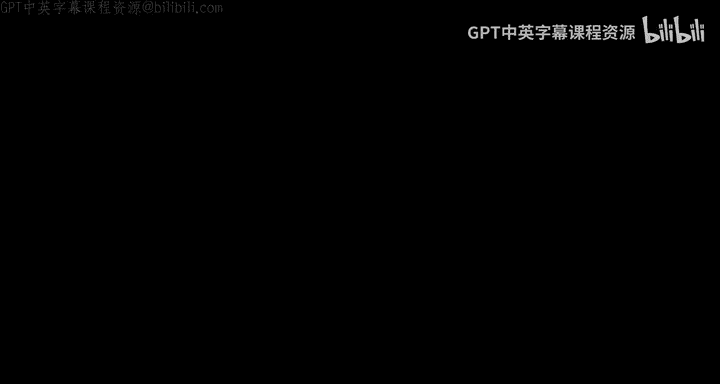

Hey， so we're going today talk continue talking about obliivvious subspace embeddings。

And we're going to see ways of getting ways of getting them。

 as well as ways of using somespace embeddings for regression。 So last time you mentioned one way。

 there are two other ways of using them as well that have some。

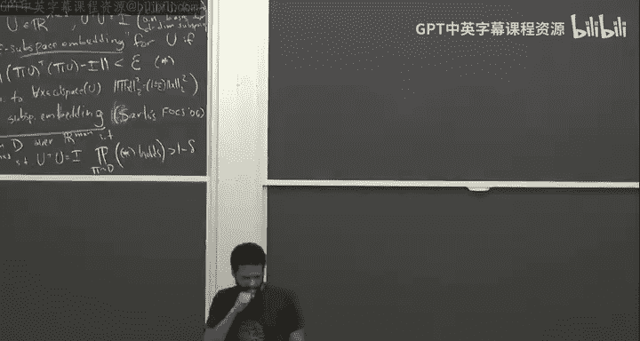

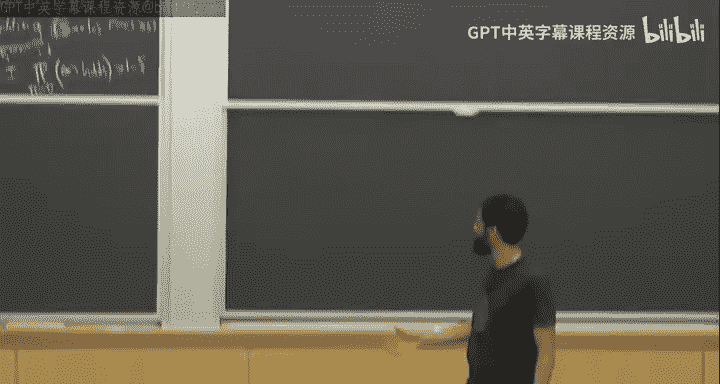

Speed benefits。As you'll see， and then we're also going to talk about low rank approximation。So。So。

 today。Ways of getting。Oh I see。2。嗯。More regression。And three learning approximation。Okay。So。Yeah。

In terms of getting OCs， I already mentioned that we already know how to get OSs。

 basically by Gordon's theorem。Right， so Gordon's theorem told us if you take a Gaussian matrix or random sign matrix with deal of reps on squared rows。

 You get it。 So let me， let me write down kind of the， the general， kind of， I think they're about。

Four， five methods。5 methods， one as I'll say， kind of net argument。So let me write， what is this so？

This is ways of getting OSEs。So。There's a net argument。The second thing you can do。Is。

Kind of use non commmunative kin。 And I'll just say a few words about each of these。

 I'm not going to go。嗯。Into full detail， noncom K or。Mattrix turn off。Okay。嗯。

Another thing you can do is use the moment method。Four thing you can do is。Use。

Approximate matrix multiplication with Frenius error。

And so I'll tell you what I mean here and E is kind of using chaining。谁。I'm not going to say。

 I guess I haven't used the word chaining in class before， have I？I haven't。But if you remember。

 when we proved Gordon's theorem， there was this like gamma2。Object that I described。

 that goes in line with a technique called chaining， which I'm。

 I guess it's beyond the scope of this course， really。 I'm not going to get really into that。

But chaining is another approach。 Just think of one example of Chaning being Gordon's steer。

So let me say a few words about each of these。 So a， the net argument。

You're going to see this on the PAT， which will be released tonight。 Okay。

 so there are only two more PSs， don't worry。You can drop one P， that's right。One。

 the lowest P S scores dropped。 Yes， don't forget， and don't forget。

 project proposals are due tonight。 Okay， good so。What do I mean by net argument， So you'll see。

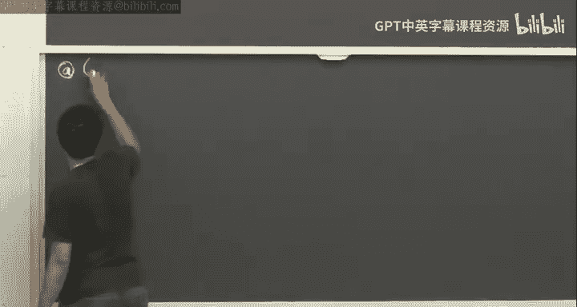

The details in the P side， but the basic idea is。

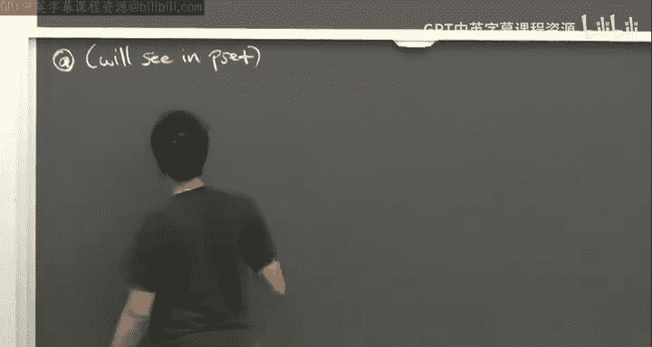

嗯。For any。

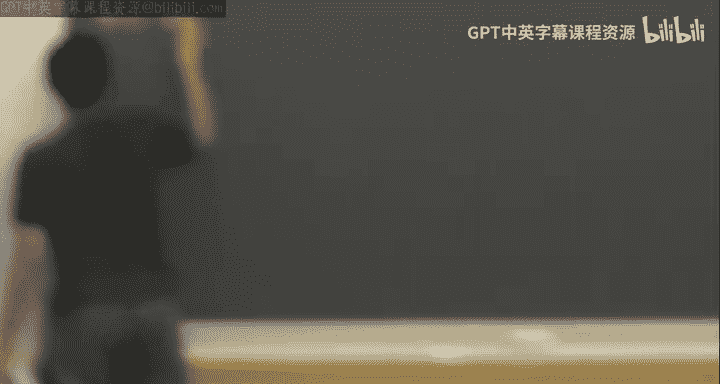

D dimensionsional subspace。嗯。Of RN。Okay。There exists a set E。let's call it T。

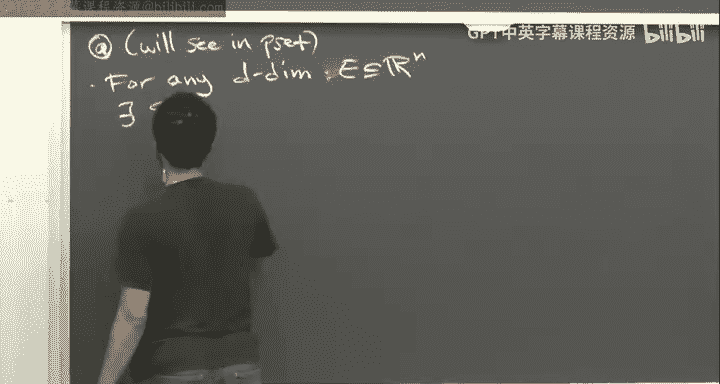

Which is a subset of E。Interssect unit norm vectors。 So there's a subset of E of unit norm vectors。

 okay。Of size。🤧。Ba， O of one to the D。 So O， I forgot the number。 It's like 9 or something。

 There's a fixed constant。Okay。Such that。If pi。Preserves。Every。X in T up to1 plus O of epsilon。Then。

Pie preserves。All of you。Up to one up slide。So for any dimensional subspace， there's this E you know。

 roughly9 to the D set of points， such if you preserve all those points， norms up to say。

1 plus epsilon over3 or something like that。 It implies that you actually preserve all of E。

 E is an infinite set up to one plus epsilon。 So you're gonna prove this in the P set。

 they'll give you some hints。Okay， but you know， what does this mean， It means that JL。

 like if you have distributional JL， that automatically implies an obolivvia subspace embedding。

Right， because distributional jail tells you that you have jail with failure probability Delta。

So what do you set deelta to B， you said deelta to B1 over that。So that by a union bound。

You'll preserve all of tea。Therefore， you preserve all of E。

So kind of you can use all the distributional jails， you know， black box， right？

 So a random sign matrix satisfies distributional jail， Sprse jail satisfies distributional jail。

 etc cea。 So all of these black box imply somespace embeddings， so。So distributional。Jail。With Delta。

Being。Let's say with failure probability。Delta prime being delta over the size of T。Applies OSE。

With failure。Probability。Delta。By union bound。Okay， so does that make sense？So， that's a。

What about B？😡，谁。So if you remember noncommunative kin。Non commutative kin。Okay。

 what you have here is you have。嗯。Kind of let。🤧咳。嗯。Let。And at the pome of a matrix。The know。

The expectation of the sha and Por of that matrix。To the P to the one。The non commmun kitchen。

 I didn't spend much time on it last time。 but I stated it。 It says that。

If you have single one up to Sigma N。Plus minus1 is independent。Then。Some Sigma I AI。P norm。

Is that most root P times the max of two things？One was。Some。AI， AI transpose。

To the one half you know。And the other was some AI transposed AI。Anyone have。Por。

You might ask what does it mean to take the square root of a matrix？Okay， so in general。

If I take F of a matrix。Where the matrix is a equals U sigma V transpose， right， This is the SVD。

 And this thing is。Sigma 1 up to sigma the rank。Then。F of a is equal to。You。F of Sigma 1。

F of sigma R。Betranss， thats what that's what that means。Basically， take the same matrix。

 but apply to function F to all the singular values。So basically， the idea here is。

What does it mean to be an obous subspace embedding？Right。We want that to hold with high probability。

 right。

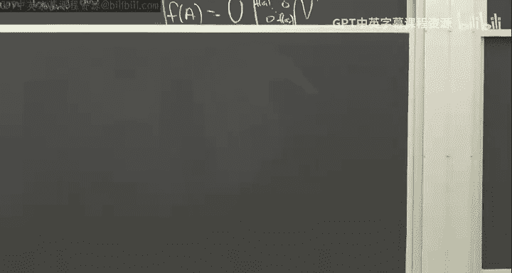

Continuing B。We want。Probability that。Pi U transpose pi U。

Minus the identity bigger than epsilon is at most delta？喂。But this thing by Markov is at most。嗯。

1 over epsilon to the P times。The expectation the of that operator norm to the P。Operator norm。

But I'm being a little loose here， but now the basic idea is， look。

 if I take P to B at least log the rank， right， you has at most D columns。 Well， you has D columns。

Right，So if I pick P to be at least log D， then chat and P norm and operating norm are basically the same thing by holder's inequality。

Okay。Because what is Shan P norm， Shan P norm is take the vectors， take the singular values。

Put them in a vector and take their p norm。And in general， if you have a D dimensional vector。

 the infinity norm and the log D norm are the same up to a constant by hold's inequality。

 So this is essentially the same thing as one over epsilon and a P times。嗯。

Kind of the expectation up to a constant to the P。When you put it like that， this is actually true。

 up to a constant to the P。That thing， shot and peor to the pe。Where P is now at least log D。Okay。

So now that tells us that what we actually want to do is bound， you know， the p norm of this matrix。

This matrix doesn't quite look like that。That's a sum of signs times a matrix。喂。

Time that's sum of signs， times fixed matrices。But now， how do we continue？So， we want。To bound。

The p norm of that matrix， pi U transpo piu minus identity。But notice that。Piu transpose piu。

Ass equal to。The sum of Z， Z transpose， or Z is the i throw。怕 you。So that implies that。

Piu transpose piu minus identity。Is the same thing as sum Z， I， Z， I transpose minus the expectation。

 sum Z， I， Z I。Well， let's say some YI transpose。Where YI is distributed exactly like the ZI。

 but independent of them。This is going to look like a trick maybe you've seen before。

You see this is clear what I mean。Y went up to YM， I guess， yeah。Ps are subspace embedding。So。

Whatever， yeah， it doesn't matter。All that really is going to matter。

 so this method works so in the very next step， you'll see what we'll need。 This method works。

When the rows of pie are independent of each other。No， so the reason that I want so for example。

 Sprse JL， we as we described it， the rows are not independent of each other because they're exactly。

 if you look at a fixed column， they're exactly S non zeros。嗯。But， you know。

 if you think a random sign matrix， oh， yeah。So why I。This I goes from1 to M。Right。

So what I'm saying here is。This is， this is pi U transpose pi U。

This is the expectation of piu transpose piu。So let Yi。Be a random vector。

 which is distributed according to this distribution， the Iho of pi U。

 So Y I is identically distributed as Z I， but it's independent of Z I。Okay。Okay。

 and then now we do the usual trick。 We did this trick， I think， with proving Bernstein a while ago。

 or maybe Hanson Wright as well。 No what， I't know about Hansonright。 We did。 We did with Bernstein。

 But the point is。By convexity， you can pull this expectation outside。So this is at most。

Some over I Z I， ZI transpose minus Yi， Y I transpose。哎。And then， now， note that。呃，嗯。

If if the rows of pie are independent of each other。Then each sum man here。

 like kind of Z I is independent of Z J。 So the summans here are independent。

 So this distribution is identical to the distribution where you just multiply each sum man by random sign。

This is the usual symatization trick。Assuming。Rows of pie。Are independent。

And then this is at most now using triangleequ two times sum of our I， Sigma I， Z， I， Z I transpose。

And it's the P norm， but it's like， let me write the P norm over both。Kind of sigmas and then Z's。

There's two sources of randomness。Yeah， so by P norm here， I mean。That top thing。

 the penor matrix is that。Okay。And then now what you do is。Your first take。

The p norm over the sigmas。And when you take the pome of the sigmas。You can now apply。

 that's exactly， you know， fix disease and take the pen over Sigmas。

 That's exactly the scenario of noncommutative tension。So this is at most root P times。

 Those two terms are the same now because these are symmetric matrices。Times the por。Of。Basically。

 sum over I Z L2 norm squared。Times Z， ZI transpose。Okay。And then now you do some tricks。

 And then you， you， you know， basically what you do is we started off。Right。

 we started off with something that looked a awful lot like that。 right， kind of we started off with。

With this。This right here is just the identity。And we bounded it in terms of something that looks a lot like itself。

And then if you keep going， basically， you can use the square root trick you know。

 which we did before and kind of get the final down。Okay， so I'm not going to do all that here。

Maybe I'll inject it into the notes， or maybe I'll。

How many things that I say are piece had a problem。 So I don't want。

 I don't want to give too many So， but kind of this approach。嗯。

This approach has been used by several papers。 And then。

 so this is non comm K is like kind of one concentration inequality for sum of independent matrices。

 There's various forms of matrix， matrix turn off， matrix Bernstein， etc cetera。 There's a。

A book on this or monographed by Joel Trorop， which is worth looking at。

But this kind of basic approach of using these matrix concentration inequ qualities has been used by a bunch of。

You know。This basic idea。Has been used by。嗯。呃。Maggan enthusiasts。By tro。By。Lou Dylan。Foster and Ugar。

And。By Cohen in a paper that's going to appear this upcoming soda。And also by a paper by。

Cohen myself。Yeah rigorous。And this approach can get you things like。

So imagine that you applied method A as sparse jail， right？So if you。

 you can always apply method A to like some net。 imagine you do it with sparse jail。

 How many rows would you need。RightDelta is1 over9 Delta is1 over 9 to the D。

 So log1 over delta is basically D。 So how many rows would you need。In Sprse jail。

If you applied the net argument。So sparse jail， the number of rows you need is log1 over delta over rhpson squared。

So you would need D rhpslon squared。What's the sparsity achieved by sparse jail。

It's basically an epsilon factor better than the number of rows， It's log when're delta over epsilon。

So if you just naively applied this net argument to Sprsedale。

 you would get that you need D Rpson squared rows。And D over epsilon sparsity per column。

But if you apply this exact， if you basically apply this exact sequence of steps to Sprse jail。

 but let's say a modified version of sparse jail where you actually have independent entries。Okay。

 where each each entry is on with probability S over as opposed to having exactly S non zeros per column。

Okay。Then， kind of。Noncommunative Kin applied。So this was observed by Cohen。

You can get M being something like。D times polylylogue。

D over Delta over Epsilon squared S being also polylog。D over deelta over epsilon squared。

 not epsilon。Buthen hashen he doesn't use non kin， and he's a fancier version of matrixtri to it off。

And what he's able to get is M being at least D times log D over Dlta。

Over Epsilon squared and s is at least。Lolog。D over Delta over epsilon。 So， you know， the。

 the fancier version he's using does allow him to have some dependence in the entries。 Okay， well。

 he's doing some tricks to analyze the case， yeah。O。Oh yeah。

 you said when we were covering Sprse jail， we said we would not improve if we used independent entries。

So that's true。 But， so， okay， so it's true。 But in Sprse gel， we had a different goal。

 our goal in sparse G was for any fixed vector， preserved with high probability。And。

Kind of by moving from。Independent entries to dependent entries。

 We're able to shave a factor of epsilon。Notice here。😡，We didn't shave the factor of epsilon。

We're here。😡，This is。This is independent entries。And this is dependent entries。Okay。Here。

 we didn't shave effective epsilon。 What we did shave was the the D。 It used to be D over epsilon。

 right， Now it's polylo D。So there's no kind of contradiction there， so。Kind of basically。

 to preserve a subspace。It's， it's easier。 It's。It's better to like。

 directly analyze that property than to preserve exponentially many vectors and union bound。

 So the union bound is basically very far from being tight，嗯，要有不快诉。Yeah。

 so the paper was accepted to appear in January 2016。CS， this is CS conventions。嗯。So yeah。

 so this is， this is the sparse jail you're familiar with with dependent in trees。

 And I should say that the conjecture。This time should be。Plus， okay， so I believe if。

 if you change that time to a plus， then this is actually the right answer。Okay， you might say。

 it's just a times log。 It's just a log factor。But as we're going to see when we talk about compressed sensing。

There are times when you want to set， just like， just like in the net argument where we set Delta to be exponentially small in D to get a subspace embedding。

 there are times in compressed sensing when you want to set Delta to be exponentially small in an O S E to get some kind of compressed sensing matrix。

So then D times log1 over delta is actually like an extra polynomial factor。

So if you had a plus here， it would be much better， okay。There this is， this is a meaningful。

Question to resolve to change that time to a plus。 And I think if you did that。

 you would get the right answer。Also。In this other paper with Cohen。Myself and David Woodruff。

We look at pie being。This PhD matrix， this fast jail。

And we show that it's enough to have M being at least something like。D times log。D over Delta。Plus。

 log， I believe。Let me make sure I'm saying this accurately。Okay。So if you analyze。

Kind of this let P be the sampling matrix。 If you analyze the sampling matrix for discrete Four transform diagonal signs for the O SE property using。

 using exactly this approach， okay。Then you'll get this pattern。Or at least that's the bad we got。

I should mention， I mean， there are other kind of tro， tro in this paper as well。

 also we analyzing this matrix。But there were some。There are some differences。

 this is kind of the sharpest bound we have right now。Basically， you set， you， for all these things。

 you set P。 you set P to be log of D over delta。It has to be at least log D。 So thatton norm。

 Sha and P norm and operator norm are the same。 But to get the failure probably to be deelta。

You increase pta log of D over delta。O。So anyway， that's all I wanted to say about method B。

 which is the non commmut kinin matrix turnoff approach。Then there's method C。

Which is the moment method。Okay。And there。嗯。The basic idea is。Well， it's basically the same idea。

Except。You kind of do things from first principles。 So what I mean by that。

 you again say that the probability that the operator number pi U transpose。H U minus identity。

Is bigger than epsilon， is that most one over epsilon to the P times the expectation of that thing to the P？

Okay。But what is this？This is the max singular value。To the P。Right。

So that's certainly at most1 ofrepson to the P times the expectation of the shaton norm。To the P。

Because this thing is the sum。Of。Oh， actually， let me， let me。嗯。

Let me write it in a more obvious way。The expectation of the trace。

Of pi U transpoposed pi U minus identity。To the P。Okay， cause this matrix。

The trace is the trace is the same thing as the sum of the eigenvalues。

And if you take this real symmetric matrix to the p power， the eigenvalues get raised to the P。

And eigenvalues are the singular valuess for a real symmetric matrix。

So this quantity here is just the sum of Sigma i to the P。

So here I'm assuming that P is an even integer。😡，Because then these are non negative things。

So the max is definitely at most of the sum。And then now you use the fact。

 you can prove this by induction。We take any matrix B and raise it to the P of power and look at the Ijath entry。

This is equal to the sum over all I1， I2， I plus1， such that。

I1 is equal to I and I plus 1 is equal to J。Of the product。T goes from1 to P of B， I T， I T plus1。

is you can prove this by induction。Okay， the Ijath entry of the power of matrix is this。Expression。

The sum of all paths from I to J of products of matrix entries along that path。Which implies。

Got the trace of B to the P。Is equal to。With sum over all I1 up to I plus1， well。

 the trace is the diagonal in trees。 So such that I1 is equal to I plus1 of the product of that thing。

诶。And you want to bound the expectation of the trace。 So it's the expectation of this。

And then now you basically just bound this thing。 Okay， so for each， for each sum end。

 you figure out， like， you figure out some bound on this。 and then you do combinatorics to like。

 count all the different cycles from。I to J and like， and well。

 from all the different cycles and how they contribute to this big sum， Okay， so。Now do combinators。

So， I mean， this， this kind of approach you know， it's the least is definitely the most calculation heavy。

 but it's the least like technically sophisticated。 You guys。

 you don't need to prove these more powerful theorems。 Okay， so this was used by。

So this approach is like Wigner。Whiickner was doing this in the 50s。You have。嗯。I'm now。

Freddie Comossh。In 80， something， the 80s。Okay， I mean， they were not looking at subspace embeddings。

 They were just bounding， They were just bounding operator norms of major random matrices。 Okay。

 and they did this。So， for example， if you take a random sign matrix。An N by N， random sign matrix。

 independent signs。EThe operator norm is at most root n roughly well2 end。

 but big of root n with high probability。 And one way of proving that is this method。Okay。

And then you get into basically， you figure out that the things you want to count。

You get Caalc numbers， and then you can write down a formula。 Anyway。

 there's this is like kind of classical random matrix theory。I'm sorry。What's the bound？

For subspacet。Well， now， I mean， now it depends right， So you do this method。

 but what you get out depends on the pi you're analyzing， right。

 So this is a general method that you can apply to no matter what pi is。

And what you get out depends on what pi you're analyzing。嗯。But， you know， for example。Like Sprsedale。

So this is still C。Continued。So sparse jail。So kind of before， before Cohen's paper， so Cohen know。

 improved what was known。 What was known before was basically using this moment method。

 So I had a paper myself with Queen W。This is in Fox 13。

Saying that you could choose M to be something like d times loggged to the sixth of D over delta。

Over Epsilon squared has to be something like。Long cubed the over Dlta。On Epsilon。

 so Cohen showed you know you can remove some of these log factors， there's just one left。嗯。Yeah。

 so removing this last log factor， I still don't have a。Sense of the best， I mean。In some sense。

 fruit。Kind of the reason we lost a lot of lot factors here is just because the counting thing that we had do was。

More complicated than a lot。 Well， it was kind of complicated。 And there were some other bounds。

 We didn't get exactly sharp。I think the moment method is definitely capable of proving the right thing with the plus instead of the times。

 It's just quite hairy。 And we didn't see how to do it。There's a little issue with。

There's a little issue with using matrix turn off and noncommutative kinin for removing the times。

 which is just you basically always have this extra log factor popping up whenever you do matrix turn off。

 So take a random sign matrix。 I said that it's operating enormous root end with high probability。

If you use matrix turn off， you'll get an extra， I think root log n。

 You'll get root n times root log n or something like that。

And it's just kind of inherent to the balance that， that exist in that literature。

 So if you were to get rid of the times using matrix turn off。

 you would basically first have to prove a better matrix turn off， which。

You sort of can't in general， that log has to be there in some examples。

 but maybe you could prove a more refined matrix turn off that reveals when you don't need the log or something like that。

 But would you would need to do that before you could。

 before you could push that approach further to remove the times。嗯。Also。Also that same paper。

And then there's another work by Meang and Mahoney。

Which said that you can choose M to be at least d squared over epsilon squared delta and S to be 1。

So this was basically this， this is very simple。Choose p equals 2。 So that huge sum is like。

Not so bad when P is2。 And you can just directly look at it and。AndPro this。Okay。

So we did moment method。 So now let me go to。And enough。Questions。So， D。🤧Yeah。

So the basic observation is this。Pi U transpose pi U minus。Identity， Opera arm is at most。

That same thing for Minor。Forenius norm is the sum of the squared singular values。

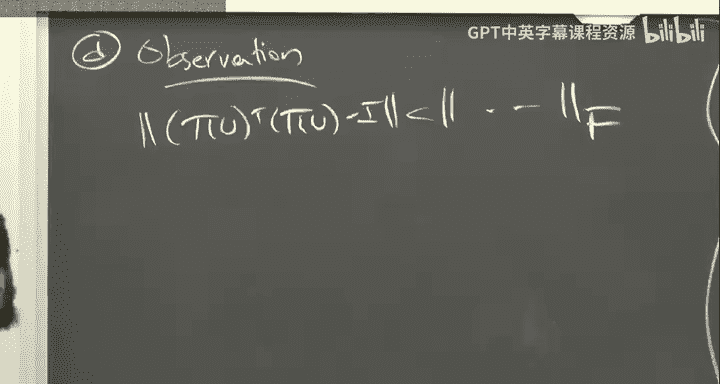

Sorry， for Venius norm is the L2 of the singular values。

Operator norms the L infinity of the singular values， and L infinity is always at most L2。Okay。对。

So if we could show， if the ferenous norm is less than epsilon。

 then the upper norm is less than epsilon。Right， so。What we want is probabilityability。That。

Pi you transpose。Hi U minus identity。For Venus norm， bigger than epsilon。Is that most Delta。

 And let me actually give myself some space here。And notice identity is nothing other than you transpose you。

So what does this look like？There's a big hint in terms of how I label D。

Right so our very first lecture after JL， when we started talking about linear algebra。

 was approximate matrix multiplication with Frenious norm error。Right。

So this is exactly what this is。 P U transpose pi U should be close to U transpose U。

And the kinds of theorems we proved before。Well， kind of we had an error。

 we had an error which was actually， you know， epsilon times。

The Frenous norm of the first matrix times the Frminous norm of the second matrix。喂。So what is this。

 this is D。Right because。The Frbinious norm squared of a matrix。

 Well you can just sum the squared norms of the columns， and each column has norm D。Or square norm D。

 So what you do here is then set。Epsilon Prime to be。Epsilon this is Epsilon Prime over here。

Set Epsilon primarily Epsilon over D， and then you'll get your epsilon。Okay。

What do we know about satisfying this approximate matrix multiplication of fromous error。We need。

O of1 over Epsilon prime squared。Delta。Equals o of d squared over epsilon squared deelta rows。哎。

So this， by the way。This is。This observation was made by Hui。It ran。

That kind of just for Bius automatically gives you operator norm。And。嗯。Good。

 so you can use basically， remember we talked about this jail moment property。

 Remember we said jail moment property implies A M with Frminius error。 So you can use any。

 you can use any distribution now that satisfies the jail moment property。 So， for example。

 Pet 1 problem 4， the sparse， you know， L2 estimation and data streams right。

 that satisfies the jail moment property。 So Pet 1 problem 4。It's basically sparse JL。

 where M is d squared。Over epsilon squared delta。And this is one， which， by the way。

 notice the same exact thing as this。 So of actually， if you really go into the details。

 you're almost basically， it's encoding the same kind of proof just。对。Okay。And so， chaining。

I'll say one thing that I haven't said yet about chaining。嗯。Chaining。

And maybe I should have also said this for net argument。

 but maybe I should have folded chain into net argument。 But so we know， for example， Gordon。Okay。

And also， the first。The first paper to realize that you could get this kind of S equals1 for a reasonable M。

Basically did some kind of chaining。 That was Clarkson and Woodruff。Okay， so this paper was。

 you know， before my paper with Hu， before Megan Mahoney， before this observation。

And what they did was， basically。Okay， so the net version of it is。

So what I'd like to do is I'd like to do the net argument， Union bound over these9 to the D vectors。

Okay， unfortunately， my， you know， if I have， if I have S being one。

My tail bounds are simply not good enough to union bound over exponentially many vectors。

 unless M is like huge， much user than this。But what they observe in their paper is they say， look。

Yes， it's true that the tail bounds in general are not great， but actually。

 the tail bounds are great for S equals1 for certain vectors。 So the vectors in your subspace。

 which are wellsp， actually have great tail bounds， even for S equals1。

So then what they say is for an arbitrary vector into the subspace。

 I'll kind of break it up as a sum of two vectors。A vector that's concentrated in a few coordinates。

 plus like a wellsp vector。Okay， and then， well， now I just need to like。

 make sure I preserve all those。Preserving， but， you know， preserving the spread vectors。

 I can do with concentration and union bounds because I have great tail bounds for those。😊，But then。

 preserving the。Concentrated vectors。Okay， my taildown suck for those。

 but there actually aren't that many concentrated vectors。

 So I need a union bound over way fewer things。 right， So pretend， for example。

 I'm union bounding over all the one sparse vectors。Okay， well， there are how many， know。

 how many one sparse unit vectors are there。 There's E1 up to there's only the standard base of vectors。

 There are very few。 So kind of their point was if you do the net。

 if you do the net argument more carefully。You can get a better bound。And。

And then if you do it like that， you sort of get a D to the fourth。

 But if you apply some chaining on top， which I'm not gonna talk about。

 you get something like M being。D squared times polylo。I forgot how many logs。

D over epsilon over epsilon squared with S being 1。Okay， so it almost got the right answer。

 Maybe it could have。 if you had done the chain a little better， I'm not sure。

And it was via different approach than to use。Okay， so。By the way， I should， know。

 we should sit back for a second and just think about what this means in terms of regression。Okay。

 so remember in regression， all you needed， we said last time was an epsilon Subspacease embedding。

What does it mean to have？In Epsilon subspace embedding with S being one。

It means you can apply the subase embedding in like linear time in the sparsity of the matrix， right。

 so。

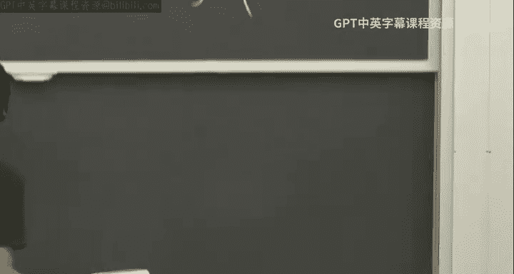

So note。S equals1 means。Can compute。呃，派 a。In time。Number of non zero entries in A。

Theyically thersity， the sparsity of the matrix A。Right。

 and then what you need to do is solve the lower dimensional regression problem。 So in this time。

 you can reduce the problem。 Now you're left with basically a D squared by D problem。

And then you can solve that， you know， using some slow method。 or actually。

 what they suggested in their paper is once you have the D squared by D problem。

Hit that regression problem with yet another subspace embedding。Hit it with， for example。

 this subspace embedding。now you have a roughly de log D by D problem。

And you have to apply this matrix， the PhD matrix， to the reduced problem。

The PhD matrix in general takes how long。 Well， for each。

 basically you apply pi to a column by column。You can apply pi to a given column in n log n time using the fast Fourier transform。

 and there are D columns。 So you can apply this matrix in time roughly N D， N D log n。Okay。

So first you do pi A and time n and Z A。Then you do pi prime applied to pi A。

 where pi prime is that matrix。 That takes time。Well， n is now basically d squared。😡，Right。

 and it's like D squared。 So that takes time de cubed。D cube log D。

And then now you solve this D D by D regression problem just by doing an SVD or something。

So your overall time is something like roughly N N G A plus d cubed up to logs。嗯。O， yeah。

So that's all I wanted to say about。Kind of A through E over there。

So what I want to do now is do some of the other stuff I said。

 I want to say something about better ways to use some embedding for regression and then something about low risk approximation。

Okay， so questions。You you have a question。O。对于。Yeah。Okay， so yeah， so you were saying in PhD。

 I separated two cases spread out not spread out。 but I guess the HD。

 regardless of what vector you start with。Once you hit it with H D。

 it's spread out with high probability。 Therefore， P works。

 That's sort of the idea behind the PhD matrix， okay。

Chaining and kind of net arguments are more about like。Well。

 net arguments are basically about union bounding。 So you want to， if you。

 if you preserve this kind of。Findine net of the set of points。 It implies you preserve everything。

 And chaining is kind of a way to do better than this naive net argument， okay。So样。Okay， so okay。

 so let me move， let me move on to these other topics。So。Rsion。L squares expression like last time。

 So last time。We said epsilon subspace embedding。For span of。Columns of A。As well as B。Implies。

Faster。呃。Proggression。Okay。So now I'm going to show you two other ways to use subspace embeddings。So。

Kind of。Okay Me 2。And for this method， I should credit。Its kind of， well。

There are few groups of Rolyn and Tiger。Al wait。There's also a run。美门卡。And Toledo。

And that was in 2010。And also the way I'm going to describe it now was in Clarkson and Woodruff。Okay。

 that same。Wherehy did I put that paper all the somewhere that paper。Okay， so what's the basic idea。

So one way to solve。Reggression， least squares regression is like a straight a straight shot method。

 right， So a transpose A inverse， a transpose B。Another way is start with a solution that's like。

 okay and then improve it using gradient descent。Okay， so。Use。Gianient descent。OrActually。

 in general， just use some iterative method。So just who here is seeing gradient descent？二。If not。

 that's fine， because I'm gonna show you exactly what you need to know。嗯。And。

The basic idea here is so gradient descent， let me just give。You know， you're given。Some function F。

And。Want to compute。X star， which is the minimizer。F of x。

Okay that's the kind of problem that we're going to look at。 So for us， F of x is going to be。

AX minus b L2 nor squared。And it's known for gradient descent that。For least squares。ほら。So。Basically。

 the method is start。With x0。In our own。Picket， however， I don't know。And， O。

 so in general ingredient gradient descent， the basic idea is this。I have some current iterate。

 like x 0 or some X T at time T。And now I want to update it to get a better X。

 one that minimizes F even more。😡，Okay， so what should I do， Well。

 I'll compute the gradients of F at the point X T。And I'll move in the direction opposite of the gradient。

RightBecauseuse if I move in the gradient， the gradient tells me like what。

 what direction I should move in to increase the most。 So if I go in the negative direction。

 hopefully， I'll decrease。And you move by some amount。Okay。

And then you just basically keep doing this。 Now you have a new point。

And then you compute the gradient there， you move in the opposite direction by a little bit。

 and you just keep going， and hopefully you prove some theorem that says that you're making progress。

So you stop after， you stop after some number of iterations， L。

 and then you try to prove a theorem that says my error decreased by。Some amount that depends on L。

Okay， so start with x0 and RN。For， tea goes from。Zero up to L。What I'll do is。X T。

Plus1 goes to well if you calculate the gradient for least squares。That's your function。 Basically。

 it should be X T。🤧Minus。Or plus。Okay。Okay。And theorem。Let Kappa。Of a。The operating room of a over。

The smallest。Singular value。Of a。Then。For L， which is at least。Cap of a。Log。One over epsilon。

If you look at。看到 a。AX L plus1。Maybe I need a constant here， I'm not sure。AxL plus 1 minus B。

Elton norm squared。 This is at most something like。Epsilon。Times。A x0 minus B。Elsator squared。

X B X plus Oh， actually， let me。And let me not say like that， that's actually not right。

This is what I should say。Put this， put here X star。Okay。So。

Kind of X star is like the actual optimal solution to your least squares problem。

And if you look at a x 0 minus a x star， the norm of that compared with what you're at after alliterations。

 then。You've decreased the error by epsilon。😡，And notice kind of just my triangle inequality。嗯。Sorry。

What's Epsilon？XR is the actual optimal solution to your least risk problem。So note that。AX minus B。

Is that most？嗯。Mus。AX star minus B。This is actually the optimal cost is at most。AX minus。

This is the triling quality。Okay。So。And if you have a bound on this， which is what we're getting。

 then you do get a bound on your distance stopped。And。So now really the name of the game is。Well。

 I really don't like this。I'm gonna put， I'm gonna to put some reference to， you know。

 I'm not gonna to prove this， but I'll， I'll prove something that suffices for what I want to talk about in the notes。

 I'll inject it into the notes after you give it to me。But basic idea is， I want。Small。Kappa A。

But of course， I might not be so lucky。Right， you're just giving me a worst case。 A。

 It happen could be huge。So what we'm going to do is pi is， let's say， a1。6， somespace embedding。

 let's say。This says C subspace embedding。For some。Small。C C is a constant。

 it doesn't depend on epsilon。😡，And now what I'll do is I'll write the SVD pi a is equal to u sigma of v transpose。

This takes me time M times d squared。Because pi A is an M by D matrix。

And now what I'm going to do is I'm going to pick R。😡，To be V Sigma inverse。Okay。Notice that。

For all X。X2 squared。Is equal to U X squared because U has orthoormal columns。

 But that's just the same thing as pi A R。Squared。Right。But pi is subspace embedding。So。

I should put an X here。Pi is a subspace embedding， So it preserves any vector of the form a times stuff。

 So if pi preserves this vector。 So this is the same， this is up to one plus or minus C。

 This is the same as A R X squared。Right。So what is this telling me？AR。

Applied to x has almost the same norm as x for all X。So AR is a well conditioned matrix。

AR's condition number， Kappa is a constant。And it has the same column spaces as a。

So what I'll do is I'll actually run gradient descent with AR as opposed to with A。Okay。

 how many iterations do I need， I need。Log one of Epsilon iterations because Kapp of A is a constant。

What's the work I have to do in every iteration？Well， if you look at this update formula。

Kind of A is now A R。 So I have to basically repeatedly multiply by A R and AR transpose。

R is roughly a D by D matrix， right？So I can multiply by R in like d squared time。

And I can multiply by a in NNZ time。So。The total runtime is basically。NNZ。Plus。

 d squared per iteration。 The number of iterations is log one over epsilon。 Plus。

 I need to compute the SVD of pi a。 And that's something like roughly。You know， D cube time。

So the nice thing is the dependence on epsilon is log as opposed to polynomial。

As like in compared with the other with with this method。 So this is。This， let me call this method 1。

Okay， does that make sense？And also。You know， to make sure that your error is really getting to be one plus epsilon at the end of the day。

 you need to make sure that x 0 was decent。So how should you choose x0？Basically。

 run the previous method with epsilon being like a constant。

Then you know that x0 is at least within a factor of  two evolved。😡。

And then you can refine it to one plus Epsilon opt in log one Epsilon iterations。

So run the old method with constant epsilon to get a0 and then run this method with a well conditioned version of a using which you find that well conditioned version using subspace nothing。

Question。Yeah。Right。Yeah， yeah， we're not getting。 we're not getting away with a having。Large ranks。

We're those to meet at Ha。There are some other problems which we're not going to get into here where you can do better if you assume that。

A has small， stable rank。Stable rank basically， is like。

It takes into account the rate of decay of the singular values。

 It's for beingia squared over operator norm squared。So if the single values are decaying quickly。

 you can sometimes get better bounds。Okay， I can erase well and erase this。

So that's method 2 for regression。 Let me say， method 3。

So there we just used the constant subsway embedding。Here what we're going to do is。Oh。

 and also kind of。Method one。Was。Epsilon， Subspace embedding implies kind of a sketch and solve approach。

When I sketch and solve， I mean， you reduce to a lower dimensional regression problem。

 you just solve it。Method two。Is kind of a constant subspace embedding。

 let's not like a sixth or something， some constant。Implies。Faster， gradient descent。Okay。

 and then method 3。Is going to be another sketch and solve method。

But method 3 is not going to rely on just an epsilon subspace embedding。 It's going to say。

Epsilon let's say， constant subspace embedding。Again， like a sixth or something。Plus。

Square root Epsilon over D， approximate matrix multiplication for venius。嗯。

These together imply sketch and solve。Okay。So as long as Pi has these two properties。

 you can still do sketch and solve and it works。Let's say now pi was a Gaussian matrix。O。

If pi was a Gaussian matrix， then。嗯。Method method one would need D over uppson squared rows。

For two or for method three， to have a constant and sub embedding just requires D rows。

To have this AMMF property requires kind of one over Epsilon squared rows。

 But Epsilon is really root uppsilon over D。 So this is D over Epsilon。So this D Repson。

 that's D Repson squared。 So this is actually getting away with fewer rows。

Or if you think about kind of。The sparse jail。Right。I can have， where S is 1，1 non0 per column。

 To achieve this， I can have D squared rows。To achieve this， I just need D over uppson rows。 So E G。

 you can get。M to be。D squared plus D over epsilon and S to be 1。Using method 3。

It's the same algorithm notice， it's just kind of a better way of analyzing things。

One thing I didn't mention that followed from Cohen's paper， as well as my own with Hui。

 is you can even get。You can even get， you know， M to be something like。D to the 1。

01 plus d over epsilon。And S to be。A constant， not one， but a constant。That also follows by method 3。

Okay。So。嗯。Okay。So。Let me do Me three for you。Let's say x star is the argument。AX minus B。

And ex Tilda is the argument。Of a pi a x minus pi B。

X Telde is what you get using sketchket and solve， and we want to say that X Tilde works well。

so we know that。

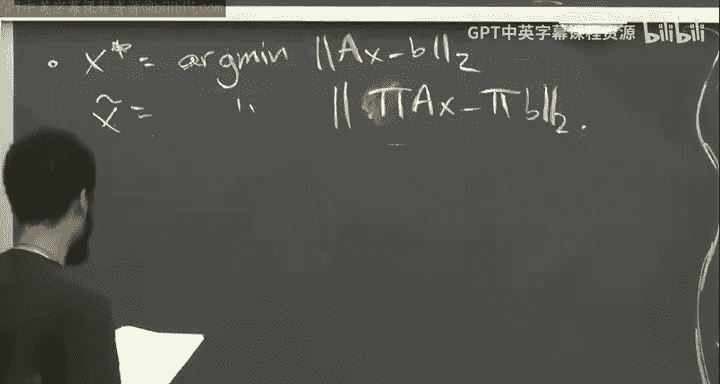

嗯。AX tilde minus B。L2 norm squared。Is equal to。Let me use this one。Is equal to。

AX tilde minus x star plus ax star minus B squared。Right。Now， what can you tell me about？

This vector and this vector。So I claim they're orthogonal。Why， what does x star do in least squares？

😡，AX star kills all the parts of B in the column space of a。

Right kind of the optimal thing to do in least squares is kill the kill the projection of B under the column space of A。

 So this vector is orthogonal to the column space of A。

This vector is obviously in the column space of A。So normally， you know。

 the squared norm of x plus y is x squared plus y squared plus twice the dot product。

 But the dot product is 0。 So this is equal to。A x tilde minus x star。Squared plus。

AX star minus B squared， this is just op squared。So really the name of the game is。We want this。

To be at most like oh Epsilon times off squared。If this thing is at most epsilon op squared。

 altogether， there is that most one plus O of epsilon op squared， and we're done。

So let me introduce some notation。Let's say that。A is equal to u sigma v transpose。

Let me say that a x tilde minus x star is equal to u beta。

 right So any vector in the column space of A is in the common space of U。

 They have the same column spaces。This the definition of beta。

 let me say that w is equal to b minus ax star。😡，And last definition I want to do。

 Do I want to do any more definitions。嗯。Let me also say that AX star。Is equal to U alpha。Okay。

 so we want to understand that。But what is that， That's just the norm。 That's just equal to。

Let me call this thing。Star star。So star star。Its just equal to the norm of u beta squared。

Which is equal to the normal beta squared because you guys ortho little columns。🤧。

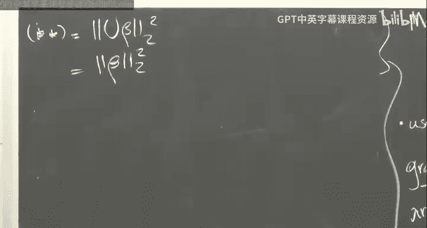

And this thing。Is that most？嗯。Well， certainly at most。Piu transpose piu。Beta of2 squared times 2。Why。

Because。We're assuming that pi is a constant subspace embedding。

What does it mean to be a subspace embedding， It means the operator norm of pi U transpose pi U minus identity is small。

Which means that all the singular values of pi U。Are close to one。

So all the singular values of piu are between a half and three halves or something like that， so。

A a matrix can only blow up the norm of， of a vector by its singular value。

 And then we put that matrix twice。 So this thing is this thing they say as bounded operator norm。

 That's what I'm saying。But buy the subspace embedding property。

And what I claim is that this thing is actually the same。As。Two times pi u transpose。P W Lar squared。

Okay， so the question is。Why is this equality true？Okay。And。Notice that。系。Pi you。Alpha plus beta。嗯う。

Look at the definitions。U alpha is AX star。😡，U beta is ax to to minus ax star。

So pi U alpha plus pi beta is just equal to pi Ax tilde。Okay。And。🤧。

This thing is equal to the projection。On on to the column space of pi a。Of pi V。Okay。

 so just remember。Remember what Xtta is？X tilde is the optimal least square solution to the sketched version。

So x tilde is the projection。Xel does the projection onto the column space of pi a。呃，排比。Okay。嗯。

And then this thing， well， pi A and pi U have the same column space。

 So this is equal to the projection onto pi the column space of pi U of pi B。嗯嗯嗯。

But now I just write out what B is。😡，B is equal to。W minus AX star。B is equal to a w plus ax star。

Which is the same thing as。W plus U alpha。I is equal to the projection。I to apply you。

Of pi U alpha plus pi W。But the projection under pi U alpha of pi under pi U of pi U alpha is U alpha。

 This is equal to U alpha。Plus， the projection。On to pi U of pi W。Okay。So。Oh， sorry， that。

This is pi U alphapha。RightThe projection on the piu。

 projection on the column space of piu of piu alphapha is just piu alphapha。

 This is already in the column space。So now notice what I can cancel now this Pau alphapha with this Pau alphapha。

And what we have is that pi beta。Or sorry， pi。Let me write that down。

This implies that pi U beta is just the projection until the column span of pi U of W。

Which implies that piu trans。系 you beta。It's the same thing as piu transpo。is a pioneer。I picked up。

whichch is all I'm saying here。Okay。And now what do I know about this quantity？Well， I have。

Now is going to look familiar， pi U transpose pi W。Minus u transpose W。What is U transpose W。

Right you transpose W。 So remember， W is kind of out。 So I choose x star at0， right。

 I chose X star to kill the part of B in the common space of a。

So W is orthogonal in the column space of a。The common space of A and the common space of U are the same thing。

 So U transpose W is 0。 So this thing here。Is the same as subtracting0。 Now。

 what does this look like？Think of W。 W is a vector。

 Think of a vector as just like an n by one matrix。ThinkThink of what's the L norm of a vector。

 It's like the Frenous norm of that n by one matrix。Okay， so。Or a D by Well。

 maybe add my dimensions off。 but anyway。It's approximate matrix multiplication。Right。

 so what I know is this thing is going be at most。Outd of Epsilon Prime times forbeius of U。

Times norm W。So if I square this， as I have it squared over there， I get Epsilon Prime squared。

 UF squared， W squared。What's UF squared？D。What's W squared， What's the norm of W？

The neuro of W is opt。😡，So this thing here。Is equal to epsilon prime squared times d times optt squared。

But I chose Epsilon Prime to be root Epsilon over D。This is just equal to epsilon over D。

Because I squared it。So。Epsilon up square。Okay， so at the end of the day， my total error is。

Epsilon opt squared plus opt squared。 So I'm done。Okay。So you really only need these two properties。

I think I'm basically out of time。 So we'll see next time。I'll do。 I'll finish long approximation。

 and then we'll move on to compressed sensing on Tuesday， but。

You'll see when we do lower approximation， that。Kind of。

The analysis of low rank approximation basically looks exactly like method 3。So it's almost。

 it's almost the same proof。 Okay， so。Andbody will see that。Questions。

