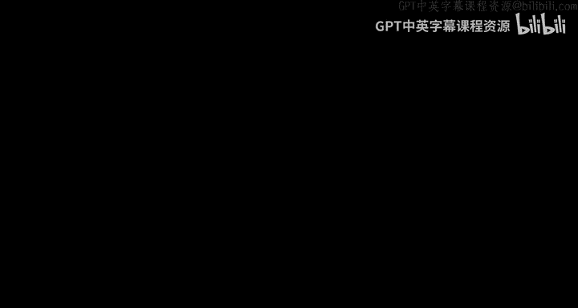
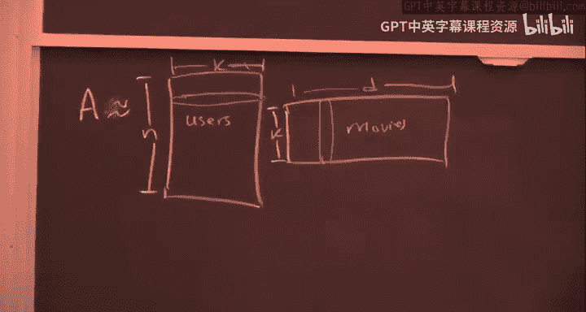
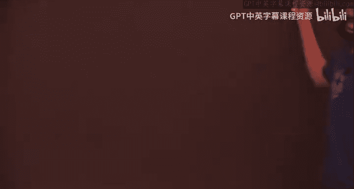
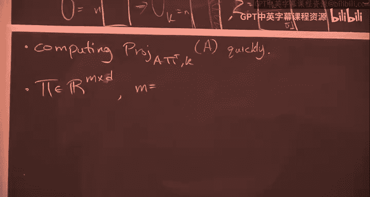
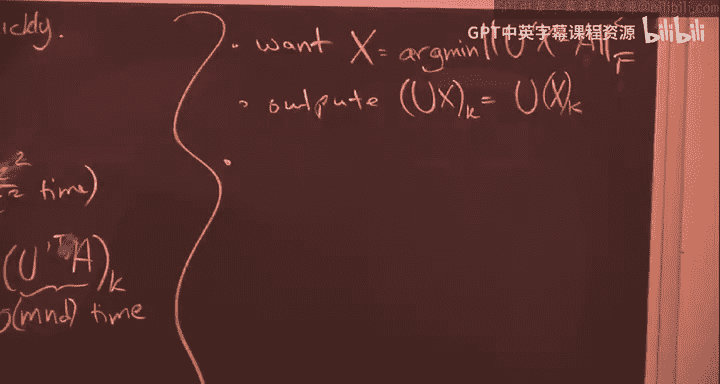
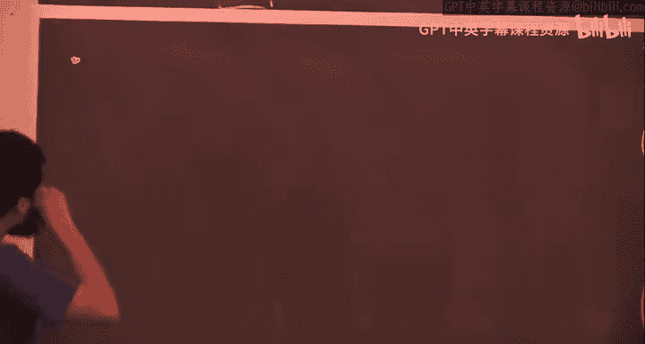
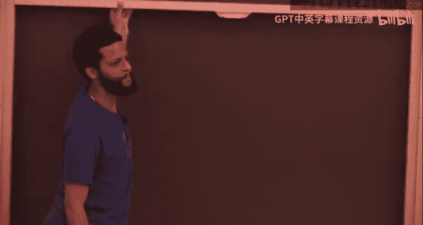
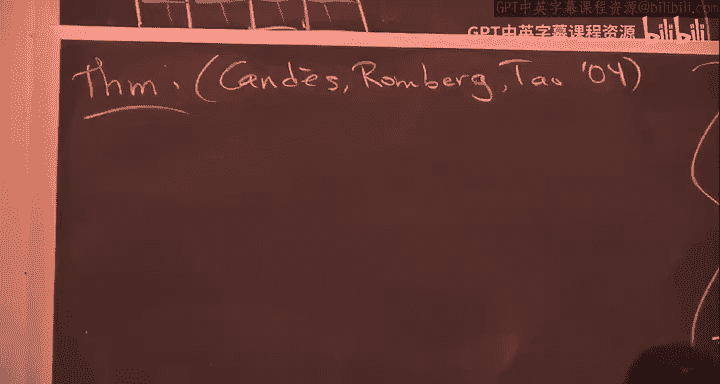

# 哈佛大学《大数据算法｜Harvard Algorithms for Big Data (COMPSCI 229r) 2016》deepseek - P18：-18-Algorithms for Big Data (COMPSCI 229r), Lecture 18.zh_en - GPT中英字幕课程资源 - BV1yGdNYvEMo

Good morning everyone， so thanks for sending your。Project proposals。

 I plan to read them later this week and send individual feedback by email to everyone。嗯。

So I want to finish off where we were last time。 and then we're going to start a new topic。

 which is compressed sensing， which is going to be now different from this large scale in your algebra stuff。

 although as you'll see。They're going to be related okay。

 so lots of these the different topics we cover in this class are actually related。

So last time we had， we covered three different methods of using subspace embedding for。嗯。

For regression， for least scores regression， the first one was the simplest one。

 If you have an epsilon subspace embedding， you get epsilon approximate regression。

And then the second one was this iterative method， iterative approach where you basically well condition the matrix to speed up gradient descent。

Okay。嗯。And the third method is this one where。You really only need。Well， is this legible right here。

 the bottom？Not very much。Okay， so basically， let's say your regression problem is minimize the L2 norm of S X minus B。

 right， what we said was as long as pi satisfies two deterministic conditions。

 then you'll get a good approximation by doing sketch and solve。Okay， those two conditions were。

 first of all， write， you know， write the SVD for S。

 U double prime Sigma prime V double prime transpose。

 I just put these primes because when we actually continue with the class。

 I will care about actual some other U sigmma V transpose。Yeah。

So pi should just be a half subspace embedding for the column space of S。

 which is the column space of U double prime。And it should satisfy this approximate matrix multiplication guarantee with errors squd uppsson over D for SSD columns or the rank of SSD。

Okay， and if those two conditions hold， then we showed， well。

You can decompose this thing as this plus that in the terminology of last time。And this W。

 W is the optimal regression error。 So W is B minus S X star。

 X star is the actual optimal solution to the regression problem。 So this is opt。

And then you have some extra error return， which you want to say is small。

And what we argued last time was that this error term is at most this thingingy。

 which looks a lot like approximate matrix multiplication， so because it has this property。

 this approximate matrix multiplication property， you get a good mirror bound。

So that's how we ended last time。S is n by D。 sorry， So yeah， S has D columns。

So D just needs to be something that's at least the rank of S。Okay， so now today。

 I'm going to show you how to use subspace embeddings for a low rank approximation。I mean。

 it's going to look a lot like once you write things down， it's going to look a lot like。

Regression method three。And then we're going to move into compressed sensing。So let's do this。Okay。

 so what's the basic idea of low rank approximation， The basic idea is you have some huge matrix， A。

嗯。Which let's say looks something like this。Think of。Think now of like both dimensions being huge。

 Okay， one is bigger than the other。 Let's say actually。

 that's not even necessary for what I'm going to say。 What I'm gonna say is going speed things up。

 even if。Both dimensions are roughly the same order。But let's say that。It's an N by D matrix， where。

And number of rowss say like these are the users。And D are like the attributes。Okay， so， for example。

People who have。Netflix accounts and movies， okay， and then each number is like how they rated it。

 But let's pretend now that we know all the numbers。O。

And the idea behind low rank approximation is that。Users。Our。Actually， low dimensional。Okay。

 what do I mean by that？ I mean， yes， there are D attributes here， Like how do they rate movie 1。

 How do they rate movie 2， etc cetera。 But actually。

 there are only only a few hidden attributes that actually matter and determine everything up to some error maybe。

 So， for example， this person really likes horror movies and doesn't like comedy so much and loves movies in the 50 from the 50s。

 Okay so there are these very few dimensions that aren't explicit in the matrix。

 but they kind of govern the way the entire matrix behaves okay。So each row。

 each row is actually some linear combination of these basic types。Okay。

 a type is a horror movie lover or a lover of movies from the 50s， and then every row。

 every user is some kind of linear combination of those basic types。And each user is。

 let's say not exactly， because it's gonna be exactly low rank， but each user is close to。

A linear combination of basic types。 and then our goal is to basically figure out what these hidden types are。

 these eigentypes， these are basically the eigen the singular vectors of。Of the matrix A。

We want to find this low rank structure。Okay， so。Victorially， basically。

 what I'm saying is that a is actually something like。A product of two matrices。This is N by K。

I think your K is like tiny， and then。嗯。AndK I D。These are our users。And these are the movies。

So for each user。There's some linear combination of the basic types。Okay。

 these hidden types and each movie。Also is some kind of combination of these each movie can be represented in in the basis of these these types。

 okay。This is the kind of thing that I want to discover。So。I mean， there's a lot。

There's lots of work on matrix factorization。 So， you know。

 one thing that is a little weird here is if you just say linear accommodation。

 these numbers could be negative。So many people have argued that kind of as I've motivated it now。

 the thing that makes most intuitive sense is that you should look for a non- negative matrix factorization where each user is actually a non negative combination of basic types like I'm 30% horror movie lover and I'm 70% comedy lover or something like that。

 What does it mean if I'm。If I'm 0。3 movie lover and then minus 0。2 something else。

 and then minus something something else， right。But nevertheless， you know。

 this low rank approximation is still a very widely used thing。Okay。

 so our goal is to basically find this this kind of low rank approximation。

And I should say approximately。Sorry。Yeah， we're looking to find a rank K matrix。😡，So this is。

 this product is a rank K matrix， right， So I put， I changed my equals to approximately equal。

 So we're gonna assume that our matrix isn't exactly rank K。 You know。

 it's not true that they're exactly K hidden types of users， but it's approximately true。

So what I'd like to have this approximate equality。 And what I'd like to do is find。

 basically find the best factorization of this form。Yeah。Yeah， so I mean， yeah。

 you're saying basically I can put in the middle， put like MM inverse and M multiplies this M multipllies that。

So right， So actually， so right now， So what we're going to talk about today is not actually。

Decomposing it like this， we're just going to say find a rank K matrix that approximates find one matrix。

Yeah， just find me any rank K matrix， which approximates a。 So our goal。Yeah。

 we want the product or our goal。Is to compute。AK， which is the argument。嗯。Over matrices B of rank。

At most K。Of basically a minus B。对。So B， you know， for us。

 A K would be the product of these two matrices。And we're going to at today we're going to look at for B St。

No， so the point is this， this product actually is rank K。Because I have K columns here， whereas。

So this is not equality， this is approximate equality。So in actuality， you know。

 if you wanted to write a as some kind of factorized matrix。

 the number of columns you would need in actuality is the rank of A。 So a might might be high rank。

 It might even be full rank。But I just assume that it's close to a low rank matrix。

So what I want to do is I want to find the closest low rank matrix to a。So find， find this product。

 which makes this approximate as good as possible。You're given you're given A as input。

 So you have your database， your Amazon or whoever you are in Netflix。

 you have your matrix of attributes and users given to you。

 and you want to find this low rank structure。And then once you have the little rank structure。

 maybe you can learn learn things about your users， make predictions， cluster them， whatever。Okay。

So this is what we'd like to do。And it's a theorem。That basically， this is called the Ehart。

 It's usually called the Ehart Young theorem， even though apparently this is a wrong attribution because。

I think Schmidt from Graham Schmidt actually proved this theorem like decades before before this。

 but it says that if a。Is U sigma v transpose？Then。AK is UK Sigma K， VK transpose。

 what does that mean？What I mean by that is。If U is this matrix。Let's say， n by D。And。And by D。

 then UK。UK is equal to this matrix， so。So， N by D， but。Basically， only keep the first K columns。

It' it's this matrix。That's UK。It's an n by K matrix。 Just keep the top K singular vectors and。呃。

Sigma looks like。Sigma 1 up to Sigma D， where Sigma K is somewhere over here。And then， sigma K。

It's just， know， take this part。This is basically the only take。Only keep the top K singular values。

 Only keep the top K singular vectors in U B。So， so this。This is a rank K matrix， right。

 UK has K columns。 Vk has K columns， Sigma K is a K by K matrix。question about you look like you're。

Yeah，' sorry， yeah， so I should have said。Where Sigma 1 is bigger than equal to sigma 2 is bigger than equal to that。

Okay。So。Where does this tell us， Well， if we can compute the SVD， So by the way， today。Or I mean。

 our goal here is not we're not going to actually spit out this matrix AK。

 We're going to spit out a factorization of AK。 We're going to spit out the SVD of AK。😡。

that's going to be our output。嗯。What this tells us is。We can compute aK in time。O and D squared。

 this is the SVD type。Right。Once you have the SVD， getting the best low rate approximation is easy。

 that's what this is telling us。But just like regression， I don't want to spend SPD time。

 I want to do things faster。So， theorem。Okay， so。So first， actually。

 before I write theem let' write a definition。So。For matrices A and B。

 the projection onto A of B is the。Projection。Of the columns。Of the。Onto the column space of a。Okay。

 so you replace each column of B with。Yeah， with the projection of of that column， Okay。

 and then also。Praage。AK of B or a comma K。I's just prodge a。Okay。

 I mean the best rank K approximation。 So in general， whenever I put a K on the outside of a matrix。

 I mean like the best rank K approximation， at least for the rest of this proof。

And now let me write the theorem。So define。呃。A。A tilde k。As being。The projection。

Proradge api transpose。K A。Okay， so project the columns of a onto the column space of a pi transpose and then take the best rank K approximation of that。

Then we have that。A minus a tilde K。Tenous norm is at most1 plus o of epsilon。Times the actual opt。

As long as pi satisfies certain conditions。So first of all， pi should be a1 half。

Subspace embedding for the column space of VK transpose or for the column space of VK， I guess。And 2。

嗯。We should have square root epsilon over k approximate matrix multiplication。Under Frbeious norm。

For the matrix for pi， basically for。K transpose a minus aK。So remember。

 when I say that we have an approximate matrix multiplication for a transpose B。

 What I mean is pi a transpose。 pi B is close to a transpose B。So what I'm saying is。

P V K transpose pi that this matrix should be close to what the actual product is。

 and the actual product is 0。Right， because。Remember， in the SVD， the columns of V are orthogonal。

 they're orthoormal。Right， so a minus A K is basically all the stuff that I chopped off。

It's all the stuff that's orthogonal to V K。So this is actually zero。Oh， actually。

 I to make the zero， I should put it transpose here。that's forminnin。Yeah。Right。嗯。Okay， so。

We'll prove this。 it's going to look very similar to。

Method 3， in fact， the conditions look very similar to method 3。But。Why is this。

 let's parse this and understand why this gives a faster algorithm， okay。

So I said that there is a matrix A till decay， which does well。

 Why can we get our hands on A till decay quickly。And that's the question。

We want to be we want to beat SVD time， which is N D squared。So。Let's look at computing。Praage。呃。

A pie transplant。K。So first of all。Hi is going to be。An M by N matrix， or actually for us M by D。

 let's say， and M is going to be something like well。What， you know， what。

 how many rows do we need from say， Gausian matrix， random sign matrix to satisfy these conditions。

 Well， V K。

Is a rank K， it has K columns。Right，So we want to preserve a k dimensional subspace。

 So using an up to a factor of a half。So for that， we need O of K columns。I mean。

 O of K rows of pi M is gonna be at least O of K。 And then to satisfy this condition， remember。

 if you want AMM with error alpha， you basically need whatever alpha squared rows。So for this。

 we need K over epsilon。So number two is the bottleneck in terms of M。

So M is going to be O of K reppson。Okay， so first of all。We need to multiply Api transpose。

Well that's fast because we can use a fast subspace embedding， right， we can use。

The the sparse subspace embedding or whatever the the Hadmard based approach。

 the fast Fourier based approach。So that's fast。And then we need to compute the SVD。A pi transpose。

AndLet's called that u prime， Sigma prime， B prime transpose。How much time is that， Well。

 a pi transpose is an n by M matrix。 So it's N M squared。 So this is N K squared。

NK squared over epsilon squared time。Well， if D is really big and K is not as big。

 then that's not so bad， maybe。嗯。Then what we want is we want。You prime， U prime。Transpose。呃，A。

We want the best rank K approximation of that， which is the same thing since U prime as orthoormal columns as u prime U prime transpose。

A。Computing U prime transpose A， Well， U prime， what are the dimensions of U prime。U prime is N by M。

So this thing here， just computing U prime transpose A takes time M And D。

So we've at least replaced one of the D's with an M， which is like k of Reps line。In fact。

 let me show you now you can actually replace both of the D's with M。

 You can get something that's more like N M squared。 How do you do that。

And the idea to use regression note that we don't actually。You don't actually need。U prime。

 U prime transpose A。Okay， and just approximate it。So what do we want？We want so。

What does this thing mean， right？😡，What does this mean or what is。What does this mean？

It means we want the best rank K approximation in the column space of this matrix。

The column space of this matrix is the same as the column space of U prime。

 So we're one the best rank K approximation in the column space of U prime。Right。

So what we actually want is kind of X。To be the A men。Of mu prime x minus a。Convenience norm。

Where the rank of x is at most k。That's what we actually want。Or alternatively。

Forget the rank constraint。And then what we do is we output。UX。Okay， which is the same as U X。

But the point is we don't actually need x exactly。嗯。

We can approximate this looks a lot like regression。

 Imagine if a was actually a vector instead of a matrix。 And this is L2 norm。

 This is exactly a regression problem。😊，And then we're going to treat it that way。So。So， you know。

 last lecture， we just talked about regression when B is a vector。

 but the same exact analyses apply of B happen to be a matrix instead。

 And you're looking at forbeius norm。 Forbeius norm squared is just the sum of L2 normm squares。

So。So we'll use fast regression。To get。X Tilde such that。嗯。

You prime x tilde minus a for B norm squared。Is that most one plus epsilon？

One pull upon times the actual。Let's call the X star。Times。U prime star minus a from U sum squared。

And then it'll output。U prime X tilde。And what are the dimensions of x Tilde， Well。

 X Tilde is actually。I guess， K over it's M。By D， which is k over epsilon by D。

And I need to compute its SVD。So I can compute its SVD in time， which is like k squared times D。

K squared of Rson squared times d。So altogether。Let's say that。Xtoilda is like。

U X t the Sigma x t the V K， V x t the transpose。We're going to output。As our decomposition。

 U prime U X tilde sigma。トがある。That's going to be our fun out。Okay， so。Okay。

 I just wanted to say a word about why this is good。Okay why we're actually speeding things up？

I mean， you didn't， you know， you didn't need to do this half of the board。 You could。

 you could have settled for this。 This is already faster。 If K over Epsilon is smaller than D。

 this is already faster than N D squared。But I just wanted to point out， in fact。

 can make you can improve that even a little bit more by approximately doing this generalized regression problem。

So this is usually called， well， in some literature。

 it's called generalized regression because a is now a matrix instead of a vector。

But the principle is basically the same as what you've seen before。O。Questions。Yeah。Oh。You're saying。

You're saying， yes， this is true。 But once I take the rank K approximation， why。嗯。Yeah。

 I think now I'm have I confused myself。 I see， I see your question。呃。The only of that。Yeah。

 I'm pretty sure it's okay， but let me think offline for a minute and I'll respond。🤧Okay， so。

So now just let me prove the theorem。Good， so。What I'd like to do is I'd like to bound。呃。

I'd like to bound a minus a field of K good。So let。Why。Be the。The column space。Of。

The projection onto api transpose。AK。Okay。偏僻？orthogonal。Projection。Onto why。谁？

Then this is the thing we're outputting， we're outputting a minus proage。A pi transpose K。Of a。Now。

 what is this matrix， This is the best rank K approximation in the column space of Api transpose。

So this is certainly at most。A minus PA。Ormediaor squared because PA is some rank K approximation。

PA is rank PA is a rank K matrix。Okay， it is a rank K matrix that lives in the column space of api transpose。

So certainly， the optimal rank K approximation does better than PA does。

And then now I can decompose a as AK plus Ak bar。😡，Okay， so let me call this thing。

V transpose times A K bar transpose by A K bar。 I just mean a a minus a K。 It's all the other stuff。

It's the error。So I can decompose this as。呃。A。AK minus。PAK。Plus。AK bar minus PAK bar。Right。

Because these two， this is definitely the sum of these two things。

 and they're orthogonal to each other。So the fact that they're orthogonal means。

That right in general， remember that。Trace fromen norm squared。For be term squared of M。

Is the trace of M transpose M？So if you expand， in our case， M is the matrix A minus P。

 if you expand M as this plus this。Then you， and you kind of expandend out this trace。

 you'll have terms that are orthogonal that have orthogonal calm spaces。

 And then the dot product is zero， basically。And what you're left with business this。Okay。

 so now this term。Is equal to。Identity minus that projection operator and K bar。

And identity minus projection is just itself a projection。

 It's a projection onto the orthogonal space。RightAnd projection operators can't increase norms。

 They can't increase forenous norms。So this is certainly at most。AK Barr。Community storms。

Which is exactly what we're happy with。This is opt， right， this is a minus AK。

So the goal then is to show that this part here is at most epsilon in times opt squared。Which。

 by the way， looks a lot like that， right， Basically， this， this A K bar is， is。

 is a matrix W as opposed to a vector W from last time。And。

 and now kind of beta is also think of beta as like a matrix。

 And we want to show that beta has small forbei storm squared。Okay。So。Want to show。🤧That。

AK minus PAK。Forenius Har Square。That most like epsilon times that thing。Okay。So。Kind of what is P？

Right so remember。We're going to re that。嗯。Kind of when we' were doing regression， we said that。Well。

 did I define this， so remember if a， let me just define some notation if a is u sigma v transpose。

 then a pseudo inverse definition， a pseudo inverse is V sigma inverse U transpose。And。

AA pseudo inverse。Is the projection operator onto A？

RightBecause if we multiply these two things together， V transpose V is identity。

 S n versus identity。 You have U U transpose， which is exactly the projection operator。So。

What didt we say it's the projection operator on？The projection operator onto the column space of that matrix。

Okay， so we can now write down what that means。Okay， so let's do that。So。The projection of AK。

That's the thing we care about。Is。Api transpo。A pi transpose。嗯。Of。This thing the a。Okay。So。

The point is。forget about P for a second。 The projection onto the column space of a pi transpose of AK is exactly this matrix。

So if you want to project this matrix， if you want to project aK onto the column space of this matrix。

 well it's its own best approximation in that space。对。So basically now what we have here is。AK minus。

Api transpose。Api transpose。AK for beius norm squared。喂。The projection of the matrix is the best。

 right， So this thing， this thing here。Oh， this is a plus。Sudo inverse。This matrix here。😡。

Is the best rank K approximation to A K in the column space of api transpose。So in particular。

 if we replace this matrix with another rank K matrix in the column space of A P transpose。

 it could only have bigger norm。 So let's do， let's do that。 We're gonna bound this by a K minus。

A pi transpose。A K pi transpose。AK formin normm squared。So I just replace this。

 I just replaced this part with。With this。So again。

 this is another rank key matrix in the common space of api transpose。And now what I want to say is。

 well， this is equal to。I really want to view this as regression。 So let me just sum over， well。

 let me also， you know， if you take a matrix and take its transpose。

 they have the same forenous norms。So let me just take the transpose that it looks like something slightly more familiar。

 This is equal to A K transpose。Mus。嗯。AK transpose。嗯。Hi AK transpose。Cto inverse。High a transpose。

This is a K。And this is equal to。The sum over I。Of。AK transpose from1 to n。AK transpose I minus。

AK transpose。Pi a K transpose pseudo inverse。嗯。Pi a。Transpose。2 norm squared。 So basically。

 I just summed over the columns of。So AK has。A K is an n by K matrix sorry， A K is an n by D matrix。

So it's transpose as D by N。 I summed over its columns， it has n columns。Okay。

 so now this looks like a mouthful。But the key， there's like one key insight in this proof。

 And the key insight is that this is exactly regression。Why is this exactly regression？

Here I just want to say we've already analyzed this。Imagine。Regression problem。Next star。

Is the argument。Of。嗯。AK transpose。AK transpose x minus。A transpose I。Okay。

So the optimal thing to do is。AK transpose X should be the projection onto the column space of A K transpose of this matrix。

Right and the projection of this matrix sign of that one is exactly ak。喂。

But if you're doing sketch and solve like we're doing， or if you're doing regression method 3。

Then you're going to have that x tilde is not going to be。

 So x star X star is going to actually be the kind of Ak。Transpose。

NowX stars is going to be AK transpose pseudo inverse。A transposed eye。

That's that's the actual optimal thing you do。But if you do sketch and solve。

Instead what you're going to do is you're going to get X tde， which is going to be。Hi a。K transpose。

So inverse。嗯。A transpose I。Which implies that。AK transpose x tilde is going to be exactly ak transpose times this matrix。

Pi a transpose。 sorry， there's a pi here。And that is exactly if I did this correctly。

 that's exactly that。😊，Okay。So。We're actually- so now we're just basically bounding regression errors。

😡，🤧Okay， and。嗯。So now kind of in that notation， basically my matrix S looks like AK。

I matrix U double prime。😡，Is equal to VK。Right， because。

The columns of U should form an orthonnal basis for the column space of S。

The column space of A K transpose， right， the column space of A K is UK。

The common space of AK transpose is VK。Because I transpose it。So that's that。And。Kind of。We have。

A beta I and a WI。For each。嗯。I from one to end now。Okay。And good。

And so what I have last time is basically now。Data I。Squared。Is that most？2。Hi， Vk。嗯。

Transpose pi WiI。L2 norms squared。Right， so if I sum over I now。

I can write this as kind of two times。H VK。Transpose pi capital W for media norm squared。Where。

W just has WI's and its columns。And。呃。那这。Questions。Why discussion solve give what？Oh right。

 so you're saying so I'm saying。I'm saying， if you were to do sketch and solve on this regression problem。

Then。嗯。The actual cost。 So if you were， if you were to description solve on this regression problem。

 you would get X tilde being this thing y。Which means that AK transpose X Tilde would be exactly what we got over there。

Which means this thing over here is exactly like kind of what your cost would be if you had done sketch and solve to solve that regression problem。

Okay， and then what I want to do is I want to apply， I want to apply regression method 3。 I mean。

 it's basically reusing the analysis of regression method 3 and saying， if I bound the error。

 if I bound that error there， using this analysis， then I get， I get。Get air。Yeah。Yeah。Yeah。

 so I guess， I mean。What I would so I guess instead what I would have to say is that it satisfies like n different AMMs simultaneously。

 and then you might be tempted to Union bound or something。

I just want to say that you can really encode this as a single AMM where you just make this matrix W have WiI's as its columns。

So。I mean。Change gears a little bit。Right and the point is。

By the fact that I have my root Epsilon over K AMM。Maybe I should just write that。Right so。

Pi VK transpose。嗯。Hi WU。The same thing as。Pi VK transpose pi W。

Minus VK transpose W because this is zero， actually yep。And by the AM property。

 this thing is at most。呃。Route epsilon over k times the Frennous norm of VK。Times the for or W。

This is Ro Ka。And then it's squared， so squared。And that's。Epsilon times。じゃ回ふみます。

And notice that in our case， W， this matrix W， when you actually do this column。

 my column thing is none another than。A transpose。Minus。呃。Minus ak transfer。Okay。

 so let me say a couple words about low rank approximation。

 things that we're not going to actually cover， but maybe I should make you aware of。嗯。

One thing is there's been some interest in work where。The， the low rank matrix you find。

 So if you look at， if you look， yeah， so there's been some matrix in like。

I want to find few columns of a， such that if I find the best rank K approximation just in in those in the span of those columns。

 it provides good error。Okay， so there are a couple works that do this， so Bofitus。Ju。So by the way。

 this is the end。Sisterness。嗯。Mag don't smile。As well as grruwami。Sap。Sa。It's possible。To find。

T being some like oh of K overrups on。Columns。呃。C of a。Such that。嗯。A minus。C。

Minus the projection onto those columns a。Its small。嗯。And by small， I mean say it's at most。

One plus epsilon times。A minus a。So if you want to say that there are actually a few columns of the data that explain everything。

Then you can find that。嗯。And these are， these are polynomial time algorithms。

Another thing I want to say is related to something you've seen on a P set。

Which is Ka means clustering。Where note， Ka means's husstering is actually some kind of low rank approximation。

Why。So you had a Pet problem on Kaian clustering， I believe， right？Remember what we said。

 some cameines。

The points are。X1 up to Xn in RD。So let me define the matrix A， which is just this matrix。

X1 transpose。XN transpose。Given。A partition。P议。Which is。P1。PK。Of the points。And2que clusters。

I believe one part of a piece that said， if you find， if you have a partition to clusters。

 the best centers in those。Partition the best centers for each cluster are basically the centroids。

 Just average all the points in the cluster。Then。So define a matrix。XP， which is。

This matrix is gonna be in。N by K。Such that if you look at X， PI J， this is equal to。

One over the square root of the size of PJ。If I is in the cluster J and zero otherwise。

If you ignore the columns of this matrix that are 0。

Let's pretend that none let's pretend none of the petitionitions are actually 0。

 Lets let's pretend that。I mean， there's really no advantage in K means to use less than K clusters because if you put a point in its own cluster。

 you're only gonna do just as well。 So let's say that we， we don't have any empty clusters。

Then you can convince yourself that X P transpose XP。Is the identity？谁。So。And also。

 you can convince yourself that。Rrow I。Of XP， XP transpose。嗯。A。Is exactly。The centroid。

Of the cluster。That Xi belongs to。Which implies that。The K means cost。Kians is。To compute。

I like this to compute。The optimal partition。Which minimizes。唉。A minus。XPxP transpose。What is this？

It's the projection of a onto some K dimensional subspace。Right。

 so K means is actually find the best rank K approximation to a。

But where you're not allowed to use any， you're not allowed to use any rank K approximation you want。

 it has to be a restricted one， one of this form。 It has to look like X P， X P transpose A。

 where X P looks like one of those matrices。So this is。Constrained。Rannk K approximation。唔。And。

So you can ask yourself well。呃。Rather than minimize this， what if I did dimensionality reduction？

What if I put a pi transpose here and I put a pi transpose here， Basically。

 what I'm doing is I'm reducing the number of dimensions D down to something。

usually we talked about putting power on the left。😡，That means reducing the number of rows。 Now。

 I'm putting pi on the right。 I'm reducing the number of columns。 So I'm。

 I'm reducing the dimension of these Xs。That's exactly what you studied in your Pet problem， right。

 If I reduce the dimension of the X's to log n dimensions by J L。

 then I still get a good approximation。So here the question is， do I really need log end dimensions。

Okay。And。Okay， I'll inject the correct citation in the notes， but ahead of this。Low rank connection。

 low rank approximateating connection。Un observed。In。I think it sits at all。

I'll rejectject the exact reference in the notes。And it was earlier about the journal version just came out recently。

 I believe。嗯。Used。Also。In。Cohen。看到。5。Pi can have。And being。K over Epsilon square。

For one plus epsilon approximation。And， and can be。L。ARepson squared。For 9 plus。

So what this paper by Cohen all showed。Is that if you， if you pick。

Po to map down to K roughly K dimensions， K rhpsilon square dimensions and solve the new K means problem。

Then you'll go to solve that optimally， that partition you find will be within one plus epsilon of the best partition for the actual Can means instance。

And if you map down to log here of Epsilon squared， it'll be within a constant 9 plus epsilon。

 So now I just think， I mean， you can get abitrarily close to a9 approximation。

So there's an open question。Okay。And seely， that's possible。I should mention that。

This result is k rhpson squared。It's for a more general problem。

 which is constrained rank K approximation。 So suppose I want you to find。

 suppose I give you a constraint set。That contains only some K dimensional subspaces。 And I say。

 find me the best rank K approximation that lives in one of those subspaces。Then they say。

 if you map the K of Epsson squared and do sketch and solve， you'll get that。

This result is specifically for cans。 This log case is specifically for Kas。 It。

 it can't even be true in general。 Okay， you can。嗯。For example。

 if you try to do unconstrained V K approximation， that's a special case where the constraint set is empty or or where everything is allowed。

Then you really do need to map the K dimensions。 Otherwise， you lose rank， and then you're screwed。

 Okay， so。Anyway。So， yeah， I've just thought I'd leave you with that。

 and that's all that we're going to talk about in class for this。

Kind of large scale in your algebra stuff， although there there's a lot of nice results out there。

 but I there's just not enough time to cover everything。So questions about that。About anything。Okay。

Actually， I gave。I basically gave as a Pet problem two years ago to repro the But citus at all。

 Bocitus， what they showed was if you mapped a K over epsilon dimensions。

You get a two plus epsilon approximation。Okay。嗯。And I gave it as a Pet problem。

 and I gave it as a final project idea to show that actually K dimensions can get， you know。

 roughly K dimensions can get you down to one pluspsilon approximation。And。At least， well。

 I think that paper had five authors and three of them were in the class。

 although they didn't solve it during the class。 but so， you know， you can。

Don't be scared of problems for your final projects。Okay。

So I'm done with that topic and we're going to move into another topic which will consume the next few lectures。

 I guess。Which is。Impressed sensing。Okay， and I only have about 20 minutes left， so。

I'll kind of set things up so that next time we can just prove stuff。So。The basic idea。As follows。

Yeah。Let me use a different piece of shock。Okay， we have a vector X and R N， which is。Compressible。

What do I mean by compressible， Well， sparse is， a sparse vector is definitely compressible。

 if it's n dimensional， but only has k non0 entries。

Then I can specify the vector to you by just writing down those k and trees and telling you the locations。

But for us， compressible is gonna mean not just sparse， but say。

Compressibility is not going to be binary。 Yes， it's compressible。 No， it's not。

 It's going to be a level of compression。 So for us。

 a vector is compressible or its quality of compressibility is how close is it to a case force vector。

Okay， so I'll fix a particular K， and it's perfectly compressible if it's K spae。

If its if it has small distance to a caseparse vector。

 I'll still say that it's somewhat compressible，And the idea is。So， x。Compressible。If。

Let's say exhale K。Small， I haven't specified the norm。 And what do I mean by X tail K。

 I think I've used this notation before when we' were talking about countmin sketch。 Basically。

 look at the vector X。Look at the largest k coordinates， the largest k entries of x in magnitude。

Those are what I'll call the head coordinates。And then all the other n minus k coordinates are the tail。

Okay， so， for example。If x is。You know， five。0。1 minus 17。Point or2。Then， these。Are part of the head。

And these are part of the tail。Two， because I kept the top two qua entries，And。我我来。

And if what the goal of compressed sensing is is to acquire compressible signals using few measurements。

 So the number of measurements we need。Will be。Kind of related to the compressibility or well。

 the number of measures so I'd like to say is if it's compressible。

 I can basically do k measurements and then get the signal。

Recover the signal from those key measurements。Okay， so。Go。It's two approximately。Let's say。Recover。

X。From few linear measurements。Okay。And what I mean by linear measurements， I mean。Well yet。

we'll get alpha 1。 x， we'll get alpha 2。x。We'll get alpha M dot x， and given these M numbers。

 I want to approximately recover x。By the way， I can just view this as being。拍。We're pie。呃。Other way。

So。What I want is。Whatant。To recover。Extder。From Pyax。Such that。X minus x tilde。Some norm。

Let's call this norm one。嗯喂。Well， we're always going to deal with LP and LP norms here。

 so let's say the LP norm of this is at most some constant epsilon PQ。Times。Exhale。

That's what I actually like to do。For some P And Q and some epsilon。

 some constant that depends on these things。Notice that if x actually is case sparse。

Then the tail is the zero vector。😡，Which means that there's zero error。

 So if it actually is case far， I should recover it。If it's not exactly case sparse。

 but there's some small tail， then my error should be on the same order as the tail。Yeah。

How喂。Yeah， how's Pi defined？So that's exactly what we're going to talk about is how can we design- so are ways of there are a few questions of interest。

In some cases， you can design the measurement matrix。Right， so I， I'm the one who designs the。

 you know， the setup。 and I get to pick what measurements are being made。

 And I want to build a device that makes few measurements and does this for me。 So I get to pick pie。

And then were， we're going write down theorems and prove theorems that say， if you pick pi this way。

 then you can do this。So we're going to show what kinds of pies work。Nope。

 so alpha is just a real vector。 So， you know， just。foreshadowing pi can be， let's say。

 a random sign matrix。Or random Gausian matrix or something that looks like fast JL or so right。

 it just turns out that things you've seen before are going to be useful even for this problem。😊。

Although the proofs are going to be， it's not just， you know。

There's going to be something that needs to be proven， which is very nontrivi。

But we'll see the connection soon。SoI was what related？Yeah， M is going to depend on K。Yeah。So。

Why do I care about this sparsity and approximate sparsity？😡，Well， it shows up all over the place。

 one of these places is， for example， one of many examples images。So I have an image。

Which is pixelated。It's got dimension root end by root end。So this is。This is equal to some x。

it as a vector。Okay。And okay， I claim that most images， like an image of this classroom。

 is approximately sparse。 However， it's not approximately sparse in the standard basis。

It's approximately sparse once you change the basis。Okay， so also what we'll talk about is。Basically。

 you can view。So。Spare。In some basis。You。はいい。X is equal to UY。And why is sparse？Approximately。Spars。

Thus we get。Measurements。系 u喂。谁？Pi X is just pi U。 So in this case。

 you should think of pi as actually being pi U。So what is this basis U that images are usually sparse in？

Who's heard of the wavelet basis？按清。Okay， so。Less than half of you。嗯。Images。Typically sparse。

In the car wavevelet basis。Okay。So。That basis describes a matrix U。 I'm not going tell you what U is。

 I'm going to tell you kind of an equivalent way of describing a basis is telling you how to map vectors into that basis。

 Okay， so if if I have an image。Which is， which is a a root end by root end image。

 I'll tell you how to transform that image into a new root end by root end image in the hard wavelelet basis。

The basic idea is。是。Pretend。You know， just because this makes things easier。

 let me actually say the image is actually n by N。And that it's an n squared dimensional vector。

 okay。So pretend。And is a power of two。And I'm going to write the image。

I'm gonna pretend that it's actually。Well， let me。Do it like this。Here。

 I wrote it as a bunch of pixels。And here what I'm going to do is I'm going to group the pixels into two by two blocks。

Okay。So。So what I mean here is。You know， there's this n by n image I'm actually viewing as being sort of like n over 2 by n over 2。

 So it's gonna be a recursive algorithm that computes the transformation。 So this is one block。

 Thiss another block， etc ceter。And， let me。Let me zoom in on one of those blocks。

And let me look at the output。The output image。And let me divide the output image。Into。

Four blocks like this， where each one of these is n over 2 by n over2。

So this is one of those circle things。And I'm labeling the four pixels in that two by tube。Block。

And what I'm going to do is。Let's say that this is region 1， region2。Region 3 and Reg 4。

And let's say， you know， let's say it's the。Let's say it's this block right here。

So that's going to correspond to。This pixel right here。Right，It's the second。

It's the second thing in the first row。So those four pixels are going to get collapsed down to one pixel。

What I'm going to do is I'm going to put one fourth。P1 plus P2 plus P3 plus P4。In。In that spot。

I'm going to put。One， fourth。P1 minus p2 plus p3 minus P4。In this spot。I'm going to put a fourth。

P1 minus P3 plus P2 minus P1， P4。In R3， and we're going to put a fourth。P1 minus p4 plus。Plus。

 let's say P4 minus is P2。Pure plus and。So which guy's got minus P2， P4， P3， P2？So P P4， P2。

I think that covers all the cases in R4。男。Re curse。On R1。Okay， so。One of these is not like the other。

These guys are very similar。I'm basically looking at differences of adjacent pixels。

And in an image in a typical image， neighboring pixels are very similar to each other。Right。

Unless it's like on the boundary of different objects。

So when you're not near the boundary of different objects， kind of this is something very near zero。

 this is something very near zero， this is very near zero。

 So these three regions are all very near zero。And then the things that you put here are the things that aren't near  zero。

 right， That's this thing。But then you recurse on this。So if you look at the output image。

 it sort of looks almost empty over here， and then as you kind of go toward the top left。😡。

You start actually seeing stuff。So this output image looks very sparse。😡，If you imagine that。

 zero means black。Then kind of this image looks almost black and it looks less black with more color as you go toward the top left。

So images usually do have this kind of sparsity， approximate sparsity in the wavele basis。Right and。

I mean， that fact is at the heart of why you can do image compression， right。

 So we have Jpeg and things like that。 And they take advantage of。Of these facts。Okay。So。

Now one actually design。Designed approaches that can actually do this compression and recovery。So。

 theorem。This is Candice。Lomberg in town。Oh4。Is that？

Make sure I'm saying the correct attribution for this。Yeah。Okay， the journal version is in 06。

 I guess， I don't know why put04。

And also Donoho。哎。There exists。A。Hi。RM by N。Where M is something like。K log of。N over K。And。

A poly time。Algorithm。Out。Such that。If x tilde is equal to the output of the algorithm on pi x。

So the pi is the thing that compresses。 Ag takes pi X and tries to figure out what x was。

 AlG doesn't know what x is as its input。Then。X tde minus， let me write it like this。

X minus x tilde L2 norm is at most o of1 over root k。Times。あてよ。So again。

 it's some kind of error term that looks like that。If x actually is K sparse。Then this error is 0。

 If it's close to case spae， you know， the error goes。

 the error depends on basically how big the tail is。

And you get away with a number of measurements that primarily depends on K。

 You have an extra log log n factor， log n over K。By the way。If x。Is actually。Kase Sp。Then。

2K measurements。Or。Necessary and sufficient。Not using this approach。

 but there's another approach where if I promise you that x actually is K sparse。

You can actually find it exactly in 2 K measurements， and you can't beat 2K measurements。

And this is proy's method， for example。So I'll probably turn into a PSE problem。It's from the 1700s。

So。You know。You guys know a lot more math than people did in the 170s， so。You know。

 you'll be able to。Proving， you know， proving this thingingy or analyzing this thingingy is definitely well within your abilities。

 There will be plenty of hints on the Pet problem。But we're not going to cover this in class。

But it's interesting that， you know， once you want to be able to handle noise。

 which is true in in real life signals， right， like images are not gonna be perfectly sparse in the waveleth basis。

 right， Like if you look at neighboring pixels， neighboring pixels are not all the same。 Otherwise。

 your image is not very interesting。Okay。Good， but if you want to be able to handle noise。

 you kind of blow up extra the number of measurements by an extra log factor。

 but if you don't care about noise， you can always do this。

So that's I guess I'll see you all Thursday， will actually prove this theorem。

And then we'll keep doing other compressed sensing pings。

