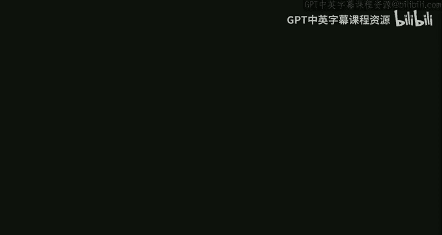
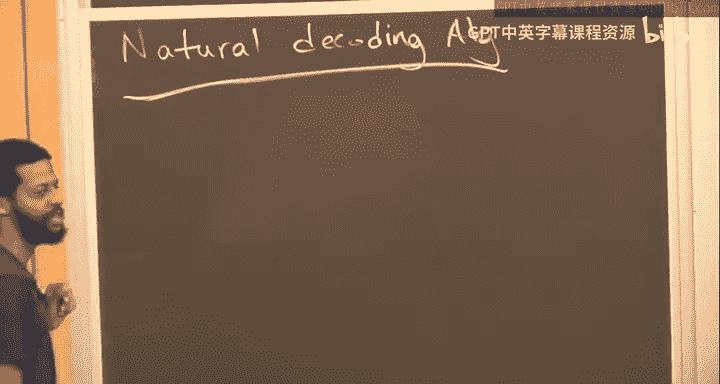
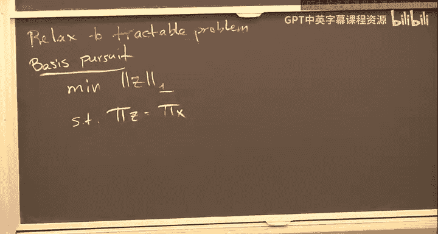
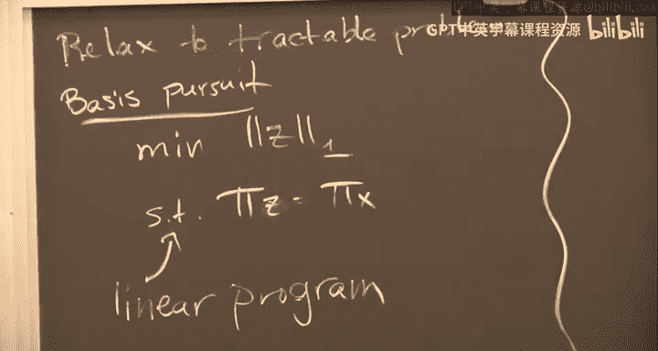
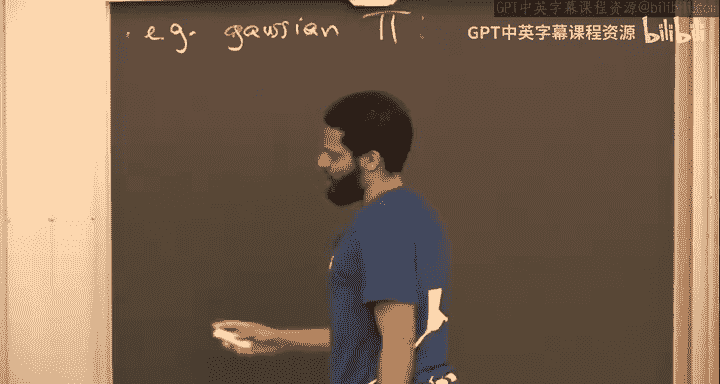
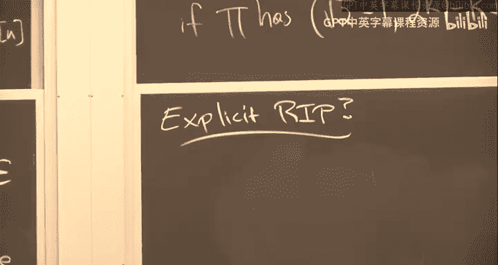
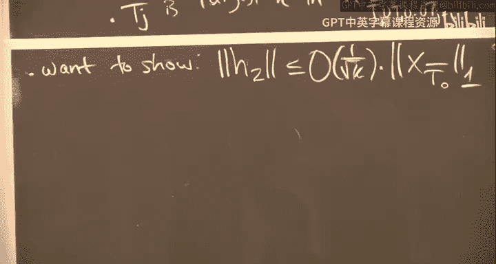

# 哈佛大学《大数据算法｜Harvard Algorithms for Big Data (COMPSCI 229r) 2016》deepseek - P19：-19-Algorithms for Big Data (COMPSCI 229r), Lecture 19.zh_en - GPT中英字幕课程资源 - BV1yGdNYvEMo

Okay， so let's continue from last time。So last time we started off on compressed sensing。

 a new chapter in the class。And I stated this theorem due to Candice Romberg and Tao and also Donoho。

 which says that。There is a matrix and an algorithm that runs in polyn time。

 such that if you give me any vector， think of x as being any vector x。

 think of it as being k sparse。Then if you just give the algorithm pix， it can efficiently recover。

An x tilde that's close to x。 So in particular， if x is actually k sparse。 The norm of the tail is 0。

 and you get back X exactly。We're gonna see on the Pet that if it's exactly as spars as。

 you can get away with 2 K measurements， which is。Both necessary and sufficient。

 But if you want this kind of approximate recovery for nearly spae vectors。Right。

 where your error and recovery depends on how far you are from actually being sparse。

 Then you do need more measurements。 Okay， there's actually a lower bound。

 which says to achieve this kind of guarantee。You really do need this number of measurements up to a constant。

Okay， so。What I want to do is I want to prove this theorem today。

 you're going to see that this pie is very closely related to JL。Okay， in fact。

 the J ama is going to imply that such a pi exists once we set things up。

And then toward the end of class， I'm also going to show you a converse that if you have a pie that satisfies what we need for this。

You can turn it into jailL， so like they're and some they're almost equivalent almost because there is a loss going in the other direction。

So。嗯。Let's forget about pi for a second。 Suppose Pi had magical properties that allowed us to decompress。

 kind of what's a natural algorithm for the out and for the decoding。 Okay， so natural。😊。

The natural decoding algorithm is， well， let's say that x actually were K sparse， right。

 So there's a unique case sparsse solution。There there's an unique case sparsse vector that gives us pi X that gives us that image。

Okay， so a natural algorithm would be minimize。

Minimize the。Support size of z， the zero norm for me。

 is support size subject to the constraint that pi z is equal to pi x。Right Alg knows pi X。

 so we can write down this optimization problem。 This is an optimization problem。Unfortunately。

 in general。This is NP hard。So if it has， you know， if you。

 if you want to solve this problem for a general input pi and vector X， this is an NP hard problem。

 This goes back to like the original Gary Johnson。Catalog of MP hard problems And I think 79 problem。

 I think MP5 is the。Is the problem So this is a hard problem， but it's a hard problem。It's。

 it's it's hard， computationally hard。 If you have to be able to solve this for any input。

 but we don't have to solve it for any input， right， we can。Yeah， so you， find， yeah， so it's。Find Z。

So maybe I'll write argument。😡，fi。OhYeah， okay。 So this is Z Xtooma。RightSo find the Z。

 which minimizes the support size subject to this constraint。

And if there actually is a case parse vector。Let's say x is exactly case sparse。

 then there is a unique solution。Okay， unfortunately， it's N hard。

So what we're going to do is we're going to relax the problem to something that's not NP hardd。So。

to a tractable problem。And then what we're going to do is we're going to do an algorithm called basis pursuit。

Which just says minimize。The L1 norm of Z。Subject to the constraint pi。啊。Our pi Z is equal to pi x。对。

And this thing here。Exercise， you know， you can write this， I don't want to get into this。

 but I'll just state that you can write this thing as a linear program。

And linear programming is doable in polynomial time。O。

The variables here are the entries of the vectors Z。So the question then becomes。

 when does this relaxation give us a solution that。Is good。So， for example， when， when do。

 when do we。For example， if x is actually k sparse， when does solving this actually give us x？

Or if X is not case Sprs， but close to it， when does it give us that guarantee？嗯。

And kind of what's the， So we're going basically need to make this work。

 We're going have to say something about pi。

We're going to say that if pi has some nice property， then solving this relaxation will work。

And what is nice going to mean？Kind of if if x actually were exactly K sparse。

Then kind of what do we， what do we need to be able to do anything at all， right。

 to be able to recover any case parse vector X。Well。Notice what we want is。You know， if x。

If pi could recover。Could let us recover。Pi X for all case barsse X。

Then what we need is that pi x is not equal to pi y。For all K sparse X Y， right？At a minimum。Right。

 if there are two different things that mapped the same image， of course， we can't always recover。

 This is the same thing as saying that。Pi of x minus y is not equal to 0。And what's x minus y。

 it's just a 2K sparse vector。Okay。So we want to make sure at a minimum is that。

No2 K sparse vector is in the kernel of pi。 because if that happens， we're dead ready。Okay。So。

Kind of。What。🤧当。Kind of I。呃。Be the matrix。EI1 earlier。E， I won。EI size of S。 It's like the S。

 it's the S standard basis vectors。 So I S is a matrix that looks like this。

 Its columns are just S different standard basis vectors， One for each element of S。

 So here S is a subset。Of one to n， let's say。I'm overloading S to mean the size of S then the set S。

 but。So what do we want？We want that。We want that。Pi。IS。Is full。Rannk。Full column rank。

For all S subset of n。Such that S has size 2k。That's what we want。Okay。Otherwise。

 if there is an S where this is not true， basically， what is pi I S， P I S is just。

The matrix where you just take the columns of pi that belong to S。 That's what pi I S is。

 So you want to say， if you look at any 2 K columns of pi， they have full rate。If you don't。

Then if there is some set that is' an at full rank， some set of columns。

 then theres something in the kernel， which we don't want to happen。Okay。So。I。e。 if you look at pi I。

Transpose pi I。This should be inverible。No zero singular values。可。So we're going to require。 So okay。

 So it turns out， as you see on the Pet。There's a way of doing this that gets you。

 there's a way of constructing this kind of pi that lets yours let you recover any K sparse vector efficiently in polynomial time。

This is proy's method from the 1700s。If we want the stronger guarantee， though。

 that you always have this kind of error， we're going to ask that pi。Pi should。

 pi should just not have this property。 It should just not be non singular。

 but it should be well conditioned。 And we're gonna show that if pi is， if。

 if every subset of 2 K columns of pi is well conditioned。

Then you can actually get that guarantee by solving business pursuit。So。Definition。Pie satisfies。

Let's call it Epsilon K。Restricted。Satisfies the Epson K restricted is sawmetry property。

It's usuallyly called RIP。So this is the term。If。For all K sparse X。We have that。

X L2 norm squared is at most or1 minus epsilon， is at most pi x L2 norm squared？

Is it most one plus epsilon？Elsetonar Square。This looks a lot like J。

 it's jail on basically the set of all case bar vectors。Which， by the way， is equivalent to。

For all S subset of n， where the size of S is k。If you look at the columns of pi corresponding to S。

 meaning the support of x， they should be well conditioned。

This means that all the singular values are between one minus epsilon 1 plus epsilon。

 we've written something like that before。Pi I transpose。Hi， I S。

Minus the identity should be at most epsilon。This is back in subspace embedding land， this is you。

IS has orthonal columns。So basically what we want is that pi should be。An epsilon subspace embedding。

For and choose K。Different。K dimensional。Subspaces。喂。

How many rows do you need to be an Epsilon subspace embedding for inches K different subspaces well。

If you have like a Gaussian matrix。Or random signs or something like that。

You need Mmin to be something at least k plus log1 over delta over epsilon squared for a K dimensional subspace if you want to work with failure probability delta。

If you want to work for all these different subspaces。Set delta to be less than1 over and choose k。

Then by the union bound， you'll work for all of them simultaneously。Which implies that。

M is that least。K plus if you take the log of that and use some sterling approximation or something you get k times the log of whatever K。

Over up s squared。Okay。So this is the dominant term。

So that's where that number of roses is coming from。Okay， and。

Basically what those guys showed or these two different papers showed is。If you satisfy。Some。

There's a fixed constant epsilon， like a10th or something。 Okay。

 There's a fixed constant epsilon such that if you satisfy Epsilon comma O of K， R， IP。

Some constant times KRIP。Then。If Al is basis pursuit， then you get this guarantee。可。

And what we're going to prove that in class。 we'll prove， I mean， kind of after that paper。

 there were other papers that strengthened the constants。 So what I'll show you in class today。

Is a version by Candice afterward。Which says that。Suffices。To get。L201 guarantee over there。

If you know， pie has。Route2 minus1， comma 2K RP。Kind of this too is clearly optimal for the same reason we said before。

If， if， if you， you need at least。Non singularity for。2K。Right， so。I don't know about this constant。

 but definitely this thing is the best you could hope for。So。If you know。

 pay attention here to the definition of RP， unlike JL， there's no randomness。

 right there is like a fixed object。 If you give me epsilon and K and say。

 give me an epsilon K RP matrix。 you might hope that there's like a deterministic construction。

 I can just tell you this， use this matrix。 right， just like with incoherent matrices。

 read Solomon codes。 There's no randomness， You know， take。

 take your code words indexed by polynomials。 It's a code。 So you can ask the same about R IP。

 Can we get a deterministic construction。Is there an explicit construction of an RIP matrix？

So this is a random thing， right， random sign matrix， so explicit RP。Also， by the way。嗯。

The way that works is you pick your random sign matrix and it's RIP with high probability。

And then you just move forward with that matrix， hoping that it's R IP。

 You don't actually know that what you got is R IP。 kind of the most naive way of checking that。

 Its R IP is just checking this condition。Right， or checking， basically check this condition。

But you have to check and choose K different operator norms。 That's like an exponential number。

So it's not efficient to check RA。 and in fact， it's NPp hard to check RA。In some regime。

Kind of the way that you have to go about things these days is， well。

 if you want that number of rows， just pick a matrix at random and like cross your fingers and hope that it's actually RIP。

How about explicit RIP？While。嗯。Yeah， so。Willll show。That， if you have a set of vectors， so let's say。

 okay， so we talked about incoherent matrices。If pi is epsilon over k。Incoherent。

That implies that it's epsilon KRIP。And if you remember how many rows we need to get Epsilon incoherence。

 it was something like one of Epsilon squared log n。 so this implies。嗯。Say， for example。

Bigger than k squared over epsilon squared。And。All。

 let me say roughly up to theta case squared or epson squared。Log n over log log n。

Plus log K overs Laton。Squared。Rose。Using。So。Read Solomon。From PSAT one or two。

 I don't remember one of those PSATs。But notice K squared。Which is like not that great。I mean。

 that's not the end of the world， but。ItIt's worse than K。

So it's actually a big open problem to get anything that looks like that。Get K times polylo n。

With a deterministic construction。No one knows how to do that。The best。The best deterministic。

Construction。Is due to。Borgain at all。In stock 2011。Okay， and it's， it says。For。嗯。K。

 which is something like。N to the 0。4999。Can get。A to me at most。K to the 1。999。Times poly log N。

With a deterministic construction。 And it's not that easy either。 It uses some。

Analytic number theory。It's not the first time that's happened computer science。

 So if you look at like the first constructions of， you know，Of expanders， right， they were。

 They were done by math people and using lots of tools that C S people didn't know。 But since then。

 we've know， developed more C friendly ways of coming up with expanded graphs。

Like people like Seele Badon and others。Here at Harvard。 So you know。

 you could hope that maybe one day we're not there yet。 but one day someone will come up with。A。

 you know， do something that is further away from2 than 1。999。

 But B come up with some method that's simpler。And more digestible by。Computer scientists。

 but we are not at that point。Okay， questions。我是。我是。Oh， what's the intuitive reason？I mean。

 this happens a lot in combinatorics and computer science where。There's just some object that。

You you know， exists by the probabilistic method。 If you take a random object from like the uniform distribution over something。

 you know， it has what you want with high probability， like expanders。But then if you ask me， like。

 just list for me， like one explicit family of。Of objects as then goes to infinity that has this property。

 no one has a clue。 Like the proofs aren't just ran like problematicistic method， right so。Yeah。

 I mean， that's I think that's the best answer I can give you is just no one has a clue。Okay。

 so let me show， let me show this。 Okay， so I want to show that incoherence implies R I P。

 But before that， I'll prove。Another Ethereem， which is the Gersh Goin。Circle theorem。Okay。

Which says that。嗯。嗯。Say you have a matrix A， which is indexed as AIJ。Then。All eigenvalues。Of。

All eigenvalues。Okay诶。L。In a complex disk。For us， we're going to only deal with things that have real eigenvalues。

 so they're in complex to this。呃。Radius。Some j not equal to I。A。J。About。Some AII。

So if you look at A as a square matrix， you look at its diagonal entries。可。

You look at some the diagonal entries and you say， look。

 the eigenvalues are it's basically each eigenvalue is like this value plus or minus the L1 norm of the other stuff in the row。

Okay， so if you look at all those kind of intervals。

 all the eigenvalues lie in the union of all those intervals。The union across all the diagon entries。

对。嗯。Just in the interest of time， I think this is very simple to prove。

 It basically just follows from the definition of what an eigenvalue is， so。Right， I mean， I mean。

 maybe I can even just start to write the proof and then not finish it。

 You can look it up online and find it anywhere。 So say。X is an eigenvector。The Iigenvalue is。两个。

Then Ax is equal to lambda x。Implies that lambda x is equal to。Some。Over J from1 to n。Of AIJ Xj。对。

Lambda Xi。Yeah。Good。Yeah， so so in particular， the Ih entry of A X is lambda X I。

 and the eighth entry of X is this。 And then you just like move stuff around。Okay。

 so look it up if you or think about it， it's not too。I could finish it in another couple of minutes。

 but I don't want to spend that time。So now。Theorem。What I said over there。

 which is that epsilon over k。Incoherence。Applies Epsilon KRIP。

Okay so what eigenvalues do we care about？We care about the eigenvalues of this matrix。Right， so。

S has size at most k， and we look at that a matrix is。Ii I。Transposed。IS S。Okay。

The columns of pi are these incoherent vectors。They have Nor one and their dot products aren' at most epsilon。

So what does this thing look like？This thing looks like。One's on the diagonal。

And then the off diagonals are basically plus minus alpha， where alpha is like epsilon over K。Qity。

 so。All the eigenvalues are one。One plus or minus the sum of all the other entries in the row。

The other entries in the row are each at most epsilon over K。

And the number of other entries in the row is k minus1。So in fact。

I can even say epsilon over k minus1 incoherence implies epsilon K RP。Questions。Yeah， right。

 so this is。This follows from Ger Boren Circuit theorum。Just because the diagonal entries are one。

 right So what that says is all the， all the eigenvalues are a diagonal entry plus or minus the rest of the row。

 the L one norm of the rest of the row and the rest of the row。

 all the entries are at mostpson over K。So now what I want to do is I want to prove。

 I want to prove that bound。 If you want to get the L 2 L1 guarantee。

 it suffices to have that level of R IP。啊。So， good。I'm going to write X Tilde。As x plus H。

 so H is just defined to be x to the minus x。So this thing here。I'm just defining to be H。And notice。

I guess basis pursuit ist on the board， but remember what basis pursuit is， minimize the L1 norm。

Of Extilda。Or minimize L1 number of x tlta， meaning x plus H。Subject to pi x tillde equals pi X。

So pi of x plus h equals pi of x， which means H is in the kernel of pi。Right。So really， really。

 what you need is that you need a matrix pi。 I mean， we're ultimately going to bound is the al of H。

Ultimately， what you need is a matrix pi such that any vector in its kernel。Is smooth。

 meaning its L2 norm is at most or one of a root K times L L1 norm。は。嗯。Water call it actually。Oh。

 I guess H doesn't。Well， okay， if， if sorry。 So no I think that。 So if， if H had been on both sides。

 I would call that smooth。 Why do I call that smooth because。

If you have a vector that's all concentrated at one point， like， let's say it's a vector E1。

 then it's L 2 norm， and its L1 are the same。But if you want to have a big big gap between the L2 and the L 1。

 you kind of have to spread mass around。Yeah。Okay， so let's prove this theorem。

I'm going to set up some notation。 So I defined H。 I'm also going to say that。T0。Is。subset of n。

Is the largest？Okay coordinates。Of X。In magnitude。In absolute value。Okay。I'm also going to say。T1。

Is largest k？Coordinates。In。H T0 bar。So if you look at H。

 so whenever I write a vector sub with a set down here。

 I mean the projection of that vector to that set， so zero everything that's not in that set。So。

I'm projecting it to the complement of T 0。 So what I'm saying is zero out everything in H that's in T 0。

 and then keep everything else。And then T1 is the largest K coordinates in this vector。And then dot。

 dot， dot。TJ。Is the largest K coordinates？In。8。Kind of T0。T 0， Union T 1。

 Union dot dot Union TJ -1 bar。So the T0 is special， it's the largest K coordinates of x。

And then from then on， you keep peeling off the next largest K coordinates in H。

T ancient restricting to the complement of T 0。So so。Yeah， so。So we have these two vectors x and H。

 right so x。X is something。参惨。One， two， three or whatever。Let me not do like that。And then H。

H might look something like1，1。5，7。Two， two whos， okay。So and let's say k is equal to2。

And let's say these indices are one， two， three， four， five， six。So that means t0 is the set 1，2。

It's the largest k coordinates of x in absolute value， right。

 So the largest K coordinates of x are these two tens。 So that's index 1 and 2。T1。

Is now look at H projected onto the complement of T 0。 So basically zero these out。

0 out of the things in T 0。What's the biggest things in H left after that。

 Notice that the biggest things in H might not correspond to the biggest things in x。😡。

So that's three and four， right so that's three and four。

And then T2 is zero out everything in t0 and T1 from H。 So zero out this， this， this and this。

And what's left is the largest K cornn that's left is five and six。对。Yeah， Ka is， we're assuming。

K is so I I assume that pi， okay， so that's k。 So if I want to have x tlde minus x L2 norm at most O of one of k times x T K。

 that's the K for the rest of the theorem。I'm always talking about that k。Now。

What do we want to show？We want to show that。The L tu of H。😡，Is that most？O of one over a rouquet。

Times。The L1 norm of X T0 complement。That's the tail， right。

 T 0 is the largest K coordinate of magnitude。 So T0 is complement as the tail。哎。

So。Notice that。H2， the two is on wrong side， L of H。Notnice of the alum of H。Is that most？

The alt norm of。HT0 union T1。Plus。HT0 Union T1 compliment。Right。

 and what we're going do is we're going bound these separately。 So we're going to show。That。

 first of all。If you look at H of T0 union T1 complement。This thing is at most this term。Plus。嗯。

Plus01 over k。Times the tail。Okay。So we're going to show that。

And then we're also going to show that the other term。Is also utmost what we want it to be at。

once we showed items1 and  two， we're done， right？Because of this triangle inequality。So， questions。

We just need to show these two things， so let's do that and we're going to show them in this order。

So first dilemma。If you look at。The sum。J， bigger than equal to2。Of H。呃。TJ L2 norm。

I claim that this thing is at most what we want it to be at most， namely。Okay。So once this lemma。

We're going to use the dilemma actually for both one and 2。But once we have this lemma。

 notice that we just have one done， right， because。What is H of T0 union T1 complement？

This vector here。😡，Is exactly H T 2 plus H T3 plus H T 4， et cetera。

 So its norm is bounded by this by the triangular inequality。

And I'm telling you that that's exactly how we want it to be bounded。 So once we prove that lemma。

 we're done with one。by triangle equalityality。I'm just saying。Age of。

T0 union T1 is equal to the sum of J。two。And then I'm using triangleality。 So let's prove this。

So notice that。We have。Some。呃。HTJ L2or。Well， by the way。

 H TJ is a K sparse conductor because we're projecting on into a set of size K。

So if you take the L2 norm of a case sparsse vector。It's at most root K times its L infinity norm。

Right， the worst cases where all the K entries are as big as the biggest one。

 And then you get root K times the infinity。 So this thing is that most root K。Times。

Some of HtJ infinity norm where J is very equal to 2。And now notice that。The largest entry in H TJ。

Is smaller than every entry in H T J -1， because J is bigger than equal to 2。What is HT2？😡。

What is T 2， T 2 is the largest and amongst everything that's been removed so far。

 or T 2 is the largest of coordinates that still remain。But in T1。

 we pulled out the biggest coordinates of H already。Right？Like， if something。

No coordinate in T2 in H can be bigger than anything in T 0 union T1。Yeah， that's right。Actually。

 more specifically， no coordinate that survived to T 2 could be bigger than anything in T1。

 Otherwise， we would have put it in T 1。So this thing is at most。One over， basically。

 let me write it like this。One over rouquet。Times the sum over J bigger than equal to 2 of。H TJ。

Minus1， one norm。Right， basically， I divided by K。 I said。

The biggest guy in TJ is smaller than every guy in TJ -1。

 So Im particularly smaller than the average guy in TJ -1。And what's the average guy。

 The average guy is1 over k times the L1 norm。 So I just divided this by K。This trick， by the way。

 is usually called shelling。use it a lot in compressed sensing proofs where like you compare we're going to see it also when we show that RP implies JL。

 where you basically create these like sequence of sets and then kind of bound norms in one set by some norm in the previous set。

And what is this thing， this thing is none other than。嗯。HT0 complement。嘿。Now。

Now I'm going to use the fact。That we're doing basis pursuit。喂。So what does basis pursuit give me。

 It tells me that from all the vectors H and the kernel of pi。This H。

 from all vectors in the kernel of pi， this H was the one that minimized the L1 norm of x plus H。

 right That's what basic pursuit does。 It minimizes the L1 norm。😡，So in particular。We have that。

You know by L1 minimization。We have that- let me write it like this。The L1 number of x。

Is actually bigger than or equal to the L1 or of x plus H？

Because x itself is a valid solution to basis pursuit， but basis pursuit chose x plus H over x。

 So it must have a smaller norm。系。And actually， let me make sure I。

Say to tell you the right thing here， Okay， good。This is equal to。X plus H。T0。Yeah。Plus。X plus H。

C zero compliment。Okay。This is just a disjoint set of coordinates here。And this thing is at least。嗯。

How do I want to write this？X t0， a1 norm minus。HT0 L1 norm。Plus。H，This is triangle inequality。

 t0 complement。01 norm minus。X T0。complement我。This is a tri inequality。

Notice now I have Ht0 bar here L1 norm。😡，And I have it over here。

So let me just rearrange this inequality。😡，This implies that。If you look at H T0 bar a1 norm。

 that's at most。So what happens， we have an XL1 norm。😡，We subtract off the head。

That just gives us the tale。And then we add the tail again。So we have two times the tail。哎。

So that takes care of this guy。嗯。This guy， this guy。Is that take care of everyone， No。

 we also have plus plus the head。Of beach。That's what we get。 when we move things around。

And by the way， this is at most。Now let me just be silly。And just add some extra coordinates。

 why not？Okay， and that's exactly。That's exactly dilemma。 Yeah， whoops， did I lose a roque。Oh。

 there's a one of a roquet。Right？So ultimately what I have is that this thing is at most one of a root k times that thing。

But I somehow am getting something a little too good， which is worrying a little bit。呃。Oh， yeah。

 yeah， good so。Good， good。 What I actually wanted to prove in thelemma was a two worm here。

And then one of rocade times is the one norm。So。This is a K spae vector， right。

 So just by Koshi Schwartz， the L1 norm is at most root K times the two norm。 So this is at most。

 this times root K。To north。And then now that's a two norm。Times are okay。Okay。It was no， it's true。

 That's true。Well， I was getting into one norm before。So right， if you look back here， ultimately。

 I'm trying to prove that this thing has a small to norm。

And I bounded it by the tumor of this plus the tumor of that。And I'm bounding the two norm of this。

 I'm bounding this by this plus something。😡，So I'm bounding this part by the first part plus1 over k times the L norm of the tail。

 so I really want two norm here。到。No， it's no fault。Yeah。So we're done， right。

 because there's a one over root k here。 when you move that over here。

 you get two over root k times the tail。Yeah， so in fact， this is two over a root k。

Let me just put the two。And you have。The rootique gets canceled by that rootique。

 and you get the L2 of the head。 So themma is proven。Now we want to handle we want to handle item 2。

So lema。If we have two vectors， let's say Y and z。Are each。Are each case sparse？

With disjoint supports。Then。嗯。Epsilon 2K RIP。Implies that。I think what you'll get is。Pi y dot pi Z。

Is that most two upil？Or actually， in fact， you get epsilon。Thats you epsilon。

I don't want to write the proof properly， just in the interest of time。

 I'll just inject it into the notes。 This is something very simple。 Basically。

 I'll write a sketch of the proof。RIP， so2 K RIP。Implies。That pi x plus y or y plus z， sorry？

Y plus z。Squared is roughly kind of y plus z squared， right？This is a two case Sprsse vector。

And also。嗯。Pi y minus z squared。Is roughly y minus z squared。That's also two case for vector。

 And then you use the fact that。嗯。Kind of。Y plus E。

 I think we might have even seen this in the class before， y plus z squared minus y minus z squared。

If you just expand this out， it's equal to， I guess。Four times the dot product of Y and z。Right。

 which means that if you preserve the arms of these guys。

 you preserve the dot product up to an additive epsilon。对。

But what is the actual dot product of Y and Z at 0， because they have disjoint support。So， that's。

IfIf you work through that calculation， you'll get exactly what I said。Does that make sense？

So now let's finish the proof。That's group two。So。Now notice that pi of H T0 union T1。

Is equal to pi H。Minus the sum J bigger than equal to 2。Of pi H TJ。But what did we say about H。

 it's in the kernel。So this is equal to that's zero。

This is equal to minus the sum j bigger than equal to2 of pi。HTJ。Which implies。

 if you look at the L2 norm squared of pi H T0 union T1。What's the L2 squared。

 it's the vector dotta in itself。😡，So it's this vector。Dotted with itself。This is equal to。

The sum J better equal to 2。Of pie。HT0 Union T1 dotted with。Hi， H TJ。Okay。Which is at most。

The sum J are equal to 2。Only put now put absolute values。 It's at most。Pi。H T 0 dotted with pi H。TJ。

Did I say epsilon， I really should have said there's some scale of this here。

 Its Epsilon times the norm of y times the norm of z。Otherwise， it doesn't make sense。

Or if you want to think about it。Prove this for YNZ being unit vectors。

And then that implies it for all vectors by scale by just normalizing Y and Z， run the lemma。

 and then put the normalization back。Okay，So， so now this thing just by distribution， right？

This vector， H T0 Union T1 is the same as H T0 plus H T1 because they're justjo support。

So this thing is at most this。Plus。Pi H T1 dotted with pi H TJ。Right。

And then I'm going to use the lemma。the lemma says that this is at most the sum of J bigger than equal to 2。

Of。嗯。Well， epsilon。Times。And what's common to both of these TJ， the norm of TJ？Times the norm of。

T0 plus the norm of T1。Right。And now。Call this A。And call this B。Notice that。A plus B。

 this is just a fact about numbers now， A plus B is always at most square root of 2 a squared plus b squared。

This is AMGM inequality。if you just square both sides。You'll get let's say if you square both sides。

We got a squared plus b squared plus 2 AB。Versus。A squared plus b squared plus。

A squared plus B squared。So if you look at what's different。Right， this kind of。

 this kind of is different is common to both。And then we kind of move the two over。

 this is exactly AMGM。So that thing there is at most sum j be equal to 2。

Of epsilon times the norm of TJ。Times root 2。 There's now， let's say。

 let's move that Epsilon outside。Epsilon Ro two。Times。H of T0 Union T1。谁。

Good now what I want to do is finally use the RIP property。

So what we've just bounded is we've upper bounded the square der of that thing。And what do I know？

By RIP。I know that。One minus epsilon times the actual norm of Ht0 unit t1。Because I have 2 K RIP。

 this is a 2K sparse vector that's at most。Pi H T0 union T1 L2 norm squared。And by what we just said。

That's at most。Epsilon root2 times the norm of HT0 union T1。

Times the sum j bigger than equal to2 of HtJ。And then now what you do is cancel this thing。With this。

Okay。Apply thelemma to this。😡，Right， we had。Let's call it Lema 1。嗯。It's called the star by by。

Number one。We now have we canceled this thing， we have one minus epsilon， let's move stuff over。

1 minus epsilon。Over。do I want to do that yet？Let mean not no okay， so 1 minus epsilon。

Over Epsilon Ro2。Is。At most。Our times。H T0。Union T1。Is that most？Epsilon root two times dolemma。

HT0 union TY。L2 norm。Plus。Two over root k times the tail。

And now you should just move things over and you're done。Okay。So I said it again。Oh yeah。

 I moved that over a good point。Okay。嗯。Let me put it back here， what I want to do。

 this is Epsilon number2。And now I move things over。This implies that。

One minus epsilon minus epsilon root 2 over epsilon root 2。HT0 union T1。

Two norm is that most two over root k times the tail。And if I did things correctly。

 let's say this is epsilon。This thing here is the same as epsilon times 1 minus root 2。Or。

1 minus epsilon。went2+1， is that what that was？So of Epsilon， well。

I can't calculate that on the board。If I did things correctly。This thing will be。Positive。

 as long as Epsilon is。W two plus one。Basically， I just want to make sure that this thing is like。

Less than one。Which says that Epson should be less than root 2 plus 1。 That's just been root 2 -1。

 So maybe I slightly messed up a sign somewhere。It seemsm I might have messed up a sign。嗯。Okay， well。

 I lost a sign somewhere。 Let me not try and track it on the board， but。

Moul me losing a sign somewhere， this is the proof。Questions。Second， second。

Since there are constants in here， why can't determin the instructions of R matrices， you can。

But the point is。In the beginning of this theorem statement， we said。

 suppose that the matrix satisfies， oh， because epsilon' is a constant。Yeah。

 but it was the other thing。So yeah， so the thing is to get。

Epsilon basically doesn't matter in these kinds of things。 What matters really is K。

 And to get an RP matrix， you need like roughly a， you know。

 one over K incoherent matrix or one over 2 k incoherent matrix or something。

 So you get K squared rows。 And that's the thing that really kills you。Yeah。Yeah关。Oh， yeah。Right。

 I mean。Yeah， I don't have a better answer than that， I guess。

It's actually maybe I didn't lose a sign。 So what do we need。

 We need that basically one minus epsilon and 2 minus epsilon has to be， you know， positive。

 basically for this to make sense。So what I need is that。One is bigger than。Epsilon。We2。Plus one。

Which means that epsilon is less than one over2 plus one。Which， if which actually is equal to 2 -1。

So I didn't actually make a typo。So anyway， that's the correct。

You just normalize the denominator multiply by root 2 -1 over root 2 -1。Good。

 so that's all I want to say about basis pursuit。 We've analyzed it。 questions about anything。Yeah。

 I mean， you could say why does something to be constant， only need to be constant。

 Not that at the end of the day， our error is。Big O of whatever Roque。嗯。So I mean， already。

 we're basically shooting for constant error， constant overroque or something。

I don't know if that's the， I don't know if that' the right way to think about it。 And if you say。

 well。What if I really want Epsilon over a roque？😡。

One way to go about that is just use an RP matrix at level K of Repson squared。

Then you get the tail at level K of Epsilon squared， which is even better。

 And you get two over square root k of Epsilon squared， which brings the epsilon up here。

 So you don't really need to mess with epsilon。 You can just change K， basically。Okay。

 so we have about 15 minutes。It's not going be enough to finish what I want to say。

 but I'll start saying something。So what have we seen， We've seen that。

Basis pursuit works as long as you have R P。 And we've seen that you can obtain RP either deterministically using incoherent matrices or using sub Gaussian matrices。

Okay， so。We showed one thing we showed today。Is that basically JL implies RIP。哎。

need to RIP means JL on this set of all casemar vectors。

What I want to show you is something by Kramer and Ward。In 2011。Which says that actually RIP。

Implies distributional jail。 Remember， distributional jail is where you want to distribution over matrices pi such that for any fixed vector x。

 pi X has roughly the right norm with high probability。That might sound a little weird right now。

 because distributional JL， there should be a distribution。RIP is a deterministic thing。

 It just has the property or it doesn't。 A fixed matrix has the property or it doesn't。So。

 here's what they say。They say， look。呃。Consider。Pi D sigma， where D sigma。Is equal to。

An end by N matrix that looks something like Sigma 1。Sigma n0。So it's a diagonal matrix。

And then the theorem is。This is the Cla reward theorem。If pi satisfies。Oh of Epsilon。2K。RIP。Then。

Hi D sigma。 So is this is the randomness coming from the random signs。Satisfies。Os。

Two to the minus some constant k。你是不是选到这样？Meaning that if you pick， you pick a fixed vector X。

Then the probability that you don't preserve it by one plus epsilon is that most two to the minus C。

 K。So for example， if you satisfy RIP with Sprsity log whenever deelta。

Then your failure probability is about deelta。嘿。And。I'll say there's a theorem also。

Which is due to originally a candace and tau， I believe。I forgot which one of their papers exactly。

Then there are improvements by Roodles inversion in。0，6， maybe or 0，8， one of the two， maybe 08。

There was also an improvement by there are lots of。Well， there are a lot of improvements。

 let me say the latest one is by Haiv and Reev。Which is going to appear in soda next January。

Which says。If you take pi to be a sampling matrix。Sling matrix means every row has a one in a random location。

And there's like Ms。And then。The Fourier matrix or how to Mar transform just like the fast jail kind of thing。

诶。It has。Let me now talk about probability specifically， but it has。Epsilon KRIP。

With high probability。For a certain M， what's the M。M should be at least。呃。K。K over epsilon squared。

Times log n。Times， it's a little bit better than what I'm saying， log squared K epsilon。

Something like that。Actually， I might be off by some log whenpss or something。But basically。

If you compare with like a Gaussian matrix， there's an extra log squared K factor。哎。好in。Yeah。

 it's fast to compute。Also， there are some situations where。You can't choose your IP matrix。

 They come from like the device。 So， for example， if an MRI， what you can measure。

 you sit in an MRI machine and the machine like measures certain frequencies。Okay。

The question is like， how few， how， how long do you have to actually sit in the device to be able to reconstruct a good image。

So that's actually。 M is actually like one of the biggest success stories of compressed sensing。A。

The patients need to sit in a machine for less time， and。

 they can still reconstruct the good image from the few measurements they've made。Because。

Basically because of RIP properties。Of the sensing matrix。So by the way。

 before we talked about fast jail， right。Remember， fast JL。 What was fast JL。 fast JL was S， H D。

 right， It was like this， this sampling matrix times H times D。

 And before the way we analyzed it is we said H D smooths the vector with high probability。

 So that sampling works。 This sort of a different way of looking at it， right？

 It's like S H has R I P with good probability。 Therefore， once you hit it with D， you get J L。

RightAnd actually， all like the best way to analyze that same matrix。

 the best known way is through this approach。You basically first show that it has R IP。 S。

 H has R IP。 And then once you hit it with the random signs， you get jail。

I'm not going to analyze this in class， it would take too much time。

Even to develop the tools needed to analyze it。Any questions。

So let me set us up for the proof of Crrame reward。Oh， by the way。

 so let's just think about what this gives us。For J L， right？

 So you need K to be something like log 1 over Delta。If you want failure probability Delta in J。

 K should be something like log whatever Delta and Krame reward。

So this is like log1 over delta over epsilon squared times log n times log log1 over delta squared。

 So let's ignore the log log。 It's something small。So you basically have an extra login。在。嗯。

So it gives you something reasonable。Okay， so let's prove Cr reward。🤧Yeah。So。

We need to show distributional jail， right。What does that say it says that for all x of unit norm。

The probability over the matrix pi D。The probability that you don't preserve it。

Pi D Sigma x L2 norm squared minus1。The problem that that thing is bigger than epsilon should be like at most Delta。

 that's what distributional jail means。So let's look at this quantity。Hi， D。

Sigma x Alin norm squared。Okay。This is equal to。The sum。I goes from 1 to M。Sum j goes from1 to n。呃。

Hi， IJ， Sigma J XG。Square。When you apply d Sigma to x。

You get the vector where like you multiply each xj by sigma J。

This is a diagonal matrix with sigma on the diagonal。So， this thing。

I can write as being the same thing as。Pi Dx。Sigma squared。Right。D sigma x is this vector。Sigma 1。

 x1。Sigma and XN。So D sigma X is the same thing as Dx sigma。Which I can now write as。Sigma transpose。

呃。Dx transpose pi transpose pi Dx。Sigma。So let's just call this matrix R。

 So this is sigma transpose R sigma。That should like ring a bell。This is Hanson Wright。

Let me go I'll take you a few more steps。And then we'll actually do the calculations properly next time。

And we're gonna analyze properties of this matrix using shelling， just like we did last time。

 where like， you bound， you kind of partition coordinates and then。B norms of。

Part of the vectorectar in terms of norms of the previous parts， et cetera。I mean。

 we have to use x is not a case Spse vector， right X is like an arbitrary vector。

 We have to use the RA at some point somehow。So。Let's。Let's。Sot。Intries。Of x。And also permute。

The columns of pi。Such that。X1。Is at least x2。That we started up。Right。That， you know。

PermutingIf you permute the columns of X， but do the same perutation on the columns of pi。

 nothing changes， right， So let's just assume that this is the case。What we're going to do is。

We're going to say that like x1。Is。X projected。So know the first K coordinates。X2。Is。

The second cake orance， et cetera。And we're also going to。We're also going to write like pi J。Is。嗯。

The M by K matrix。Obtained。From。The Jf。Chunkク。Of columns。你。Does that make sense？嗯。

And I think we're basically out of time， but let me just write one last thing。

If you write down this matrix R。You can kind of write it as like a。Block matrix。

Where I'll call it like， you know， it has blocks Rj， which are each K by K。And if you write it out。

You can write it as。Se matrix。What was R， R was that dx pi transpose pi Dx。

And I'll break it up into like。You know， up in the top block is like。Dx1。P pi transpose x1。

I give myself more space。Pi x1， dx1。Right。Where each one of these is like a K by K block。Right。

And then we're gonna analyze properties of this block matrix。 Okay， and then we're going to。

It's going to be something quite short， but。we're out of time。

 so you'll see next time exactly how we'll wrap this up。 But as you imagine。

 we need to bound some properties of this matrix in order to apply Hanson rate。

