# 哈佛大学《大数据算法｜Harvard Algorithms for Big Data (COMPSCI 229r) 2016》deepseek - P1：-01-Algorithms for Big Data (COMPSCI 229r), Lecture 1.zh_en - GPT中英字幕课程资源 - BV1yGdNYvEMo

Okay， we can get started。Welcome to CS 229 R Algoms for Big Data。

I put some logistical information on the board there。

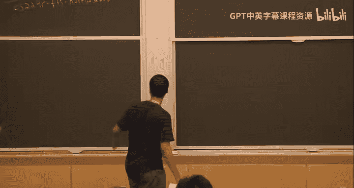

If， you're going to email me or the TF， the TF is right there， that's Yak Yaroswab。

Please email this address。 It's all on the class website。It， it still goes to our inboxes。

 our main inboxes。 It's just it gets auto tagged in the right way。 So I won't lose track of it。 So I。

 I recommend。Emailing us that way。嗯。I'll spend just a couple seconds talking about logistics before I really start。

So lectures will be recorded。 We have a videographer of us in the back。

And there will be links on the course website to videos。Pres， undergrad algorithms， probability。

 linear algebra， grading， we're going to have PSATets。Roughly every week and a half。

 if you look at the fall 2013 website， we're going to have probably less PS this time around。

Give you more time to think about the final project。cring。

 can I get any volunteer to today's lecture？So just the scing means， you write notes on the lecture。

 and then you email it to the staff email address by 6 PM the next day。

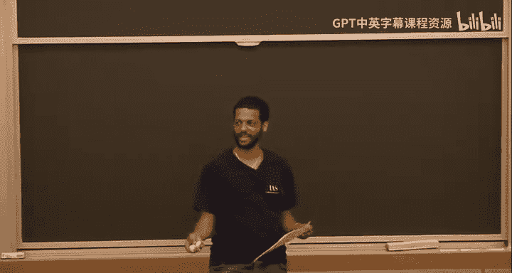

So I think today is a particularly light lecture describe because I'm spending time beginning talking about logistics。

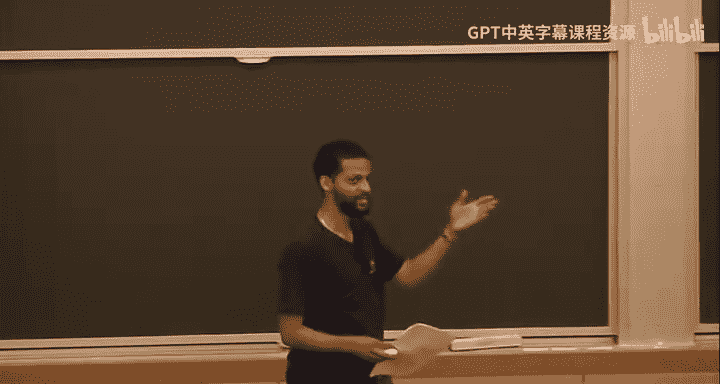

Any any volunteers。And everyone has to described describe at least once if you take a class。

If you think you're going to take it。No subscribe volunteers。Okay， okay， so that's okay。

 So we have one。

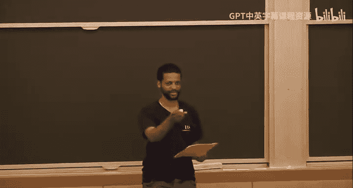

So。OhAnd also all the dates of the class are。On the website。

If if there's a particular date you want toscribe， you should email us， and then we'll。

 we'll list you for sccribing that date。 and it's first come first serve。 So take the spot that。

You prefer early， there's a final project and a presentation。

Combined is after grade， presentation is about 10%。 final project is 40。

 and you can work in teams of up to3 and also。Every student is expected to help grade one P set。

With the Tia。Okay。So what is this class about？

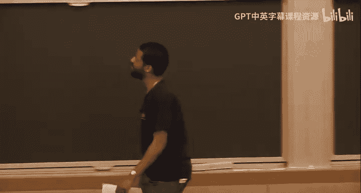

So it's about algorithms for big data。 What I mean by that， I mean。

 input data that say so large that the traditional way of analyzing algorithms you learned in say。

 undergrad algorithms is you know， insufficient。

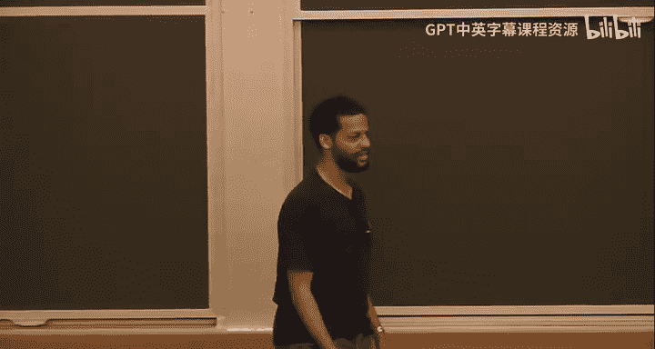

So， for example。Maybe you don't have enough memory to store the input even， right。

 So you have one pass over the input and you need to compute something。

 Maybe it fits on your computer， but it doesn't fit in memory。 You have to use disk。

 and then you have to take into account that diskcas are much slower than。Then memory Access。

 etc cetera。 Okay， so let me give an overview of maybe five。

 six things that we're going to talk about in this class。 So one is sketching and streaming。

So this is a topic overview。And also， I sent。I sent a paper going yet。 it's over there。 Okay。

 so make sure that before you leave this classroom， you sign up for the class or。

You sign up for me to put your name on the course mailing list。 Okay， that's in the back there。

 It's going to pass around。 So topic overview 1， sketching and streaming。So what do I mean by this。

 What is a sketch， What do I mean by streaming， So sketching。So a sketch。呃。C of x。You know。

 with respect to。Some function。2。Okay， is a compression of the data X。 So x is the data。 Okay。

 and a sketch of the data is the C of x。 and the sketch is a compression。

With respect to some function F。嗯。If it allows me。You know，Comp or approximating。Let's say， F of。

F of x。Given。Access。Only to CX。可。And sometimes we care about。You know， sometimes。F has two arguments。

So， you know， we want our multiple arguments。 We want F of X， Y。Given。C of x and C of y。

So just to locate this in reality somehow。Let's look at the second bullet here。

 So maybe you have some input data， and I have some input data。

And we want to compute some similarity measure of these databases， okay， or of these data items。

So one way is I can just send you my database， and then you can compute locally the similarity measure or vice versa。

But imagine that these are really big data sets， okay？And I don't want to， you know。

 it's expensive to send that much data across the wire。

 So rather what I'll do is I'll locally just compute the sketch of my data。Right。

 and then send the sketch to you， which is something much smaller。

 It's a compression that I say it's a compression so。It's a compression， I didn't write it。

 but I said it。So C of x is much smaller than x's。 And then given given the sketch。

 you can compute the function， right， the similarity measure， let's say。

And to give a really trivial example， let's say that my data is a bunch of numbers and your data is a bunch of numbers。

 and F is their sub。Okay， the sketch I can do is just locally compute the sum of all my input data and then send you the sum。

 which is a lot smaller than sending you my entire list of numbers。 That's true。

 that's a true example。 But you can do more sophisticated things。In Sketchland。 Okay。

 so questions about what sketching is。🤧。And then， streaming。

The only you can think about it for now anyway is。

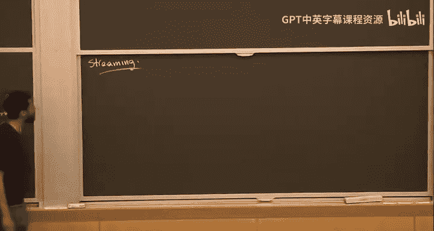

What。To build a sketch。To maintain， let's say， maintain。Our sketch。C of x on the fly。As x is。Okay。

 so my list of numbers is growing。 I keep seeing more and more。 I can keep a running sum。 Okay。

 the running sum is a streaming algorithm。 So it maintains the sketch of the data as the data is updated。

And these kinds of things appear in a lot of places。 So， for example。

 say you're a router and you're monitoring network traffic， right， and you want to be able to。

sketchketch network traffic so that AT&T can later come and query about the traffic patterns。

 find anomalies， etc。Or compare traffic patterns at two different locations in the network。嗯。

Feel free to interrupt me with questions。嗯。So that's sketching and streaming。

 that's the first topic we're going to cover in the course。

Another topic we're going to spend time on is dimensionality reduction。And it's what the name says。

 So my input， my data is a bunch of high dimensional vectors。So data is high dimensional。Okay。

 and what dimensionality reduction lets you do is map your data into transform your data into a low dimensional version。

Such that whatever computational problem you're considering。

If you solve that computational problem on the lower dimensional transform data。

 you can then somehow lift that solution to the original data。

 And the point is that since the data is now low dimensional， algorithms will run faster on it。

 presumablys the running time or resources required by your algorithm depends on the dimension of the input。

 right， the bigger the dimension， presumably the slower or more space， etctera。 it takes。

So by first hitting it with dimensionality reduction， you can speed that up。You know， speed up。

Clustering algorithms。You know， nearest neighbors search in high dimension。赛啊。

Nearest neighbors sayI have a database of images。Images are really just high dimensional vectors。

 right， Every pixel is a dimension， and the value of that dimension is。

 say the intensity of the pixel or something。 and I have a database of images and a new image comes。

 and I want to locate someone of my databases close by like I want to auto tag pictures on Facebook or something。

So。Dimenssionalality reduction is a way of。Of handling such high dimensional data。

We're also going to talk about。

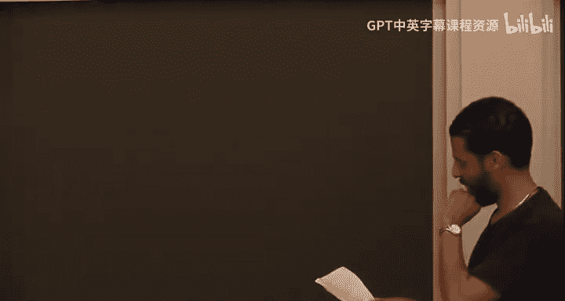

So it's related to， well， many of these things that I'm going to write down。

 you're going to see in the course are actually quite related。 The tools that we develop。

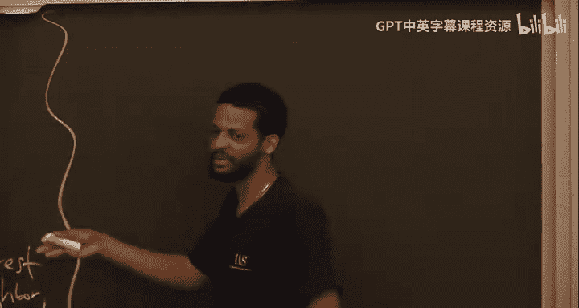

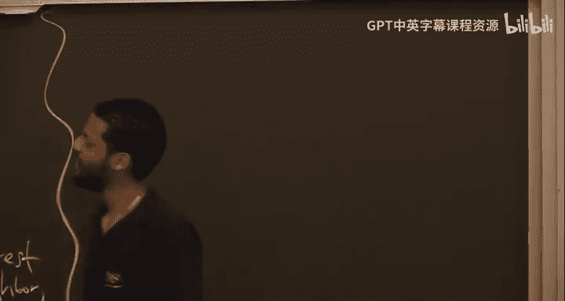

In streaming， and sketching are going to be related to things that we do in dimensionality reduction。

 which are going to be related to the next thing I write， etc ceter。

 So we're going look at some things。 This is not a machine learning course。

 but we're gonna to look at some large scale。Machine learning problems。More from the algorithm side。

 like machine learning， people want to solve some problem in their algorithms and then how do you speed that up。

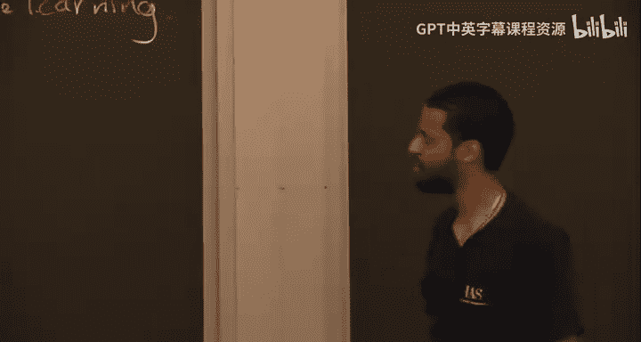

嗯。So， for example。You know， regression problems。Large scale regression problem。🤧。

We collect a bunch of data。Data， which looks like。The IF data item looks something like。BI。Equal to。

F of X I plus noise， and' say F of Z plus noise。Okay。So we imagine that theres one variable B。

 which is somehow a function of a bunch of other variables， which I'm calling Z。

And I want to learn the relationship between this variable and these variables。ok。

So that's regression。And I imagine that I get a bunch of。嗯。Observations， possibly with noise。

 And based on that， I want to， you， want to basically recover F。Or there's。

 there's noise so you're not gonna to recover exactly， but you want to recover， say F tilde。

 which is close。And from the statistics side， kind of the more data you see。

 the closer you should be able to get， know， with some good probability。

 FTilde will get closer and closer as you see more data。嗯。So some a little linear algebra。

 maybe some of you have heard of the case， you know， linear regression。Where。FM Z。Is let's say。

 it's a linear function。's some let's say X dot Z。Maybe plus a constant term or something。And now。

 really， the parameters here are， you know， this vector X。 You want to recover X， right， and。

From statistics， we know that if you know， the noise is say Gaussian noise， you know that。呃。呃。

You know， a popular estinator to use or one that is。Prorovably optimal， in some sense， is。L squares。

Right，The maximum likelihood estimator， I guess， is the right word。

 So you set Z tilde or Z least squares is the minimizer X least squares， sorry。

Xley squares is the minimizer。Of。Z x minus B。Alt two。So this is least squares regression。对。

And let's say you have a really huge regression problem。

So can you raise your hand if you've seen least squares Russian。

Or if you've never seen least squares regression。Some people haven't。But。I'll just tell you that。

 you， this has a closed form solution， which looks something like。呃。Let's say Z has full column rank。

 Z transpose z inverse。Z transpose B。The rows of Z are the Z Is。 The Z is a matrix here。

 the rows of which are the Z I's。And B is the vector of the BIs。

We'll get into this more later in the course， but the point is if you want to solve。

 say least squares regression， it involves some big matrix matrix multiplication。

 which is expensive right the more data you had， the the more data you collect。

 the more expensive this operation is and we'll see techniques that allow you to solve problems like。

 well least squares regression in particular to get good least squares answers much faster than just doing this。

 which is the thing that you would learn when you first learn least squares。Okay， and we'll also see。

So at least linear regression is just one example， but there are a bunch of other examples。

So for example。Some other forms of regression。Not just linear regression。NowPA is another thing。

 principal components analysis is another thing we're going to talk about later in the course。嗯。

You know，Ma completion。Another thing we're going to talk about。

It's often called the Netflix problem where you're given a big matrix， let's say。

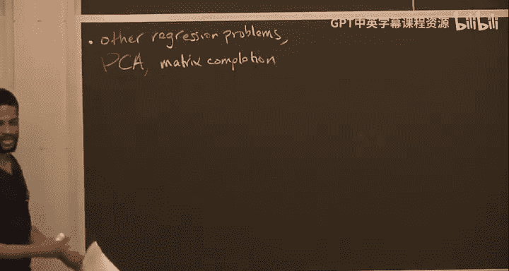

Users of Netflix and movies。 And then people rate movies。Okay， and based on the ratings you collect。

 which is very sparse， right， Most people don't rate every movie。 You have very few ratings。

 You want to infer what the other unknown ratings probably would be so that you can do product recommendations。

 Okay， so we're gonna to talk about some of that。嗯。We're also going to talk about compressed sensing。

呃。🤧And the idea here is。嗯。Compress or even cheaply acquire。Depending on。The scenario you're in。

High dimensional。Structured and signal。O。So what do I mean by high dimensional structured signal。 So。

 for example， take an image， an image of this room or a typical image， okay。As I mentioned before。

 an image is really a high dimensional vector， right indexed by the pixels。

 So if you have 100 by 100 pixels， this is a million dimensional vector。

 Okay and in the usual basis that we use， right， if you write this if you write down the usual basis for a million dimensional space。

 the the picture probably is not sparse。by sparse， I mean mostly zero。Most images in the picture。

 unless you take a picture of like a black room or something。

Most pixels will have some intensity in them。But there's something called the wavelet basis， okay？

And pictures are usually sparse in the wavelelet basis。

 And what I won't tell you what the wavelelet basis is exactly。 But the basic idea here is， yes。

 in the standard basis， pictures are not usually sparse。But if you look at any pixel and look at。

 say。The pixel's intensity versus the average of its neighbor's intensity。Okay。

Those differences are usually pretty small。 Images don't change very quickly， from pixel to pixel。

Okay， unless your image is random noise， okay。So theres a。

 there's a basis transformation you can do where most images actually are sparse。 So really。

 you have a high dimensional signal， which is sparse in some basis。And because it's sparse。

 you expect that you should be able to compress it。Maybe lossy compression。

 It's not perfectly sparse， right， You're not exactly your neighbor， but you're very close。

 So there's some lossy compression。 And then given the lossy compression。

 you want to be able to decompress。Right， so this is， for example， how， you know。

 Jpeg exploits the fact that images have this structure that are're sparse on a certain basis， right。

 so。So example applications， you JPEG。just image compression。Or MRI。

Okay so the MRI machines are also taking some measurements。

 which are sparse in a certain basis and kind of if you can so here it's compression。

 here it's cheap acquisition。Right， so basically， the longer your body stays in the MRI machine。

 the more measurements the machine can take。Okay。And if you can cheaply。

 if you can take few measurements。Okay， that means that you spend less time in the machine。

 which is you know， ideal， I guess。Especially if the person is say a little kid and you can't get them to stay still。

And I should say， you know， using， so usually when people say compress sensing。

 they mean using linear measurements。So this is， this is a vector and Hyde mentions。

 And we want to take few using。Linear measurements。I'll just say two more。

 and then I'll start doing stuff。Okay。One other thing I said is external memory model。

This is what I was saying earlier where when you took CS 124 or whatever other undergrad algorithms。

 of course you took。You usually measure efficiency of an algorithm in terms of number of instructions that it executes on the input。

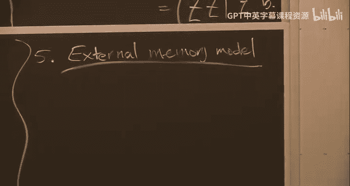

喂。But this is a different model for measuring efficiency。So measure。Discas。Instead。

Number of instructions or you can measure both and try and be good in both at the same time。

And the reason is， you know。If you compare， let's say， mute most computers。

 if you compare the the time it takes， you know， in seconds or in in fractions of a second to touch。

A cell in memory in Ram versus to seek to some random position on disk。 not flash。

 but let's say an actual like magnetic disc。It's about six orders of magnitude difference between those two okay。

So as long as you're not doing anything too crazy with number of instructions。

 kind of a first order proxy is I should really minimize this guos and。Maybe condition on that。

 I'll also want to minimize number of instructions。

 but I'm going to focus my intention on disk guy Os。And。And random seats are expensive。🤧。

And the idea here is。Seeking to a random location on disk takes time。

But then once the head is already there reading。You know， I can， if I spent。

 if I spent some milliseconds seeking to arrange a position。

 I might as well spend another millisecond or so reading the next few locations sequentially after that location。

 right。Basically， it to amortize against the seat the seat cost， the random seat cost。

So the model here is。I have an infinite disc。Divided。Into blocks。

Just think of a tape that goes on forever。Blocks of size B。Okay。And I also have memory。

Which is finite。It's divided into pages。Size B， and there are let's say M over B pages。

So memory in total can hold M data items。

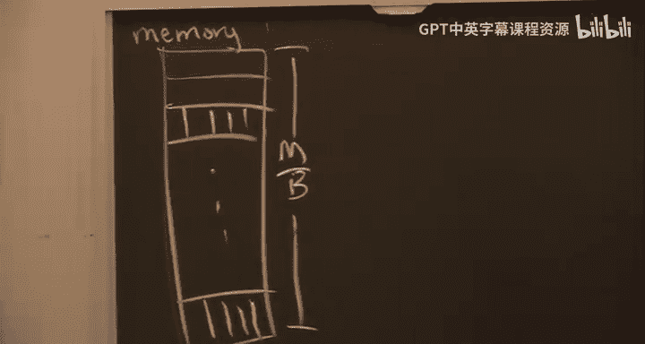

Okay。And if the data that I want to read is in memory。Or if the value I want to write is in memory。

 I can just simply read or write it for free。对。But if there's a location that I want to access。

 that's not in memory。Then I have to fetch it from disk。 That costs me one and put it into memory。

 and memory might be full。 So I also have to choose a page to evict from memory to disk。

And here I want to minimize basically the number of times I have to go to disk。

So there's this parameter B as well as the input size of the data， let's say。And， you know。

 something that you might have seen。That was designed for the external memory model as， say。

 the Be tree。 And people heard of bee trees used in databases。Maybe some people have， if not。

 you'll see it at some point in this class。Okay， so that's so external memory model and then time permitting。

You know， we'll also。Maybe spend the lecture or at most two on other models。Such as mapRuce。

 et cetera， other models， newer models for handling。Okay， good。

This was just an overview of the things we're going to see in this class。that about does it？

So now I want to really start and show you your first kind of cool streaming algorithm。

So questions about anything。I iss the paper still going around to sign up with email addresses。

 it' somewhere over there？So streaming， so back to streaming。

So we're going to look at a problem called approximate counting。And I think this。As far as I'm aware。

 this paper really is， know， the first streaming paper when the author wrote it。

People weren't talking about streaming yet。 He did it because， well， you'll so okay。

 so what's this problem， So this problem is there's there are a bunch of events that happen。

 You're sitting here waiting。 a bunch of events come and someone asks you， okay。

 how many events have there been。 So an event might be on a website and every time someone visits my page。

 that's an event。Okay， or I'm a router。 A bunch of packets get routed through me。

 Each time a packet comes， that's an event。 Hey， so someone asks me， how many events are there。嗯。

And you know he wrote this paper。In the 70s。Actually， his son is。A professor down the road at MIT。

This is the father。So。He wrote this paper he said， what's the trivial solution。

 Suppose that there are N events。Right， and I'm just asking you how many events are there。 And what。

 what my goal is is to minimize space。 I'm imagining that I'm a very space bounded。Devicice。Okay。

 so I want to into my space。 What's， what's the most straightforward solution if there are N。

If there are N events， how much space would you use and how would you do it。Yeah。Yeah， log in bits。

 you just store a counter right， and every time you see an event， you increment the counter。Okay。

Can you beat login bits？Can you solve this problem in less than log n bits？No takers。

If the promise I give you is， if all I tell you is the final answer is somewhere between 0 and n。

Okay， now use that most login bits for this problem。Then， yeah。An order of magnitude more cheaply。

Now。So I want to know exactly the number of events， right？I want I want。Oh yeah， yeah。 good point。

 Okay， So I wrote proate count。 So for exact counting。Okay， sorry， for exact counting。

Can you beat log n， And the answer is no。 So O， so you know。Easy solution。Is counter。Log。Bits。

Where n is the number of events。Again， you can't beat this with an exact solution just because of the pigeonhole principle。

 right if you're using less than login bits。Then how many， let's say using T， you're using T bits。

There are only two to the T Tbit strings。Right， which by the pigeonhole principle means that there are two distinct numbers between 0 and n。

 which are getting mapped to the same state of your algorithm。So on one of those， you're wrong。

But yes， as you were pointing out， if it's approximate counting。呃。This is optimal。For exact county。

Okay， so approximate counting。W to。Output。Let's say in An Tilda。Such that。

So we're going to look at to randomize the approximate algorithm oncell put until this upset the probability。

That。Until the deviates from the true end by more than epsilon n。Is that most Dlta？So。

In the beginning， someone gives me two parameters of Epsilon in Dlta。 and they say。

 design an algorithm for me， which can give me this kind of guarantee。

 And I want you to use as little space as possible。For now， thing of Epsilon as like。

 let's say a half or a third。 I want to know the answer to within a factor of two。

And I want to work with 99% probability。对。So， yeah， guess you were。You were saying before。

 I only need to， you know。What's the lower bound for this problem that you were about to say？Well。

 forget about the randomness。 Let's say it's a deterministic algorithm。

 And it has to know the answer up to a factor of 2。Log log in， right。

 because you really only need to know。You， you can round up the。

 You can round the answer to the nearest power of  two。 And that's still a valid solution。

 And how many distinct。Powers of two are there between one and n。 there are a log n of them。

 So you really only need to remember which band you lie in。 Which power of two are you close to。

But they are only log n possibilities。 So writing down routing down a number between one and log n is log log n bits。

So。You can't， at least deterministically， Itll even randomized。 you know。

 I I won't justify fight right now。 You can't hope for better than log log n bits。

It's the same pigeonhole argument if you're using less than log log n bits。

There are two numbers from two different bands， which are're getting map to the same thing by pigeonhole。

 and your answer is wrong for one of them。 It's not going to be a good approximation for one of them。

So we can hope。It maybe home。For O of log log ins。So that's exactly what Morris does。 Okay。

 so we're going to see Morris's algorithm。He's going to give us this kind of。Okay。

 so what's the algorithm？Step one。Initialize。A variable x to0。Okay， step two。For each event。

Increment。X。With probability。1 over 2 to the x。And three。Output。2 to the x minus-1。Okay， so。

Every time we have an event we increment with a certain probability。

 imagine that my computer has a perfect random function。

 which gives me a perfectly random number between0 and1。 Okay。

 perfectly random real number between0 and1。 We'll talk a little bit about deranization later in the class。

 how you might implement such a thing that suffices for algorithms。And then when someone says， okay。

 what's N， How many events have there been。This is my entilder。By N tilda。

 my estimate for n is 2 to the x -1。Okay， and。Just the， you know， the。

The intuition is supposed to be。That X is sort of representing， you know， log。Of。Of course。

 it x is a random variable， but。We're hoping that X stay somewhere around login。

And I'm stealing this notation from a friend of mine where you drop the O from log。 Basically。

 it means log base 2。 And it also means， let's say。Log of x is equal to。Log this to。Of two plus x。

It's never。It's never negative or anything。 It's all I don't want to keep writing。

 I don't want to have to deal with the fact that sometimes log of one is 0。

 And then if I divide by log。I'm dividing by 0。And things like that， okay， so that's what log is， LG。

So now we want to analyze this thing。可。And。Good。Now。I apologize that maybe the next。

The next few minutes。Might bore some people here and not bore others。

 I just want to do a very quick probability review。And then I probably won't do any other reviews。

In lecture。But。You know。Almost every algorithm we're gonna not every。

 Almost every algorithm we're gonna to cover in this class is going to be randomized Monte Carlo。

 meaning you know， it has some probability of failure， right。

 There's some deelta probability of failure over there。

And I really want to make sure that people are all on the same page。Actually even for。

 even for the people who are gonna be very familiar with everything I say。

 there's gonna be one thing I'm gonna to say at the end， which。

I hopefully won't be familiar to anyone， at least in the form that I'm going to say it。 Okay。

 so I'll try and keep it exciting。Okay， good。Before we analyze。Probability review。And it。

 it'll introduce some technique that we're gonna see later in the course as well。

 So it's good to see it early and。Bee a master。Probablyly review good。

So we're mostly in this class going to look at discrete nano variabless。You know， X takes。

Let's say value。And some some set S， some discrete set S。Right and you know。

 expectation of X is the sum over J&S。J times the probability of。And there's the usual。

Linearity of expectation。Okay。This is called linear expectation。I'm not going to prove it。

You got read about it a few。Forgot。Okay，Okay， good， other things I want to say。

 so there's Markov Markov's inequality。Which says that if x is a non negative random variable。

That implies that。For all， let's say lambda， a probability that x is bigger than lambda。

Is that most the expectation of October Lambda？Okay。

 and then there are a bunch of other things that are just Markov on something。

 So there's chubby shove。So now here。It says that for all lambda， the probability that。

X deviates from its mean。By more than lambmbda。this is the kind of thing I like to know of a random variable like that one。

Like 2 to the x -1。 And I'd like to know that it's concentrated around what I expect it to be。

So what's the probability that it deviates by what it's expected to be by lambmbda， that's at most。

The expectation of x minus the expectation of x。Squared。Over。Lambbu word。So。

It's the expectation of the square。Not the square of the expectation。And the proof is just。You know。

 probability that。X。Dgate from its expectation by more than Lambda is the same thing as。

X minus expectation of x squared。Deviating。Being bigger than lambda squared。Just square both sides。

 and then now you do Markovs in quality。可。And depending on the community you're talking to。

Some people call everything Cheubby Che。 So you can， you can put a P here or something。

So I can take higher moments。 I don't have to take the second moment， right， So this thing。

 by the way， if P is 2， it's called variance。 but， you know， you could。

 we could work with other moments as well， right。And then there's turn off。Which says， let's see。

X1 up to Xn。Our independent。And I know that Xi。It's always in the interval 01。

And also define x to be the sumvari of Xi。What it says is the probability。That x deviates。

Here it's mean。By more than， say lambda times it's mean。Is that most two times e to the minus。

Lambda squared times its expectation。er three。You know， for all。Epsilon between zero and1。Orlandda。对。

I mean， you can go read about it。 This is basically Markov all over again。

 So I'll put the proof in one line。Their details。Which you can find on pretty much。哦。

You can Google it if you really want to。So。嗯嗯。Okay， so。The key is really here。

This is bigger than that， if and only if。This to the， you know。

 to the second power is bigger than that to the second power or to the P power。

 I can apply whatever function I want here， right， as long as the function is， I guess。

 increasing or。It should just be the case that F of this is bigger than this。

 if and only if F of this is bigger than F of that。Right。

So the F that I'm going to use is going be some particular F。So。呃。Probability that。

X is my minus expectation of x。Is bigger than lambda expectation of x。Is that most is equal to。

The probability that。Well， what you would do， really is you would do。

 You would do the upper bound and the lower bound separately。

 So the probably that this is bigger is equal to the probability that E to the T。

X minus expectation of x。Is bigger than E to the T expectation about。Okay， so my function。

 my function， F of Z is E to T Z。 So I apply that function of both sides。

And this is bigger than that， if and only if this is bigger than that。

 and then you do Markov on this。And then you have to do some calculations。

And then you also want to know that the absolute value doesn't deviate with high probability。

 So you also have to look at what's the probability that the negative is smaller than the negative of this。

 And then again， you do Markov where you apply E to the whatever on both sides。Okay。

 so you can find that。 You can find proof of this pretty much。 You can find it on Wiki。 Okay。

 this is a very。Standard thing。Okay， and I promised that I was going to show one thing。

That maybe people haven't seen。Do I really want to？Yeah， okay so。嗯。I'll show it。 Yeah， okay。

 let's do it。So maybe you've seen the statement， but maybe you haven't seen the proof that I'll show you。

 which will imply turnoff， for example。So this is called Bernstein。嗯。Okay， so。嗯。It says that again。

 you。X1 up to XN。Independent。And you have， let's' say the absolute value of x is at most k。

You also have that x is the sum of Xi。And you also know that， let's say sigma squared。

Is the sum over I expectation of x minus expectation。So assuming as square is the variance of x。

Then the probability that x deviates from its expectation。I use less than twiddle to mean big O。

 So up to a constant。E to the minus C， probably that it's bigger than let's say。T。

E to the minus C T squared over sigma squared plus E to the minus C。T over K。Okay。So。

The turnoff form that I wrote here is implied by Bernstein。Okay。

I'll leave that to you to verify as an exercise。Basically， the point is that if k is1。

 So this corresponds to K being1。If K is1， then sigma squared is at most the mean。Okay。

 so you can prove that to yourself offline if you want。

And then if you just plug in T being lambmbda expectation here。And epsilon is less than one。

 or lambda is less than one。 This term is dominated by this term。

 and this term will give you exactly that up to the constant。 The constant changes。

 I guess theres a three here。 I put some constant C。Okay， but。呃。Turn turnoff is implied。

 This form of turnoff that I've written is implied by Bernstein。Up to Constance。There's。

 there's a difference when Lada becomes bigger than one。 When Lada becomes bigger than one。

 turnoff actually gives you something that's stronger than this。

But then there's a better version of Bernstein called Bent's in equalityequality。

 which I would forget about it。 We don't really care right now。Okay， so。I'll actually。

 I guess I'll prove Bernstein。And I'll prove it。In a way that。

Will be useful later in the course as well。So it's good to see a trick early。So proof。

So I'm gonna use a couple things。 I'm gonna use。 I'm gonna make some notation， so。

The p norm of a random variable Z is the expectation of z to the p to the 1 over p。This is a norm。

A P bigger than equal to 1， that's a fact。Okay。So I can do triangle inequality， et cetera。

 it's a norm。ok。And I'm also going to use something called yson's inequality。

 which says that F is convex。Implies that。呃。F of the expectation of Z。

Is that most the expectation it？This is called Ysen。Good， so now。Let's prove Bernstein。

 We have to prove。We have to prove that inequality。

 the problem that you deviate by T is at most that。可。So。It's equivalent to prove。That。

Some over Ixii minus the expectation of sum over IXi。

P to prove that for all P bigger than equal to 1。This P norm is at most up to a constant。

Root p times sigma plus p times k，嗯。Forget out equience for now。

 Supp I had a bound on the P norm for all P。P norms are really like pe moments， right。

 Por is like a pe moment to the one over P。 So really， this means I've abounded all the moments。

How might you go from having a bound in all the moments？To getting that bound。

How would you go about it， given something that we've already talked about in today's lecture。

Any ideas， yeah。So Markov， okay， so Markov on E to the something。So， okay。

 but so here all I'm saying is I only know what I have is I have bounds on the p norms。

 and I want to go to that。 So I， yeah， I will use Markov。

 But what I'm gonna to use Markov on is I'm gonna use。 I'm gonna do exactly this。

Undo Markov on the P of power。Right，Because that's what I know。

I know I have a bound on the PF moment of this random variable。

 So I'm going to use that bound and then apply Markov。Okay。

And if you're telling me to prove that kind of bound。Right。

 then P is going end up being a function of T。Okay， so basically， I'm gonna do Markov。

 I'm gonna optimize my choice of P to give the best bound I can as a function of T， T sigma and K。

And if you do that。If you do that with this as your moment bound。You will get that。

 So I'm not going to do it on the board。 You're going to have a probability review kind of one problem on your on your PAT。

 which is going to come out soon。You're going to prove that。This， this kind of statement。

A bound on the moments for all moments is the same thing as that statement。 So that statement。

I should have said。There's a for all in both of them， right？For all t bigger than0。So the statement。

The statement that for all T， you have this deviation bound is the same statement as for all P。

You have this kind of moment bound。So one direction is Markov。And the other direction。

 you can also go from there to here。And you'll see it on the Pet。 Okay， so these are。

 these are the same statement。Okay， so let's prove this kind of bound。

So I didn't explain all the details， the calculations of why they're equivalent。

 but let's just take it as they're equivalent because you're going to prove it on the Pet anyway。

Okay， so。来。Yhy I。Identally。Distributed。As Xi。With。Xi。Overall， I and why I。Overall， I are independent。

So now that we have two n random variables， x went up to Xn and y went up to Yn。

And X I and YI are distributed exactly like each other。So then， that implies that。Some over eye。

Xi minus expectation， some over I X。That's the same thing as this is just a number。 This is a number。

 and it's the same number as if I had written。Expectation some over I Y I。

 or this is the expectation over y。诶。And really， I mean， I can put the expectation over why here。

Expectation over why of of this big thing。And now， I apply Yssen。If P is， if P is bigger than one。

Then absolute value to the P is a convex function。So I can pull this expectation outside and put it in the pen norm。

 So this is at most。Some over I X minus Yi。Where now this is over the randomness in both X and Y。

 this is by Yenssen。And now。Notice that X minus yi。😡，Is a symmetric random variable for any value T。

 It's equally likely to be t or minus T。So this is identical in distribution。To some over I。Alpha I。

Xi minus Yi。P norm where alpha I is just a plus minus1 random variable。Random plus -1。Okay。

 and now I'm going to use the fact that。What I said was this thing is a norm。 Oops， did I。Oh。

 my goodness。That was terrible。 I risked the I money。 That's okay。嗯。

So I said that this thing is a norm。So this thing is at most。Two times。Sub over well。

 I can write it like this。嗯。Some of I alpha I X， the norm。Plus。Some over I alpha IY， IP。

I just use triangle inequality。But Y， I and X I are distributed the same way。

 These two things are the same。 This is just equal to two times。The sum of I alpha I。对。Which。

Now here's maybe a magic trick that people haven't seen before。This is equal to。

Two times the square root of pi over2。Times the expectation over G of sum over I， alpha I。

 absolute value of G。Xi。Where。G。Is。Vctor。IID Gausians。Okay， so what did I do。

 I just multiplied by one。The expectation of the absolute value of Gaussian is square root 2 over pi。

Just some number。 It doesn't really matter。 Look it up if you want。 It's just some number。

And then I just divided by that number on the outside。So I just multipied by one。

And then now what am I going to do？😡，I'm going to use Ysen。And pull this outside of the。

 of that of the norm。By Ysen， this is at most。Forget about constants。 This is at most。

S over I of alpha I ups the value of G X I。This is again， Ytsen。

What's a random sign times the absolute value of a Gaussian？Exution。Right。Yeah。

 random sign times the absolute value of a Gaussian is a Gaussian。 is equal to。Some of I G XI。谁。

I apologize if people， I guess I I start off saying discrete probability if people are not so。

Are you used to working with Gaussians all the time。

 Everything that you're gonna need to know about Gaussians。 I'll just say it as I do it。 O， so。

You don't really。I won't expect you to know that much in the future。So。

 so what happens when you add up a bunch of Gaussians， What do you get。You get ation。

And the variances add。If you add a Gaussians， you get a Gaussian， the variance is add。

 So this is just a Gaussian。这是 Gausian。With variances， with variances。Basically， sum of Xi squared。

I don't want to erase that algorithm， so I'll leave it。OkayGreat。So great。 So now you can say。

 you know， you can just， you， prove it for yourself or look it up in a book。What are。

 what's the peth moment of a Gausian， Okay， so。🤧嗯。Look up in a book。Expectation of a Gaussian。这个。

Let let's say you have that some random variable Z。Is a Gaussian with mean zero variance 1。

 Then the expectation of z to the P is equal to。0， if P is odd。

And something like P factorial over well。Yeah， P factorial over p over 2 factorial2 to the P over 2。

He's even。Which this thing is basicallyo of root P to the P by Sterling's formula。Well。

 it's actually at most repeat P。You can prove yourself to yourself that's at most repeat of the P。

Great， so that thing there。😊，And if you， if you。If instead you have a Gaussian with variance。

V squared， then you， you multiply this by a vta the P， basically。对。So there what we got is。

That thing over there is at most。Square root P。Times。The P norm of sum of I X I squared。

To the one half， this is V V squared。 the variance was this。

 So the standard deviation is the square root。谁。And this thing here。

 what you can say is this is equal to by the definition of P norm， this is equal to root P times。

S over I X squared。To the P over two， Or actually， I can even say。Yeah， to the P over two。

To the one half。So if you， you know this thing。In general， notice that。If you have a random variable。

 Z P norm。This is the expectation of。Z to the P。To the one over P。

Which is the same thing as saying expectation of z squared。To the P over2。Right。To the two over P。

To the one half。Okay， those are the same thing。And this is the P over2 norm of z squared to the one half。

 So that's all I did。 So the P norm of this is the same as the P over2 norm of this to the one half。

Okay， and this is at most。Rot P times。Some over I X squared。P to the one half。

This is because P norms increase。Okay。And that's equal to。Rupee times。

Some over Ixi squared minus expectation， some over Ixi squared。Plus， expectations of Xi squared。Good。

呃。

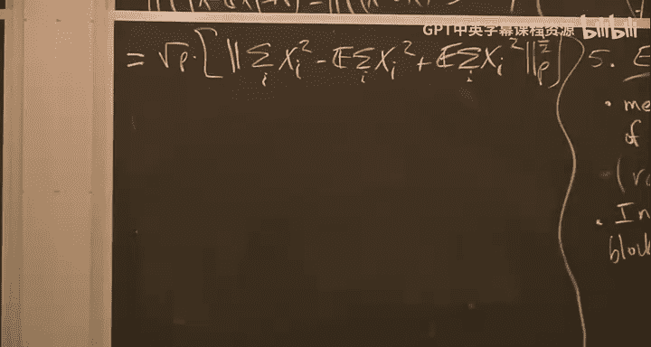

We also say。So without loss generality， let's say。Expectation of X is equal to0 for alli。So。

If that's not true， I'll replace each Xi by Xi minus its expectation， okay。And now。

I'll use triangle inequality， this is at mostP times。Some of I X squared minus the expectation。

Our similar expectation。Some of our Ix Ico。Plus。Some of our I X squared minus expectation。

So I I shifted all the X。 so they have mean 0。 So what's， what's this thing inside of here。Yeah。

 yeah， sorry， it's variance。So this year。It's just the number It's Sigma squared。 It's not random。

 It's a number。 And I took it to the one half。 So this is equal to。Sigma root P。So I'm getting close。

 right？Sigma， yeah repeat repeat time Sigma。Okay， plus。Plus， rootee。Times。呃。

Some over Ixi minus expectations， some over I X squared。

And using the same exact sequence of tricks as last time， replacing these with Ys。

Putting in random signs， using Yssen， putting Gaussians in， arbitrarily， all that stuff。

This is at most sigma root P plus root p times。Some over I。G I X I square X I。Squared。

RightYou can artificially， you can symatize， you can replace these y eyes。Pull。

 pull the expectation of why outside， put the signs， put the Gaussians， do all that stuff。Okay。

And now， this。Right。This absolute value is at most。Well， what is this again？This is a Gaussian。

Whose variance is the sum of X side of the fourth。Right。This is a Gausian。The variance。

Some of X side of the fourth， but I know。That X is at most K。 X I is never bigger than K。

 So this is at most。K squared times sum of Xs squared。So at the end of the day， what I have。Is。There。

嗯。Right， so。I have that thing， so let's say star。Star was some over eye。G， I。

 X I P norm is at most up to a constant sigma root P plus。K squared。So。The variance is k squared。

 So the standard deviation is k squared times this。 So the standard deviation is a square root。

 That's K。 And there's another square root。 So plus root P times root K。Times sum over I， G X I。

P norm to the one hand。RightSo now this is a Gausian whose variance is sum of R X I squared。

 and I've pulled out the K squared。Right。But does anything look funny about this to you？Almost。

I've bounded something in terms of its own square root。Right。So let's call this thing。

Let's call this thing Q。This big O， this less than twi is having a constant。

 what I've shown is that Q squared minus c sigma root P minus C root P root K。Q。Okay。

Is less than equal to zero。This is some quadratic in Q。So this is Q。 So what it looks like is it's。

 you know， because the leading coefficient is positive。As Q goes to minus infinity。

 it goes to infinity。 It goes down， and then it goes back up again。

And I've I said that this thing is less than equal to 0， which means that Q。Q is less than。

The larger root。Of the associated quadratic equation。And if you solve that quadratic equation。

You'll get that。Well， you'll basically get what I promise， okay， so I'm not going to do it。

So this is， I guess I'll call Ruleson's square root trick， where when you want to bound P norms。

 you bound them in terms of their own square root by artificially inserting Gaussians and things like that。

We're going to do it later in the course。When we do it later， I want you to be。

 you look at it and say， oh yeah， that's just lecture  one。Easy stuff。so。Yeah， okay so good。

 So now that we've done that。Let's actually go back to analyzing more。Okay。So。

Let me erase some of this and let me write one conclusion that we had before。We said。Xs are in。

Independent。Sa new is the expectation of。Some of I。はい。Which I'm calling X。Then the probability。

That x deviates from its expectation by more than lambda mu。Is that most two times e to the minus？

Lambda squared mu。3。哦。Yeah be0。So good。 Now let's analyze Morris。Okay， so Morris。

So the plan is going to be。First， we want to know that the expectation is correct。Okay。

 then we want to know that the variance is small so we can say that it's good with chubby Che。对。So。

Cim。So okay， first I want to say let。XN denote。X after。And events。So claim one。

The expectation of 2 to the x。s equal to x n is equal to n plus  one。So Xn is a random variable。

Sometimes we incremented， sometimes we didn't。And the proof。Is by induction on n。Base case。

N is equal to 0。 It's fine。 So when n is equal to 0， we haven't seen any events。 So x is 0。

So two to the 0 is 1， which is 0 plus  one。 Okay， great。Now， for the inductive step。Let's say that。

It's true for n， and we want to show that it's true for n plus 1。呃。The expectation。

Of2 to the x n plus 1。Is equal to。So we've seen n events， and now we're seeing the N first。

So let's just sum over all possibilities of what。The counter was after n events。

So it's the sum over all possibilities J。For what the counter was after n events。Times。

The expectation。Of2 to the X N plus 1。Given that Xn is equal to J。

So this is the conditional expectation conditioned on the event that。Xn is equal to J。

So if X n is equal to J， what are the possibilities for what X n plus 1 might be？I'm sorry。

 or are J or J， what did say？J or J plus1。 So2 to the x N plus 1 will either be two to the J or 2 to the J plus 1。

So that thing is equal to the sum overall J。Of the probability of that。X1 is equal to J。OfWell。

 it's equal to 2 to the J。With probability 1 minus 1 over2 to the J。😡。

Because that's how the algorithm works， it increments probability 1 over two to the x。So this is。

We didn't increment。And with one over two to the J probability， we do increment。

 So with one over two to the J probability， we increment， and it becomes two to the J plus1。Okay。

So this is equal to。The sum over j going from0 to infinity of probability that x n is equal to J。

E2 to the J。Plus， the sum overall J probability at Xn。Is equal to J times 1。This is one。

sum probabilities of being anything is one。Has to be something。What's this？Now。

 this is the expectation of 2 to the XN。Which we said was equal to n plus  one by this is our inductive step。

So this thing is equal to n plus 1 plus1。So we've completed our induction。Okay， and。That's great。

 So good。 So we know at least， let me not erase that。

We know at least this thing is giving us the right thing and expectation。

But what we want is not just that it's right in expectation。You， we want。We want。

That the probability that。Untililil deviates from n by more than epsilon times its expectation。

 by epsilon n is at most delta， right， that's what we really wanted。

 We want to say it's close to high probability。Okay。So let's bound the variance remember。

The probability that。N tilde minus n deviates by more than。嗯。嗯。By more than。Epsilent N。

Is that most1 over epsilon squared n squared？Times the expectation of n t the minus n squared。 This。

 This is chubby Shi's inequality。 This is Markov on the second power。

This is one of the things we had in the probability review just now。RightAnd if you look at Enilde。

 untililde is 2 to the x -1。 So if you square it。You're going to need to understand the expectation of 2 to the 2 x。

Right。So。This thing here。Is。This thing is one over Epson squared n squared。

Times the expectation of 2 to the x -1。Minus n squared。So if you square it。

 you're going need to understand expectations of two to the two x。So claim。I don't have time。

 I'm not going to write down the steps， but it's another inductive thing。You can show。

And what are you going to get exactly？And you're going to show that。The expectation of 2 to the 2 XN。

Is equal to three halves and squared plus3 halves n plus1。可以。So I'm not going to do on the board。

 but it's another inductive proof。 It'll be in the notes。 Okay， so Jg Y， when you。

 when you send me the notes， I'll just add it in myself。呃。Okay good。So。If you then。

If you then put that into here， this implies。That the expectation of。And tilde minus n squared。

 you're going to get something like。One half n squared minus2 n minus1。

 which is always at most one half n squared。Okay。对。So now we know。That this， so you know。

 we have this。 This implies that the probability that。Until the minus n is bigger than Epsilon n。

Is that most？呃。1 over epsilon squared n squared times1 half n squared。And。Oh， n squared over two。

And that cancels that， this is equal topsil1 over two epsilon squared。Okay。

 so if a probability is bigger than one， then that's kind of a useless bound。

So let's say we want to succeed。 Let's say you want to succeed with probability， two thirds。喂。

So if this thing is equal to two thirds。Then epsilon is some pretty large constant close to one。

 We're actually getting， I mean， we're getting some multiplicative error with two third probability。

 but。It's not like great。What if we really wanted to get？😡，1 plus epsilon。 Epsilon is a parameter。

 And someone says， I really want to get one plus epsilon。 I really want epsilon as my error。

 How would you change this algorithm。How would you change this algorithm to get epsilon as your error？

Any other any take？二人。Yeah， I'll run。 So here's what I'll do。 I'll say Morris plus。Is instantiate。S。

 independent copies。Of Morris。An average。Their outputs。When you add a bunch of random variables。

Their variances add。But then you're averaging， so you're dividing by S。So effectively。

 what this does is it decreases your variance by a factor of S。😡，So this gets you。

So this failure probability。Becomes。1 over 2 S epsilon squared。Okay。

 so now if you want failure probability。A third， if you' want failure probably a third。

 how should you set S？😡，Sa again。Yeah， so that thing there。Is equal to a third。

Or let's say it's less than a third for s bigger than3 over two epsilon squared。

 which is theta1 over Epsilon squared。What if you wanted failure probability Delta？What would you do。

What would you change？来。Or it's less than deelta。For S being。

Bigger than one over two epsilon squared delta。Okay， so we have a minute left。So Morris plus。

It's know basically before your space was like log log n， so we didn't analyze the space。

 but you're going to see on the homework with high probability。

 the space is going to be at most log log n。😡，Now your space is1 over uppsilon squared times log log n because you're repeating it1 overpsson squared times if you want failure probability Dlta。

 it's1 of uppson squared times1 over delta times log log n。

But there's a more plus plus which gets you this delta more cheaply。😡，Run。T。Instaniations。

Of Morris Plus。With failure probability。One third， let's say。So S is theta n rhpson squared。Output。

The median estimate。From。The S。Morris pluslesss。And in the last。Let's say 30 seconds。

I won't get to do the calculations， I'll put them in the notes， but why does this work？Well。

Turnoff was going to be good for something in this lecture。Where is my better erar？So。

So run team instantis， and I claim it works。Fortiing。Something like log whenever over Dlta。

 So we replace the delta with log whenever over delta with log whenever Dlta。 and why does this work。

 basically it works because when does the median fail， Well， if the median fails。

 it means that at least half of the estimators had to fail。 They had to give you a bad answer。Right。

But how many of what fraction of the estimators， What fraction of the Morris pluses do you expect to fail。

A third。You instanted Morris pluses with sc probably a third。For the medium to fail。

 it means that more than half failed。RightSo what you do is。Let Y I。Equal。1。If。哎。Morris plus。Failed。

And zero， otherwise。So we're asking， what's the probability that the sum of Yi is bigger than T over 2。

Which is less than the probability that the sum of Y I minus the expectation sum of Y I。

Is bigger than。呃。T over6。Basically， because this is something like T over 3。

 and we're bigger than T over 2。 So we deviated by T over 6。

This is going to be something like exponentially small。In some constant times T by turn off。Okay。

 and T is like log whatever delta times a constant。 So this is deelta。Okay。

 so this idea of averaging a bunch of estimators and taking medians is a useful way of。

 of doing things。 Okay， so it's a general trick that you can do to turn a weak estimator into a very strong one with high probability。

 And you'll see more of it in the course and。For more specifically for pro counting。

 there's something you can do better。 And you'll see that on the first P set。 Basically。

 instead of using two as the base。You know， you'll use like some parameter as the base。

 and if you choose that parameter very well， you can get even better bounds。So that was lecture  one。

 thanks。