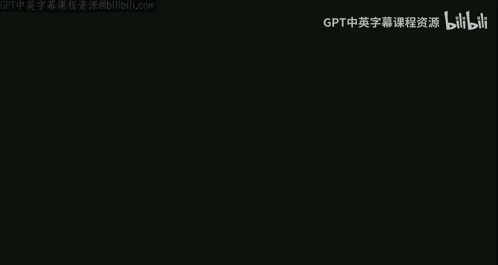

# 哈佛大学《大数据算法｜Harvard Algorithms for Big Data (COMPSCI 229r) 2016》deepseek - P20：-20-Algorithms for Big Data (COMPSCI 229r), Lecture 20.zh_en - GPT中英字幕课程资源 - BV1yGdNYvEMo

Let's get started。

So last time。We finished up with me stating that。R IP implies JL。

 We already know that JL implies R IP just by union bound over。 Well， basically because。

RIP is just a subspace embedding for N2K different subspaces。

 so union bound over a subspace embedding that works with high probability。

But there's the other direction by Kraron Ward that says。

 say you have an epsilon KRIP matrix and you take this diagonal matrix with signs in the diagonal。

 so signal are independent random signs。Then pi d sigma basically take pi and randomly flip the sign of each column。

 satisfies distributional JL， where the epsilon is the same as the old epsilon up to a constant as the RIP epsilon。

 and the failure probability is exponentially small in K， the sparsity that you satisfy RIP to。

And just yeah， so there's a reminder of what distributional jail means。

It means that you preserve any fixed unit vector with high probability。

So we're going to prove that today。 and I started off the proof last time。

 but now we're going to finish it。So。And kind of a key trick that's used repeatedly。 therere。

 there are kind of two key tricks used repeatedly in this proof。 One is that。If you apply D Sigma。

 so in general， this D， think of D as like an operator。😡，If you give it a vector。

 it's just the diagonal matrix that has that vector on the diagonal。So if you look at D Sigma X。

 it's just equal to D X sigma。 Okay， so that's。Which means that we can write thiseltonor squared as a quadratic form in sigma。

And then we want to say that this quadratic form in sigma is concentrated about1 is about the L2 norm squared of x。

哎。So we have tools for that， namely Hanson Wright， Okay， so we're going to do that。So I can write X。

 Let me partition the entries of X as follows。Okay， yeah， question。So just cur by。

So Bx sigma is just like changing di。Yes， it wasn't， Yeah， exactly。Yeah， sigma is that vector。Okay。

First of all， what I want to do is I want to。Just sort the entries of x by magnitude。

 This just amounts to permuting entries of x， which is the same as permuting columns and pi。

 So just do that。 It doesn't change any norms of， of anything。嗯。Yeah。

 x the vector we're trying to preserve。So I'm going assume that the entries of x are sorted。

 and also。X per I is gonna for me denote a K sparse vector， which is the。

 the entries of x that corresponds to the Ih block。Okay， right。

 so block one is block 1 is x 1 up to X K。 Block 2 is x K plus 1 up to X 2 K， etc cetera。

 So X I is the K sparsse vector corresponding to the if block in theed order。

And then also pi I is the K columns of pi。From the I block。

 So pi 1 would be would just have the first K columns， etc cea。

So I want to now write down this matrix x。 x is just dx pi transpose pi d just from that。

And I want to partition the entries of x into different pieces。So there are four pieces。

There's the diagonal blocks， right？ So each one of these， by the way， looks like， you know， you can。

 you can imagine。Taking this n by N matrix， x is an n by N matrix and just breaking it up into K by K blocks。

So imagine this thing is actually a bunch of K by K blocks。

So there'll be n over K blocks and n over K blocks。😡，And I'm partitioning those blocks。

All the diagonal blocks。I'm going to call a matrix A。Okay。

So a is just the diagonal blocks and everything else is zeroed out。😡，The this。Is B？Okay。

 so B is actually a matrix which just has this and everything else is 0。And then of course。

 this is B transpose。And then C is everything else。 So C is everything that's not in the first row。

 not in the first column， and it's not in a diagonal block。

And then we're going to break up X like this。Oh， I didn't mean to imply that they're all the same。

What I meant to say was。A includes those， so A， if you look at if you draw A。It looks like it has。

 you know， it has stuff on the diagonal blocks and then everything else got zeroed out。

 That's what I meant to say。哎。RightSo in particular， if you look at the IF block of a。

 so if you look at， for example， AII。This is equal to。DxiI。Hi I transpose pi eye。Dxii。Right。

And similarly， you can write。嗯。And also， A。I J。Is it zero？For I。

And you can write similar things for B and C， et cetera。So what we're going to show。You know。

 with probability 1 minus2 to the minus c prime K， we'll have a few things happening。

 We'll have that sigma transpose。A sigma？Will be one plus or minus epsilon。And then we'll have。

Sigma transpose B sigma。Sigma transpose， B transpose Sigma。And sigma transpose C Sigma。

 So all these guys。We'll be like at most O。So that's what we're going to show now。Okay。

 so let's do this。So， first of all。Sigma transpose a sigma is what did we say A was。 It's that。

 So it's the sum over all。嗯。Some of I。From 1 to n over K。Of Sigma transpose。DxiI。Pigh eye transpose。

By。嗯。嗯。Sigma。🤧嗯。And actually now。Like。Only the columns in the I block human matter here。But again。

 just basically， let's just for， for this part， we're just gonna undo the trick we just did。

 So this is the same thing as some of our I X I。Transpose。D Sigma I。Pigh eye transpose pi eye。

Z Sigma I X。Which is the same thing as。Some of her eye。Pi I， D I， D Sigma I， X I。Ll2 norm squared。

Right。But now， remember， X I， D S X I is a K sparsse vector。

 We broke it up into these blocks of size K。 So pi preserves it。

 So this is equal to one plus or minus epsilon times sum over I。D Sigma I X。El I squared。

What does D do to x， It just changes signs in entries of x。 It doesn't change the norm。

 So this is the same thing as one plus or minus epsilon。Some over I。Xi squared。

Which is just the same thing as。hi we said is one， okay so that's that， that's simple。よし。Okay。

 so now let's deal with these other things。Okay， so I'll just tell you whats what the game plan is。

 So Sigma transpose B sigma。If you look at if you look at this picture。Well， let's。

 let's write what that is， Okay， so。B， notice that B now is the same thing as。D。X1。Hi。One transpose。

Pi -1。Dx minus-1。 Okay， what do I mean？What do I mean by -1。X minus1 is basically the vector， x2， x3。

X and over k。 so it's the vector you get by deleting the first block。So by 1。

 I just mean the vector without the first block。对。🤧嗯。Good。So。嗯。So now what we have is。Quions。

 is this clear， right， B is the part， B is this thing。That's missing this piece right here。

So Sigma transpose B sigma。Is now sigma。呃。Oops， this should be a one。1，1， minus1 minus1。Right。

 so this， yeah，1，1，1，1，1，1，-1，-1。 So it's it's a K by n minus K matrix。Okay， you can in actuality。

 as I've described it here， all these matrices are n by N。Okay， but kind of。The， the first。

 like all of。This whole part is。Well， in B， kind of this whole part is 0。

 So kind of all the action happens with this K by and over n minus K part of it。

 So let's just pretend that it's actually K by n minus k。

So sigma transpose B sigma now becomes sigma 1。D X1。Hi one。Transpose pi 1。Dx minus1。Sigma minus1。

 right？And the thing to note here is。Where's the randomness， right， The randomness is in Sigma。

 The thing to note here is， if you look at this versus this。These are independent of each other。

Because this is the first k entries of sigma， these are the last n minus k。

So what we're going to do is。We're going to say look。If you look at。嗯。And this whole thing。

Without that part， just look at this， this is a vector。😡，Okay。

And we're going to argue is that this vector。😡，Because pi has RIP。

 this vector will have small L2 norm。😡，Okay， and then now what do we have， We have。

 we have some vector V， V transpose sigma。When we've seen that before， right。

 if you take a dot product of a fixed vector with a random sign thing， you'll get。

 you'll get a good tail down。 That's kinchin。So that's what we're going to say。

 We're going to say just like， forget about the fact this is random。Actually， this won't。

 this won't even involve randomness。 with probability1， this vector here will have small L2 norm。

Therefore， by kin chin， if you dot this product with this。😡，Pace of randomness here。

 which is independent of this。Then you'll， you'll get a good tail down。 Okay。

 so's how're going to handle B。 And B transpo is basically the same thing。

And then we're going to handle C by Hanson right。Just telling you where we're going。

So claim- so let me call this vector V。Okay。嗯。Yep。I think we'll get something like。Yeah。

So let's prove this。So the key part。Notice that。The alt tuneer of any vector is just equal to the soup。

Over y having L2 norm1。嗯。V dot Y。So。Let's look at this thing。V dot y is equal to。嗯。

Sigma minus Sigma 1。Dx1。High1 transpo， pi minus1。呃。The x -1。Why mine。可。And。Good。Make sure I。

So this is equal to now the sum J bigger than 1 of single 1， dx1。Pi 1 transpose pi J。ZXj。Y j。可。嗯。

I'm going to do the trick again where I say that this is the sum of J bigger than1 of now x1。D S1。

やりやだ。うううん。But this will actually be。D Xj。And this is at most。 now。

 the sum J bigger than one of the norm of x1。Times the norm of d Sigma1。The operator norm。Times。

The norm of。Pi1 transpose。系。Jy。Actually， let me just。So let's say that。

for this I'll actually need 2 KRA。It's not a big deal。Times the operator norm of Dxj。

Times the L tu of yj。Okay， get。Now。A couplele things I want to observe， first of all。What's the。

 you know， one trivial bound is while the1， the L two norm of x is one。

 So the L2 norm of the first block is at most one。 So we'll just basically ignore this。对。

If you have a diagonal matrix， what's the operator norm。

 It's the largest magnitude of any diagonal entry。 But this is a sign。

 this is a sign on theagonal random signs of the diagonal。 So this is also equal to one。Now。

What is the operator norm of this matrix？ So in general， if you have a matrix M。The operator norm is。

The soup over all Z of unit norm， Z transpose M Z Z， sorry， in general。

 it the soup overall Z Z prime of unit norm of Z transpose M Z prime。Right。So notice that。

The operator norm of。Pi 1 transpose pi J。It's just the soup。Over Zz prime。Of unit norm of。Pi 1， Z。

Hi J Z prime。That's the definition of the operator norm。

But this is exactly something that we bounded last time。 Remember， we had a lemma last time。

 which was， if you have two vectors。That have， that are each K sparse， but have disjoint support。

And you hit them with an RP matrix， right， The dot product will be O of Epsilon。

As long as it's a 2K RAP matrix。Right，This is just because。Ppe is 2 K， R。RightSo in particular。

 it preserves。The L2 squared of z plus z prime， and it also preserves z minus z prime。

But if you sum this， if you sum the squared norms of those two different vectors。

You get exactly or subtract them， you get something like four times the dot product。

By parallelogram rule。And the actual dot product between these two vectors is0。

Because they have disjoint support。 Z only has support in the first block。

 Z prime only has support in the JF block。Right。Yeah， question。Yeah。So we're。

 we're only looking at the JF block of pi being applied to Z prime， right。

 So Z prime is just a case sparsse vector， of course， with entries in that block。Yeah。

So Z and Z prim K sparse， so by our alema from last time， this thing is O of Epsilon。

So the operator norm of this thing is O of Epsilon。This thing we'll deal with that soon。

 what's the operator norm of XJ of Dxj？I， don't give me a bound， just tell me what it is， equality。

 what is it？X1。I don't want an upper bound。 I just want an exact expression for this thing。Yeah。

 it's the L infinity norm of X J， right， It's again， a diagonal matrix。 So the， the。

 the largest eigenvalue is the largest magnitude of any entry in the diagonal。 So， so let's do that。

 So this thing here。Okay， is。At most， sum J bigger than one of。Oh， epsilon。Times。

Xj infinity times yl2 norm oryjl2 norm。Right。Okay， but now。Here's again。

A trick that's called shelling。 It's very common in some compressed s proofs。

Notice that everyone in the Jith block。Is smaller than everyone in the J Min first block。 Okay。

 just by， that's how we define these things。 So this guy here。Is actually at most。Well。

 let me put it like this。Look at xj minus1。嗯。So it's not most the largest guy in the previous block。

 so it's at most the average of the guys in the previous block。Right。And then by Kohi Schwartz。

 L1 norm is at most root K times the L2 norm。 So this is at most。Xj minus1。Times root k or。Over。

My coachhi Schwartz。So this thing here is at most sum J bigger than1。There's， there's an o of。Oh。

 epsilon of a roquet now。嗯。X J minus1， L2 norm times。YJ。L2 norm。Okay。Question。Khi shorts。Yeah， sorry。

Okay。So this this trick is called。Slling。Where you kind of break up the vector into blocks after you sort coordinates by magnitude and then you bound norms in one block by some norm in the previous block。

 so it's a very common thing in lots of these proofs。Lots of compressed sensing proofs。

 So now what we do is we just finish off with AMGM。 Okay， so this is at most。

Oh of Epsilon over two root k。Some J bigger than one。Of。X J -1。Ltitude norm squared plus Yj。

Allterar squared。But this is exactly。じ。So this is exact。 if you sum over J of this thing。

 this is exact。 This is umost the al two norm squared of x， which is one。 And the same thing about Y。

 you get the al norm squared of y， okay， which is also one。So this is now this whole sum。

Is that most two？So this thing is。O of Epsilon ofque。对。More。嗯。Well， actually I'm not sure what。

 maybe I think these are Turing machines。Well， these are tapes for a drink machine。

Given what the last class is。o so。So good。 So now going back to。

Going back to Sigma transpose B Sigma。The probability that。Sigma transpose B Sigma。

Ass greater than epsilon or some constant times epsilon。Well。

 that's equal to the probability over now。Singma minus1。That。And V transpose Sigma。

Let's go to NC Epsilon， but by Kinchin， we know this is Kinchin。

This is at most something like e to the minus， some constant。呃。Epsilon squared and over。

And the the squared number V。Which we said is k over Epson squared。So this is。对。Makes sense。

So now the only thing left is。This guy。行。Yeah。在我会告时。Sorry I said again。 Yeah， so you know。

 Kinchen says that all the P norms are at most the L2 of V times root P。Sorry。

 what is is the question？So basic just。Wait， yeah， so okay， so so Kin。

Says that for all P bigger than equal to 1。V trans post Sigma P。

Is that most basically root P times the L of V？But yeah， so sorry， I sometimes I just inter。

 I just interchange moment and taildowns like this because we know they're the same。

 So this is exactly the same thing as that。As this statement。对。So now all that's left is handling C。

So let's do that。I'm going to erase the statement because I think we know what we're trying to prove。

 we're just trying to prove now that Sigma transpo C Sigma is less than。Expsilon。

 there some constant epsilon。So Hanson Wright。Well， it gives us concentration around the expectation。

But sigma transpose C sigma。 C has no diagonals， right， I。

 I removed everything on the diagonal blocks。 So the expectation of sigma transpose C sigma is 0。So。

So the probability that sigma transpose C sigma is greater than some lambda。

 for less lambda is like Cpson。Is that most？E to the minus some constant。

Lambda squared over the Frbeius norm squared。Plus e to the minus some constant lambda over the operator。

That's what Hansonright says， right？So we just need to bound these two quantities for venius Norman operator norm。

So let's do that。So。Let's do Formini St squared first。So this is equal to the sum over。IJ。

 both bigger than one。Of I not equal to J。 So blocks， So I and J are block Is。

So they're not diagonal blocks and they're。They're not part of that top。

Row of blocks or bottom or leftmost column blocks of。DxiI。Hi eye transpose。Hi， Jay。Dxj。

The is no squared。Okay。And now what I'm going to do is。

I'm going to use the fact that- so I'm going to write me quality。Some overall Ij bigger than1。

 I not equal to J of。Operator arm of DXI。Times operator norm of pi I transpose。Hi， Jay。

Times for Venius norm。Of this guy。And this is just using the fact that in general。

 if you look at the ferenous norm of AB。It's at most。

The operator norm of a times the Frbei norm of B。This is just inequality， that's true。对。

I'll leave that as an exercise。I think we are okay to。I'll now erase that， I think we're okay here。

Just the。General fact。I think maybe you know where this is going。

 We're basically gonna do the same kind of trick as last time。 So that's now at most。嗯。So。

Remember pi I transpose pi J has operated on Epsilon， O of Epsilon， and it's getting squared。

 so there's an O of epsilon squared。And then we have some over IJ。one I not equal to J。

 that's the L infinity norm of X。And that's。Well， the Forveius squared oh it squared。

That's the fermin squared of that thingingy， but that's the diagonal matrix with xj on the diagonals。

 So that's just equal to xj。Now two norm squared。And then we're going to shell。So this is at most。

 oh， Epsilon square times sum of I J bigger than1 I not equal to J of。This is at most。

 remember over there， this is at most epsilon of a root k without the square。

 it's that most epsilon of a root k。Times the。Not epsilon。

 it's almost one over a k times the Lt tu of the previous block。And it got squared。

 so there's a division by K。And then， now we have。X， I minus1 L two norm squared times x。Al great。

And this thing here is just。At most。Some over I。呃，XI。Squared。Squared。

But this thing here is just x squared。Which is one。So overall， we have that this thing is O of。

Epsilon square over K。 so the perveium squared of C is at most epsilon squared over K。哎。

So now we just have to deal with the operator normally that's the last thing。Yeah。This thing。

 is inequality。So。Take this quantity。And square it。Now what you're going to get。

 you're going to get the silver all IJ。X I squared X J squared， which contains all these terms。

Like all of these， all of these summans appear in the expansion of the square of this。 Yeah。

 there's a square here， yeah。So， and this thing is， is one， right。

So now let's look at the operator norm， C is a symmetric matrix， so this is just equal to the soup。

Of why having unit norm。Of y transpose Ci。谁。So。Let's bound this。So we have。

I'm gonna stop writing soup from now on。 So just pretend why is the thing that actually achieves the soup。

 So this is equal to。Some of。I J bigger than 1， i not equal to J。🤧嗯。Y i。Dxii。Pi I transpose pi J。

Actually？Y j。对。嗯うん。And this thing is at most。That same sum of the L2 norm of Y I。

Times the operator arm of this guy。Times。High eye transpose。Hi， J， operator Norm。Times。

That operator norm。Times this L2 norm。对。And you probably already see what's going on here。

 it's basically the same trick over and over again。So now。I'm gonna， this is X infinity。

 X I infinity norm。 I'm gonna shell。This is also。X J infinity norm， which I'm gonna to shell。

So this is at most。S over Ij bigger than 1， I not equal to J。Y I。

L twoor times and there's also this is O Epsilon。This operating rooms of epsilon。

And O of epsilon over K， the K is because I get a root K from shelling this and another root K from shelling that。

嗯。Times。Xi minus1。L two warm times。X J minus1 L2 norm times yj。Oh too norm。Okay。

And now this is equal this is at most oh of Epsilon number K。Times。A sum over all I。Bigger than one。

Of Y I。L2 norm times Xi minus1 L2 norm。Squared。RightBecause if you expand the square here。

 you'll get Y I x minus-1。Y J x X J minus1， which is exactly what you have here。

So and this is even bigger because when you squared this， you would get the diagonal terms。

 whereas here you don't have the diagonal terms， same thing over there。And then now we do AMGM。

This thing here。Is that most or？thatThis thing here。Is that most one half？Y I L2 norm squared plus。

X i minus1。Eson norm squared。By AMGM。And then we're summing that overall eye。😡，So again。

 when you sum these overall I， you get the square number of y， which is one。

 When you sum these overall I， you get the square number of x， which is1。A question。So， oh， yeah。

 good。 So this is actually， this is actually the Elfinity norm of X I。

 and this is the Linfinity norm of X J。😊，Right，But then I'm gonna to shell again。

 I know that the the infinityor of the ifF block is at most one of a root K times the Uor of the previous block。

 So I picked up one of root K twice， which gave me a1 over K。Yeah， so this was by。Slling， so。

Shulling twice for brother Walls Reg is。So this thing here is again。Oh， Epsilon over okay。Yeah。

And then now we're done because。What say so both of those are good。

I'm not going to write it I'll just point。 so Frbii normm squared is epsilon squared over k。Okay， so。

 and Lambda is also basically epsilon， right， Lambda some constant times epsilon。

So what we have over there is e to the minus epsilon squared over epsilon squared over k。

 so the epsilon squares cancel and K comes up to the numerator。

 so that first term becomes exponentially small in k and similarly the second term also because the operator norm is epsilon over k。

Lambda is basically epsilon， So so it cancels the epsilon。

 And then you get a K again in the popping up in the numerator。 Okay， so we're done。

 We've shown exactly what we wanted to show。对。Yeah。Is there the reason that we separate？

It's because in case。Or you're saying maybe we don't need to deal with B separately。Yeah。

 just include being。 I mean， so， yeah， so。What you're saying might actually work。

 I haven't tried to do it that way。BB does not have the diagonal block， right？It doesn't， right？Yeah。

 yeah。Yeah， you can't shell， that's true。You can't shell， because。That's true。 But in principle。

 I mean， I don't see why。I mean， we're trying to show that this quadratic form is that most epsilon with high probability。

And even if you include B， your quadratic form does still have zero diagonal。

 So you could still try and say this quadratic form has bounded operator norm and bounded forennous norm。

 which might still be true， but you might have to deal with the the block number one separately。

Which we did。 But， but I mean， you might be able to。But when I say deal with it separately， I mean。

Just do Hanson right。But when you bound the operating norm from media norm squared。

 you kind of deal with that part separately。Such a thing might work。I haven't tried that。

any other questions？So that's。点。Okay， so。We've come to the endpoint of something in this class。

 which is something you pointed out， which is there are all these。I mean， so first of all。

 let me say something， which is， why do I care about this theorem， right， that R IP implies jail。

 So I think I mentioned before that if you， for example。Your example have pi， which is SHD。Is RIP？

Or not without the D。Just sampling rows from Fourier or had Mar， this is R。

 I think I gave some references last time。So now what it's saying is if you， if you attach the D。

I satisfies distributional jail。And also， when I say it's RIP， I mean， S is random。

 So it's RP with good probability。So actually， the best ways of getting kind of fast JL。

 the most sophisticated ways of analyzing the fast JL approach are using this。Also， remember。

 at some point we talked about if you have JL， JL implies this Gordon's theorem， right。

 because you basically you look at these different sequences of T Rs and you have to preserve them all at different scales。

So。嗯。There， there was something like， if you recall the proof， if not， you can review it。

 There was something like log1 over Epsilon， log of one of Epson different scales that we needed J L at and the proof of that。

 not log1 over Epsilon， but were log of1 Epson Prime where Epsilon Prime was something like Epsilon over the mean with。

Okay， so。So we need a jailL。Go log one of Uppson prime scales。

We're Epsilon Prime with something like。Some clientss， some epsilon over the Gaussian Me with。

Or T set of vector wanted to preserved。See some concert。哎。So。What you could do is you kind of。

 you can have enough rows， an S such that your R IP at all these different scales simultaneously。

With good probability by the union bound。Good。Which means that you'll be DJL at all these scales。

 just because of the theorem we just proved。Which means that you could prove Gordon's theorem using starting off with like an RIP matrix like this one。

So the number of rows like for example， implies。嗯。SHD。To preserve。Tea can have。

G squared of T over epsilon squared times polylo。This extra polylogue is coming from the fact that you need to satisfy RIP at all these different scales。

对。And the number of rows you need for RP is off by log factors。And actually。That was kind of the。

That that paper that I presented that time in lecture， that was their motivation。

 They wanted to say that this matrix can have this many rows and preserve things。And kind of。

 once you have。R IP implies DJL and DJL implies Gordon like theorems。

 Then you kind of just combine them。对。So anyway。Yeah， so Yakiir asked about， you know， can I， there。

 there are all these different kind of primitives that we've talked about in class or things that I've defined R IP。

 DJL， JL， Gordon。Subspace embedding， et cea， et cetera， Appimate matrix multiplication。

 And as we saw， like， they're all connected。 Once you have one or jail moment property。

 Once you have one， it implies a bunch of things for the other properties， right。

 There's like this web of connections。So。And we're sort of done in the class now with that web。 Okay。

 so the stuff we're gonna to look at in the next few lectures。

It's not going to be like using things that you've seen and showing that they imply new things。

 We're going to actually use new objects， Okay， so so。What I'll do is I'll。 I'll prepare like a PF。

 maybe with like a drawing the web or something showing you that what implies what， okay so。

Med for like。せ。Be你 shop。Wait are we actually in thele？I think， yeah， yeah。 we are。 We are。

 I think were we're done。 Were， we're done in this， We're still okay。

 we're gonna use it for one more thing this lecture， but we're not gonna use it explicitly。

 Were going use R IP。😊，But we're done kind of showing that this property of a matrix implies that it also has these other properties。

SoOkay so。We're done with random sign matrices。😀。😊，And we yeah。So rest of today。So。So last time。

Remember， we looked at basis pursuit。We said that if you want this L2 L1 mixed guarantee。

 then you can solve a linear program， and then you'll become a vector that has this good guarantee。

 right。嗯。Now， that's all nice in that it's polynomial time。 right。

 We know there are algorithms that solve linear programs in polynomial time， ellipsoid algorithm。

 interior point algorithms， et cea。😊，But。Kind of in the cases we're looking at and the dimension。

 It's like polynomial and n time where N is the dimension。 And we're， we're imagining that n is huge。

 right， Like you have this0 by00 pixelated image， million pixels。

 I don't want to spend N cube time or end the fifth or whatever。So one question is。

 is there a faster recovery algorithm than actually solving the basis pursuit linear program？Okay。

 so。Faster。L2， L1。Recovery。Then basis pursuit。And in fact， there are such faster algorithms。Okay。嗯。

Most of these algorithms are iterative。😡，Okay， meaning that。

They start off by saying my recovery is the zero vector。Which is， which has terrible error。

 And then there's this iterative step that you keep doing that every time you go through an iteration。

 the error improves。Okay。And。As we'll see， you can implement the iterations quickly。Okay。

And you will show that kind of it converges the small error quickly as well。

There are actually several algorithms， several iterative algorithms that have this kind of good behavior。

1 is， for example， coamp by needle and drop。 There's iterative heart thresholdholding。

 which is what we're going to cover today。 There are several of these。 today， we're going to look at。

This iterative algorithm。Okay， which is。Due to B and South or the analysis of this algorithm in this context for L2L1 is due B in South of Davies。

And this is an '09。Let me write down the algorithm。And we'll prove what it can do。

So what's the algorithm given as input？It's given us input。Why。😡，Okayay。As well as。It knows pie。可。

And it's also given an iteration count T。That's all we need to know。

And let me just put a comment in this code， I'm imagining that y is equal to pi x。Plus E。Where。

E is some error。And I' write down， I'll write down what the recovery guarantee will be soon。

So first step is we're going to initialize x0。To be the zero vector。

And then we're going to do is we're going to say for。I goes from1 to T。😀。😊，X I。Get set to。And。

I'll say what this means in a second。X i minus1。诶。Actually。Yes。O。So this is the iterative algorithm。

So。It maintains these iterate X。Initially， it guesses that X is 0， which is not good。And then。Ptend。

 pretend there's no E。 Preend that y is just pi X。 Okay， introducing E is， well， it's gonna be。

Useful prove when we prove our theorem。But， so， I mean。

You can also say this thing handles kind of error both before the measurement and after the the measurement。

 right， So X is actually a K sparse vector plus error。

So there's some error before the measurement pi is applied。 And then in addition。

 there's some error after the measurement is applied。

 and we'll see kind of what error guarantees we get。But the way to view this is look。What is why？

Why is pi X？😡，So pi x minus pi X I is pi times x minus X。And now， pi transpose pi。

 in a lot of these things， you should think of pi transpose pi as trying to be the identity matrix。

So pretend there's no， pretend pran is pi worthy the identity matrix。

 We would have x minus X I plus X I， which is just x。

And HK is what they call the hard thresholdholding operator。

 which just keeps the largest K entries in magnitude。Hey so。HK。Of Z is Z restricted。To the largest。

Kate and treesre in magnitude。So this is a whole algorithm。And the theorem。Is that。If you look at。

 we want an L2 L1 kind of guarantee， if you look at。X。T minus x。

X t minus x L2 norm is going to be at most up to a constant。S to the minus t。Times。HKX。Plus。

X minus minus hK。X L2 norm。Plus o of1 over root k。Times。X minus HK。X。One norm。Coss the number E。谁。So。

Initially， of course， initially your error is at least。The al of the head。 Well。

 it's actually the al of X itself， but。嗯。Right。Initially， your error is the norm of the tail。

 as that most the norm of the tail plus the norm of the head， which is X itself。

But as you do more and more iterations， the norm of the head plays less and less of a role。

 It gets like exponentially decreased at every step。So if you do enough steps。

 of this term goes away。And then what you're left with is1 over a rootcade times the O1 norm of the tail。

 which is what we're used to。Plus， the L tumor of the error。😡，Plus， the L2 norm of the tail。

 So this is something that doesn't look familiar from before， right。

Before we just had one over K times L1 norms。I claim， though。

 that this and this are basically this is basically bounded by that。Why。Because， oh。

 I should say something about the conditions。If I。Satisfies。Epsilon 3K RIP。For。

Epsilon has to be smaller than。One over four route two。

So if Epsilon is less than some fixed constant， and it satisfies 3 KR IP。

 then you get this guarantee。So。Imagine that actually k were a 2K。So this had 6 K R IP。

Then what would this be， this would be the 2 K tail of x。Right。

But we can bound the L2 norm of the 2 ktail。By basically this， by shelling。Okay。Why， because。

If you look so this， if you look at the2 K tail， this is going from block 2 onwards or block 3 onwards。

 Sorry， everything except the top 2 K people。 So going from block 3 onwards。

But if you look at the L2 norm of the third block。😡，It's at most the Ltum of the second block。

Which is at most one of a root k times the L1 norm of the second block。

So you can shell and you'll get one over k times the L1 norm of the tail。So if you just double K。

 you can basically make this thing be this。So it's still giving us the kind of guarantee we're familiar with。

 kind of the only new thing is this part。Which is sort of unavoidable because you're starting off with some bad estimate。

 you know， what are you gonna to do。But it's exponentially decays。

 so questions about the statement of this there。Okay。So let's prove it。Before I prove it。

 I want to introduce some notation。So。嗯。Let X。Okay， denote。HKX。So it's actually K Sprse。

We'll assume x equals xk。So， then。So in reality。嗯。Pi x is equal to。Pi。I of Xk plus the tail。Well。

 let me write it like this。Pi x plus E up there is actually equal to pi X K plus the tail plus E。

I'm going to view this as being pi Xk。😡，Plus E tilde， where E tilde is e plus pi times the tail。可。

So what we're going to do is。We're going to show this theorem。But imagine that E is actually E tilde。

But then when you bound the L2 norm of E tilde， you'll get that。

 It's at most the L norm of E plus the L norm of this thing。

 And this turns out you can bound in terms of these anyway， so。So really interesting thing is。

Look is understanding this。Let's pretend it's actually case parse。So。Is it notation。

So we have that y is now equal to pi xk plus E。We have that， let me define RT。Is equal to。X。

K minus xt， so it's like the residual。At time tea。Let me also define A。Plus one。As being equal to。

Basically， that step before we apply the hard thresholdholding operator。That is equal to X T。Plus。

 pi transpose。Y minus。X T。Which implies that。Xt plus1 is just the hard thresholdholding operator applied to A plus1。

Yeah， sorry， there's a pie here。Let me also say。Gamma K star is equal to the support。A Xk， which is。

Subset of indices。And also。GmaT。It's just the support。Of XT。And。呢次。Squal to gamut K star。Union。Gant。

对。

So。Right， so ultimately， I want to get a good handle on。Of this， right？

Which is the norm of the residual after T steps， so let's write that down。So we have that。

X minus xt plus1。L2 norm。Is equal to well， this has these two vectors both have support in Bt plus1。

So this is equal to X， Bt plus 1。Minus X t plus1。VT plus1。

And then I'm going to do triangle inequality where I introduce a， this is at most。XBt plus1。

This x is equal to xk。Right so this is Xk。Minus a。BT plus one。Plus。ABT plus1。Minus x vc plus1。哎。Now。

What does the hard thresholdholding operator do， right What is what is this， What is this guy。

 This guy is just the hard thresholdholding operator applied to this。Applied to A。

 So what does the heart thresholdhold operator do， It gives you the best K farce approximation to the vector。

 It takes the largest K entries of magnitude。Right so。This norm is definitely at most。😡，This norm。

Because that is the best approximation。 So this is at most two times。X B T plus1。Minus a。

Be chief as well。喂。And now what I'm going to do is just expand the definition of a。This is equal to。

X Bt plus1。Minus。X。Qi。B T plus one。嗯。And then there's a minus。Hi transpose。Y minus。

X T I forgot that pi again， pi X T。BT plus working。う嗯。I should really。This is restricted to。哎。So。

 now。X minus x T is just the Tth residual。And now what is？What is Y， Y is pi X plus E。

 So I have pi x minus pi X T。 That's also pi times the residual。So。Using our notation。

 we can rewrite this。Is equal to two times。The residual， the teetheth residual。Times B。T plus one。嗯嗯。

Minus。Pi transpose pi。Our。209。B plus one。Minus pi transpose。异议。Actually in。s。

And now what I'm going to do is I'm going to write。I'm going to write R as being RBT。Plus one。

Plus RBT。Minus。BT plus way。And I'm going to do that to this R right here。

So this is equal to two times。RRT。Bt plus one。Minus pi transpose pi。R。1E plus one。呃。S。

And this is also。嗯。Minus。High transpose。B。T。Minus Bt plus1。H R。呃B。T minus。BT plus one。再也是 woman。

Writing nightmare。可以。Very good。 And now what I can say is look。

Here I have identity minus pi transpose pi applied to this vector。

And then here I have I'm going to do triangle lineality。 This is at most two times。

The operator norm of the identity minus。Pi Bt plus one。Transpose pi Bt plus1。Times the norm。Of our。

This is all our key。Ass number of RT。Plus。Two times the operator norm of。Pi Vt plus one。呃。Transpo pi。

Bt minus Bt plus1。Times the operator times the normous thing。Plus。Okay。Okay。So now。Remember that。

Pi has。3K RIP。Okay， in particular， it has。So what is so B is B is a particular support， right？

 This is， this has K elements in it。 This has K elements in it。 So B has size at most 2 K。

So because we have 3 KR IP that's even K more than we need， this thing has， is at most epsilon。

So here we have two epsilon times the norm of the Tth residual。 Remember。

 we're trying to bound the norm of the T plus first residual， right， This is。RRT plus one。

So we're saying that the norm of the teeth plus first residual is at most something in terms of the teeth residual。

 which is the kind of thing we want to see。So this thing here is at most。

Two epsilon times the norm of the teeth residual。Plus， again。

 this is the kind of thing we've seen before。😡，Right，If you look at disjoint。

 if you look at disjoint columns of pi， then if you look at pi transpose pi where each one of those instances of pi is disjoint columns。

 then the operator norm is O of epsilon。That's again。

 what we saw just now when we're analyzing Krame War。Now， what's the total size of all these sets。

 The total size of all these sets is this has size 2 K。And then B。

 T brings us an additional at most K。 So in total， these union of these census has both 3 K。

 That's why we need the 3 K R I P。So again， we have another two epsilon times RT。Plus。Plus。

 this guy over here， which is plus。The norm of E。Two times。Basically。Square root of 1 plus epsilon。

Times in R。This too is that too。Also， we preserve squared norms up to one plus epsilon。

 so the non squared norm is up to the square root of that。So this is equal to。F epsilon。Tons Rt。

Plus two square root， one plus epsilon。Okay。嗯嗯。Oh， and I should say。This is okay。

 I screwed this up a little bit。 this is actually BT。BT plus1。

 and this is actually Bt minus Bt plus1。Right。So really， this is actually BT plus1。

And this is actually Bt minus Bt plus1。So。What I can say is。Two epsilon。RBT。RRT，BT plus one。Plus RT。

BT。Minus Bt plus1。Plus this two square root one plus up slot。And these are norms here。But again。

 we have this。They out the， they out of time。We're like almost there。

 so I'll say one thing and then I'll。If there's anything missing， I'll just add it to the notes。

So remember we had this thing before we said a plus B is at most。呃。I think two A plus B。Roer2。

A plus b squared。Or a that right， what I want to say。No。Is that goes to a squared plus b squared？

Something like that。Yeah， maybe I'm missing。 Well， what I want to say is this。

 what I want to say is that in general， if you have X。Plus， why。And they have disjoint support。

 This is at most route to x plus Y。When they have disjot support。So if you just apply that to that。

 that thing is at most two root2 epsilon times the norm of R T。Plus two root1 plus Eps long。Times E。

And then this thing。Is less than a half。For。Epsilon unless's we equal to one over four or two。

Which is why we got that。 So then this thing will be at most something like one half times the previous thing。

Plusaw something like three times an E。If you plug in that for you。Cps on。And now basically。

 now that you've established this。You can just use induction。Induction on T will imply that theorem。

Okay。So remember， there's a， there's a less than twiddle here， meaning that there's。

 there's a constant that's multiplying this whole thing。 So if you choose that constant big enough。

 the induction will go through。So I' leave I'll leave it at that。And I'll fill in anything。 guess。

 I guess I。I discussed everything except for really， you know， dealing with this Eilda。

 which is dealing with the normal of pie the tail。 But I'll put that in the notes。 It's。

 it's not much more than what we've already just seen。

