# 哈佛大学《大数据算法｜Harvard Algorithms for Big Data (COMPSCI 229r) 2016》deepseek - P21：-21-Algorithms for Big Data (COMPSCI 229r), Lecture 21.zh_en - GPT中英字幕课程资源 - BV1yGdNYvEMo

I going to be， I think our last lecture on compressed sensing。

And what we're going to talk about today is。

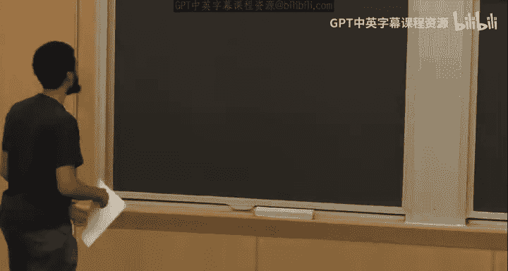

0101 recovery。

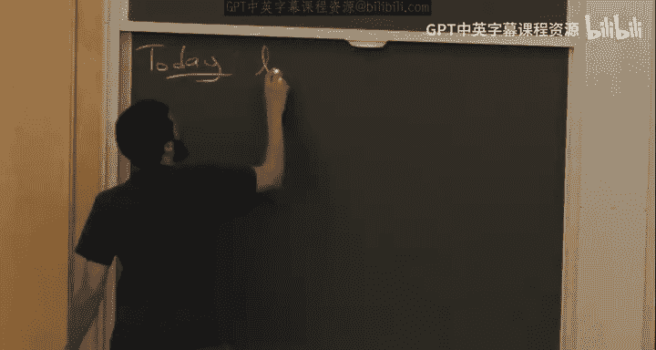

And it's going to be using something called Sp graphs。对。嗯嗯。So what do we know so far？

So using last lecture， iterative hard thresholdholding。

 as long as we have an R IP matrix with good enough RP constant。

 Let's say less than a10th or less than some fixed constant。

Then we know that we'll get L2 L1 guarantee where the time per iteration of this iterative algorithm depends on the matrix vector multiplication time of pi。

うん。So it depends on。ItTime to compute。P X or pitrans。For various inputs x， let me not call it X。O。

So if you want that to be fast， then and if， if you're in a situation where you can choose your sensing matrix。

 then you would choose pi to be， let's say， row samples from the discrete Fourier transform。Right。

So up to logs， it's roughly linear time to apply Pi to any input vector。If pi is， say。

 this SH matrix。Sampling rose from Haammar or Fourier。The downside here。

Is that we don't know how to get the optimal number of measurements by sampling Fourier rows。

 So all the all the known analyses of this S H matrix。It， it's not K log n over K rows。

 like a random Gaussian， a random sign matrix。 It's K log n times some extra logs， so。

So we know that。You know， the best bound is something on the order of k times log n times log squared k。

Is best down。man， this is due to Jave and Reev。And so does 16 to appear。So there's this。

Is this some optimality here？So one question is， can we get the optimal？ And also。

 this is log n instead of log n over K。So。Kind of， in many real situations。

K is actually of the same order as n。😡，Okay， so K might be n over 100， let's say。Okay。

 and what you'd like to do is compress your vector by a factor of。I don't know，50， Okay。

 so the constants really matter in many of the applications and the different and if K is on the same order of n。

 then log n is log n， whereas log of n over K is a constant。Right， so all。

 there's also the issue that you would ideally have a log of N over K here for many actual applications。

Now。う。What we'll see is that we can get away with。We can actually get the optimal number of。

Measurements， K log n over k。If we relax the L 2 L1 guarantee to the to an L1 L1 guarantee。

And we can and we can keep fast time。 So we we'll come up with we'll show an iterative algorithm today that gets this nearly linear time per iteration。

 gets us L1， L1 error， and M we will be K login over K。So we want to get until the end per iteration。

With。on the order of k times log of n over k。But well pay， we'll weaken。To an L1 L1 guarantee。

And if you've taken a look yet at PSet5。One of the problems was problem too， I can't remember。

Asks you to prove that L 1， L 1 is actually weaker than L2 L 1。

 meaning if you had a scheme that provided L 2 L 1。

 then you can transform that scheme without doing any extra measurements and make it L 1， L1。 Okay。

 so L1 L 1 is an easier thing to achieve。 It's a weaker guarantee。

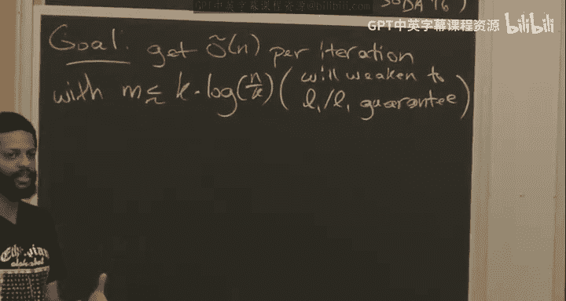

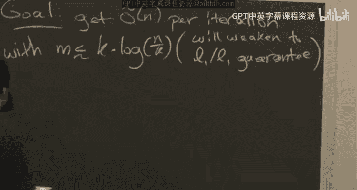

And what I mean by L1 L1， I mean that we'll recover an x tilde。Such that if you look at this L1 norm。

 this is at most some constant times the L1 norm of the tail。Okay， so。Okay。

 so it turns out that both of these are achievable， so you could hope to get C being some constant。

 some fixed constant or C being one plus epsilon。So that's what we're shooting for today。Makes sense。

Okay， so。How are we going to do this？😡，Well， the way we're going to do it is。

Using something called RP1， RP1 matrices。 So definition。Hi satisfies。Epsilon K。RIP1。

If for all case barsse x。We have that pi X。One norm is at most one plus epsilon actually。

Is that mostly a1 norm of x？Is at least one minus epsilon？Yeah one over back。

It's going to be convenient for the rest of the talk for me to or not talk lecture to to assume that。

It never blows up the L1 norm and it never shrinks it by too much。I mean。

 notice you could have error on both sides。😡，If you had error on both sides。

 you would just divide pi by one plus epsilon， and then you would have no error on the upper side。

 and you would have some similar error on the lower， yeah。we care about no。

Because it's pretty similar。All right， so I guess you missed the beginning of class。

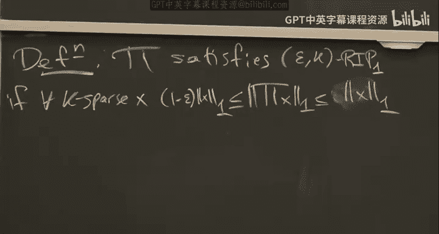

in several real applications， K is actually on the same order N。

 So like is like K is like n over 100。The matrix is sparse So X is this thing。

 X is this thing we're trying to recover， which is compressed and then approximately recover。

 which is， which is approximately K sparse， right， And in many real applications， K。

 K is like n over 100。It's not， it's not like super small。

RightSo what you you're trying to do is you're trying to say， look。

 I have this thing which only has 1% sparsity。And what I'd like to do is compress from an n dimensional vector to like an n over 50 dimensional vector。

So the constants actually mattered a lot in real applications。And in real applications。

 there are many situations where you actually care about。K being a constant times n。

 Don't think of k as root n or K as log n。 Think of K as being almost n。 Well， n over 100。

And then you really don't want to like logs。 Then you're paying， you're paying this log squared K。

 which is like a log squaret N。 And also， if you think about。RIP。

 the traditional RIP2 norm that we've talked about。To get RIP 2， you got a log of n over k。

 but if k is on the same order of n， then log of n over k is a constant as well。So really。

 you're kind of suffering three logs。 Okay， so the question is， can you get really。

Kind of the right thing。In terms of the number of measurements。With the speed。

 but maybe worse than the guarantee。Yeah， so that's our goal here。Okay， so。

Definition pi satisfies Uppsson K RP1 if this is true。Okay。

And then we're going to see in lecture how to use an RPP1 matrix to do L1 L1 recovery。

But before we do that， how you get an RP1 matrix？ So before we're all about random sign matrices。

 etctera。Okay， random signs were nice because we saw early with the AM S sketch that they preserve L2 norms squared in expectation。

 So it's really an L2 thing。So what's going to be relevant here for for RIP1。

 we're going to use something called unbalanced expander graphs， okay。Let me give you a definition。

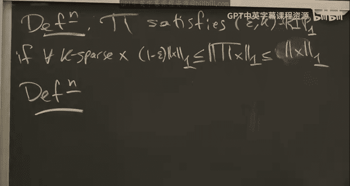

So we have a bipartheid。Graph。G， which is U V E。Okay。🤧。Where the bipartition is between U and V。

It's also。Right。Dregular。Meaning if you look at every node on the right。😡。

It's adjacent to exactly de nodes on the left。Or actually。That's not what I want。

 I want leftyregular。node every vertex on the left is adjacent to exactly D on the right。Okay。嗯。

Is an。NMD。K epsilon expander。Okay。If。First of all， the size of U is n。The size of V is M。

D is what the same D。 It's left Dregular， and。For all S subset of U。Okay。

 such that the size of S is at most k。We have that the neighborhood of S。

 the size of that is at least1 minus epsilon d times S。So this thing here is。The neighborhood。

Sorry you said again。Greater than。Yeah， rather than or equal to。So my neighborhood。

 I just mean the vertices in V， which are adjacent to something in S。So what's the point here。

 the point here is， look。We have you here。We have V here。

 so we're going to imagine in this scenario that。M is going to end up being the number of measurements we make。

 M is going to be much less than n。So， this is V。So let me make it more of。And U is much bigger。

So then there's S。Okay， so each guy in S。Has degree D， right？Right。Now。

 if things were perfect and there were no collisions anywhere。 We're not going to like collisions。

 If there were no collisions anywhere， then the size of the neighborhood would be exactly D times S。

Right what an expander gives you is it says， no matter what S you take， as long as it's not too big。

 it has size at most K。The number of collisions amongst the guys in S on the right hand side is not too much。

 You don't lose。 You only lose this epsilon infraction of what you possibly could get if there were no collisions。

So that's what an expanded graph is。A bipartheid expander。And。Theorem。

I'm usually just gonna write the K in the epsilon because NM And D are always gonna be you know。

 understood from context so。

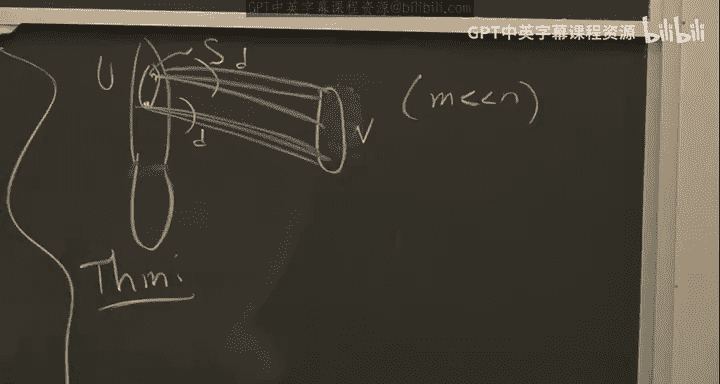

So let me I'll write now for the last time， NMD KFL。Expander。Exists。For。呃。So first of all。

 M can be something like K times log of。And over k。Over epsilon squared， maybe that looks familiar。

looks like exactly the kind of number of measurements we want。And D。

Is that most something like log of an over k over epsilon squared？

I'm not going to prove this theorem， but I'll just tell you how to prove it in words。

 this is a very standard theorem。Its expander graphs are used quite a lot in computer science。

 pseudo randomness， algorithm design。This is kind of a very standard thing。

The way that you prove this theorem is by the probabilistic method。

Just choose a totally random graph with these parameters。 Okay， so for each vertex on the left。

 just map it to D random people on the right and do that independently for each guy on the left。

And then you'll show that this expansion condition holds with high probability just by a union bound over all possible sets S。

There n choose k of them， you can bound over all of them。

 and you'll get that these settings let you get it with high probability。

So that's how the proof goes， I'm not going to do it on the board。

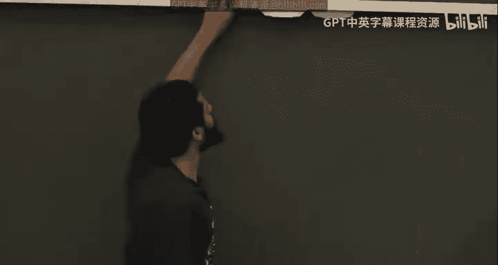

So， you know， just。You know， getting， so this is， this is just showing that。This random proof。

 this probabilistic method proof shows that a good expander exists。 You might be curious。

 can we come up with an explicit good expander， just like with the R IP2 version with the two norm。

 we ask， can we get an explicit RP2 matrix。There we saw that we could do it with incoherence。

But we got worse parameters。 And then I mentioned this br at all paper。

 which also didn't get you anything near as good as what you'd hoped for。

People have also worked on the same question for expander graphs。 Okay， probably for even longer。

 because people have。Use expanders for other things before compressed sensing even existed。 Okay， so。

Kind of the record right now is。So an explicit。Construction。Of an expander graph。This is due to。

Grouswami。Two ones。And Seil Vadon， who is here at Harvard。They show that。 you can get。An explicit。

G with。M being something like， let me write down。D squared times k to the 1 plus alpha。

 where alpha greater than0 is like arbitrarily small constant。Okay， so what's D？

D can be something like one over Epsilon。Lg K。Log in。To the one over epsilon。So by the way。

 we're gonna see soon that kind of the epsilon from the expander is related to the epsilon from the guarantee。

 So if you think of C as a constant， think of epsilon as like a half or a fifth。 Epsilon。

 like a fixed constant。Then this is like poly， well， one of Epson。

 the one of Epson is also a constant。 And then this is like poly log n。Right。

 so instead of having degree log n over K， it becomes like poly log n。And then M becomes K to the。

 you know， almost K times polylu n。So again， you're running into the same issue where you have these extra log ends in M。

嗯。But well， but this is an explicit thing， whereas even that's a random sampling of that S is random。

But in actuality， what you could do is use a random。

 just like we used random matrices for RIP2 before， use a random expander。Okay。

 and then just cross your fingers that what you got is actually is an expander。

Which you did last time for RP2 anyway， get a generator random matrix and hope that it was RP2。

But yeah， it's a big， you know， getting something， getting closer and closer to that with explicit construction is the major。

 major open problem in computer science。Okay， so。Good， so we've talked about expanders。 like what。

 So what is pi at the end of the day， What's our RP1 matrix。So we'll choose。Pi， which is pi G。Okay。

 which is1 over D times the adjacency matrix。Of the expander。 And by adjacency matrix， I mean。

 the bipartid adjacency matrix。 So A G looks something like。

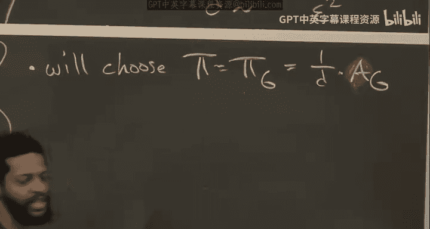

This M by n matrix。And if you look at any column。Right。How many columns are there。

 There's one column for every element of U。If you look at any column。

 then it has ones corresponding to the adjacency of that vertex on the left。

 So each one of these guys is one。And the number of these is deep。

And then the rest of that column is zero。对。And now， again。Just like using。You， just like using。

Forourier sampling to get R I P2。 this matrix also has fast matrix vector multiply， right。

 So if you're running an iterative algorithm that repeatedly needs to multiply by pi or pi transpose。

 it's pretty fast。

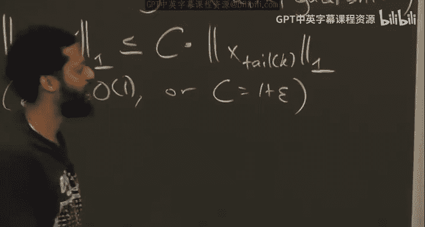

Right， why is it pretty fast？ Well， well， let's say you need to repeatedly multiply by pi。

It only has log n， roughly thinking of Epsson as a constant， like log n non zeros per column。Right。

 so you can you can apply this to any vector in n log n time。

Any and dimensional vector and login time。对。What about pi transpose， Well， I didn't say it， but。For。

 it's easy to show from the proof that I sketched over here where you take a random pi or a random biheid expander。

Yes， you enforce that it's left regular with exactly deregularity， but if you choose a random graph。

It's also going to be true that everyone on the right will also have roughly the degree that you expect them to have。

That also fall by union bound。So the total number of ones in this matrix is N D。

N columns and d1s per column。So the average number of ones per row is N D over M。Right。

And then you can show kind of with high probability， if you're picking a random graph。

 no row will have much more than N D over M ones in it。

So you know the sparsity both per row and per column。But anyway， so this is。

 this is the pi that we're going to use。 And then there's a theorem。嗯。This is due to。Brinda。Gilbert。

In the。Carl off。And strauss。This is Alton 08。It says that。What you expect， Okay。

 if you have an expand， if you， if you make pie this way， it's R P1。Okay， so it says something like。

呃。K Epsilon Exper。Complies。嗯。K2 epsilon， RIP1。If pi is pi G。Yeah。She said that if you have。Yeah。Oh。

 if you want， so if you want the Lfinor of pi X to be roughly the efin norm of x。嗯。So， I mean。

 there's also this。There's also unfortunately this theorem which says that there's。

 so I think I mentioned this paper by Johnson and Naor。Which says that。嗯。Basically， out。L 2。

 essentially， the punch line is like L 2 is the only space that has good dimensionality reduction。

Okay， so it says that if you have a space that well without without giving the exact details。

 if you have a space for which any finite set of endpoints。

 some set of endpoints can be embedded into O of log n dimension with constant distortion。

 then your space is very similar to L2。So they have a theorem like that。

The way that one way of getting R I P2 that we talked about was if you have JL， JL implies R IP。

 right， because JL implies subspace embeddings and RP is just N choose K different subspaces， okay。嗯。

But the way that， the way that this is proven is not via a similar kind of theorem。

 It's not saying that expanders preserve。A fixed vector。Therefore， therefore。

 it preserves all the case parts vectors。 It's not a similar kind of。Analysis to prove this theory。

Yeah。嗯。And also。If， if you want to talk about not。Embbeddings like lower dimensional embeddings into the same norm。

 But let's say just sketching， right， So we saw， for example。

 if you want to sketch LP norms for P less than 2， you can use P stable distributions。

 We saw this in the streaming part of the class。But that was not an embedding。

 It was not an embedding from。LP into a lower dimensional LP。

 because the way that we estimated the Lp of x was by taking a median。Right。

 so we took our high dimensional vector。 We hit it with like this P stable matrix。

 matrix of P stable entries。 And then we took the median of the， of the。

Of the entries in the output vector， we didn't take the LP norm of the output vector。

You do you see what I mean。So we weren't。 It wasn't that we were preserving LP norms by doing this dimensionality reduction。

 We were just。Keeping track of enough information to estimate the LP norm。

Given the lower dimensional sketch。嗯。And if you， if you want to sketch， say L infinity norm。

 then by disjointness by communication complexity， you can prove a lower bound that says there is no short sketch for L infinity norm。

 Basically， you have to use n bits for L infinity。And for P bigger than  two， in general。

 we said for P bigger than 2， the space is n to the 1 minus 2 over P。Right。

 for streaming LP estimation for P bigger than two。 So if you set P to B infinity， there。

 it's like n。Yeah。But that' that's in sketching land。 It's not an embedding。Does that make sense？

Okay good so。What I'll do is I'll， you know， if you w to。I want to get to some other stuff。

 I'm not going to prove this theorem on the board。 You can read it there。

 It's it's actually not super long， but it's longer than I want to spend time on。🤧嗯。

But let me say one thing。 So you might say， okay， now you know， how will I。

You know what's the algorithm then， right now I have an RFP1 matrix， what do I do？😡，Well， first。

 let me say the following。嗯。Let me make another definition。

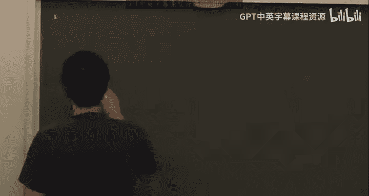

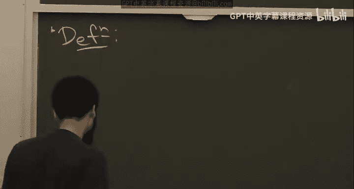

definition says that。Pi satisfies。C restricted null space property。Oh。

 I guess I should keep going on order K。Okay。If。嗯。For all s of size k and also for all eda in the kernel of pi。

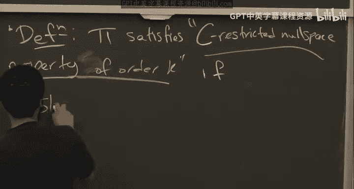

It holds that。The L1 norm。嗯。Of Ada。Is that most C times the L1 norm？

Of Ada projected onto the complement of S。So if you remember。When we analyze basis pursuit。

Using RA matrices， RA2 norm matrices。It really all boiled down to saying that。

No eta in the kernel of the sensing matrix。 Well， all the any Eta in the kernel of the sensing matrix is smooth。

By smooth， the intuitive meaning of smooth， Well， there it had to do with L2 and L 1 norms。 But the。

 the overall intuitive meaning of smooth is that mass shouldn't concentrate in few coordinates。

So if you have the vector E1， that's not smooth at all because all the masses in one coordinate。

 So kind of the mass should be evenly spread around， okay。

So we say that pi satisfies this restricted null space property， well the L101 version。If。For any。

 for anything in the kernel and for any small set S of coordinates。Not too much mass。

 L1 mass can live in that small set。Okay， so in particular。

 if you look at the L1 mass outside of that small set。

It's at least the one over C fraction of the whole L1 mass。

 so think of C as like a constant bigger than one， maybe it would make it easier to think about one over C here。

Makes sense。Okay， and。There's also a output。I'll put this in the reference in the notes。So claim。

If I。Satisfies。嗯。Ci。Let me call it。Restricted， let me call it the。C， comma 2 K。

Restricted null space property then。If Xtel的。Is the solution？From basis pursuit。

Meaning on one minimization， then we're going to have that x minus x tlde。One norm is that most？

Something like 4 c over 2 minus 2C， I believe。Is that right？嗯。Times。Lettail。So this。

 this theorem becomes meaningless actually， that looks a little odd to me now that I think about it。

She is。And。Because this makes sense when C is bigger than one。Right。So。

 this only makes sense when C is less than one。Whereas this only makes sense when C is bigger than one。

嗯。Right，Yeah， so。嗯。I think I got some of the constants wrong。 So let me fix it by just saying。

For small enough sea。Theres some C bigger than one such that， but you can't make C too big。

 So this C， as long as this C is like small enough， then this will be O of1 bigger。

So I think I got some of the constants wrong， so it doesn't make sense。

So think like if you can get C to be 1。1 here。Okay， then you can get an o of one here。Okay。

 now what you'd like to then say is if you satisfy R IP1。

Then you satisfy this restricted null space property。Unfortunately。呃。There's no proof of that。

 And in fact， someone even told me this morning that they think that's not even true。 But I'm not。

 but I don't know an actual proof of that that's， I don't know an actual counter example。So。嗯。

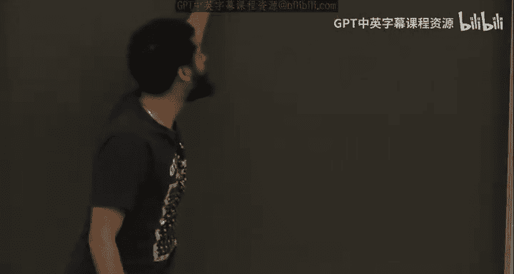

What is known is that if you take an RP2 matrix， it satisfies this property， but okay。

 that's what we're trying to avoid using。

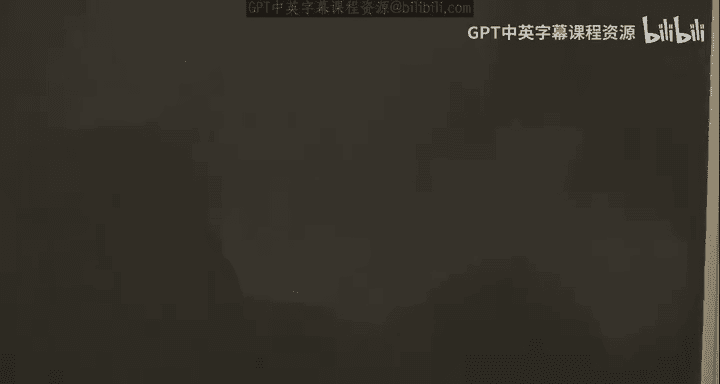

But what is also true， which is better for us， is if you take the adjacency matrix， if you take pi G。

 where G is like an expander。Okay。Then Pi G does satisfy this restricted null space property as long as Epsilon is small enough。

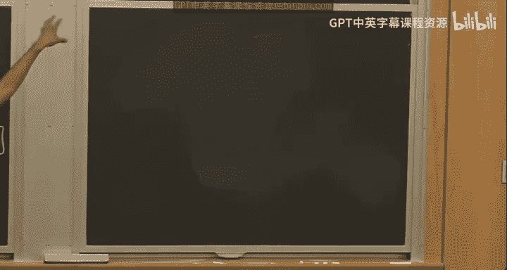

Okay。Which is fine。Except a， we don't We're trying to avoid solving L1 minimization， right。

 So we we're trying to get a faster algorithm。 That was our goal， okay。

Or maintain have a fast algorithm with the optimal measurements。 That was our goal。 And B。

 it's sort of， I mean， it's a little annoying because it violates。

 it's like an abstraction violation。 right， What I'd like to say is there's this primitive called R P1。

 And as long as I have that， then it works in my algorithms。It works for my recovery algorithm。But。

Although expanders satisfy RP1， RP1 is not known to imply that basis pursuit works。

The analysis that basis pursuit works actually talks about the expander graph。

 so it violates this RP1 abstraction。So in anyway， we don't want to use that anyway because we're trying to avoid solving linear programs。

So what we're going to talk about for the rest of classes。

How to use R P1 matrices in iterative algorithms or in a particular iterative algorithm。

To get good error。It doesn't need to be expandeder。 Yeah， although so let's now。

 let me mention something about that。 So iterative recovery algorithms。Hey so。

This is not chronological in terms of when they were discovered。

 but so one thing we have is something called expand。

 So we had last time iterative hard thresholding。

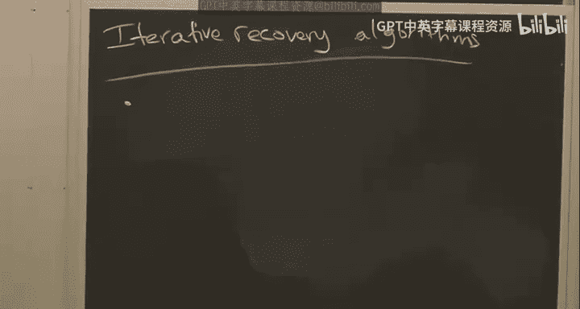

So。I feel like somehow in this space， people are very good at like naming things， right。

 So a lot of the results we talked about in class didn't really have names。

 They were just like there's some algorithm due to some paper。 But here， everything is a name。

 So one algorithm is expander matching pursuit。😊。

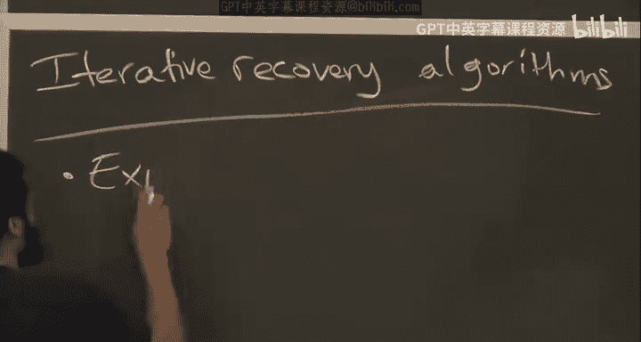

Which is called BMP。呃。I don't think either of the authors played Starcraft， so I don't know。嗯。

This is due to Indic and Rujich。Okay， and as you can probably tell from the name of。

Of the recovery algorithm， it doesn't。 It doesn't use the RP1 abstraction。 Okay。

 it just like directly talks about expanders， so。This algorithm。In theory。

 in terms of the theoretical analysis， does the best it gets。C to be 1 plus epsilon for L101。Using。

An O of K。No， oh of Epsilon。Expander。And it's an iterative algorithm where the time pereration the time per iteration is。

Is the time to multip by pi， Okay， plus some small stuff， okay， so。

It gets the kind of runtime we want。嗯。Good。So it doesn't know it doesn't use。It doesn't use RP1。😡。

Then we also have sparse matching pursuit， so let mem sure I write the right reference for that。嗯。

So we also have spars smashing pursuit。Okay， and what this thing does， So this is due to。Brinda。

Ind and research。This was， I guess， believe it。In 0，8。So this thing gets sea being some constant。

Using an O ofK。O of one， like think of this01 as like a10th or something。Spandander。So again。

 it's not using this RFP1 abstraction， but it's using。Yeah， so for now， kind of end。

NM and D are always， you know， like that。 Basically。 So N， N is N。 N is the dimension of X。

M is going to be kind of imagine that M from an optimal expander。 and D is going to be this D。

So yeah if you just give it an expander， it'll work。So in particular。

 if you give it like this expander that exists from randomized constructions， it'll work。

But it it just needs an expanding。And then， finally。嗯。

The algorithm that we're going to talk about is。I believe this is from 08 or 09。

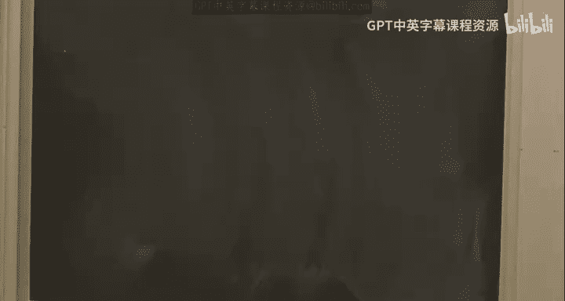

9。It's called sequential。Sparce。Matching。Pursuit。This is SS&P。This is due， too。Brenda。And index。Or9。

No what I'm going to write down I's going to look a lot like SP。嗯。It gets。Seing O of one。By the way。

 I should mention when I say get seeing O of one， remember in these。Iterative algorithms。

 There's always。There's always this extra error term that depends on like the norm of the head。

 but if you run it for T iterations， that extra error term gets divided by2 to the T。

So what I really mean is you'll get L1 error， which is that plus kind of like1 over2 to the T times the norm of the head。

嗯。Using。And， oh， okay。O one expander。好当然。I really like abstractions， okay？嗯。

So I remember my intro CS class。When you know when we got it backgraded。

 there would often be like marking， saying abstraction violation。 I think it was even a stamp。

 the T A would just say abstraction violation if you didn't respect abstractions。So。呃。

What we're going to talk about now is。Analysis。Analysis of SSMP。Using。O ofK。O of one。RIP1。Okay， so。

It just relies on this RIP。And this analysis is due to Eric Price。It's an unpublished manuscript。

 maybe he'll put it online at some point。2010。Okay， so。Doesn't exist anywhere。

Except maybe on a couple people's hard drives and in my hand，But I think I like abstractions。

 I guess。And I think it's， I mean。From my， in my opinion， I think it's also a little simpler than。

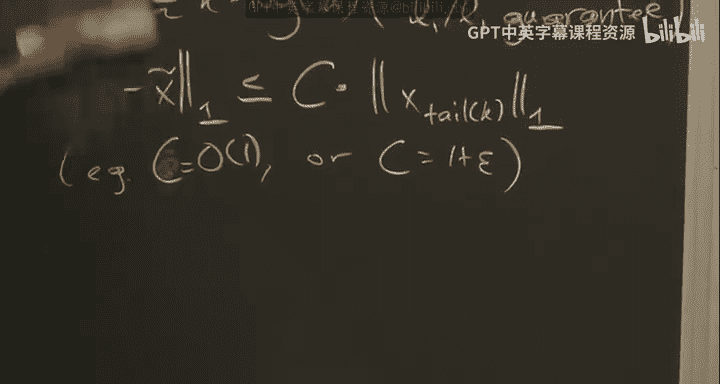

Some of the other analyses which then go which actually have to talk about the expander and the analysis。

So。Kind of the remaining。Time， what I want to do is I want to tell you what the SS&P algorithm is and then show you why it works using just using the R P1。

So questions about anything before we do that。So first of all， what's the algorithm？

Does the algorithm propose of that paper Eric just provided this。Alternative analysis。

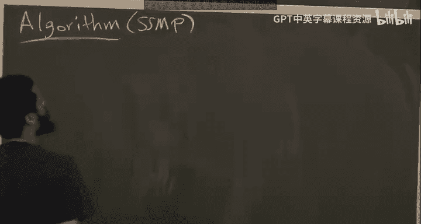

So the algorithm goes something like this， it's iterative。We initialize x0。To be zero。

And then we say you also give it a parameter T， which is how many iterations you want to run for。

 So you say for I， for J。

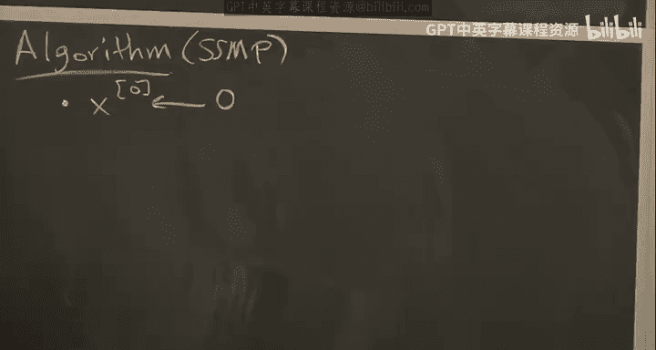

Eals 1 to T。嗯嗯嗯。You do X。J0 gets set to be x J minus-1。对。And then you say for。A goes from one。

To c minus1 k。And。还 he。The Ar then。Overall， I。By the way， I should mention。

B is going to denote for us pi X plus some error。So its sort of like last time， okay？

Argument of the all1 norm of b minus。A x plus。X J， A。So this is the algorithm。

So what's going on here？So just like I iterative heart thresholdhold， we initialize。 So X， X。

 J is always like our guess for what X is in the J iteration。 So we start off with a guess of 0。

 just like iterative hard thresholdholding。 and then。😊，And then given X J -1， we now try to form X J。

So we initially， we set， initially， our guest for X J is gonna be X J -1。

 and then we're gonna gradually improve it until we get X J。 And what is a gradual improvement， Well。

 C is gonna be some constant for some O of K steps， we're gonna find。😊。

A one sparse vector to add to it。To make it better。Okay。Does that make sense？嗯。Good。And then。

 and then that's what we add to it。 And then after doing that C -1 K times， then that's our final。

That's our final Xj。And just like the analysis and iterative heart thresholdholding。

 we're going to assume that x is actually case barse。Okay， why can we do that？So。

Without loss of generality。X is k sparse， Y is that without without loss of generality。

 because we're going to say look。Otherwise。Notice that。pi x plus e is the same thing as pi xk by x K。

 I mean the best K par approximation to x。Plus。E plus pi x minus xk。And call this thing here Eilda。

And notice that the norm of Etelda。Is that most the norm of E？Plus。Hi x minus xk。Okay。But then。

Remember， our definition of R P Y， and it doesn't blow up the norm of any K sparse vector。 Well。

 this is not a sparse vector。It's the tail， right， but you can write the tail as the tail projected to its heaviest K coordinates。

 plus the tail projected to the next K plus the X K plus the X K。And then do a triangle inequality。

So this thing is at most。The L1 number of E plus the l1 number of the tail。So。Actually。

It's not so just because because of the fact that， I mean， this is a nice thing， I guess， about。Well。

 no， actually， just by the fact that we don't blow up sparse vectors。

 it implies that we don't blow up any vector。The real trouble is in the lower bound。I mean。

 it can so definitely pi x minus X K has norm at most x minus X K。

 But if you look at the lower bound， pi x minus x K L one norm might not be at least one minus epsilon times Yeah one norm。

Does this make sense？Okay。So our goal。Is to show that something like。X minus X T。

Is that most to a constant， something like2 to the minus t times？The head。

That was our notation for the head from iterative heart thresholding。Plus。嗯。The O1 norm of E。Plus。

The tail。对。Well， now we're assuming that X is K sparse。 So there is no tail。Right， so really。

 our goal is just to show that this thing is at most this。Let me make this actually。

 let me write down some constant here。When me erase this， this might be a little confusing。

 we don't care about the tail right now because we're assuming it's sparse。

So our goal is really to show this where x is actually case barse。嗯。And， in fact。

The head is just X itself， so this is like。X minus x0。Which is zero， by the way。

 So real so a sub goal， which implies that。Is just to show something like。X。X minus xj。

1 norm is that most1 half times x minus x to J minus1。A one norm。

Plus some constant times the norm heat。To suppose we could show this for every day。

If we could show this for every J， then。If we pick this C big enough。😡，In relation to C prime。

 then by induction on J， we will get this。Okay。So really， that's what we ran to show。

So let's do that。So。嗯。Well， there are going to be many subbles， et cetera。

 but let's write some stuff down。So let's first introduce some notation。Let me say。

Yj is the residual。At the J step， so x minus x J。And also YJA。Is equal to x minus x J。

So there are these two four loops， the inner loop and the outer loop。So。我 show。So one。That。

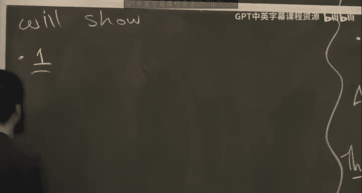

一起。Ittereration。🤧哼。OfThe inner loop。Decreases。Or。By。Something like。1 minus1 over 2 k plus a。

Square root。And what I mean more specifically is if you look at。Hi。🤧嗯。X J a plus 1 minus B。

And you compare that to the eighthth one。That's going to be something like that most。

1 minus1 over 2 k plus a。To the one half。Times。Some more space。Times pi。X J A。没。

 so we're going to show that。And then we're going to show。That one。Implies。

That this is something simple， so pi X。AC minus 1 k。Is there for minus B？Is there at most。

Kind of one eighth。Times。Hい。It's shame to speed。Okay， so。Essentially， I mean。

 this follows by like multiplying all these together。And picking C。

Picking this little C to be big enough。 So in particular， we're gonna pick this little C。

 I believe to be 1 hundred27。 Okay， so I mean， that's in the analysis。 So I should mention。

I should mention， you know， there's one thing is what you prove and the other thing is kind of what you witness experimentally。

Right， so if you look at these two， the first bullet looks better than the second bullet because this is getting one plus epsilon。

 and this is just getting a constant， right。But， you know。

 these guys actually implemented these things and compared to them。 And empirically。

 like this seems to do better。even though the proofs don't say that。

 but kind of reality says that when they actually apply these things。Yes， in the proof。

C is going to be 127， but you know。Who knows if that's really what you need？And then step three。

 we're going to show that two implies that you get。嗯。X J plus1， C minus1 k。Mus B。Most a quarter。

Times。XJ。Those was sorry minus x。And then， lastly。We're going to finish it off。

 we're going to say that three implies。That。Xj plus1。Mus X。It like I。Times。さ。So。

So right now I'm saying， this is if we're ignoring E。So in reality。

 there's also some plus E or whatever，Plus some constant times number E。

But just to give you an outline of how the proof is going go， it's going to follow these four steps。

Okay。So。Lets go， let's go over it again。 solely。 So here we just say。Each iteration。

Each it through the inner loop， we make some small amount of progress。Okay。

 in terms of the residual error。 So if we run the inner loop。128 K times or some， you know， big。

 big constant times K times。 We actually can get the error down to。嗯。A constant factor less。

 so like a factor8 less。Notice that。Notice that maybe it's if I put JPlus1 here， it'll be clearer。

So the point is when we're when're running through the iteration J plus1 of the outermost loop。嗯。

Then。We start off at J plus1 comma 0， which is just J。Right， and then each iteration through。

 we improve by this。 So then after some constant times K iterations， our error becomes 1。

8 times X J plus 1，0， which is just X J。And then we're gonna show that that implies that our error to X is actually small。

 and that implies that after we do the head truncation。Oh， I forgot to do the actual truncation。

There's one。There。Four characters that I forgot to write down， which are the following。So。

The environment that we're going to maintain is that at all times。

 these iterateates are going to be sparse。😡，Okay。So。

Let's say that I always promise you that X J is sparse。 So we start off X J 0 as a K sparse vector。

And then we run it through this inner loop， C -1 K times each time。

Each time we add exactly one more entry to it。So now it started off K sparse， now it's CK sparse。

So to maintain our invariant， we're going to make it case barsse again。 So actually。

 what we're going to do is we're going to say X J。Is set to be the hard thresholdholding operator on that。

So that's the one piece of code I forgot to write。So we're maintaining the invariant that these iterates。

 these outer iterates， these Xjs are always caseverse。Okay。So after。

 so we're gonna say that after we apply the hard thresholdholding operator。

 our error isn' blown by more than another factor of two。And then that's。Basically， how things go。

So questions， any questions？So one is definitely。嗯。And in the most serious amount of work。

From all of them， in fact， I think so 2，3，4 are somewhat more standard。

Eric even Eric Price says this in his published manuscript。

 and I think they might even have been in the previous analyses。Really， you know。

 the place where he wins and exploits RP1 is in step 1， and he doesn't need expanders to do it。

 He can just rely on the RP1 abstraction。So what I'm going to do now is。I'm going to show you that。

 if we had one。If we had one， it would imply2 then three then four。And then at the very end， given。

 you know， depending on how much time we have， then we'll start， I'll explain parts of one。

 And then if we run out of time，I'll put the full details。

 I'll just inject them into the notes you send me， Alex。Yeah。Okay， good。So for now， let's assume。1。

And so。Two， three， four。So let's do this。Okay， so what do we have here， We have that。呃。

We're assuming that one is true， we're assuming this inequality。So we have that pi。Remember。

 we're trying to prove this sub goal。Actually， let me just to be consistent about things。

Let we make this be J plus1。It's not that it really matters。

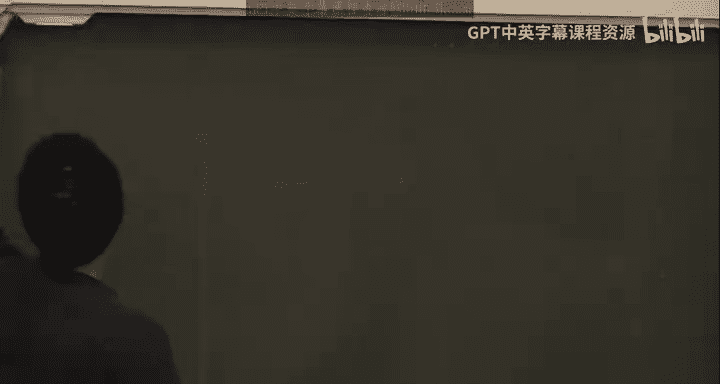

So let's say now we have pi of x。J plus1， comma c minus 1 k。Minus B。Okay。What do I know about this？

I'm trying to show， too。 I mean， that's， it's， you know， it's not，s nothing tricky at all。 Basically。

 I just multiply all these together。 This is that most the product。From T goes from。Sorry。

Let's say a goes from 0 to t -1。Of this quantity，1 minus。1 over 2 k plus a。This is all square rooted。

Times。嗯。Pi X。J minus B。RightBecause Ja。J plus 1，0。 X J plus 10 is just x J。

So I just kind of multiplied all these down to x J0。X J plus 10。And then。

This thing here is the same thing as。呃。2K plus。A minus1 over 2 k plus a。对。And you can show that。

So let me not， so you know， you can say for tea。T here is what is t T is equal to。I guess。C minus-1。

Okay。Which is going to be， let's say 126 k。For sea being 127。

And then you can calculate and show that this quantity just becomes at most an eighth。For this thing。

呃。And I guess the point is。You can take the product of this quantity over all a。It telescopes， right。

 or kind of cancels along the way。 And all you're left with is。呃。

And the numerator all you're left with is。The case when a is t -1。 So you get 2 k plus t -2 over 2 k。

 And if you pick T to be。嗯。Is that。こ。😔，2 k plus。Right。Okay。Yeah， let me not try and。

Something looks a little fishy to me right now， actually。But。Oh， that's right。 Okay。

 so the thing that you're left with in the denominator is 2 k plus t -1。

And the thing that you're left with the numerator looks something like， I think，2 k -1。So。

 so you're left with 2 k -1 over 2 k plus T-1。And then if you pick T to be a big enough multiple of k。

 you can make this thing be a small constant。 So that's the point。so that is exactly this。

That's something very simple。Okay。嗯。And now let's write down。Let's expand what B is。 It's that thing。

So now this was。This was one implies two。And then now let's do two implies three。So we have that。嗯。

So T is just c minus1 k over there。Expand out what B means。 This is equal to。呃 pi。Of。Xj plus 1 T。

Minus x。Minus E。Which is at least。呃。Ii Xj plus1。ちに？Minus x。Minus is the norm E。

And then now we're going to use the RP property。Remember， we're assuming that x is actually k sparse。

And。This thing is。I guess at most， 127 k sparse。Right， because。Well。

 as you go through that inner loop。Right， you only add one nonze each time。

 So the R P we're gonna need out of pi is gonna be something like 127 K comma O of one。

So this is at least。1 minus epsilon times。呃，X。J plus 1 comma T minus x。Minus the L1 number E。

And is that。What I wanted， I think that's exactly。Okay， almost。嗯嗯嗯。

And then we're going to use RA on the other side。 So this implies now just So let's also assume。

Epsilon is going to be small， but it's certainly going to be less than a half。

Let's move things around。 We have that。Xj plus。Plus one comeee。Minus x。

Well one norm is at most two times this guy pi x J plus 1 t。Minus B01 norm。Plus2 times E01 norm。

And then what I want to do is。And。Then what I want to do is I want to use this。

 So this is this quantity here。Is exactly this quantity？Which we just showed does that most this？

So this is at most。A quarter。Times。I Xj。Minus b a1 norm。Plus2 times E1。And then again。

 I'll expand the definition of B。 This is， This is B is equal to pi X plus E。

And then I can pull out an E by triangle inequality。

 and I get the norm of E over4 gets added to this thing。So this is att most。1 one fourth。Xj。

Minus x1 norm plus9 fourths。N一。And that's basically， so I was， I was ignoring E over here。

 but that's basically what I wanted to show over here。So now there's the last part。

So now I just need that three implies four。嗯嗯。So I claim that。X。J plus1。Minus x。Is that most？

Two times。Oh。Let me write it like this。So this is equal to。X J plus1 comma T。Minus x plus。back。

Minus xj plus 1 T。Plus x J plus 1 T。Mus x。And then I'm going to use triangle inequality。Okay。

 and then this is at most。X J plus1。Minus xj plus1。7。Plus。X。嗯。J plus 1 t minus x。Right。

You look puzzled， is that okay？And then now I use the fact that what is X J plus1。

 Xj plus1 is the hard thresholdholding operator applied to this vector here。

And what does the hard thresholdholding operator give you。

It gives you the best Kparrse approximation to the input。

So X J plus1 is a better case spase approximation to this than x's。

 Remember x is actually case sparsse。 So this part is actually bigger than or equal to that part。

 So this is at most。Two times。X minus xj plus1 comma T。

And we just said that x J plus1 comma t minus x is that most this thing you over hear。

 This is that most。One half。Times xj X， xj minus x。Plus two times that。Okay， so that's。

Basically that。Well， that's exactly what I said is our sub goal。So C prime is nine/ hals。Okay， good。

So really， the only thing left is to show Luma1 or item 1， which is actually the trickiest part。嗯。

I don't think we're going to be able to do it in eight minutes， but。

Maybe I'll try to give you some kind of。I'll put it in the notes。

 I'll inject it into the notes so you can read it if you really want to see the details。

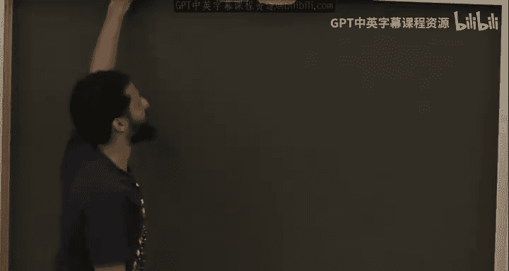

He， so。Let me write down the statements of somelemmas。So first let， write down。Leumber one。

Solooma1 says。Suppose。R1 up to RS。A N RM。And then you also have some mu。You also have some mu and RM。

And z is equal to mu。Plus the sum over。I goes from1 to S of RS。And you're told that。

Mux is that most some small constant。 Think of this as like you know，1 over 30。

 It's gonna to be in our application。Time's Norman。Z。Then。If we have this property。So。If you take。

The sum of the Rs。That's definitely at most the sum of our eye arms by triangle inequality。

But if you also have that， this is true。Then。There exists in eye such that。嗯。Z minus。All right。

Is that most？What's the exact quantity？1 minus1 over S。1 minus2 delta。Minus 5 C。Okay。

 so let me try and say this in words。好人。So you have a bunch of vectors ignoring mu for now， okay。

 mu is not so important。You have。You have a bunch of vectors， S of them。So。

 and Z is equal to their sum。Okay， forget mu mu doesn't exist right now， mu is 0。

And what you're told is that if you look at some of the RIs。Well， you know that it's at most this。

 and it's at least one minus delta times times the sum of the magnitudes of the Rs。Now， why。

 why is this not just in equality without the delta。

 The point is that you have these you have these M coordinates and when you're summing up these different vectors。

 there could be cancellations within the coordinates， right so if you look at L1 norm。

 if you sum up two vectors and look at the L1 norm of the sum， if you look at any given coordinate。

 if the two things you're adding there have different signs。

 there's some cancellation and that decreases。😡，That makes this an inequality instead of inequality。

So what this thing is saying is that there's not much cancellation going on。 for the most part。

 most of the mass across the coordinates is aligned in the same sign。That's what this is saying。

And then intuitively， it makes sense， right if。Well， if most of these are aligned in the same sign。

 pretend then they all were perfectly aligned。Well， if they all were perfectly aligned。

 then is there is one particular of them that you can subtract from the sum to decrease the norm。

 in particular， any of them。If you subtract any of them away， you'll decrease the norm。

And this is some a more， a more relaxed form of that， saying even if they're nearly aligned。

 there's always one that you can subtract to decrease the sum。To decrease the norm of the sun。

Does that make sense？Yeah。I don't see。后的时候。Providing what？Newュ isない。

So mu is basically going to be like E for us， it's going to be some noise。😡。

Because there's like noise that we have to take care of。 And basically what we want to say is， okay。

 yeah， we have some noise， but if the noise is like much less than。D the thing we care about。

Then we don't really， we can like ignore the noise， basically is what it's saying。

And if it's and the thing we care about will end up being like our。Well end up being like this error。

😡，Okay， so it's saying if this error is much bigger than the norm of E， then like E doesn't matter。

 really， once this error is much less than norm of E， then we're like golden。

 every iteration from then on can only help us。 And kind of we don't care what happens anymore。

So so that's that lemma， which we're definitely not going to have time to prove。

 because is's only two minutes left。But the intuition behind all makes sense。

And then there's limit 2。うんうん。

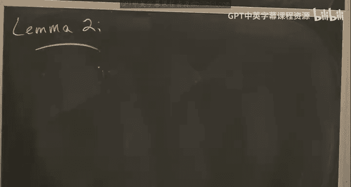

And let me I on it too properly。ぱ。Is S comma a tenth？RIP1。嗯。And S is bigger than1。If y is S spae？

And W。Is like the noise has almost1 over 30 y。Then。There exists one spars Z。Such that。Hi。

 why minus Z？Plus W has norm at most。1 minus1 over S square root。P P Y plus W。

So W is going to be like a guess E or something like that。And then Lama 3。

 Lama 3 is that if you have R IP。If you have R P。And。This， this norm is at most one30th of this norm。

Then。You get this inequality。's that's Lamma 3。 And it basically follows immediately from Lamma 2。

Okay。And notice it says， what does La2 say， it says that there exists a1 sparsse Z。

And I erase the pseudocode from SSMP。But it it basically。

 at every step you try and find the best one parse， one sparse vector to add to decrease the error。

 So you know that one exists。 And since you're finding the best one， you're gonna to do great。

 By the way， So we're out of time。 one thing that I didn't mention is。

I didn't make it clear why SMP is actually fast per iteration because if you think about it。

 I'm saying at every step， you have to find the best one sparse vector to add to my to add to my thing。

 right， And the number of iterations of the inner loop was c minus1 times K。

 So it seems like the inner loop is taking n steps per iteration。

 There are roughly K inner loop iterations。 So it's like n K per outer loop， not n per outer loop。

You see what I mean。But there's actually， you can actually implement using like a priority queue。

Okay， so maybe I'll put a reference to this in the notes。

 You can actually implement the inner loop faster than looping through all indices from one to end。

And finding the best one sparse vector for every possible eye。 So you can like put basically every。

Every I from one to N in a priority queue with a certain weight and then keep popping things off the queue。

 And then because so I don't want to get into this now， but there' there's a fast implementation。

 I'll put in the notes。So questions。So number one implies number two。

 it turns out number two implies this thing that we care about。

I think it's just because Loma 1 was extremely clever， and。And I think people， you know。

 initially people didn't see Lama1 and。They just directly you know。I mean， they got it working。

 right， They got it working directly with the expanded properties。 So then they were like， oh。

 we got it。 Okay， so what's， what is there to do。一パト。我那不完毕。Yeah。

 So there were these other albums I mentioned like SP， as well as expander matching pursuit。 I don't。

 I don't know of any analysis of those that just uses R P 1。

 Those actually still use expanders in the analysis。 So that's， that's a good open question， I guess。

 you know， can you。Reanalyze those just using RP1， although。In those。

 kind of even the way the algorithm is written， it says。

Take these edges in the expander and average it。 So you might have to like modify the algorithm a little bit。

 too， but yeah。O。