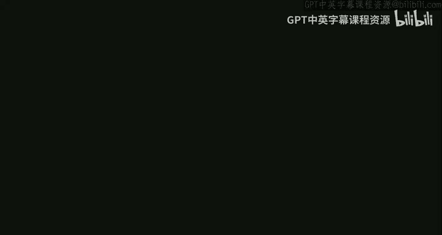
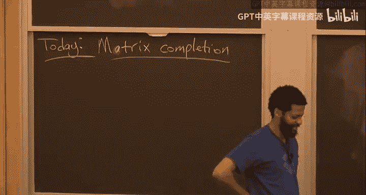
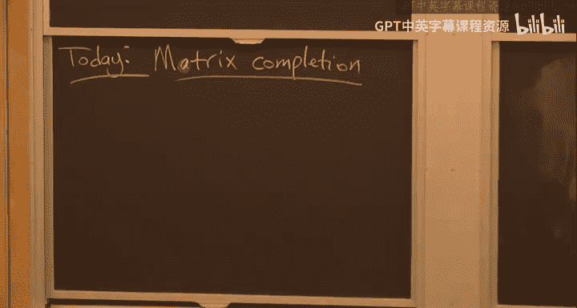
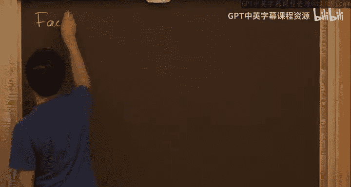
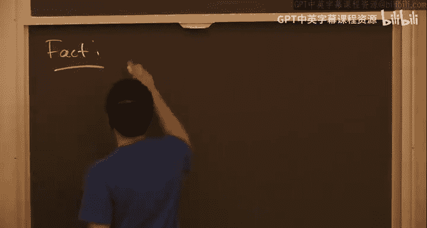
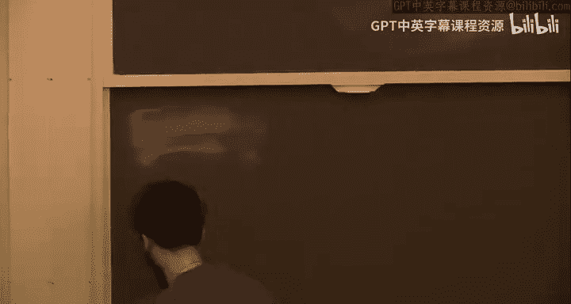
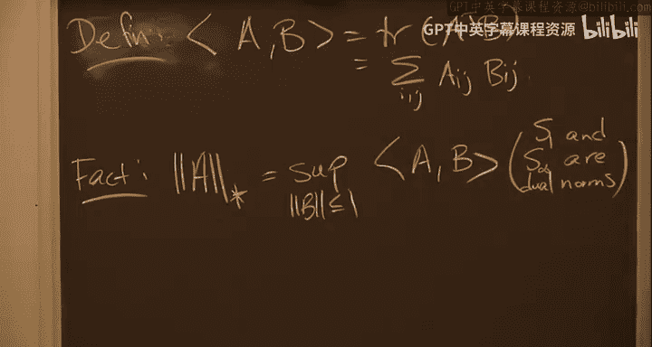
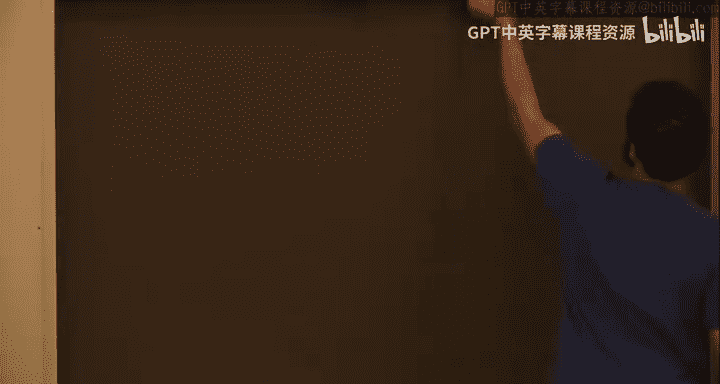
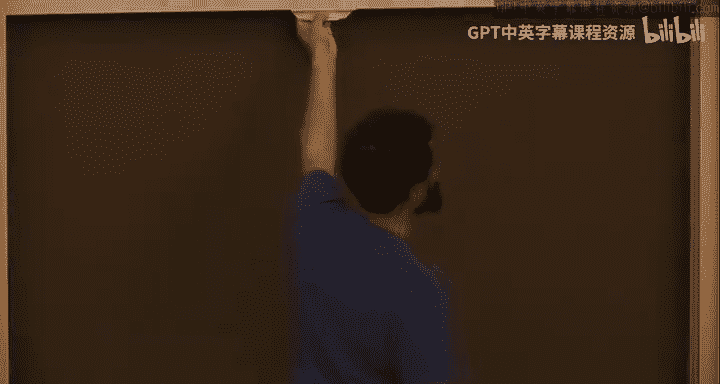
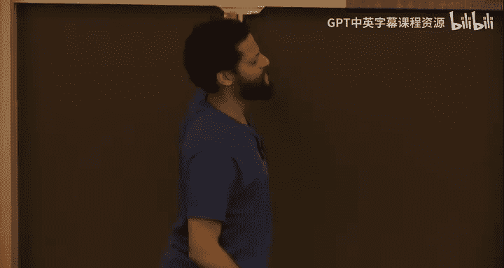

# 哈佛大学《大数据算法｜Harvard Algorithms for Big Data (COMPSCI 229r) 2016》deepseek - P22：-22-Algorithms for Big Data (COMPSCI 229r), Lecture 22.zh_en - GPT中英字幕课程资源 - BV1yGdNYvEMo

So today we're going to talk about matrix completion。Is this the last day you're going to see。呃。

This is the last day that you're going to see anything to do anything to do with you。

 approximate matrix multiplication。Certain leverage little subspace embeddings。

 I might have already said that， but now it's really true。 This really is the last time。 Okay。

 so starting next time， starting Thursday， we're gonna move into some external memory stuff。

So the last thing I want to talk about is matrix completion， sometimes called the Netflix problem。

And the idea here is。You're given。Some matrix M， which is， let's say， N1 by N2。 And what you assume。

Is that。M is low rank or let's say， close to a low rank matrix。Okay。

 so sort of like compressed sensing， right， you assume it's close to a sparse vector and you want to find it Today。

 we're just going to talk about the case where M actually is exactly。Low rank rank R。

 I'll say a few words， I mean， the algorithms。That I'm going to mention also extend to the case where it's approximately low rank and you want to recover a good approximation。

And the idea here is now， let's say M。So it's n1 by N2， both of those are huge。Okay。

 and maybe these are in Netflix， you know， these are your movies。And these here are your users。

And you imagine that。This factors as this is low rank。 let's say， so it factors as this。

AndGiven this assumption， you want to be able to recover him。So the idea with Netflix。

 I think I might have mentioned this before is when we were talking about low rank approximation is。

Maybe each user has a rating for every movie。Okay， so a user is actually this N two dimensional vector。

But you assume that there are a few kind of only there are few user types。

 and each user is actually a linear linear combination of these basic types。

And then once you know their breakdown according to those types。

 you know they're this percent horror lover， there're this percent drama lover， et ceter。

 once you know that breakdown into these few types that explains this entire rating matrix and this is the factorization here。

And why is it called matrix completion？notSo I lie a little， you're not actually given M。

You're actually given。Some。Tin。Fraction。Of the entries of it。Okay， so。You don't know。

You don't know the you don't know every rating for every movie， for every user， because， you know。

 in real life， users don't rate every single movie in your database。

You only know a small fraction of the entries of M。 Well， this is really slanted。

You only know a small fraction of the entries of M。

 And kind of given that small fraction that you do know。You want to infer。All of the entries of M。

 you want to recover the entire matrix M， given that you only know the small fraction。Okay。

What do you defineise。Like yeah so you're given as input。

 you're given as input M restricted to a few entries， and then you have to give me M。😡，You mean来。

So here I'm going to assume that M actually is。 So from now on。

 I'm going to assume that M actually is exactly rank R。

The algorithms I'm going to mention do extend to the case where there's noise。

 but let's just pretend that is exactly rank R。So， given this assumption。

I want to say that kind of given only few entries of the matrix， we can recover the entire matrix。

Exactly。Exactly recovery。So for。Right， so I mean。My assumption is that。There is an underlying truth。

 which is a low rank matrix。Okay， so， in reality， there is this noise。

 but let's ignore the noise for now。 Then there is this underlying truth。 You do have。

 you are a user and you do have some underlying types。 Okay， and I want to recover， you know。

 given that assumption， I want to be able to recover。The entire matrix， Yeah。

 so I'm praraising it as recovery。There is a truth and I'm trying to recover that truth。Okay。Good。

Any other questions？And we're going to make a model assumption， which。Which。

I think it one of the more unrealistic things that I'm going to say today， but it's what it's。

 it's an assumption that many papers have made。 willll assume。We are given。M random。Intries。Of。

Uniformally。Okay， so what's revealed to us is just a random collection of M entries in this matrix。

Okay， which。You know， in a real situation。I， as a user， don't watch a random set of movies。 You know。

 I， I probably watch movies that are similar to each other or。They're probably clusters of movies。

 and I watch very similar movies within those clusters。

 but this is the assumption that many works have made。Given every entry。卡不用你哋。Yeah。

 look recovering M exactly。 Well， I didn't tell you what M is。I didn't tell you what little M is。

Yeah。嗯。Right， yeah。I should mention that。There is work on adversarial recovery。But not as much。

 and also the bounds you get there are not as strong。 So if you want to look at one such work。

 there's a paper by。Shmman Whites。On the archive。Okay， but。Kind of， I think in the best case。

 in the best case scenario， they need to look at like a constant fraction of the entries of the matrix。

Okay。Whereas for us， we I'm going show you the bound soon。

 we're going to look at like way less than way less than that， okay。Means that like。

As long as we see， So here I'm saying we see M random entries trees of M。Right。

 so what if there's an adversary who's trying to mess up our algorithm and they show us like M carefully chosen entries to try and trick us。

Then what they say is as long as you're still seeing at least a constant fraction of each row and column。

 let's say you can still do recovery。 given some assumptions。 I haven't talked。

 There are some assumptions we need to make about M beyond just low rank。Okay。

But making those assumptions， you can still do recovery。And just clarify your。原到这。说那个是哪？Yeah。

 and you know where they are。 So， you see， yeah， So you're given， you。

 you're given like a random set of of entries， I J。 And you're also told M I J。 So you know I J。

 and you also know M I J for a random set of I J。Okay， so。嗯。Yeah， so let me。

 let me tell you more about the assumptions。 or actually， you know。

 before I tell you the assumptions， let me tell you the algorithm because the algorithm。

That that makes some intuitive sense。algorithm。It's going to look a lot like the algorithm you saw for little basis pursuit。

Okay。嗯。This is called。啊。NNM。Which is nuclear norm minimization。Okay。

So the ideal thing you'd want to do。Is let's say that。Some notation you're given。R omega。

Where omega is this subset of N1。Cross N2。Also。From now on。N1 is equal to N 2。

 So I'm just going assume， I'm going assume that M is a square matrix。

 It doesn't really affect anything。 I'm going say it just makes it。It just makes less。

 it allows me to write less subs， so。嗯。And R omega of M is the restriction of M to increase in omega。

Okay， so everything that's not in omega gets zeroed out。So the ideal thing Id want to do is。You know。

Compute。The argument。Over x。Of the rank of x。Subject to the constraint that r omega x。

Is equal to r omega M。Right， that's what I'd like to do。

 I'd like to find the lowest rank matrix that agrees with my observations。Unfortunately。

 this problem is NP hard， right， this looks a lot like。The idealized version of basis pursuit。

 where I'd minimize the sparsity subject to equaling my observations， my measurements。

So we're going to relax this to a convex problem before we relaxed support size to L1 norm。

Just because L1 norm was like the closest。 imagine you put a P norm there。Kind of。

LP only starts being a norm when P is at least one。 So that was sort of like the minimally。

Like the best convex relaxation we could do for the zero norm。O。So。You。

 based on that kind of loose intuition， what do you think we're going to do well。

 actually maybe the title of the name of the algorithm might suggest it。

But kind of one way of viewing rank。Is the number of singular values of the matrix right if you take the SVD。

So then what do you think we're gonna。What do you think we're going to do for the actual N&M。Yeah。

 the L1 norm in the singular values， which is usually called the nuclear norm。Okay， so。The actual。

Nuclear arm minimization is。Arment。Of the newinere Army。So this is the sum of the singular values。

such that。R omega x。I it what's horriblerring。Okay， so I'm not gonna。

 I'm not gonna cover this in class， but it turns out that this optimization problem can be。

Can be phrased as an instance of something called semi definite programming。Okay。

 so I don't want to dwell on that。 That's not what this class is about。

 But the point is that there are polynomial time algorithms that can solve SDP。

 semidefinite programs up to arbitrary precision and run time depends logarmically on precision okay so。

This is a semi definite program。Which can be done point time。So R omega， you should think of。

You you think of omega as like a linear operator， so it takes as input a matrix？😡。

And then it spits out that matrix with everything not an omega zeroed out。O。So in particular。

If you think of so now n1 is equal to n2， if you think of M as like an n squared dimensional vector。

Then R omega is an n squared by n squared matrix， which is a diagonal matrix。Okay。

 and the entries corresponding to omega are 1 and the entries corresponding to things outside omega are 0。

 So it just zeros out， It zeros out certain entries of M that are not in omega。🤧Okay， and。嗯。Let mean。

 so the first。The first work。To give。Kind of a rigorous。Analysis。Of nuclear normalminization。Is。

Rightrrect。He。Okay。And since then， well， that was not in the well。

 that was for other problems as well， not just matrix， not matrix completion。

But for N&M applied to matrix completion， there was a paper by Candice and Rech。嗯。

First good analysis， rigorous analysis。Of N and M。For matrix completion。And then after that。

 there was an improvement by Candice and Tao kind of the name of the game then becomes like minimize M。

 right。I haven't told you what assumptions we're going to make about capital M。

But there are like two things in this game。 One is make SP assumptions as possible。

 And the other thing is make this little M as small as possible， right， so you can play those games。

 And there are a sequence of works that。Yeah。第四依据。Qu both actual and ideal。I mean。

 have to prove we didn't prove anything yet。Yeah， Yeah， there's a unique solution。

 and it's and it's gonna be capital M。 Well， notice that this is randomized， right。

 because we're taking a random sample of entries。 So we're gonna show is with high probability over the random samples。

😊，The solution is unique and it's capital N。I mean， capital M is always a solution， right？ Well， I。

 well， no， I guess I shouldn't say that There might be something that has even smaller nuclear norm than capital M。

 So let me not say that。 Capital M is always feasible。The thing is it might not be the optimizer。

But what we're going to show is that with high probability over the random samples， if。

 if little M is big enough， if we take enough samples， then it will be。It will be the optimizer。Yeah。

Oh， so similar to basis pursuit， right， so when we're doing compressed sensing。

Kind the idealized picture in our head was subject to you know， agreement on the measure。

 the linear measurements we've made。 we should minimize the support size of the vector。Right。

The problem is that that's an NP hard problem， so we relax support size to L1 norm。

So kind of rank is sort of like support size of the vector of singular values。

And this thing here is the sum of the singular values。 This is the nuclear norm， So this is。The sun。

Of the singular values。法庭。最て要は？Im sorry， say that one more time。来。H sure。

We probably back to ideal one。Does it Rick？嗯。Well。Yeah， I don't know about that， but I mean。

 what we are going to show is that M itself is the optimal thing here， right？Yeah。AllI mean。

 that's the main theorem that has to be proven。Yeah。Yeah。

 the theorem that's going to be proven is that。The solution to this。

 the minimizer of the nuclear norm will be capital with high probability over the choice of the random entries。

As long as we take enough samples。答件。Well， I mean， forget about the ideal case。

 We're never actually solving that。 This is the thing we're actually solving。

 And what I'm saying is this will give us capital n with high probability。

 And that's that's all I care about。Okay， so there was some improvements by Candice and Tau in 2010。

And then also by。开始 on。换成RA。OAnd also in 2010 and '09， I guess it seems or 2010。And finally。

 there's also wrecked。And these are。These are all improved。Quantitative improvements。

And I guess maybe also you can I mean。Better little M and also fewer assumptions。

And today I'm going to give you this analysis for this paper。O。

And this analysis is actually based on。Based on work。In。Quantum。Tmography。My gross。So it turns out。

 I mean， actually， the last time I taught this class， there were two quantum tographers。

 postdocs who attended the class specifically for these lectures because they。Apparently， it's like。

I'm not a quantum person， but apparently telling the stuff they do is like exactly the same problem or very similar。

嗯。I mean， the little I know here is basically you have some。Quantum state。

 and you want to like recover it using few measurements。 I mean， it sounds sort of similar to。嗯嗯嗯。

But don't worry， I don't know a quantum， and you don't have to know quantum either to understand what's going to happen here。

So。I want to get there。 so all of these are analyzing exactly this algorithm。

 which is trace norm minimization， nuclear norm minimization。

 and even this paper was analyzing nuclear norm minimization just with adversarially revealed in。

Quest。Oh sorry， I you。嗯。So I do want to mention that there are other。Approaches， okay。

 so remember before we didn't basis pursuit gave great guarantees。

 but we didn't like it because it was slow。 So then we started doing iterative algorithms。 Okay。

 so people have done the same thing for matrix completion。

 They've developed iterative algorithms that still try to give good guarantees， but are faster。

I'm not going to cover them in class， but I'll just mention their existence。So there are a few。

So one is。Something called- so there was this paper by W。Over after and figuereto。え。

And the algorithm is called a Sp assay。So first of all。I'll it。

 I'll present in the case where there's actually noise。 Okay， so when there's noise。

And if you can't really do this anymore because you don't expect there to actually be。You know。

 your rank M isn't actually your low rank。Thinky， so what you do is。So。And to replace。

Replace R omega x equals r omega M。With。嗯。R omega x minus R omega M。

Forbei Norm squared is at most Delta？So Dlta is like some parameter and then have the quality of what you find depends on Delta。

But this is what you do。And you can imagine a regularized version where actually。It's unconstrained。

 but you put a penalty based on this in the actual objective function。 So you minimize。

 you try to minimize the nuclear norm of x plus mu times this regularizer。Hey， so。

So this thing tries to compute。Kind of the optimal x， which is the minimizer。Of X star。Plus。

 mu times。R omega。Well。Let me say。In general， A x minus B。Okay。Where in our case， now。

A is R omega and。B is omega M。Okay。And it's an iterative algorithm that。嗯。P。

You knowX0 and a step size T。And then what you do is。We set Z to be equal to。

Xk minus t times a transpose。Ax k minus M。Mus B。You da。The transpose is now the SVD。

So you pick some initial gas for your matrix。For your， for your， for your optimal matrix like 0。

 and then you iteratively do some kind of like gradient this is called projected gradient descent。ok。

嗯。Which looks the first step looks similar to gradient descent for least wears regression。

 which we covered earlier in class。And then you do this step where you kind of approximate the matrix。

 the new matrix by a low rank matrix。Okay， so this is not。

I guess this is more of a soft thresholdholding than a hard thresholdhold。

 Hard thresholdholding is just you just keep the top K。Here is。You。

 you keep everyone who's like big enough。And zero everyone else yeah。Mu。

 where mu is mu is your penalty on the regularizer。That's right。Right。

 so the idea is just to be faster than semi defite programming。Yeah。嗯。Now。

 one thing that I've wondered about， which none of these papers are doing is。So in this paper。

 if I remember correctly， kind of empirically， they observe that these iterates always are low rank。

Okay。And now， and we know in this from this class how to get good low rank approximations。

Using subspace embeddings。So you could imagine given this Z coming up with X K plus1。

 using a good low rank approximation。This is something I haven't seen using using things we know。

 And this is something that I haven't seen。Done， so it'd be good。

 at least to see empirically if that's a useful useful thing to do。嗯。

Another algorithm is called alternating minimization， which I think is。

Maybe which is also a very popular。Way to solve matrix completion， minimization。

And the basic idea is。You say that。Your matrix M。Is is。Approximateated。Bye。X，Y。Where these are。

Let's say's why I transpose these are both n by K。 So this is a rank K decomposition。

And let's start with x0 y0， this is our initial iterate。

And the initial get the initial iterate we have X 0 Y 0 is like a terrible approximation。

 M is nowhere near x 0 Y 0 transpose。 So then we iteratively try to improve it。

 And why is it called alternating miniization。 It's because at any given step。So we say for I， for L。

 let's say。Equals 1 to T。We first try to get a better X， and then we try to get a better Y。

 And then we， we iterate back and forth。So what we say here is kind of XL。Is the Arg men。Of M minus。

X， L。Argument over x。M minus X， Y， L -1。Forgius norm squared， and then we set YL。

To be the argument over why。Of M minus Xl。Why。And then we just keep doing that over and over again。对。

And each one of these is a regression problem。Which again， actually when I look at these papers。

I don't see them mentioning that you can do approximate regression quickly。

 so that might be an interesting thing to try at some point。And then you just keep doing this。

And hope that it converges that。Or something close to them， Does that make sense？嗯。And。Recently。

 there have been a few papers from the theoretical C S community that have analyzed。

 I think not exactly this algorithm， but some a variant of this that they could actually prove good things about。

Okay， and if you want to see， if you want to see some analyses， you know， see。There's a paper。

By more at heart。In Fox 2014。And also heart and roots。In cult。

There are others some other works too that I。嗯。That I could be mentioning， but， you know。

 I don't want to spend all day writing references。 You can go looking in there。我 you。

Why would put the penalty？Oh， I see。This penalty here。I mean， it's。嗯。

There's some kind of equivalence between。Basically。

 an unconstrained problem where you regularize and put it in the objective function versus the constrained problem where you just constrained that this thing is at most some valued delta。

So。I guess the way that this paper is written kind of attacks this version of the problem。

 but you can think mentally that it's the same as this。Okay， so you。

 the reason I change from this to this is because this thing kind of naturally handles noise。对。

And in general， by the way， these papers， like for example， the paper that I'm about to present。

 if you look at this N&M， but where you replace this by this kind of constraint。

 then he also shows that， this can handle noise。Where M is actually a low rank matrix plus noise。

Yeah， that's right。So yeah， I mean， you should think of kind of the noise as， I guess。

 as being on the order of Delta， Well， as being on the order of Delta and the for being is squared。

这边。Okay。I think now what I should do is maybe actually。Get into the analysis of RET。Okay。

So from now on， we're going to do some analysis， some analyzing of this thinkingy。

 And before I do that， I want to just prove one kind of math fact。

And then we're going to use that to the analysis。So fact。

嗯。

Well， first before I do the fact， let me do a definition。

Which is that the dot product between two matrices， A and B， is equal to the trace of a trans goes B。

Which is equal to the sum of IJ， AIJ， BJ。It's like dot product of vectors where you treat the matrix as a vector。

And in fact。The nuclear norm of a star。Equal to the soup。Over B。Having operator room at most one。

Of A dot B。So what this means is that kind of。Stton1。And Shatton infinity。Are dual norms。Okay。呃。

TheThe shatton P norm is take the vector of singular values and take its LP norm。So you。

 in particular， like， if A and B are vectors， right。

 L 1 L1 and L infinity are dual in the sense that the L1 norm of a vector is。

The soup over other vectors of infinity norm at most one of their dot product。Right， so what。

 in particular， how would you do it， Well the L1 norm is。The one number of x is x dot y。

 where y is a sine vector that agrees with x on every coordinate and sine。

That's how you achieve the soup。嗯。So let me prove this is actually not。2。😔。

Complicated to prove， so first I'll need alemma。Which says that。A star。Is that most？

The min over Xy such that。呃。Xy is equal to a。呃。Ex。Fbeius times y forbeius。Oh。

 this is actually equality。Which is equal to the min over the same stuff。Of。One half。

X for media squared plus y for squared。Let me call this。You know， A1。2 and3。

So proof。A dilemma。So。Two is less than equal to three is just。AGM。Right。

Three is less than or equal to one。AGM just says。AB is at most1/ half a square plus B squared。

3 is less than or equal to1。I just need to show that。There is an X， Y with a equals X， Y。

Such that that thing is at most that。So in particular， the men will be even smaller。Okay。So。

I'll just choose x to be equal to y to be equal to a to the1 half。Remember what this means。

 it means that if I write。A to be equal to u sigma of B transpoposedse， then a12。

Is equal to u sigma12 the transpose。Where S12 means you just square root each singular value。Then X。

 Y does equal a， and the Frbeius norm squared of a12。

Is exactly the nuclear norm because you square rooted each singular value。And then now。

 I guess the one that maybe takes。Slightning more amount of work， one less than equal to 2。Is。So。

 what。X，Y。I mean， right。XY star is equal to a xY transpose。Let X， Y be such that。嗯。

A is equal to xy transpose。Okay， so for example。X is U sigma and Y is V or whatever。

Does do any such decomposition。嗯。Now。Note that。The nuclear norm of this thing is equal to Xy transpose nuclear norm。

Okay。Which is at most。The soup。Over AI as well as BI。🤧。Of some。X，Y transpose AI， B。Where。AI and BI。2。

Orth theormal bases。So why is this inequality true？So。

To say that this is at most the soup over all pairs of orthomal bases of this。

I just need to exhibit one pair of orthogonnal bases where this is actually at most that。😡。

And one thing you can do is let the AIs be the columns of U and let the Bs be the columns of V。

 And then this actually becomes equality。Okay， so I'll leave that to you to verify。

 but it's nothing too tricky。系。And then now what I'll do is I'll move the X over that's equal to the soup over all those A's and B's of the sum over I。

Why transpose AI？Dted with x transpose B。Okay。Good。So now these are just vectors。

 so now I can you do Kooshi Schwartz， this is at most the soup sum of her eye。Why transpose AI？Times。

X transs B。嗯嗯。And then I can do khi shorts again， this that most soup。

Some over I Y transpose AI L norm squared and square root。Times some of her eye。X transpose B。

E squared square root。And notice that。Kind of， this is a vector， but I can imagine it's a matrix。

 So then this thing here is the trace of。AI transpose。Why， why transpose？AI。Okay。

And then I can use cyclic property of trace。Which says that this is equal to the trace of y y transpose。

AI， AI transpose。And then I summed over Y。 I summed over I。 So when I sum over I。

There's a similar eye here。But what's the sum of AI AI transpose。It's the identity。

 right because this is an ortho basis。So this is the trace of y y transpose。

 which is exactly the forbeous norm squared。 So this is equal to the Frbeius of y。

Times the ferenius of x。Okay， so we've proven dilemma。

 so those three quantities are all equivalent ways of writing nuclear norm。Good。

 so now just proof of claim。Again， we'll show that。嗯。

Both the left side is at most the right side and the right side is at most the left side。

Left hand side。It's the right hand side。So which B are we going to choose？😡，谁。

So you can do a computation and and see that if you choose B2 B this， then in fact。

You get the nuclear norm。The soup can only be bigger。How about the right hand side？

Is that most the left hand side？So what do I mean by this。

 I want to say that kind of for all be with operator norm 1， we have that。A dot B。Is that most？Yeah。

Do you well。The single values is well positive。RightThis is not eigenvalues。 This is the SVD。

You're all strictly positive。Okay， good。 So how are we going to show this。

 We're basically going to use。We're going to use thelemma to say that this thing here is equal to。X啊。

Times Yf。For some x and Y。Okay。So then now。Let me also write。The SVD。Of B。

Sorry for the double notation。 This is at most some Sigma， some of our I sigma I， U I V I transpose。

 where for all I Sigma I is at most one。That's B， because it has operator norm。

And as was operating about most one。谁。So then now we have that A dot B。Is equal to。X。

 Y transpose dotted with some over I， Sigma I， U I， V transpose， this is B and that's。That's a。嗯。

Which is equal to the sum over I。Sigma I。嗯。Yeah。Anything for a second？😔。

So I guess I can write this as。Y transpose V dotted with x transpose。Which is at most。Some of eye。

Sigmmaize at most one， is that most。Y transpose V times x transpose。Okay。

And then you do the same tricks as before。You get that this thing is at most formin of y times forminius of x。

But that's exactly equal to the declared norm of A。So。We've proven that。

The dual norm of nuclear norm is， in fact。啊。Operator arm。Me。So let's。Actually now do some。

Do something。Okay so。Define。呃。So from now on， so now we're going to do the actual analysis。

Let me set up some notation。M is going to equal u sigma of v transpose。Okay。

P of T is an orthogonal projection operator mapping matrices to matrices。And then P bar。T perp。

 I guess I should say， PT perp is the。As the orthogonal projection。To the compliment。

Okay so what do these things do exactly， what are they projecting to？So PT， if you feed。

A matrix into PT bar。It makes sure that the output has rows and columns that are orthogonal， well。

 orthogonal to U and V， basically。PT bar。Of a matrix A is defined to be identity minus。

Projection onto you。A， identity minus projection onto B。By protection on the V。

 I just mean V V transpose。 and this is U U transpose。And then。PT of a is now equal to。

A minus PT per。So you can see that these are linear maps。Right， so in particular。

 you can express the action of PT and PT per by a matrix， which is n squared by n squared。 right。

 Just think of the input matrix A as being like this n squared dimensional vector。

 which these matrices are operating on。I'm not going to explicitly write down PT and PT perp。

But they are linear operators， so you can write down a matrix。对。

And also you can see that they are orthogonal projection matrices because PT squared is equal to PT。

 If you apply PT to a matrix twice， you get back just one evaluation。

 so these are orthogonal projections yeah。えず在。Oh， I mean， this， nothing I'm saying is algorithmic。

 I'm not saying you're computing anything。 I'm just making definitions。Right。Yeah。Thats看见了。P it link。

Yeah， I'm just saying， yeah。Right， yeah。Okay。And also， I'm going to assume that from now on。

Omega is a subset of m cross n。Is a。Mtiet。So I said before that we took M little M samples from the matrix capital M。

Okay， and then we stuff those in omega。 So now we're sampling with replacement。

 So each of our samples is uniformly random。 So in particular。

 we might sample the same thing multiple times， in which case。R omega。Is diagonal matrix？Where。

Kind of IJfe entry。Is the multiplicity？Of IJ。So if we analyze this。

 I guess I erasse it ifed and M works kind of with this R omega。

It'll definitely work where you actually sample M people without replacement because you're only seeing more of the matrix。

 right this is potentially only letting you see less of it。So formally。

 the success probability under this model can only be worse than success probability in the actual model where you're seeing M guyss without replacement。

Okay。And then now。嗯。Let me make two more definitions。Let me say that。God a mu zero。First of all。

 move0 of a of u。Is equal to。嗯。N over r times the max。Leverage score。Of you。And similarly， for V。

Remember leverage scores， they have the squared row norms of U。

And what's the smallest that a leverage score can be。

The smallest aesthetic laboratory it can be is R over n。Because if you take the matrix U。

 its forennius norm squared is R。😡，And there are N rows。Right。

K the best case is that all the rows have square norm exactly R over n。😡，Okay。嗯。But for example。

 if one of the rows of U is like a standard basis vector。

 you could be in a situation where the maximum level score is1， in which case mu zeros。

Is large you know so we know that kind of one is that most mu 0 of U， is that most N over R。And also。

 let's define mu1 to be equal to。The infinity norm of UV transpose。Which is the max over IJ。Of U。

Transpose。Okay。And by Koshi Schwartz， you can show that this thing is at most something like mu zero times the square root of bar。

It can be smaller， but it can be bigger than that。Okay。And the theorem。Is that we got recovery？

Recover。With probability， 1 minus1 overpa N。If M。Is at least something like。Some constant times。Max。

Of mu1 squared， mu zero。Times something like N R log squared。They make sure I'm not lying to you。

 I'm pretty sure that's theorem。Okay。Oh， sorry。Mux is the max of。You not of you and you。Yeah。

And you're going to see， you're going to see in the analysis exactly why kind of mu 0 pops up。

It's exactly because of leverage score sampling for approximately matrix multiplication。

Which I guess you analyze on。Is it the piece that's due tomorrow， No。

 it's the p that was due last week， or the week before。So the way I'm going to do this。

Especially because I think。Well， yeah， the。 So I'm going to do this。

 I'm gonna I'm gonna state certain conditions such that if those conditions held。

 if those conditions held， then。We would definitely recover M。

And then I'm going to explain why those conditions hold with high probability as long as M is big enough。

So these are deterministic conditions that suffice to recover。To recover M， so conditions。

So the first one is going to be that n squared over m times。PT R omega。P7。Minus m over n squared。PT。

Is less than a half。By the way， so does this remind you of anything？Kind of like all they。Yeah。

 it actually。 So it actually is AM M， right， This is， this is basically。AM was about。

AM looks at something like pi a transpose。拍比。IB minus a transpose B。And in this case。

 A and B are both equal to PT。Right。Notice that PT T PT T is exactly equal to PT T。

 So this is just PT PTT。 And then here is basically saying that kind of pi is equal to R omega to the one half。

Right， which is。So kind of before when we' were doing subspace embeddings。

 we were doing leverage score sampling， and if you remember kind of the diagonal matrix we had had one over a square root of PI。

Right so here we're。Here PI is uniform because we're doing uniform sampling。Right。

Which is why I kind of imagine this scale factor gets like absorbed into R omega。

 and the scale factor actually multiplies this and cancels it。 And this is like exactly AMM。

Except we're using uniform sampling instead of liver score sampling。Yeah， exactly。

 That's what we can have a simple model for which entries we see。

 And that's exactly why kind of we want， so。The proof is going basically need to say once these conditions hold。

 we recover M。So one of the conditions we want to hold is AMM。

But we know how many rows we need to sample for AMM， right。

 It's like the sum of all the leverage scores。RightBecause if we sample each row with probability proportional to its leverage score。

 we know we'll get AMM。 So the total number of rows we sample an expectation is the sum of leverage scores。

Unfortunately， we're doing uniform sampling， not leverage score sampling。So we need to compensate。

 how do we compensate？Kind of really in leverages score sampling。 Okay， so on your PSet。

I had you analyze the case where you're doing exact numbers score sampling。

But as long as you sample each guy with probability， at least his leverage score。

 you still got to get the same guarantee。 Okay， you can do it as an exercise， if you want。So we need。

 if we're doing uniform sampling， some people aren't sampled enough。 They're undersampled， right。

Because the liver score might be big。So we need to oversample to make sure that they're sampled at least by their lover score。

And that's exactly why mu zero comes in。According to Laber scores。Right， yeah， unfortunately。

That's sort of also self referencing because the lever score depends on the matrix。

So that's exactly why mu0 comes in。 U1 comes in later for some other technical reason。

 And now think about AM M， right， How many rows you need to sample for leverage square sampling。

Rannk log rank， right if you remember is like failure probability Delta with with like a rank D matrix。

 it was D times log D over deelta over epsilon squared。Right？Well。What's D？D is the rank of PT。😡。

PT is this orthogonal projection matrix。😡，Right。So。What's one way to see， if it's not intuitive。

 What's one way to see， I didn't even specify what this matrix PT T is。

 I just said it's an orthogonal projection on matrices。 and maybe it sounds confusing。

 If you have orthogonal projections， then kind of that's like U U transpose， right， for some you。

If you just look at the trace。A view， you transpose。

That tells you exactly the dimension of the projection。So we can look at the trace。😡，The dimension。

Of T is exactly equal to the trace of PT。Okay。Which I can write as。

It's gonna be equal to like the sum of all I J of。PT， E，I， E， J transpose。

 these are like the standard basis vectors for matrices。Forennius norm squared。

And if you do this calculation out， you'll get that this thing is equal to the sum over I J。U。PU。

EI L2 norm squared。Plus， P V， E J。L2 norm squared。Minus。PU EI squared times PV， EJ squared。

You can do this calculation。This thing here。😡，Well， if you sum over I， you get R。

 but then there's a free J there， so this is equal to NR。😡，This is also equal to NR。😡，Minus。

The sum of P EI squared。Times the sum of。PV Ej squared。Which is r squared。

So this whole thing is equal to r times 2 n minus R。

Which is sort of like the degrees of freedom in this whole problem。

So if I tell you that the matrix M is a full rank matrix。R is equal to N。 This is equal to n squared。

Right， your matrix M has n squared entries， so you need to tell me all n squared entries of a full rank matrix to specify it exactly。

But if your matrix only has rank R， this is telling me that really there's only like NR degrees of freedom。

😡，You can tell me NR numbers。Roughly in our numbers and those specify the matrix to me。😡。

Which makes sense。 What do you have to tell me， You have to tell me the entries of U。

 the entries of V and the singular values。 And that specifies the matrix， right。So。

When you look at this thing， you need mu 0 to convert to basically convert uniform sampling into lover score sampling。

 You need N R， which is the dimension。And then you need an external log of NR。

 but log of NR is like log N because R is at most N。And then in rec proof。

 there's an extra login that he just needs to make his analysis work。Okay， so in fact， I think he。

 he poses that as an open question in his paper like， do you really need my extra login。

And he also needs this extra mu one squared。Lettter。Okay， so anyway。

I went off on a little bit of a tangent， but just to give intuition。 So this is condition one。哎。

More conditions。Condition2 is going to be that the operator norm of r omega。

Is like at most a constant times log in。This is basically just the turnoff bound。😡。

R omega is a diagonal matrix， right， R omega is this sampling matrix。

That tells you which entries you keep。 And I said it's a multiet。While呃。

We're sampling less than n squared things。And there are n squared entries。 So by turn off bound。

 we're not going to overs anything by more than log n。Thiss okay。

This is basically just turn off bound。Applies this。And then this is the one that maybe is a little。

A little trickier。 Well， this actually requires some work。 It's a lot trickier。

 So there exists a why。In。The range。Of R omega。Such that。First of all。P of y。

Minus UVV transpose for venius norm is at most square root r over 2 n。And also。PT per。Of why。

Is that most of half？Okay， so that one actually requires some work to justify。 Okay。

 so let's just pretend that。We have these three conditions。

 The first two are sort of familiar to you。 Hopefully， the third one requires something， okay。

But by the way， the way that you。

I don't know if we're gonna to have time to actually show that condition 3 holds with high probability。

 but I'll let you look at the paper。 It basically is a bunch of。A bunch more AM M Ms。 Okay， So。

 I mean， there's， there's some argument you have to do。

There's more things you have to condition on and happening。

 but you say if all these good things happened then such a why exists and all those good things happening is again。

 AMM。Approximate matrix multiplication。Okay so。Okay， good。 So that's these conditions hold。

 So what do we want to show， We want to show that M is the unique solution to non。

 to nuclear norm minimization。Right， so。Want to show。That for all Z in the kernel。Of R omega。

We have that。The nuclear norm em plus Z。Is strictly bigger than the nuclear norm of M。

That's exactly what we want to show。Which means M is the unique。Minimizer。So。First of all。

 we know that。呃。Zero is equal to。The Frenius norm of R omega Z。Okay。Which is because this is zero。

 this is in the kernel， which is at least by triangle inequality。嗯。R omega。PT of Z。Minus。R mega。

PT per of Z。Yeah。Okay。嗯。And now let me say that。嗯。R omega。PT of Z。For media norm squared。

 it is equal to the dot product of R omega PT of Z。lf。Right。And。So this is。

 this is a dot part of the matrix itself。 So we're like scumming the squared entries of the matrix。

Right， notice that all the R omegas， Romega is this diagonal matrix that basically multiplies each entry by something that's at least one。

 maybe more than one。 if there's higher multiplicity。 So this is certainly at most。

The dot product of PT Z are omega。PT c。Okay。Yeah， but it's also here。哦。Yeah。

 I'm leaving it on one side。And then now I can PT T， PT T is like actually a matrix that acts on。

 Think of Z as like a vector。 This is like a matrix that acts on Z。 This equal to。Z dotted with。

PT transpose， which is just PT because it's an orthogonal projection， R omega PTZ。呃，让你感觉不幸。

They let me do some funny business。 So this is equal to。PTZ。Dotted with。PT Romega， PTPTZ。

So everything， I mean， I'm already， the thing on the right hand side here is in the image of PT T。

 It lives in the subspace T。 So if I just replace this with PT T Z， it's the same thing。

 the same dot product。 And PT T is the same as PT squared。And then now let me write this as。

PTZ dotted with。M over n squared。PTZ。Plus。PTZ。Dotted with。P7。R omega Y P。Minus PT。P7机。Sorry。Oh， yeah。

 that's here。And then now I collapse this again， and then this is equal to PT。

Now this is equal to the Frenius norm squared of PTZ。It's at least this minus。The operator norm。Of。

P T R omega P T minus。M over n squared PT。Times。Inforenous norm。Yeah。喂。

I just took this and I added and subtracted this。Here。Oh， I just use the fact that。A dot。

What did I use？Right， so well， at least this is at least M' over 2 n squared。So。So this thing here。

Is at least M over 2 n squared？

Ston？Oh right， M' over 20 squared times。不呀。Times。PTZ。And then I can also get。

 there's that other term。 So that's the first term。 And there's also R omega。R omega PT perk。Z。

For beingia S more。Is that most？嗯。The operating number R omega。Times different repeat PT per。

Which is at most log n by one of our conditions times PT per Z。Sa。Which implies that。

At the end of the day。If you just used this。Over here。

So now I just move this thing to the other side。Yet， PTZ。Fminiano。Is that most something like？

What you can get。Something like and over2r。这。呃。Well， so there's。Notice that。There's an M here。

RightM is the thing that is my free parameter that I can choose。 It's how many samples I'm taking。

 So I'm basically I chose M to be big enough。That。When you move things over， right。

 So what we actually showed is that， what we actually show it is。Make sense。

 I just chose M big enough to like kill everything and give me however something small I wanted。Okay。

 so good。 we've established that。Okay。We know that the columns of U as well as the columns of V。一起。

San。A different r dimensional subspace or not necessarily different。

 but each span is an oral subspace of RN。Youer。And VPp。To span。The compliment。Such that。嗯。

U perk V perRC transpose。Dotted with。P T per Z。Is equal to。The nuclear arm。So remember by that Lumo。

 we said。The nuclear norm of a matrix is equal to the soup over all matrices of the dot product。

 where those matrices should be of。嗯。Unit operator Nor？Okay。

 so to get the best dot product with this matrix。 I mean。

 this matrix lives in the orthogonal complement， right， So you should pick。

 you should pick matrices that also live in the orthogonal complement。

 So I'm just calling those matrix。 I'm just calling that matrix U perp B perp transpose right It has It has operated normal one。

😊，Okay。So now finally， in the last minute。We'll try to actually show what we want to show。

So if we look at。M plus Z。Nuclear norm， this is the thing that we want to show is bigger than the nuclear norm of M。

This is at least。UV transpose dotted with M plus Z。Where。Now U is equal to sorry。

 I guess this is terrible notation。So U is actually equal to the matrix， U U perp。

So let me call it U prime， and V prime is equal to the matrix V V per。😊，Okay。Which is equal to。

UV transpose plus V perp transpose。Aple。UV transpose M is equal to the nuclear norm。

And this is in the earth， this isn't the good。So。Plus。UV transpose plus V perp transpose。

Daughtta with Z。And remember， I said that there exists this nice y in the range of R omega。

 So in particular， y is。Orthgonal to Z because Z isn't a kernel。So I'll just stick a y in there。

 I can， right？Yeah。Are you with me？🤧嗯。嗯。And then now let me say that this is equal to。

Mm nuclear norm。Plus。呃。UV transpose。Minus PTY。PTZ。Plus V perp transpose。Minus PT perp。

Y dotted with PT per Z。And this thing here is at least。M star。Minus the Frbeious norm。嗯。

Of UVV transpose minus PTY。Times for Gu number PTZ。Minus。Plus， good， so plus。

U VPp transpose out of the PT perp Z。Is equal to the nuclear norm。 That's how we。

 that's how we chose it。Plus。The nuclear norm of P per Z。And then minus。In general。

 you have that A dot B。Is that most nuclear norm A or operating norm A times the nuclear norm of B。

 this is again because nuclear norm operating norm our dual norms。Minus。嗯。The operator of PT per y。

Times the nuclear norm of PT per z。But this。Is that most a half， again。

 by magic which we didn't cover？Right。So this is at least。M star。Minus there's this condition。

 that thing is at most rootr over 2 n。Times this thing here。

 what we said that thing there is root n over 2R times PT ZF。So that becomes。PTZf。Plus。U。PG。Purp。Z。

Star over two， I guess。Think。Okay， I think the next class is coming in。Okay。

 so I think what I'm going to do is so there's just like a couple more steps。

Now it's like basically just manipulation。 So I'll just inject those into the notes。But really。

 this is almost done。 And then really， the name of the game is proving that thing。

 which I think I'm just not going to do because it' you can always just look at the paper if you really care enough。

So I want to do some other stuff。Okay， so。