# 哈佛大学《大数据算法｜Harvard Algorithms for Big Data (COMPSCI 229r) 2016》deepseek - P23：-23-Algorithms for Big Data (COMPSCI 229r), Lecture 23.zh_en - GPT中英字幕课程资源 - BV1yGdNYvEMo

So today we're going to start a new topic。

Which is the external memory model？

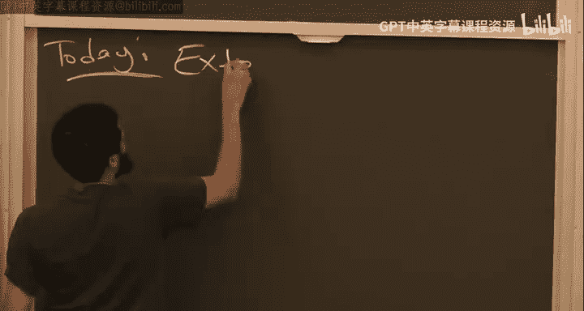

actually I li， I said there's going to be no linear algebra。

 then there's going to be one matrix multiplication thing， but mostly not linear algebra anymore。

It's also。It's also called the disk access model。And it's due to。Hder while bitter。It's2。Okay。And。嗯。

the name of the class is algorithms for big data， so one thing you have to deal with。

 well we've looked at several things now， one thing we looked at in the beginning was streaming so there's so much data that we can't even store all of it and we can only make one passover。

 let's say。嗯。Here， what we're going to talk about is。We can store the data。

 but it's definitely too big to fit in Ram， let's say。So we're gonna have to go to disk。 Okay。

 And then the question is， how do you develop efficient algorithms when。Some of the data。

 most of the data is residing on disk。Okay， and we're going to。Kind of right now。

 define a model and justify the model and then discuss some algorithms and data structures that operate in this model。

So that's this， the external memory model。And the basic idea is that there's disc。

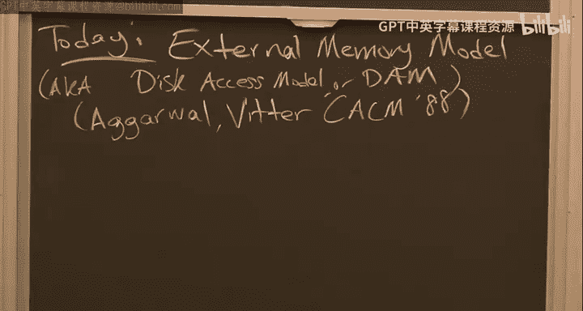

Which。You know， is。Infinite。And then there's memory。Which is finite。Memory looks something like this。

There。I'm over B。Pages。And then each page is size B。Meaning you can hold B elements。And the idea is。

Data on disk is divided up。 Well， I drew it as a。I drew it as a circle， but let's say it's。Yeah。

 so data on disk is divided up into blocks of size B。

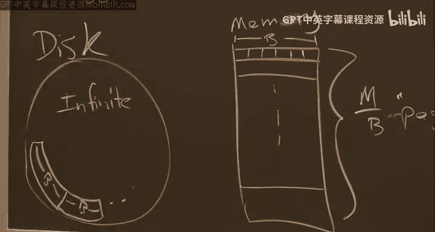

And whenever you want to read or write。An element， if it resides in memory， you can do that for free。

Okay。If it's not in memory， then it's on disk， and then you have to go fetch it。

And then bring it into memory。And then that costs you one。And then memory might be full。

 so then you have to decide which page and memory to evict and kick back to disk and then bring the block into that page。

A so。嗯。Wait， so you're saying streaming well， I haven't set any problems yet but。I mean。

 guys screaminging。SoI mean， so usually in streaming。So usually in streaming。

 we imagine that the data structure takes so little memory that or you even just make one pass over the disk。

Right， so that's one advantage of using streaming algorithms is even if things can fit on disk。

You want to minimize like the number of IOs， so you want to just read everything once。

 and then it can give you efficient。Iio algorithms as well。That's true。Yeah。Okay， so。本那个。Right。Yeah。

So reading， writing。Memory。It's free。Diso。Ts one。And we're trying to minimize the total number of IOs we do。

So what's the kind of justification for this model？So。

The basic idea is that reading and writing disc is super slow and memory and reading writing。

 say Ram is super fast。 So just this morning， I decided to look up some numbers because these numbers。

 you know。Theres， of course， as technology changes， numbers change。 So I looked up some Toshiba。

3 gig，3 TB hard drive with 7200 RP PMM or something。 And there were some tests done so。

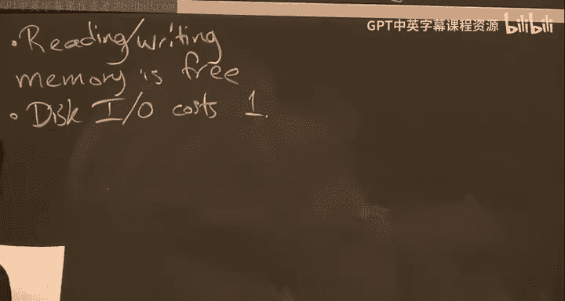

So some are you know。Some realistic numbers。So let's say。Sequential。Reads and writes。

What do I mean by sequential reason and rightss， So disk actually。Well。

 there are different kinds of disks， there's the magnetic。Magnetic disk's what's that flash。

 et cetera， buts solid state to disks， but let's look at like the older magnetic disks。

They look something like this。 They spin around in your computer。 Okay。

 and there's something that can read the disk。 And if the thing that if the thing that it wants to read is over there。

 it has to wait until the disk spins around so that this spot comes under the reader so that it can actually read that and that takes time。

 You have to actually wait for this mechanical thing to rotate and get under you to read it。😊，Okay。

And then once it's there。You can read sequentially， really fast， right。

 because all the sequential stuff is coming immediately。

 So sequential reads and writes are much faster than random reads and writes on magnetic disks。

 So if you look at sequential reads and writes， all the the performance。😊。

Tests I saw online they measured reads and writes separately。

 but the numbers are roughly the same order of magnitude。So they were roughly something like。

You know， 140 megabytes per second。Okay。Whereas if you look at， say random。

Random reads writes it was something like。140。IOs per second。Doing。4K chunks。

So it would do a random read and then read the next four kilobytes and then do another random read and read another four kilobyte。

 et cetera， or do a write to a random location and write  four kilobytes。So 140 IOs per second。

Whereas kind of。the ra I looked up。Was like in the order of five to 10 gigabytes per second。Okay人。

So if you look at this。You know， the number of bytes that are being written。

In 140 I Os is something like。4096 times of 140。Right，Was it 140 might have even been less than 140。

 And I was more like 120。Whatever it is， it's about 100。So 4096 times 120。

 that's the number of bytes written。Many of those are now sequential， so let's like infer。

From this that。If you do the math， about half of the second。Is done doing sequential stuff。

 and then the other half is done doing random stuff。So， you know， you can go basically。

 you can go to roughly 200 random locations per second。200 random kind of by locations per second。

 as opposed to reading 140 megabytes per second， if they're sequential。Okay。そうです。

So those numbers are， are definitely better， like a lot better。

 There are other issues with flash where like kind of the number of times you can， I think， write。

So any cell is bounded before it becomes unusable。 So there are other。

There are other model issues you have to do deal with flashlash。

 I'm not going to talk about that here。嗯。But yeah so。Kind of the difference。

Between these two is like greater than six orders of magnitude。In terms of just speed throughput。So。

So to simplify our life。We're just going to assume that reading and writing memory is free。And that。

Disguos cost one。 And， and the fact that sequential reads and writes are so much faster than random。

That's why we imagine that there's some block size， that when we read an item。

 we actually get to read B items for the price of one。

Because if we're doing a random seek and spending so much time doing that random seek。

It costs almost an negligible extra amount of time to read B elements。

 We might as well amortize the time to seek to read those B elements。Okay。Does that make sense。Okay。

Good， so now， now the question is， how do you solve various problems in this model， So I'm going。

 that's what we're going to talk about。Today and also Tuesday。

 we'll talk about also some more sophisticated versions where。

The algorithm is not even allowed to know M And B， but you still want good performance in terms of M And B。

 Okay so that's called cache oblious cache oblivious algorithms。

So like let's do just a toy example。Okay， so。Reading。And elements。Reading an o， okay。

So kind of how would I do it， Well， I would store them continuouslytiguous in memory， okay。

 and then do a linear scan。That's O of N over B。Plus one iOs。Okay。呃。Yeah。

 I guess if you're running a one pastor me algorithm on your disk。That's how many i would take。

 I mean， I don't even need Big O， right。It's at most。So the thing is。Yeah， I mean， I would start。

 I would store the elements starting at the beginning of a block。

 and then it might spill over the next block。 So the exact thing is seal of N over Vos is exactly how many。

I suppose I would do。let's do something more real。

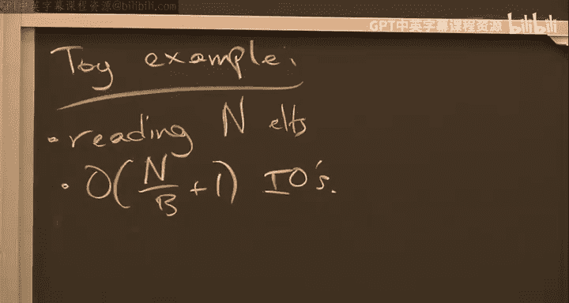

So this is the only linear algebra。That we're going to talk about， which is。Okay， it's a less toy。

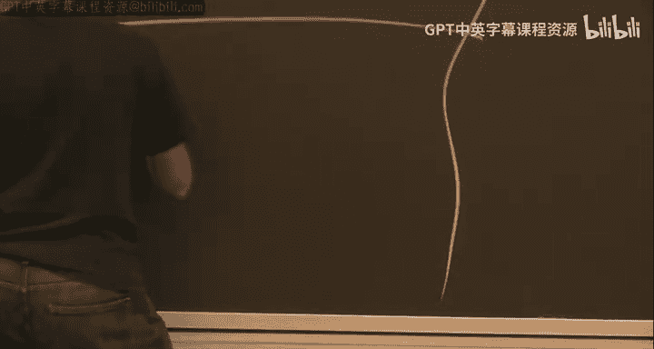

I don't know if less toy is proper grammar， but matrix multiplication。Okay， so we're given as input。

XY， which are both。N by end matrices。谁？And we want。X times y。Yeah。And。An algorithm。W sorry。

 you said an algorithm this model consists of two parts you said。

 the first part does what write write data。And the second part actually。Okay。Right， so yeah。

 so the question is。嗯。You know， the complexity of the problem will probably depend on how the person is specifying the input to us。

 If they wrote it in disk in some stupid way， then you know。We're， we're not in such great shape。

 So I'm gonna assume that。Kind of we， as the algorithm designer。

 also get to decide how you the format the format of storage of the data on the disk。Okay。

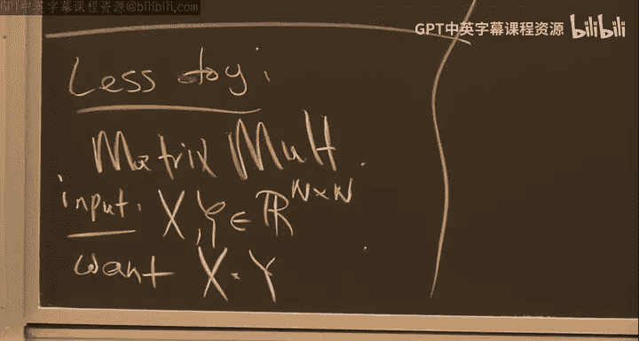

So in particular， for matrix multiplication。I'm going to assume that。Well。

 here's what I'm going to do， So let's say x。

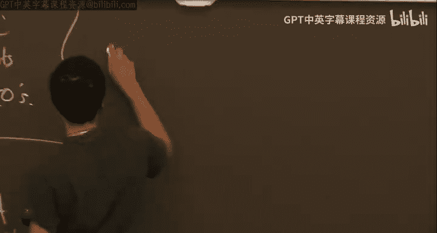

So matrix complication， so let's say x is equal to this n by n matrix。

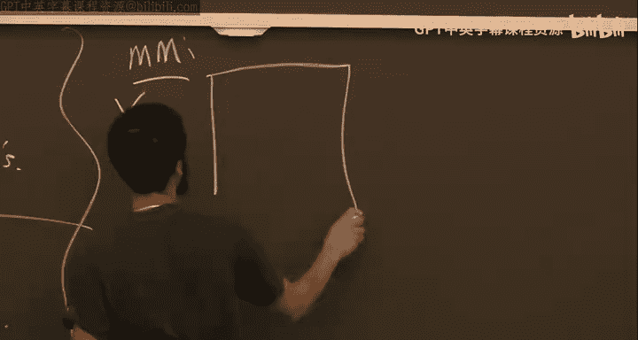

And why is this end by N matrix？Okay。What I'm going to do is I'm going to divide up this matrix into blocks。

Where each one of these blocks is say root M over 2 by root M over 2。

And the way that I'm going to store these two matrices in in on disk is I'm going to contiguously store the blocks kind of in row order。

 So I'm going to store this block contiguously in disk。

 Then I'm going to store this block on that one， etc。 I can go row by row。Not， okay。

 if it isn't stored that way， then。You know， as a prepro step。

 I'll read it all in and make it stored that way。 then there's some complexity of doing that。

 which depends on how it was presented to you in the first place。 So let's ignore that。嗯。

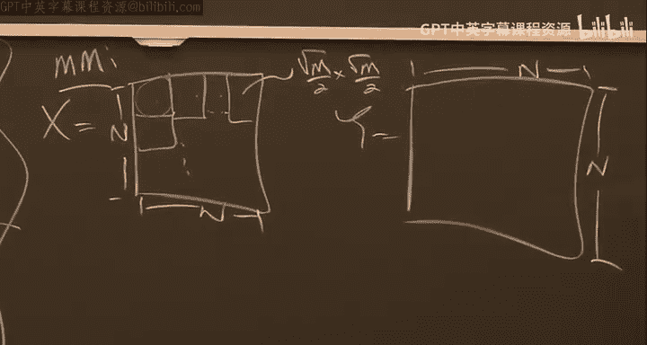

And then what I do is I just observe， like so x times y。Is also an end by a matrix。And kind of。

 if you look at。If you look at each similarly sized block。Of the product matrix。

It's like this matrix dot product of blocks in X and Y， right so。

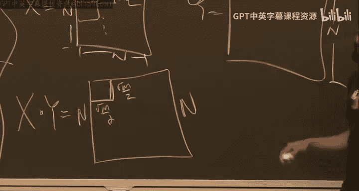

So like this entry right here is kind of this matrix times this matrix plus this matrix times this matrix。

 etcter。Right。So what I'm gonna do is I'm going to， I'm gonna compute it exactly like that。

 I'm gonna read in these two blocks， or these two。I I'm overloading the meaning of the word block。

 But these two chunks。Okay， and I'm going to multiply them using any algorithm。

 Now it fits in memory， right， once I read these in， it fits in memory。So I can do whatever I want。

Multiply them together and then add it to this。😡，And then now read in the twos。

 multiply them and add it to this。 And then eventually， I'm done with this。

And then I move on to doing this one， etter。对。

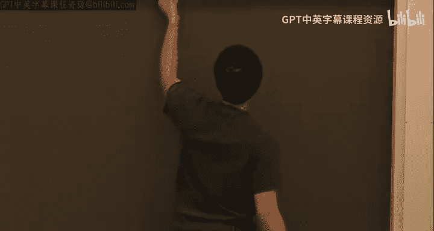

What's the complexity of this algorithm in the。An external memory model。Right。So， there are。

And oh of。And overroot M。Squared。Output chunks。x times y。I'm assuming that N is at least M。

I'm assuming my data doesn't all fit in memory otherwise。This is less interesting。

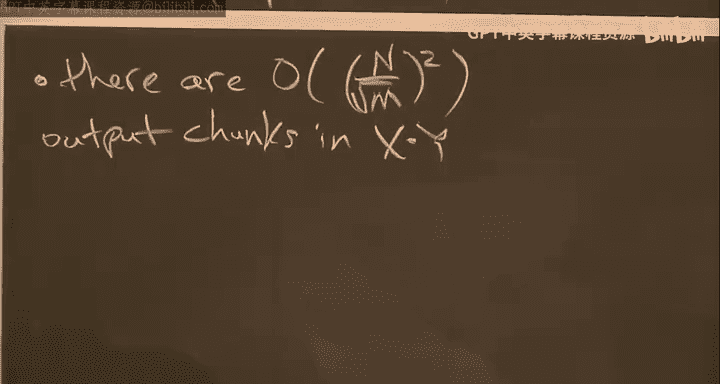

And for each output chunk。I do kind of this matrix dot product thing。On。嗯。And over Ro M。

Ps of matrices。Pairs of chunks。Such that。Each pair。Can be read in。Using O of M over BIOs。Right。

There are size。Each one is a size and over， well， I guess I could have said the squared of two could have been square the two could have been squared in as well。

The point is that。Each pair of chunks and X and Y both fit in memory simultaneously。

 so I can read them both in。 And since they are M elements altogether。

 I can read them in an M over B。So the total number of IOs。Is something like。呃。Oh。And over route M。

Cubed times M over B。Which should be。N cubed。Over B rooted。对。And this can be improved。Using you know。

 better matrix multiplication algorithms。Like basically break it up into chunks like that。

And then instead of doing kind of naive matrix multiplication， dotroauin or something。

And you would get better exponents here。Good。Another， another。

 let's look at another kind of commonly solved problem in internal memory。

 but look at it in external memory model。 So， for example， linked lists so。What's the。

So this is it solves some dynamic data structure problem。Just a reminder on terminology。Kind of。

A data structural problem is one where there's some data and you have to support certain queries to the data。

We say it's static if the data can't change。 You're given the data up front。

 you store it in a certain way， and then you have to answer the queries from now on。

 We call a data structural problem dynamic if it has to support updates to the data。

 like insertions and or deletions。So what's the problem that linked lists solve？Well。There's insert。

X， P。Which says。Insert。Element X to data set。Such that。X is the successor。Of the element。Pointed to。

By the pointer P。So P' is a pointer to some element that's already in the data set。

There's also delete。So I guess it's self explanatory， so remove。P from data。

So P again is a pointer to an item in the data set that you want to remove from it。

And then there's also traverse。Traverse pK。Which requires me to。You know touch。

 if I want to be more formal about this， I mean， what does it mean to touch。

So let's pretend that all data items。Have呃。Have a value associated with it， right？

And what I'd like to do is。Insert tells me， kind of the。

The idea of x is like a pair It the idea of the element and its value。

 And then we want to insert it after this element。 And then for traverse。

 what I want to do is I want to print out the values of all the K elements that follow P。So。

 touch all。Touch。The K elements。Let follow P。In this successor order。

So the standard linked list and internal memory solve this problem。

And it solves insertion and deletion both in constant time。

 and it solves the traverse problem in O of K time。Okay。How about an external memory。

Any ideas for external memorying？And let's say I'm willing to have。You know， those sound pretty good。

 right， I mean， how can I touch K elements in less than K time and how can I insert and delete in less than。

Constant time。But here I'm trying to get， let's say， good amortized complexity。Yeah。

a data structure in a disk。So， like we。就按你去。被捕。我来看。不定个第一次。So kind of disk is already mapped out。

 there's like block one， block two， block three， and you can read it in and write to blocks。

Like that's all you can do。I don't knowDoes that answer your question？So can we do like。Please。

So否是你方工。So， theres already。It is a error。Before two。Oh， I mean， so。So I mean， you can do。

 you can implement the standard like lists on。In the external memory model where basically kind of a pointer will just tell you what the kind of sector ID D was on disk。

 So you know， like which block to go to。I mean， you could do that。 and you would get。

 I guess you would get the same。Kind of performance， right， if you're just。

 if you're not careful about making things contiguous。

You could just have each node and a linked list stored in an arbitrary block somewhere。

 And then as you follow pointers traversing through the linked list。

 you might have to fetch kind of arbitrary blocks from disk。So kind of following any。

Successor pointer will cost you one IO， it could。Right。So this is just the recap。

 so what does the linked list look like in the standard inMemory linked list？Kind of， you have。

Every linkedless node is。Kind of a pair of two things， an element， as well as a pointer。

 and the pointer tells you the memory address of the next network grid。第二。Right the bottom。啊。

Instead of like copy that down here。Yeah I mean， so idea I mean。

 the idea definitely is you want things to be contiguous。

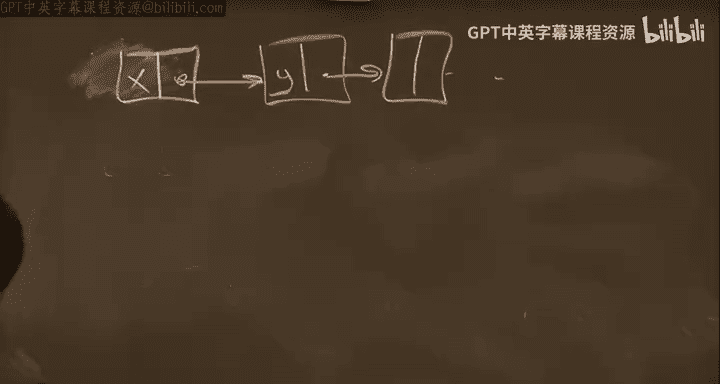

But。Right。Like answer would be really close。对。Have one。Right。

 so so let me tell you one way going about things， basically what you'll do is。

You'll do the similar kind of linked listing， but where you'll kind of group together。

Ranges of consecutive nodes。Into chunks of size B。二人。So basically。

 if there were no insertions and deletions， this would basically be an array。 Okay。

 you would have just everything contiguous。But now there are insertions and deletions， right， So。

 so what we're gonna to do is kind of group。Group contiguous。Linkless nodes。Into groups of size B。

Okay。And we'll maintain an invariant。Let me call it every group。Will be。At least half full。

Except maybe the last group。The last group was allowed to underflow more。

So every group will have at least be over two nodes， and we're going to maintain that invariance。

Okay， so。So delete。We're just going to。Delete the element， deletelete the node。From its group。Okay？

And then most of the time willll be done。 But the group might have already had exactly be over two nodes。

 And then now we do a deletion。 It underflows。 It has one less。 So what do we do。We merge it with。

If group size。Is less than B over2。Merge。It's an adjacent group。

Which is one extra I O to read in the adjacent group and then put them all together。

 But then now that adjacent group could have up to B elements in it。Right。And we had B over 2。

 So altogether， we have at most 3 B over 2。 We'll just split them evenly into now each group has size about 3 B over 4。

It overflow。Well， evenly。Into。Well， okay， so let me put it this way。

The other group we're emerging in has between B over 2 and B elements in it。

So when we merge together， we'll have a total of between B and 3 B over two elements。

So after we split， we'll have between B over 2 and， and。Three be over four。嗯。Right。And good。Yeah。

 technically， I guess we might have to。Because if we had exactly be over 2 -1。

 and then the neighboring group had exactly be over two。Oh， but then if we merge， then we fit。Yeah。

 okay， great。 So for us to have to split again， it had to have more than be over2。 over good。Okay。

 good， so insertion。It's a similar thing。 We just insert it into that block。Okay。

 so like when we insert， we insert after some element P。We read in the block that contains P。Okay。

And then what we do is we want to logically kind of have X after P in the same block。

 But now the block might be too big。 If the block is already full now。 it's too big。

 We split the block in。Just note that。You know， if we can， once we read in the block。

 we can reorder things in that block of1。 So if there are some gaps， we can like move things over。

 that's all free once it's in memory。 put X and P's block。Split block into two。They're necessary。

How many IOs do insertion and deletion each take？Yeah， almost a constant， right mean。

You read in a block， maybe you have to split and create a new block and merge or something。

 but at most a constant number of IOs， but then now the better part is traverse。

So Traverse does exactly what you think it does。 It starts somewhere。

 and then it just keeps going for it keeps walks to the KX items okay。But remember now that all。

 all blocks， we have this invariant that all blocks are at least half full。So no。

 whenever we read in a block during a traversal。We got to read at least B over two elements for free。

So the total number of blocks we need to touch to touch K items is roughly something like 2 K over B。

So Traverse takes o of 1 plus k over B。Ios。Oh sorry， so it's not even amortd。Right。So that's。

 that's it。 That's  linkeduists。Any questions？Don't worry。 So things will get。More involved。

 especially when we start talking about cashable things。

I just want to make sure we're all comfortable with。The basics of external memory。

 So all this make sense。Okay， so now。Let's do another data structural problem。

It's the predecessor problem。Okay， so here we have。And items。That are comparable。Okay。

And what I'd like to do is so there's one query。And query。Takes his input。A value K， which is a key。

😡，So sorry， so maybe I should say items。An item is a key value pair。The keys are comparable。😡。

So the keys could be strings， like my name， like people's names and then the values are are actually。

嗯。The keys could be。IP addresses。Okay。And the values could be。嗯。You know， if like。

 let's say like a router table。 So routers have these tables where if they get。

 if they get queries to certain。There certain addresses。

 then they should forward it to this other router next， right？

Or kind of anything that starts with 80。17 should go here， right？嗯。And。

Whatever router decides like kind of where to send the packet next， it does， well。

 this table doesn't have size 2 to the 32， it doesn't have every possible IP address in where it should go next。

Its， it does a predecessor query on， on the IP address that's coming into it to decide which thing in the table it should go to。

 And。 it sends it there。 Okay， so query K kind of return。Prodecessor。Return item。In database。

Whose key？Is the predecessor？Okay。If I drew the items in the database， kind of in sorted order。

These are the keys in sorted order。 And then now someone says。I want a query K。

 then your data structure should return this item。Okay。And kind of from now on， oh， and let's say。

 and if someone queries something that's actually in the database。

 you should just return the thing in the database。So from now on。

 I'm just going to assume that because it's not going to really change。

Much of the discussion of what I'm going to talk about。

I'm just going to assume that people always just query things in the database。Okay。

the data structures you would use for well。I'm going to present a data structure that solves the version I just told you。

 but the data structure naturally also solves predecessor。By the way。

 so the problem where people always query things that are actually in the database。

Or if they're not in the database， you should say they're not in the database is actually a different problem。

 It's called dictionary problem。 And at least in internal memory， it's solved by hashing。Right。

Hashhing doesn't solve the predecessor problem。sorry。Skipists， Yeah， skips do solve predecessor。

 I guess there are even， well， there's static there's static predecessor and there's dynamic predecessor。

 right， which means。Static means there are no updates。Well， okay， yeah。If it's， if it's dynamic。

 yeah， so just I only put queries。 So this is static， but the dynamic version。

There's like delete where you're giving a pointer to the item to the delete。

 and there's also kind of insert。And you're given a key and a value。So just around the same page。

 what's the simplest data structure you know。That solves static processor。And okay。

 so I guess just storing all the items and then doing a linear scan is probably the simplest thing。

 But let's say。The simplest thing that gets some query time that's not terrible。

 so static static predecessor with not so terrible query time。Yeah。

 so the data structure would be an array， asorted array， which takes linear space。

 and then to solve a query， you would do a binary search， take log in time。So。Good。

 and that's actually optimal in the comparison model。

 The comparison model means all your algorithm is allowed to do is compare pairs of items。

It's not optimal on a real computer。😡，What I mean by a real computer。嗯。

A real computer doesn't just store these abstract items that can only be compared， right。

 A real computer stores bits， and it can Xor and it can multiply numbers， and it can bit shift。

 It can do all kinds of things， right。嗯。So if the keys are， for example， all ints， then so okay。

 so let's say internal memory， so where everything fits in RA。So static predecessor。

Static predecessor。End space。Login query。This is just binary search。On a real computer。

 taking advantage of the fact that we can multiply integers and do things like that。Complexity。

In Word RA。The Word RA model。Is perfectly understood。So you should see if you want to see that。

 there's papers of Perashku and Thororup。So I mean actually。

Predecessor was only perfectly understood， Amy1。A little less than 10 years ago by Peraska and Thororup。

Yeah， yeah， it's the same one。嗯。And。So kind of in Word RA。

 you imagine that your computer stores words of size W bits each。Okay。

 and you can operate on words in constant time。 by operate on words， I mean you can add words。

 So for example， ints on your machine are 32 bits。And you can add to ins。

 You imagine that you can add to ins in constant time。 You can multiply it to ins in constant time。

 right so。And the usual assumption is that you have a word size。W， which is theta log n。

Why is that the usual assumption in Word RA just because？

You imagine that you can dereence pointers in constant time。

RightAnd a pointer should at least be able to point to an element of your data。

 and there are end data sets。 So your pointer should at least be log n bits。Okay。

 so the usual assumption is that your word size is， well， certainly at least log n。

 but usually people even assume theta log n。And here。You can get。Oilda and space。

 well actually linear space。With O of log log N query。Okay。

 and Petrochn Thor up showed that this is optimal。 This is basically the upper bound is via Vanom de Boaz。

呃。The van du Boaz data structure。So。I don't know if let me。Right at his name。This is' in 75。

I'm just curious who've heard of venom de bo trees。Oh yeah， it was yeah。

And then if you're willing to use a little more space， so if you're willing to get like， let's say。

 use n to the 1。01 space。So just slightly more than linear， you can actually get query time。

 which is log log n。Over， log， log， log in。And this is beamman Fitch。In '99， I believe。Okay， and。

 and those， these are both optimal。 just like this is optimal in the comparison model。

 This is optimal by Petraush and Thorrop。 These things are optimal。 They have lower bounds。

In the real model， which is Word RA， I guess。But anyway， enough about。Enough about。Internal memory。

What about external memory？Okay， so has anyone， Im。

 I'm just curious have have any of you seen external memory before。Before today， yeah。

 you've seen it。 So have you seen any， have you seen anything for external memory predecessor。Okay。

 so I'll say the data structure。 And then when I say it， I'm sure。

 I'm sure many of some of you have heard of this data structure。 you might just have not realized。

That it was created exactly for this purpose。 Okay， but it's a day I'll give you a hint。

 It's a data structure that is kind of like bread and butter in databases。Right。

 which is the bee tree。Actually， the B in B tree is the B in the model，Right， so what is？

So an in the down model。Be trees。Hey。So what is a bee tree and it's gonna support。

 It's gonna be dynamic as well。 So what's a dynamic predecessor， data structure in internal memory。

 It's like a balanced binary search tree， right， like a red black tree。嗯。

So before I tell you what a B tree is， let me just tell you what an AB tree is。Little b。Okay。

A little A B tree。So， for example， people talk about2，4 trees。 They sometimes call them 2，3，4 trees。

It's， it's like a， it's a balanced search tree， but it's not binary。 So kind of every。

 all the items live at the leaves。And。If you look at the data structure。Something like this。And then。

Okay。So。嗯。It's this tree that looks like this where each internal node。

Has at least A and at most B children。Rouch。Only has。At least two children。Well， unless。Yeah。

 the root only has。Well， either the root has no children。 like in which case。

 the data structure only has at most B elements， little B elements， or it has at least two children。

And。The basic idea is you have some keys， right， So let's say this has。This has a key of 50。

Everything， everything here has key， at least 50， and everything here has key less than 50。

 So so let's say this is 50。68， 74， 74。And this is all lessons。 So let me make this 60。

So everything here is less than74。 Maybe there's like。69。61， 62s， 63， 69， 70。Okay。So all。

 all the items actually live at the leaves。And then。

The internal nodes just give us keys that are like guides to find the items。

 so everything to the right is at least as much as the key and everything to the left is strictly less。

Let me just tell you how to insert and delete from an AB tree。Insert a key and a value from now on。

 just I mean， the values are not going to really matter that much just you store an item with that key and it has that value stored as well。

 Okay， So how do you insert an item with a given key K。

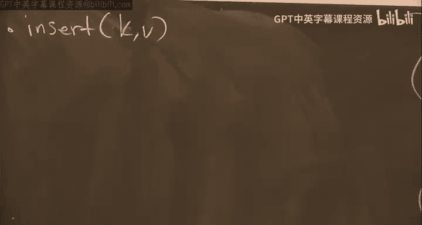

Well。Search。For leaf。That should。Contain K。Okay。This is a search tree。

 so just search for where K would be。And then once you find the leaf that should contain k。

 just put k there。Okay。Yeah， so if， if that leaf had less less than little B elements， you're fine。

 It fits。 but now you might have too many elements。If leaf overflows。Then split。Into two leaves。

And promote。One key to a parent。So let me just draw a picture， so let's say that。AB is equal to2，4。

Right。And。Someone wants to insert an element into this leaf， so now this leaf has keys， 1，2， three，4。

5。They got too big。Okay， and then it used to have。It used to have。Some呃。

Let's say it used to be a child of this thing y。So。Thiss6。So this was like a left child of this。

And now what happens is this becomes。嗯。1，2。One， two， three。And then。4 five。 and then。Now we have。

 let's say， four， or six。Comes that。Okay， now the same thing might happen with the parent。

 the parent might overflow。And then you split the parent and then promote to its parent。

 and then you recursively do this up to the root。And then eventually the root itself might become too full。

And then you split the root into two and then create a new route， which is a single node。

This is why the root itself might only have two children。 because when you first create a new root。

 it only has the two children， the ones that cause the split in the first place。

But everyone below the root has at least eight children。Okay。So kind of the nice thing one reason I。

 I like A B trees is。😊，Unlike， say red black trees。Red black trees。

 you maintain this invariance about the colors of the nodes， right？

And the point of that invariant is to improve amma that says if you maintain this invariant。

 you'll maintain balance so that all operations are height do the trees always oh a log in。Well。

 A B trees are like automatically balanced， right， Why are A B trees automatically balanced。

All leaves。In AB trees。Are at the same depth。Because the tree never grows downward。

 the tree only can grow upward。It can only grow by creating a new root。

And what's the height of the tree。Well， you know that each leaf has at least eight elements in it。

OrAnd I didn't tell you how to do deletion。 Deletion is somewhat similar。 So to delete。

 you go to the leaf where you go to the leaf where the item lives。You remove it from that leaf。

But now that leaf might become too small。Right， so what you do is you find a neighboring。

Leaf node and merge it with that leaf。Which might cause a collapse。In the parent。By one。

The parent has one less splitting node。But then the parent might underflow， So you。

Recursively merge it with one of its。One of its sibling nodes。

 and then re crystalsal knew this up the tree。So。What's the height of an A B tree， Well。

 you know that each leaf contains a elements。 So they're at most n over A leaves。

And you also know that the branching factor of every internal node is at least a。

 except for maybe the root， which is a special case。So。The height。

Is at most kind of log base a of n over a。Something like that。And usually in two， three， four trees。

You know， usually you pick these things to be constant。 So the height is like log n。So that's。

 that's that's2，3，4 trees。 They get log in， even in internal memory， they get log in。

 update and log in query。So what's a bee tree。Yeah。It'll be like。Right。

 so there's something I guess I skipped， which is。What's the actual time？ So at every internal node。

 you have to decide which child to go to What， one thing， Yeah。

 and one thing you could do is like just binary search and find where it should go and then go down。

So there's an extra， like log B that should multiply。That should multiply your times。

And if you notice， log base A is the same as log over log A。 And this is getting multiplied by log B。

So it makes sense to have basically B And A be similar。

 So usually you choose B to B like 2 A or something。And then you just get log in。嗯。Yeah， so。Yeah。

 I mean， the bigger you make be know。On the one hand。You know， on the one hand。

 you want to make A And B kind of huge because you had a really shallow tree。

But then your nodes become huge。 And then just finding which child to visit becomes itself computationally heavy。

 right， so。But in in external memory， you do want to make the branching factor big。

 So a Be tree is just equal to a B over 2 Be tree。and what's the point， the point is now。😡。

Each one of these internal nodes has size B at most。

 So you can read it in in a constant number of ios。Right。

 so all you pay for is the height of the tree。So each node。Fits in one block。implieslies。Oh of。

Log base B。Of NIOos。iteration perer operation。So that's a B tree。So， now。Let's ask ourselves。

 we be can we do better than a bee tree or can we understand like trade offs that can be made？Okay。

So。So let's say this is。嗯。Query。And then this is updates。This is， let's say， amortized。

And this is update worst case。So。And this is a data structure。

 So one thing we do is we can do a B tree。And then all of these are log based B of N。

Let me not write big Os all the time。Save myself some writing， log based B of N， log based B of N。

 all the way across。O。The most straightforward like。

 the most trivial thing you could do is just store the elements in a log。

So whenever someone inserts an element。You just insert at the end of the log。Okay。

 and then when someone。Once someone wants to delete an element and they give you a pointer。

You just go and mark as deleted。Okay， so let's say this is a log file。Query， well。

 you just have to read the log。 It's not even sorted or anything。 So this is like。

O of n over B plus1。Just like scanning all the elements。Update。Well。In the worst， okay。

 so update is like。O of one。 Well， actually， let me be a little careful。 There's insertion。

 and there's deletion。When someone deletes。They just give you a pointer to an arbitrary place in the log。

So let me。Instead of saying update， let me just say insertion because I want to highlight something。

Let's say we never delete data， okay。If you want to insert。

 you just tack it onto the end of the log file。😡，But if you always just keep the last block of the log in memory。

Then that's usually free to do an insertion。 You just tack it on to the end。

 but that's already in memory。But kind of every B， every B insertions。That last block becomes full。

 and you have to create a new last block。So for every B insertions， you have to spend1 IO。

 So amortized， it's like one over B。And in the worst case。

 you have to create a new block that's one IO。Okay。So question。You know。

 there's like a huge difference。 I mean， query is great for a Bre。 but if you compare insertion。

 log based B event is like log n over log B。So we get to divide by log B。

Whereas insertion in a log file is one over me。 It's like exponentially better。So one question is。

Can we somehow get something in between？ That's like as good as B trees are almost as good for query。

 but has an insertion complexity。 That's a lot like a log。Does the question make sense。

 so it turns out you can。So I'll show you two ways of doing that。So， there's the。

Buffford reppoitory tree。This is due to。Bushb。I think gold wasser。Then caught a Supermanian。

And Westbrook。This is soda 2000。And it's it's a simple tweak on 2，3，4 trees。 So it's a2，4 tree。

With buffers。What I mean， I mean， look something like this。And then once you get to leaves， leaves。

Have size at most B and at least be over two。And also。Every node has associated with it。

 a buffer of size of size B that contains at most B elements。

 So this node also has a buffer of size B。 Every node has a buffer Every internal node has a buffer of size B。

可以。Now， how do you do So all items。All items either live in a leaf or in a buffer。

 That that's what we maintain。When you want to search an item。😡，And when you want to search an item。

 you， you like do a normal search as if you were doing a search in， in an A B tree。

But also you search the buffer of every node that you've come across so far。😡，Okay。

And notice you can read a node together with its buffer in a constant number of iOs。

How do you do an insertion？To do an insertion， you just insert into the root buffer。 That's it。Okay。

 now， sometimes the roots buffer gets full。And then what you do is you flush the buffer to the children。

Okay， so based on what this key is， some of these buffer elements should go left。

 Some of these buffer elements should go right， and you just flush them where they should go。

Does that make sense？And then， of course， now， when you flush into leaves， the leaf might overflow。

 you split it into two， and then you promote back upwards。Okay， good。

What's the query complexity of a BRT？So。Buffs can be empty， by the way。So buffers are allowed。

 They don't have to have theta B elements and buffers。 Just buffers can hold up to B elements。

What I'm saying is， it's not obvious。Well， if you ignore all the buffers and just look at the keys。

Then。Because like we're not。So yeah， if you look at the search tree and ignore all the buffers。

Kind of what you have is a valid A B tree just that the leaves are oversized。I guess。TheThe actual。

Does that also。我我我。The nodes just contain keys， just like an A B tree， Inter nodes just contain keys。

Yeah。When you do an insertion， you just insert into the root buffer。 Okay。

 and then now this might overflow。 Some of them get flushed into this buffer over here。

 Some of them get flushed into you know， this buffer over here。 and you。

Was what's never modified。Well， at some point， things might get flush all the way to a leaf。

The leaf might overflow and have more than B elements。

 Now you split the leaf into and then promote something upward。And that's when you modify the nodes。

 And again， no， it only grows upward and you you maintain balance。

 and the height of the tree is log in。Okay。So， the query complexity。What's the query complexity？

This is the height of the tree， right？

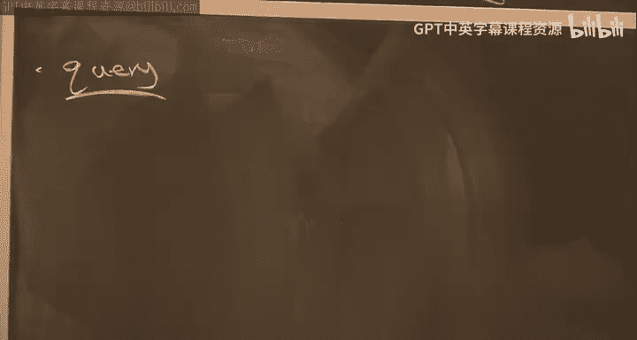

It's the height of the tree because。You're're going to search the way you do a search is just like a normal search research。

And you can read every node and its buffer in a constant number of iOs。Right。

 and the height of the tree is log n。How about the worst case？Let me now do worst case。The amortized。

Insertion。Okay。So for amortized insertion， the way to reason about this is as follows。🤧嗯。Now。Usually。

 insertion is free。Except you have to flush items。When you flush an item。😡。

You have to pay a constant number of IOs。😡，To read in all the， you know。

 there are only at most four children of these， each one has its own buffer。 So this guy。

 plus all his children， takes a constant number of IOos。Okay。

But you're moving B items down to a constant number of new places。 So kind of on average。

 each one only has to pay one over B。Okay。And to make this more formal， I'll imagine。

 I usually like to think about this in terms of money。When I insert。X。I'll give it。 I'll give X。

 you know， theta1 over B times login。Dollars。Okay。And I'm gonna say that this is now my amortized insertion complexity。

 Now， the question is， do I have enough dollars to pay for the actual i Os I'm doing。

 And the answer is yes， right， because。Whenever I do a flush， as I said before。

 I only have to do a constant number of i Oos to read in all the children。

But there are at least B items being flushed。Right each one。

 I'll just charge each one of those B items， whatever B dollars。😡，So now in total。

 I have a constant number of dollars I can pay to flush to all those children。Okay。

And then an item is never going to get flushed upwards and it only gets flushed downwards。

 So the number of times an item can ever participate in a flush is the height of the tree。

 which is log N。So all flushes are paid for。

So during a flush。Charge。Each flushed item。Kind of $10 B dollars。everything' is paid for。So。Now。

 the worst case insertion complexity could be terrible because it could be that as you recursively flush。

 everything just gets flushed right， like the left child overflows and the right one overflows。

 recurively flush and you keep doing that downward。One thing you can do， which still works is。

There're at most four children here， there are some number of children， and there are B items here。😡。

What I'll do instead， is I'll identify。Which of my children？So。

Which of my children would receive the most number of flushed elements from this buffer。

 One of them has to receive， at least B over 4。And I'll only flush to that child。Okay。

The amortized complexity would still be the same。Because there are still theta B items that are being flushed。

😡，But now I only ever flush to one child at a time。

 So I'll only ever flush on one path down the tree。So I can make it to that worst case insertion。

It's just the height of the tree。Which is O of log n。So。This is starting to look better。

I mean you lose a little bit， so now this becomes log n， this becomes one over B log n。

 which is a lot better than one over log B log n of a B tree， and this becomes log n。

This is the bufferin repository tree。And one other thing you can do。嗯。

Which loses a little from the buffered repository tree。

Its basically the thing I'll say now is basically strictly better than a bee tree。I mean。Well。

 not strictly better。 It loses a constant factor in the query。 And kind of in the real world。

 you care about constants。 But let's say we don't care about constants right now。Oh yeah。

 don't think of B as a constant。 Think of B as a parameter。IfV is a constant。

 then you basically just use whatever old data structures you're using。

So the other thing you can do is due to Broel and Fagerberg。Well， their paper had many things in。

 it was mostly a lower bound paper， but they just mentioned this kind of in one paragraph。Is it。

Very quickly。Do an AB tree。Do like a B to the epsilon， 2 B to the epsilon。3。With buffers。

So instead of a two3， instead of a two4 tri with buffers。

I do a beat of the uppsil and treat you with a buffer。What's the height？Is logbase B to the epsilon？

Of N， which is the same thing as。嗯。One over Epsilon times log base B of N。

So think of epsilon as being like a half。So the height is just a factor of two bigger。😡。

And query is the same as a buffered repository tree。

 insertsion is the same as a buffered repository tree。 you just insert in the roots buffer。

And then you overflow， et cetera。 And what you'll get is that the amortized insertion。

Become something like1 over b to the 1 minus epsilon in times log base。B to the epsilon of， which is。

1 over epsilon b to the 1 minus epsilon， long base B of M。So what you get from a buffer。

 a buffer bee tree。Query becomes one of our Epsilon log base B of N。Worst case is the same。

For insertion。But then the amortized insertion。It's quite good。

So if you think of Epsilon as being a constant， like a half。

You get basically the same query as a B tree， but worse by a factor of  two。Insertion is like。

 much better。You get to divide by polynomial and B instead of log B。

And worst case insertion is also similar to a V tree。Okay。Now， the last thing。

 I think we basically have about 10 minutes left。I want to mention just one other。

Thing before we move into cash bia stuff on Tuesday。Which is sorting。谁。So。

And one one of the first things you learn algorithms is sorting， and you learn。

 say merge sort or quick sort。 These take un n time。And the question is。

 what's the an N log n is optimal in the comparison model。 Again。

 N log N is not optimal on a real computer。 So if I give you， if I give you， you know， inputs。

 which are integers， they fit in like machine words。 And I tell you to sort them。You know。

 there are algorithms that can sort N N in n numbers in n log， log n time。 So that， I guess that's。

H's algorithm， it can sort n numbers in n log log n time。 And if you're。

 if you're willing to use randomization， then Han Thor having an algorithm that's randomized that gets n time square root of log log n。

 Okay， so it's actually an open problem as to whether you can sort。

 whether you can sort in linear time。So maybe that's possible， okay， but people don't know how。

And I mean in Word RAM。Right，So these algorithms take advantage of more than just comparison。

 You can multiply。 So I guess you mentioned 2，2，4。I don't know if you were there for the second lecture。

 We talk about fusion trees。So they do all kinds of crazy things with taking advantage of multiplication in to do in order to implement search tree。

 things like that。So anyway， sorting， how about an external memory。

 so kind of the right thing to do turns out to be an M over B way merge sort。

So you have your N items。And then you divide them。Into blocks。Not blocks。

 blocks has already reserved groups。Chrunks。嗯。Divide。Into。M over B groups。

And then you recursively sort each group just like EmerSo。And then you merge。

Why did I choose M over B， Because if you， you know， if you remember merging， right。

 what does merging look like in merge sort， basically。ind you start。

 you have your finger on a location in each chunk。😡。

And then you figure out from those who's the smallest。 And then you put him next。

 And then you advance your finger。And the point is， if I have M over B chunks or groups， then。

I can store each one of these blocks。😡，In memory。Because my memory has size M。

 so now you get a recurrence relation。So。TmN。Is the number of IOs？With n elements。

You have recurrence relation， which is that T of n is equal to first of all。1。If N is at most B。

 so if everything fits in a block， you just read the block and then you can do whatever you want。

 and you can sort it in memory。Otherwise， it's。At most。O of n over B。

So when you're doing the merge part。You actually have to。

Kind of you spend N over B time reading all the elements eventually， or N over B I Os。Plus。

M over B times t of n over M over B。And if you solve this occurrence， which。

I'll let you do this becomes theta of n over B log base M over B。Of N。Okay。Yeah。え好。

How do you ensure that？Can be。Oh， each chunk won't fit in memory。BL。

So my finger is somewhere in each chunk。But then I only need to store the block that contains the finger。

And that block has size B。 So I'm storing B elements from each chunk at a time in memory。

Which is why I chose M over B。So we no think。And I claim that this is optimal in the comparison model。

Why is it optimal in the comparison model？Okay， so。

Comparison model means the only thing I'm allowed to do is like。

 choose which elements to compare at any given time and。嗯。

So my algorithm is modeled like as a decision tree。 at any given step。

 I choose which two elements to compare。 And now I'm trying to minimize the total number of comparisons。

 okay。So。Consider。All inputs。Where。一。Block。Of the elements。Is sorted。So in actuality。

 the items have some total order on them， their keys have some total order， so for example， one， two。

 three， up to n。But the algorithm doesn't know this order。

 The only way you can figure out how things are related is by comparing them。So normally。

 the way you argue about opt in the comparison model is you say， well。

 the input could be any one of the n factorial permutations。Every time I do a comparison。

 I only learn one。 So it takes in particular， it takes log of n factorial bits。

To encode which permutation it is。Every time I do a comparison， I learn one bit。

So I need to learn log of n factorial bits， but log of in factorials roughly N log n。对。So here。

Each of the blocks is sorted。 So number of。A number of valid permutations where each internal block is sorted。

So it's n factorial。But then after I give you a permutation of the elements。

 I have to make sure that each block is sorted。 So I overcounted each block or each chunk by a factor of B factorial。

 So B factorial。So the N over B。Implies log of the number of permutations。Is basically log of this。

 which turns out to be something like， well， end lot， which is roughly。Asymptotically and log n。

Minus n over2 or n over B times B log B。Which becomes。N times log of n over B。Let me just do it。Here。

Finish it off here。Okay， so now。That's number permutations。 Now， every time I do an I O。

How many bits can I learn from an I O well。Number of bits。Learn。Per iron。Well。

 there were already something like at most M elements in memory。😡，Now we're doing in IO。

 we bring in B more。😡，So。I can assume that I already knew for any given block。

 I already know the sorted order within the block。And also。For the things that are in memory。

 I can assume the algorithm already knows their sort order too， because it's free。

 You can do whatever you want to things in memory for free。

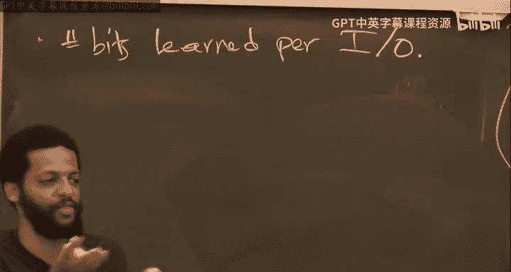

So the things in memory。M kind of zeros in memory。Not zero elements in memory。

 which I'm representing by zeros。 And then now I'm bringing in B guys。 And what am I learning。

I'm learning the most I'm learning is how those B guys interleave with these M guys who are already in memory。

 So I'm learning。😊，Learning。How the B elements？From IO。That's that most I'm learning。

 I might already know some of that。 So I'm learning at most of this。

 learning how B elements from I Os interleave。The number of possibilities for that is。

 while there are now m plus B things here， I choose B to be ones。

Their M plus B choose B possibilities。Implies I learn。At most log of that number of bits。And plus B。

取离。Bs。Which is something like。嗯。B times log of M over B。😡，So it's a learn。

N times log of n over B bits。I need。And。N times log of N over B。Over。B times log of M over B。Ios。

But remember， right， log of。Log A over log B is。Logb， B of A。So， this is equal to。

N over B times log base， M over B of N over B。Okay， so。I need that many is。

So next time we'll talk about cacheab oblivious algorithms and data structures where we're going to get the same performance as a B tree without knowing B。

 right， So I mean， obviously the B tree needs to know B。Because that's the block。

 that's the node size， but we're going to get the same performance without not knowing B。

It turns out you can get， if you assume that M is at least B squared。

 So the algorithm won't actually have M over B in the code at all。

 But when you analyze the algorithm， if you assume that M is at least B squared。

 you can get the same complexity for sorting。Link lists。

 remember we had to know B because we had to put things into groups of size B。

 you can get the same complexity even even without knowing B and M in your code， Okay。

 so that's that's going to be next time with cache boousness。

