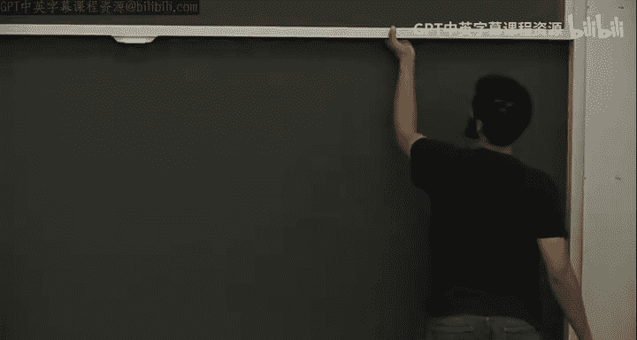
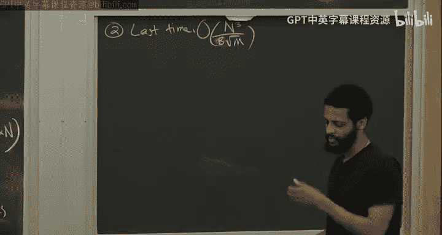
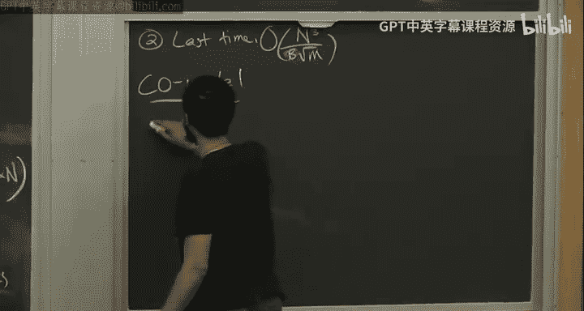
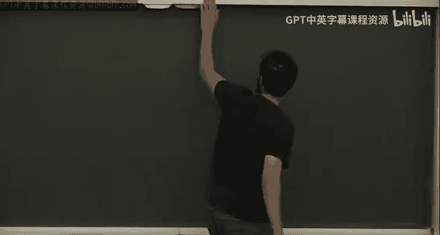

# 哈佛大学《大数据算法｜Harvard Algorithms for Big Data (COMPSCI 229r) 2016》deepseek - P24：-24-Algorithms for Big Data (COMPSCI 229r), Lecture 24.zh_en - GPT中英字幕课程资源 - BV1yGdNYvEMo

Good morning。

So last time we talked about the disk access model， AKA external memory model。

 and there the goal was to minimize IOs where we assume that there's an infinite disk and there's memory that's bounded。

 memory has size M， but it's divided into M over B pages， each which can hold a block of size B。And。

Today we're going to continue with trying to minimize IOs。

 but we're going to look at something called the cache oblivious model or actually。Yeah。

 cash this model。Okay， and the idea here is， well， it' it's like the dam model。

 except there are two differences。 The first difference is that the algorithm is not allowed to know the parameters of the system like M or B。

 Okay， so B trees， B is hard coded into into a B tree。

And the second thing is that the algorithm doesn't control the cash replacement policy。😊，Meaning。

 so when we're in the da model， we said things like， okay， so I'll read in this block。

 then I'll evict that block， etc ceter。 We assumed we had full control over the machine。

In the cache oblivious model， we assume that the operating system handles all of that。 Okay。

 it handles what gets infected and what doesn't。And we assume that it makes optimal choices。

 so in our analysis， we're going to assume that we're evicting what we want to evict okay but in reality。

 it's the operating system that's doing the choices and we're assuming that it makes the optimal choices so in particular。

 it makes choices that are at least as good as the ones that we assume in the analysis。Okay。

Any right。 So yeah， so things can only be better than what we say in our analysis because we're in our analysis。

 we're going to assume a particular choice of evictions。But the O does， the optimal evictions。Okay。

 so。First， a couple words about this。嗯。You know why， why the cache oblious model。 So one。

 one thing is just。嗯。Well， easily it's easily portable across machines。

 you don't have to like fine tune parameters in your code on a per machine basis。

Remember when I remember why we have B in the first place， B。

 the block size was chosen to amortize against the expensive cost of seeking on disk right Once you seek。

 which cost you a lot， you might as well read B things to amortize against that。So in reality。

 there's。嗯。This B is not really even a fixed thing because even on， even on a given disk。

 like the disk is is a disk， right， And then kind of depending on whether things are written on the outside of the disk or toward the center of the disk。

 it affects kind of what the effective B should be to get the same level of amortization。

 Another thing is your code might actually be running on a machine that's also running lots of other processes at the same time。

Right， so the effective M that's allocated to your codes process might change over time。

 So kind of the M that you're using in your code should change over time， depending on you know。

 the current situation。 But if your code， if your code doesn't know M or B。

 but your bounds depend on M and B。 then they're effectively using the best block size and memory that's actually available at any given time。

 Okay so they're robust as system environment changes。Another thing， too。

 is there are multiple levels of memory hierarchy， right， So there's disc， there's Ram， there's L3。

 L201 cache。嗯。And。Each one has its own know， different effective M with different parameters。

 So the bounds that you're proving kind of hold against any adjacent levels of the hierarchy at the same time。

Okay， so that'， that's what I want to say about the justification for cache algorithms。Now。

You might look at2 and say this is not realistic， right。

 How can the operating system know the optimal choices， in particular。

 the optimal choices depend on things that our algorithm might do in the future。Right。

 because what should you evict， You should evict something that the algorithm is not going to use any time in in the any time in the near future。

 but for the operating systems know that it has to know the future， which it doesn't。Okay。

 so I want to actually claim that item 2 is actually not。Really。An idealized assumption。

 It's actually perfectly fine to assume that the operating system knows the future。

 And the reason for that is related to。Something in the world of online algorithms。

 so I'm just going to do a brief detour。Into online algorithms to justify。

To justify this optimal choices from the operating system。 And then once I do that justification。

 we'll start actually seeing some algorithms in this model。 before I do that justification， you know。

 just。Let's just make sure， you know， this is not crazy that we can actually develop algorithms that have I O complexity。

 depending on B and M， even though we don't know them。 So we， we already saw one last lecture。

 actually， which was scanning an array。Okay， so even if you don't know B。

 you can store your elements in a contiguous array。And then if you scan the array。

 your IO complexity is like n and over B， right。1 plus N over B， let's say。嗯。

So there is a bound that depends on B， but the code doesn't need to know B。

But it turns out you look puzzled。我样。Or the algorithm can just be a for loop。

Now just 4 I equals one day like read AI because。嗯。I mean， that has the same effect。

 right like when you read in the first element of that block。The block will be read into memory。

 and then the future reads you do in that block will already be in memory。

 So you don't even need to explicitly。That's right， so yeah。

 so that's the assumption is if an item you read is in memory， you read it for free。

 if it's not in memory， then you fetch it and the whole block that contains it and you bring that into memory。

That's right。So even， even last time we had that assumption。Okay， great。

 So we've already seen one catchable algorithm。 It's going to turn out you can do crazier things than than scanning a array。

But actually， a lot of the algorithms hinge upon this observation that scanning arrays is n over VIOs。

 and then it's cleverly arranging things in contiguous portions so that you get this kind of good behavior。

🤧嗯。Okay， so。I want to justify item 2。So I have to talk about online algorithms。

So I apologize for anyone who took CS 22，4。 So we spent two or three lectures on this。

 but I just want to make sure， I don't assume that you've been in 2，2，4。 So I'll。

 I'll just tell you what you need to know。 I won't actually。Spend too much time on it。

 So the idea in online and online algorithms is you have。A sequence。Of events。And after。Each event。

Must。Make an irreversible decision。Okay。So。I'll show you soon how that's related to our situation。

 Well， the irreversible decision， I guess is obvious is。What should I evict from cash？Right in。

But okay， so。Are a victim of memory？But so the canonical you know。

 example of an online problem is the ski rental problem。 So who' heard of。

 have any of you heard of ski rental。Its， it was 2，2，4s。 Maybe you've seen ski rental。

 So in ski rental， the idea is this。You and your friends are on vacation at a ski resort， okay？嗯。

You and your friends also don't have jobs， but you have a lot of money， so that's okay。

 you're willing to take long vacations。And since you don't have jobs。

 your vacation can be as long as as。You want it to be， okay， and。

 and you yourself have no preference for how long the vacation is。 So you let your friends decide。

 So every morning you wake up at this ski resort and you ask your friends。

 do you want to continue skiing， you know， today or should we don't should we all just go home and end the vacation。

 so。And your friends will tell you， either yes， let's keep skiing or no， I'm ready to go home。

 So each day。P say。You know。Continue skiing。And the other thing we can say is。We're done。

Let's go home。 Okay now， in order to ski， you need skis。 Okay， so there are two options。

 Op 1 is you buy skis。Okay。And that costs you 10 bucks。And the store， unfortunately， has no refunds。

No refund policy。Renting skis， on the other hand。Costs you $1。Okay。

So every day you hear their decision， continue skiing or we're done。 Obviously， if we're done。

 you don't have to do anything， you just go home。 But if they say， continue skiing。

 now you have a decision to make， Are you gonna buy the skis or are you gonna rent the skis today。

And， of course， once you buy them， you don't have to do any in the future。

 you can just keep using the ones you bought， okay。So what's our goal here to make， you know。

 what's guiding our decision， we want to minimize。W to minimize the worst case ratio between the amount of money we spend versus the amount of money spent by an omniscient being who knows exactly when our friends want to go home。

So want to minimize cost ratio。Versus。Omniscient being。Who knows the future？

And this thing is called this cost ratio is called this worst case cost ratio is called the competitive ratio of our algorithm。

Okay。So what's one strategy？One strategy we could do over here is。On day one of skiing。

 we just buy skis， and then that's it。 we never need to spend more than $10。But of course。

 the worst case scenario is that day two， they wake up and say， okay， one day of skiing is enough。

 we want to go home。 You spent $10。 but the omniscient being mu that they only wanted to ski one day。

 So he only rented。 and then he paid 1。 So that's a ratio of 10。 And as you can imagine。

 as this 10 gets bigger。 Let's imagine 10 is 1000。 Then your ratio is just terrible。 okay。嗯。So。

The better thing to do is。Wait nine days， the first nine days you just rent every day。😡。

And then on the 10th day， if they still want a ski， then you finally buy。Okay， so。The opt cost。

 let's so let's say。Let D equal number of days。Skiing。And then optt is going be equal to。D。Well。

 actually， opt is just equal to the men of D in town， basically。

This is what the omniscient beingan would pay。OkayAnd what we're going to do is。呃。

Rent the first nine days。Bye on day 10。And what's the worst case now， Well， if we actually。

If our friends actually want a ski for less than 10 days， we paid $9。

 and opt would have also paid $9。 So we're doing the best that's possible。On the other hand， if they。

 if after day 10， they want to go home。 Well， actually， okay， let's say this。

 The worst case actually is that we ski for exactly 10 days。RightThen Opt knew that。

 and he would have just bought the skis on day one。Whereas we're paying $19。Worst case ratio。Is 1。9。

So that's the competitive ratio of this particular algorithm， The algorithm， which waits 9 days。

I mean， which rents nine days and buys on the tent。It turns out， actually。

 that if you allow randomness in your。In your decision making。 So in particular。Your friend。

 so you're， you're allowed to use randomness in your decision making and your friends don't know the random bits that you。

 that you generated。 Okay， let's assume that， which I think is reasonable。

 You can actually get an expected， expected competitive ratio of something like E over E -1。

 which is which so this thing is like converges to 2 as 10 goes to infinity。Right， in general。

 is B this is B dollars you you buy on the B F day。But there's。

 there's a scheme which is never worse than E over E -1 for any B， for any value cost of buying。

A randomized algorithm。And actually， provably， I think， provably deterministically。

 you can't beat2 or as as be goes to infinity。Well， you can't really beat this。

 I think it's kind of obvious to see why you can't beat this deterministically and randomized。

 I believe it's also true that you can't beat。The other scheme。

 which I'm not going to talk about today。But anyway， so that's what online algorithms are about。

How does that now apply to our problem？😡，嗯。I's the paging problem。Which theoreticalore， which， you。

 had kind of rigorous analyses of things。Id a good theoretical understanding from this paper of Slater and Tarin。

And 85。ok。Now， what's the paging problem memory？😡，Poolds。K， which is equal to in our case， M over B。

Pages。And。There's a sequence。Of page access requests。So someone says。

 want I want to read from page one， I want to read from page5 and they give you a sequence of pages that they want to read and write。

And it's just like the damn model we've seen。 if the page is in memory， you can， you can freely。

 a page is like a block now， if the page is in memory， then you can access it for free。

 If it's not in memory， you have to go fetch it and bring it in and possibly evict someone if memory is full。

And that costs one。 Thats exactly the da model。And now again， you don't know the future。

 don't know you're the operating system。 you don't know what the future page requests will be。

You just have to serve。 You just have to decide what to evict on the fly， as you see requests。对。

So anyone have a guess for what what the optimal algorithm is， the omniscient being。

If you were omniscient and you knew the future。When you had to evict。When you had to evict a page。

 due to memory being full， what would you evict？Use the least in the future。So frequency wise。

 like the one that's used least frequently in the future。Yeah， the theest way in time in the future。

 right。So， opt。Evicts。The farest。In future。In terms of time。Okay。So clearly。

 you need to know the future to do that。What's a scheme that， you know。

 you could actually use in a real computer， which you， youd learn probably learn about in。

 in architecture， things like， for example。LRU， so least recently used。Or first in， first out。Okay。

 so what are these algorithms？Least recently used。

Looks at so needs to evict something for each page in memory。

 it keeps track of when when did I most recently touch this page。And the page。

 which is furthest back in the past。Is the one that I prefer to evict。

And first and first out is as it sounds like。 So if I look at， if I time。

If I put a timestamp on each page as to when I first brought it in。

 then the oldest page is the one that I'll evict， I'll evict， okay。So what later int showed。Yeah。

That would be LRU。😡，Right， it really is just when you brought it in， yeah。嗯。In fact， I mean there's。

There's a simpler algorithm called， I guess the mark， well， yeah。

 the deterministic marking algorithm。Which。Kind both of these work for the same reason。 Well。

 the theem I'm going to say applies to both these for almost the same reason。

 which is that the mark algorithm does well， and the mark algorithm is just initially。

 all pages in memory are unmarked。When I bring a page in or whenever I touch a page that's already in。

 I mark it。Whenever I have to evict someone， I'll evict any page that's not marked。

Unless every page is marked。Okay， and if every page is marked， then what I'll do is。

I think I evict all of them and。And then bring in a page。

Or I'll just I'll unmark them all and then evict someone and then bring in what the guy I want to bring in。

嗯。So yeah， the mark algorithm also will satisfy this theorem， but the theorem is that LRU。And Fifo。

Are both。Kay competitive。Which is actually kind of terrible。 actually， right， A K is M over B。

 So what I'm telling you is that the number of I Oos that。I make is M over B times what opt would do。

So if， if I made assumption2 and I， I came up with an I O bound of T， then if I used L R U。

 my I O bound would be T times M over B， which is terrible。Okay， however。

There's also another theorem they proved。😡，Which they call kind of analysis with resource augmentation。

LRU and FiIFO。Are both。Too competitive。Against。An omniscient being。With only。K over2。Sized memory。

So if you assume that kind of the bad， the bad case examples which which make you which force you to be k competitive。

Are somewhat very careful。Okay， I mean， actually the bad example is just。

The about example is just there are only K plus one pages in the universe。

 and then the adversary always。The adversary always requests the page that you don't have in cash。

Okay。But then if you， if you take that sequence， like basically that， that same thing。And。I mean。

 remember， opt， the omcient being knows the future。 So in particular。

 whatever sequence you write down， you can't kind of dynamically change things on them like that。

 You have to fix a sequence。 And then you'll show， you can show that for any such for any sequence。

He won't do nearly。 He'll only miss like a1 over K fraction of。Of requests， whereas LRU。

 this is basically everything。嗯。So anyway， yeah。 So what this means is this implies that。

If IO complexity。Of my cache oblivious algorithm。Is know T。NMB。

So if if the complexity is this and this is equal to theta of T and M over 2 b。Then。Assumption2。

Its valid。You know， up to a constant。Right so。If I do， if I do assumption 2。

 and I assume that the operating system is using， let's say。LR U， and。

 and let's say that memory is fully associative， which it often isn't， but。Yeah。

 then then algorithm 2 is a safe assumption。So that's the justification of medicine。Qu。So let's now。

 now that we've talked about the model and gave some justification for this assumption。

 let's get into some algorithms in the cacheob model。 So， so problems。So for example。

We could look at array。Traversal。Or even reversal。So we already said traversal。

Is O of1 plus n over B。Right。Traversing an array of size n is1 plus N over B。The one。

 just because in the case that n might be less than B。

 we have to pay at least one IO to read in the first block。And reversal。

One way to do that is just read in the array from the left and right simultaneously and just like swap as you go this way。

So that's also basically the it's like two traversals， so that's also 1% of me。Okay。

 so that's some simple stuff。Let's move into something where last time when we came up with an algorithm。

 it was not cache obliivous。 So， for example。Square matrix multiplication。

Let's say the matrices are n by n。So last time。So here， let's say this is a times B。

We're doing matrix completion A times B last time。Break， we break， we broke them。A and B。Up into。

Like root M。Number two by Ruem。嗯。Is that rude am by， so let's say。Bot down by two。

I root them by two blocks。So the point is that the total amount of memory that。

I don't want I shouldn't say。Blocks because blocks mean something for us， submarices。

And the point was now a sub matrix takes total space M over 2。

RightSo we can take a sub matrix from A and a sub matrix from B， those combined fit in memory。

MaybeMaybe I just need to adjust the constant so that we can also do some other stuff in memory too。

But yeah， and then we got a complexity。 We got a complexity last time。Which was something like。呃。

I think it was O of N cubed。B root M， something like that。What was the complexity last time？

Obviously， this algorithm needs to know M。Okay。So the question is。

 how do you do matrix multiplication efficiently in the I O model when you don't know M and you don't know the algorithm didn't actually need to know B last time。

The B came about just because we had to like scan things in。

 and we were assuming that scanning things in took time。You know。

 number of things you scanning in over B。But we did need to know M。

 because that's how we chose to break up the matrices into sub matrices。

Now we don't know these parameters。In the CO model， Ca of Blivius。

What we're going to do is we're going to look at a。

It's N by N。And we're going to break it up into submatrices。He。

And then we're going to lay out the sub matrices。In memory。So here we have a11。

 here we have A12 here we have。A21， here we have A22。We lay them out continuously memory like this。

 and we do this recursively。OkaySo this is a recursive layout。Okay。So that's how we。

 that's how we choose。 So we can choose how things are laid out in memory。

 like we can we can have four loops and say， you know， for es one to end。

 put this here or things like that。 But we can't we we can't decide what blocks get evicted and we can't know what the memory size is。

So that's the layout。 And then what's the actual multiplication algorithm。Again。呃。Divide and conquer。

Recursing again。So we have。We have， you know。A11， A12， et cetera。We also have。B11， et cetera。

And then C is equal to a times B。So， that's equal to。A11。B1，1。Plus。A 1，2。B21。And then。A11， B12。Plus。

 A 1，2， B2，2。It上。Okay。So we're actually going to do we're going to do it recursively like this。

So you asked， won't the optimal place to stop on thecursion depend on M or B， So the， the point is。

There's sort of a。so at some level of the recursion。All these block sizes。

Will all these like sub matrices will fit in memory。Right。But you don't know when。

 But the point is even though you recurse further than that， which we will。

ThenThen you're just doing stuff in memory anyway， right， So that， that's the main。

 that's the point here， which is you are recursing deeper than you need to recurse。

 But all the deeper levels of recursion， everything's happening within memory anyway。

 So you're not paying for it。So if I write down， I can now write down。A recursion。So。

The analysis of this。So the base case， or let's say T of n is the number of IOs。T。

 I guess usually meant time。 but T now is Ios。 So T of N is。

How many IOs are being done here in order to multiply to N by N matrices？So the base case。

 this goes now to what you're saying。The point is。This is O of M over B。😡，Once n is at most。

 something like root M。Right。And。That's the base case。Otherwise。

 T of n is something like eight times。T of n over2。Plus， O of。1 plus n squared over B。Okay。

N squared over B just because you have to read in the output matrix and write to it。

 and the output matrix has size n squared。Okay。嗯。Good， and I'm not gonna， you know。

 this is now an exercise。 You can solve this recurrence。This becomes something like O of。

N squared over B。Plus N cubed over Brum。Which is exactly what we got last time。Okay， in particular。嗯。

I'm assuming that， so if you make the assumption that n is bigger than M。Otherwise。

 everything fits in memory。Then this is n squared over B times n over rootM。

And N over root M is bigger than one because N over M is bigger than one。 So this is。

Equal to n cubed， this term dominates that term， n cubed over B root M。For n bigger than N。In fact。

 bigger than Ruam。对。I can't just understand though。C有。那那不不是是。Doesn't how it works。

 So like in this recursion， how do we know we are at the best。We don't。

Then we just recursse forever and then。So the point is， yeah， so the point is。

Once we have submatrices。That。Fit fit inside of memory。Okay， then we're going to do a bunch of stuff。

 We're going to like， you know， keep recursing， keep rehesing， keep recursing。

 and then we're going to like read all this stuff in。But in reality， everything here fits in memory。

 So we only pay like， we only really pay for a linear scan to read this stuff in。Like。

 if you analyze all these deeper levels of recursion， you know， we're reading， Yeah， I mean。

 everything is happening in memory。 So the only payment is actually bringing it into memory。

Does that answer your question？对。So that's matrix multiplication。Okay。

 another thing we can look at again， is link lists。

So remember the problem that that we wanted to solve last time。 So linked lists are a data structure。

 they solve a particular problem。 The problem we want to solve is a data structural problem that supports three operations。

 insertion， deletion and traveral， okay so。We want to support insert。

I want to insert some item X after the item that's pointed2 by point or P1 and delete。

Something that's point2 by P， but we also want to traverse。

The K elements that follow the element at  point or P or K。Just was like last time。

And if you remember the solution from last time， what we did is we like。

Partitioned the linked list nodes into these groups of size theta B each。Okay。

 and the idea there was as we traverse through the linked list。There's。

 there's at least B over two elements in each group of of nodes。

 So we only pay kind of amortize1 over B for traversal。The issue is we don't know B now。

 so we can't do that。So we're going to do something else。Oh， and。Did I。哎，这。Once we。Wai ouridian。

I mean， each time we still re。So， I mean， yeah， so our， our interface is just。

 we can ask to read items at。 We don't read blocks in our code。

 Our code is the code that you're familiar with writing， which is。We just asked to read an address。

Okay， and then。The operating system。Knows whether or not the thing stored at the address is actually in memory or whether it's being stored in disk。

And it does things behind the hood to make sure that it's in memory。And that gives us the value。

But we， we were oblivious to all of that。 All we know is we asked to read what's in the address。

 and we got an answer。 all we know is we allocated an array of size 10 billion。

 and we read the 50th element and we got it， or wrote it， and it's written。Behind the scenes。

 the operating system is。Is doing stuff， but ribious。I don't remember if I said it。 So I hope I did。

 if I didn't， maybe I should say。Kind of who， who introduced the notion of cacheability algorithms that I。

 that I forget to mention that。 If I did， I should mention， I'll just mention it now。

 So cache believe algorithms kind of this， this whole model was introduced in a paper by。Freego。

Lisson。P cop。And Ramachandran。And Fox 99。Yeah。And。嗯。

I guess many of these algorithms and data structures that I'm mentioning， unless I say otherwise。

 were also introduced in that paper。There's also a survey that came out after。By Eric Demain。In O2。

 the name of the survey is cacheable based algorithms and data structures，Easy to find the survey。嗯。

Good， so now back to the linked list。 So how do we do this cacheable obviously。So， insertion。So okay。

 so first of all， what we're going to do is we're going to store all the nodes in an array。

When we do insertion。What we're going to do is。Oh， insertion actually that comes with a point or two。

 which tells us we should insert element X after element P。Okay。

So we're going to do is we're going to。Store X。At the end of the array。And。Adjust。Pointers。

So in particular now。The element at P has its next pointer pointing to x。Okay。

Let's say we would maintain it as a W link list。 So we'll， we'll update X's predecessor to be。

P and etca。 We， will maintain as a linked list。 So how many i Os is this。Yeah， so it's over of1 IOs。

The constant。Which last time is also what we got， right？Last time we also got O1 Is deletion。

We're not actually going to delete anything。 We're just going to go to P。

 and then we're going flip a bit， a mark bit that says it's deleted。😡，So， we're just going。Mark。

P as deleted。So so far we're not doing anything intelligent at all。Right。I mean。

 this looks a lot like implementing just a normal linked list。

 But then now what we want is we want traversal， we want traversal to be something like one plus K over B I Os。

 If you traverse K elements， then that's the complexity。So how do we do that？Traverse P。Okay。

So there's really not much we can do at first。 We go to P and we follow the we follow the next pointer K times。

 and we just read those K elements。Okay。That's just like a normal link list。

 But then we do something extra at the end， which is we take all those K elements that we just read。

And rewrite them at the end of the array， contiguously。Okay。是。So， read。The K elements。

 just by following pointers。Then。Rewrite。The all。Contiguously。At the end of the array。

And then mark their old locations as being deleted。😡，So the picture looks something like this。

Here's the array。We asked to traverse from here。So who knows where things are， might go here。

 That's the next thing， might go here。 That's the next thing。And then it might go here。

And then it might go here。And then I might go here。You can do all kinds of crazy stuff。

So the elements we visited in order are  one， two， three，4， five， six。

And then that's going to be turned into basically the same thing。So。

Now we're just going to mark these items all as being deleted。😡，And then at the end of memory。

We're going to rewrite those items。We're going to rewrite them as。We're going to put item one here。

 item two here， three here。So in particular， the next time someone wants to traverse those elements。

 it's already contiguous。Okay。And what we're going to argue now is。😡，Cim。The amort， oh。

 and I should also say another thing。If you really pay attention to what we're doing in this data structure。

 kind of we， we're using a lot of we're using a lot of space。 There are only n elements。

 but we keep like marking things as deleted， but not actually deleting them and moving things to the end。

 So over time， we might use way more space than the total number of items。

So we also do the following。After。Every。And operations。And traverse。Count as K operations。

 by the way。We rewrite。Oh。I'm going to modify Traverse in a second。Okay。Do I need to do that？

No I don't even need to do that。No， this is fine。 So after every N operations where Traverse counts as K operations。

 we rewrite the entire。Data structure。To a new contiguous array。And we like free the old one。

You delete it， we tell the operating system we don't need this old way anymore。对。So in particular。

At the beginning of a phase， phase means where we we wrote， we re wrote the entire data structure。

 Now we observe what N is。Notice that。After N new operations。

 we at most double the amount of space we're using。😡，So we're still， we're always， we're never using。

I mean， if you want to be a little more careful。Kind from those N operations。

 kind of n -1 could have been deletes。 So there could be a moment in time where we only have one item。

 but we're using end space or something。 So make this in two。So after n over two operations。

 if we started with n at the beginning of the phase， we still have at least n over two items。

 and we're using at most two n space。 So at any point in time。

 we're never using more than big O of n space where n is the current n。Okay。And furthermore。

 by an amortization argument。😡，This only。It increases。The amortized complexity。Of each operation。

By O of1 over me。So speaking of money， as we did last time， every time there's an operation。

I'll charge that operation some money。 That operation will increase my bank account by one over B。ok。

So me charging that money is costing an extra1 over B per operation now。

But whenever this time comes around， my bank account has at least N overD dollars in it。

And I can afford to rewrite these n elements because writing an elements cost N over B。

 You look like you have a question or。Yeah。这关键。Yeah， so I'm a mat， yeah， that's right。

So Im imagining that we actually store the double links。The predecessor and the successor。Okay。Good。

So that's fine。 We're never using too much space because of this。So now the question is。

 why is traversal good， Why is traversal？Why does it have low IO complexity in an amortized sense。

 Definitely it doesn't have low worst case complexity。But it turns out it does have good。

Amortize complexity。So let's look really at。What's going on when we do？

Let's go when we do a traveral。Because every time we do reversal， things are coniguous at the end。

Right， some of these things that we read in you know。

 will might be contiguous from like previous cleanup operations that we did。 But then over time。

 they got fragmented because people started deleting stuff。

 people traversed a subset of this and moved it over。 So we have these like runs。

 These contiguous runs。 So， for example，1，2，3 was in a row。And then 4 was by itself。

 and then 5 was by itself， and the6 was by itself。 So here we had a total of four runs。1，2。

3 was one run，4 was an run。5 was a run。6 was a run。Okay， so。So for traversal。We have R runs。

So the actual IO complexity is something like O of R plus K over B。Ios。But。Other than the first run。

Right， the fact， so the fact that we have more than one run means that things got segmented。Right。

But how did that segmentation happen。That segmentation happened because of a previous operation。😡。

It happened because of a previous traversal that made us move things over or a previous delete or previous。

 a previous operation。 so what we're going to do is。So。Other than the first run。Other runs。

We're caused。Each other run。Each other run。Was caused。B a specific。Operation in the past。钱。

So we're going to charge that operation。😡，Okay。So， actually。What I'm going to do is。

For each operation like a traverse or a delete or insert。If it's an insert， let's say。

In addition to the actual two or whatever iOs it does， I'm going to charge an additional two。😡。

One of those two will be used to help pay for this。😡。

And then the other one will be used to pay whenever a run wants to charge it。

 Whenever this situation arises， he'll pay for it at that time。 Same thing for delete。

And then for Traverse。For each of the K elements， I'm going to charge them1 over B money。😡。

And then I'm also going to charge the Traverse operation itself in extra one money。😡。

So that K over B money is going to help me pay for this。😡，And that extra one money is again。

 going to help me pay for the run that it caused。And in this way。

 an operation is only ever charged once for a future run。😡。

Why don't we charge once because after we read this in。

 we're gonna make it all contiguous again at the end of the array right So for it to become segmented again。

 it has to be caused by another future operation。 So an operation is only charged once for the run it causes and then it's never charged again for that run Okay so we'll charge。

😡，Those。R minus1 runs。To the past operations。So they're paid for。

So this implies that the amortized complexity is o of 1 plus k over B。

I should mention that it is possible to get worst case bounds in the Ca Oblivious model for linked lists。

And if you want to look at that， you can see this paper so it's。Bender coal。Vendor Co。Dmain。

 Farch Colton。And Zo。And that was in。Esa O2。For a worst case data for something that gets worse case bounds。

 for worst case。Normally， I mean， the point is to get something better than that。Yeah。

 so it's not going to be this data structure。 It's a different。Yeah。Okay。Good。

 so now let's get into something that maybe even seems a little more magical， magical。

 which is for predecessor。😊，Static predecessor。Fi。What solved that in the dam model？Beries。

So for static， be， for static cache oblivious B trees。嗯。Even in that paper。

 it was already presented how to do it。 So it turns out you can get log based B of N。

Without knowing B。Okay。So how do you get log based B event IO without knowing B is the same kind of concept as this where you use recursion to lay out stuff in memory。

So they're are static。Cash oblivious。Me trees。And uses something called what they call the Vanom de Boas layout。

Usually this is， they say VEB。Okay， this is a data structure that's used for predecessor and first past predecessor and word Ram。

 But it turns out that kind of the way the data structure is laid out is helpful for cache。

 the cache obliivous model。 And the idea is just this。So you have this。

 you build a perfect binary search tree。😡，We a perfect binary tree。And then what you do is。

You conceptually now break it up into these subtes。Okay， where this height。Is a half log n？

So this height。Is a half login？And then you call these trees。 Let's give them names， T 0。T1。

 up until。Well。How many， if you go down a half log n levels， how many nodes are at this level。

 It's root N。So they' root on trees hanging out， hanging。Hanging down here。Okay。And then now。

What you do is you recursively lay out。These things in memory， contiguous。

Just like when we're doing matrix multiplication。So now memory looks something like。T。

And then how do you actually implement。A query in this tree。

You do the standard search in a binary search tree， right。

 You start at the root and you keep going left or right。

 depending on where the item you want should be。So， so great。 So all you。

 the only thing that you are doing fancier is kind of deciding how to do this memory layout。

 this layout of the data structure and memory， and you're doing it rehearsally， according to this。😊。

This this picture over here。 So now the question is， why is it get good IO complexity？

And the reason is， so analysis。Yeah。Now remember。The data structure doesn't know B or M。

 but in the analysis， we get to know B and M， and we get to assume that the operating system is making optimal choices for what to evict。

😡，So。What we're going to do in the analysis is zoom in。On the level of recursion。So these trees。

 they start off as size n， then root end， then end of the quarter， et cetera， right？

They look like the sizes of the trees are like n to the1 over2 to the J for some J。So in particular。

 there's the first level。When these trees when these recursive trees actually fit into a single block。

So zooming on level of recursion， the coursears level。A recursion。Where trees fit into。

Fit into one block， so they have size， in particular， they have size at most be。

And if it's the courses level， that implies that。😡，That implies that the tree size。Is at most B。

And also at least。Square root of B。Right。Just because we take square roots at each level of recursion of the tree size。

So now let's look at。Let's look at this picture now。We have these little trees now。

 if you got to zoom in onto the picture of that level recursion， we have this tree that has size。

 at least root B。It has these other trees hanging off of it。And all of these have size like root B。

This ist the analysis， of course， the data structure doesn't know this。But。And what are we doing。

 We're executing our search just as in a normal binary search tree。 So we started the root。

 and we followed some path。That goes down。It goes down and finally hit somewhere。Right。

And the point is， because of the way that we do our recursive layout over here。These。

 the nodes in this tree are contiguous in memory。 The nodes in all of these little trees are contiguous in memory。

Right， which means that we can read in one of these little trees in at most two IOs。Right，2 I Os。

 because we don't know。 it might not start at the beginning of a block。

 We don't know where the block start an end。 It might straddle a block。

 but each one of these can be read in two I Oos。And then how many trees do we have to go down before we get down to the bottom well。

The height of this tree is log n。The height of one of these little trees。Is log of root B。

Which is a half log B。Right。Implies the total number of i Os。Is that most？Well。

 we said two IOs per each of these little trees。 So two times log n。Over a half log B。

Which is the same thing as four times the log base B event。Okay。

So we're getting kind of B tree like complexity， even though we don't know bee。And I think。

Maybe I'll have time for just one more。One more algorithm。 And this。

 this one is a little bit of is gonna be even maybe the most。Involved of the ones we've seen so far。

So this is going to be sorting。Okay。So。The original cache will be asing algorithm was funnel sort。

And that's even in that paper， Frigo， lyroin， proop， et cetera。It was later simplified。Oh。

 and I should mention。嗯。So I have space to write it。 Notice this is a static B tree。

 It doesn't support insertions and deletions。You can actually get a dynamic Bre that does support them still with log based B of N IOs per operation。

That's a little more involved。You can go dynamic。B3。With the right number of operations。

 And that was due to。Bendnder。Demain。And Farch Colton。This is I think， inscom 05。

If you want to go look at that。 And actually， after that paper。

 there were other ways people came up with of doing it。

 So there are different approaches that get the same dynamic B complexity。 So okay。

 now back to sorting。So there's funnel sort。 And then later， that was simplified。 and there was this。

Lazy funnel sort， which is what I'm actually going to cover today。

 which is also covered in domain Sur。The O2 survey that I mentioned。 and that's due to brutal。

Fagerberg。And Jacob。This is Soda 06 Soda 02， I'm sorry。That's what really going covered today。

So remember in the downm model。We did an M over B way merge sort。

 so it needed to know both parameters and B。And we got the complexity。

Which was something like N over B， log base M over B。N over B。Ayos。

that's what we're going to shoot for now。Unfortunately， even though we don't know。

We don't know M and B， in the analysis， we're going to make one assumption called the tall cache assumption。

We're going to assume that M is at least b squared in the analysis。And that's actually it。Well。

 you can relax it a little bit， but you actually need to make some form of tall cash assumption provably。

 so let me just write that down。You make。呃。This tall cash assumption。Namely。That。And。

At least be squared。Okay。This can be relaxed。To M。Is at least B to the one plus gamma。

You can put a constant here too。It's at least one me of that。For any。

 for an arbitrarily small gamma that you want。 So you can。

 you can assume that M is at least B to the 1。01。 That's fine。

 But you need to assume that M is polynomially larger than B。In this analysis， and in fact。

 there was a paper by Broal and Faggerberg。In stock 2003。

Which showed that if you want to achieve this complexity in the cache of alluous model。

 the tall cache assumption is necessary。 You need to assume that M is polynomially larger than B。

 Otherwise， it's impossible to actually achieve this bound。Okay， so。They say that tall cash。

Assumption。Is necessary。To achieve star。O天 model and k。あれ。

Example of problems where even with the tall cashash assumption。

 you just can't achieve the same as the dam model。嗯。Actually， did I know an example。There is。I， okay。

 so I definitely know an example that says。That。I believe it's in。

I' I can't remember if it's in sorting or if it's in predecessor that。

The constant factor has to get worse。Like， there's an example of a problem where you like the constant that you can achieve with。

The dam model， it might even be bee trees。 The constantly achieving the dam model can't be achieved in the Kehebous model。

One where you don't even get similar asymptotic complexity。I don't know how to top my head。Yeah。嗯。

Yeah， I don't know if it's on my hand。Okay， so。Now the question is， what is lazy funnel sort？So。

It relies on。A subroutine or a data structure called a K funnel。So。Deition。

All these chalks are not quite broken down let me try this so a k funnel。So K is a parameter。

Is a data structure。Which。Takes。K lists。As input sorted lists。As input。Having at most。Having at most。

K cubed items total。And merges them。The， if you add up the total sizes across all the lists。

It's going to be so in particular like k squared per list or something like that。Okay， and。This。

 we're gonna， let's assume for now， then we're gonna show。 I'm going discuss how to actually do it。

 This can be implemented。To use。K squared space。And。Oh love。K cubes over B times log base M over B。

Can't cubes ever be？Plus， K。Is。Let's assume that's true。

And then I'll tell you how to actually implement the K funnel， but let's say we have a K funnel。

So one way， one way to sort using a K funnel is to just set K to be N。Right。

 and then just feed each element as an input to the k funnel。

And then it'll spinit out the sorted order。Because each list is now a list of size1。

 so it's definitely sorted。The issue with that is， of course。

 the IO complexity is something like K cubed。And I don't want to deal with that。

There's the other issue， which is that a K funnel takes K squared space。

 which means we would be using n squared space to sort n numbers。

So what we're going to actually do because of this K cubed business。Is the following。

So we have our array A。Which has size n。And we're going to break it up into gllobs， each of size。😡。

And to the two thirds。Okay。So now the number of groups we have is we have k equals n to the one third groups。

What we're going to do is for each group。We'll recursively sort it。The group。

And then we're going to do。Is we're going to merge the groups using a K funnel。Okay。So。Now。

 what's what's the IO complexity of this。Again， we can say， look， T of N。Our base case。

 we can say is。When n is b squared， so O of B。When n is at most be squared。Why。

 because if we have b squared elements， we can read them in to memory that takes B squared over B。

 That's BIOs。 And now they fit in memory。 They fit in memory because we have a tall cache right M is at least B squared so we can actually hold everything in memory。

😡，Otherwise， we have this recurrence， which is something like。N to the1 third times t of n to the23s。

All'll these， let's see into the two/3s。嗯嗯嗯。Plus。And then we use that k funnel complexity that's over there。

But K is now cube root of n。😡，So that becomes plus O of。N over B， log base， N over B of N over B。

Plus end to the one3。Now note that。And the above， if n is that if。

 if the original n is less than or equal to B squared， then we only use。Well。

 that could really be like N over B， actually。So maybe I'll write this。

 this should really be n over B。 let's say。 So if the original n is less than B squared。

 we're only doing n over BIos。If it's bigger than b squared。Then。If n is bigger than b squared。Then。

Using a tall cash assumption， it's not too hard to convince yourself that this is actually dominated by that。

Because。That's end to the one third N is at least B squared。 So that's at least。

That's at least root end。Well， you don't even need the tele cash assumption。 That's at least root N。

 that's end of the one third。 So this dominates that。So the n is at least be squared。We get star IOs。

 that star over there。If n is at most be squared。And yet。Oh of N over BIOs。Ne to break this thing in。

 okay？ great。 So now there's only five minutes left。 So now the real question is。

 how do you actually implement a K funnel。And that's really where the work is。

How do you implement a k funnel？It's going to look a lot like。The static B tree。

So the way we're going to do it。Is。This is a K funnel。嗯。We break it up the middle。

A you write it like this。Cha。Where again， this height is going to be。One half log K。

And then we break this up into。This is going to be F0 is a root k funnel。

And then we have these other root cave funnels that are hanging off。This is F1， F2。FK。

 these are each rootque funnels。What we also do is each edge in this tree stores a buffer。

So these things have buffers on them。And if you look at the edges that cross between F 0 and each of the other trees。

 these buffers。There's a buffer。Of size。K to the three halves。Or。Yep， okay the three halves。Okay。

So in particular， the size of a buffer will depend on what level of recursion。

That edge crosses between a top tree and the bottom trees。And then these bottom leaves。

Have these K lists coming in them to be merged， and then this merges them。

 this is like the output buffer。Which I'm imagining has size K cubes to store the emerge lists。

There's not a lot of time， so I won't be able to。Do this analysis thoroughly。

I'll just give you the basic idea。So。First of all， the space analysis。😡，So the space。Okay。

 so first of all， how do you actually store this， how do you actually store this thing in memory。

 so the memory is going to look it look like。F0 gets stored here。And then here you store。

The middle level。Buffs。Like these ones that cut across the middle。And then here you store F1。F2。F K。

 and of course these are all done recursively。These are laid out rehearsively。

And you do a space analysis。Maybe say that SFK is at most。Well， something like。1 plus root k。

F0 plus the root k others times s of root k。Plus k squared。

 k squared is to store these buffers that cross the middle level。😡。

And then can this implies that k squared is at most S of K， and if you saw their current。

 it's at most O of k squared。Okay。And how do you actually do the merge， to do the merge。

 what you do is。😡，You look at the root of this。And he has two buffers that hang off his children that go toward his children。

You look at the two elements in those buffers at the top of those buffers， and then you do emerge。

 whichever one is smaller goes up next。Unless one of these is empty。If one of these buffers is empty。

 then so remember that the root guy himself has an output buffer he's trying to fill。

 So he's trying to fill his output buffer and he's trying to do it by merging his two children buffers。

 The buffers to his children。 If one of them is ever empty。

 that node that has that as an output buffer recursively tries to fill it using its two children until that recursion eventually trickles down to the leaves and these leaves are actually the input lists right So there's a node that that's like here and there's buffers here。

At some point， this buffer might want to fill itself and then he's just going to read from this list。

唔者。And by zooming in on the right level of recursion， in particular， zoom in on the level J。

 So look at level where you have J funnels where J is。At most root M。

 it's the coursesest level where J is at most root M。 You can analyze this and show that。

K funnels achieve the kind of complexity that I said。Okay。So I don't have time for that。

 it's already 101。Any questions？その basic idea。this like kind of like。Yeah。出壳。好，来来开。毛林。Smaller airs。

And then like。Somehow right， so yes。So yeah， so every time you want to fill a buffer。

 So a node nodes want to fill the output buffers。 So like the root wants to fill the final output buffer。

 every time a node wants to fill a buffer。He just looks in his two buffers hanging to his children and then picks a smaller one。

 unless one of these buffers is empty， Then he asks that child to recursively fill his output buffer。

Anyway， so that's all。 Well， I guess we have only one more lecture， which is next Tuesday。

 and then project presentations next Thursday。 And I sent an email about that this morning。

 I believe so。