# 哈佛大学《大数据算法｜Harvard Algorithms for Big Data (COMPSCI 229r) 2016》deepseek - P25：-25-Algorithms for Big Data (COMPSCI 229r), Lecture 25.zh_en - GPT中英字幕课程资源 - BV1yGdNYvEMo

So if this is the last lecture of the semester， we're going to have one more meeting on Thursday。

 but that's just going to be project final project presentations。

The project isn't actually due until next week， Thursday。 So I don't expect presentations to。

Give a complete picture of your project should just。Talk about the background。

 the problem you're studying， or know what papers are you reading for your survey。

 what are you implementing， what the goals are， and then give a little bit of background on the literature in the area。

 so talk a little bit about what's been done in prior work。And what you hope to do。

So that's what I'm hoping to see Thursday， and I sent an email with instructions for the final presentations。

 maybe I'll resend it。So each group has eight minutes。If your group has more than one person。

 you can split time however you'd like amongst yourselves， you can split work however you'd like。

 one person can make slides and the other person can talk， you can both talk 50 50。

 you can do whatever。I don't care。But you only have eight minutes。

 and I'm going to time things very precisely。Okay， so today the final thing that we're going to talk about is massively parallel computation。

 we're just going to spend this one lecture on that。This is where we have a。

Kind of distributed environment。 There are lots of big Google， right。

 You have like a million machines。 You have some computational problem you want to solve。

 How do you make use of having these， you know， many， many machines。To do things efficiently。

So work on massively parallel computation。As far as I could see， well。

 from a survey I found started as early as。76， maybe even earlier， if you wanted to see more。

 there's a survey。

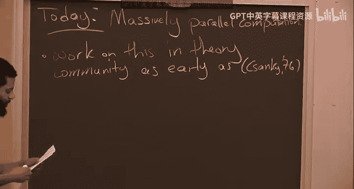

By。Ep Stephen Galilio。That's a。In '88。And there。The model is PR RamM。And the idea behind T RamM is。

You know， you have you ignore。嗯。Communication as well as synchronization。Okay。

 so you assume that there's a shared memory and you just ignore any synchronization issues。

 all processors can read and write to this shared memory。嗯。And。And， you know。Try to understand。嗯。

Time。Versus a number of processors。So when I say ignore communication。

 I mean there's a shared memory amongst all processors。He， so a lot of the results there of the form。

 If you give me n cubed machines for a problem of size n。

 I can do whatever I can multiply to n by n matrices in polylog n time， okay so。

This is the kind of thing you see there given polyan processors for some poly， I can do things very。

 very quickly in poly long time。嗯。ThisUnfortunately。

 this ignoring communication and synchronization and this shared memory are unfortunately unrealistic。

And。I would say kind of somewhere， I don't know exactly when， but somewhere in the late 80s。

 maybe early 90s， P Ram sort of。Stop being studied so much。I think in big part because of。

Because of the fact that this， you can't just ignore communication that's actually。

One of the biggest issues when you're dealing with massively parallel computation。呃。After PR。

 there was。The bulk。Synchronous。Parallel model。This is due to valt， less Valalian here at Harvard。

And in this model， you know， you explicitly。Worry about。

The things that you should also be worrying about， like communication between machines and synchronation。

And。The BP model is actually。

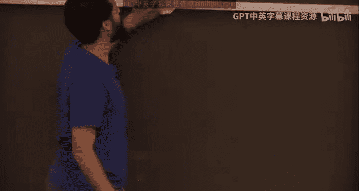

嗯。

You know， something that。Still exists today。 So this is 1990。 I it a0。 But today。

 you look at systems like。

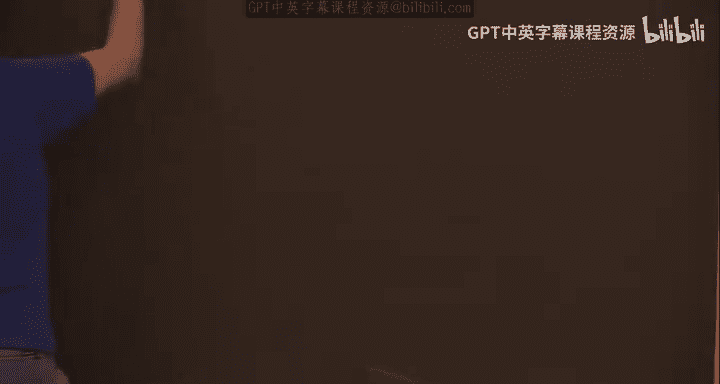

Apache。A on。Like Google's Prale。嗯。For graph processing。

 so these are based on Valian's original BP model back in 1990。

Today we're going to talk about a model that's。嗯。Simimpr to introduce， it has less parameters。Today。

We're going to talk about map use。And that's that was introduced by Dean。And a watch。And again。

 this is， this is a model for， well， this is a system that was built that's actually used at Google right now。

嗯。To deal with massively parallel jobs。And you also have。You know， Hadoop is。An open source version。

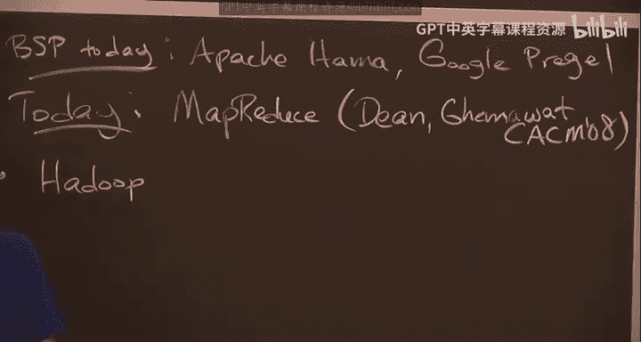

嗯。And these two systems are used。By， you know， Google。Facebook。Amazon， you name it there tons of。

Tons of places where。Where this thing is used， so it's widely prevalent。

And today I'm going to talk a little bit about， kind of a theoretical model for working working with these systems and trying to develop efficient algorithms within this model。

I guess I should just since I put Hadoop， I should also at least put ya him。嗯。Okay， so。In this model。

I imagine that， data items。Or each。Key value。Pairs。

 and I'm going to consistently use this notation throughout lecture， so。

A date item is always angle bracket， colon angle bracket with key in value separated like this。

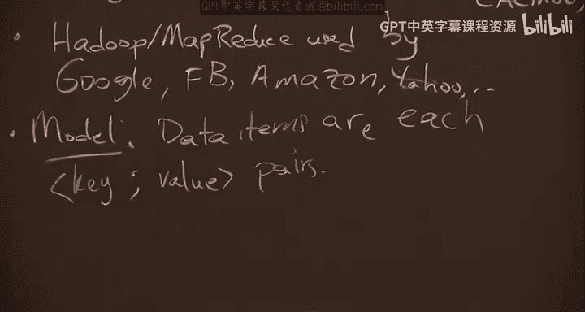

And we have to compute something。Okay。Computation。Is broken up into rounds。

And what does a round look like？So a round consists of three phases in order。There's map。😡，🤧So。

In the map phase。一。Item。Is。Processed。Byy some。Maap function。Okay。

 so a map function takes as input a key value pair。

And what it's allowed to do is it's allowed to spit out。😡，A set of。Key value pairs， okay？

And it emits or spits out。A set。Oh， new。Key value pairs。

They can have the same key as the original item。 they can have different keys。

 They don't even have to have the same key as each other。 They can have arbitrary values。 Okay， so。

 the mapper is some arbitrary computation。Then there's two。The shuffle phase。Okay。

 and what this does is。This is oblivious to the programmer， this just happens internally in Mare。😡。

All keys。Amitted。In okay， all items， I's say all items。Admitted in the map phase。Are grouped by key。

Okay and。Items with the same key。Set。To same。Reduccer。Okay， what's a reducer。

 Redr is a machine that reduces in the final phase。 So this is the third phase is reduce。

So a machine， a reducer， which is a machine。It receives。A key K， as well as a bunch of values V1， V2。

 VR。And emits。You know， new set of keys， new set of items。开以。嗯。Technically， in the system。

 the items that it spits out should have the same key as。

As the items that as the list that came into it， but in one extra round。

 you can just use the mapper to change the keys so let's just pretend that it can admit different keys as well。

Okay， questions， any questions about？嗯。Okay， so。So what kinds of goals do we have now within this model and we're going to look at certain problems。

 so you'll see exactly how things work in this model。Okay， so。One goal is。

We want to have a few number of rounds。Okay。Another one is。Want。C use。Much less than end memory。Her。

Reduccer。Okay。So you could imagine one trivial thing I could do is。For each item in the input。

I just map it。😡，I just map it to the to let's say I'll map。So the trivial thing。Is to map。

All key value pairs。To， you know。To something like。This。Right。

If I may have all key value pairs in the input to the key dollar sign with the value K comma V， then。

You know， by， by the semantics of shuffle。All items that have the same key get to the same get sent to the same reducer。

 which means that since every item has dollar sign as its key， they all get sent to the same reducer。

 which means that the reducer is just is then just。

 just has all the data and is doing some computation on it。 Okay。

 so this is like not taking advantage of。Of of parallelization at all。

 this is just doing all the computation on a single machine。对。So。But I don't want to allow this。

 I want to make sure that my algorithms are using much less than end memory per producerr。

And other things that we'll try and shoot for is so another。嗯。Right。I also want， let's say， want。

Much less than n squared， let's say， total memory used。对。So。Another thing I could do is。You know。

 send a related thing I can do is send send。Theirre end data items。

 I'll send all end data items to end machines。 and then I'll try to have each machine do something locally in one item or something。

 Okay， so。I I want to avoid， I want to avoid using n squared total memory。 In fact， ideally。

 I want to use， I want to use nearly linear total memory across all machines。

 When you sum up the memory used by all machines。 But as a first pass， you know。

 we're gonna to shoot for something like this。And when I say much less than， as a first pass。

 I'm happy to have end of the 0。9 memory per producer。

But I don't want to use n or even n over polylo n。Good。Okay， so。

Let's see some algorithms in this model。Oh， I guess there's another goal。

Which is maybe small total work。Whereby total work I mean。Number of machines。Times。

It's a max work for machine。Or what might be more interesting is。Small， you， parallel work。

Which means what's the maximum time spent by any machine？You know，Time the number of rounds。

 let's say。嗯。So they're always the classic problems you can look at in a parallel， well。

 when you're studying algorithm design and you're looking at a new model。

There are certain go to problems you always go and look at。 So one example is like sorting。

 so one question is how do you sort it efficiently in this model？

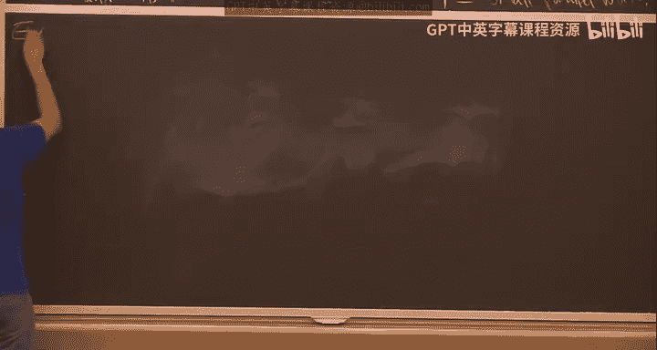

And。The algorithm I'm going to tell you about is called Terra sort。 which is in the paper by。

White paper。对。嗯。Actually， the。The terrorist sort。Implementation described there was designed specifically to sort integers of some bounded number of bits。

 let's say 32 bit integers or 64 bit integers。 And there are some extra tricks。

That are used in that implementation to get speed up using that fact。

So I'll maybe say a sentence about it at the end。 But I'm not。

 I'm gonna give a simplified version of terroristra sort。

 which just sorts arbitrary comparable elements。 Okay， so I'm not gonna。

I'm not going to say that the keys being sorted are bounded integers。

 so I'm going to leave out one of the tricks in the actualter sort。

And so the basic idea behind Terraor is as follows。

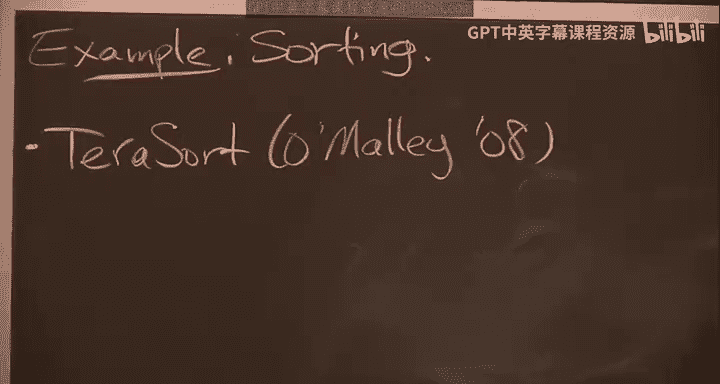

So let's say input elements。R of the form， let's say。I。AI。Okay。Where we have this unsorted array。嗯。

1 n。谁。And。The basic idea is。Say willing to use。Say you know， say we want to use。P。Machines。

 P machines。parallel。What we'd like to do is somehow get get the smallest。 So divide the elements。

 the n elements into P groups of equal size。Like the smallest N of repeat elements。

 the next smallest N of repeat elements， et cetera。

And then what we'd like to do is we'd like to send the smallest N repeat elements to machine 1。

 the second smallest machine elements to machine 2， etc ceter。

 Each one sorts their machines locally and then concatenate all the sorted things at the end。Okay。

That's what we're trying to do。So the issue with that is。

We don't know who the smallest N overP elements are， who the next N overP elements are， et cetera。

So the way we're going to get around that is by。Figuring that out approximately。

 and we're going to do a two round algorithm。So。The basic idea is to attempt。To。

Find smallest P elements。Smallest and repeat elements。Next and a repeat。Et cetera。Send you JF D。

I going repeat elements。Its machine G。To be sorted。对。So。How are we going to？

Figure out roughly the thresholds for who's the smallest N overP， next N overP， et cetera。

 we're going to sample。So let me just write the pseudocode here。

 so this is going to be a tumor round algorithm。 so let's say round one looks as follows。So。Map。

 let's say， I'm defining now the map function。Which takes as input。嗯。An I and an AI。

And what I'm going to do is I'm going to emit。Ilo P。AI。And。Also。

 so here I'm going to set T to be something like。嗯。Log P over Epsilon squared。

 we'll see where this comes from in a second。The other thing we're going to do is with probability。

T over N。So we're going to flip a coin with probability2 over N。For J equals 0 to p。

We're going to emit。嗯。Jy。哎有。So what's happening here？In our first round， after we knew the map。😡。

We even lead partition。The N elements into P groups of size n over P and， and send them。

 These are not sorted。 remember， these are just， you know。

 just take the first P elements in the role because I did mod。 It's not the first P。

 but just take some group of n over P elements in the array to machine ，0。

 then send the next n P to machine 1， etc ceter。They're not sorted。

And then I'm also sampling elements from the input array。 the total number of， in expectation。

 the total number of input elements that I'm sampling is T。

 which is something like log P of Epsilon squared。 We'll set Epsilon in a second。

And if an item decides to be sampled。Then what I'm going to do is I'm going to send that item to every single reducer。

So for each reducer J， I guess it goes up to p -1。For each reducer J。

 I send this item to that reducer， just the value。Okay。Good， so that's map in round one。

 What is reduce。So reduce gets is input。🤧咳。You know， get this input some。

J which is a number between 0 and p minus1。And it also gets。A list of elements X。

Some of the elements， let me also do this。

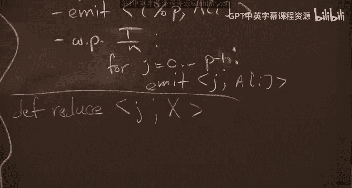

Let me say this is actually。I开了AI。Sure。So some of the elements from X are these types of elements。

 Their pairs I comma AI， and then some of the elements in X are just single numbers， which are。

 which are the sampled elements。So let's partition them， So say。B or the。I AI。And。S is the set。

Of sampled elements。对呀。So it reduces doing this local computation on x。

And then what I'm going to do is I'm going to set S to be the sorted。Of S。Okay。

 so you know what I hope？What I hope happens。Let me write that right here。So what I hope is。

Pretend this were the array as if it were sorted。Okay， and I'm sampling T elements。

 capital T elements。 What I， what should happen， kind of an expectation is that。

You know， this guy， the first guy is like a one over t plus one fraction of the way along。

 The next guy is a two over t plus one fraction of the way along， etc cetera。 Okay。

 and this is a T over t plus one fraction of the way along。对。And these are the guys。

 you know what I hope happens is that these are the guys who got sampled。😡，In the sorted order。Okay。

And then what I'm going to say is。Kind of look at。Look down to the level where this is。You know。

 one over P。One over P fraction。Or let's say， you know。So there are these T elements。😡。

And I sort them capital capital T elements and expectation。 Let's say capital T elements。

 and I sort them。After I sort them， look at the guy who's at index capital T over P。

 So he's a one over P fraction of the way along。What I hope happened is that the guy who's a1 over P fraction of the way along in the sample。

😡，Is also a one to repeat fraction of the way along in the actual sorted array。

But there's some randomness。 He's not going to be exactly one a repeat fraction of the way along。

 but he's going to be something close to it。And what I'm going to do is I'm going to use him as the pivot to decide who should have gotten sent to machine 0。

 So everybody less than him should have gotten sent to machine 0。And then what I'm going to do is。

 look at the guy index 2 T over P。Right。He， he should have been a two over P fraction of the way along in the original array。

 So everyone between him and the first guy is going to get sent to machine 1。

And I'm going to use these as surrogates for the actual people who are at index N over P to n over P。

 etc cetera， in the sorted array。Okay， so。So now what I'm going to do is。嗯。For each。I comma X in B。

Find you know， some。R in 0 p minus-1。That。X。Should map 2。In relation to S。

And what I'm going to do is I'm going to admit。I'm going to emit。R together with IX。Okay。

So kind of every reducer has。The reducers have two jobs。 Okay， One job of the reducer is。

To find these approximate。Quantiles in the sorted array。 And then the next。

 the next job of the reducer is to take the N over P elements that map to it。And see where。

 compare them to those approximate quantiles and see roughly where in the sorted order they are。

And then map them to the corresponding reducer for round two。So now there's round two。

The input to round two is the output of the reducers from round1， so it's all these R's， comma IX's。

So what's the map function？It's just the identity function。Okay。

 so map doesn't do anything in round two。Map gets us input in R comma IX and it just spits it back out。

😡，And reduce。So reduce gets' input。Some J together with a set of items。

And then what we're going to do is just sort B。By second element。And then we kind of write。

The output。To J dot out or something。Yeah。And then to get the actual sorted order at the very end。

 you just concatenate 0 dot out，1 dot out，2 out up to p minus1 dot out。Does that make sense。

So let's analyze this quickly。

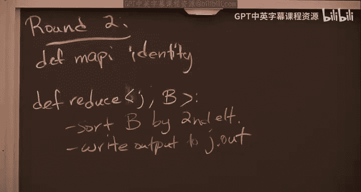

So what's the total memory required per machine？Let's say。Analysis now。Okay， so first of all。

I want to balance， you know， I have to choose Epsilon， I haven't told you what Epsilon is。

So how am I going to do that？Well， I guess there are a couple things I wantna。

 There's one thing I want to balance， which is I know that in the reduced step。

 each reducer is getting。The set B of， of items from the array that mapped to it。

That set B has size n over P。😡，So I'm getting a set of size n over P。

 which is like sort of evenly spreading the work， right， There are n elements to be sorted。

 So that's great。And in addition to those N over P elements that I'm getting。

 I'm also getting log P over Epsilon squared elements。😡，So。That's one thing I want to be balanced。

So the log P over epsilon squared should be like at most n over P for this two。To make some sense。

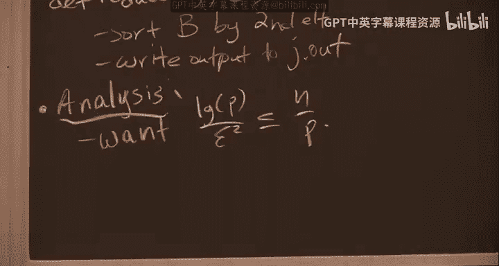

The other thing that I want balanced is， okay。Ideally， what I want to happen is， so， okay。

 so there are these N repeat elements that map to reduce。And then。

Reduce takes its set of N elements and figures out which quantiles they're in。

 roughly between which two quantiles they're in。And then there's a second reduce phase that sorts all the items that it thinks are in its quantile。

Right。So。Turn off bound。Says。A turn off bound and a union bound。 So let's， actually。

 let's just focus on one reducer。Okay。Now。If we just sample， if we just sample。

Log1 over Dlta over epsilon squared elements。 Forget about mapreduce for a second。

 Just take an array and sample log one over Dlta epsilon squared elements。Okay。And then， look at。

Look at the smallest element。😡，嗯。Or look at the element that's an alpha fraction of the way along in the sortded order of those sample elements。

Right。Turnoff says if you sample。Log whenever deelta over epsilon squared elements。And。You。

 let's say。Let's call this T。And look at。Alpha Teth。Smallest element。In example。It's rank。

In the actual sorted order。Of a。Is going to be something like。Alpha n plus or minus epsilon n。

Let's say there's some constant here。With probability1 minus delta。

So that's implied by the turnoutdown。Okay， so maybe I'll just leave that to you as an exercise。Okay。

The proof of this is somehow very similar to when we analyzed。Actually， when we analyzed。Pace stable。

 using P stable distributions for LP Nor estimation and data streams。 Okay， so the basic idea is。嗯。

Kind of if you look at people。You look at， you look at people who are more than epsilon and below this guy。

 Okay， So， so look at the guy。Look at the guy who's actually at。

Rannk alpha n in the sortded order of the array。Now look at everybody whose rank is less than alpha n minus epsilon n。

What an expectation how many of them survive the sample。

Now look at everybody who's alpha n plus epsilon n。

 who's at most alpha n plus epsilon in this sort order。

What fraction of them and expectation survive the sample？And。

 and what you can show is that kind of by a turn off and union bound。

 if you sample this number of people， then。You'll have less than you'll have kind of what you expect with probability y minus delta。

So what this tells you is these guys that you're using to estimate the quantiles in your sample。

Are off by this epsilon and you're off at most epsilon n in the true rank in the original array A。

Okay。So what this implies。Let let's say。So continued from that last well， remember now we set Delta。

嗯。So we said Delta it'd be something like1 over P here。😡，In RT。

So what that means is for each of the p quantiles we care about that we're using to partition our elements to sort。

With good probability， we're correct on all of them simultaneously。Okay， so。What this means is that。

Each reducer in the second round。So kind of with high probability。

The time probability each in the second round gets。At most。Something like N over P plus epsilon n。

Items to sort。In particular， the number of items against the sort is。😡。

Between N over P plus epsilon n and N over P minus epsilon n。😡，诶。And again， I want to balance this。3。

Epsilon to be something like 1 over P， which implies that capital T is going to be something like a log of P over p squared。

So going back to the first。To the first item there。So we want。P squared log P。To me。

 most something like N over P。So， you know， the most you can take advantage of here is something like set set them to be equal。

 So now P is something like you know， n to the one third over log n。Implies。With high probability。

Each。Of the P machines。Mes to sort。At most O of NP。Which is something like。

 oh end of the  two third log in。Items。对。So what this algorithm is telling us is。

If you you have roughly end of the one third machines。

Then each machine only needs end to the two thirds memory。

And all it's doing is sorting those end of the two/3s items locally。😡。

And sorting into the two thirds items locally takes roughly end the two thirds time。

 right up to log n。Right， so we're getting a running time that's get scaling sub linearly with N。

Right。Our kind of parallel running time is something like end of the  two/3s。

 roughly up to these logs。呃。发没。Well。I guess what I'm saying is。

What this is saying is kind of there's no real advantage to using more than end of the1 thirds machines。

So I mean， the number of machines you have is whatever。But kind of once。

Once the number of machines you have is more than end of the one/ thirds。

 this algorithm isn isn't like getting any better。Oh， if you're using less。

 you'll still get some kind of advantage。 It's just that kind of the most advantage you get。

 you keep getting more and more advantage as P grows up until this point。

But this particular algorithm。对。Maybe I'll just say a word aboutterra sort。

 So in the algorithm that I've described it， I guess I didn't really mention it。In the first reducer。

I said， first， you sort S。 and then for each element of B， you figure out where that element。

Relates to the sorted order in S。How would you do that？Quickly。But you just do binary search。

 So S is now sorted。 You have this element。 You have this key X。

 You want to know where X is in relation to this sorted list。 You just binary search。

And that's the part that， the actualter sort does more efficiently using the fact that the keys are integers。

 they basically build some try data structure。To do this more efficiently。

 So I'm not going to talk about that at all。 but I think this is， you know。嗯。

This gives you kind of a look at the kinds of things you might want to do in this model。二人。

Say a couple other example problems。嗯。So let's look at a graph problem。

So I'll show you two graph problems。So mint and Spanish tree。And graphs that are not too sparse。

So in particular。I want to look at the case where M is the number of edges。

It's end of the one plus C。For some。C bigger than zero。

 so I have more than just the linear number of edges。And what I want is。

You knowI want the memory per machine。To be。嗯。Much less than M。

 say something that's at least like m to the1 minus epsilon for some positive constant epsilon。So。

The algorithm that I'm going to tell you about is due to。嗯。Carl off。3。And Vasslitsky。AndSo 2010。🤧あ。

So we're going to。I's any some parameter K？不说。See you in a second。Actually， K。

 no K is gonna be something like n to the C over 2。And what I'm going to do is。I'm going to hash。

And I have a hash function。H。Which maps vertices into1 to K。So。

I'm going to have a random partition of the vertices。V1 up to VK， where VJ is what you expect。

 It's a set of all veres V such that H of V is equal to J。

Okay。And then what I want to do is。嗯。You know， for each。 So right now。

 I'm just sort of describing the algorithmman words。

 Maybe this is the last example where I'll actually。

You knowWrite down pseudo code in the map reduce framework I mentioned with map and Red so you can see this is actually implementable。

Okay， so in the model that I that I described。 So for each。What I'd like to do is for each IJ。In。

In k。Squared so for each pair of the IVJ。嗯。I'll do something like let GIJ。Is the induced graph？

On VI Union VJ。MIj。So。So G， I， what， what's gonna happen is G I J is gonna be kind of one key。

 the like I J I comma J is gonna be。A possible key coming out of the map phase。对。And。

So there's going to be a reducer that gets all the edges in GIJ。😡，And the reducer is gonna compute。

MIJ， which is equal to the MST。Of GIJ。And then。We're going to set M to be equal to。

The Union over all IJ of MIIJ。One last。Reduccer。Outputs。The MST of。Okay。So that's the algorithm。

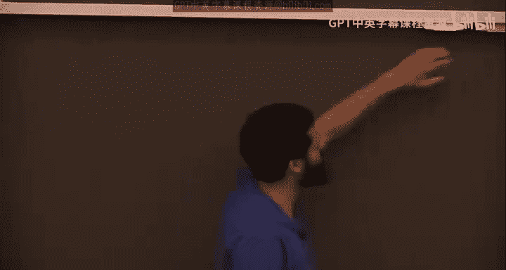

Is it clearer that this can be implemented in map produceuce and how many rounds you need？

So basic idea， maybe I'll just start writing this map reduce。So there's round one。嗯嗯嗯。嗯。

Let's say the inputs。The inputs to map are just edges， u comma V and the key doesn't matter。

 let's say key the value doesn't matter， the value is nu， let's say。嗯嗯嗯。

And what we're going to do is just emit。嗯。So the key is going to be hash of U， comma hash of V。Right。

So in particular， these GIJs。Partition the edges。Right。

So the key is going to be H of V become H of V， and then the value is going to be UVv。

And then there's going to be a reducer。Which takes his input some IJ pair。

Telling me which induced graph I'm looking at， question。全と。Oh。

 I just had VI appear in multiple places。That is。Oh， I see what you mean。嗯。Yeah。Yeah。

 but I guess it also means that。I need to change how the map works， right？

Because if U and V actually lies within the same partition。Then I need to。

And I need to also admit to all other。All other places where that edge appears。

 do you see what I mean？Yeah，Everybody， I should say is。

There's an if statement of H of U is equal to H of V。Whi is equal to I。Then。For。For each J。

I guess there's also a weight here， which I've been ignoring， so the edge also has a weight。Okay， so。

For each J。Going from1 up to K， I'll also emit。I J。因为。So that's right。

 they don't part the edges because of exactly what you said。Then there's reduce。Which takes us input。

Which GIJ you care about as well as some sequence of edges。And then it just。嗯。What。You know。

 E1 up to E。Will there be well it might not be connected？So， and this。

 this should not really be an MST。 This should really be a minimum spanning forest。

Because GIJ might not actually be a connected graph。

But let E1 up to E T be the minimum spanning forest。Of this EIJ。And for。For a equals 1 up to T。

 I'm going to emit。Ij。Together with， or actually what I can say is。Imit IJ。哦。Iit dollar sign。

 let's say。Together with。The edge。And where it came from。对呀。Oh， just because so as Yo pointed out。

There are some edges whose endpoints both hash to the same partition， right， and。嗯。

You want those edges to。So， I mean， my definition。My definition of GIJ is that it's the induced graph on VI Union VJ。

 So it's not only the edges that go from VI to VJ， it's also the edges that are internal to VI and the edges that are internal to VJ。

So in order to have that。Be true。 I needed to make sure that let's say that both U and V hash to I。

Right， but then now look at， you know， VI Union V1。If if I just did this。Then。

That edge that's internal to VI would not actually survive， would not actually be emitted to Ia 1。

Yeah。Does makes sense。Okay。So good。At the end of this， basically。

 the thing that's being emitted here is all the， all the edges of capital M。

 Capital M is the union of all the M I Js。Right， and they're all getting sent to the same reducer because they all have the same key dollar sign。

 So in round two， in round two， the map will just be the identity map。

And the reducer will take all these edges as input。And then compute the MT of this set of edges。

So let me not write the round two reduce on the board。So now the question is。Kind of what are。

 what can we prove about this algorithm， So I'm not going that。

The correctness of this algorithm is pretty easy to establish， I'm not going to do that on the board。

 you can look at the paper if you want。But what about the resource requirements of this algorithm。

 the memory and the running time， etc？In particular， the memory， so analysis。Let's say in memory。

 so what I want。The trivial solution， as always， is one machine gets all of the graph and then computes the MT。

And I don't want to assume that one of my machines can store the entire graph。Okay。

So I want to say that the memory is much smaller than M per machine， so。So the me per machine。Well。

 that's at most。How many edges are coming out of Icoma J？Readdit。

If you look at reducer Ia J in round one。Well， there are k squared reducers。

Their K squared reduced keys。And each one of them is giving you the tree of some subgraph。Okay。

So a tree has at most n -1 edges。 Let's say at most n edges。 And there are K squared of them。

 So the memory per machine is at most。 actually， now that I look at this。

That's case squared times n seems a little big， actually。So as I did it here， it's case weird。

Times n。Oh yeah， good point。 Right， Okay， that's a very good point， so。Right， so。

The total size of a spanning forest is at most number of vertices -1。

 let's say most number of vertices。And as you pointed out， the number of vertices in GIJ is。

Is roughly with high probability， it going to be something like 2 n over K。

And most big O of n over k。So it's actually something like k squared times bigger of n over k。

This right here is。It's going to be at most the size of VI Union VJ minus1。And this is big O of。KN。

 which is big O of n to the 1 plus c over  two。Which is much much less than M。

 which was end to the1 plus C。So I'm using truly sublinear memory here。So in particular。

 the graph is nearly dense。😡，Meaning n squared close to n squared edges。

 I'm using like n to the three halves memory per machine。This is just in。Round two。Round two。

 which gets all of the MIIJs to then compute M。And then for round one。The max manm per machine。

It's just equal to the max。Overall， IJ of the size of EIJ。right。🤧。对。

And what's the expected size of EI J。Well， it's the sum of all edges。The probability that。

The endpoints。Of意。Are in。VI， you VJ。But the probability of being in VI union VJ is something like。嗯。

2 over k， I guess。The probability that you hash to I is1 over k。

 so the probability that you either hash to I or j is 2 over k。So this whole thing here is equal to。

2 M over K。对。So kind of by a turn off bound， followed by union bound over allIJ。

 you can say that with high probability， none of them are bigger than big O of M over k。

 which is again end the 1 plus C over 2。N R k squared。说。2。嗯。Yeah， it's a very good。Yeah。

 so I just did one in point。 That's a good point。 So probably that both。啊哈。Oh， actually， okay so。嗯。

Okay， good。 So that's a good point。 So the expected size is M K squared。

 So I got I got a little ahead of myself with concentration， I think。Right。Okay。

 so concentration isn't just， okay， now let's invoke the turn off bound。 There's a little issue here。

In the turn off bound。You're summing up a bunch of independent random variables， right。

 and then you want them to be concentrated about their mean。

And you assume in the turn off bound that these independent re variabless you're summing up are bounded。

And if the bound you have on them isn't great， then the tail bound you're great， you get as a result。

 also isn't great。So if you look at。You know， how many edges land in the induced graph G I J。 Well。

 think about certain vertices。 certain vertices are very high degree。

So if you happen to sample them to that partition， then you'。

 you're actually going to have a lot of edges。 So you have a bunch， you basically have。For turn off。

We have。Kind of EIJ。Is equal to the sum over vertices V and V。

Of the indicator function of the event that。🤧K。Let's write like this。Well， is at most this？

It's at most of this anyway。呃。H of V is in the set Ij。Times the degree， I guess， of V。

I guess you can do better than this。You can do better than just saying this。 and。

I I guess what they do in the paper is they say。So Carlar Officer Revaselvissky。

What they do is partition。V， according to degrees。And they define something like VT is the set of all vertices V。

 such that the degree of V。They say， is that most two to the T？And is at least2 to the t minus1。

And then now when you're doing and then now what you do is you kind of do a union bound over all of these VTs and then you use this bound。

 and then you say within a particular VT， all the sumands are basically bounded by similar things。

 right， This degree V is basically all the same up to a constant factor。

 So you're not losing too much by using the turn off bound now。啊。And at the end of the day。

They show that with high probability。The max。Of EIJ。

Is hoteled up to a log and to the1 plus zero over2。对。Yeah， should now that now that you mentioned it。

 I mean。This does seem like quite sloppy because just because you sampled him doesn't mean you sampled everyone that that he's adjacent to。

嗯。I'm pretty sure。And。I'm fairly sure that's what they're doing。嗯。Or maybe I'm mistaken， but anyway。

You know， it's some。Something not too crazy， and you get something that's truly so。

Sublilineary memory per machine。There's one downside。The total number needed。It's something like。

Is roughly k squared times。I guess n over K。嗯。K squared times this thing n to the 1 plus c over two。

对。So kind of what we said was that none of the induced graphs have more than n the one plus over two edges。

 there are K squared of them。 So you sum up the memory used over all machines。

It's something that's like this。K squared is end to the C， so this is equal to。嗯。

Something like n to the 1 plus 3 c over two。Which is。Equ to。And to the2 plus， well， what's M？Yeah。

 so enter the two plus c over two。Something like that。Right。Which is basically。

M to the 2 minus epsilon。Right。So。The total amount of memory that you're using is less than sending every edge to every machine。

But it's not like much less than that。嗯。Which is not ideal， so。There was an algorithm afterward。

Latania at all。spa。저 영화맨。Which she gets？Or end to the C machines。So this is like the K squared。

Or under the 1 minus epsilon mem per machine。And something like C over Epsilon。Brows。

So the total number， the total number here is actually something closer to M as opposed to。嗯。In fact。

 that maybe looks a little bit too good。 It looks like it's less than that。

 Maybe this is plus uppsilon。No， it's less。 this might be something more than。So I saidian。Yeah。

 C is the same C that we've been talking about。Yeah， I mean， I， I think。

 I think maybe I lost something small here because。If you multiply these two things together。

 it's less than M。So definitely the total memory you're using should be at least M to you can store the graph。

 So I think this may be C plus C plus something small。There's not a lot of time。

 let me just say one last thing。So。Last example problem。Is triangle counting？So。

So the number of triangles of G is just defined to be。Look at how many。U less than v。

 less than W are in the vertex set such that。Uvi。VW。UW are in the edgeet。

It's the number of triangles in the graph。Sequentialally。If you don't care about parallelism。

There's a simple N cube time algorithm。Three and nest and four loops。Right。

You just loop over all UVW and then check whether or not all those three edges exist。 and if so。

 you increment a counter， you return it。In fact。You can even get。M to 3 halves time。

I'll show you that right now。And the mapreuce algorithm I'm going to show you is basically an implementation of that in mapreduce。

And it's going to use something like。I think， Rum。They're going to be rudem different reduce keys and。

Great。And the memory machine per machine is going to be something also very small。So let's。

 what's the sequential algorithm that gets this。 So let's define。A total order。On V。

We're going to say that。You is。Less than the。If the degree you。Of U is less than the degree of V。Or。

The degrees are equal。And。You know， you is less than me。So when I say U is less than V， I mean。

 let's say that we associate with each vertex a number between one and n。Okay， so if that。

 if that I D of U is less than the I of V。

So the algorithm looks something like this。For V in the vertex set。For you in the vertex set。

 such that。U is bigger in this order than V。And then also for W in the vertex set。

Such that W is also bigger than the。Let's say answer is initially zero。Answer。Yeah if。UVW。

Is a triangle。If all those three edges exist。Then the answer gets ined。And then return the answer。哎。

Does that make sense？So I mean， each triangle， basically in this。In this code。

 each triangle is counted exactly once， right， because this is a total order on the vertices and。

Well。Okay， I guess。Maybe twice because there's VUW and there's also VWU。

 but maybe I need to return answer over two or something。嗯。

So why does this algorithm run in time end of the three halves？A sorry。Oh， just because。

I can I count the like， if there's a triangle U VW。

 I'll count it as V comma U comma W and also count it as V comm a W comm a U。

Because I'm just saying that U is bigger than V and W is bigger than V。

I just have had me on both sides。Yeah， I probably could also do that。Yeah。So。Runtime。

Pick a threshold T。If the degree。A V is bigger than T。Theres at least T。Then we only consider。

Triangles。With the。Containing。Two other。Greater than T degree vertices。Right。

So if V has degree at least T， that means U AndW also both have degree at least T。

 But how many vertices are there that have degree at least T。The sum of the degrees is 2 M， right。

So there are at most2 M over T。Vertices。Of degree， at least T。So that implies。O M over T cubed。

Such iterations。And then the other cases。If degree。A V is less than。T。Right。嗯。That implies。That。

 at most。Well。I guess I should have said such that use at least V and。You is in the neighborhood。A V。

 and。Dolly was in the neighborhood of me。I only have to look over neighbors。Right。

 and then I guess I should just say that。So， really。

The only thing I really need to check is that U double use an edge。Almost t squared time。

The total amount of time spent in these iterations is at most the sum of。V such that。Dgree V。

Is that most t of degree v squared？Which is that most？T times the sum of the degrees。

 which is at most2 MTt。So you can balance this。 So the time is at most。I love。

M cubed over T cubed plus MT。Which is equal to o of m to the three halves。For t equals rootdon。对。

And now how do I use this to implement a map reduce algorithm？So there's round one。嗯。

Where Map gets its input edges。And it just says， if。U is actually bigger than V in this order。嗯。

Then I'll emit。Liu。😔，🤧。Then my reduce。Get this input V together with some set S。

 where here S is a subset of the neighborhood。It's the people in the neighborhood who are bigger than the partial order。

And then what it says is for。UW and S。Admit。V。UW。If U w use an edge。嗯嗯。And then there's round two。

Now。Get his input。So there are two cases for the input map gets。 So I'm going to imagine that。

I'm going imagine that the inputs that were in round one will also appear in round two。

 so I could I could achieve that by just like remitting them and producers also spit them back out。

 Plus， I'm also getting these outputs。So。If the input。Is of the form the UW。Then。诶咩。UWV。Otherwise。

 if the input。Looks like an edge like that。Then。M咩。UW。Dollar sign。And then finally。

 let me just say the reducer in the last second。嗯。If。Dollar sign。S。Then。For each VNS。

Such that V is not the dollar sign。I right。V1。Okay， so at the end of the day。

 what I'm emitting are basically all the items。So for each time V appears in a triangle。

 I do any mission。Okay， so at the， at the end of round 2， all the emissions correspond to triangles。

 or I guess maybe there's this double counting because of that same issue。

 And then you have to divide by 2。And then there's a final aggregation stage。

 which just has to basically sum up how many things there are。嗯。So I think that's。Yeah。

 unfortunately out of time， I don't know， do you have any questions。

 last second questions about anything？Okay。A are those PSsets？Okay。

 so I guess we'll hand them back maybe Thursday。Okay， okay right。

