# 哈佛大学《大数据算法｜Harvard Algorithms for Big Data (COMPSCI 229r) 2016》deepseek - P2：-02-Algorithms for Big Data (COMPSCI 229r), Lecture 2.zh_en - GPT中英字幕课程资源 - BV1yGdNYvEMo

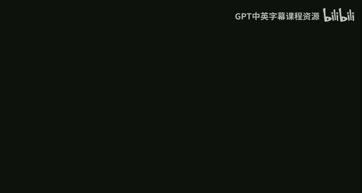

All right， let's get started。So the lecture video for last lecture is up and the I put the notes up immediately as soon as it was sent to me。

 I might go back and do a little editing those are all up let me know if you can't do the video just a reminder of some of the things from last time。

Plus， maybe one thing bullet that I didn't mention last time， but。I should have。

And we're going to eventually get back to using that again。

 So today we're going to continue with streaming algorithms。

 I'm going to focus on a different couple of streaming problems。

 Most of the time will be spent on something called the distinct elements problem。不对。So。

Its a last time。We did like approximate counting。It was Morris's algorithm。

RightAnd Morris's algorithm gave us an unbiased estimator and then to get a good approximation with high probability。

 Well， first we took the average of many estimators， which I just called Morris plus。

 and then we took the median of a bunch of those and I called that Morris plus plus okay。

 this is nonstand terminology。 I just made that up。

 but this idea of developing an unbiased estimator。

Like you're randomized basically setting up an algorithm that outputs a random variable。

 which is an unbiased estimator of what you want。Then taking the average of many such estimators and then taking the median of a bunch of those。

Is something that。Is very common in the design of streaming algorithms。 Okay， so this idea of。Plus。

 plus， plusing is。Something you should。Feel comfortable with。

 And we're going to do another example today。

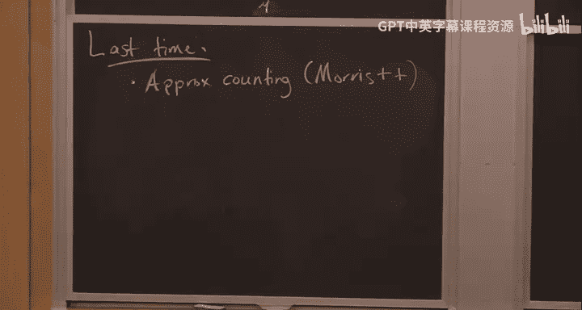

And this is probably， was probably the last example where I'm gonna really go through all the details painfully。

 And then from then on， I'll assume that you're comfortable with the。Plusing and plus plus，So， today。

We're going to look at another extreme problem， which is called the Dis elements problem。

And if we get time， we're also going to look at enormous deation。

If if we don't have time to do this fully， I'll put it in the notes。Very good。

What is the distinct element problem？In the literature。

 you often hear this problem called the F0 problem for a reason that'll become clear， I guess。

 at the end of lecture。对。So you see a stream of integers。

I use this shorthand to denote the set one of。Okay。

So each stream update is a number between one and n。And the output。Is the number of distinct？

Integers。Same。And as last time， the goal is going to be to minimize space consumption。谁。So。

What are two。What are two straightforward algorithms for solving this problem。

And how much space do they use。 So give me， someone give me one straightforward algorithm。

Let's say you know M&N。Yeah。

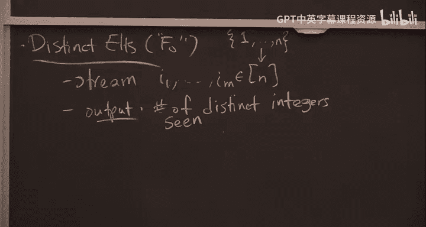

Yeah， basically keep a bitter array of size N。And then flip the I bit to one。

 if you ever see an integer I in the stream。Okay， so。So straightforward algorithms。

So the first one is a bit array。Of length。Okay。what's another straightforward algorithm。

 So what is this， This uses space， which is n bits， right。O。What's another algorithm？

Something that gets you a bound that's not end bits， some other bound， which is incomparable。

What might you do if M is very small， if the length of the stream is very small。takers？Yeah。

 just keep a list of all the numbers you've ever seen。Theirre M of them。

Each number is between one and n。 So it takes log n bits to store a number。

Just store the whole stream。And that's something like M times login。Bits of space。

Whereas this is end bits。So， we can get。The min N and M log N。哎。And。Okay。

 we're going to see after the algorithm， we're going to talk about lower bounds。

 but you can't really beat this bound。 okay， if you want to solve this problem exactly。

But just like last time with Morris's algorithm， we're going be okay with getting a randomized algorithm。

Which outputs an approximate solution with high probability。Okay。So。Again。

 randomness in approximation。We'll settle for。Upputing。Let's call it。See Tilda such that。

Probability that t minus t tilde。I's bigger than Epsilon tea。That most delta where T here。

Is the true。Answer。对。Very good。And the first algorithm that got us something like this is due to flag A。

And Morton。This was back in。嗯。83。谁？

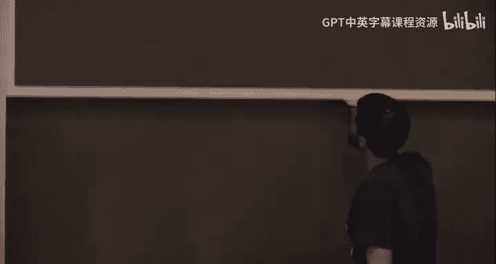

Okay， great。

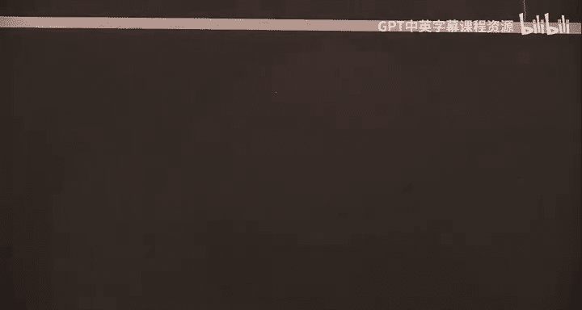

So first， I'm going to show you an idealized algorithm。

Which is going to give us a good space complexity。

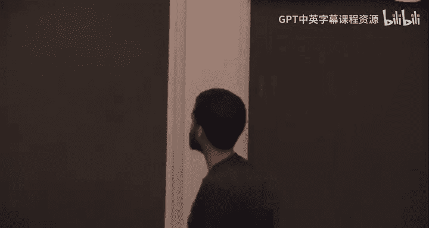

And then， I'm going to。Tranform it from an idealized idealized algorithm to one that you can actually implement。

On a computer， okay？So this was the heart of the idea from Flagla and Martin。

And so。

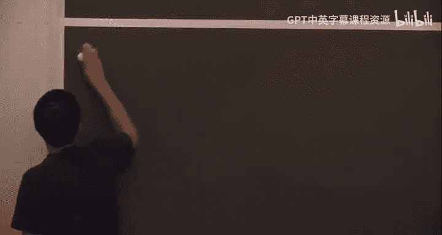

The algorithm。So the first thing we're going to do。Is we're going to pick。A random。H。Mapping。

The input universe into the continuous interval from 0 to 1。Okay， so already， so I should have put。

 this is。Idealized。Idealized algorithm。So already， there's something wrong with this algorithm。

 right。What's wrong with step one？There are two things wrong with step 1。对。Right， so yeah。

 so I guess that sums up both problems。 So the first issue is。嗯。To store H。

 to store a random function。You're going to need at least end space。 You're storing n random numbers。

 And the second thing is， these are real numbers， right， And my computer only has finite precision。

so we're going to take care of both of those soon。

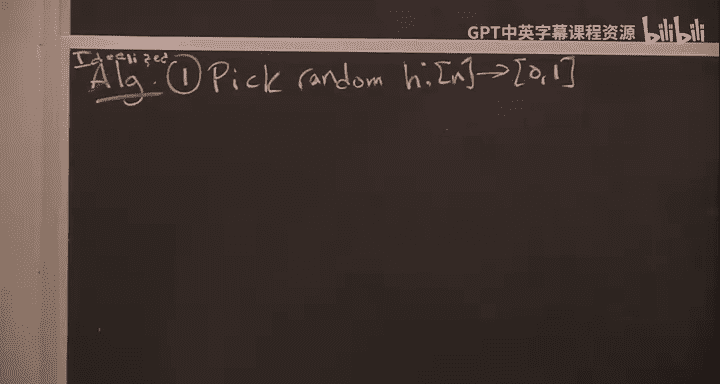

Okay， so。Second step is。We're going to maintain only one number in memory。

Which is the minimum hash value we've ever seen。Okay。And then what we're going to do at the end。

His output。1 over x minus1。哎。Now， some intuition for where this algorithm is coming from。So this。

 this random function is， it's a consistent function， right， If we see。

 if we see 5 in the stream and compute H of 5。Then later in the stream， if we see 5 again。

 H of 5 will be the same number， right？ So what are we actually what are we actually maintaining in this random。

 in this variable X。So。X。Is。A random variable。And it's the minimum。Of。T independent。Uniform。Zero1， R。

Right。For each of the T people in the stream。嗯。They're giving you a random number， H of I。

 and you're maintaining the minimum of all those H Is。 That's T independent random numbers。Right， so。

Here's zero。Here's one。Suppose P was one。 We just had one random number between 0 and 1。

 What do you expect one random number between 0 and1 to be。Right， a half。

What if you add two random numbers between 0 and1， the picture you expect is， you know。

 kind of evenly spaced， which is。A third and two third。If you had T random numbers。

 you expect them even leave space， which means over1 over t plus 12 over t plus1， et cetera。Right。

 so。The expectation of x is1 over t plus 1。So one over x is t plus 1， -1 is T。

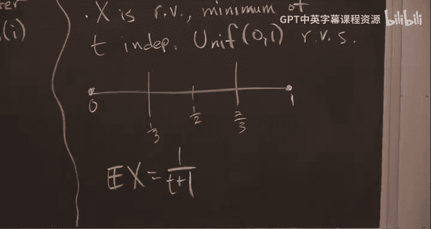

对。AndI apologize， I think if anyone was in 2，2，4 a year ago， I might have done this example as well。

 but we're going to soon get into stuff that you've never seen。

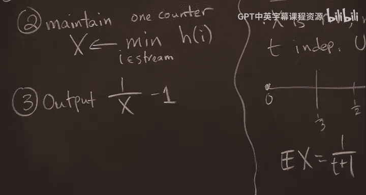

At least I don't think so。

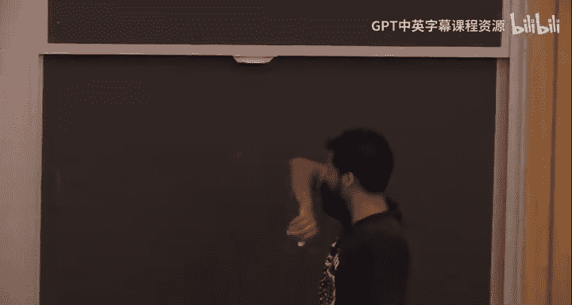

Okay， great。 So let's prove， let's prove this claim right here。

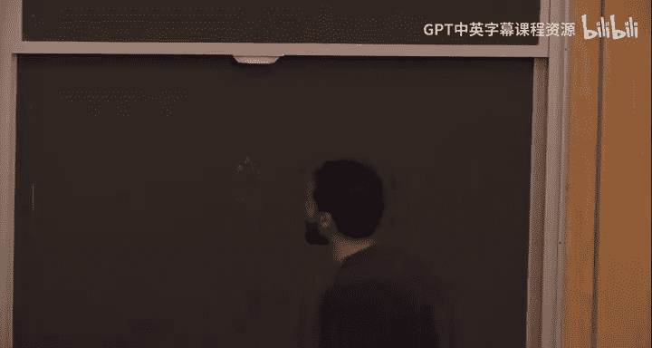

Claim。The expectation。Of X。Is。Here。Oational。One over。Okay， the proof？

The expectation of x is the integral from 0 to infinity of the probability that x is bigger than lambda d lambda。

Okay。

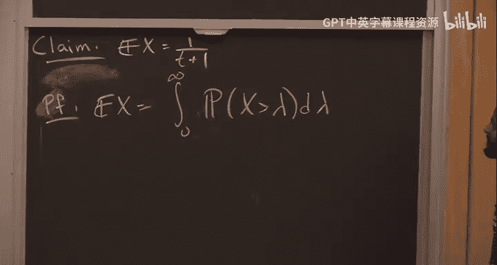

And that's equal to。The probability that。The integral。From zero to infinity。Of the probability that。

 for all I。In the stream。H of I。Is。problem that X is bigger than lambda。 Yeah。

 so the minimum value has to be bigger than lambda。

Right whichch means that for all I in industry stream， H of is bigger than Lada。

But these H Is are independent。 H is a totally random function。

So this is equal to the integral of the product over i from1 to T。Or let me call it。R from1 to T of。

probabilityb that HI R is bigger than lambda de lambmbda。But what's the probability that？

The hash value is bigger than lambda。 Well， if lambda is bigger than one。Then at 0。

 H of I is never bigger than one。If lambda is between 0 and 1。Then it's 1 minus lambda。

The problem that you're bigger than lambda is1 minus lambda。So this thing here is equal to。

The integral from 0 to 1 of 1 minus lambda to the t d lambda。

 and then you do a variable substitution。This is equal to the integral from 0 to 1 u to the TD。

And that's equal to one over t equals1。嗯。

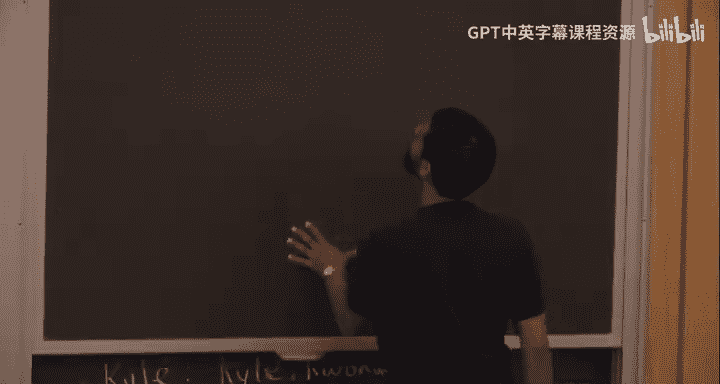

🤧う。Okay。

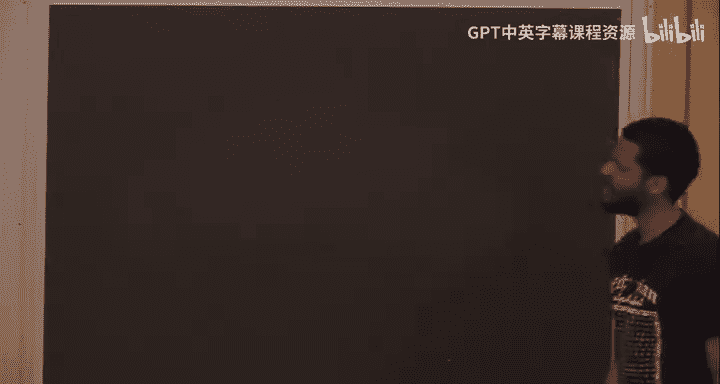

So。I'm doing things slightly differently than last time， but it's okay。 I mean。

 last time I took the entire estimator and I computed its expectation。

 and then I took the entire estimator and computed its variance。Okay。This time。

 I'm just focusing on X。And then I'm saying， what's the expectation of x？给。

And what's the variance of x。 And then what I'm going to do is I'm going to replace this X with an average of many of them。

Okay， so we'll get there in a second。But I want to know the variance of x， right。

 So remember the variance of x。Is that second the first bullet？Because I want to apply chubby Shove。

And the variance of x。Requires me to understand the expectation of x squared。Okay， so。Claim。

 and I won't do this one。I won't do every single calculation。

 but claim is that expectation of x squared。Is equal to。Two over t plus1， t plus 2。

And the proof is very similar proof。The expectation of x squared。

Is equal to the integral from 0 to 1。Of the probability that。嗯。

X squared it is bigger than lambda d lambda。Okay。

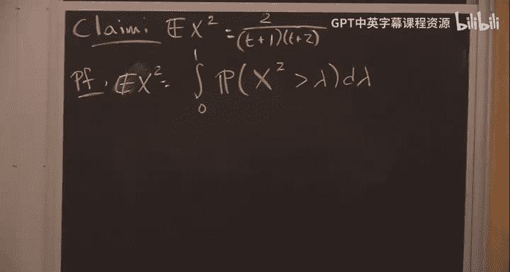

And that's the same thing as saying that。X is bigger than root Lada。So just running through。

The same kind of steps。 you get that this is equal to the integral from 0 to1 of1 minus root lambda to the T。

D lambda。And then now what I'm going to do is I'm going to say。呃。U is equal to 1 minus root lambda。

Which implies that lambda is equal to 1 minus。You。Squared。Which implies that D lambda is。诶。Minus。2。

1 minus u。Do you or something like that？哎行。So if you plug that in here。

 you'll get that this thing is equal to the integral from 0 to 1。

Two times the integral from 0 to 1 of u to the t。I think you。1 minus u or u minus1。诶。1 minus UDU。

Right， this is。You did the tea。Minus u to the t plus1。And then you'll get what I said。O。

Which the variance is the difference of the two。 So if you do that calculation。

 which I won't do here， the variance of x。Is equal to。This minus the square of that。😡。

Which gets you something like。And。Think t over t plus1 squared t plus 2。Which is less than one over。

T plus1 squared。which is the same thing as。The expectation of x squared。Very good。

Now we're going to do the。The standard plusing。Which is averaging a bunch of these guys。

So let me call this algorithm。FM for Plededley Martin。

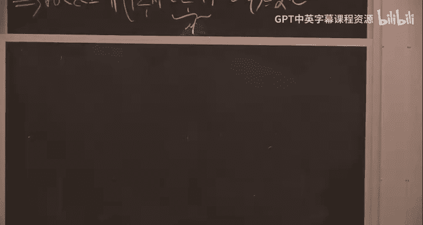

So now Fm plus。

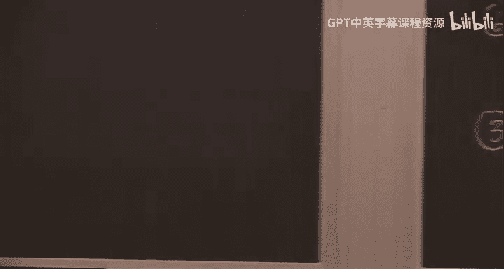

Is。呃。Instantiate。Let's say call it Q， which is1 over epsilon squared eta。Fms。Independently。

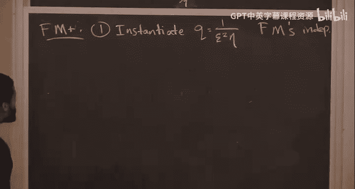

诶。And。Output。The average。Well， okay， let's， let's see。Let Xi。Come from。

X I is the counter that's stored by the I instantsiation of the algorithm。

And now what I'm going to output。Is one over the average， one over。1 over Q times the sum。Of X size。

 I goes from1 to Q。-1。可。And notice that now the variance。The variance of this thing，1 over Q。

 First of all， what's the expectation。What's the expectation of this average？

It's the same with what it used to be whenever T plus1， right because。Liineative expectation。

 If you sum a bunch of random variables， the expectation sum。 And then that。

 So this would give you Q times the old expectation， but I divided by Q。And the variance。

Okay the variance， well。By the second bullet， when you sum up independent random variables。

 the variances add。So the variance of this sum would be Q times the old variance。

But whenever you take a random variable and scale it。😡，Scaled by some factor C。

 the variance gets multiplied by C squared。RightSo you can verify， basically。

 there's a square in that definition， right， So if you replace x with C X。

Then you have the expectation of C X minus expectation C X squared。 So C the C gets squared， right。

 So we got the old variance times Q divided by  Q squared。Which means we divided the variance by  Q。

So we improve the variance。So this thing is equal to1 over  Q。Times what the old variance used to be。

Which is less than。The expectation of x。Squared over Q。ThisUs what's over there。🤧Okay， good。

 so now let's finish the analysis。So now what I want to say is that。嗯。Let me call this number。

Let me call this。Z。The probability so claim。The probability that。Z minus1 over t plus1。

Is greater than epsilon。Over T plus1。Is that most Ada？What's Ada？

I instantd Q to B when a rhpsson squared eta。Okay， and the proof is just chubbyhoev。

The probability that I get that deviation is at most。The variance， well， first of all。

Let over lambda squared。 So I get。T plus1 squared over epsilon squared。

And then the variance is at most。呃。1 over Q。T plus one squared。That cancels that。

And I rigged Q so that this thing is less than eta， right， or this thing is equal to Eta。嗯。Questions。

Yeah。Oh， but I so I'm yeah， I'm never。对。Oh， I mean， so we're not。

 we're not we're not making any such assumption， right， so。Regardless of what T is。😡。

The expectation of x is always one over t plus 1。 And by averaging many copies， what is this saying。

 right？Yeah。Yeah。Yeah， just the denominator。 We're just saying the denominator is super close to one over T plus1。

Oh we'll worry about it， but it'll be fine。Right， so okay， so now， so now。Claim， so just to。

Make you at ease。 So， so now the claim is the probability that。You know。

1 over1 over  Q of that sum of X size -1。 The problem that our estimator deviates by t by more than epsilon T。

 I want to say is more than eta。 Maybe maybe I'll get。

So maybe I'll lose a constant factor in the uppsilon。Yeah， and that's all I care about anyway，Right。

 and the proof of that is just。Let me call this claim two and let me call this claim one。

By claim one。Now with probability1 minus8。We have。This is something that's within a one plus epsilon factor of。

The truth， right？The deviation is epsilon over t plus1。 so multi multiplicatively。

 it's only the one plus epsilon of what we care about。We have that that output is actually one over。

1 plus or minus epsilon，1 over t plus1， minus1。Right。

But one over1 minus epsilon is basically one plus epsilon。

 One over one plus epsilon is basically one minus epsilon up to changing epsilon by a constant。

 you can calculate that for yourself。So this。Is 1 plus or minus o of epsilon？T plus 1 minus1。Okay。

And as long as t is not 0。 Well， if t is 0， that's very easy to check。 Basically， there's no stream。

 Okay， so as long as t is not 0， this thing is equal to， well， what is this， This is。

One plus or minus o of epsilon。C。Plus or minus o of epsilon。Right。

This is a much smaller error than Epsilon T as long as t is not0。 So， so we're fine。Yeah， so yeah。

 this this example was a little different from last lecture's example in that it's not the estimator itself whose expectation we're calculating and whose variances were bounding。

But there's some random variable somewhere in the estimator。

 And we're just saying that we can apply the plus， plus， plus trick to that thing。Questions。确认。

So the space here， well， okay， again， there's this issue of the the algorithm being idealized。

 H is taking n space already。 Okay， But if you ignore the fact that we have to store H。

This algorithm is maintaining Q numbers。😡，Right，So for some definition of space。

 the space is whatever over epsilon squared eta。谁。And if I want failure probability delta。

 one thing I can do is I could just set a to be delta。

But now my space is1 ups on squared times 1 over Delta， right。

 And we had a trick last time for improving the dependence on Delta。Which is。

I'm not going to try and get failure probability Delta in one shot。

I'm going to settle for Eda being a constant， like a third。Right。

And then I'm gonna take the median of many such estimators。 So that's the plus plusing。 Okay。

 so let's。Let's do that。 And then this will be the last time I do this in。Such great detail。

 and then from now on you'll be。You should have this。Sequence of steps at your fingertips。

So then now finally， we have FM plus plus。

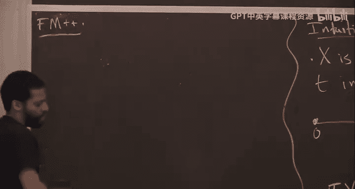

🤧。We're going to instantiate。Step one， instantiate。And。S， which is。Something like 24 times lawn。呃。

Two over Delta。Independent copies。FM plus。With。Ada being a third。Output。The median。Of。W over。

Zj minus1。Where J goes from1 to S。 So ZJ is the output of FMJ。可以。And what's the analysis for this？So。

 the analysis。So claim。Let me call this。Let me call this TH。

The claim is that the probability that t hat minus t。Is bigger than。Apsilon tea is that most often？

And the proof of that。Is so let's define some indicator random variables， Y J。Let Yj be。1。If。

1 over Zj -1。Minus T。Is bigger than Epsilon tea。And zero otherwise。Basically， Y J is1 if the J。

F FM plus J。So we have these S independent copies of FM plus。

Yhy J is an indicator random variable telling us whether the J of copy screwed up。

And didn't give us a good estimate。诶。Now， what do we know？😡，From claim to。Right。Claim2。Says that。

For all J， the expectation of Yj。Is at most。RightThe expectation of YJ is the probability that the JF copy failed。

 That's almost the third。

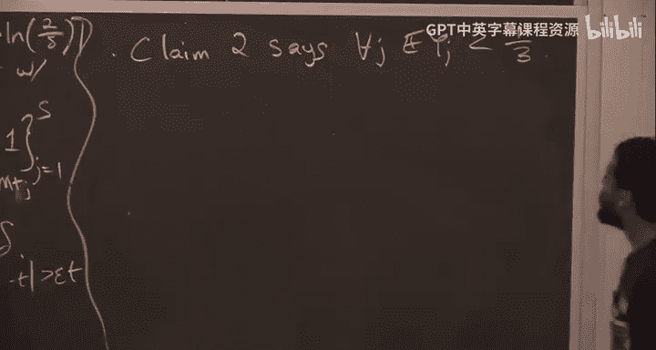

So。For the median to be a bad estimate， right， for the median to be a bad estimate。

 it means that strictly more than half the copies failed。So median fails。

Implies that the sum from j goes from 1 to s of yj is bigger than s over2。

But the expectation of this sum is S over 3。So it had to deviate by its expectation by quite a lot。

 So right， so the probability。That sum of Yj is bigger than s over 2。

Is the same thing as the probability that the sum of Yj。Minus s over 3 is bigger than。S over6。

So by the way。For the purposes of bounding this tail bound。Here we have a bunch of。You know。

 basically Bernoulli random variables。Each expectation at most the third。

So the tail bound will only get worse if we replace them with berulular random variables。

With parameter， exactly a third。Those only have a bigger probability of being bigger。

So let's just pretend that these YJs actually were。Random variables。

 which were one with probability a third and0 with probability two thirds。So now what is this。

 this is equal to the probability that the sum of yjs minus the expectation of the sum of Yjs。

Is bigger than。One half times the X。Of their son。And this is exactly the setup of turnoff， right？😡。

I have independent random variables， my YJs， which are between0 and 1。

The problem that it deviates by its expectation by more than epsilon times the expectation。

 Epsilon is now a half。Is some exponential decay。Actually。You don't even need this too if。

 if you remove the absolute values。 We don't have the absolute values。 So we don't even need the two。

So I could have made this two a1。So this thing is at most。E to the minus。In fact， it's okay。

 I could have even made that。Three in the denominator be a two in the case we only care about the upper bound。

Whatever doesn't matter so much， if you don't care about constants。

So here I put e to the minus1 half squared。Times the expectation， which is S over 3。Over。Three。

 right this is I'm just invoking turn off。And I picked S exactly so that this thing is less than deelta。

This is4 times 3 is 12 times 3 is 36。 okay， so 36。Okay。This is the general plus。

 plus plusing paradigm for the second time， and。Hopefully now you all are plus plus， plus experts。

Any questions about any of this？Yeah。The meaning of the mean， it's right。Oh。

 why not just take the mean of a bunch of copies。Or why take medium of means as opposed to simply。车伟。

So。Okay， so one thing about。Okay， so there are some， we're gonna see later in the class。

 There are some cases where you can really just take the mean of the mean of。

 So here our final space is big O of log1 over deelta over epsilon squared。

 right So maybe I should write that down。Ignoring H。This is ignoring the space store H。

So you could say， why don't I just average this many copies？Okay。

 so depending on how your random variable behave， sometimes that works。

 and the way you would have the way that you would analyze it is kind of variance。

 variance is just not strong enough to give you this kind of log whenever delta kind of behavior。

 you would have to go to higher moments。So from the first lecture， I said， you know。

 taking the square here。Right。Up here。How did we prove Chevysha。

 We just did Markov on the second power of both sides。

So you could imagine taking the P of power of both sides。And。If you take P really big。Then。

Then depending on how the moments of your're available behave。

 you can get this straight you can get this straight up from averaging sometimes。嗯。But。

If the moments of your random variable， if your big moments， if the high moments don't are too big。

 then that wouldn't work。Alright， so。So yeah， sometimes it works。 Sometimes it doesn't。

 But this medium of means thing。Works as long as you can get the variance founded。

Did I answer your question？ any other questions？O。So。

I want to do two more things with distinct elements。 One is， this is an idealized algorithm。

 because we had to know this H。ok。And then the second thing is， I want to talk about why。 So we。

 we have a randomized and approximate algorithm。 right？

 What if I just wanted an approximate algorithm， which isn't randomized。

 like a deterministic algorithm， which always outputs a good approximation of the。Of the answer。

 I'm going to show you that that's impossible。Then you could ask the other question。

 what if I want to randomize the algorithm that outputs the exact answer with high probability。

 but has some probability of outputting junk。And that's also impossible。 By impossible， I mean。

Getting space better than the trivial solutions of remembering everything。Okay。

 so I'm going to show you the deterministic proof in class and the randomizers will probably be on your first P set。

Which will come out probably tomorrow or our Thursday。嗯。Good。And then in the remaining time。

 I will say something about another problem。So I don't want to have this assumption that I have this access to this。

Perfectly random hash function H， which takes。At least end space to store。Right。So。

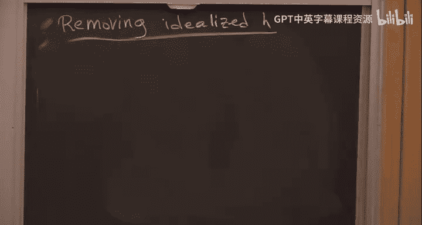

So 124 is a prereq， so I will assume you've seen hashing。

 but I'm going to cover the definitions again， just so we're all on the same page for sure。嗯。So。

Definition。A family。H。Of functions。Mapping。A to B。Is。Kay wise。Independent。If。And for all。J1。JK。In B。

And also for all。Distinct。I1。IK。In A。If you take a random function age from this family。

 a uniformly random function from this family。Then the probability that。嗯。H of I1 is equal to J1。

 and。And H of IK is equal to JK。Hey， what do you think I should put here？

I want to say that basically the function behaves like a random function。

If this were a random function， what would be the probability of this happening？

What's the problem that H of1， H of I is equal to J。1 over B。 So if these are actually。

 if this is actually a totally random function， what's this probability。Yeah。

 I want over be to the cake。So that's the definition of here wise independent。对。

That it behaves the way that a random function would。So you okay， so what？What's an example？

Of a family of functions， which is KY independent for N K。So。Yeah， the set of all functions。Right。

 the family of all functions。Is KY independent for any K？

Because then picking a random function out of that family is the same thing as picking a totally random function。

 okay so。If you pick H。To be。The set of all functions。Mapping。A to B。This is KYs。Independent。Okay。

 so。If you want to store a function little H from a family script H。

 how many bits do you need to store a little H？In general。

 if I have a set of elements and I want to represent an element from that set。

How many bits do I need to represent element from that set？Log the size of the set， right。

This script H。Has size。Which is， I guess， something like。B to the A。Which implies age represented。In。

A times log B。Right， so the name of the game really is， right at the end of the day。

 we're going to instantiate some kind of version of this algorithm with some K Y independent family。

Okay。So。If you have to take into consideration that the algorithm has to store H。

What you really want is your family to be small。😡，Because then you can store H using few bits。😡，So。

Let me make， let me define another family。 So let's let。嗯。A equal B， equal。Yeah。P移。Where。And。

Is that what I want to do？P is a prime。Okay。And then， I'm going to define。H Polly。As being。

The family of。The set of all。Degree。At most k minus1 polynomials。嗯。With coefficients。Okay。

As I say over。Okay， so I just mean。The set of all polymers would degree at most k -1。

 where the coefficients are between 0 and p -1。Okay。And。

How do you actually evaluate the hash function on an input。You evaluate the polynomial modP。Okay。So。

 now。How many？ what's the size of H Poly。Yeah， it's。Well， that's， I guess log the size。 But yeah。

 right， so。Basically， if you have a degree at most k -1 polynomial。

 that means there are K coefficients。Each one is a number between 0 and p -1。

 So there are p possibilities。 So this equals to P to the K。Which implies H can be represented in。

K times log P。喂。A totally random function from P to the P would take P log P bits。

But here we're getting it down to KelloPs。So if you imagine we're setting K to be like two or something。

Then this is only log P bits。 We can actually store H using very little memory。Okay， and in fact。

 you can even set this thing up where， you know， Q， Q actually is a prime power。

And then you do it over this finite field。 Okay， I don't want to。If you don't。

 if you think of P as if you're not。So familiar with abstract algebra。 It's okay。

Not going to be a component in this class， but。Okay。Think of P as a prime。So claim I'm not going to。

Prove this claim， I'll put the proof in the notes。Is that H poly？Because K wise。Independent。

Essentially， the reason I'm not going write the proof down。Essential， the reason is。By interpolation。

Okay，So if you give me any set of Js and any distinct eyes， K of them。

There's always exactly one polynomial。😡，Which will make。

All of those evaluations come out the way you want。So there' is exactly one polynomial。Over。

And then you have to divide by， you know， what's the problem that you pick that polynomial， Well。

 it's one over the total number of polynomials， But the total number of polynoials is P to the K。

Or Q to okay。So it's， the proof is by basically interpolation or the fundamental theorem of algebra。

嗯。Okay。I'll put that in the notes， So now。Let's do a version of Vly Martin， which is not。Idealized。

Okay。So， first。What I'm going to tell you is how to get not a one pluspsilon approximation of the answer。

 but a constant factor or approximation of the algorithm。Of the， of the output。

 of the number intelligence。And we're going to do it in。嗯。And log in space。Lg in bits。And by this。

 I mean， what I mean by this， I mean。

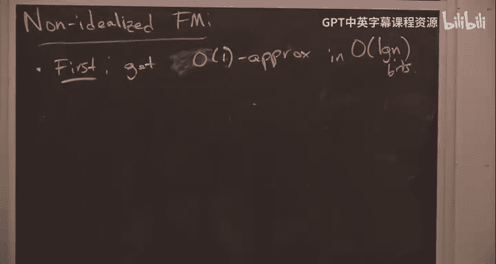

T tilde is going to be at most C T and at least know， T over C for some constant C。

With good probability， it's going to be a randomized argument。So。1。对。嗯。H。From a two wise family。

Mapping。And。Assume。And is a power of two。So that construction there works as long as。

The input and the output are equal in a prime power。So let's just pretend that n is a power of two。

If N is not power of two， what do you do？Yeah， you round up to the nearest power of two yeah。Right。

 so。嗯。I don't want to get into that because it requires too much algebra， but。Yeah。

 so what you could do， sorry。Yeah， you could also。Yeah， so rounding up to the larger。

 the next prime also wouldn't quite work for what I'm about to say， although。

Rounding up to a much larger prime would work from what I'm about to say。 Okay。

 so I'll tell you what I'm about to say。But。Yeah， you can do arithmetic even over these other fields。

 but then。Okay， I'll say something if you don't know what I'm saying。

 that's okay because I you don't need to be， you don't need to know abstract algebra， but basically。

To work over an extension field， what you need is， let's say a Q to the K。 sorry。

 let's say Q is P to the K or not K because I'm already talking about K。

 Q is P to the R where P is prime。What you need is an irreducible polynomial of degree R。

Over the base field。 And then you do multiplication mod， that polynomial。And then you add。

 you basically add vectors mod P。Add coefficients mod P。

 that's how do arithmetic over an extension field。But。Forget about that， if you don't。

If you don't care about it。But let's just pretend that there are other， by the way。

 so there are other。There's actually a wki page on pairwise independent hash functions。

 So this is one example。There are other implementations of pairwise independent hash functions where you really only need to do like bit shifts and other bitwise operations。

 You don't even need to deal with like multiplication over a field。Okay。

 so check Wiki page for Paraed has functions and you'll see some really fast implementations of them that just require like a shift and maybe a。

Yeah， you need to multiply as well。 But like shift and multiplies and nothing。Fancy。

Let's just pretend that we have this。Yeah， so if n is not a power of two。

 just round up to the nearest power of  two， that will at most double n。

 and then log of 2 n is basically log n anyway。I only care about things that's a big O。嗯。Good。

 so what we're going to do is。🤧。Maintain。X。Which is。The max。Over I in the stream。

Of the least significant bit of H ofI。LSB is a least significant bit。

The index of the least significant bit。And then what we're going to do is。Output。2 to the x。诶。

Questions about the algorithm。I mean what the algorithm is。

 I haven't proven to you that it does anything。Useful， so that's the algorithm。Okay。And。

Before I write anything down， let's talk about why this makes some sense。

Just focus on our particular。Integer I in the stream。

What's the probability that the least significant bit of I。Is J。Is index J。

 Let's say we start counting from 0。 The bit， if you write down H of I and binary。

The bit all the way to the right is bit 0， and then bit 1， bit，2， bit 3， etc cetera。

So what's the probability that the least significant bit of H of I is equal to J？Yeah。

 or one over two to the JPs1。Yeah， so everyone to the right of it has to be zero。

 And then J himself has to be one。真。There are J plus1 things that need to。

 J plus1 bits that need to be exactly the way you want them。Right。So。

The probability that a particular person in the stream。Has LSBJ is1 over two to the J， J plus 1。

 But let's say roughly one over two to the J。So the expected number of people。

In the stream who have least significant bit J is T over 2 to the J。Right。Or what's。

 what's the probability that theyre that what's the expectation of people who have least significant bit。

 at least J。It's T over two to the J plus T over 2 to the J plus 1 plus some geometric series。

 It's still roughly T over2 to the J。So。That means that when J is about log T。

You expect about one person there， you expect to have some people there。

But when J is much bigger than log T。You expect very few。 You expect like much less than one。

So with good probability， you're not going to get any。Right， so essentially。

 what's happening is kind of the last J， the biggest J where you know。

 you see people and then you stop seeing them afterward is roughly loggged T。

So then 2 to that J is roughly t。Does that make sense。🤧Comん。嗯。So。Good， so。

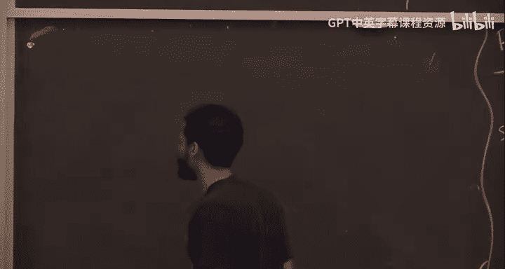

So for fix J。Let ZJ。Equal。Number of。Iron stream。With LSB。Of H of I。Equ to J。And let。Z bigger than J。

Equal。Number of I。In stream。With LSB。H of I。Bigger than Jimmy。All so what do we know？

Basically what I said just now in words， I won't write the proof down is that the expectation。Of Zj。

Is equal to T over two to the J plus1。 This is by linear of expectation， right。

 Each one has probability 1 over2 to the J plus1。 and then you sum up over all T of them and。

The expectation。Of Z greater than J。It's equal to t times。1 over2 to the J plus 2。Plus。

Plus plus 1 over2 the J plus3。Plus not of that， which is at most。T over two to the JPlus。Okay。Now。

This is an expectation calculation。 I'm also going to do a variance calculation。

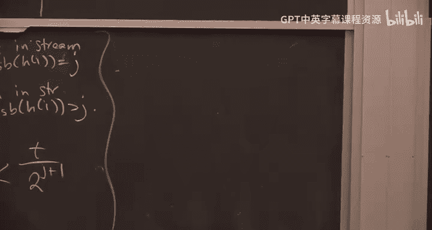

Okay， so this is something subtle when I wrote it， I didn't。Make you pay close attention。

 but this actually is important。Now。The second bullet。

If you have a bunch of independent random variables。Parawise independent random variables。

 then variances add。That doesn't actually require full independence。

 It just requires pair wise independence， like two wise independents。

So we're going to make use of the fact that H is a two as independent function。 And let me do things。

 Let me write things explicitly so that you see where this is coming from。So。来。You know let Y I。

So fix， let's fix J。Let Yi be。1。If H of I。If the least significant bit of H of I is equal to J and0。

Right。Then。Then Zj is just the sum over I in the stream。😡，OfY I。Right。

Which implies that the variance。F ZJ。Is the variance？Of why I。嗯嗯。Which is equal to the sum of the Yi。

Which is equal to the expectation of the sum of the Yi。

Squared minus the expectation of the sum of Yi。Squared。喂。And then if you expand this thing out。

Is equal to the sum over IJ。Of expectation of Y I， Yj。Right。So， this is why。

This is why you really only need in a variance calculation。 when， when sums are involved。

 you really only need parawise independence。Because what you'd like to say is you'd like to say that this is equal to the expectation of Yi times the expectation of Yj。

That's what you'd like to say。And that's true if the variables are pairwise independent， right。

 I'm only focusing on two random variables at a time。 So by， by two wise independent。

 these two guys act independently of each other。Yeah。Oh， sorry， said again。To， yeah。

 to the integer I in the stream。对。Maybe I so。So for maybe I don't know if this answers your question。

 but ZJ I'm saying is the sum of I is like the distinct eyes in the stream。

 I'm something over the distinct eyes in the stream。 There are T。 There are T things in the sun。

 This is the sum of T things， yeah。Yeah， sorry， that was confusing。Okay， so， right。

 So you really need pairwise independence， which we have。And。嗯。

I'm not going to do the calculation for you because I want to get to things。 but if you。

 if you were to do this calculation， if you were to use the fact that the variance of the sum is some of the variances。

 you would get that this thing is at most T over。2 to the J plus1。 Basically。

 the variance is at most of the expectation。 That's you'd get something like that。So I' leave this。

 I'll leave proving this to you。🤧Right， so。Right。For J star， which is something like。Log of T。

 let's say， plus。Plus five。Or something。Kin of at the level log T。Log T might not be an integer。

 but let's it。 Let's say it were at the level， log T。At the little log T。

 we expect ZJ to be about one。喂。At the level， long T plus5。We expect。ZJ to be something like 32。喂。

So what's the probability that？Z J is 0。 What's the problem that Z J。 So this implies that。

Expectation of ZJ star。Is somewhere between， I guess， 16 and 32， something like that。

So let's say it's at least 16。So what's the probability that it's zero？

That means it had to deviate from its expectation by at least 16。Right。

 but chubvy S tells you that that's unlikely to happen。

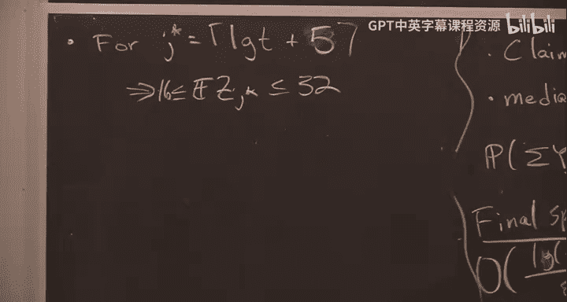

Ilies that the probability that Zj star is0。Is。At most， the probability that。

ZJ star deviated from its expectation。By at least 16。 and this is at most。I don't know。

 like let's say almost a10 or something。Or fifth。It's something you use chubby s， okay。

We have a bound on the variance。Right，We know the expectation， Jews Chubbishaev。

 and you get that the chance of that happening is a small constant。And then， similarly。

You know for J minus。Which is like。Log t minus5。Right。How many people do we expect there？

How many people do we expect to have a least significant bit？

The expectation of Z Z greater than J minus， how many people do we expect to have at least significant bit bigger than J minus？

Something like one over 16。Right。But by Markov， so then what's the problem that we see one at all？

That means we have to be 16， a factor of 16 bigger than our expectation。But by Markov。

 that happens probably at most 16。1 over 16， right。So this thing is like at most one over 16。

Which implies the probability that。Z bigger than j minus is bigger than 1。That we see anyone at all。

😡，Is。I almost one over 16 or something。It Markov。So by a union bound。By union bound， this means that。

The last。You know， the the last the J， where we have anyone with a least significant bit of J is roughly log T。

It's within a band of a window of size 10 or something around log T。

Which means we'll have like two to the5。Well have like a two to the5 approximation。

 like a 32 approximation or something。Not that great but。You know， as's a constant factor。

 approximation， it constant probability。And if you want to boost that to high probability。

 what do you do？Yeah， you could plus， plus plus it。嗯。I'm actually here。

 you can go straight to the plus plusing。Right。You can just do a median without an averaging。Right。

Because what's going on here。 So if you think about what the plusing does。Right， the averaging of。

 of unbiased estimators。 What that gives you is it gives you a good algorithm that gives you like a good approximation with constant probability。

Right， this already is giving me a constant approximation with good with two thirds probability or something。

So I can go straight to taking a median of a bunch of them。So this is a constant approximation。嗯。

So overall， let's say。You know。32 approximation。With two third probability。And when I write this。

 these numbers， you know， two thirds，5， etc ceter， I'm just kind of praying that it gives me two thirds。

 Okay， so if it doesn't， you can just increase this number by another constant or something， right。

 These constants are not magic。 They're just。😊，Pick them big enough so that you get the right failure probabilities。

So good。 So first， we got an O of1 approximation。How do we refine to one's epsilon？

So the moral of the story is that sometimes when you。Make the idealized algorithm non idealized。

 things get a little hairy。Okay， that's okay。So， first。Let me define。Algorithm。TS， which stands for。

 let's say， a trivial solution。Maintains。You know， stores。The first。C over uppsalon squared。

 distinct。Elements。It just remembers the stream。 It remembers the first C over Epsilon squared things in the stream。

And then after that， it just stops remembering。It just remembers the first。

 And then when you ask it how many distinct elements are there。

 it just tells you how many things it's stored。So observation。

 this TS algorithm always gives the right answer as long as the answer is small。😡。

If the answer is less than0 of Epson squared， it will give you the right answer。

IfThe answer is bigger than C over Epsilon squared， then it'll give you a severe underestimate。Okay。

 so。It's always right。If t is at most C over uppsson square。

 otherwise it gives you some underestimate。Now what we're going to do is instantiate。In she ate。TS1。

TS or let's say Ts0 up to TS log base 2 of n。So we're going instantiate roughly log n different copies of this T。

 S algorithm。What we're going to do is we're going to pick。Hash function G mapping N to end。From。

A parawise family。And then。So this is now my algorithm。Feed。I。We feel。Ex streamreme element I to T S。

Le significant bit。Of G of I。And then4。Output。Two to the J plus1。Times。The output of TSJ。Where。

T is roughly2 to the J。So I'm assuming that I know T up to a constant factor。

 I know a J such that T is roughly sorry。So that T over2 the Js right such that。T over 2 to the J。

Is roughly1 over epsilon squared。That's what I'm meant to say。

So I'm assuming that I know a J such that T over2 the J is roughly when itrups on squared up to a constant。

How do I actually know such a J？That's what that was。So in parallel with this algorithm。😡。

I'll run that algorithm in parallel。 And then at the end。

I only need one pass over my data stream because these things are running simultaneously。 at the end。

 when I need to actually output an answer。😡，I'll get my constant factor approximation here。😡。

That tells me a J such that T over 2 to the J is roughly what erupsson squared。

And then I'll scale back up by two to the J plus1， or let's say 2 to the J plus1。

 T over2 J plus1 is roughly one I rows on squared。Okay， so that's the final algorithm。

I don't want to get。Too formal with analyzing this。 Let me give you。

 let me tell you roughly why this works。And by the way。There might not be such a J。Right。What if T。

 what if T is actually 5。Then T over anything is not going to be when erupsson squared。

RightT over two of J is only getting smaller and smaller。So in parallel。

 what you can also do is maintain。Another T， S data structure that just remembers the first。

10 ofrups on squared things in the stream。And if the answer is less than 10 reppson squared。

 you know it exactly because of that thing。 If the answer is bigger than10 reppson squared。

 then there is such a J。 you'll figure out such a J from that step， and then you'll use that J。Okay。

So why does this work？

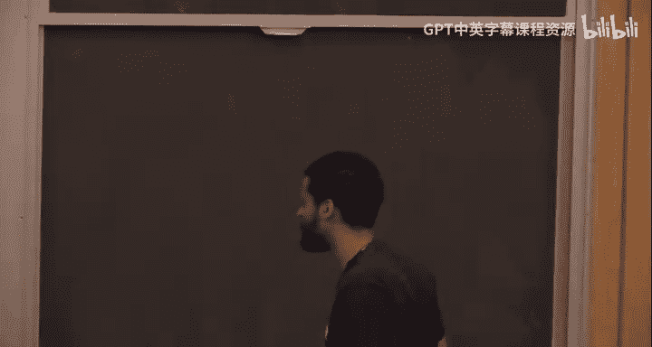

Basically。What。You know， BJ。Equal number。Of。Distinct elements。Mapped or hashed。By G。To。

The the J data structure。The expectation of Bj is equal to t over 2 to the j plus 1。

This is just linearity of expectation。If you have a bunch of indicator random variables that each indicator random variable tells you whether or not item I map there。

He has expectation1 over two to the J plus1。So the expectation of their sum is the expectation of BJ。

 which is t over 2 to J plus1。可以。Let me call this， let me call this。QJ。Chubbyhoev。

Says that Bj is actually going to equal Qj plus or minus o of the square root of  Qj。

With you know good probability。With probability two thirds or nine/ tenths or something。

 some good big constant probability。So chubby chefev basically tells you that。

With constant probability， a random variable is within within a standard deviation。

 That's what that's what Cheubby chef tells you。But if this number is roughly1 over Epsson squared。

If this number is bigger than equal to1 of e Rpson squared。Right。Then， this is equal to。Is equal to。

1 plus or minus o of epsilon。QJ。If。2 if。If QJ is roughly1 over uppsilon squared。That's why。

 that's why I zoomed in on the level where T over2 to the J plus1 was roughly when a rhpsson squared。

In fact， this is going to be this as long as QJ is at least1 or Epsilon squared。

As long as you pick a level that's bigger than equal where the expectation is bigger to one of Epsson squared。

 you will get a one pluspsilon approximation by chubby show。So。Good。So in fact。

 you've get better and better error if J is smaller。😡，If QJ is bigger than 100 over Epson squared。

You'll get a one plus Epsil on over 100 approximation。😡。

Or one plus uppsilon over 10 approximation or something like that。So why didn't I pick J。

 Why did I pick。嗯。Why didn't I pick a smaller J？Why don't I just pick J to 0 or J to 1 or some such thing。

So here's what I'm saying in words。 Okay， so what I'm saying is if you go to a level。

Where the expectation is like。One， if you expect。One person， right， if you go to level log T。

 you expect only one person to be there。But then there's， there's terrible variance。

 There's a pretty decent chance that no one's going be there。

 There's a pretty decent chance that three people are going be there。If the expectation is one。Right。

 so you're not gonna get a one placeceptpsilon approximation with good probability because there's just too much deviation。

But if you expect what are Repson squared people to be there。😡，Chuby Che tells you。

 actually you'll have very close to1 of epsilon squared with good probability。

 You'll have1 over Epsilon squared plus or minus1 over epsilon。

Which means you're getting a one plus uppsilon approximation。So the bigger the expectation is。

The better quality， multiplicative approximation you're getting。So I said。

 let's go to the level where the expectations is when epson squared。 Why didn't I say。

 let's go to the the level where the expectation is1 epson to the 1t。

 We'll get even better multiplulative error， yeah。Yeah， exactly。

 The problem is the TS algorithm stops working if the number of distinct elements in the stream is too big。

Right。So yeah， you could go to the level where the expectation is when of ropes under the  ten0。

But the T S at that level， all you remember is the first interrupts on square people。Right so。

You're not going to get a good， you're not going to actually know how many people landed there。

So if you go to the level where the expectation is roughly when it rhsson squared。

 you actually will have roughly when it rhsson squared with a good probability。

So you both get a multiplic of approximation and the TS at that level will work。😡。

RightAnd then you scale back up by two of the J plus1， and then you get T。So。Minus calculations。

 That's what's going on。 That's why this algorithm works。And the final space。Well。

We need to remember， you know， we need to run that algorithm in parallel。 That's log n bits。

We needed another hash function G。 That's another log n bits。And then。For each of the。

 there are log n different levels in this log n different streams that we're running in parallel。

 right， T S 0 to T S log N， for each one of them， we're running the T S algorithm。

 How much space does the T S algorithm use。Yeah， exactly。 remember is C rhpsson squared numbers。

 Each one is log n bits。So this uses zero ups on squared log n bits。

 and there are log n of them running in parallel。 So the total space。

Is1 over epsilon squared times log squared n。And there's no idealized assumption here， right。

 This is， this is just the truth。And it turns out it's possible。To get。

An algorithm using space1 or Epsilon squared。Pluss log end bits。This is a paper。

By Daniel Kane myself and David Woodruff。And this is actually optimal。

You can prove that or it was proven by Woodruff and others that there is no。

There is no algorithm that uses less space than this。😡，I'm not going to cover this algorithm class。

But it uses similar ideas where you have parallel streams and do stuff。 Okay。

 but I'm not going to talk about the details。 But anyway， now。

 you know an algorithm that runs in a non idealized algorithm that actually runs in very little space。

 So I didn't get to the impossibility results。 I'll do that the beginning of Thursday。

So that's everything。And please sign up for  scibing。 Okay， we have very few scribe sign ups。

 you described today， right。O，可以， okay great。