# 哈佛大学《大数据算法｜Harvard Algorithms for Big Data (COMPSCI 229r) 2016》deepseek - P3：-03-Algorithms for Big Data (COMPSCI 229r), Lecture 3.zh_en - GPT中英字幕课程资源 - BV1yGdNYvEMo

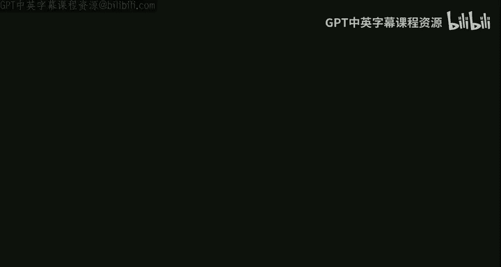

2。let's get started。So。Last time， we saw。嗯。Fgelie Martin algorithm for distinct elements。

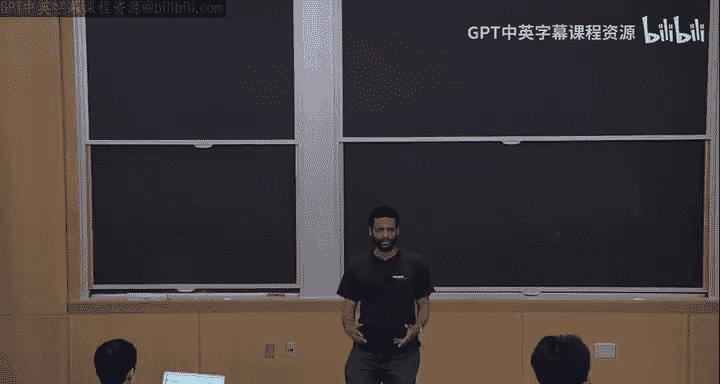

Or some variant of it anyway。 So I want to talk to you a little today in the beginning about lower bounds。

 So showing you that。You know， we had both the algorithms we saw， both the Morris algorithm。

 as well as the distinct elements algorithm for。For a distinct element。

 as well as the Pley Martin algorithmgam for distinct elements。

 Both of them used randomness and approximation， right， They output an approximate。

Answer with high probability。 So you could ask whether we could relax that in two ways or strengthen the algorithm in two ways。

 maybe a deterministic algorithm， which is exact。 Okay， well， that be that would be the best thing。

 We can't do that。What about a deterministic approximate algorithm。

 will'll also show that we can't do that。And what about a randomized exact algorithm？

Will'll show that that's also impossible。 And when I say impossible。

 I mean using little low event space。 Okay， so I want to convince you that both randomness and approximation are actually necessary for distinct elementss。

嗯。对。So as a warm up。Remember distinct elements， you're seeing a sequence of integers in the stream。

 How many of them are distinct or how many distinct ingers did you see。

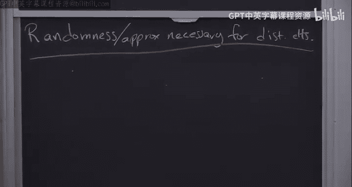

So。So， I1。I am。Stream。And each each eye is then set from one to end and then claim。嗯。

Little low of the men。Of an。You can' can't have an algorithm that uses space less than any of these two。

Remember， you can get n bits with a bit array， and you can get M log n bits。

With just remembering the entire stream。Okay， so proof。So， I'm going to show。呃 and欧omega。

And lower bound。Or an。And M being like roughly the same to a constant。So in the lower bound instance。

In the proof， you're going to see that I'm an under meeting。Conant。So again。

 it's going to be what we said， I think when we're talking about approximate counting the Morris algorithm。

Basically， it it boils down to compression in the pigeonhole principle。So。If algorithm。

If it' deterministic。impossiblem。If。If you're deterministic。And you're exact， that's what it mean。

If you're deterministic and you're exact， then you need。

You can't have sublinear number of amount of memory。So suppose the deterministic exact。Algorithm。诶。

Uses space S。Then。We're going to use。哎。As part。Of a compression scheme。It's a map。End mid strings。

Into。Epi string。And when I say a compression scheme， I just mean an injection。Okay。

And now you can't have an injection from a bigger set into a smaller set。

 So that implies that S is at least n。Okay， and the way that I'm going。You know。

We're going to argue that it's an injection because we're going to say that let's call this compression scheme。

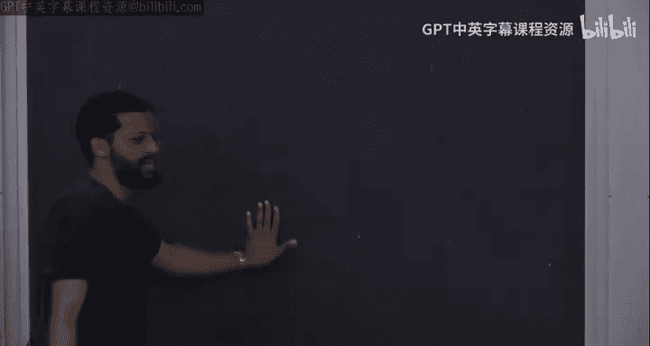

You know。

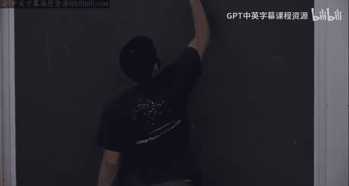

ENC and。ECSo there's an encoder and a decoder， right？To say it's compression scheme means。All X。

The decoding of the encoding of X。So I just mean that being basically this is a proof that the encoding function is an injection。

So what do we do？So。How do we encode？Create a stream。Containing。All I such that X is equal to 1。

And then。Output。The space contents， the memory contents， let's say。Of a。On that street。Right。

 so this is S bits。The encoding outputs S bits。诶。How do we decode？How do we decode some y。

 so y is like the encoding of some x。Questions about anything I said， people look a little puzzled。

他2。Yeah， so so take you create this stream based on x。You run the algorithm A on that stream。

 When you finish running the algorithm， it has some memory contents。Yeah。

And then that final memory state of a is then the encoding。Okay。And now。

 what does the decoder have as input， This is， this Y is like the M。Contents。嗯。A。And some。

Stream that came out of some X。So I'll call it streamax， okay。

So the decoder is just going to figure out what x was bit by bit。O。

The first thing you're going to do。😡，Is just ask A， ask。 So you mean， you have。

 you have the memory contents of a so you can like boot a up with these memory contents。

And it's as if you had just run it on this stream X。

The first thing you can do is ask it how many distinct elements are there。

What does that tell you about x， it tells you。How many1 bits are set in X？So。F 0。

 F 0 is distinct elements。 F 0， Y， query Y equals， you know， number of1 bits。In there。

Now that I know that。Let me call that。Let me call that the weight of x。Now that I know that。

 how am I going to recover x fully， I'm going to recover it bit by bit。😡，O。

So let's say that I want to know whether the Ih bit of x is a 1 or a0。 How might you do that。Divide。

So what do I have now， What do I have in my in my hands， I have a， I have。

 I have the memory contents of a run on the stream specified by X。 That's what I have in my hands。

And somehow， given that， and given the fact that a is always correct， right it's an exact algorithm。

 and it's always correct。I want to use that fact to say。For any bit I。

 I can figure out whether X I was one or not。

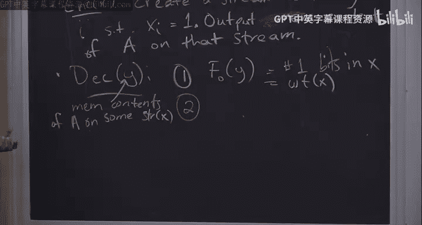

So since I have the memory contents。I can append one more。Number to the end of the stream。

And then after processing that new number in the stream， I can ask a。

 what are the number of distinct elements now？😡，Right。

So let's say that the new number Iend at the end of the stream is I。

So now I've run A on the stream of X。And then now I'm also running it on I。😡，If X I was one。

How will the number of distinct elements change compared to the weight of x？If X is 1。

 it'll stay the same。Right， I was already in this dream。So if you append another eye at the end。

 you haven't changed the number of distinct elements in the stream。But if Xi was actually zero。

You've now added a new distinct sync element in the stream。

 and then the answer will increment by one。Right so。To determine。If X is 1。嗯。Aend。Okay， well。

 yeah end。Bye to end of stream and thescribe here。Oh， you're a the scribe， right？Oh。

 sorry about that youre okay with that？Okay， sorry， I guess I misunderstood。 So you said lecture 10。

 I some kind of thought September 10， O， was sorry okay。Okay， sorry about that。Got something。Okay。

 so。The determinative X is 1 append to I to end of stream。And。Query。Whetherather。F 0。

Has stayed the same。Or gone up by one。And we can do this for each eye and then recover X bit by bit。

Does that make sense。Okay，Okay。Maybe that's not that surprising that we can't do an exact deterministic algorithm。

 How about maybe we can hope to get an approximate deterministic algorithm。Right。

So now I'm going to show you。Another claim。Any。嗯。

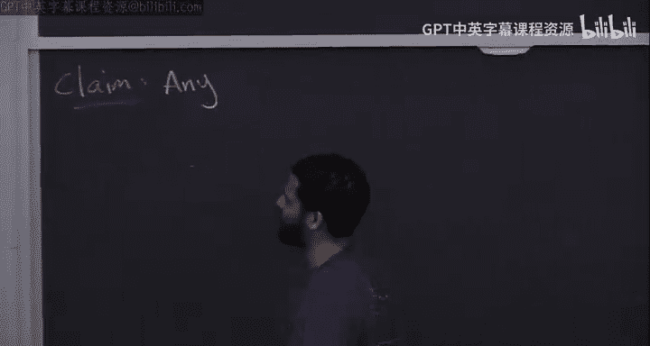

Any approximate， let's see。 Any deterministic algorithm。Providing， let's say， a。1 plus 1。1。

Approxiation。Requires。Omega n bits。So， even。Even if you're willing to have an approximate algorithm。

 but you insist on being deterministic， you still can't get sub linear your space。

How are we going to prove this？It's again， gonna be via an encoding decoding scheme。

Why does this proof break down， Why can't you just repeat this exact proof over there。This is yeah。

Right， so， yeah， exactly。 So the， yeah， so the issue here is。

Are tests for whether the iPhone is one or not。Depend on the number of distinct elements changing by an additive one。

But if the weight of x was， say， 100。Or， you know， something really big。

 The weight of x is like n over 2。Then to detect an additive one difference in the number of distinct elements。

 you need a really， really good approximation。You need like a one plus one over n approximation to determine that。

I want to say that even a one plus 10th approximation requires linear space。

And such an approximation would not be sensitive to changing the distinct elements in order distinct elements by one。

Okay， so。Good。So proof， suppose。

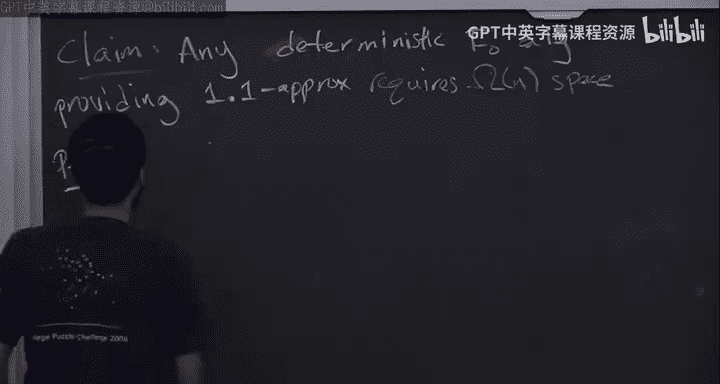

We had。嗯。3。Let's see， let's。Suppose we had a collection。C。Of。Subsets。Of one up to n。

Such that two things happened。1。The size of this collection。Is at least。Two to the C。

And two or three things happen two。For all S in this collection。The size of S， let's say。

 is n over 1000。And three。For all S not equal to T in this collection。This is how I wantna。这是。Yeah。

 say。The size of。S intersect T。Let me get in over 100。Is that most？And over 1000。嗯。

me I'll figure out this constant。对。Can。对。Which you know。

 is basically the point is that this is like only a tenthth of the size of S。I can't even make that。

嗯。Okay， that's better。Hey， so these constants will see what they actually need to be。

 but I think that should be fine。Okay， so I have basically a bunch of sets。 They're all quite large。

 They're linear in size， but they have very small intersections。 And I。

 and I claim that suppose I had a collection like that。 and the collection is of size。

 exponential in N。How many subsets of one to n are there。 There are two to the n subsets of one to n。

Right，So that's an exponential number。 And I'm claiming that。

Even theres still quite like an exponential， maybe this constant is something less than one。

 There's like  two to the n over two or something， an exponential number of sets。That all have small。

 pairwise intersections。Okay so。We will。In compresspress， decompress or encode decode。Vectctorors。

X of S。For S in this collection。What's x sub S， x sub S is the indicator vector of the set S。

It has a one for the elements that are in S and has a zero for the things， not in S。对。

And I claim that。There is a way to encode and decode。If we have a 1。1 approximation output。X of S。

I is equal to1 if I is an S and0 otherwise。So how do we encode？Same as before。RightAnd by the way。

Again， what we're going to get is that there's an， there's an a compression scheme。

From that family of vectors。Not from 01 to n， but from just that family of vectors into01 to the S。

So S has to be at least log the number of vectors there are。But log， the number of vectors is C N。

 So S has to be at least C N。 So we're still getting an omega n lower bound。

That's why I want this family to be large。 So we're going to encode the same way as before。

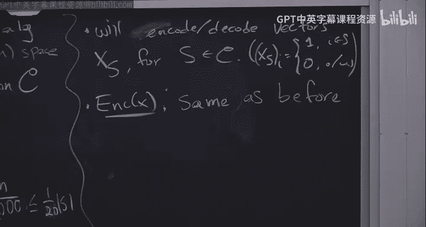

And then how are we going to decode？When we've been fed as input， you know。

 A applied to some string of X。It's a string of x。Which I called why before。So the point is。

 I have this A run on some stream。But I don't know which X was used to create that stream。

 which S was used。So。Want to test。If。X was actually equal to xs。

We know that it is X of some subset in this collection。 We just don't know which subset it is。

So we can do is like an exponential time decoding。Basically， try every single S。

And then test whether or not。😡，The X that created that stream was actually X of S。Right， I mean。

 it's okay for we don't care about computation time here。

 We're just trying to prove that this encoding is an injection， right。So how would you test？

How would you test if x was equal to x of S？Any questions about where we are？O。Right。

 so you know that right now， before you do anything。

 you know that the number of distinct elements is n over 100。All the sets sub size in over 100。Now。

 A has been run on some stream。And then you can append to that stream。A new stream， which is。

The stream of excess。I mean， you have， you have the memory contents of a run on this。

 So just continue running A on this， too。And just ask yourself。

Now what is the number of distinct elements， query the algorithm。

 whats the number of distinct elements now？😡，If x sub S was actually equal to x。喂。Then what？

And Vos was actually equal to x， what's the number of distinct elements？Yeah。I'm saying。

 if you were right， if x of S is equal to x。😡，Then the everything else doesn't change at all。😡，Right？

Oh， oh， sorry， sorry。 Okay， Yeah， You're right。 Okay。 So yeah。

 I guess that's what the algorithm would say。 Yeah， you're right。

 So if x and S were actually equal to x。😊，Then the number distinct elements would still be an over 100。

 But since we have a 10% approximation guarantee， our algorithm will say a number between。

same number which is n over 100 plus or minus n over 1000。So maybe I really need to make this 3000。

 but anyway。Right， so I'll be within and over 100 of and over 100。What if x of S was not equal to x？

😡，Actually， I think that's fine。What if x of S was not equal to x？Then。This is actually some X sub T。

Right。This is some X of S。😡，S&T barely overlap with each other。😡。

So the neuro distinct elements almost doubled， basically。

It almost doubled minus a little bit because there is some small amount of intersection。

So the true number of distinct elements is now roughly。And over 50。Not what the algorithm says。

 but the true nano element is roughly n over  two times n over 100， which is like n over 50。

But there is a little intersection， So N over 50 plus something small。

 maybe plus or minus something small。And then we get a 10% approximation to that。Right so again。

 we get N over 50。 The algorithm will tell us something which is like N over 50 plus or minus is something small。

But N over 50 plus or minus is something small is very different from N over 100 plus or minus is something small。

 So we can distinguish the two cases and know whether or not our guest for us was correct。

Does that make sense。So。Question or。😀这是。😊，😀嗯。😊，二人。Oh， okay。Any， specific thing that you're。Oh， I see。

 okay。Well。Any other scribe volunteers， okay？Where are you looking over here？LB lowerbound。对。If not。

 I mean distinct elements。Enot for me is like the number of distinct elements in the stream。

So are youcring？Paent。Okay。Okay， so。Right， so okay， so。RightIf we had this collection of sets。

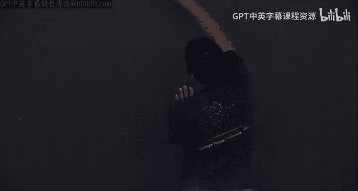

Sorry。Pull it over。对。Okay， okay， good。 So we write and like law text scribe notes and send them to me。

Okay， so。😀Yeah。😊，Okay， so。Good， so if we had a collection like this of sets。

 it would imply our linear lower bound。 So now we just need to show that this collection of sets actually exists。

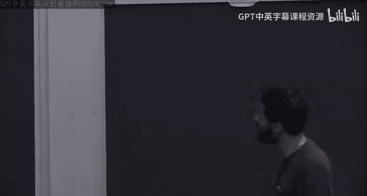

Right。And how are we going to show that this collection of Z collection exists。With those properties。

So here's what we're going to do。So。So we're going to do is okay。

 so every set in C is a subset of one to n。So write down one to n。

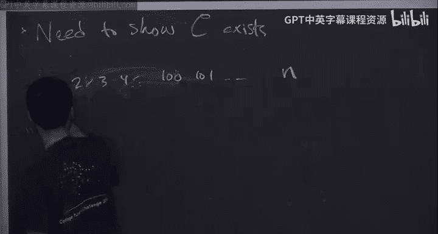

Take the first00 elements。Take the next00 elements is up to 200， etcter。So， basically。Partition。And。

Into。And over 100 pieces。哎。🤧And。Pick x1 up to x capital n。IID randomly。For each。I X， I contains。

A random。A uniformly random element。From each partition。Okay。

 so X1 will like take one of these at random。 It'll take 4。 maybe It'll take one of these at random。

 It'll take one of these at random。Okay， so by construction， every set has size exactly n over 100。

Okay， and now what I'd like to say is that。Or I guess。I wrote them as x's， but they're ss。

 So x is a set。嗯。If you look at X I and X J。Right。In expectation。How many collisions do they have。

 How many elements do X I and X J have in common。Yeah， exactly。 right。 It's so within a chunk。

 within a partition， the probability they chose the same element is  one over 100。

And the number of partitions is n over 100。 So by linear expectation。

The expected number of collisions they have is N over 10，000。So what's the probability that？😡。

The number of collisions is bigger than n over 2000。

That's like five times bigger than the expectation。By turn off， that's like exponentially small an N。

Right，It's E to the minus C N for some constant C。So。

As long as you choose capital N to be an exponential。

 but not too big of an exponential by union bound， right， So what you can say is。嗯。

The expectation of X intersect Xj。That size is n over 10，000。So the probability that Xi intersect Xj。

I's bigger than。Five times the expectation。Is that most some e to the minus is some constant times n。

 This follows by the turn off bound。So。We're going to choose。N to be E to the minus C。Over two。

Why are we doing that？😡，Because。

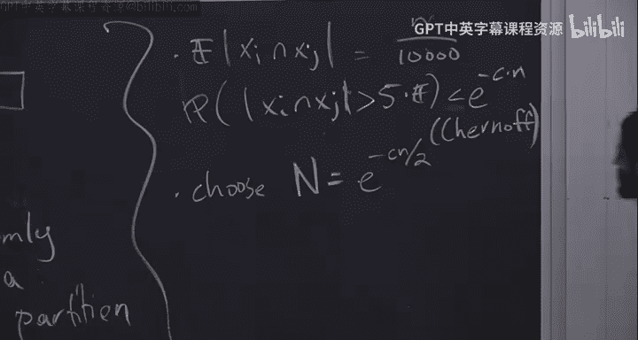

The probability that there exists an I in a J， such that X intersect Xj。

Is bigger than five times the expectation。Is that most？And choose2。Times e to the minus C。

This is a union bound。Over all。IJ pairs。喂。But because of the way we chose capital N。

 this thing is less than one。Right。The problem that there exists， a bad pair is less than one。

Which means that the probability that， yeah。Say that again， the C。Capital N， yeah。2。Sorry， yeah。

 and is。Positive integer。Yeah。We're picking we chose to become this way so that this expression is less than one。

That's right。So the problem that there exists a bad pair is less than one。

 which means that the probability that all pairs are good is bigger than 0。Strictly bigger than zero。

Which means there exists。A family of these excs， which works。This is just an existence proof。Right。

Does that make sense？Okay， so what we just showed is that there exists this， this family of sets。

 So that's it。Okay， so。That's all I want to say about lower band。 So I showed you that。

Deterministic exact doesn't exist。😡，With linear sublinear space， this is even stronger statement。

 deterministic approximate doesn't exist with sublinear space。 You could also ask randomized exact。

That that's a Pet problem。 So PSet1 is out。 You can go to the class website。嗯。Hint。It's you。

 you should think about using basically the same exact family of subsets。

 but you're gonna use it in a different way somehow。Okay， there's a hint on the problem set itself。

 too。So yeah， so after you solve that problem， you'll realize that randomized exact doesn't exist either with sub linear space。

 so we really did need an approximate randomized algorithm。Questions。对啊。so what do you actually do？

What you do is。You basically have。A loop over every S in the collection。

So the decoding algorithm takes exponential time。It takes time， which is something like capital N。

 It tries every single S in in the collection。And then what it tries to figure out for each one of those it tries to figure out is the thing that was encoded this S or not。

😡，And if not， you'll try the next S in the loop until you find one that works。So now。

 how do you test if the thing that was encoded was actually your S。

You know that the number of distinct elements。The actual number of distinct elements is n over 100。

RightBecause of the way we're doing the encoding。All the one bits become elements in the stream。

 and there are exactly n over 1001 Bs。对。Now。If this S was correct， you're a correct guess。😡。

Then when you append the stream of access to your stream。😡。

Then you haven't changed the actual number of distinct elements at all。

So when you query that algorithm， it'll give you something within 10%。

So it'll give you something that's within n over 1，000 of n over 100。Right。

It'll be something very close to n over 100。But if。Yeah， and see。 So yeah，que。

 basically queer appendix appendtry of X of S to this， to that stream。

And then check whether or not the query gives you some number that's close to and over 100。

But if this thing were actually different。It'll give you something that's very close to N over 50。

Right， because。These two sets， if this is a wrong guess， these two sets barely overlap。

So the number of distinct elements almost doubles because all the new elements you add here。

 almost all of them are new。Right。And if you have， if you can tell the answer to within 10%。

You can tell you can tell that the number of recent elements actually doubled or close to doubled。

Yeah。So ultimately， what we get is that。The final lower bound we get is that the space of a。

Is at least。The log。Of C， right？Because we have an injection from C into， into S bits。

Where S is the space。Any other questions？Yeah。Oh， connecting that to the claim， the fact that a 1。

1 approximation algorithm。Needs omega n space。So。What we did was， we used。

We used call that algorithm A。 Sose there was such an algorithm。

And suppose that algorithm used space S。 The point of this was to show that if there is such an algorithm A using space S。

 then there's an injection。From that collection C。Into the set of Sbit strings。Right。

But there are only two to the S S bit strings。So that would imply that C。

 the size of C is at most2 to the S。😡，RightBut we know that the size of C is2 to the CN。

So that implies that S is actually CN。Right。Does that address the part that you were concerned with？

I mean， the point of this。Decompression， the point of this decoding is just to show that the encoding was actually an injection。

If the encoding were not an injection， you wouldn't be able to decode。Yeah。From C， Yeah。

 so this is the encoding is an injection from C。Into the set of all SV strings。Yeah， the nerve， yeah。

 so。Yeah， exactly。 So that means that2 to the S has to be at least as big as2 to the C N。

 So S has to be at least as big as C N。Yeah。There's no algorithm。

So I said the statement we're making is if there is such an algorithm。Then。There is an encoding。

Right。And that encoding is using S bits of space。So therefore， S must be at least C。So give me。

 give me any algorithm that you're claiming solves the problem。

 This is a proof that that algorithm space must be at least CNN。

I can use any algorithm that solves the problem to come up with such an encoding decocoding scheme。

Okay， good。So。嗯。I guess so that's what I wanted to say about lower bounds for the distinct elements problem。

 at least for now。You could also ask about lower bounds for。

Even the randomized approximate algorithms， right， So I told you the best known algorithm we get space。

 What erups on squared plus log n bits。To give a one pluspsilon approximation with 99% probability。

 you could ask， can we improve that。There are techniques that say no。

 actually you can't prove that even with a randomized approximate algorithm。

But we're going to see techniques for lower bounding such algorithms later in the class， okay。Here。

 I just want to show you that you need both randomness and approximation。 and also。

 I guess maybe I can say， you know， if you have， if you have more questions about this stuff or anything else in the class。

 we now have office hours up on the website。 So mine are Mondays and yas are Fridays starting next Friday。

 And PSet one is due a week from Monday， a week from this coming Monday。🤧Okay， so。Good。

 so now let me。

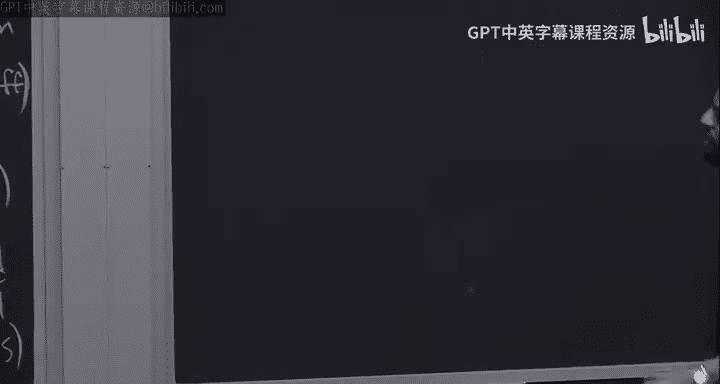

Now that I've shown you this lower bound。

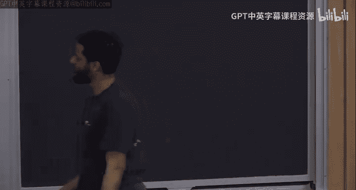

I want to move to another kind of streaming problem。 So so far， you've seen two streaming problems。

 approximate count and distinct elements， and both of them are in what I'll call the insertion only model。

Okay， and it'll be clear in a second why I call it that。

But what if I want to deal with streams that have deletions？Okay， so。Back to upper bounds。

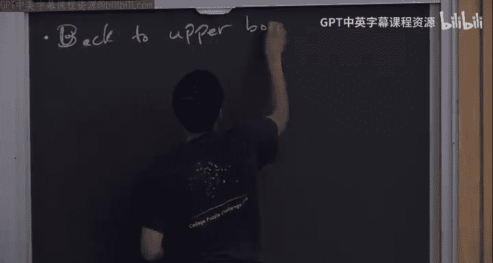

So I'm going to look at what's called the turnt model。

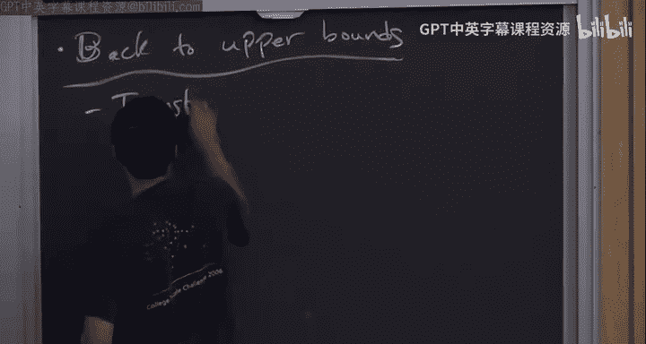

The turnst model of streaming。

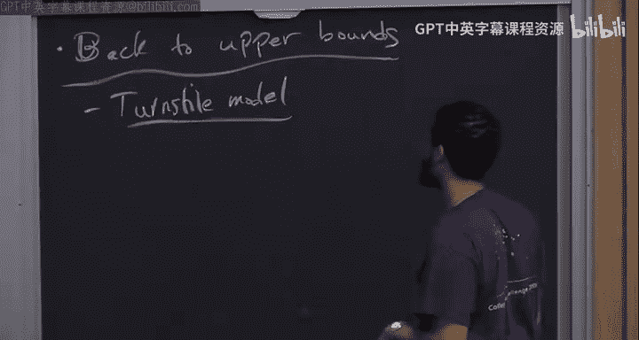

I think it was first defined by。This term was coined by Muur Krishhnan， maybe an 05。So here。

There's a vector X。Which is an RN。It starts。As the zero vector。Okay。Sequence of updates。

In the stream that look like I deelta， which means that X I。Yeah， it's implemented by Delta。

 and imagine Delta。呃。Is some number that can be positive or negative？Think of delta as plus 1 or -1。

 You can either add or subtract to some element。And the vector， is somed in the vector。And then。

 you want。To。Compute。Or approximate。Some function of the vector。哎。So。

No matter what stringing problem you're trying to solve。

K ofThere's always this trivial solution of maintaining the entire vector in memory。

And that's going to use you something like n words of space。

You need to remember every coordinate of x。And the goal is going to be to do something that's more efficient than that。

Okay， so。Yeah， so for example。A function of the vector X。 So， for example。F0。

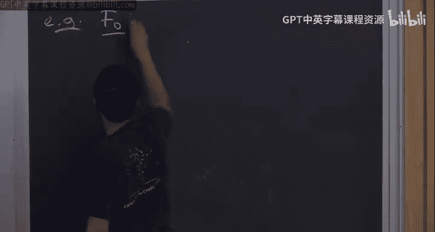

We have that。Delta。Is always one。And F of X。Is the support size of x。

 so it's the number of coordinates I such that。Xi is not equal to  zero。

That's the distinct element problem。But you could look at。

And of a generalization of distinct elements where you're allowed to delete people in the stream as well。

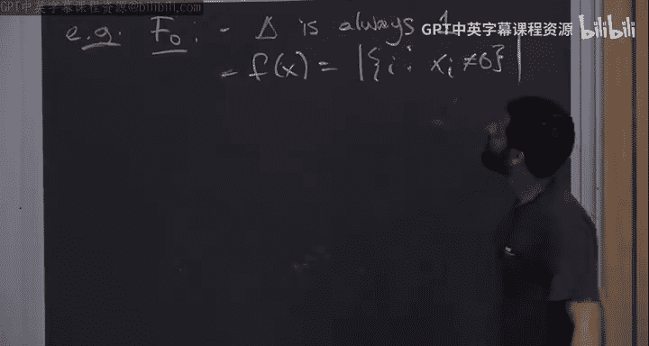

Okay， good。So。A common。Actually， the only。Technique。For designing。For designing。Turn style。You know。

 algorithms。And the turnst model。It's something called linear sketching。

I'm going to tell you what that is。And the idea here。Maintain and memory。Why。Equals pi x。In memory。

Where pi is a matrix。That's short and fat。 It's got n columns。And Mros。谁。I mean。

 we'll see now examples of you know， using this。Approach of designing algorithms for some actual problems。

But the idea here is。Basically， don't store X。 Oh yeah， question。嗯。Yeah。

 I think you imagine that what's a turnstile， it's like that when you enter， Yeah。

 when you enter a building， right， you， you go through this metal thing that spins around。

 So when when an element， it just means that their people can come in and out。So。

 so I get I comes in the stream。 And then later， someone deletes him。 He comes out of the stream。

That's where it came from。It means that there are deletions。Yeah。So。Right， so first of all。

First of all， this should worry you a little bit because。Now， what do I need to maintain。

 the algorithm is specified by pi。😡，Pi is a huge matrix。 It's got M N numbers in it。So， yes， why。

 y is only m dimensional so I can store it more efficiently。 But then pi is huge， right？

 So we're not gonna actually store this matrix pi explicitly， Usually when we design such pis。

 they'll either be deterministic in such a way that we can extract any entry efficiently without actually writing down the whole matrix。

Or we'll also have algorithms where pi is specified by two wise independent hash functions or something。

 right， So we never actually write down pi。 Its entries are specified by a hash function。

With down in independence so that we can write it down compactly， things like that。

 So we're gonna to see examples very soon。And just so we're on the same page。Why can I even maintain。

 let's pretend that storing pie happened to be free somehow。

How can I process updates using a linear sketch？

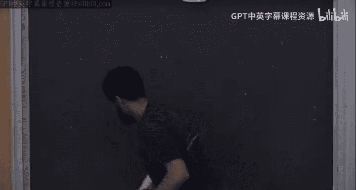

。嗯。So， let's say。Pi。You， it's this matrix。Let's say the columns are called pi1。Up to pi N。Okay。

Remember。So remember， like notation， notation should usually help you。To solve problems。

 So why did I write this， So， you know， fact pi X is the same thing as some I from one to n of X I times pi I。

It's a linear combination of the columns of pi。So suppose someone doesn't update。Someone doesn't。

 so suppose。I'm storing。

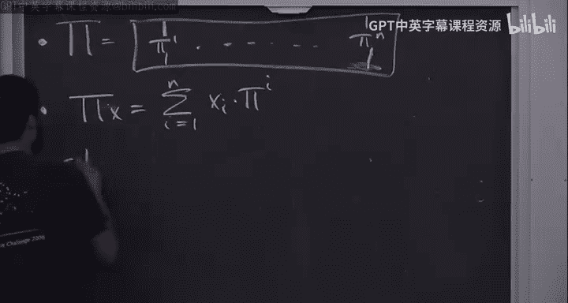

Y equals pi x。And update。嗯。Ie Delta Coms。That means y is now pi should Y should be now pi of x。Plus。

Delta times EI， the I standard basis vector。But this is the same thing as。Pi x plus delta times pi I。

So this is the old value of y that I was storing。 and this is the new Y that I need to store after the update。

Right， so whenever an update comes， how do I update why。

 I just need to add deelta times the I column of pi to my sketch to y。Okay。

 so as long as I'm able to access columns of pi efficiently。Right as long， you know， I don't。

 I don't want to write down pi explicitly because that's too big。 But as long as someone says， hey。

 what's I column of pi， if I can tell you that in small space。Then I can。

 I can implement this update rule in small space。What's a question。Very good so。🤧Let me。

Let me now show you a problem where we can use some linear sketching。

So why did I call distinct elements F0？So。Here's a problem。Moment estimation。

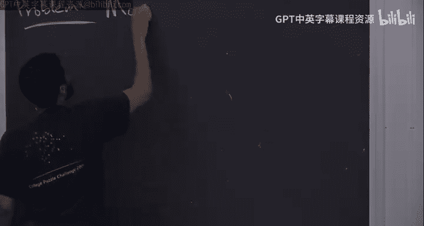

And this was first studied by。Alone。Maratius。In secondti。In stock 96。嗯。

And here here are the function that I want to compute。 Remember。

 I want to compute some function of x。F of x is going to be what's called。Which is。The LP norm。

To the piece power， which is the sum of our eye from one to N。Xi。To the P。Yeah。

 so if you interpret0 to the0 as being0。Then。F0 is is actually the number of non zero Xs。

 which is the number of distinct elements。 So that's why people the literature they call the F0 problem。

开。And。It turns out we're going to see more about this as the course goes on or in the next this lecture and the next one。

 basically。As far as the upper bounds are concerned。There's。There was a。Kd of a。

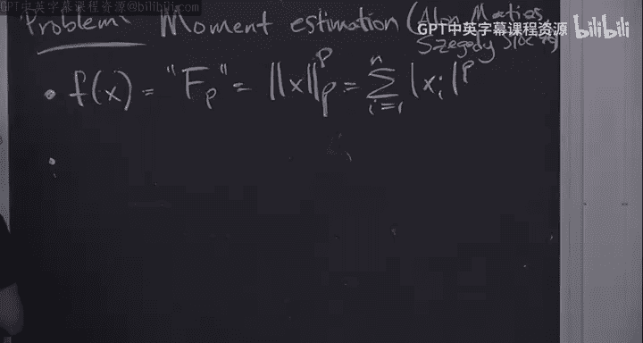

Transition point。Transition point。In complexity。嗯没有。F P estimation。

 So it's known that if 0 is less than or equal to P is less than or equal to 2。You can get。Polly。

 you know， loggan。We uppsilon in space。In fact， you get log n over uppson squared。Bits of space。

If P is greater than2。Then you actually need is achievable。😡。

It's achievable for one pluspsilon approximation with two third probability。Meanwhile。

 P is bigger than 2。You need。N to the 1 minus2 over P。Bits。Of space。You know， for any。

 let's say two approximation。And actually， not just， not just that that's omega， but theta so。

There's an algorithm。And let me like this。Times polyly。Login。Over absolutely。So。for one。

 let's say now one was up on approximation。So even for a two approximation。

 it's known that you need n to the 1 -2 repeat bits of space。

And there's an algorithm that actually gets you that up to some polyloin of reppson terms。ok。

And this is due to。Yeah， so if you send me the notes， I'll， I'll add all the references for this one。

 But this one is due to。Bri Joseph。Ja Ram。Kumar。hima Kumar。I think at 04。That's the lower bound。

And then the upper bound is due to in。And Woodruff。In05。

So there's some transition in the complexity of this problem。First， I'm going to show you a question。

いや、よすよ see。You'll see later why。 So the out basically， the algorithms for。

The algorithms for0 less than equal P less than equal to 2。Look very similar to each other。嗯。

P equals 2。 You can make it even simpler， but there's basically one family algorithms that works for all these P。

 And there's a reason they don't work when P is bigger than 2。SoAnd you'll see， you'll see。

You'll see。Well， I'll assert the reason that they don't work with P is bigger than two。Basically。

 a certain kind of probability distribution that you'd want to use doesn't exist on P。So first。

 let's look at p equals 2。I is the AS sketch？🤧。So。Let's sigma I。In minus-1，1。To the end。You know。

 just random， but let's say。Actually， you only need it to be4 wise independent。

Come from a four wise independent family。How many bits does it take to represent？

Such a so this vector is， this is， this is a bit vector of length n where each bid is either 1 or -1。

 but it's four。 It's coming from a fourY independent family。

How many bits does it take to represent Sigma I？Yeah， all of login bits。

You can represent even though this is an n bit vector， you can represent it in log n bits。

From the last lecture。And then， why I。Remember， we're maintaining a vector Y。

 Y I is just going to be。Sigma i dot x。对。In other words。This matrix pi。

The eye throw of it is sigma I。 This is a random side matrix。So that's going to be our linear sketch。

 a random sign matrix。谁。And remember， when we need to do an update。

 we need to be able to extract a column of pi。😡，But that just amounts to evaluating hash functions to get each bit in that column。

Right， so that's fine。Okay， and how are we going to estimate， How are we going to estimate。

🤧How are we going to estimate。

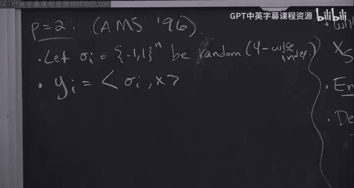

The L2 norm squared of x。To estimate。F2， which is equal to the Lt norm squared of x。Well， output。

1 over M， sum over I from1 to M of Y I squared。That's going to be our way of estimating this thing。

Now， why does this work？😡，Questions about the algorithm。Dot product。Yeah。

 this angle bracket means do product。So right， so pi。P is just this。Sigma1。Sigma M。Now。

The way we're gonna analyze this is the way that you've seen， I guess， twice already。 right。

 We're gonna we're gonna compute the expectation。 This is an average of many estimators， right。

 We've， we've dealt with that。 We've been doing this for twice already。 So the median of averages。

So this is the average。 So what I'm saying is this thing here。Has the correct expectation。

 and it has bounded variance。Therefore， if you average one of Epson squared of them。

You'll get a one plus epsilon approximation with two third probability。

 And if you want to boost that to Delta failure probability。

 you take the median of log whenever delta have them， right， so。

Here I should say that M is going to be chosen to be something like one over uppsan squared。

So what's the expectation？Of Y I squared。This thing。Is。The expectation of the sum J from1 to n。

 sigma I J。Squared。

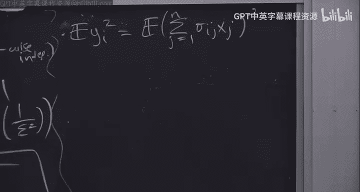

There is equal to。The sum over J。Of the expectation of sigma J squared and xj squared。Plus。

 the sum of j not equal to J prime。嗯。Expectation of Sigma J， Sigma J prime。X J， X， J prime。

What's Sigma J squared？😡，It's one， because it's a sign so。Really。

 there's no randomness this thing here。😡，Is always equal to with probability1 is's just equal to the Lt norm squared。

Of x， which is F2。What's the expectation of this product。Zero， right。

 because theigma theigma I should put Sigma I here。RightSigma I。Is a fourY independent vector。

So in particular， it's also too wise independent。So this。

 whenever you have independent random variables， the expectation of the product of the product of the expectation。

 this is the expectation of sigma I J times the expectation of sigma I J prime， which is 0。So。

 this whole thing。Is0。 So it has the correct expectation。Now we need to also understand the variance。

The variance。Of Y I squared is equal to the expectation of Y I to the fourth minus the expectation of Y I squared squared。

We know what that is。😡，We just computed it， this thing here is x2 to the fourth power。

So now we just need to compute that thing。Y I to the fourth is。That dot product of the fourth。😡。

So they're gonna be all kinds of terms， right， There's going to be the terms where all the eyes are the same。

 It's basically the sum overall J 1， J 2 up to J 4。

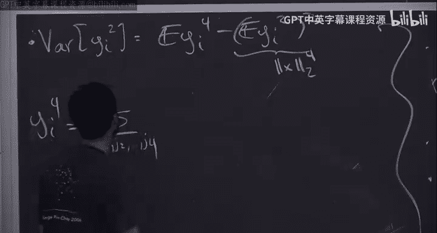

Of sigma。I J1， Sigma I J2， Sigma I J4。嗯。X J1， X J2。4。Let's put an expectation here。Right。

There are cases。There's the case where all the Js are actually equal to each other。

There's the case where。They're all different。There's the case where three of them are equal。

 and then the fourth one's different。There's the case where two of them are equal to each other and the other two are equal to each other。

How about the case when they're all different？You had zero because of four wise independence。😡。

When they're all different。The expectation of the product is the product's expectation because there are four random variables here and we have fourY' independence。

That's why we need for independence for the variance。

How about the case when three are the same and one is different from the other three？Zero again。

Right。Because a sine cubed is the same as a sign right if R is plus -1。

 r cubed and R are the same thing。So r cubed times R prime is the same thing as R times R prime and the expectation of R times R prime is 0。

Because we have parawise independence。 We have fourwise independence。 In fact。

 So the only cases that matter are when。Either all of them are the same or two equal each other and the other two equal each other。

😡，So this is equal to。Sum over J of sigma J to the fourth is1。So we have Xj to the fourth。

Plus some over。J not equal to J prime。Of。We have Sigma J squared and Sigma J prime squared are both one。

 We have X J squared， X J prime squared。Okay， I lied very slightly here。

 Why did I what's wrong about this equality。This equality is not exactly right。

There's a factor missing。 There' are some combinators。Yeah。

 so how many ways are let's say that I fix a J and a J prime。

How many ways are there for there are to be two of these being J and two of these being J prime？😡。

Right。So it could be that J1 and J3 are both J and J2 and J 4 or J prime。

 or you know there's any number of one of those possibilities。I think。

Because I wrote J not equal to J prime。嗯。I think the right thing to put here is three。哎。

But you can do that counting on your own if you want。 Okay， it doesn't really matter for us。

 if the fact that it's a constant is enough。对。🤧ん。So。So that implies that。嗯。The variance。Is equal to。

This thing。Minus。This thing。Which is equal to the sum over J X J to the fourth。

Minus the sum of j not equal to J prime。Xj squared， xj prime squared。And again。

 there's some constant missing here。Which。嗯。Oh no， no， this is right。 Okay good。So this cancels this。

And what I'm left with is twice that。So what I'm left with is the variance is equal to two times the sum of j not equal to J prime xj squared xj prime squared。

 which is at most two times the sum over Jxj squared squared。Which is equal to2 times F2。Right。

So the expectation。🤧嗯。So the expectation of a single row is giving us the right thing。

 and the variance of a single row is like roughly the square of the expectation。

So if you average one of our sun squared copies and apply chubby chef。

 you'll get what you want to get。I trust youre now。

 chubby chef experts enough that you can do that computation if you really wanted to。But really。

 this is enough。So that's all I want to say about P equals 2。

And then I want to move into P not equal to two， so questions。

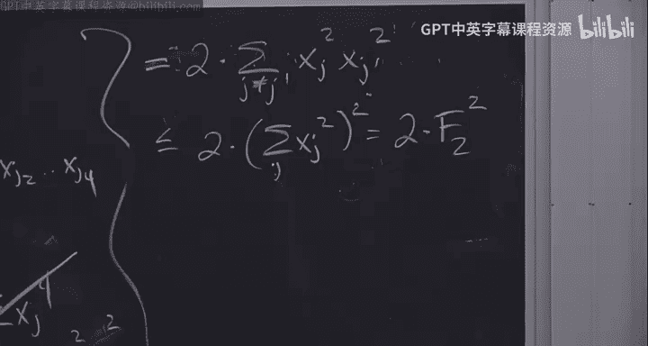

Yeah， so actually， to make this argument go through， right。Think of Sigma I。

As actually a function mapping n into -11。And it's coming。From。A four wise family。Okay。So。

One way to get such a function is， first of all， pretend that n is a power of  two。And then actually。

 you know， one thing we talked about， we already discussed one construction of KY' independent families based on using finite fields。

So pretend n is a power of 2。And then pick a random function that maps one to n into one to n。

That function is a fourY independent that's coming from a fourY independent family。

 And then Sigma I will just be apply that function and then take the last bit as your output。

But if the output is a random number between1 and n。Then the last bit is a random zero or1。Right。

So that's a way of getting kind of random bits。Just output into。Actually。

 a larger se that is project onto the last bit。And since n is a power of  two。

If you have a random number from 0 to n minus1。And you take its last bit， that will be uniforms。

Probably 50%， zero， probably 50% one。Does that answer your question？So yeah。

 the total space to store the hash functions。Is1 of uppson squared times log n。In fact。

I'll let you think about this offline。 In fact， we can have a single hash function。

We can have a single hash function， sigma。Which maps M by N。Into minus11。Okay。

So instead of thinking about this as each row gives us an estimator， then we do the averaging trick。

You can think about this as the entire matrix。 you know， this entire thing is our estimator。

Compute the expectation of that entire thing。Compete the variance of that entire thing。

And you really only need。This thing， to be fourwise independent。

And you can store sigma in log of M bits。😡，But M is less than n。

M is less than n or else wouldn't bother doing this pie business anyway。

RightWe're trying to do some kind of reduced space here。

 So you can actually store you can actually store the entire matrix pi in O of log n bits。

 regardless of what Epsilon is。Yeah。Oh， so what I'm saying is。Pretend we actually had a function H。

 pretend n is a power of2， and we actually had a function H， which mapped n into N， right。

Then let's call it Hs。😡，喂。And then now if you look at HJ。😡。

That's a random number between 0 and n minus1。😡，So it's， remember， n is a power of two。

So it's like a random bit string。So in particular， the last bit is a random bit。😡，Yeah。

I really do mean columns。So whenever you have this is just a fact， linear algebra fact。

 if you have a matrix pi whose columns are pi I's。Then pi X is a linear combination of the columns of pi。

Yeah。Oh， so the space will still be， I mean， we're still storing why。Right。

 and why has what of rhpsson squared numbers in it， M numbers。

So our space will still be dominated by storing Y。😡，I'm just saying that in addition to storing why。

 we also had to store sigma or these hash functions。

And the naive way to store those hash functions is have a separate hash function for each row。

That would work， and it wouldn't be that costly because you're already storing Y anyway。😡。

But I'm saying， you know， just as an as an observation。

It you could actually specify the entire matrix by a single hash function sigma。

That single hash function takes in I and J。And spits out Sigma Ij。

And it's enough for that hash function to be4Y independent。 And this analysis would go through。

And then to store that sigma。Would take O of log a big O of log of M N bits。

But Mn is less than n squared。And log n squared is the same as log n basically。Any other questions。

Okay， so。So in the roughly 10 minutes I have left。I want to say something about。

Other P between 0 and 2。In fact， what I'm going to say will be you can apply it even to P equals。

 too， but。That's a simpler thing than what I'm going to say here。

So we're going to use an algorithm due to IndC。And first， I'm going to describe an idealized version。

 just like in lecture 1， or was it lecture。2， there's the idealized algorithm for distinct elements where we assumed we had totally random functions and infinite precision。

So let's pretend that we have that again。 And then Ill。

 I'll say a little bit about how to get rid of that assumption。So I， so let's say before I。

 before I tell you the idealized algorithm， I need to give you a definition。A distribution。D over R。

Is。P stable。If。For Z1 up to ZN。Coming from D， you know。Z1 up to ZN are independent。

 identically distributed， according to D。So D is P stable if for independent random variables coming from D。

And。For all x and Rn。The sum。I goes from1 to n of Z Xi。This is a random variable。😡。

This random variable is distributed as the LP norm of x。Times something coming from D。

So if you take a bunch of these and take a linear combination。

The randomim variable that you get back out is a scaled version of the piece table distribution itself。

So。Examples。P equals 2。Anyone know a too stable distribution？Yeah， Gausians are too stable。 right。

 What does this mean when P is 2。It means that。Basically。

 what it means is that if you add a bunch of random variables for that distribution。

 their variances add。Right， and that's what that's Gaussians obey that。 If you。

 if you sum up a bunch of Gaussians that are independent of each other， you get back a Gaussian。

 whose variance is just the sum of the variances of the other Gaussians。

Of the the the sum of the variances of the Gaussians you added。 So this is just。

Let's say the Gausian， the standard normal distribution。Okay， one p equals1。

Maybe many of you have not heard this， there's something called the kshi distribution。And it has PDF。

P of x。1 over pi x plus1 squared。Not pi like that pi， but pi like 3。14。那时候。

It's the fact that you can go read about it。That khi you have this distribution as well。

This property as well for Ping1。By the way。Raise your hand if you ever heard of the central limit Bureau。

Okay， so for many of you have， for those who haven't， the central limit theorem just says that。

Whatever distribution you have。If we take a bunch of independent copies from that distribution。

And then， average them。Kind of in the limit， as you take more and more copies and average them。

 the thing you get approaches the standard normal distribution。 It approaches a Gausian。Okay。

But here what I'm saying is。But then， then that sort of means that there shouldn't be P stable distributions for P not equal to 2。

Because。If you're one stable。😡，It means that if you sum up a bunch of copies。

 you're getting back that original distribution scaled by the one norm。

But by the central limit theorem， that shouldn't happen。 right， If you add a bunch of copies。

 you should be getting a Gaussian。 You shouldn't be getting the original distribution you started with。

So for people who。I mean， there's there's a technicality in the central limit theorem， yeah。Yeah。

 so for the central limit theorem to apply。You need bounded variance。😡，O。

The second moment has to be bounded of your distribution。 Then the central limit theorem applies。

If you look at this thing。It definitely does not have bounded variance， bound to second moment。

 right， If you take a koshi distribution。The expectation of it square。Is it's infinite。

You're integrating basically one over pi roughly。😡，From 0 to infinity， which is infinite。Okay， so。

When P is less than two， these distributions。Are quite heavy tailed。Or when p is not equal to 2。

 they have to be heavy tails。And in fact， if you notice。The one stable distribution has a P D F。

 which behaves like whenever over x squared。It's beyond the scope of this course。

 but you can prove that if， if a distribution is P stable， except for P being 2。Or no， no。

 If a distribution is P stable。Its P D F has to decay at least as fast。

As whatever x to the one plus P。That's true for Gaussians， too。 It' just that they decay even faster。

 They decay like e to the minus x squared。 but that is faster than one over x cubed。喂。Which， by。

 which in and of itself implies that P stable distributions can't exist for P bigger than2。

RightIf you take it as fact， that P stable distributions have P DFs that decay at least as fast as1 over x to the peoples one。

Then they cannot possibly exist for P bigger than2。

Because that would violate the central limit theorem。If you had a three stable distribution。

 its PF would decay so fast that it would have boundunty variance。But if you had bound variances。

 suming up a bunch of copies would give you a Gaussian， not a three stable distribution。

So they don't exist when P is bigger than2。And these things were first studied。By levy。In the 20s。

 I think。1925， if he wrote a paper。About these things。

And there's a theorem which we're not going to prove in this class。Pacetable。Distributions。Exist。

And only if。Z is less than p is less than equal to 2。So from the algorithmic side， that's why we。

 and we're gonna to see using index algorithm。How to design a very low memory algorithm。

 where basically， instead of filling pi with a bunch of random signs。

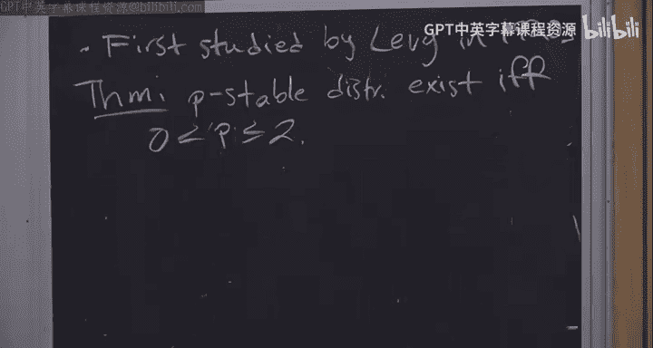

By the way， you could have filled pie with a bunch of Gausians。

 Then you have to talk a little bit about discretizing them because we have bound precision， etctera。

 But if you had filled pie with a bunch of Gaussians， all these calculations would have worked out。

Okay。So instead what we're going to do for other P is we're going to fill them with a bunch of P stable distributions。

😡，So。I throw。A pie。Is。ZI， which is a vector。Of IID P stable。

So that means that now Yi is going to be equal to Z dotta in x。

And we're going to do is we're going to output。The median。Of the absolute value of Yi。

Where I goes from 1 to L。This is going to be the final estimator。And。Mr。 LeeLk。

Without loss of generality。我 assume。That the piece stable distribution。DP。Has a median。DP。

Which is one。What do I mean by do I mean by that， I mean that if Z is coming from DP。

 then the probability over Z。

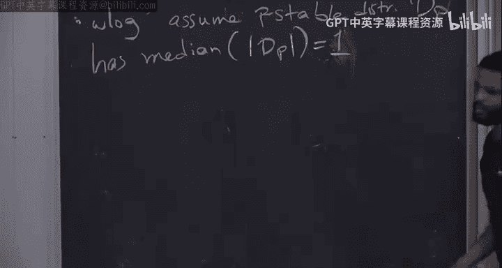

that。Z is between 1 and minus1。So if you look at the distribution。DP， here's one。Here's -1。 You know。

 It looks something like a Gaussian， just heavier tail。We're not a mass here。

The amount of probability mass between minus1 and1 is a2。这。So。Good。

 so next time what I'm going to do is。Or what we're going to do in class is we're going to analyze index algorithm。

we're going to show that， remember now it's idealized。Again。

 we have this issue that this is a huge random matrix。 We can't afford to store it。

 We're gonna somehow get away with some deandization of this algorithm。and bounded precision。

 et cetera， but the idealized version， next time we're going to see an analysis that tells you that if M is something like1 over Epsilon squared。

Then this algorithm gives you a one pluspsilon approximation with two third probability。

 and then you can do the usual median trick。Do a median of a bunch of estimators。

 A median of medians， actually。嗯。And then we'll talk a little bit about P bigger than2。

 and then we'll move on to another problem， more streaming problem。So any questions？Okay。

 so have a good weekend。