# 哈佛大学《大数据算法｜Harvard Algorithms for Big Data (COMPSCI 229r) 2016》deepseek - P4：-04-Algorithms for Big Data (COMPSCI 229r), Lecture 4.zh_en - GPT中英字幕课程资源 - BV1yGdNYvEMo

Let let's get started。 I Hoon here。Yeah， okay。To your crbing rate。🤧。

So just a recap from last time we met last week。We we're about to analyze index algorithm for estimating the LP norm。

A vector X updated in the turns style model in a data stream。

And we used the linear sketching matrix that was filled with these P stable random variables。

 I'll write the algorithm again in a second。So recap， we say that。

A distribution DP is a P stable distribution。 It's a distribution over real numbers。

If you take n independent random variables from that distribution and then take some over I Z I X I X is a fixed vector。

 that should look like itself a P stable distribution， but scaled by the LP norm of x。

And these things exist， if and only if p is between 0 and 2， if p is less than1。

 then LP is not a norm， but it still has that scaling anyway， okay。And you might wonder。

 how do you sample from these distributions or what do these distributions look like。

So there's no closed form for。The P for the density function of a stable distribution。

 except for special cases， like P equals1 has a special form。

 P equals2 is the Gaussian has a special form。But I think none of the others do。嗯。However。

 there's a statistics paper in the 70s that showed how to sample。From a P table distribution。 Okay。

 so don't worry about why this formula does it。 The。

 the only thing I want to say here is if you take two uniform random variables。

 if you sample two uniform random variables， you can use them to generate a P table random variable。

 Okay， that's the only takeaway from that ugly looking formula。So you can actually generate。Okay。

 and。This distribution you get out here， remember I said that if。😡。

I wanted it to be scale such that if you look at this distribution DP。You know。

 it looks it looks something like a bell curve， just like a Gaussian， but it's heavier tailed。

 I wanted to say that if you look at the amount of mass between 1 and -1。It has half of the mass。

Okay。That thing has the piece。 So if you take any P table in the variable and scale it by any fixed constant number。

 it's still P stable。 So this thing is P stable。 It doesn't quite have this property。

 It's gonna be some other。 It's got only one。 It's gonna be some other number where the halfway point is。

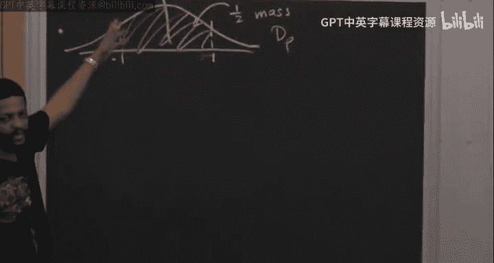

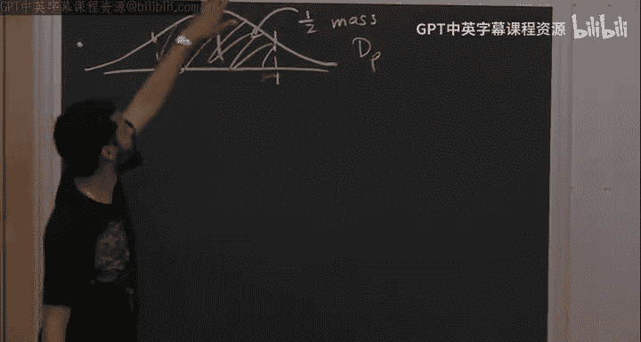

But， you know， imagine taking that random variable and scaling it so that it has the right median。

So I'm gonna assume that half the mass is between -1 and 1。

Okay， so index algorithm。

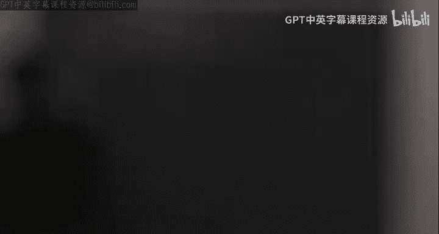

Was you take。

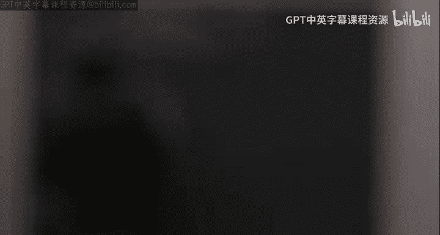

The matrix pi， your sketching matrix， to look something like this。Okay， where。DIJ or sorry， Pi IJ。

Is it a P stable or in variableable？This means distributed as。Sttable。Okay， so。

We're going to take y equals pi x。M is going to be something like one e rhpson squared。

And we're going to estimate。ItP。As。The median。Where。1 goes from I to M。Of whyi。

So that's the algorithm。That's what we talked about last time。 And now I want to analyze it。

 Any questions about what the algorithm is。So let's analyze this algorithm。喂。So。I'm going to let。呃。

And also， let me just some a notation。 Very good， actually。I'm going to let。i。So IAB。ok。

Be the indicator function of the interval A， so this is equal to 1。If。This is a function。

 It's1 if x is in the interval and0， otherwise。喂。Now。What's the expectation？

Of the indicator function of -1，1 applied to Y I over the LP norm。

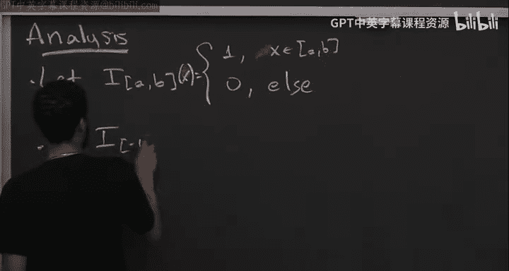

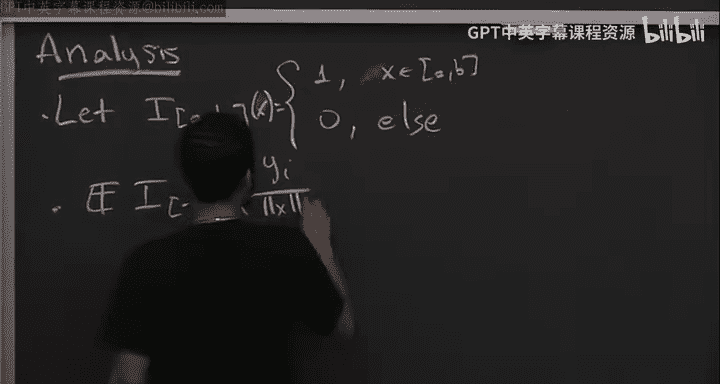

What is this thing？First of all， what is YI， what kind of random variable is YI。

 how is it distributed？DP scaled by the LP norm。Right， why I。

 each entry of y is like the I entry of y is the I throw。

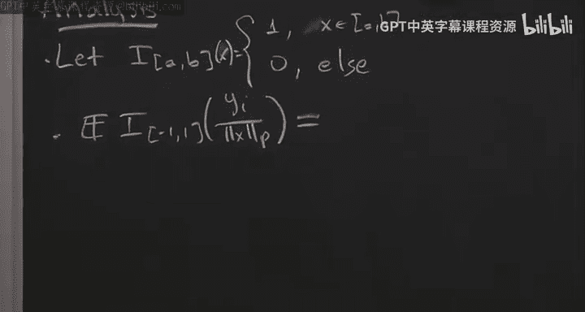

Of pi dotted with x， which is a DP scaled by the LPor of x。哎。This thing。Let's say that。The rose。

A pie。these vectors， I'll call them Z1 up to Zm。So this thing right here。Is just。

ZI dotted with x over the LP norm。So this is D P right here。 This is， this is distributed like D P。

 So this is。that's what that scaling means。Okay。Now。What。Tell me。

 what is the expectation of the indicator function of -1 minus epsilon，1 plus epsilon applied to Y I。

What's this expectation。You can tell me up to thetas or whatever。I want some handle on this。And。

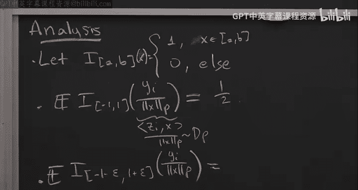

You know， you don't have to be too rigorous。 Just assume that。

This is what the density of a P table distribution looks like。Okay。So。What does this mean。

 What's the expectation of the indicator function of this interval on this is just asking how much mass is between -1 and 1。

And now what I'm asking is。If you just stretch out the interval by epsilon。😡，And then add in this。

Extra mass here。Right what's the new expectation？Yeah， it's a half plus theta of epsilon。Even。

Right because。You know， let's say you went out to the number  two， right。

 and you went out to the number -2。 So I'm being a little non rigorous here。

 It's known that this distribution really is bell shaped and that it when you go over from zero decays。

Okay， the PF decays。So if you go out to2， what's the P D F， It's some number， call it C。

And if you go to -2， it's that same number C。So in particular， for any epsilon between 0 and 1。

 the PDF there is at least C。So if you move out by Epsilon， you're gaining at least the Epsilon mass。

Right。What I really want to say is not just O epsilon， but really omega epsilon。

 I want to say that you really are gaining roughly epsilon mass if you move out by epsilon。

And similarly， what happens if。You shrink the inter。My epsilon。What's this？

I just half minus that uppsson， right？So。Now， let's look at the random variable。😡，嗯。1 over。

 let's look at this random variable，1 over M， some I goes from one to M of the indicator function of。

-1 minus epsilon， 1 plus epsilon evaluated at YI over the LPO。

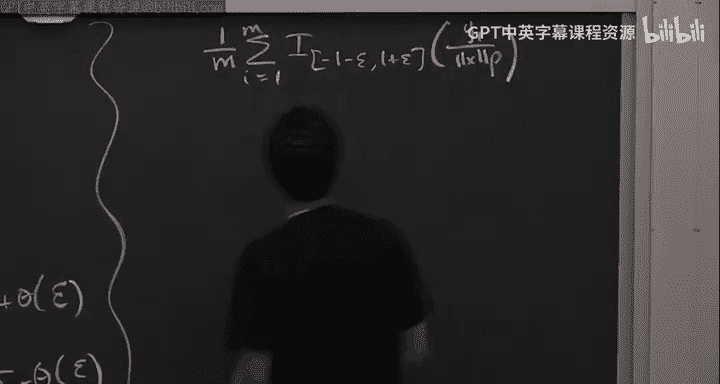

So what is this？What does this cat， What does this random variable mean。

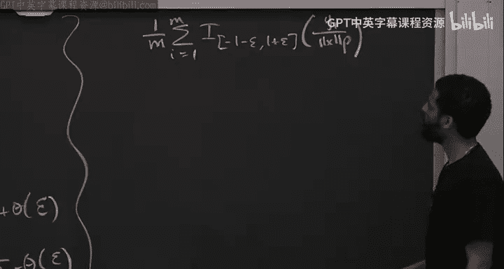

Someone interpret this in words。

Yeah， so the average of that thing， but。Basically， so what do I want， right。

 What I want at the end of the day is that the median of these y I's is between one minus epsilon and one plus epsilon times the LP norm。

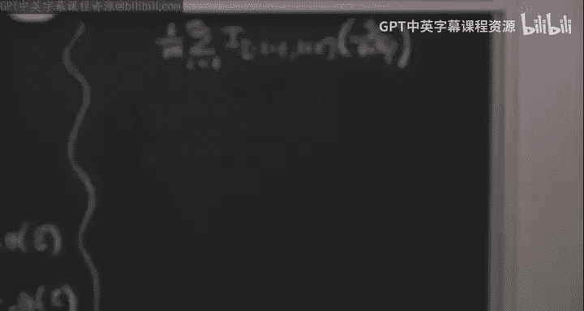

What this expression is telling me is telling me what fraction of the Y eyes。

Gave me a value less than one plus Epson times the LP norm。What fraction？Of Y eyes。Give me。

Yi is at most one plus epsilon times the LP1。That's what that's counting for me and the expectation of this thing。

 we just calculated it by linear and expectation， it's a half plus theta epsilon。So in expectation。

 more than half。

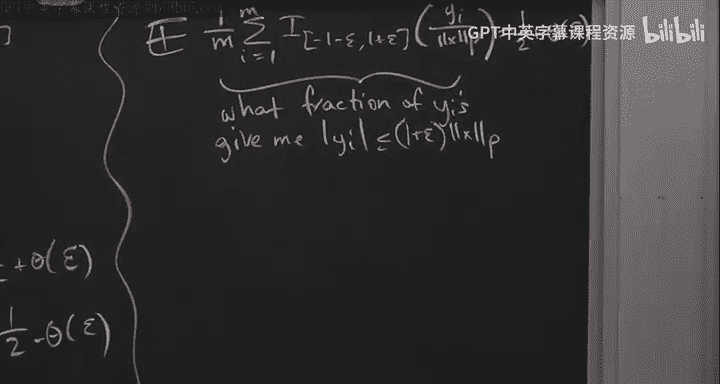

Of the Y Is are giving me a value less than this。可以。Similarly。In expectation。

 if you look at this expectation。This is what we just calculated over there。This is。This is here。

The fraction。Of I give me why I is less than equal to 1 minus LP norm。Right。

So what this is telling me is。More than half of them are less than this threshold。In expectation。

And less than half of them。Are less than this threshold and expectation。

So if both of those things actually happened。The median would be in between these two thresholds。

The median of the Y eyes is and magnitude would be， would be， I should really， yeah， okay good。

 The median would be in between these two thresholds， which is exactly what。

Which exactly means that my algorithm is correct。Right。Okay， good。 But this is。

 this is all an expectation。I want to say that not only are these expectations correct。

 but there's actually a decent chance。That more than half are below this threshold and more and less than half are below this threshold。

And the usual way we say that things happen like the expectations tell us they。

 they will is to use chubby shop。Which requires us to bound the variance。

Right the variance of this random variable and the variance of this random variable。谁。Now。

The variance。Of。1 over M times。The sun。Of over I of。The indicator function of minus1 minus epsilon。

 1 plus epsilon。Of Yi or the LP norm。Okay， so。There are a bunch of random variables we're adding together。

 and there's also a scale factor。If you scale a random variable by C， what happens to the variance。

You multiply by C squared。 So this is equal to。1 over m squared。

And then if you sum a bunch of independent random variables。Their variance is add。

So the variance of the sum is the same as M times the variance of one of them。

 So times M times the variance of one of them。Okay。

 so the variance of an indicator function of this P sta distribution looks a little bit complicated to me。

But this random variable right here。😡，Is always either zero or one。😡，Right。

It's the indicator function applied to something。 It's always 0 or1。

 Its variance can't be bigger than one。Right， no matter what the distribution of that thing is。

 the variance of this can't be bigger than one。So this thing is at most this， which is1 over app。

Okay， so we know what the expectations are。 But again that the variance of this is at most one over M。

 The variance of this is at most one over M。So the usual chubby Cheev analysis will tell us that if you choose M to be something like one over Epsilon squared。

 you'll get two third success probability。And that's the end of the proof。Yeah。The one。

Oh why not use the turn off bound？Let's see。Yes， that is right。Yeah， you're saying。

I think what you're saying actually might be。Correct。

 so basically you can choose M to be something like1 of Rsson squared times log1 over delta。

And then directly apply the turn off down and then get success probability y minus delta。That sounds。

 that sounds reasonable to me。That sounds reasonable to me。Or you could do。Yeah， you can do that。

 You can do the median of medians， which is useless here。 I mean。

 it's you can do what you said instead。Just take the media of more copies。Okay。So。

Now， what's。There's still one big issue with this。

哦， yeah。

好单。Okay so。That indicator function。For that to be， for that to evaluate to one， right。

 its argument has to be in the interval。So Y I over the LP norm has to be in that interval。

 And just moving LP norm to the other side means that Y I has to be between。

Or if you want to think about it， maybe this makes it clear， I don't know。

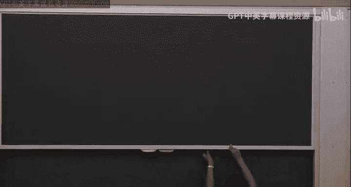

一是。This is the same thing。As if I put an absolute value of Y I here and made that a zero。Right， so。

For this thing， for this indicator function to be one。

 it means that this thing had to be less than one perpsilon， which means that why。

 the absolute value of Y I has to be less than one pluspsilon times the LP norm。Yeah。Yeah。

They depend on P。 That's right。 Yeah， so yeah。This。The constants hidden in this theta epsilon。

Will come up when you try to actually apply a Chey show。Right。

 because the expectation here is this halfless state epsilon。 And that constant is related to。

How small can the， you know， what is the， what is the P F at the number two， for example。

 How small can the P F get it to。啊。So。Yeah。这个有关注。Right， yeah。As it's right， as P goes to 0。

 you this constant blows up there， or I guess shrinks。Which means that you need more rows。

 thats right。Yeah， so I didn't， you know， you， you can do some analysis to get explicit bounds on the PF at various points。

 which tells you what that constant should be。 But， you know。

 that's really just a bunch of math that I don't want to get into。 And is beyond the scope here。

 if you really want to know。I did those calculations somewhere in my thesis， and I can。

Put a link in the put a reference in the notes when you send them to me。

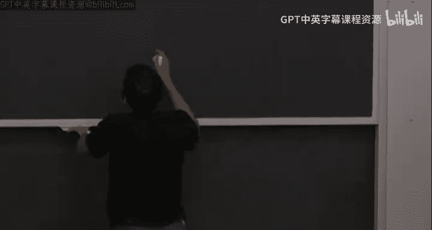

对个。So there's still one issue。嗯。Which is the following。

So。

，We could have done turn off， like you said， if we do variances， recall that。

 So we have this matrix pi， right。

Here it is， pies right here。Here's the first row of pi， the next row， the last row， etc cetera。

Where did we use independence of the entries of pi。So if you fix a particular row。

We really needed that the entries of that row were independent because we wanted to say that Y I is a P stable random variable。

 right， that P stability condition depends upon these Z I is being independent。

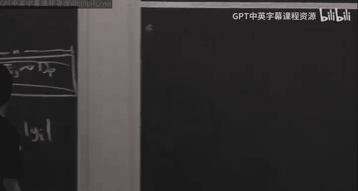

The entries in the row need to be independent to invoke the piece to say that Y I is actually peacetable。

So we know that within a row， the entries need to be independent。How about between rows。

 Does this row need to be completely independent of all other rows。

 Should all the rows be drawn independently。Yeah， the rows actually only need to be pairwise independent。

 right， So if you imagine that there's some random seed that generates a row。

And each row has its own random seed。 Those random seeds just need to be parawise independent。I mean。

I haven't talked it。 So， this is a continuous distribution。 So it's a little weird。 You might ask。

 how do I generate。Parawise independent， Gaussians or parawise independent koshi random variables。

 etc ceter。So what you're actually going to do。 and I don't want to get into precision issues。

 What you're actually going to do is say that this argument would work。

If actually you didn't draw theta uniform at that interval， but you did this。

 So let's say this is minus pi over 2。And this is pi over 2， which is your theta。

Just like discretize this interval very， very， very fine。Okay。

 and you're not gonna draw an actual uniform， random， continuous number。

 You're gonna draw one of these discretization points uniformly random。 And the same thing for R。

 So now really， you're draw， you're， you're picking。You know。

 kind of random discrete points in this set。 that that's things that we know how to do using。

 using polynomials， for example。So I don't want to get into that。

 but if your discretization is fine enough， you can prove that you won't， you know。

 you'll still be with an epsilon of what you should be。Okay， basically， the amount of precision。

The amount of precision needs to be like log of N over uppsslog or something like that。Okay。

 but good。That means that we can generate each row using just kind of。

Uniform numbers from sets like this。And then across rows， those seasons to be pairwise independent。

 But there's still the issue that we need each row to be fully independent。

 The entries in a row need to be fully independent of each other。In order to say it's peace stable。

But actually。We don't really need。

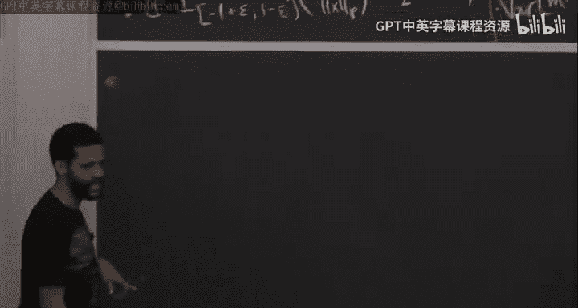

We don't really need why I to be peace stable to make this argument work， right。

 What we really need is。Suppose。Kind of WI。

Were。The sum。Of QI J， Xj。Where these are only。You know， KY is independent。

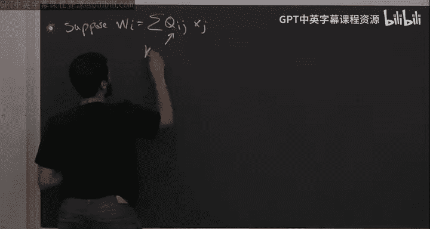

He stable。

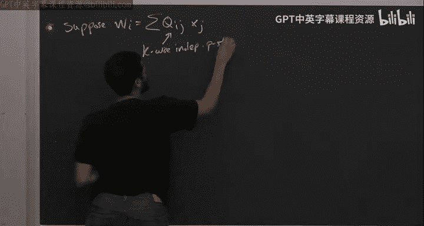

Right。So imagine that we replace the entries in a row， not with fully independent PC variables。

 but KYs independent ones。And what we want。We want that the expectation of the indicator function of A B。

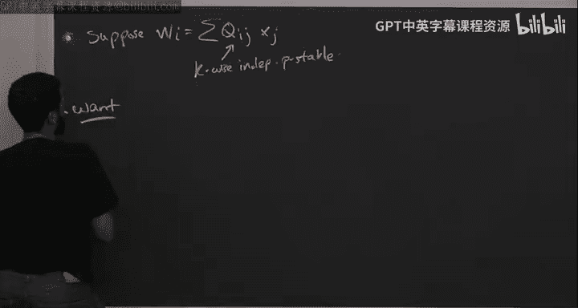

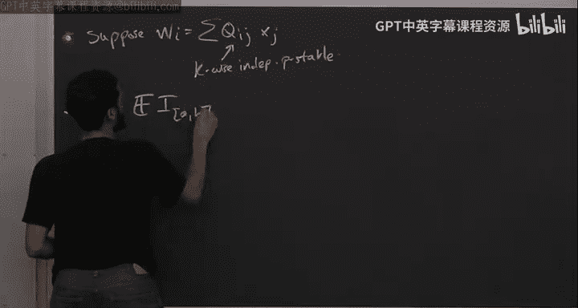

Evaluated at know Y I。Why I over the LPN norm？Is basically the same。 Let's say， up to an additive。

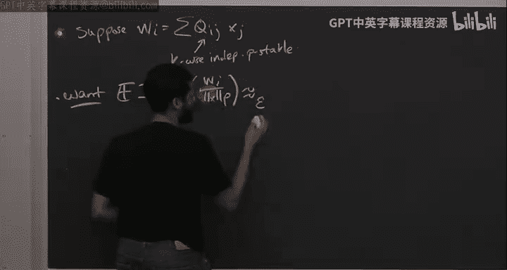

Epsilon， as the expectation over the indicator function of A B。Of whyi。RightIf we could prove this。

 if we could say that what is this really saying， this is saying that if you had used KY's independent P table random variables。

 then the amount of mass in any interval is basically the same as if you had used fully independent Ptable random variables。

 If you could show this kind of claim， then you could still invoke the same exact proof。Okay， and。

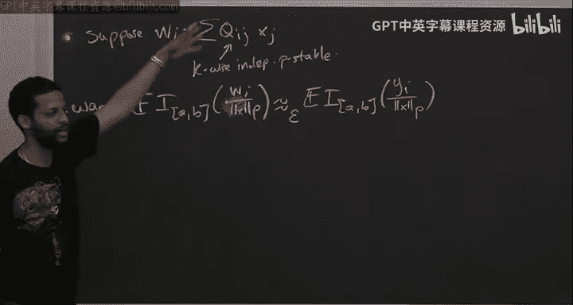

This thing happens to be true。😡，For K being at F K as long as K is at least something like one of reppsil under the P。

 So this is something。I showed with。Caan and Woodruff。行。And。Right， so。

How many random bits do you need to store a KY independent hash function？Mapping， let's say。

 end to end。K log n bits， right？So here you would need whatever ups under the P times log n bits。

But P is less than  two2。😡，So that's less than one of rhs on squared log n bits。

You're already using one of Epsilon squared rows in your pie。To store why。

And I said that the precision is also log n bits for y。

 So the space required to store this K independent hash function is actually less than the space。

That's just for a single row。You need you need that for every row。😡。

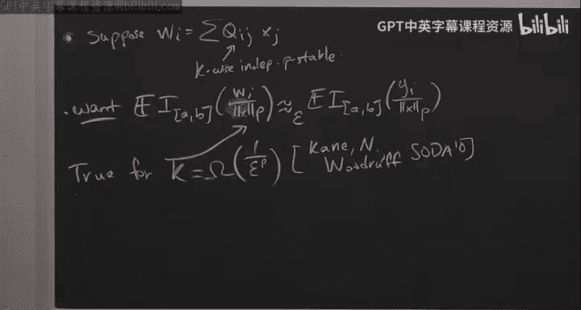

If you were naive and said that that seed is independent across all rows。

Then you would end up using1 of upson to the P times log n times M bits，1 for each row。

 And that would that would actually be a problem because that would be bigger than1 of rhs on squared。

 That would actually dominate this。But again， you only need the seeds across rows to be parawise independent。

So let me write this down。You can specify。Using。K times log n。Bits。Right？So。Think of this as。

A number。In。N to the K。K log n bits you can think of as a number between one and end of a K。Right。

 and what I'm saying is that that seed across different rows only needs to be parawise independent。

So what we actually want is。A cross rows。Just need。To use。A pair wise。Independent hash function H。

 which maps a row。Into one of these numbers。喂。And this thing。

This thing can be specified a number of bits， which is something like。

Big O of the log of the max of these two numbers。😡，Okay， which is much， which is， you know。

Not that much space。 So overall， all this entire random matrix can be stored in something like K log n bits。

So。Yeah， I want to make sure that， you know， this， maybe you're not used to seeing these kinds of arguments with pseudoranness。

 By the way， there is a course at Harvard called pseudoranomness， CS S 2，2，5。 So if you wanna。

If you want to play with pseudo randomness even more， you can。Take that course。

Are there questions about what I'm saying here？So。Ignoring the P stable issue for a second。

 just imagine that this is a matrix of random bits。For a second。What I'm saying is。

Each row of that matrix。Can just be K Y independent。

 And we know how to generate K Y independent random bits。 N of them。

 It takes K log N bits for your hash function。So the description of the hash function is a K log n bit number。

Think of it as a number。 Think of it as a number that's roughly end of the K。Okay。

It's actually O of K log n。BSo it's actually going to be end to the O of K， but whatever。And。Now。

 what we want is we want that each one of these rows。Has an associated end of the O of K number。

 right。We just need a parazze independent enhancement。Okay。Good。Okay。嗯。

So I'm not going to prove this in class because it's a bit of a pain。But I'll show you。 and。

 you know， this is something that we did after index algorithm。

 I want to show you how Ind himself analyzed it。嗯。And it's gonna lose， it's gonna lose a little bit。

 It's not。 It's gonna to lose an extra log n factors， so。In the space。

 but it's a general technique that you can use for lots of problems。And so。Sos okay， so how did In。

Generate this matrix pi。So。Diggression。Deranomizing。Branching programs。

Slash space bounded computation。And so。For the next two boards or so。

 forget about an Excel algorithm。And I'm going to show you。

 I'm going to show you something about space band computation。

 And then we're going to apply that to index algorithm。Okay。So。

I wanted to do something too called a branching program。

A branching program is think of it as like a grid graph。

So there's an initial node on the left all by itself， and then there's a grid。可以。And。

The number of nodes。And a particular column is 2 to the S。Nos I'll say what S means in a second。

 and let's say that the number of layers， the number of columns is R。And each node has。

Some out edges。And there are two to the S out edges。 Okay so what does all of this mean？By the way。

 I just have curiosity， who's seen branching programs。So most have itt， that's fine。

You'll now see them。So what should you view this as being so。It represents。A space。S algorithm。Right。

And。You start。At the left node。And。Repeatedly。Read in。The next。S bits。Of impact。Okay。

 so you have some algorithm that uses space at most S， your algorithm starts in this state。Okay。

You read in S bits of the input， so this graph is the description of a program。😡。

And there's some input that's written here。 So there's S bits here。 There's S bits written here。

 there's S bits written here， etc cetera。 So there's a bunch of bits chopped into chunks of size S written at the top。

You read in these S bits， and then that causes you to go somewhere in the next。😡，In the next layer。

 it might be that two different。Two different Sbit strings make you go to the same place。

So the degree here is 2 to the S because that's the number of S bit strings there are。

Think of this as like a finite state machine， right。You read in S bits。

 There are two to the S possibilities for that。 You go to a new node from here。

 you read an S bits that takes you to a new node。 You read another S bits that takes you to a new node。

 etc cetera。 At some point， you'll end up somewhere in this last column。 That's your final state。

Okay。And what we're going to be focused on。To apply to index algorithm。Is。Ways of。Feeding in。

 So imagine that these， you know， R S， so。Imagine。The input。Is。A uniformly random。In，0，1 to the R S。

 the input is a uniformly random bit string of length Rs。Okay。

That's going to induce a distribution on the output states。

What I'm going to be concerned with now is， how can we generate。

How can we how many bits do you need to generate this？This top layer， R times S bits。

 You need R times S random bits to generate this top layer。 My question is going to be。

 how can we generate R S bits using fewer random bits。

Such that the output distribution of this branching program will still be very close to what it had been if we had fed it。

Truly random myths。Yeah。So right， so when you're in any given column。😡，You're at some node。

You don't remember any of your history。 All that matters is like where are you right now？😡。

And then where you go just depends on the next sequence of S bits。

 I don't know if that answers your question。Yeah。Oh， I mean， if you're here versus you're here。😡，No。

 those can have different edges coming out of them。

The the way that this interprets the S bit chunk versus the way that this would deal with the S bit chunk can be totally different。

The edges don't have to look the same at all。Yeah。I'm only going to be concerned with the output distribution on the final column。

So I'm imagining that this entire top string written down of R bits is my input。

And what I'd like to say is， if I feed this。Code， I mean， this program， okay。

 if I feed this program a totally random input versus a pseudo random input。

Suder randomum input could mean the evaluation of a hash function or something。It's still going to。

Behave in the same way， meaning its final state is going to be almost the same。

 The distribution on the final state is going to be almost the same。We want similar。Distribution。

On output states。Using。Many fewer than RS。Random bits。Okay， and then。

IWe're going to use a result of Nissan， so theorem。Let be。Be any。Branching program。AsAs over there。O。

And F。Mapping01 to the S。To01。Is some function。Is any function。Actually。嗯。Okay。

 so let me write and then I'll say something there exists。A hash function。Okay， H。Which。

Well he calls it a pseudo randomum generator mapping 01。To the let's call it T into 01。To the Rs。

For T being O of s times the log。Of R over S。Such that。嗯。The probability that。F of。

The probability over x。Uniform。And 01 to the Rs。OfF of x equals1。Minus the probability。Of。Why。

In01 to the T。Sorry， and。So let me parse this。So。So one thing I should say about these quantifiers is。

Their exist H should have really been the first thing I wrote。 So there exists in H。

Such that for any branching program with parameters SNR and for any E F。This holds。

So there's a single， there's a single function H， which takes us input T random bits and stretches them out to R S random bits。

So it takes t random bits and stresss them out to R。

Notice that you should think of S as being very small。Like log N， we have a log n space algorithm。

 and R is something big。 Like R is like polynomial and N。So then in that case， T is stretching。S。

 like log n times log n， log squared n random bits into like into N random bits。

 So it's like almost an exponential expansion of the randomness。Such that。

So think of F as a statistical test。F is some function。

 It some statistical test you're using to distinguish。Was B really fed a truly random R Ssp string。

 or was it fed the output of Nissan's H。What it's saying is no matter what statistical test you use。

The the probability that your statistical test can actually distinguish the two is very small。Right。

 if you feed your branching program， a truly random X。Versus feeding at the output of Nissan。😡。

The probability that your test flags it is the difference is very small。It's one over2 to the S。

 S is like log n think。 So this is like one over poly N probability that you'll be able to distinguish the two。

谁？Questions about the statement of this。Yeah。Yeah。Oh， right。

The probability that youre equal 0 is just  one minus the probability that you're equal 1， right？

 So the fact that this is true is also the same for the zeroes。 So yeah， think of， think of like F。

 F spits out one。 if it thinks it's Nissan and F spits out 0， if it thinks that it's uniform。Right？

And it's saying that no matter what your F is to distinguish the two。

 you're not going to be able to distinguish them with good probability。No， so yeah。

 that's what I meant to H does not depend on the branching program。 So there， there exists in H。

 such that。There exist in H。Such that for all branching programs and for all functions， F。

 H fools them。Yeah。Okay， good。I'm not going to prove Nissan's theorem。😡，I'll tell you what H is。😡。

Okay。If you really want to see the proof of Nisan's theorem， you can read his paper。

But I'll tell you what H is。 It's not a complicated H。

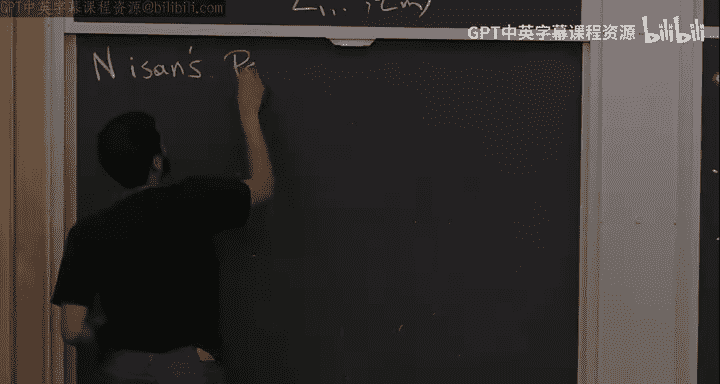

People usually call a pseudo generator PRG。So what does it look like？So。

We're going to build a perfect binary tree。😡，The height of this tree。

It's going to be log base 2 of r over S。😡，Okay。Let me you make these circles a little bigger。

We're going to pick here。Each node is going to have a value written in it。😡，The root node。

Is going have a value Z， which is just uniform in 0，1 to the S。

It's going to be a uniform random value in 01 to the S， random S fit string and every layer。

There's gonna be a hash function。 Let's call it。H1 is the first level of the tree。

 H2 is the second level of the tree up to H log of R over S。Okay。And if you go left in the tree。

The node just copies its parents' value。If you go right in the tree。

You apply the hash function at your level to your parent。So here you apply H1 to the parent。

 So here you have H1 of Z。Here you copy the parent because it's a left child， So you have H1 of Z。

Here you apply H2 to the parent。 So here you have。H2 of H1 of Z。And each one of these。

Is a hash function mapping2 to the S into 2 to the S。And it comes from a two wise family。

You pick H from a pairwise， independent hash family。

You pick H2 again from a pairwise independent hash family but independent of H1。

 So these are independently chosen pairwise independent hash functions。

How many bits does it take to specify H1。S， right？A pairwise independent hash function from Q to Q takes like log Q bits to represent O of log Q bits。

 So this takes O of S bits to represent。 This takes O of S bits to represent， etc cetera。

The total number of random bits that you need to special。 So what is H。H of Z。Is the concatenation。

Of all leaves。This is the first S bit chunk that you feed to the branching program。

 This is the next S bit chunk that you feed to the branching program， etca。So。

Each one of these is of length S。 The number of leaves is R over S。 So you have。I guess the yeah。

 so I guess really you need log R， maybe I should have said。Like our。So you have your RS random bits。

O。And the total the total space to store the。So sorry， So H takes as input。

 You should really think of H as taking as input。It takes as input Z。

 but it also takes as input descriptions of all of the HIs。Right。So this is S bits。

 And each one of these is S bits。 and there are log R of them。

 So the total number of bits you need to specify to feed into H's S log R。Oh， thats。

I'm not going to analyze this， but this is the scheme。Questions about the scheme， what it is。第二。Yeah。

 so this is。Basically， this is what Nisan provides us is a pseudo randomdom generator。

For branching programs， for these are called read once branching programs。

 which is related to pseudo random generators for space bounded computation。

 because if you have space bounded computation， you can represent that computation via such a branching program。

Where every note。Basically， in this way， right， your algorithm starts in a certain start state。

And then you imagine that it can read S bits at a time。 S is its own space。 It can store S bits。

 right， So let's say it's a two S space algorithm。 It has S of space。 It reads in the next S bit。

 and then it chooses to go somewhere。Technically。This model of computation is a bit stronger than space battery computation。

 because。I'm not assuming right here， I'm just assuming that these transition functions can be arbitrary。

But if you think about it， the space bounded。Algorithm。Can't do arbitrary transition functions。

 Its transition has to be computable in small space， as well。Right， but， you know。

 we're fooling something even slightly more powerful。Yeah。Right， so yeah。

We have a space e bounded algorithm， and what we're saying is if that algorithm is here。

Theres someone outside of the system who's feeding inputs to this thing。

Some more powerful person who has space S log are at their disposalpoable at their disposal。

 If that person instead feeds in the output of Nissson's generator as opposed to feeding it truly random bits。

 this algorithm will roughly behave the same way。That that's what we're saying here。

We're not relaxing the space down。 We're just saying， I mean。Originally。

 this thing had an input of size Rs， right。They can't store R bits either。😡。

We're just imagining that there's tape。 Theres some tape written in the sky that has the input。

In any state we're only using aspects， that's right。So。首先在。Yeah， there's like an algorithm。

 and then there's someone， there's someone else who's feeding input to that algorithm。

So that what I'm saying is that person who's feeding input to the algorithm。Can use Ss log R bits。

And still get roughly the same behavior。Okay， so。Good， so that's all I wanted to say about。

The workings of Nissan and what it gives you。 Now， I want to tell you how you can use Nissan's generator。

To generate pi。Okay。I want to say that if you generate pi using Nissan's generator。

Then index algorithm will still work。And what I'm going to do is， I'm going to say that。

There's a particular， there's a particular branching program such that if。

 if you fool that branching program， Nisan's algorithm will work。

That branching program is not going to bes's algorithm。

It's just gonna to be something as a tool in the analysis。

If we fooled it， Miss index algorithm will work。 So let me， let me just describe it to you。

 So consider。The following。O。嗯。1。Initialize。So let me write it like this。For I goes from1 to M。

And let me also say。嗯。Let's say。Low is zero and high。

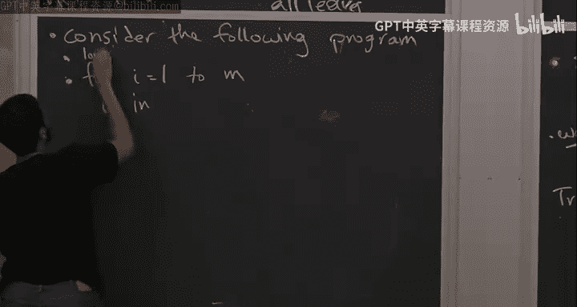

一起。For  equals 1 to M。Initialize。Her。To 0。

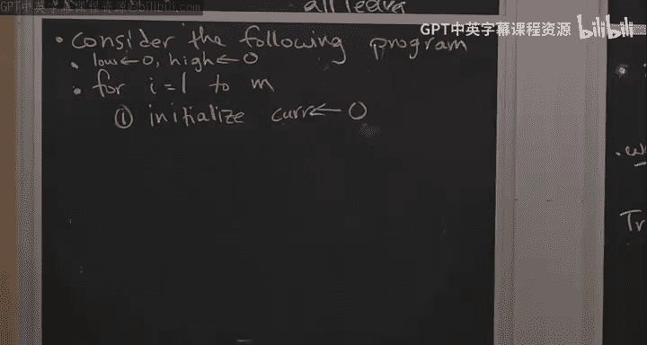

And then。For J equals 1 to n。I'm going to say。Her。Plus， equals。And。Pi Ij times xj。So。Think of the。

 think of the input that's coming in as being。The first。

 so what's coming in as inputs to the branching program is。The first row of pi。

 followed by the second row of pie， followed by the third row of pie， et ceter。And then， we say。Yes。

嗯。If K。Is less than or equal to1 plus epsilon times the LP norm。Output or。Hi。Yes， I。

And then also if cur。Is less equal equal to1 minus epsilon LPR？Then low。This is my branching program。

 So this is a space boundary computation， because this algorithm only maintains。Three counters。

 right， It maintains low， high and curve。And low and high are each numbers that are at most M。

 So they take log M bits。Cur is going to take an amount of bits that's basically the precision that you need to store the pi I J。

And then you're adding up n of them， so log n lost that。😡，Right， so in total。The space here。Is S。

 which is O of。Log n plus。Log M plus the precision。

And I promise you that the precision you need is bounded so that this whole thing is like。

 oh of log n。M is less than n， right， So log M is less than log n。

So this is a space bounded algorithm。Oh， plus equals means。Increment curve by this amount。😡。

Like compute curve plus this and reassign it to curve， So increment curve by this amount。

If curves are equal go to that increment high， and also if curves are going to go to that increment low。

By one。Look remember my one。Questions。对。They're after this for loop。Yeah， but。

 but they're inside the for over eye。So tell me what is high counting and what is low counting at the at the end of this whole algorithm。

What are high and low counting？Yeah， they're counting exactly that。Right， I mean。

 here we divided by M。 but if you haven't divided by M。

 high is just counting how many people are less than one plus epsilon times the LP norm。

 How many of the y I' is are less than one plus epsilon times the LP norm magnitude and low is counting how many of them are less than1 minus epsilon times the LP norm。

This branching program is basically mimicking the proof of correctness of index algorithm。So。

As long as。As long as high。Is。Bigger than M over 2。

 as long as high is at least M over 2 and low is less than M over2， the median will be correct。

 and index algorithm will be correct。Right。And if pi actually were a totally random matrix。

Then this analysis that we have over here implies that this thing will be good with high probability。

Right。Kind of at the end of running the randomness coming into this branching program are these values。

😡，You can imagine writing this algorithm as a branching program。Right where？Basically。These chunks。

This is like pi 1，1。 This is pi 1，2， pi 1，3， etc cetera。 When you're done with the first row。

 then you see pi 2，1， pi 2，2， etc cetera。 You're reading in the the pi matrix row by row entry by entry in that row。

And。This is just what's the state of your algorithm， meaning kind of what are the values of low。

 high and。😡，Depending on what those values are， you get， you know。

 each one of these nodes corresponds to a different setting of those three counters。

And what we're saying over here is。😡，There's a final distribution。

 if you had chosen a totally random pi， a truly random pi。

 there's a final distribution on those counters。Such that the probability that those counters are good for you is at least two thirds or something。

 by good for you， what I mean is。High is bigger than M over 2， and low is less than M over2。Yeah。第二。

So yeah， so this might be a little confusing。This program knows X。😡，X is sort of hard coded。

Into the source code of the program。So when we're writing down this branching program。😡，Right。

Remember。The way that curve is being adjusted depends on X J。

 which means the algorithm needs to know X J。If you move back here， essentially what deck means is。

The way these edges point to the next layer depend on xj。😡。

This is also what I meant by fooling this branching program is a little more powerful than fooling just spacebanded computers because these branching programs。

 these edges can be arbitrary。These edges can depend on actually quite a lot of information。

 like the entire vector X。Clearly， a space bounded program can't store X。But， you know。

 we can encode。Information about X and these edges。This one。No， I don't。 No。

 It should be less than equal to， because look at this analysis over here。What I said was。

The number of people less than1 minus epsilon is less than half of them。

And the fraction of people less than one pluspsilon is more than half。

So this branching program is really just mimicking this proof。对。Yeah。So what I'm saying is we can。

 we can create a branching program。 So fix X， fix X， Okay。

 And what I'm saying is we can create a branching program。That the branching program。

 let's call it B sub X because it depends on X。We can create a branching program that implements that algorithm。

Okay， so。The initial node， the initial node here。😡，Corresponds to cur low and high aling zero。

And then we read in pi 11。That's going to affect curveb。😡，Then we're going to read in pi 1，2。

 that's going to affect curve， etc cetera。 And then eventually， we in the loop over J。

And we're gonna maybe adjust high and low。And then that's going move us somewhere as well。

 Now we read in the next row。So you can the number of kind of， let's say。Let's say that。Low。

 high in each have qubits。😡，Okay。So the total space of our algorithm is 3 log Q。

So the total number of nodes we need in a column is 2 to that， which is Q cubed。

So each of these columns has Q cube cubed nodes in it。

 representing kind of what those counter values are。

So R is going to be the total number of entries in the matrix pi， which is m times n。😡。

Any other questions？So。So now we're basically done。Because if you fed this branching program。

 that branching program over there are truly random pie。😡。

K output some of these output nodes are good for us。And some of these output notes are bad for us。

Good for us means that。H is bigger than m over2 and low is less than M over two。😡，That's good for us。

 bad for us as if that's not true。And what that analysis told us is that the probability that we end up in a good node。

Is actually actually at least two third。And what Nissan tells us is。You know， let F。

 let F be the indicator function of the good nodes。喂。

What Nissan tells us is the probability that you end up on a good node if you had to use Nissan。

Is at least two thirds minus1 over n or something。It's still very close to two thirds。

So you're still succeeding with good probability。And what's the space that you need to feed into Nissan？

It's going to be log squared to n。S log R for us。 S is like log N。 R is like。MN。And M is less than n。

 So R is less than n squared。So S log R is like log squared n。So your final algorithm。😡，Okay。

 your final implementation of index algorithm。Would on the side， store this。

And then whenever you need entries in the matrix pi， it would generate them using Nissans。

Niss Nissan's function H。Applied to the seed。So the total space would be like1 ofrepson squared log n。

😡，Plus， log squared n。So you know， if Epsilon， for some range of Epsilon。

 you're really most of your space is dedicated to this part right here to Nissan。So。You know。

This eliminates that problem， but it's a little more。

Work to actually analyze KY's independence in this context。 So I'm not going to do it。

So that's index algorithm。 Quetion about index algorithm and this Nissan thing so。I encourage you to。

 you know， if， if this Nissan thing isn't totally making sense to you right now。

 I encourage you to look over a little more because this is actually a very。It's。

 it's a very powerful way of derandomizing streaming algorithms or getting random bits for streaming algorithms。

 because you'll often be in a situation where you don't know how to generate pi。

It'll be very hard to reason whether KY's independence works in maybe your situation。But。

It's usually easy to come up with a branching program that mimics the proof of correctness that says if this branching program worked。

 my algorithm would have worked。Therefore， I can use Nisan。So。There are no more questions。

This is P less than 2。 Remember， P stable distributions only exist for P less than 2。

 What about P bigger than2。So I want to show you how you would handle that with a different algorithm。

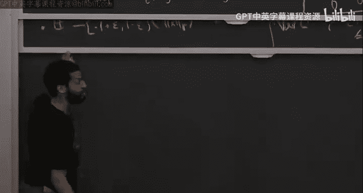

对。So。The amount of space you need is something like，s let's say。And。So the 1 minus-2 over P times。

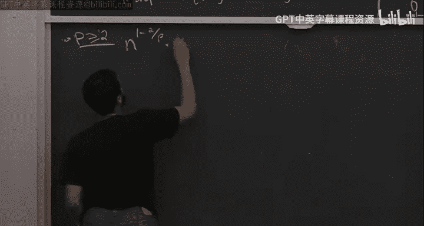

，Poly。Log n over up line。Space。Is necessary and sufficient。So， the lower bound。

There's an argument that you need basically N to the 1 -2 over P space that's due to barosef and all。

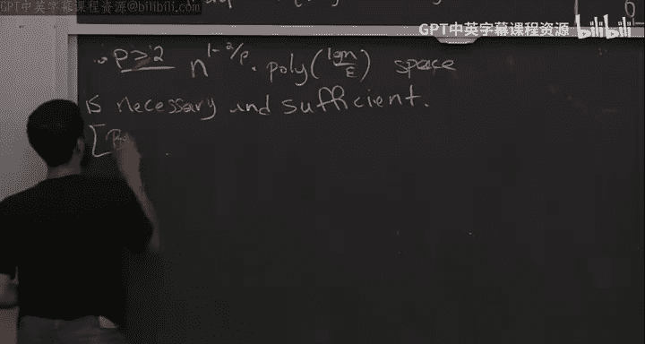

I think that's the right reference。And then the fact that you can achieve this space was first shown by。

Ind and Woodruff。Okay， and kind of since the in of algorithm。

 there have been several papers that try and， you know， simplify their approach。

 get rid of some log factors， get better dependence on epsilon。 So today。Well，Algorithm。Of。And doni。

And it's based。It's based on approaches of others。And doni。Craft gamer。Oh no。And。Souglo and tuurish。

Yeah。So yeah， if you can't find any of these references when you're preparing scribe notes。

 just put a placeholder and I'll fill them in。I guess these these I actually put the conference names。

 this one， it's like a manuscript on his website so I can put the link to that。

so I'm going to show you this approach of Anddoni， which is based on these other papers。So。And。Today。

 we'll。We'll focus。On Epsilon being like a concept。

So I'm not going to get you a one plus epsilon approximation of the P moment of the P norm， sorry。

I'll get you。A constant factor approximation。And。The the proof can be modified to give you one plus epsilon。

 I might make their a Pet problem， which says， show how to modify this to get one plus epsilon。

You don't need too big of modifications to do it。On the next piece set。But。

So let's let me show you the algorithm。 So again， it's going to be a linear sketch algorithm。

So we're going to come up with the right matrix pi。And how are we going to do it？Pi。

Is going to look like。A product of two matrices。 I'm going to call them P times D。

P is going to look a lot like a matrix that you've seen。That you're going to see on P at 1。 Okay。

 there's a problem about a faster AMS S sketch on P at 1。 And P is basically the same matrix。

 So each column of P。Has a random sign in a random location， and the rest of that column is zero。

That's the matrix P。And the matrix D。Is a diagonal matrix？It's n by N。

And each diagonal entry looks like one over。U1 to the 1 over p，1 over u2 to the1 over P， et cetera。

Where。UI is drawn from the exponential distribution。what is that distribution？Being exponential。

Means that the probability that。X is bigger than。T。Is equal to。1， if t is at least 0。

And e to the minus T。For。T less equals zero。Okay， so。The exponential distribution is such that。

An exponential random variable is always positive。谁。

And probability that it's bigger than t is either to the minus t。

And you're going to put a bunch of inverse exponential random variables on the diagonal with one over P's on the exponents。

And P is going to look like that。 So that's that's the matrix。

what you're maintaining is just this sketch。Of course， again， there's a lot of random variables here。

 you can't actually store them all， So you， you're going to argue that this is correct。

 if those are truly random matrices， and then you're going to use like Nissan or something。Yeah。

What are they？Oh， that's not B。 That's you。

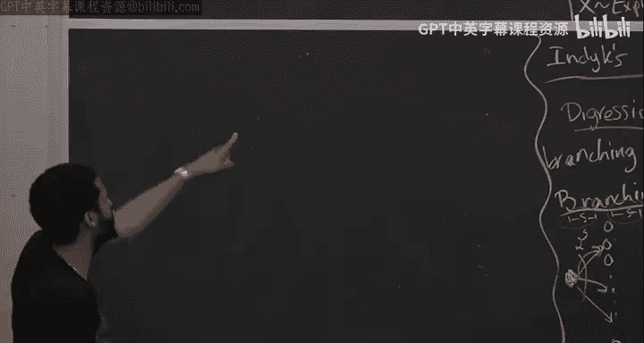

So， U， so U is an exponential。 U I is an exponential random variable。 This is a U。

That's a you2。Yeah。You want to estimate the p norm of the vector x？Okay， and so。

Y is going to equal pi x。And we're going to estimate。The Lpum of X。As the infin number。Right。

 which is。Max。Of the absent value。可以。And M。We're going to pick M to be something like n to the 1 minus2 over P times log n。

可。So why does this work？😡，Is it clear what the algorithm is？😡。

Assuming that we can store these big random matrices。Right。You have M counters that you're storing。

 these entries of Y。And then whenever you see an update to some Xi。

 you multiply that Xi by1 over u to the UI to the1 over P。And then you add it to the， to the。

Then you go to that column。😡，And only one entry is nonze in that column。

 You add it to that entry of y with a random sign multiplied by it。So the claim so the theorem。

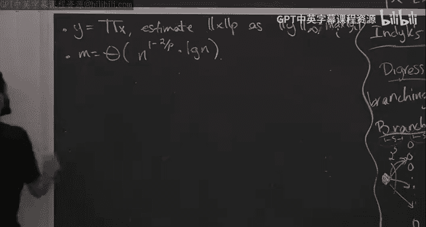

Is that the probability that。One over four。LP。Is that most why infinity？four times the LP。

Is at least。嗯。You know， 11 over 20 years。Somethings strictly bigger than a half。Right。

So if you want to make that if you want to make that one minus delta。

 you'll take the median of lots of these estimators in parallel。So let's start the analysis。

 we won't have time to finish the analysis。嗯。How can we analyze this thing？So， let。ZB。Dx。So y is P？じ？

And the claim。Claim one。Is that a probability that a half LP？Is that most the infinity。

Is that most two。At least three quarters。So the first thing I want to say is。

If you had just applied D。To the input matrix。Right， and then just looked at the max entry of D X。

That would already give you a good estimate of V LP norm。But you can't use that as your sketch。😡。

Because D has N rows。And I want to use， I want that I don't want to use n space。 I want to use space。

 which is like n to the 1 -2 over P。So first， we're gonna。

 we're gonna say Z works with good probability。 And then we're going to say that。

PZE is going to still work with good probability。Does that make sense？So let's prove that claim。

And I think， I think we're gonna be able to prove this claim before it class ends。

 and then we'll finish the analysis on Thursday。So。Proof of this claim。Let you。These are men。呃。You。

U1 over x1。这个P。U2 over x2。就个P。UN over XN。

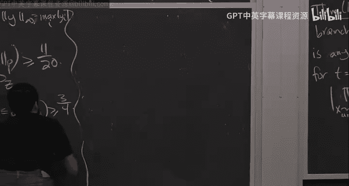

这是P。The probability。That。Q。Is bigger than some value T。Is the probability that。For all I。UI over。

Xi to the P。VT。Right。Which is the same as the probability that for all I。

 U I is bigger than T times x to the P。T times X of the P。Right。Which is these eyes are。

 these U I are independent exponential random variables。

 This is equal to the probability over I of E。To the minus t times x side to the P。

Which is equal to E to the minus T times the LP norm of x。To the people。喂。So what I'm saying is that。

The min of all these random variables。😡，Is actually an exponential random variable itself。

Scaled by the L Pino of x to the P。喂。So。This implies。That。The probability that。

This applies that the probability。AtQ。Is between。Let's say。2。P to the P。Is。Equal to。呃。Is this right？

Okay， so this thing here， basically， this implies that。Q is an exponential random variable。

Divided by the LP norm to the P。哎。So the probability that Q is between these two things。Is。Equal to。

Oh let me write it like this。Yeah。Let's say， let me put one over two to the P here。

The problem that Q is between these two things is just the difference of the tail of the exponential distribution。

 which is。呃，一。To the minus-1 over2 to the P minus E to the minus。2 to the P。Okay。

And if P is at least2， you can check， you know， using a calculator or something。

 This thing is always at least three for it using calculus。Right。But this quantity here。😡。

Is the same thing as the probability that1 half is less than or equal to one half times the LP norm？

Is less than equal to Z infinity。Is less or equal to two times Fipenino。

RightThe entries of Z are X over Ui to the one over P。

The entries of Q are1 over that raised to the P of power。😡。

So the probability that this min is between this range is the same thing as the probability that this max is between these two ranges。

Which， because this is an exponential distribution， we can calculate explicitly。

 and it's at least three quarters。So。We've shown this claim。

 And then now what I want to show is that。Actually。

 why the max entry and Y will still be good with compute。And we'll do something else on Thursday。

