# 哈佛大学《大数据算法｜Harvard Algorithms for Big Data (COMPSCI 229r) 2016》deepseek - P5：-05-Algorithms for Big Data (COMPSCI 229r), Lecture 5.zh_en - GPT中英字幕课程资源 - BV1yGdNYvEMo

Norm estimation for P norms is P bigger than two。

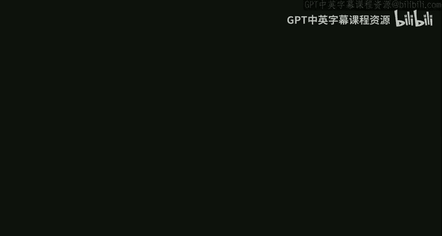

And then， we'll get into。Another turnsile streaming problem。Remember the problem from last time？ア me？

嗯。Up to a constant。So a constant factor。I click at a factor。Okay， and I was showing you。

An algorithm by Anddoni。Which is based on some other algorithms。

 It's a simplification of some other algorithms in the literature。

 You can see the references from the last lecture notes。And the algorithm did the following thing。

 It maintained。Why， which was。A matrix P。Matrix D。And a matrix x， the vector x。

Where P looked like this， each column had exactly one random sign and the rest of the column was 0。O。

And D was a diagonal matrix that looked like1 over， well let's call it u1 to the minus1 over P。

 u2 to the minus1 over P。E cetera， it's a diagonal matrix。And。P is the same P。

 You're trying to estimate the p norm of the vector x。And what do we have， We had that。呃。

The probability that UI。He's greater than X。Is。One， if x is less than equal to0， otherwise it's even。

啊。Exponential distribution。对。And last time， what did we show， we showed one thing。 Okay， well。

 we're going to estimate。We're gonna estimate。呃。Xピ？As。Why。Infinity。Which is the map。Of Yi。Right。

 so this this is an M by。N matrix。And this is an end by N matrix。Where x is in R。

X is our high dimensional vector。And last time we had alemma。Which we proved。We said。

Let z be equal to dx。They made a lelemma。The probability that。

Z infinity is a good approximation to the LP norm is actually good。 So the probability that。

Z infinity is between half the LP norm and twice the LP norm。

Was at least something like three/ quarters？S。They agree。So of course。

 what we want to do is maintain Z in memory。And then go through Z and output the largest coordinate。

 But Z is n dimensional， right， Z， Z is this n by n diagonal matrix times X。

 We haven't actually reduced any dimension。So now what we'd like to do is have a small sketch。

 maintain something small in memory。 And that's what Y is doing。Okay。And pictorially， so let me。

 let me show you the game plan before I start writing down a bunch of lemmas。Okay， so。

The idea behind behind this approach。Is as follows。So we have this high dimensional vector Z。

Right Z is n dimensional。What is the P matrix really doing for us。

So now there's this new smaller dimensional vector Y。It's only M dimensional。 This is y now。

And what you can think of as happening is。Each one of these entries and y is a counter。

And what we're doing is we're taking each entry and Z and hashing it to a random counter。

And adding it there。But we're adding it there with a random sign。Okay。

This guy's also getting hashed to a random counter。

We put a random sign on him before we add him there。Et cetera。

 each guy's getting hash to a an encounter。 And， of course， we're mapping N people to M。

 So there will be collisions。Right， so this guy might collide with this guy。So。

We know that the largest of these guys is a good approximation to the LP norm。

But when we hash these guys down here， some of these big guys might collide and cancel each other out because of the random signs。

Right， or even if they don't cancel each other out， they might add together， you know。

 if 100 guys land in the same bucket， then if they're all big。Then。Now。

 infinity of this will be like 100 times bigger than that。

So it's not going to be a good approximation to the LP norm， right？

It's not going to be a small constant approximation。So game plan， okay。

 before I start writing down thelemmas in the analysis， basically， what we're gonna show。

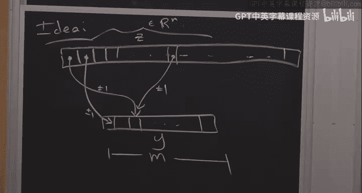

Is that not only is the biggest guy a good approximation。

But there actually aren't going to be with good probability。

 There aren't going to be too many big guys。Most guys who are big， I mean， yeah。

 so if you look at how many guys are at least the LP norm over 100 or something。

We're going to show that that's actually a constant， There aren't that many big guys。

And since we're hashing。Since we're hashing to like a large number of buckets。

 we're going to map to this number of buckets。With good probability。The big guys here。

 some of these guys are the big guys。 Most of them aren't。

These few big guys with high probability won't collide at all。 They'll be perfectly hashed。And why。谁。

But you still have to worry。😡，Because。Yes， even if the big guys are perfectly hashed。

There are the small guys who are also getting mapped down here。

Right and they might interfere with the big guys。They might subtract from the big guys。

 or they might add to him so much that you think he's a lot bigger than he really is。

 and it's going to distort your approximation。But notice that when we add the small guys。

We add them with a random sign。So if you look at what's the expectation of the contribution of the small guys？

In a bucket， what is that？😡，It's zero， right？If you take if you take the small guys that hash here and you dot product them with a random sign vector。

 the expectation of that is 0。And then what we're going to do is we're gonna to say not only is expectation 0。

 but the variance is bounded。 So there's a pretty good chance that actually they're not going to be big。

The noise， like the the small guys， they're the noise。The noise in every of these。

 each one of these buckets is actually gonna be pretty small with good probability。Therefore。

 the L infinity here is almost the same as the L infinity here。So that's the game plan。

Questions about the game plan。Yeah。Yeah， so we'll we'll。We'll get there in a second。

 I'm gonna define， I'm gonna end up defining big guys as being。嗯。The magnitude of ZI。

Is at least the LP norm over 100 log n。It's this something that's going to make the analysis work。

So let's finish this analysis。Actual rigorous analysis。

Let's define I don't have to write LP all the time。 T is the LP number of x。Okay。第二。I mean， the。

 I mean， the expectation is0 because when we're adding them to that bucket。

We're first multiplying each one by a different random sign before we add it。Right， so right。

 the expectation of the random sign times that small guy is 0。Small guy， to me。

 is going to mean every person。 I'll define it in a second。 But small guy is going to mean every I。

 every index I， such that the the absolute value of Z I。Is less than T or much less than T。

Like T over log n。 So we know that， you know， condition on this good event， we know that。

There are some big guys who are who are roughly T in magnitude。

So the smaller guys to me are going to be the guys who are much less than T。

And I want to say that their， their contribution to each one of these buckets is very small。

So they don't really interfere with the big guys。The heavy indices are going to be the eye such that。

The absolute volume of Z is at least。T over some constant times log in。

 we'll we'll see think of C as a big constant。It's going to be whatever it needs to be in the analysis to work out。

And then。L is going to be。And minus H。 So these are the light guys。 So this is the I， such that Z I。

At most。TC login， notice that。H and L are actually random sets。H and L depend on the matrix D。

They're random。O。So。嗯。So claim1。

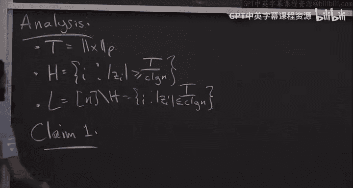

For any。Oh， bigger than let's say0。The expected。Number of indices。I in N。Such that。ZI。

Is bigger than T over L。Is that most。L to the P。That's clean one。So think of L as being C log n。

The expected number of big guys， guys in H， the the expected size of H。

When L is C log n is like poly log n， log n to the P。But we're。

We're hashing these polylylo and big guys to polyly N buckets。So。

They're going to be perfectly hased with actually really good probability。

And who who's seen birthday paradox？O。So I'm not going to go over this。

I'm not going to go over the analysis because it's something I expect you've seen in undergrad algorithms。

 but I'll just say something。So if you put， pretend there are end days in a year。Okay。

If you and pretend that people keep coming into a room， each one has an independent random birthday。

Once roughly Ro end people come in， there's a good chance that two of them have the same birthday or inverting that。

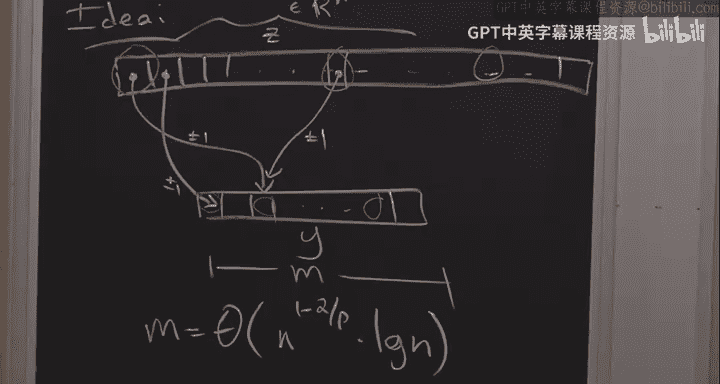

If you have N people coming into a room and the calendar has n squared birthdays in it。

Then there's a pretty good chance that no two people have the same birthday。Okay， so。Right。

 these these L to the P big guys are my people， and these M buckets are my birthdays， right。

 So as long as I'm mapping into L to the two P buckets。There will be no collisions。So， you can。

If you， if you're not familiar with this。I'll say something， I'll add something to the note。

 and you can prove it as an exercise for yourself， okay。

And it only requires parazze independence from the hashing。Okay， good， so let's prove this。

Let's define indicator random variables。 Let's say Q I is equal to one if。

ZI is bigger than T over L and0 otherwise。So this thing we're computing here is just the sum of the QIs。

Right， the number of indices wheres the iceberry material sum the sum of the Q Is。

 So we have that the expectation of the sum of the Q Is。Is the sum of eye expectation of QI？

Which is the sum over I， the probability。That what is Z I， Z I is X I over U I to the1 over P。

What's the problem that this thing is bigger than T over L？谁。And now let me rearrange things。

This is equal to the sum over eye probability。That U I is less than。嗯。I guess Xi to the P。

 L to the P over T to the P。I just rearranged， I just moved this over here。

And then move the L there and the T to the denominator and raise to the P。

I don't need absolute values。 UI is always not negative。Okay。And this thing。

 while U I is an exponential random variable。So the problem that u is bigger than x is e to the minus x。

 the problem that it's less than x is 1 minus e to the minus x。So this is equal to the sum over I。

1 minus E to the minus。X I to the P L to the P over T to the P。Right。And。littleello。

Fact that follows， for example， from Taylor's theorem。Is that。For all X。And R x is not equal to 0。

1 plus x is less than equal to e to the x。So for me now。This X is actually this expression。

 negative x side of the P the P over t to the P。So moving things around， what we see is that。

1 minus x is less than equal to e to the minus x。Or in other words。

1 minus e to the minus x is less than equal to x。So this thing is less than or equal to。

The sum over I。嗯。L to the P times。Xi to the P over t to the P。

But what's the sum over I of X I to the P。It's T to the P。The definition of T is the LP norm。

So the sum ofry of this is t the P that cancels， this is just equal to L。

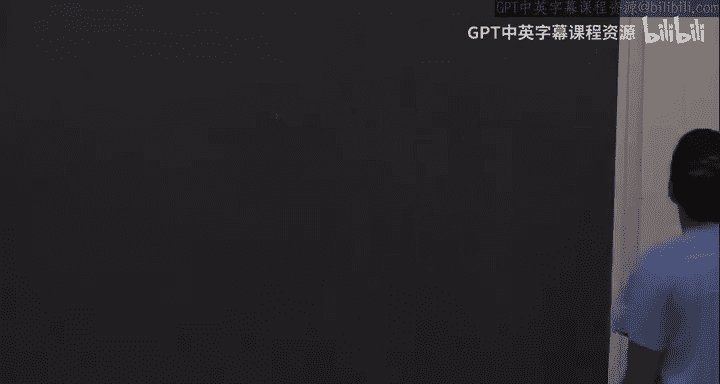

And I guess I dont well， what what was I doing over there？I'm just being pedantic now。 I mean。

 the only reason I wrote x not equal to 0 is because。X not equal to  zero。

 lets you put a strict inequality。 if x is equal to zero it's equality。

 but actually I don't really care so。Okay， good。

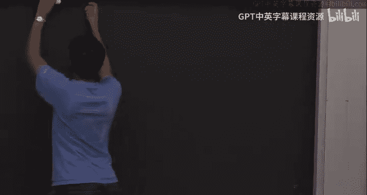

Great。

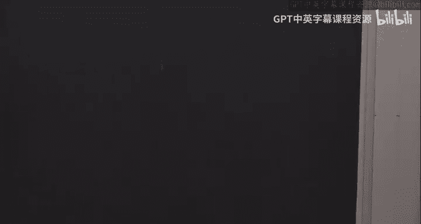

So that's one thing。We'll get back to thatlemma in a second。The main point of this dima is。Now。

 by Markov's inequality， what's the probability that。Okay。

 so we know that the number of people bigger than。Basically。

 the number of heavy people and expectation is poly log n。So by Markov's inequality。

It's actually polylo n with probably 99%。So we can just pretend that it actually will be poly again。

And we're mapping in Napoleon。 so it's perfectly hashed。Okay， great。Now。

 there's another thing I want to understand。So let's look at this vector y。😡。

And let's focus on one particular bucket。And also， let me say that。

It's useful to have some notation for this matrix P。嗯。Let's say that。There's a hash function H。

 which maps1 to n。InInto1 to M。And there's also hash function sigma。

 which maps one to n into plus -1。And actually， I can write。P。I J P is that matrix， P。

PI J is equal to。Sigma of J。If H of J is equal to I。And zero otherwise。So basically。

 there's a hash function， which for each column tells you where the nonze is。Okay。

 and then sigma tells you what the sign of that nonze is。And then the rest of the column is 0。

 so it's going to be useful for me to。Write it this way。诶。So， now。Let's look at some。3。Bucket J。

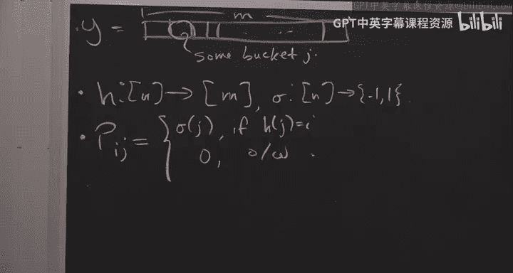

And what I want to know is。Want to say。For all J from1 to M。The magnitude。Of the sum of light guys。

That map there， so H of y equals J。Sigma I。That's what I want to happen。哎。Let me talk through this。

Look at a particular bucket。😡，And what are we going to do at the end。

 we're going to output the L infinity norm of y。😡，Right。Look at a particular bucket。😡。

Either that bucket has no heavy guys。 Most of them don't have heavy guys because they're only polylog heavy guys or it has。

 or it has one heavy guy， because I'm assuming the heavy guys got perfectly hashed。Now。

 if what I don't want to happen is。A bucket that has no heavy guys， I think， is big。And confuses me。

 and I put， I output that mass。So what is， you know， let's look at a guy that has。

 let's look at a bucket that has no heavy guys， What is the value in that bucket。

 Well the magnitude of the value in that bucket is exactly this， right。

 this is the value in the bucket and its absolute value is that。😡，I'm sorry。A bucket is。

 is an entry of why。Y J， So this thing right here， sorry。

 this thing right here is just the absolute value of Y J。So what I like to say if J。

 if J got no heavy guy hash to it， I want to say that the magnitude of Y J is quite small。

Remember now。There are the heavy there are gonna be some heavy guys that are actually quite big。

 right。This is T， remember， this is T。There are some heavy guys who are like T over 2。

 So I want to say， if J didn't get any heavy guys， He's actually very small， much less than T over 2。

Maybe like T over 10。And then I want to say， if Jay actually did get a heavy guy。Well。And by heavy。

 by heavy guy， I don't just mean an H。I mean。Like one of these guys， really heavy guy。

 a guy who's actually at least half the LP norm。I want to say that if if Jay got one of those guys。

Then。What's Yj。 Yj is going to be this。Plus， that heavy guy times his sign。Right。

But that's going to be at least the heavy guy， minus this。By triangle inequality。

And the heavy guy is T over 2。This is much less than T， it's like 2 over 10 or something。😡。

So overall， that bucket is still going to be at least t over 2 minus t over 10。😡。

So it's still going to be like within like a constant factor times steep。Okay。在。

Before I get into calculating things on the board， Any questions about why why I want this to happen。

对。Right， so yeah， I just want to say in reality。Okay， so actually， this is Y J。Let me。

 let me not say this is Y J。 So actually， let me。Let me say like this。If heavy guys。If H。

It's perfectly hashed。By H。By little H。Then what do I know。

 Then I know that Y J is actually going be。The sum of these light guys， the sum over I and L。

Of H I and J in general， in general， why is the sum over all I such that H of I is equal to J。

Of Sigma I， Z I， this is always true。 Y J is equal to this。 right， That's what Y J is。

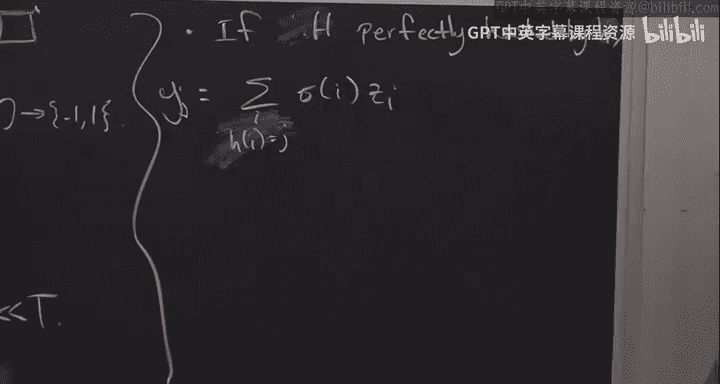

Now， if H is perfectly hashed， if the heavy guys are perfectly hashed。

Then I know that there's that most one heavy guy in the sum and everyone else is light。😡。

So if it's perfectly hashed， I know that I can write this as the sum over I and L。Of H I。

Equals J of Sigma I Z I。Plus。Possibly some sigma of some heavy eye。😡，Time Z of some heavy guy。If。

Jay got。Somem heavy guy。Right，Otherwise， there's nothing here in。 you just have the light guys。Now。

 what I want to say is if it didn't get a heavy guy， this will be small。

 So when I look at the infinity of why I won't get confused。If it did get a heavy guy。

If it did get a heavy guy， then notice。That。By triangle in equalityality。

 this absolute value is at least。Z of the heavy guy。Minus。minus the noise， basically。Right。

 but this guy， this guy is between T over 2 and 2 T。

ThisThis thing here is going to be much smaller than T。 This is going to be at most like t over 10。😡。

So if you have two over 2， minus-2 over 10， it's still。EIt's still 3 T over 5。RightSo it's still big。

And it's also at most， the heavy guy plus the noise。 So really。Really。

 you'll still get a good approximation to the heavy guy。给告什面。That are not heavy you guys。

you mean capital， sorry， capital H or little H。Capital H， sorry， So maybe。

 maybe so capital H was like the mildly heavy guys。 So capital H is the heavy guys。And then。

This we know that there's at least one guy who's like a super heavy guy。Namely。

 the largest entry in Z。 The largest entry in Z is a super heavy guy。 He's between T over 2 and 2 T。

So。So， yeah， sorry。 yeah。 If some， yeah， if So if Jay got the super heavy guy。

Then we're in this situation， and we're still getting something that is a good approximation。

If Jay didn't get the super heavy guy。Then。We're still in good shape， I mean。

 there might be some heavy guy who's not super heavy。But we can still say that。

This absolute value is basically this guy plus or minus the magnitude of this guy。

This guy is at most T over 10。This guy is。At most2 T by that， he's at most 2 T。

 and he's at least T over C log n。Right， so。嗯。He might end up being the new super heavy guy for us。

 You might think he's a new super guy。 but only if we get something that's like 2 T plus T over 10。

 which is still a good approximation anyway。对。对。T overall。T is the LP norm。

And then L is something small ish。 L is log n。T overl。When you say small， I mean， what's your scale。

 So let's say T is one。Yeah， so we're choosing L to B log n， C log n。

And the number of indices roughly is polyloin。They are in indices， right。

 So polylo N is like minuscule number of them。I don't know if I fully answered your question。

I feel like I didn't，You got the super heavy guy？but I'm assuming that Capital H got perfectly hashed。

I'm conditioning on that event， right， So because I'm mapping poly log N guys into polygon buckets。

With good probability， they're all， they're all sent to different buckets。

 I'm never gonna have two heavy guys in the same J， in the same Y J。Good， so let's prove this， okay？

Let's prove that the light guys don't contribute much in any bucket。So。

Let me remind you of something from lecture1。Which was Bernstein。Burernstein inequality。

Which says that， suppose that you have。Let me call it， let me use letter， we're not using let。

 let's say R1。Up to Rn。Are independent。And then we also know that， let's say。For all I。

 R is always at most K。And we also know that the variance。Of the sum of our eyes。Is equal to。

Let's say Sigma squared。That implies that。For all tea。The probability that。

The sum of R minus the expectation of the sum of the R。It's bigger than T。Is that most。

Some e to the minus some constant t squared over sigma squared。

Plus e to the minus some constant t over k。This burn things inequality， and we're going to use it。

Something。Like something that's like the turn offdown。

If you sum a bunch of independent random variables。

Then you get really good concentration about the meat。Okay， so。

So we're going to use Bernstein basically on this thingingy。So。6。J from 1 to。So we're looking。

At the contribution of the light guys in Yj。We know that Y J， I can write Y J as this plus this。

 And let me focus on the light guys。 I want to say the light guys are small。

 They don't contribute much。For I&L。嗯。Define。Delta。I， to be。Let's say one。If H of I。

Is equal to J and0 otherwise。So that expression over there。Let's call that star。

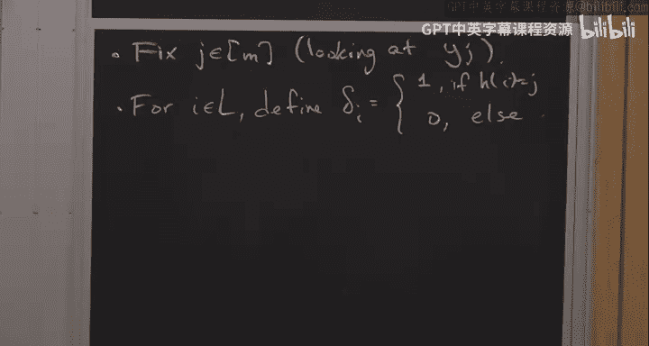

Star。Is equal to the sum。Of over I。In L。Of Delta I， Sigma I。ZI。哎。This right here。😡。

Is my R I for Bernstein。诶。Question。What's the expectation of the sum of the Rs？0。What's K？

I need I need to make sure that no R is ever bigger than K with probability one。

It's never bigger than K。Yeah， exactly t over L where L is c over log n。These are the light guys。

 right？None of these， none of these are， you know， that's at most one。

 That's at most one in magnitude。 And that， because it's the light guy is at most T over C log N。

 So K is going be something like T over C log n。Okay， and Sigma squared。

So I'm not gonna do it on the board。 Hi this calculation for sigma squared is like almost identical to。

 I think， problem。One of the problems on your Pet，4 or five。

's a problem There's a problem on your Pet that basically analyzes that same matrix P for a different context。

 okay。And once you solve that problem， you'll see that Sigma squared is something like。It's like。

At most。The L2 norm squared of z。Over M。Okay， yeah， in fact， it's actually at most even。

Kind the L2 norm of Z。 well， take Z and like only keep the light coordinates。喂。

It's like basically the sum of the squares of the light coordinates over M。But actually。

 I don't even care。 I'm willing to， I'm willing to settle for the sum of the square of all elements。

 That's an upper bound， anyway。And that upper bound is good enough for me。谁。

So we have the startup setup for Bernstein。I still want to do one more thing。Which is。

Notice that Z is random。Right。So this variance is itself a random variable。So what I want to say is。

RightSo really like there's a bunch of sources of randomness here。There's D， and then there's P。

 Well， two sources。 And P actually depends on H and sigma。And H specifies Delta。So。We have it， so。

You know， if you， if you compute the variance。If you compute the variance over this by the variance。

 I mean。This is the variance。Over the randomness。Of P。Right。But得。Z itself is also random。

 It depends on D。So what I want to say now is。With good probability over。D。

This expression is still small。So。There's this random variable， which is the sum of the Rs。😡，And。

It's a random variable that depends on both DNP over there。😡，There are two， Oh， sorry， capital。 Yeah。

 sorry， that matrix， capital P。 Sorry about that。 There's a matrix capital P。

 So what I want to say is conditioned on D。The variance over the matrix P。

Is going to be at most z squared over M。And now what I want to claim is that。

Kind of with good probability， this variance is actually small。 The good probability over D。

 This actually is quite small。Because this， this depends Z， norm square of Z depends on D。

 D is a random matrix。So。We want。That。So was squared， small。With high probability。Over。

The randomness indeed。Or basically that Es use。So what we're going do is we're gonna compute the expectation of this variance and then use Markov to say that。

You know， the probability that it's bigger than 100 times this expectation is at most one over 100。

So。The expectation。嗯。Z L2 norm squared。Is equal to the sum over all I of X I squared times the expectation of1 over U I to the minus-2 over P。

ZI is just Xi over u to the1 over p。So that's exactly that expectation。肯定啊。

Let me continue on this word。So what I， what did I say， I said the expectation of Z。

 And by the expectation， I mean over the randomness in the matrix D。Is equal to。

 which is the same as you。This equals to the sum over I X I squared times the expectation over this matrix U。

Of1 over UI to the minus2 over P。Yeah。Oh yeah。 I， I double minus。

 basically It's writing the denominator。 So I don't need another minus。So now what's this thing？

Ba I just want to show that that thing is a constant。So this thing is equal to， right。The integral。

Of。So。RightSo the tail， if you look at the exponential distribution。

 the probability that UI is bigger than x is e to the minus x。The PF is also e to the minus x。

Of of the exponential distribution。So this thing is equal to the integral of the PF times that。

So e to the minus x from 0 to infinity， e to the minus x times over1 over x to the 2 over P。Dx。

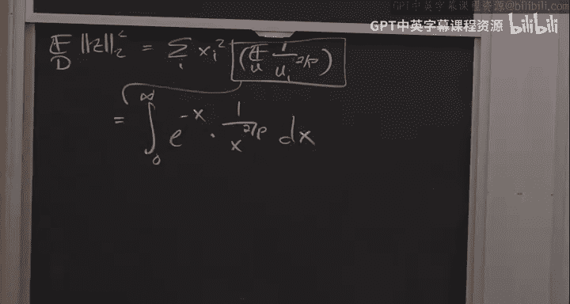

And this is equal to the integral from 0 to1 of that stuff D X plus the integral from1 to infinity of that stuff Dx。

Now， in the range from 0 to 1， notice that e to the minus x is always at most one。Or。

It's always that most one over E。No， it's always at most one。 Yeah， E the zero is1。 Okay， great。

 So in the range from 0 to 1， it's always at most one。So， this thing。Is that most？

The integral from 0 to one of。X to the minus2 over Pdx。Meanwhile， in the range from 1 to infinity。

 e to the minus x。in the range one infinity， this part is always at most one。

So this thing is at most the integral from 1 to infinity of even the minus x。Yeah。This converges。

 It's a constant。This thing also converges because P is bigger than 2。Right。So， the integral of。

Right， I'm going screw up my arithmetic on the board。 But if you integrate x to the K。

 you get x to the cap sn se or whatever， right so。X of the minus 2 over P。Add one to it。

It's still basically。Can I do math。2 over P is less than one。Because P is bigger than 2。

So this is x to the minus something where that something is less than one。It'sX to the 。

9 or whatever。So the integral of it is x to some other constant that's bigger than 0。

So this thing actually is a constant。Because P is bigger than2。喂。So great。 So this thing here。

Is equal to big O of。Alceor。Yeah。Oh， because。Right， what is this。

 This is the sum over I of Z I squared。So I square it。Great， so now we're in a good position。

I'm just going to write one more fact， a math fact。 We're not going to prove it。

 but let is take it as true。This is holders's inality。You might be wondering， out of all of this。

 why N to the 1 minus2 over p？😡，Right， we chose M end O my P。 And the reason is holders inequality。

So holders inequality。Says。If you have F and G。In RN。Then some over I F I G I is always at most。

The P norm of F。Let me know where it is in P。 the A norm of F times the B norm of G。For any。

1 over A plus1 over B。Is equal to one， where。1， less it equal to a less than。V less than infinity。对啊。

That's holder's inequality。So what do we know？😡，Okay， so。You might be asking。

 whyhy dot want these holders in？Okay。

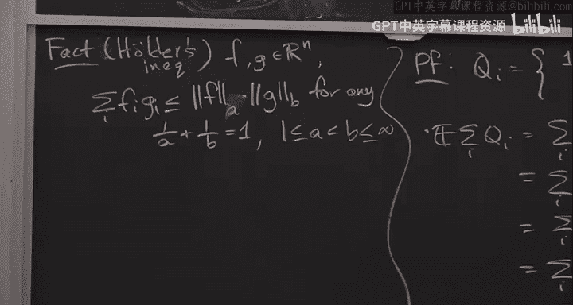

Look back at this right here。😡，嗯。What we so in general。

 kind of what do things like chby chef tell you， They tell you that a random variable with good with decent probability。

 a random variable is at most of the standard deviation。

We just show that the variance is the L2 squared over M。😡。

And the L2 square of Z is roughly the L2 square of x。

 So basically what we showed is that the standard deviation is like the L2 of x over root M。

So what we just showed is like， if you use chubby Cheve this thing here。😡。

With decent probabilities at most the L2 of x over root M。

But what I wanted to say over here is that it doesn't really kill the LP norm。😡，Remember。

 Z heavy is roughly the LP norm。So I need to compare the L2 norm and the LP norm。I need to say that。

Not only is that most of the L2 norm， but it's really at most of the LP norm presumably。

So what I get now is。You know。L2 norm of x squared is sum over i from1 to n of Xi squared times 1。

RightThis is this is my this is my FI for holder， and this is my GI for holder。And this thing is。

 at most。Some over I。Let's put absolute values。This thing is at most the sum of I X squared。

Raised to the P over 2。😡，To the2 over P。Times the sum over I of1。To the， the holder inverse。

 basically。Right so。嗯。1 over 1 minus2 over P。1 over 1 minus2 over p。To the1 minus2 over P。

Something like that， is that right？嗯。So。And。So two over1 minus yeah I good。 I think that's right。

And right， this is just N。 So this thing。This is holder。Where A was equal to P over 2。

 and then B is equal to。嗯。One over。1 minus a， basically。So this thing here is at most。

What is this now， This is just the LP norm of x squared。This is the LP norm of x。

Squared times n to the 1 minus2 over p。Questions。It looks like you have a question there。

Do you have a question？Okay， so what do we know？We know that the variance over。

Over that random matrix P， which is erased。 But the variance over H and sigma over the hashing and the random signs is this。

But it's still random because it depends on you。And then what I said is。Kind of， if the expectation。

The expectation over you of the variance。The variance was this。

So the variance and expectation of the variance over you is basically this。So by Markov。

 it's a constant times this with 99% probability。 So this is， this is the variance of the noise。

 This is the variance of that。喂。But I don't want to。

 but this tells me the variance in terms of the L2 norm of x。

I want to know the variance in terms of the LP norm， because ultimately， I'm trying to estimate LP。

So I'm just going to use the fact that L2， I'm going to use holders and say that L2 squared is at most LP squared times n the1 2 over P。

So that was holder's inequality。 there's just the fact about norms of vectors。

The L2 norm is always at most， the LP norm times this thing。So。Probability， you know，99%。

The variance over basically delta and Sigma。The variance over the randomness in delta and sigma。

Of the sum of our eyes。Is that most？LP squared。Some con， some big of。LP squared。

Times n to the 1 minus2 over p。Over M。But remember now how I chose them。😡，I chose M。To be some。

Big constant times end to the 1 minus2 over p。Times log n。 Basically。

 I chose M to kill this end of the1 minus2 over P。So this thing here is O of。LP squared。

Over amtimes log n or over log n。Okay。认。😡，So now， I'm going to use。You know。

 LP is the same thing as T。 Let me just stick to my T's。Good， so I know that。

This is the expectation over， again， over deelta Sigma。And this is the variance over delta in Sigma。

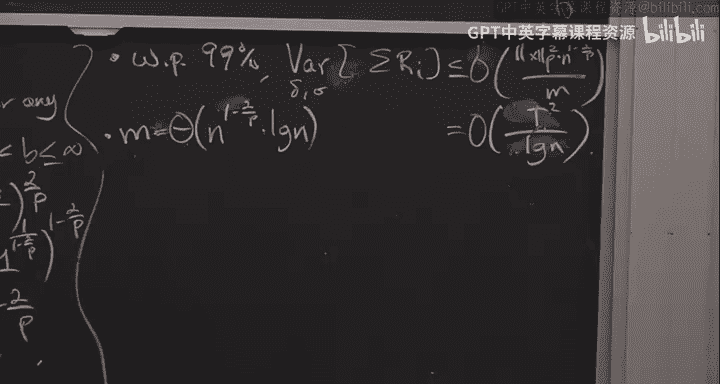

So we've conditioned on D。 We've conditioned on U。And now we're going to apply Bernstein。

 where the probability， the probability is over Delta and Sigma。 We've already conditioned on you。

Right。So now Bernstein。I'm not going to do the calculations。 It's basically basically just do it now。

Bernstein。Probability。Over Delta and Sigma， that the sum of R。

Is bigger than something like T over 10。😡，Is going to be at most。E to the minus， some constant。呃。

So let's make this concrete， let's say that the variance is at most， there's some constant here。

And we can make this constant as small as we want by making M bigger by a constant。

 so let's make this thing at most T squared over some constant。

V times log n where V can be as big a constant as we want。

So Bernstein tells us the problem that this thing is bigger than T over 10 is that most。

E to the minus C。T squared over 100 Sigma squared。What sigma squared。

 Sigma squared is that t squared over 100？Divided by sigma squared。This is sigma squared。

So divided by sigma squared means times log n。Over T squared V。

And then the second term plus E to the minus。Let me also make this a big。 I don't want。

 I'm using this constant C there too which is different。 Let's make this some constant V log in。

E to the minus。C。T over 10。Times 1 over k。😡，Which is V log n。Over K。Over V log and repeat。Okay。

 this is Bernstein。Magically。Ts cancel。These teas cancel。

I can choose V to be as big a constant as I want， because basically， I can just scale。

 I can just make M bigger by a constant factor， right。

So I can make V so big that it cancels this0 and it cancels the C。V cancels this 10 and the C。

So what do I get e to the minus log n is my failure probability。Right。

And I can make these such a big constant that， you know， this can be e to the -10 log n or whatever。

So what do I know， The probability that the noise is bigger than T over 10。

Is less than one over poly N， where I can make the poly， whatever I want。

 The problem that the noise is bigger than T over 10 is that most one over n cubed。

But there are only M buckets。 M is less than n。😡，The problem that the noise in a bucket is bigger than Tier over 10 is that most one are around cubed。

 there are only end buckets at most end buckets。So the problem that any of them has big noise is really small。

So with high probability。None of the buckets have big noise。With high probability。

 all of these are at most t over 1。😡，So I'm， I mean， I'm done。 I really upset。

 this is what I've shown。 I've shown that for every bucket。The noise is less than T over 10。有。So。

I claim we are done。But I don't know if everyone believes we're done。

 So are there questions about anything we did。 There's one thing I didn't cover， which is。You know。

 again， the usual thing of there's a lot of randomness here。Right。There's this random function H。

 the hash function。 There's this random sine function Sigma。

 There's also the random U on the diagonal。What I might make you do is。You know。

A you using Nissan or some bound independence or whatever on the homework that that works？But that。

 that is doable。 Okay， so other than， other than storing up this a lot of randomness。

 are there any other questions about the analysis。Yeah， and I could。Sorry， say one more。And this。

 I should have said this V isn't the。This V isn't the en numerator。 But yeah， the， the final。

 the final， the final failure probability is one over end to the 10th or one over end to the100。

 It's one over end to some constant。 I can make that constant as big as I want by just tweaking V。So。

 by a union bound。The noise is small。 The noise from the light guys is small in every bucket simultaneously。

Any other questions？第二。Yeah。This thing。Yeah， one of the homework problems。

 you're going to basically imply this。Yeah， that's right。That's right。So really， actually yeah。嗯。

Yeah， with probably 99%。The variance。Basically， that sigma squared。

That variance over there is at most this， and that followed by that calculation as well as holders。

对二。This one。No， so I've conditioned on you。Okay。So specifically。

 what I did is I conditioned on the event。So with probably 90% over you。I conditioned on you。

 and I conditioned on this event。 I conditioned on the event that。For my U that I got。

 the variance is small。😡，Exactly。So， so， so I guess the way that I'm thinking about is there are lots of times that I just said this happens probably 90%。

 So at the， I'm gonna union bound over everything。 I needed the big guys to be perfectly hashed。

Right， I needed。The variance to be small to apply Bernstein。 So I'm all those happened with 99%。

 So by a union bound， it all happens with probably 95% or something。Yeah， I only did just play a few。

 I just didn't want to count how many I did， so。Any other other questions？嗯。Right， so。Right， so。

Right， so， yeah， so with， with problem， that's right。 That's correct。 With probably 99% over you。

I'll have that。For all Jay。This variance is small。That's a good point。

Because the only thing I used you for。Was to say that there's a good chance that the square neuro of Z is at most the square norm of x times a constant。

RightThat that didn't depend on J。 That's just about Z。

So that would imply that all the variances for all the Jars small。So。We've done。

 we've done basically P norm estimation for P less than2。

 That was stable distributions index Dix algorithm。Now we just did P。

P norm estimation for P bigger than two。 Well， we did P equals 2 as well。 right。

 You could also have used index algorithm for that。

 although we did it just using random sign matrices。P bigger than two is this algorithm。

And what we're going to see。 So notice that at least in terms of the space complexity from the upper bound side。

 there's like this phase phase transition when P is 2， right， When P was less than 2。

 we only needed like log space。When p is bigger than  two， we need polynomial space。

 So like P equals 2， there's this change in the way our algorithms。Complexities。

 it seems like there might be a change in the complexity of the problem itself。We don't know that。

 We just know that we have different algorithms that behave differently。

But we're going to see later in the course that actually， that's not just an accident。

 P equals 2 actually is really a threshold。 We can prove lower bounds。

So just like we proved some space lower bounds earlier in class based on compression。

We're going to see that you can prove a space lower bound on pen norm estimation that says that。

Once p is bigger than 2， you really do need n to the 1 -2 over p space。Whereas。

 we'll see that not this lecture or the next one。 But when we talk about lower bounds。

 we'll see that。 So this is not an accident。So。There's about 15 minutes left in class。嗯。

What I'll do is I'll say some stuff to set you up for next time。Well， maybe prove one thing or so。

But we're done with moment estimation， norm estimation。 I keep saying moments。

The P moment is just the LP norm to the pe power。 So sorry if I。

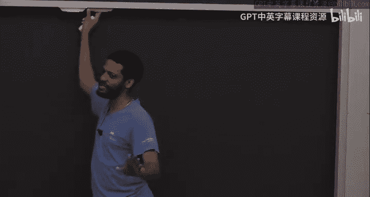

Go back and forth between Norman moment。So， we've seen。What we seen， we've seen distinct elements。

We've seen norm estimation， approximate counting。嗯。So。Right。Maybe I'll say a little bit about。有。

Maybe I kind have said this earlier， why some of these problems。

 why you might care about some of these problems， It looks like I'm just pulling problems。

From out of a bag， right。嗯。呃。So for example， like the distinct elements problem。

It's been used in several。 who's use SQL， There's a count query in SQL。 So， I mean。

 counting distinct elements is。Us in lots of places。

 So one application that I've seen is network anomaly detection。Okay， so the situation there is。

 so there was this worm that was spreading。 I'll put a reference to it in the notes。

And the idea is you want to track the the speed at which the rate at which this worm is spreading。

Okay， so what do you do？You have a distinct elements algorithm running on the router。

And you look at each packet that comes through that router。

 you look at whether or not it has the signature of the worm， in the packet。And if it does。

 then you count it as being。Kind of a bad packet。 And you count how many distinct I P addresses are sending。

Packets with that worm signature on it through this link。So it's like。

 and you want to get an approximate count of。Yeah， basically how many sends are infected with this worm？

So that's a count distinct kind of problem right because if the same guy is sending many packets。

 you don't want to count him multiple times， you're just counting the number of distinct senders。嗯。

Yeah， so I mean， I mean， I can make up all kinds of stuff， right。

 How many distinct people visited your website， Look at their IP address， etc cetera。

 So counting distinct things。And a stream is a pretty natural thing。嗯。Again， moment estimation， so。

Basically， it's again， again， you could use it going back to this router example， anomaly detection。

So imagine that XI is the number of packets sent to IP address I。Okay。

 and I want to know various statistics like who's receipt which servers are getting are getting hit with the most traffic today。

 That's basically the L infinity norm。O。And there was an application at AT and T， where。Okay。

 what you really want is maybe the L infinity norm。But unfortunately。

 we can't do the unfinity Nor in sublinear space。So what you settle for is。

The most sensitive LP norm to the outliers that you can， which would be the L2 norm， right。

 the L2 norm you could do in log space。So what they did was they actually used the algorithm from homework problemm 4 because it's faster than the A M S sketch we saw in class to track the L2 norm of。

Of this traffic vector X。To， to detect when it was skewed toward。Toward some subset of servers。

I mean， it's not only。 It's not the only。 It didn't solve all their aly detection problems。 Okay。

 it's one statistic they track amongst many statistics。嗯。

So now what I want to do is I'll switch to another problem。And this problem。

 before I define the problem for you。It's again， motivated by anyone ever go to Google dot com slash trends。

Okay， so you want to detect what's trending。 Okay， trend detection。What。

 what are the search queries that a lot of people are searching for these days， Okay， or just。

 you know， tracking hot items。In in a database， okay。That's the problem we're going to look at。

And it's called the heavy Hious problem。

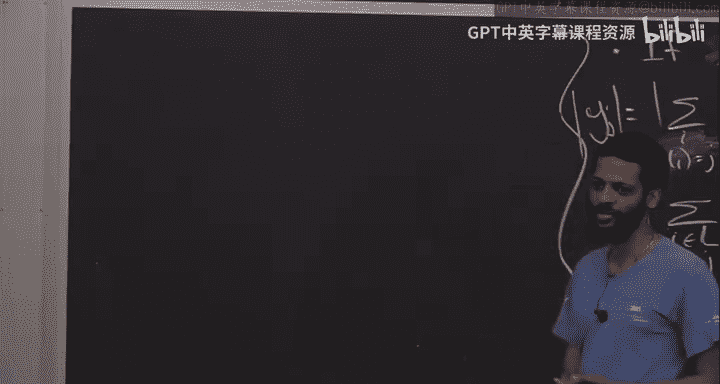

Okay， so。And it's related to a problem called point query。So。Let's first look at point query。

X and Rn。Updated。In the turnstyle model。So， for example， X is a super high dimensional vector。

 It's indexed by every possible string that's ever been fed into your search engine。

 all possible queries。Okay。And Xi is going to be， for example。

 the number of times that people searched for that string。Now you can say， well。

Some searches are basically the same， but the strings are different because people were them differently。

 Okay there。 So theres some， there's some， you know， bucketing you。

 you have to do there your search engine to make sure those are treated as the same thing。

Now let's just say this。 we have a vector that's updated in a turns style model。Okay， and。

If someone can come along and say query I。Where I is in one to N。

And the output of query I should be Xi。Okay， but we're not going to be able to do that in sublinear space。

 So we're gonna to allow some error。 It should be Xi plus or minus you know， epsilon times。

 let's say the。L1 norm。So， this would be。L1 point query in general。

 you can imagine putting some other error， the LP norm or some other thing。😡，给。嗯嗯。

So that's point query。And a related problem by related， I mean， the solutions is for one。

Are going to be used for the other。So there's just one kind of query。

There's no argument to the query。And what should the streaming algorithm do when someone has a query。

 you should output。An L， which is a subset of 1 to n。Such that。First of all。If I。An Xi。

Is at least epsilon times the L1 norm？It implies that I is an L。And2。

If Xi is less than epsilon over2 times the outline norm。It implies that I is not an o。

So that's the kind of guarantee that query promises us。 This is a data structure problem， right。

 X is being updated， there are updates in the turns cell model， and there are queries。

 and there's only one kind of query。And the guarantee of the query is that this happens。Oh no no。

 sorry。 this is。OutThe outputs。A value。In the range。Xi minus epsilon times01 norm。

An Xi plus epsilon times the L1 norm。对。So the output of query is an approximation to Xi。

It's an additive approximation。So it's some number guaranteed to be in that range。

Does that answer your question？Yeah。我要问。Yeah， so I mean， you could put other ideally。Right。

 so ideally， it would just give you X I。But if you want query I to give you X exactly。

It's just not possible in the streaming model in subline space。

 So we settle for some notion of approximation that's going to let us design an algorithm。

So what is the L1， let's say you're searching for things in in the search engine， right。

 And let's say that X is the number of times you search for a string I， What is the L1 norm。

 The L1 norm is just how many searches were there to my search engine today。So。

What this is saying is， like what this is saying is I want to know all queries that occupy。

 let's say Epsilon is you know，01。 I want to know all queries that that occupied at least a 1% fraction of my search traffic today。

Tell me all the top 1%。Assorttionions。Are there any other questions。And this guy is telling me。

 I want to know all the searches that were very popular。

But there shouldn't be false positives that are two falses。

The people you tell me should all be like at least somewhat popular。And in general。

 you can even make this be。You can make this gap different。 You can make this B at least epsilon。

 and here is at most 0。99 epsilon。So the gap， between， you know， your false positive gap。

 you can make it small by， by some other constant。 It'll follow from when we。And always。

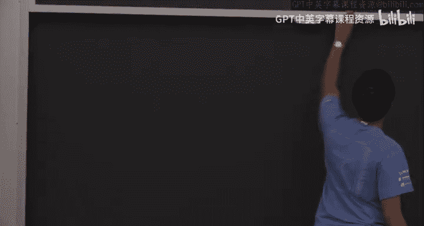

Today is Thursday， yes， let's。So let me say one thing because you do have a Pet problem。

That says something like you， as you will see in class， incoherent matrices， blah，lah， blah。

So you're going to see that right now。And this is actually going to be deterministic。Algorithm。

It's not gonna to be a randomized streaming algorithm。 Okay， Well。

 we're gonna to see randomized ones next week。 But right now。

 let me show you a deterministic approach。

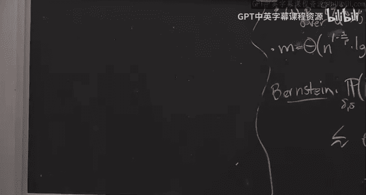

So。Deterministic。So论是。For point query。So first of all， if I can solve point query。I claim that。

That lets me solve heavy hitters。 If I can solve this in small space。

 I claim that lets me solve that in small space， although the runtime won't be that great。Okay， why。

 what will I do？I'll run point query with Epsilon actually being something like Epsilon over 10。

Then when I want to know what the heavy hitters are。

 I'll run through every single index from one to n and do a point query。If the guy was actually。

 at least Epsilon times the L1 norm。Point queryry will say that he's at least。

Nine epsilon over 10 times the L norm。喂。So。I'll run point query。

 and then I'll output every guy who says that he's at least nine epsilon over 10 times the L1 norm。

That will include all the true heavy guys。And anyone in the list will be at least eight epsilon over 10。

Because the error and point creates at most stepsps on over 10。So， right。And you know。

 you can make Epsilon over 10 Epsilon over 1000， and that would make this gap even smaller between Epsilon and Epsilon over 2。

So point query。Point query with Epsilon over 10 implies heavy hitters with Epsilon。 Of course。

 the running times actually get the list is terrible。We'll see how to fix that next week。

But let's just now focus on point query。So， definition。Pi。Is an M by on matrix？Is Epsilon incoherent？

Yes。For all I， the L2 norm of pi I。I， this is the I column。A pie。And also two。

 for all I not equal to J， the absolute value of the dot product pi a dot pi J。Is that most absolute？

So a matrix is incoherent if。Its columns are approximately orthonormal。Right， so they。

The different columns are almost orthogonal。And the norms of each column are one。Definition。

Let's call it and。Epsilon。T。And。We've put another letter in there。Code。Is a set？C， which is。

Let me call this capital N。C which is C1 up to CN。That are each。In Q to the T。Such that。For all。

 I not equal to J。The hammering distance between C and CJ。Is a is a。At least one minus epsilon T。

Havingming distance。Is how many entries this is a C， How many entries are different。So it's a set of。

 it's a set of vectors。Each vector has T symbols， Each symbols between1 and  Q。

And for all different code words。They barely agree。😡，Basically， this means that they agree。

On at most epsilon T injuries。哎。And I claim。Plaim。Epsilon T， Q， N。

Code where capital N is now little N。Implies。Epsilon incoherent pi。With。M beingQT。

And why is that the case， here's how we're going to make pie。

Pi is going to be1 over square root t times。😡，Each column。Let's say this is the I column。

It's going to correspond to CI。We break up the rows。Into blocks。There are T blocks。Each of size Q。

And in each block。We just put a one corresponding to that symbol of CI。Right，So C。

Is like some symbol。Another symbol， another symbol where each one of these is between1 and Q， right？

So we're going set， we're going put a one in the alpha 1 symbol in this block。 We're gonna put。

 We're gonna put a one in the alpha2 symbol in this block， etc cetera。

 and make the rest of the block 0。And then we scale by whatever routine。Because of the scaling。

 all the colon norms are one。Because this thing is an epsilon code。

If you look at two different columns， they only agree in an epsilon fraction。Of blocks。

So the dot products are going to be at most Epsilon。

And what we'll see next time because we're out of time。Is the final claim？An epsilon。

 incoherent matrix。Can be used。As a sketch。To solve。Point query。And then will'll also show。

That a random code。With。Cubing。Oh of one of Epsilon。And T being O of1 ofeppsilon log n。Is。An epsilon。

TQ。And code。With high probability。So we'll see that next time。

So we'll show that these codes exist with the right parameters。 But once you have that code。

 you can always use it。 So once you have the code， it's a deterministic algorithm。

 but we'll show that the code exists randomly。And then you can use the matrix you get from that code to solve point query。

😡，And what one of the Pet problems asks you to do is to show that。

There's another code besides this code， which gets a better。Remember， M is going to be Q times T。

We're going to see in the piece that you can do a better Q times T for a certain range of epsilon。

Using a different code。 And that's， that's that code you're gonna analyze in the PAT。哎，坐啥子。

