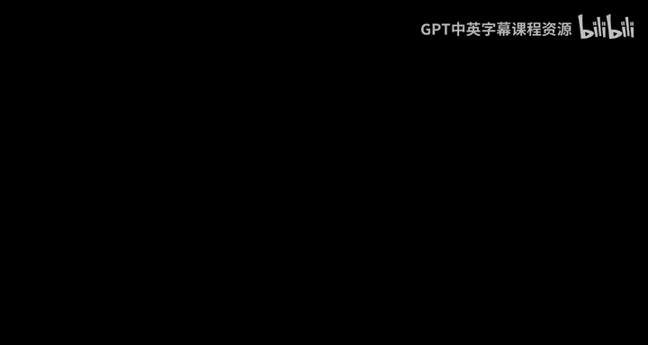
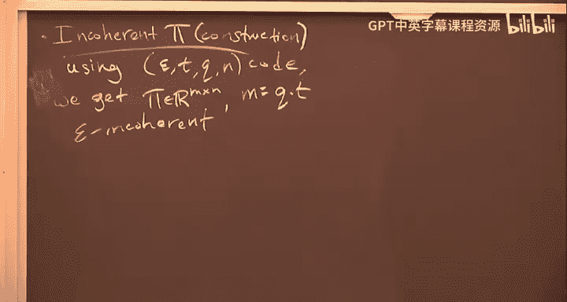
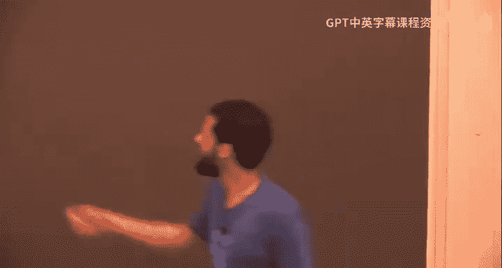
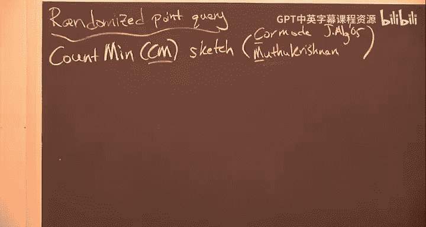
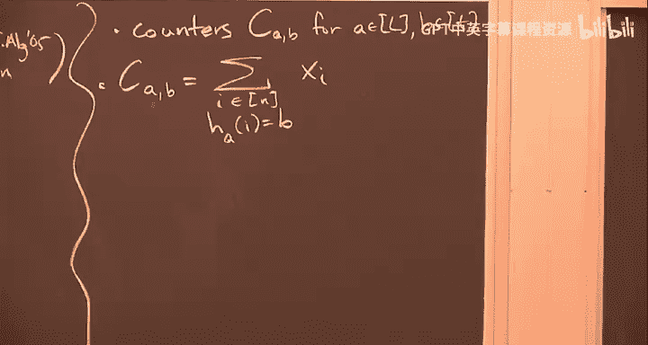
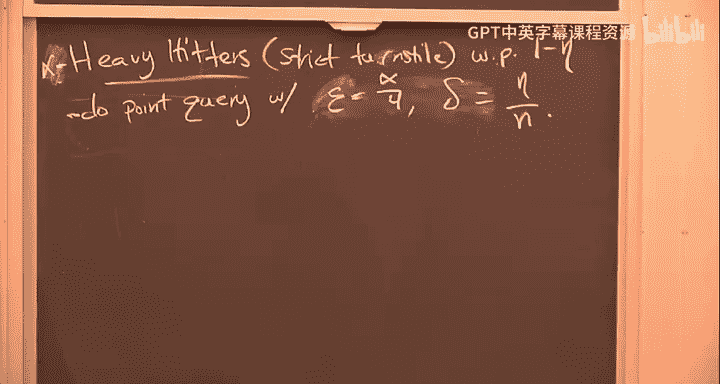
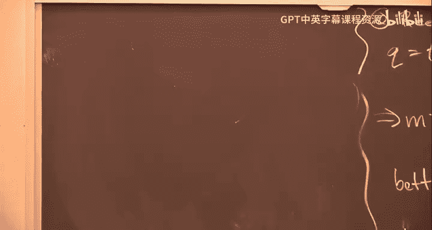
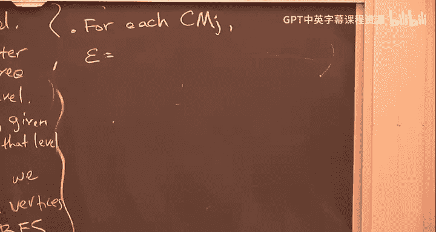
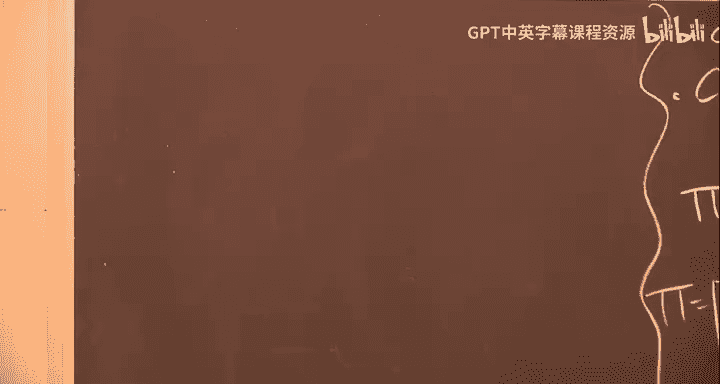

# 哈佛大学《大数据算法｜Harvard Algorithms for Big Data (COMPSCI 229r) 2016》deepseek - P6：-06-Algorithms for Big Data (COMPSCI 229r), Lecture 6.zh_en - GPT中英字幕课程资源 - BV1yGdNYvEMo

All that。But， so。I hope everyone enjoyed PSet one。So on the lectures section of the website。

 there is this。bullet that says everyone may have to one to two lectures， depending on class size。

It seems like the class is small enough that。I might have to ask people to。

Ascribed twice in this minute。In particular， there's no scribes for today。Arecr。 Oh， great。 Okay， Oh。

 did you send an email or。Okay， great， okay， okay， great。Okay。

 and also we do need two more people to sign up， help grade PS at one。

Everyone's supposed to help grade one， he said。Please sign up for that。 I think we have two。

 we have two people， but there are five problems， so。You know the TF plus four people would be ideal。

AndP3。Two is going to come out tonight， which has only three property。

And it will be due two weeks from yesterday。Great。So now let's get back to business last time we met on Thursday。

We discussed a new problem。It was related to trend detection in streams or two problems。

 one was point query， specifically L1 point query， where there's an x。

 a vector x iss high dimensional， n dimensional， it's being updated in a turnstile screen。

And at various points， someone can perform a query， and the query takes as input in index I。

 which is between1 and n， and you should output Xi plus or minus some error term。Okay。Okay， great。

And it's L1 point query because that's all1。 you could ask for other norms， how is the volume now？

Right， okay。嗯。And L1 heavy hitters is you need to return a subset of one to n。

 such that everyone and all the people who are epsilon heavy hitters。

 meaning they're at least an epsilon fraction of the total mass should be in that list。

 And if you're not close to being an epsilon heavy hitter。Then like you're like。

 you're less than an epsilon over two heavy hiter。 You should not be on the in the list， right。

 So this already implies， for example， that。The size of L can be at most two over uppsilon。

How many people can have epsilon over two fractionions of the mass， most two are epsilon people？Okay。

And I was about to tell you how to solve this problem in the streaming level。

We had a definition for epsilon incoherent matrices。So pi has columns。 pi went up to pi n。

 and it's an M dimensional has Mse， and it's epsilon incoherent， yeah。Here。Right。

 so think of it as a data structural problem。 The data structure has to maintain X。

And then there's one kind of query that's allowed， namely you query an index between one and n。

 and the answer， an acceptable answer to that query is the if entry of x plus or minus an error term。

And the promise should be that the error term is at most。

 an additive error term is at most epsilon times。The L1 norm x。It's an index。 Yeah。

 I think it as as like an index into X。 like I give you I。 You should give me X I。Yeah。

 but I'm allowing error。But I'm allowing error。Now， these are two different problems。That's sorry。

Yeah， we'll see a relationship between these problems soon。 but these are two different problems。

Okay， so good so。Actually， to solve both of these problems。

 one thing we can do is use what's called an Epsilon coherent matrix。

 the columns of pi have unit norm， Euclidean norm， and the dot products between different columns are at most epsilon。

 so these are almost orthogonal vectors that are the columns of pi。

 and the claim is that you can use this pi， if you have an epsilon incoherent pi。

 you can use it as a sketch。For actually both of these problems。So we'll see that now。

And we talked a little bit about how to get pi from codes， and you had a piece of problem about it。O。

So proof of that claim。It's actually very simple。It's almost one liner。 So our sketch is going to be。

Is y， which is pi x。给。And。嗯。Will。Will estimate。X I。As Y I， which is。Which is EI。quiet。Oh， sorry， as。

We'll estimate Xi as pi transpose。Let me， right that。Over。So the point is。

 since pi has almost orthogonal columns， pi transpose pi is almost the identity。

 That's the thing to keep in mind。So y is pi X。 So x is roughly pi transpose y。

 which is pi transpose pi X。 So we'll estimate X I as pi transpose y。And then the i entry of that。

Which is equal to。Ply transpose。hi。And why does that work？嗯。Notice that pi transpose pi。I。

 the icon entry of that。Is。EI transpose。High transpose。I X。哎。Which is equal to。

The dot product of pi EI， which by the way， is just the I column of pi。

And think something to keep in mind， you know， linear algebra fact。

The definition of matrix vector vector multiplication is that pi X is the same thing as the sum over all J of pi J X J。

Okay that's what matrix vectorplication means。 And then now we distribute this dot product。

So there's the case when J equals I， and there's a case when J doesn't equal I。 when J equals I。

You have。Pi I do pi I， which is one。So you have X I。

And then you have the case where Jde does not equal I。啊。Xj times the dot product of pi I dot pi J。

Okay， but these are most epsilon in magnitude。So this is at most。X I plus， this is equal to。

Xi plus something。Which is at most the sum of j not equal to I of the absolute value x。Times Epsilon。

So， in fact， the error is even slightly better than the L1 norm。 It's the L1 norm， not including I。

Okay。And one way to write this， by the way， is。I'm going to write something and we'll see more of it soon and in other parts of the course as well。

Given pi X。We are recovering。Some ex tda。Whihi happens to be pi transpose pi X。Such that。嗯。

If you look at the infinity norm。Between x and x tilde。That's at most。Epsilon times the L1 norm x。

Okay。So this is what's called， you know， in。We'll talk about compressed sensing later in the course。

 This is what's called an L1 L infinity guarantee。Okay， and， you。

 there are other guarantees you could。Shoot for， we'll put something。

 some other norm here and some other norm there。 And you could ask， you know。

 which kinds of guarantees are the strongest。And how how big does your sketch have to be to achieve these different kinds of error guarantees。

 Okay， so that's something we're going to talk about more later， yeah。You know。

 EI is the I standard basis vector。Yeah。So， yeah we。If you have a vector Z。

 the if entry of the vector Z is just EI transpose Z。Any other questions。Okay。

 so now the question is， what kinds of incoherent matrices can you get？So， construction one。Okay。

 so the best construction comes come from codes。Okay， so there are other ways to construct them。

 But for now， I'll just mention the codes because that's the best thing。嗯。

That's the best thing we have， so using codes。I called them last time， what was my。Made up notation。

As long as you have an epsilon。知。Q and code。Is to recap， what does this mean。

 it means what is a code， a code is just a collection of vectors。Each vector has length T。

Each entry in that vector is a symbol between 1 and Q。And there are n vectors。

Those are the code words。And the epsilon means that if you look at any two different vectors。

 two different code words， they agree in at most an epsilon fraction of coordinates。

And we saw last time that if you had such a code， then you get an incoherent matrix that has Q times T rows and and is epsilon incoherent。

 So now the question is， what kinds of codes can you get。

One thing you can do is you can choose。Q to be something like2 over epsilon。

And T to be something like。呃。I'd say log n overs。And I claim that。Random。Such code。

Works with high probability。Okay， if you pick a ran， if you just pick。

N random vectors where each vector has T entries that are in each randomly。

 each entry is just independently a uniform number between1 and  Q。I claim that it has this property。

 and why is that？It's basically just the turn off band，So look at any fixed two of the code words。

AndWe call them C and D。Okay。The expected number。The expected number of places where those code words agree。

Is Epsilon is actually T over Q。Right。Expected。Number indices。Where。CND agree。Is equal to。T over Q。

You write can write this as a sum of independent indicator random variables。T of them。诶。

So the expectation is T over Q。 And since this is a sum of independent indicator random variables。

 you can apply the turn off bound。 and you can say that actually not only is it T over Q。

 but it's at most2 T over Q with probability exponentially small in T。嗯。1 minus that。The probability。

 at least one minus exponentially small in t， you actually get at most 2 T over Q。

 that's theoff that follows from the turnoff found。So now if you set T to be something like。

If you make this T big enough。Right。嗯。Like some oh， not， not， not tea。嗯。Actually。

 you're going to get something like epsilon tea in this case。So the so t over Qd。

RightSo the probability that you're bigger than the expectation by a constant factor is like e to the minus expectation。

H from constantant。So as long as you make T over Q。A big enough constant times log n。

 which it is in this case， okay。Then this thing is going to be。You know。

 this thing here is going to be much less than one over n cubed。So with probability。

 at least1 minus1 over in cubed。You succeed on these two code words。Okay。

But how many pairs of code words are there， there are entries chooses 2。

 therere like n squared pairs。 So by union bound over all the pairs。

 you can say that simultaneously none of them agree on most 2 T over Q coordinates。

And 2 T over Q is exactly an epsilon fractionra of coordinates。第二。Yeah， exactly。Yeah。

So E to the minus log n， right， there's a constant here。 So you can make this。

 you can make this constant bigger by making this constant bigger。对。Yeah。

 but  two over  Q is equal to epsilon。嗯。So the number of indices where C and D agree。

Will be at most 2 T over Q。Which is exactly epsilon over Q， which is exactly Epsilon T。Yeah。

 so this is equal to。Epsilon T， an epsilon fraction of the indices。So questions， don't be afraid。

There are only a few of us。Okay， great。So in now union bound。Un mean bound over the n squared pairs。

 Okay great。 So that implies。And。Oh1 over uppson squared times。Login。啊。

And then the second thing you can do is use what's called read solvent codes。

Which is exactly your Pet problem using polynomials。 Those are， those are called readitalmon codes。

And if you solve that problem， the way that we wanted you to solve the problem。

 you would have gotten that。Q is equal to T is equal to theta of。One over Epsilon times login。

Over log， log in。Plus log when a reppson。Which implies that。M is equal to theta of。

One erupslon squared。Times log n。Over a log log n plus log1 reps log squared。对。

So if you think of epsilon as being a constant， like 01。This is login。This is roughly log squared n。

 log squared n over log log n squared。So that's better when Epsilon is not too small。

But once epsilon is small enough， for example， if epsilon is like one over end of the 0。1。

Or one over end of the sea for any constant C。That's when of Repson squared log n。

 but log n divided by log1 of Repson is a constant。So this part just doesn't even matter anymore。

 So this is better by a factor of log N。And， in fact， this thing is better。Then the first option。

When。Epsilon is like much less than two to the minus some constant square root login。那是圈子什么？可。

And it's， you know。By the way， codes that。Cos that achieve this kind of tradeoff are called。

 you know codes that meet the Gilbert Vsashov bound。 If you read coding theory， literature。

 is the GV bound。And this is read solve in codes。 And if your goal is to minimize M。

 which is Q times T， if your goal is to come up with an。

A code with relative distance 1 minus epsilon such that Q times T is minimized。

 and I want you to have N code words。The best I'm aware of is in some regime you do this。

 in some regime you do that。Okay， and it's an open problem whether there's anything better。

 There's a lower bound。We'll see it later in the class， actually， there's a lower bound by alone。

Which says that any incoherent matrix， forget about codes， Just any incoherent matrix must have M。

 which is at least one over uppsilon squared。Times log n over log when eson。Okay， so。

If epsilon's a constant。Then that actually is fine。 That matches that。 if epsilon' is really small。

 then again， that matches that， but we don't how to match it in between。Okay， so good。

 So that's point query。You can ask about heavy hitters。 I think I mentioned this last lecture。

 I'll just say it again in words。 So one thing you can do。This is for any。For any。Epsilon。

 incoherent。Ppe。So。One thing you can do to solve heavy hitters is there's a black box reduction right。

 from heavy hitters to point query。Which works as follows。

Instantiate a point query data structure with error epsilon number 4。

That means anyone who's actually a heavy hitter。You， if you point query himm。

 you'll see at least three epsilon over four。Anyone who's not even an epsilon over two heavy hitter。

Right， you'll see something less than epsilon over  two plus epsilon over4。

 You'll see something less than3 epsilon over 4。So， the algorithm is。Do your point query sketch。

And then now at the end， loop over every single index from one to N。And report the ones。

That have a mass at least three epsilon over four。That's your list。So， you know， that works。

 It's really slow because N we're imagining is being huge。We'll see how to fix that soon。

So good notice that。We use the probabilistic method to show that this code exists。

But if someone one day came along with like an explicit construction of this code。You know。

 the algorithm will be totally deterministic。 There's no randomness in this algorithm。

And if you use read Somon codes， there's no randomness at all。没。Okay， so this。You know。

 this is a deterministic approach。Which has certain advantages。Which I'll say in a second。

 but there there's also a randomized approach， which has certain other advantages。Namely。

 that it's more space efficient。So， randomized。Point3。

So the first thing I'm going to show you is the what's called count min。C啊。Sketch。

This was introduced by core mode。And Muhu Krishnan。In 05 was the journal version。

And I'm not making any accusations， but just notice。😊，嗯。Actually。

 they have a f where I think they ask about the naming of the sketch and they they sort of evade I mean。

 they created the fact， I guess as a joke for this question。

 they they avoided answering whether there's any correlation here。

嗯。So how does this work？So it's based on hashing。Okay， so。The way the algorithm works is。

I'm going to have this grid of of counters。And。For each row of this grid。

 I'm going to have a hash function。So， there's H1。Which maps。1 to n into one to T。Up to HL。

Which maps？1 to end。Into one to T。对。And when an index I comes along， someone updates X I。 They say。

 I want to add V to X of I。What I do is I go to the first row and I hash I。

 and that tells me some random entry。 and I go to the next row and I hash I， and I hash I。

 and I hash I。And I add V to each one of these。And， so。There are counters。是。呃，AB。Or。

So I guess if a is a row。呃。For a between 1 and L。And for B between one and T。See， so see。

Let's call it。C a b。Its going to store for us。The sum of all I。From one to n。Such that。H。

 B or H A of I。B。Right。So this CAB is the Aeth row。And the B of column。

It's going to store everyone who hashed by the AF hash function into B。

Or if you like thinking about pis， you have your sketch matrix pi。

M is going to equal basically t times L。And pi looks something like this。If you look at a column。

This is column I。Imagine the rows are sort of segmented。Into there are， guess， L。Chunks。A rose。

And each chunk of rose has a one in it。In a random location。And where's that one。

 That one is dictated by the hash function。 So this is H1。 H1 tells you where that one is。

 H2 tells you where that one is。 Each one of these。As with tea。对。So we're not。Yeah。

 so you're saying this looks quite similar to the matrix that was constructed。

 Epsil incoherent matrix constructed using codes。So the thing that's going to happen here though。

 is we're not going to have the guarantee that。Any two columns。

 like for all pairs of columns I and J， they don't intersect much。We'll just have the guarantee that。

You know， certain our error random variable will be small with good probability。Yeah。嗯。Right， so。

You'll have that。 So if， if you a pair， if you fix a two different I and J。

 like columns of this matrix。And you ask。You know， what's the， you know。

 you want to say with good probability， they don't collide much。

That will happen from parawise independenting hashing。 But with the codes。

 we wanted something even more。 We wanted that for all pairs。 this。

 this they didn't collide much simultaneously。 So what we did was we did a union bound。

So to do a union bound， your failure probability has to be something like one over n squared。

And if you try to get that out of just parawise independence， you're going to be screw。Or no。

 it'll be it'll be like a constant。Basically， if you want purely probability， delta。

You like pairwise In is going to force you to set T E to depend on one over deelta。

Whereas we really want things to depend on log whatever it delta。 Yeah。

 it's like the same issue we had in the first lecture or the second one where we did the median of estimators。

You know， we could have just done the average of many estimators。

 but that would have made us have a one of delta dependence。So we did the median of a bunch， right。

 So it's the same kind of issue。That's right。 Yeah。

 you could use para independent hash functions and blow up T by a lot。Yeah。

Your final sketch will have even more than n squared。Rose， that's right。 and actually， in fact。

 these Hs will be。From a two wise family。We will use powerys in Pensian。

And the Hs will be independent of each other。Very good。So， now。We just need to。

 show that good things happen。So。For point query。Yeah， let's say for。Epsilon point query。

Now this is a randomized algorithm， Monte Carlo， it has some failure probability。

So with failure probability。Delta。嗯嗯。Meaning we're going to output Xi plus or minus epsilon times thel1 norm with probability at least1 minus delta。

We're we're going to set。T。To be something like two over Epsilon。An L to be something like。

Log base  two of1 over delta。I don't know why I put seals all of a sudden what I haven't been doing before。

Let's just pretend， I mean， it has to be an integer， but put a ceiling if you so choose。O。Good。

 so claim to oh， I should tell you， what is the estimate for the point query。We're going to output。

This is why it's called the count min sketch。Becauseuse we store a bunch of counters。

 and then our estimator is going to be the minimum。 So output the min。Over， I。From one to L。Of C of。

Not。2。嗯。可以。And I should say。Here， I'm assuming。I'll say something with assumption in a second。

 I'm assuming what's called the strict turnstile model。

So I'm assuming there's someone gave us a promise that said all entries in x are non negative。 So。

 for example。If you， you know， if X I is the number of packets addressed to。

To IP address I in a network traffic stream。Then X's account， so it it better not be negative。嗯。

Though there are situations where you care about。Negative counts。 So， for example。

Suppose I have an accountant vector from today and account vector from yesterday。

And I want to know what are the things that differed a lot between today and yesterday。

 What would I do， I would do this sketch to both of those vectors separately。

And then I would subtract the sketches from each other。And since the sketch is linear。

That subtraction will be the sketch of the difference vector。And then I will ask。

 what's heavy in the difference vector。And that can have negative injuries。

So there are cases where you care about turnstile versus strict turnstile。嗯。Now。In the first case。

 I said， not not only do you know that all the Xs are not negative。

 but you know that there are never any deletions ever。So that's the insertion only model。

 And on Pet 2， which will come out later today， you'll see that there's an even more efficient。

Even deterministics get our algorithm， streaming algorithm for insertion only heavy hitters。

But anyway， so let's assume the strict turns install model for now。Our estimator is going to be。

So you want to estimate X I， look at all the places he hash to。

 the L different places and output the minimum of those。 Y the minimum。And the strict。

 So whats what is in this bucket in this counter， X I is in here。Plus。

 some other stuff that collided with him。But if it's in the strict turns style model。

 all the stuff that collided with him is not negative。So that can only make it bigger。

So really what you want is。The count all of these are over estimates of Xi。

 So what's the best overest， It's the smallest of all of them。That's where you're taking the in。

If you， if you didn't have a strict turnstile model， if you had turnst。

 what do you think you would do instead。Yeah， youll take the median。 And based a similar analysis。

 you know， you'll see in a second is going to give the same。Kind of performance。

 the constant factors will differ。Okay， so the claim。Is that。Query of I。Is X？

Also bias upps a times the L1 norm。The probability， at least one minus。Okay and why is that？so。系。

Let ZJ。Let's call it ZRJ。The indicator function of the event。嗯。Actually。Fix I， and also fix。

R from 1 to L。Look at a particular R。And now let Zj be equal to it。

 it's an indicator function of them colliding under the hash function under the R hash function。 One。

 if H of R of J is equal to H of R of I。And0 otherwise。And now notice that CR， HR of I is equal to。

Well， X is definitely in there。Plus， the sum of j not equal to I。Of X J times。嗯。Zj。

So this is the error。😡，给。Now notice that the expectation of the error。Is。

Some over J not equal to I X J times the expectation of Z J。 But what's the expectation of Z J。Yeah。

 it's one over T because of pairwise independence。Right。If you look at two guys at a time。

 namely I and J。The probability that they collided under this hash function is one over T by pairwise independence。

So， this is equal to。Some of J not equal to I X J over T。 And by our choice of T， that's less than。

Are equal to。嗯。Epsilon over two times the L1 norm。So the expectation is at most this。And again。

 because of the strict turnst assumption， you know， E， E is non negative。So。That's not going to go。

 it's not that serious， but the problem that E is bigger than。Epsilon times the L1 norm。

Is less than a hour by Markov。喂。Now。You know， if it， if it hadn't been strict turnstyle。

 what I would look at really is like the expectation。嗯。嗯。

I that this error would say that this error is at most the absolute value here。😡，Right。And then。

And then I would bound， I would bound that。And that would still be some non negative random variable。

 okay。So。Right now， basically everything I did here， so let me say I could say this error is at most。

😡，This error is at most that。And then the expectation of the error is。I could have done that。

 and I would have still gotten something like that， even in terms style。

So then the probability that the error is bigger than epsilon times01 norm is at almost a half。

OkayNow， now is where I'm going to use the strict turn style assumption。

When does the min estimator fail？😡，When does it fail to give me that kind of guarantee？

So I know that in strict turns style。All my estimates are overestimates。😡，So certainly。

 none of them will give me something less than Xi。So when will the。

 when will the men fail to give me something。Less than Xi plus epsilon L1 norm。对呀。Yeah。

Every single one of the counters has to fail for the men to fail。 right。

 If they're all giving me over estimatesimates， they all have to fail。For this to fail。

And they're independent of each other。So the problem is that they all fail。So the probability that。

The min estimate。Which was the men。Over R of CR， HRI。

Probably the min is bigger than Xi plus epsilon times the L1 norm。Is at most one over two to the T。

 which by our choice of T is delta。Now。If you had been working with turnstyle where some of these。

 yeah。Oh yeah， thanks。If we have been working with turnstile instead。You know。

 some of these things could be overest。 Some of these things could be underestimate。Right。

So what we would do is take the median instead。And what we would say is the probability that the error is bigger than。

You know，3 epsilon times the L1 norm is at most， you know， a6 or something。And then by turn off。

 the median， you know， when the median fail， half the people have to fail。

But only a sixth fail in expectation。So the probability that we're bigger than our expectation by a factor of  three is exponentially small in L by turn off。

Which， again， is Delta。 So you could do that median turn off approach。And it would work。

 It would just get you a worse constant factor。Because you lose fact in the exponent from turn off。

And also， it's not enough to just make this thing a half。

 you need to make it something a little bit less than a half。走话。Notice， by the way。

 that what is this giving us at the end of the day， this is giving us M。Which is O of。

One over epsilon times log of1 over Delta。RightSo over there。

 both of those solutions got one of Epsson squared。Here we're getting one of our Epsilon。

So if Delta is not super small。You know， this is better。

That's not an accident I'm not going to cover in class。

 but there are there is a lower bound that's been shown that says that any deterministic scheme for point query。

 you really do need one Epsilon squared。So you do lose something by requiring your algorithms be deterministic。

Now， what do you gain？😡，You know， one thing that you。

One thing that you lose by using a randomized algorithm like this one。😡，Is if you're doing， like。

 say， you're doing data mining， you're doing some data exploration， right。

 and you're running some randomized algorithm on your data。That has some problems to guarantee。

Like the probability of successes。99% or something like that。You'd like to say that。

 let's say your failure probability is deelta。You'd like to say if my failure probability is Delta。

 I can make one over Delta queries on my data and by union bound。

 there's some chance that all of my queries succeed。Now， if you're doing data mining。

 when is there a problem with that argument？It's a little subtle， maybe。Yeah， exactly 。

 if the queries are adaptive。Then there's a problem。Right， so。If you the next query you make。

 if you choose to make a query。Based on what the answers to the previous queries were。

Then the query you're making is correlated with the internal randomness of the data structure。

And then。The rent， know， the failure probability guarantees like just don't apply anymore。

 All bets are off。Right， the guarantee here is if you have a query in mind and you don't know the internal randomness of my data structure。

Then once I see your query， I'll be correct on it with probability 1 minus delta。

But as I answer queries。The answers I give might reveal。You know。

 they're correlated with the randomness I'm using。 So if you start。

 if you start asking me questions based on what you're hearing from me。Right。

 then I'm not really a randomized algorithm anymore。 that's providing good guarantees。

So as an extreme example， if the way I answer queries for you。

 I give you I give you my answer and then I append my internal random string so you just know all of my randomness。

 then you can go and cook up a query that just completely screws me over， right。So。

These kind of randomized guarantees are not。Applicable when you're doing adaptive data analysis。

So if you're doing something adaptive， then it's better to。You know。

 one thing you can do is use it a deter deterministic algorithm because it just always works。

 regardless of。How you choose your queries？第二。Yeah。

So you say if I'm not trying to screw the system but I guess it depends on how you formalize that。

One thing that would work is。If I determined all the queries I ever want to make ahead of time。😡。

And then once I'll go to this prepared， I I just ask all those queries I had prepared ahead of time to you。

 and then you answer them。 That's perfectly fine。The problem is， as soon as you have adaptivity， so。

You know， maybe I'm not trying to screw your system， but。Yeah， I mean， the theorems just don't apply。

 right， to this situation。When I'm asking queries based on your answers。

And that's a general thing to watch out for with with Monte Carlo randomized algorithms。

 by Monte Carlo， I mean there's a failure probability as opposed to Las Vegas。

 where they're always correct， but the running time is random。You said。

 so I have a set of possible queries I might want to ask。

 and then I narrow it down to a subset based on how you actually answer things。I mean。Yeah。

 I guess it really depends on exactly the setup because， you know。

 you could imagine what if the initial set of queries I might ask is like the set of all queries。

And then I narrowed it down to a subset， right， So in that case， you really can't say anything， but。

Yeah， I don't know。I don't know a good answer。An answer to that is more meaningful than。Actually。

 there is some， So for people in the audience who。I mean。

 this is not only sort of related to what I'm saying wrong。It's not really a streaming thing。

 It's just the general thing about adaptive data analysis。

 There's been some really nice work by people who were doing differential privacy exactly on this problem so。

Showing that you can use differentially private mechanisms to do adaptive data analysis well and not not to。

Not harm the privacy of people in the database。It that's it's a different topic， but anyway。嗯。Yeah。

 actually， there was a paper by。Mth Hart and David Woodrow on adaptive queries in。

Kind of in this context where they show that you can really。

You can really be screwed by adaptive queries in certain contexts。They said， that was point query。

Now。If you want to solve the heavy hitters problem。Which I just erased。

You want all the people who have at least an epsilon fraction of the L1 weight。Again， you would set。

 you would actually use would， you would do point query with Epsilon over 4。

 What would you set Delta to be。Remember the algorithm。

 I'm going to loop over every index I from one to n。 and I'm going to do a point query。

 And I'm gonna I'm going to return the list of all people that that answered at least three epsilon over four times the10。

Let's assume strict turns style。Log of so log of one over n over n is log of one over n is a negative number。

对。So。So do point query。So Epsilon heavy here is do point query。With。Epsilon over four error。

Andelta Delta att most what？Let's say Delta less than。

So suppose that I want my heavy hitters algorithm。Actually。

 now it's let's say I want the alpha heavy hitters。I want the alpha heavy hitters。

With probability 1 minus Eta。just so that I'm not using the same variables in both algorithms。

 So I'm going to do point query。With epsilon equal to alpha over4。And Delta is going to be what。

Delta to the N。 So okay， sota no delta to the n less than a。 So here's what Ill do。

 I'll set Delta to be。EA over end。Right， because at the end of the day。

 how many point queries am I doing， I'm doing end point queries。

 I'm point  querying every index I from one to N。What I'd like to say is that with probability 1 minus Eda。

 all of them succeeded。So I'm going to do a union bound。This is not adaptive。

 I've decided my queries ahead of time。 I'm querying all n things。So。

The probability that any of them fail is the sum i from 1 to n of ata over n， which is eta。

 So by a union bound， this works。So。This implies M。

 the space of the of the heavy hitters's sketch will be。In a1 over alpha times log of n over Eta。

And also。You know， query time。Will be O of basically n times log of。And over Ada。

So that's a pretty bad query time。So。Faster query。And I describe it I'll describe it again in strict turnst because this time it actually is simpler to do it in strict turnstyle。

 it's not just the difference between men and media。And this approach， again， this approach is in。

The countman sketch paperper itself。So the answer is。Use。A tree。What do I mean by that？

So we have these n indices from one to n。 We don't know which ones are heavy hitters， right。

So let's write these n indices。As leaves of a tree。And let's make a perfect binary tree on them。

So there are log n levels here。嗯。And what we're going to do is。We're going have。Accountment sketch。

 C0。We're going to have Acants got CM1。All the way down to accountke， C log n。So， so you know。

 notice that， that it's nice to think about it in terms of reductions。

This is not really specific to countant sketches。So that。

That first part over there is a reduction that says if you can solve point query with epsilon equals alpha over 4 and delta equals a over n。

 it implies to heavy heat's algorithm。Now， you can go off and implement that point query algorithm。

 however youd like。Again， what I'm going to show you is if you have well， right here。If you have a。嗯。

If you have a point query data structure， you can use it in this tree fashion。

 You can use log n of them in parallel in this kind of tree structure。To solve heavy hitters。

We'll also use in this solution。 We'll also crucially use the fact that。

The count Minke always provides an overestimate。We will use that。 So that。

 So if you have those two things， if you， if you don't ever underestimate。

If you don't ever underestimate and you。And you have strict turn style。

If you don't estimate you have a strict turns。 Actually， you don't need the underestimate thing。

 Okay， if you have a strict turns style and you have point query。

 then you can do the treatment thing。 So let's， let's see what I'm going do here， okay。

I will use synide。So， the thing。To have in mind here is that。

We're actually sketching not just one vector， but we're sketching log n different vectors in parallel。

Yeah。With the count sketch。Yeah。Maybe but maybe there's some other crazy algorithm that does underestimate me。

But if you have strict turns style， you can use a point3 data structure。In this treeway。

So there are log n log n plus one different vectors that are being sketched。 at the bottom。

 there's just the vector X。It's n dimensionsal。One level above， there's another vector。😡，Okay。

 which is n over two dimensional。 each node is a coordinate。

And。What is the weight of this node？It's the sum of its children。And the same for all of them。

 in general， whenever you look at any level， the weight on a node。Is。

The sum of the weights of its two children， which inductively implies that the weight of this node is basically the sum of the weights of all of these。

😡，Of everyone under it， of all the leaves under it。

The way I'm going to use strict turns style is to say that。Since all of these are non negative。

 there are no cancellations。Right， which means that。If a node has a heavy hitter in its subt。

Then that node will also be a heavy hitter at its level。

Because the L1s L1 norm doesn't change from level to level again， because there are no cancellations。

So。嗯。L 1。Is the same。At every level。And also。No you。Contains。Heavy hitter。Amongst。Leaves in its subt。

Complies that。You is a heavy hitter。哎 itss老。对。So now what am I going to do。Here's the algorithm。

First of all， the update algorithm， I have log n， one plus log n， different count sketches。

The update algorithm is。Whenever I update some node。

I look at the root look at the leaf there and I look at its root to leaf path。

 and I update every single one of these nodes by that amount。Okay。

 so I update log n different countman sketches or log in different point query data structures。

That's how you do an update。 How do you do a query。Remember。

 updates are already fast from that first thing the thing that was slow was the query now how do you do a query？

The way you do a query。Is。You start at the root。😡， the root and what you're going to have is at any point in time。

 you're going to have like one over Epsil on different fingers。At different places。

So you start off with a finger on the root。And whenever your finger is on something。

 it's because it's a heavy hitter。Is the root to having you hit or yes？

It's it's a one fraction of all the L1 mass。 right， The weight of the root is the entire vector。

And now you ask yourself。Okay。Which of the children of this node are also heavy hitters。

So I'll query this child。😡，And I'll query this child。Now， because of the second bullet over there。

 if there's a heavy hitter in this tree at all， this will be heavy and same thing here。

 if it's not heavy。I won't recurse down there。And then I only it's like a DFS， basically。Or B， F S。

 imagining a B， F S。And then now I look at these two children， and then maybe they're both heavy。

So now I look at these two children， I look at these two children here， these two children。

 maybe all four are heavy。Right，And then I'll just follow down the tree until I get to the heavy people。

Now， in reality。The question。Forget about failure probabilities。How many right So this here。

 this is a one dimensional vector。This is a two dimensional vector in general at level J2 to the J dimensional vector。

In that vector， how many entries could actually be Epsilon heavy hitters？At a single level。

How many of these nodes can actually be epsilon heavy hitters。At most the size of the level。我。

All right。Well， I mean， no， well， I don't agree with that。 The reason is。

Like this like this guy might not have any heavy users under him。

 but there might just be a bunch of noise that adds up and makes it look heavy。So at any given level。

 you might have some people who we think they're heavy when they're actually not heavy。

But how many of the hitters are there at this level？It's something we've already answered before。

 How many epsilon inhibit hitters can there be in a vector。What of uppsilon。Right。This is a vector。

Granted， it's， it's sum2 to the J dimensional vector， but whatever。 It's some vector。

 only only one epsilon entries in that vector can be heavy hitters in that vector。喂。

So what that means is。As we're doing this DFS。Our finger will only ever assuming that all these count sketches are assuming that every query we ever do is answered correctly。

😡，Will only ever DFS down to vertices that are actually heavy hitters at their level。😡。

So we're only ever going to touch one over epsilon or two over epsilon， maybe。

Vertices on every level。So the number of vertices we touch is that most over two overs sometimes log in。

They log in levels。So。They're only。At most， two over epsilon。Nodes。At any given level。Which are。

Epsilon over two。Heavy hitters。At that level。Which implies that。All which implies that。If all。

Point queries。Are correct？嗯。I guess I said， I'm using alpha。If all queries are correct。

 if all point queries are correct。We only。Chuch。At most。You know， two over uppson。Times log n。

 vertices。During this BFS。So we don't have to actually try all N vertices。Like the first illusion。

 we can just do this tree thing。Question for you。So we're instantiating these point query data structures at every level。

 their log n of them。For each one of these C data structures。

 we have to set its epsilon and its delta。喂。For each CMJ data structure。

What should we set Epsilon to be？Where we need to detect。For a node。

 we need to make sure that it's an epsilon over It's an epsilon heavy hitter at that level。

 And we don't want to touch people who are not even epsilon over two heavy hitters or alpha。 Sorry。

 we want to make， if it's an alpha heavy hitter， we want to touch it。

If it's not even an alpha over too heavy hitter， we don't want to touch it。

So what should we set epsilon to be in the point query data structure。Ever over4， just like before。

How about Delta， the failure probability， right， We want a union bound。

 and we want to say that every query we ever make succeeds。Right， so what we should said。

 deelta to B is eta， the final failure probability that we want， which is eta over。

The number of queries that we make。哎。Now。How many queries？

So we have our fingers on a certain number of heavy hitters at this level。

There are only two over epsilon of them， right。And for each one of these things that we know that is a heavy hiter on this level。

We're going to query its two children。So there are two over epsilon people or two alpha There are。

Two over alpha people at this level that we have fingers on。

So the number of children they have total is four over alpha。喂。

So the total number of queries we make。s something like4 over alpha times log n？Great。So。

That implies that the space。Of any particular one of these heavy hitters。Is gonna be， oh。

Of one over alpha times log。Log n over alpha Eta。But we have log n different countman sketches or log n different point query data structures。

So that implies that in the total space。Is O of1 over alpha times log n。嗯。Yeah。Times log n times log。

Of login。Over alpha Eta。对。So this is the final thingy。And again。

 our query time for heavy hitters will be something like。

One over one over alpha times log n times some other smaller stuff。

So we improved the query time from n roughly to one over alpha times login。Buthi is I mean。

 it's not going to be better than one of alpha because the output size has one of alpha things in it。

 right。Potentially。Okay， great。Questions， yeah。Right， so。

What is the time to update accountman sketch， It's log1 over deelta。喂。

Because are basically L is going to be login delta。

So the time to update a single one is log one over deelta。

 which is something like basically log log n。Log log n plus log 1 over Eta plus log1 over alpha。

So your final update time will be that times login。Right， so。It's still the up time is it is worse。

Because it's， but it's'， you know， it's still polylo anyway。sorryrry， stay one more time。Yeah。

 so that's exactly this， right， that's so this is storing all of them。

 So storing just one of the company sketches takes you this machine words。

 Storing all of them as an extra log n because they're log n in them。I mean， you could ask。有。

Top secret， even though I'm being recorded， you could ask。

Can I maintain that same kind of space and an update time。And yet， that kind of query time， right。

 like the best of all worlds。So I mean， that's something that with some， you know。

 friends we're currently looking at， we think we have something that you know。Working hard。

And unfortunately， it's not looking as simple as。But I just presented on the board。Very great。😊。

That's one thing。

So another problem， I'll say one thing about another kind of guarantee。 So we saw a point query。

 We saw heavy hitters， right， So heavy hitters， as I mentioned。I kind of an L infinity L1 guarantee。

诶。Something that we'll see soon。Later， well， later in the course， but soon。Is。

Something called compressed sensing， which is all about various kinds of guarantees you can get。

And one such guarantee is。You know， can we get？L1， L1。What does that mean， What do I mean there。

 What I want is。I want to return x tilde， such that x tilde。A one norm。Is that most。

One plus epsilon times。What I'll call this。Okay， so what is X。

 X is Xhale K is take x and just zero out。Imagine that x is actually a K force vector plus noise。

So X tail is the noise。 Xta K is the noise。 So just zero out all the top K entries in magnitude and keep。

 keep the noise。 So in particular， if x is actually K bars。Then this is0。So the question is。

 can I get？Can I get an ex tilde that does almost as well as the best case parse vector approximation tag。

In this kind of L1， L1 sense。可以。And。Kind of point query。

Can give this or let me not say a point query， but specifically this count sketch can give this。Okay。

 and we'll see why can give this。喂。The support size of X Tilda， even being， you know。At most K。

So the common sketch can actually give you a K sparse vector。

That does almost as well as the best case parse vector approximation to x。Under this kind of L 1。

 L1 guarantee， in particular， if x is actually K sparse。Then this right hand side is 0。

 which means that youll actually recover X exactly。So。How do we do that？So first of all。

 what I want to say is。Time。If， so let's say if countman sketch。Has。呃，T。Being at least。

 let's say K over epsilon。And。Even not just Krepson， but let's say L。Eding theta log1 over deelta。

Then。With probability 1 minus delta will have that X I tilde。Is equal to。

Xi plus or minus an error term， which looks like epsilon over k。Times。Xel k。哎。So normally。

 what did we say， we said that if you're using an account sketch to S to do point query。

Then if you have， if you have a T by L count sketch grid， countman sketch grid。

Yourarrow will be Xi plus something like， let's say。Some， some constant times care epsilon。

 your error will be something like1 over t times the L1 norm。

 That's why we set T to be like1 over epsilon， right。But I claim that。嗯。

Not only do you get1 over t times the L1 norm， you actually get1 over t times the L1 norm of the T tail。

Okay。So I'm not going to write down the proof formally， but basically it goes like this。😡。

Before we just said， look。The expected L1 mass of the people who collide with you。

Is a one over T fraction of the L1 mass。So then we did a Markov and trail bound or Markov and mid kind of thing。

Another thing you can say。Is。If you're hashing into tea buckets。

 let's say you'rehing into 10 T buckets。哎。Then。With pretty good probability， like with you know。

910 probability or some some high good constant probability。

None of the top T guys will collide with you。😡，If you're hashing into 10 buckets。

Then the expected number of top tea guys who collide with you is like a 10。

So the probability that it's at least one is at most。Is it almost one over 10。

So with good probability， none of the top T guys will collide on with you。

And then if you condition on that event， so let that be one event。 and the other event is。

 look at the tail。What fraction of the tail collides with you？

An epsilon fraction of the tail collide re， right？So if those two events happen simultaneously， a。

The topy guys don't collide with you。 B， only an epsilon fraction of the tail collide with you。

Then you're getting this kind of error。So really countmin actually gives you a better error than what I said before。

 You can get an error in terms of the L1 of the tail and not just the L1 of the entire vector。

So let's just take this as truth。嗯。Good， so in fact。And。In fact， this is even tale of K Epson。

It's tail of tea， basically。So now good。 So how are we going to do a sparse approximation。

Given extilda。From the countman sketchch output。Where。X till the I is equal to the query of I。

We're going to set。嗯。Kind of why。As being。Okay， so。Let T subset of n。Correspond。It's the largest。

K entries。X told the。In magnitude。诶。What we're going to do is we're going to set y to be X tilde T。

 meaning。X toes are projected to the coordinates and T。 Just keep， it means basically keep the head。

Okay， so everyone keep the top K coordinates and zero on everyone else。

 And that's going to be our approximation。 And the claim， the claim is that。

If you look at x minus Y L1 norm。That's going to be at most one plus up long。他是这样。

And I think we don't have much time。嗯。So let me say this。呃。Actually， I think。Yeah。

 this is not too bad to prove。 prove。I's proof。Let us。You know。The head。Of X。 And also， as we said。

 T is the head of。Exelder。So， these things are。Subs of one to。These are the heavi。

 the locations of the heaviest entries。So， x。Minus y L1 norm。Is equal to。嗯。Well。

 why only has mass and tea。So this is equal to x。Minus x of n minus T。そます。Xt minus yt。喂。

This is just the L1 mass and X outside T。And then this is what's left over。

 Why only has mass and tea。And for this part here， what I'm going to do is。I'm going to。Oh， sorry。

 this is T here。诶。And now what I'm gonna to do is I'm gonna。Subtract YT and add it back。

This is at most。X1。Well， this is equal to。X1 plus。Xt minus Yt plus Yt。Plus， the same thing again。

And I mean use triangle inequality。This is at least。X1。Minus。Y企。Plus two times xt minus yt。Okay。

At most， sorry。And then I'm going to say， look。Y T gives you the biggest mass。

 T is the biggest locations of Y。Right。So， definitely。It's even smaller if you put S there。Right。

 T is the location of the largest entries of y。S is the location of the largest entries of x。

And now what I'm going to do is I'm to do the same trick。

 I'm going to subtract excess and add it back。So I'm subtracting excess and adding it back。

This at most。Minus xs。Plus。Xs minus YS。Plus， two times。X T minus Yt。

But this is exactly this all L1 norm。 This is exactly the L1 norm of the tail。

And now we're going to use the fact that Countman gives us this pointwise guarantee。For each entry。

And for each entry in S， the difference between X I and Y， I is at most that。

Epsilon over k times the L1 norm。On tail。And similarly， here， for each entry and T。

 it's at most that。Right。How many entries are there in S， K， How many entries are there in T， K。

Those ks cancel this K。And you get basically epsilon times the tail from this and another two epsilon times the tail from that。

 So this is at most。Three epsilon times then over the tail。So really。

 I could have said the claim really， I could have been let's say three epsilon。

So you can kind of get this L1， L1 sparse approximation guarantee out of countman as well。Okay。

 so that's really all I want to say about。Countman and and this incoherent stuff。

 at the beginning of next lecture， I'll say one more thing about heavy hitters。

 And then I'll move on to move out of heavy hitters。And we'll look at some other stuff。

 and you'll have some piece of problems。A couple pieces of problems that deal with heavy hips。

