# 哈佛大学《大数据算法｜Harvard Algorithms for Big Data (COMPSCI 229r) 2016》deepseek - P7：-07-Algorithms for Big Data (COMPSCI 229r), Lecture 7.zh_en - GPT中英字幕课程资源 - BV1yGdNYvEMo

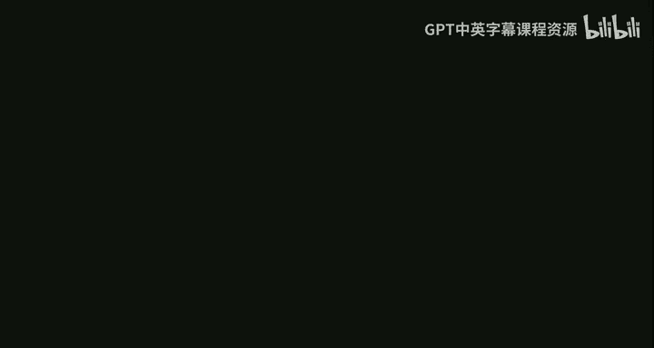

Right so if you put instead of the one norm， you put the infinity norm。

 that's an even better guarantee， right， it's smaller error。So you ideally， you want this norm to be。

 a bigger norm。So let's look at the two norm。 So there's the count sketch， which actually。

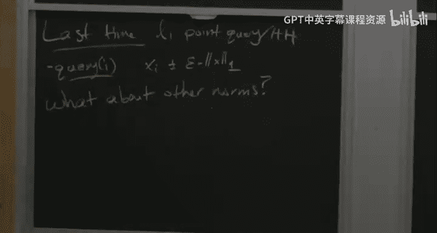

嗯嗯。Proceeded the count minsketch in time。 that was by Charlie Carr。Chen。ThereA Colton。嗯。I believe。

The conference version was ICalpo2。There's a journal version later， which was in04， I think。

I don't remember exactly。So it's the same idea as last time。You have his grid。

And here you have T counters here。And you repeat this L times and again， you have the hash function。

 which can be parawise independent。And you hash a guide to one place in every row and add them there。

 but when you add them there。Let's say you want L2 error。

 What do you think you're going to do inside of this bucket。So with L1 point query， what we said was。

You have the guy himself there。And then a one over T fraction of the mass。

Might coll collide with him an expectation。 So if you sent T to be something like one over epsilon。

 then you get good error， right。But now I want to say that， okay， this guy is there。

 plus there's some other noise， which has small L2。How what would I do to make that noise of smile。

 too？Any ideas。Yeah， so right multiply it by random signs。

 so whenever you add when you add a guy here， you don't just add them there directly。

You have another hash function， Sigma。So you have sigma 1 up to Sigma L。

Where Sigma J maps your universe。Into minus-11。Right。And then when you add。

 when you add someone to the counter。You add him times when you add X I to a counter， you add it。

 you add X I times sigma J of I times a random sign。Right， so now when you look at。Now。

 when you look at a counter C of。Let's say。Some。R comma HR of I。

If you look at the counter in the R row。That corresponds to where I hash to。You'll have his sign。

Sigma J， Sigma R of I， X。Plus， are some of people who collided。Right， of Sigma R。J。Xj。

Where basically HR of J。Is equal to H。R of I J not equal to I。So this becomes the noise。Yeah。

I'm sorry Saan。Or you' putting the random signs。 Yeah， that's true。 So you could say， look。

Putting random signs like only ever helps me。Right， even if I wanted the L1 case。

 because I'll have X I plus， you know， the way we analyze the L1 case， as we said。

 we have X I plus some stuff， which only has a one over T fraction of the L1 mass。

This still only has a one over T fraction of the L1 mass。

 plus it might have cancellations now because we have the random signs， so it only you know。

 can do better。 And actually that's true。What you're saying is accurate。In reality。

 I would always just put the random sign there。嗯。But if we to to write。

 if we wanted to be able to write an error term in terms of L2。喂。What do we say about this。

 We'll say， look， this is what we analyzed when we did the AM S sketch。Okay。

 it's also what you analyzed with this hashing is basically what you analyzed on problem set 1。

You expect so call this error term。You call it beta。Right， you expect。

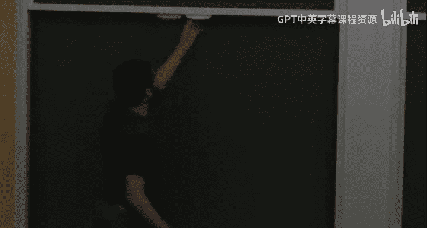

By computations you're familiar with from the PAT， you expect beta squared and we'll release solutions soon。

 So you can look at those as well。 You expect expectation of beta squared to basically be at most。

1 over t times the L2 norm squared。喂。So by Markov， it'll be at most five times this or three times this was probably a third。

Right。And if beta squared is this。Then that implies that beta。

Is that most1 over the square root of T times the L？没。With let's say， three times that。

With probability at least two/ third， this is Markov。Okay， so。Good。

 so if you wanted to have epsilon times the Lt two norm。

 basically you should set T to B want over epsilon squared。And so what do you do， You take。

 you take the counter that I hash to。

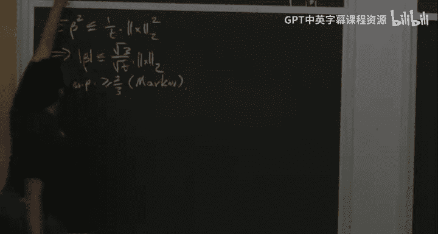

You multiply that counter by sigma R of I to kill this sign。

And then what you have is Xi plus something that's on this order。

And you take the median over all those estimates。So good， and you can look at。You know。

 sparse just like at the end of lecture， look at sparse recovery。

 sparse approximation using the count sketch。 You can look at sparse approximation again。

 using the count sketch。嗯。You can look at heavy hitters under L2， etc cetera。

 So let me say one thing about， you know， say state of the art so。

Let's say you want sparse approximation， for example。

 you want to recover an x tilde such that x minus x tilde L2 squared is at most1 plus epsilon times。

Exhale K。L2 norm squared， just like the end of last lecture。

Well let's say now we don't require Xtel that actually be case barsse。

We just want it to be almost as good as the case barsse， the best case bars of approximation。

 So there's work， for example， that can do this， so。

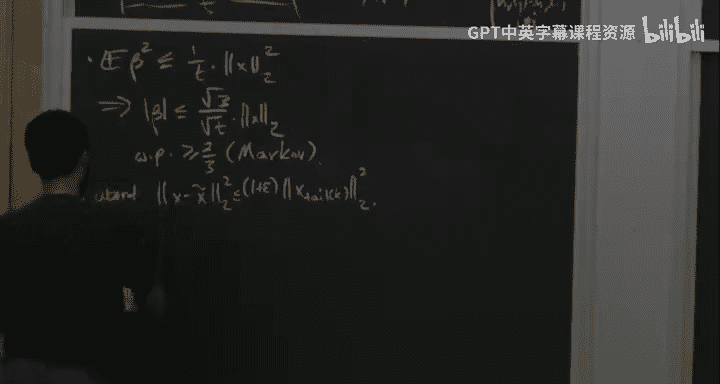

This is something。There is a final project， so you know I'll occasionally mention things that I won't actually cover just in case you want to look into it。

嗯。So what they can do is they can get this kind of guarantee and。

The sketch size in their guarantee is something like。K over epsilon times log n over K。And。

They can recover。X tota in time。Okay K times poly log n。嗯。So。

And we'll get more into this kind of these kinds of sparse recovery guarantees。 And if you want。

 actually， can even， you can actually require Xols that to be sparse itself。

And then M blows up by another one of epsilon factor。

But we'll get when we get into the compressed sensing part of the course。

 we'll get more into getting these kinds of。Recovery guarantees from few measurements。Right。

 so what's the motivation for this kind of thing， right， if I can。

 if I can compress x down to a sparse x Tilde， for example， let's say X Tilde actually is sparse。

Well， actually， what am I going to do？ I'm going to compress X， for example， to its sketch。

Such that I can recover X。Very well with small error from the sketch。 When might I want to do that。

 For example， if I'm compressing images or something， right， So you know。

 I'm designing Jpeg or some other compression scheme。We'll get to more of that later。 so for now。

 that's all I want to say about heavy hitters， but keep it in mind because it's going to be closely related to compressed sensing when we get there。

And there are lots of other works that get various guarantees with various， you know。

 small sketch lengths， fast up the time， et cetera， not just L2 L2。So， rest of today。

I'm going to talk about。L zero sampling。Which is going to be related to graph algorithms。

So for example， connectivity。Finding all the connected components of a graph。K connectivity。

So these two， I'll cover fully in class。 And then I'll probably mention other things you can do。

 but I won't have time to cover all of them， such as。

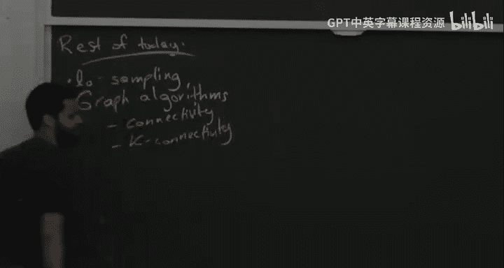

You know， let's see min cut， vertex connectivity， vertex cover， etc cetera。

 There are lots of problems that you can solve， and this LZ sampling turns out to be a very useful primitive okay。

So what is L0 sampling。喂。So in general， what is LP sampling？喂。LP sampling is the following thing。

X is updated。In turn style model。Okay， and what we want to do， We want to。

 we want to draw a random index I between one and n， according to a certain distribution。 Okay。

 we want to draw。

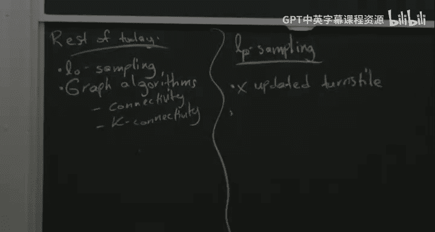

Or sample a random coordinate。With probability， with draw with probability， let's say。对。Good。嗯。

Is it clear what I mean here？Which this box？Here。That box。呃。This is。Yeah， so。

I was talking about the count sketch。Which is something like an countman sketch。

 but it gets you L 2 error in your point query instead of L 1 error。And。嗯。呀Maybe。

And if you missed this whole board， it might be better to just。Watch the video。Yeah， anyway。

 I'm not going to talk about this for the rest of the lecture。

 This was just a wrap up of heavy hitters。Yeah， so now even if you didn't see that board。

 whatever I say here is。Independent of that。Okay， good。 So at the end of the stream。

 I want to be able to draw a random sample from one to a random I between1 and N。

 according to this distribution。 The probability that I is equal to J is proportional to X J to the P。

Okay， so for example， L0。What is L0 so？It should really be called L 0 to the0。

 but people call it the L0 norm， at least in streaming literature。

 this thing is basically the support size。RightAnd the reason is。You know， LP to the P。

The definition of LP to the P is the sum of Xi to the P。对。And if you treat。

Z to the zero as being zero。And any， any other non zero number to the zeros being one。 Then。

 you know， when this thing is。Basically， the limit。

 the limit as P goes to 0 of this expression is the support size。

 So that's why people call it the L0。Of， of x。Oh， sorry。 So that's just。

The number of indices i such that Xi is not0。The support， the support。This set is the support。

 the support size is the size of the support。So what I want you to do is I want you to draw a random index that's not0 in x。

That's L0 sample。And LP sampling。For General P， I believe there was first a by Mond。Zay and Woodra。

In soda 2010。People already knew that it was quite helpful。So for example。

 people knew that if you could do L2 sampling。It gives actually a very simple algorithm for norm estimation。

P LP norm estimation for P bigger than2。Okay。嗯。But you know the first people who actually gave an algorithm that provided it。

 I believe， was this。And since then， there's been more work on various P's。

 So I'll show you L0 sampling today。 And the L0 sampling thing I'll show you is not what they're doing。

 but。This mother out。 so let's go back to L0 sampling。嗯。I also， if you want to see more on this。

 I recommend there's a survey on L0 sampling。By。Coor mode。And I think， for money。

There are many different solutions to this problem。

 And they kind of give an overview of of all many of them。 I'm just going to present you something。

And really the goal here are one of these solutions。The goal is。You know。

 probability that I is equal to J is going to be equal to basically。0， if。J is not in the support。

And it's going to be one over the support size。Plus， or minus an error term。If J isn't the support。

So we're allowing ourselves some error。So we're。嗯。

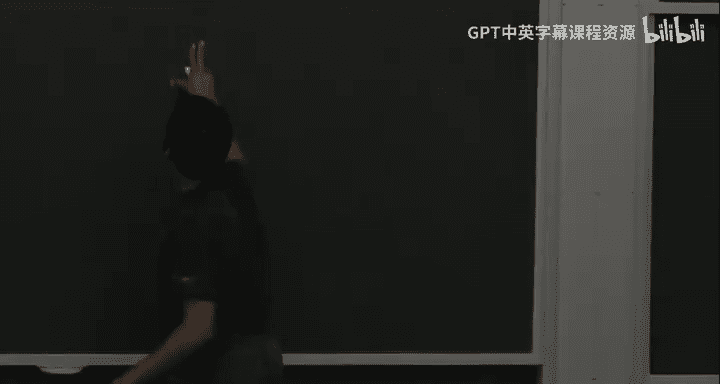

And also with probability Delta， we're also allowed to just output fail。

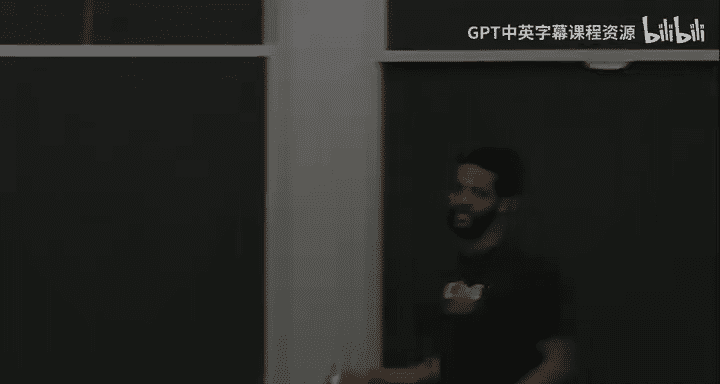

Okay， so the algorithm can say sorry， I failed and didn't get anybody in the support。

So how are we going to do this？嗯嗯。嗯。

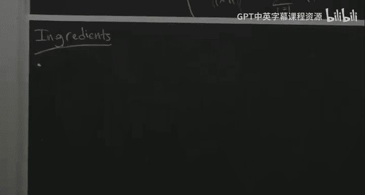

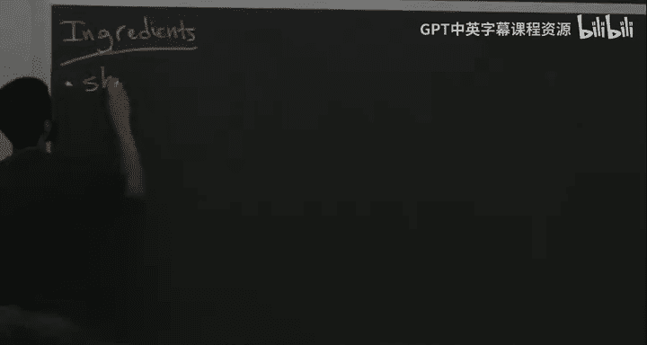

So we' going to show that if。Let's say why is。嗯。Let's say C O of1 sparse。

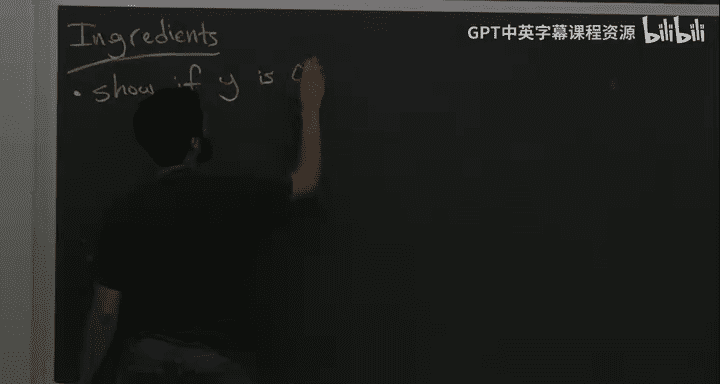

Can recover why。The probability 1 minus delta， using。

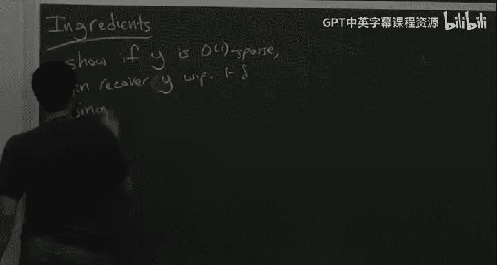

Oh of long。What of adults have？Rs in our sketch matrix。 So we're using linear sketching。 Remember。

 this is the turnst model。 We can delete and insert entries into x。

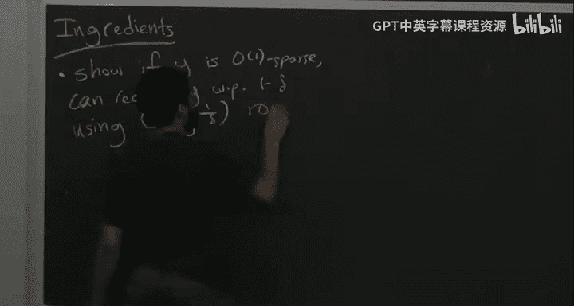

Okay。So first， we're going to show a data structure that provides this kind of guarantee。

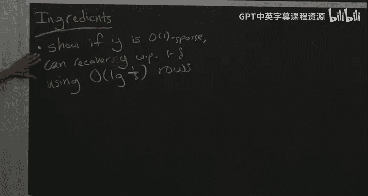

Okay。Let's let's say C sparse。

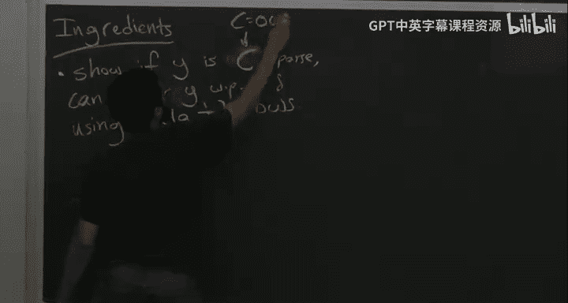

Oh， actually。Sorry。Let's even just do one sparse。Okay， so if you give me a vector Y。

 which has one nonze entry。Then we're going to be able to recover y with probability 1 minus delta。

Actually， we're going to recover it with probability1。嗯。Also。

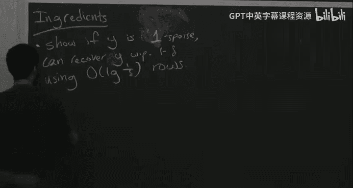

If。The support size of Y。It's not equal to one。 So if it's either0 or。Or at least two。

Will output fail？

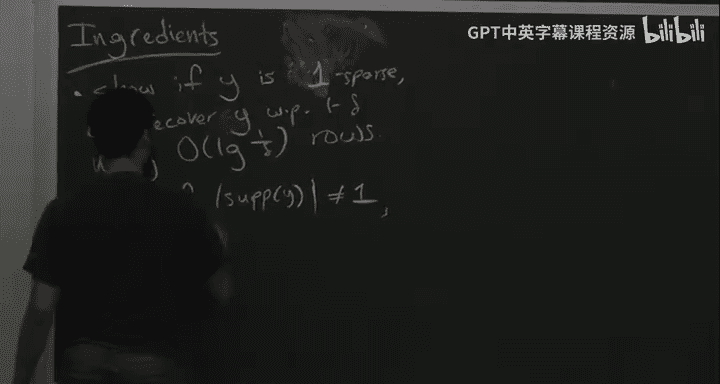

With probability。

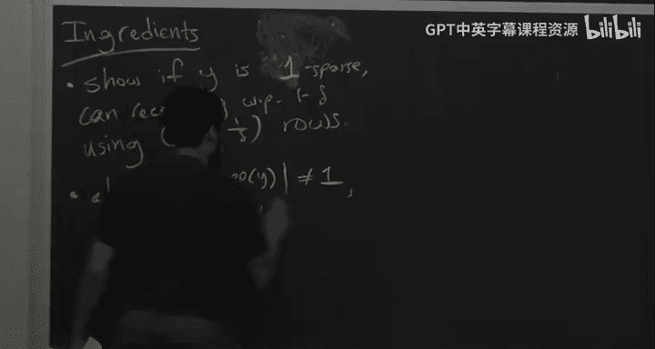

So maybe I should say。If it actually is sparse with probability1， we'll be able to recover it。

And if it's not sparse， if it's not one sparse， if either it it has zero elements or at least two。

 then we'll be able to detect that something is wrong and output fail。

And then the last ingredient is going to be。

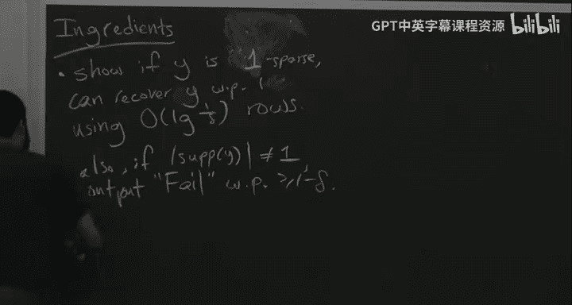

Gmetric sampling。Which is something that we've already seen， I think， in lecture 2。

 for distinct elements。

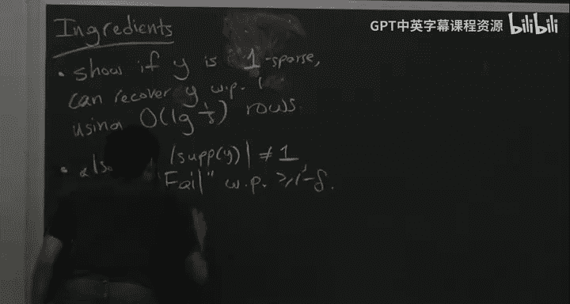

So let me actually。嗯。Let me put it like this actually。This part is actually using。

W when we're D rose。And if it actually is spae， you know， we only need。

We're only going to use two rows。So first， let's do bullet number one。对啊。Yeah， theres one。

 there's exactly one nonze entry in y。And we just want to know， what is it。So。

So now forget about L0 sampling。We're just have a new problem。 I'm gonna。

 we're gonna reduce to this problem。 We're gonna put these ingredients together to get L zero sampling。

But。One question is， is， how do you build this function， This data structure。

 This data structure receives turnst updates to why。Okay， and then at the end of the stream。

 it's promised。That。W has exactly one non zero entry in its support。How do you detect？

What that index is that has the nonze entry。The second thing we want is another data structure。

Which can tell me whether or not。The support of Y is not one。

So think of these as think of the first two bullets as like two different problems。

So we're going to run these data structures in parallels。

So this is a text when the support size is not one。

And then we're gonna to use geometric sampling combined with these two data structures。

 We'll see that soon to actually get our final L 0 sample。So the first bullet。

 I feel like the first bullet is something that you is related to something that's a popular interview question。

 you know， like for software engineering companies， does anyone have any ideas for the first one Now。

 there are turnstile updates here。So there are insertions and deletions。

 and I promise you that y is one sparse。How can you maintain two？Two dot products with Y。Basically。

 two linear， a linear sketch that just has two rows。Such that you can recover the index。嗯。

They'll be able to recover both the index and its weight。You know， with probability 1， there's。

 there's not， there's not even any randomness here， actually。This is deterministic。

This will be randomized。Has anyone seen something like this。Okay， I'll just。I'll just reveal。

Let'll just maintain two counters。The first counter will be the sum I from1 to n of Yi。Okay。

 we can maintain that。 That's， that's basically that linear sketch is just a row of all ones。

And then the second thing we'll maintain is B， which is the sum from  equals1 to n of i times  y0。

Right， so our sketch matrix has all ones in the first row， and then one，2，3，4，5，6，7， bulb。

 et cetera in the second row。And if I promise you that y is one sparse。Then this will be Y I。

 and this will be I times Y I。Right。Why。Is one sparse implies that the support of Y。

Is actually equal to。B over A。Right。And why I。诶。那 a。That's it。 That's a。B。Okay。

So suppose now we wanted to detect。嗯。Let's look at two cases。Case A。

 we want to detect whether the support size of y is 0。 In other words。

 we want to detect whether or not y is a 0 vector。Case 2。

The support size of Y might be bigger than one。 So it might have at least two non zero entries。

 We want to be able to detect that， as well。So how would you detect using things you know already。

 How would you detect whether Y is the zero vector。So this is turnstile。

 So the entries of why could be some could be positive， some could be negative。

So if you just maintain the sum element。You might have cancellations and think it's 0。

 even though it's not。Okay。But。So， I mean， you could do one of many things。 A vector is 0。

 if and only if， for example， it's L2 norm is 0。

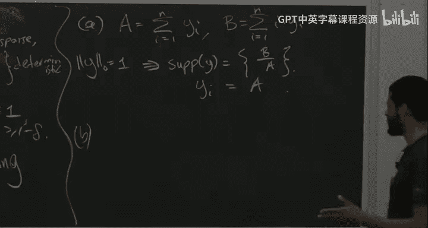

Right， so just maintain an AMMS S sketch。With failure probability， Delta。

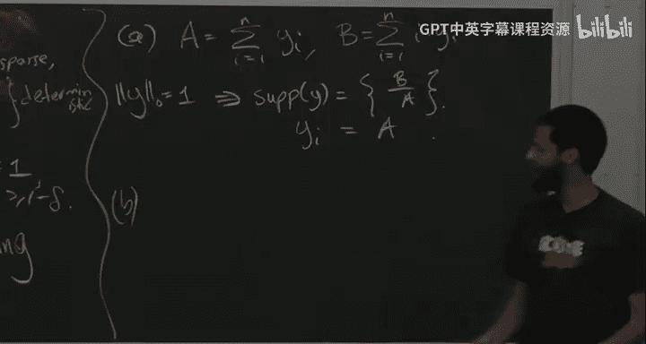

So， you know， detect。嗯。The support size。Equals 0。S。That means that y is zero。Right so y is 0。

If and only if the L2 warm。And we have a way to approximate L2 norms up to constant factors。Okay， so。

How about detecting that the support size is。Strictly bigger than one。

 we want to be able to also catch the support sizes， two or more。How would you do that。

And don't worry about independence of hash functions。

 Like pretend you have random hash functions at your disposal。

 You can usually use Nissan at the very end anyway。 Okay， so any ideas for this。It's also gonna。

 It's also。It's a trick that I'm going to be able to write here。

 So I promise you it's nothing to fancy。And again， it's something where there are a lot of different ways to do this。

A， so you're saying。I'll run。II'll run a。Thatll recover。

 that'll tell me a candidate for who the answer is， for what why is。And then I'll test。

 let's say a returns to me a Y prime。Right basically。

 a is a recovery algorithm that spits out a Y prime。Such that if， if y actually is one sparse。

 y prime will equal y。So what you're saying is take that y prime。And test whether y prime minus y。

 that vector is equal to 0。And you can test that using the A S sketch。Right， because。

Since since the M S sketch is a linear sketch。You already have Y I in your hand。 You already have。

 you know， the sketch times Y in your hand。 You'll apply the sketch times Y prime and post processing。

 and then subtract。That works。 That's one way。Okay， so one thing you can do， there。

 there are lots of ways to do this， so。Let why prime。Be returned。From a。From step A。And then test。

That test weather pi of y prime minus y。I zero。Where pie is like an A S sketch， Yeah。

 that's perfectly reasonable。Another thing you could do。

Another thing you could do is pick a random hash function， which maps， let's say， n into 01。

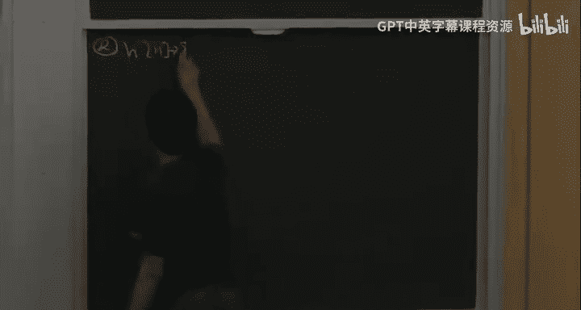

Let's say it maps n into。Two counters。

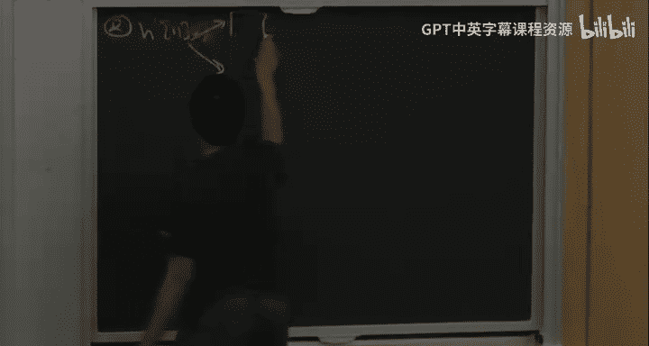

Randomly。Right。So for each El from one to N。For each element I if for one to end。

 why I either gets attacheded there or there？😡，Okay。

And if there are at least two people in the support。

 then there's at least a one half chance that not everyone gets map to both places。

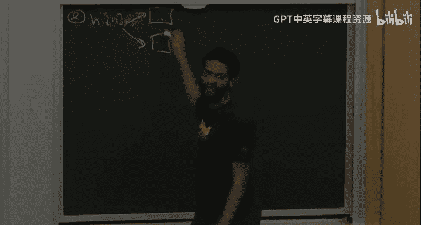

Right。If the support。Size is at least two。Let's say。It contains。I I1。

 I2 and many other people as well。

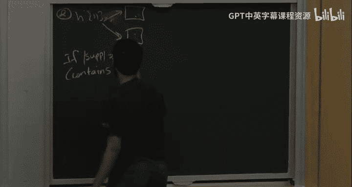

There's not least the one half probability that I1 and I2 are mapped to different places。

And then what he could do is。Do an AMMS S sketch in each of these counters separately。Right。

And if you ever get that。Both of these L2 norms are positive from the A S sketch。

 Then you know that the support size is at least 2。

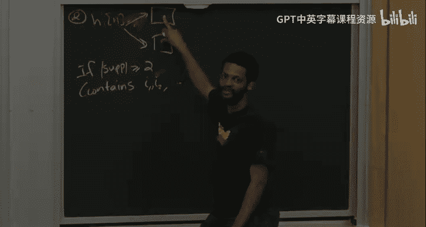

And then you can repeat this structure， you know， log one of delta times so that you'll catch it at some。

 with high probability at some point。So yeah， there are lots of different ways to go about this。

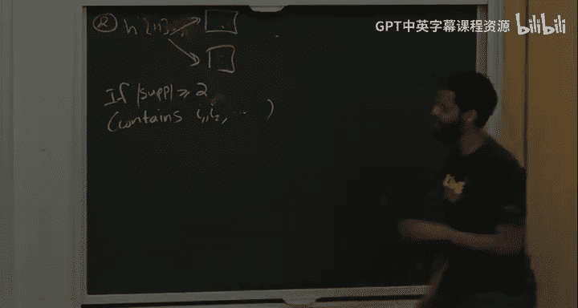

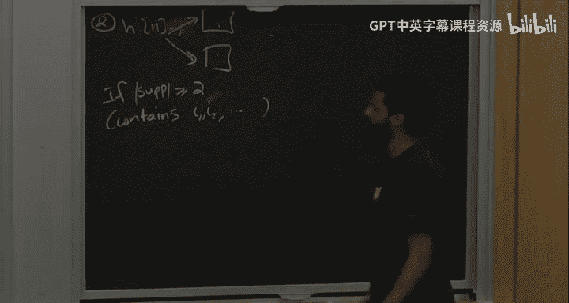

Go。Okay again。 So now let's do items。 Let's do C。Which is we want to combine。

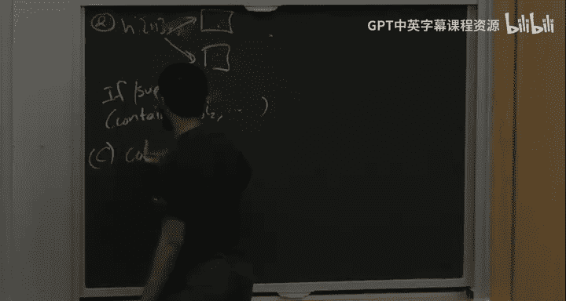

A plus B。Using。Geometric sampling。To get our final L zero sample。哎。How might I do that？😮，哦。Create。嗯。

You know， login， virtual streams is again， just like distinct elements。Con vectors。

You knowY0 up to y log n， so maybe log n plus one of them。And I'm going to have a hash function in H。

Which hashes。And。Into zero to log n。Such that the probability that H of I think of H is totally random for now。

 the problem that H of I is J is equal to 1 over 2 to the J。哎。🤧嗯。And I'll include。Index I。

In the vector Y of H of I。Sa again。Okay， so maybe。嗯。Or maybe that was a confusing word。

 All I want to say is this， so。Really， there's one stream， right。

 streaming updates to this vector X in the turnst model。I'm actually gonna to view my stream。

 as actually being。Kind of log in， streams in parallel。When I see an update to index I。

I want to know which stream should I include that updated。 It's going get。

 it's basically going to get hash to be included in only one of the streams。

And which stream is it going to be included in， It's going be included in the stream H of I。嗯。

Maybe I need to put plus one here just because otherwise， everyone on otherwise。

 this thing doesn't even sum up to one， but。Right， so， so now my vector X has sort of been split。

 split into these log n different vectors， Y 0 up to y log n。The vector Yj。😡，Basically。

 the vector Y J is。Y or let's say Yj is equal to x。Restricted to the。Coordinates I， such that。

H of I is equal to J。Right， so。Recently， Y J is a projection of X to a subset of the coordinates。

 namely the coordinates that actually got hash to J。

Which is a1 over two to the J fraction of the coordinates。

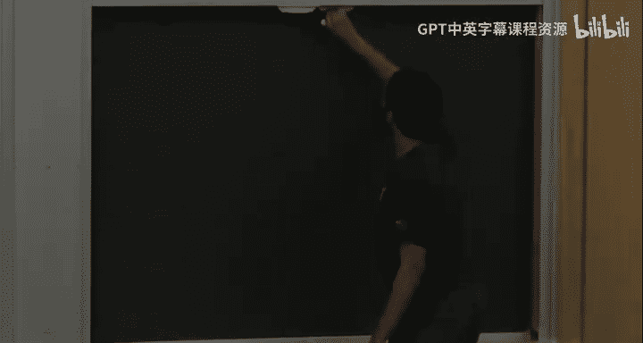

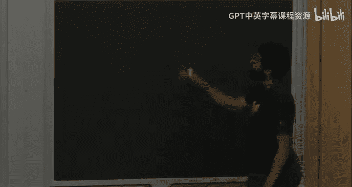

They said， why might I be doing this？Well。

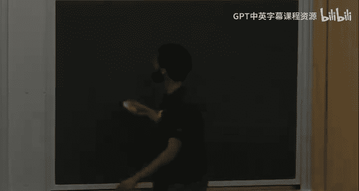

We know that the support size is actually some number between。

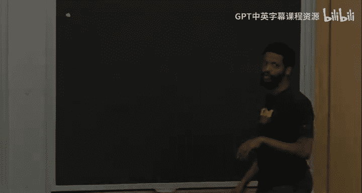

嗯。

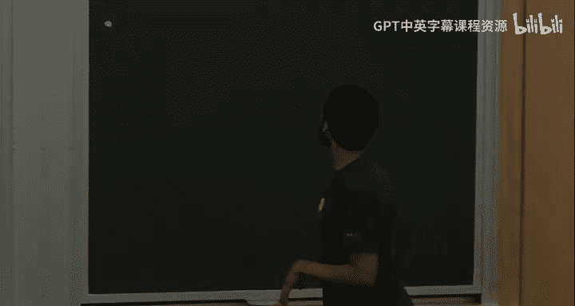

By the way。Okay， so this。嗯。Let me just say something。 and then we can ignore that case。

 There might be a case where x is actually the zero vector。 and then there's nothing in its support。

O。So the way we'll deal with that is we'll keep an AM M S sketch on the side for X。And if。

 if that A S sketch says that the L tu norm of x is 0， then we're just going to。

We're just going to output fail。 We're going to say this thing doesn't have anything in its support。

So let's just pretend now。 So now let's assume that。X actually has something in its support。

So the support size of x。It's some number between1 and n？And。

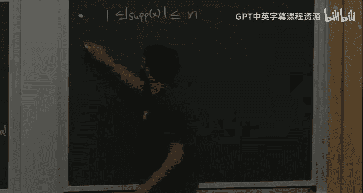

The expectation of the support size。Of Yj。

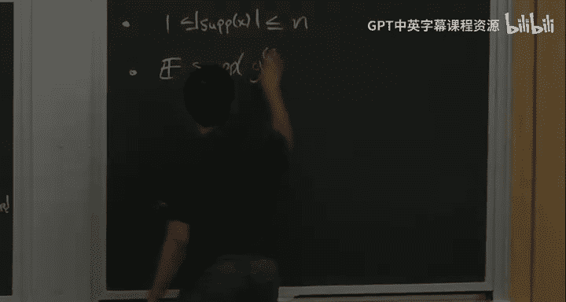

Is。

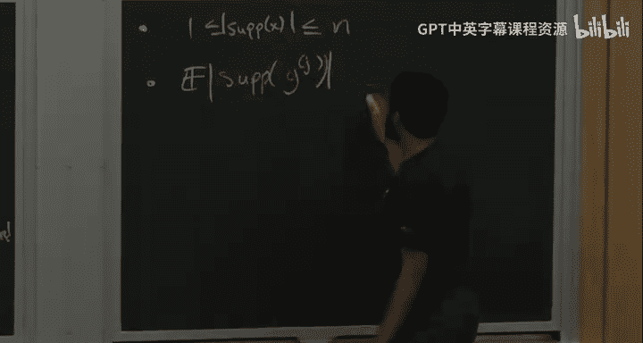

What is that？

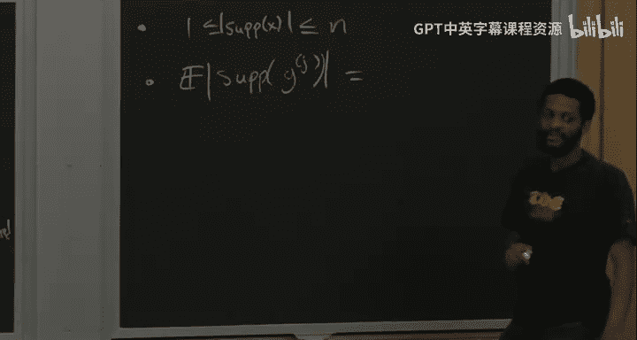

That thing times。Yeah， exactly， it's the support size of x。Over two to the J plus1， right？

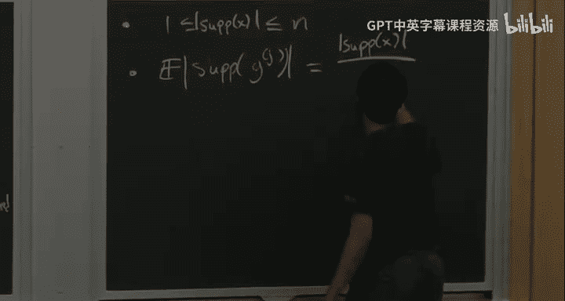

This follows by the support size of Yj is a sum of indicator random variables。

 and this follows by linear of expectation。谁。So。And remember now we're going where zero is less than equal to J is less than equal to log in。

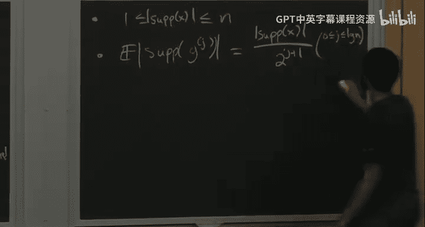

So。

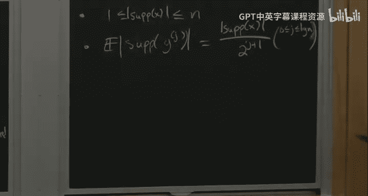

In other words。There is going to be some J， right， So this implies like there exists。

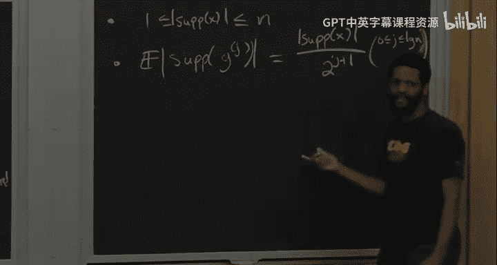

Some J star。

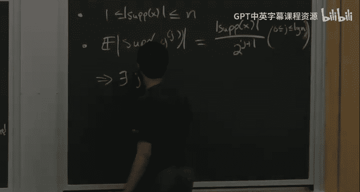

Such that the expectation of the support size。Of Yj。Is between basically two and one。Right。There is。

 there is going to be one of these virtual streams that actually you expect。

Only only a constant number of people to be in the support。Okay。Okay good so。

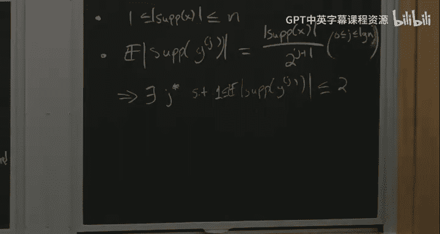

What's the probability that you have exactly one？RightIf we have exact the good case is that we have exactly one。

And if we have exactly one， remember， we're going feed this。

 we're gonna feed all of these Y J data structures or Y J vectors separately into the data structures from A And B。

What we hope happens is that one of these log n vectors will actually be one sparse。

And then we'll feed it into A and then figure out what that thing is。

 and we'll get a random element of the support。We also have to make sure we can detect when YJ isn't actually one sparse because we don't want to just output some nonsense。

 A might output nonsense if y is not one sparse， but that's what B gives us。 If YJ is not one sparse。

 we'll catch that with high probability and then we'll say YJ wasn't one sparse。

 We're not gonna use it。He， good。So let's look at this J star， the probability。😡，That。嗯。Why。J Star。

 the support size of this thing。Is exactly equal to one。Okay。So， let's。Let's think about this。

 We have， let's just call this。 Let's give this thing a name。The support size of x。

 let's just call that T。Okay。So。We have， let's look at something simpler。 Let's say we have tea。

 We have tea items。And we sample each one independently with probability one over T。Right。

 what's the probability that exactly one item survives。So。Let's say。Tea items。Are each。Sampled。

You know， are each。Cs， let's say。Independently。With probability 1 over t。

What's the probability that the number of items kept？equalqual to1。For a tea for us。呃。Yeah， good。

So I'm imagining that2 to the J star is basically equal to T， right。

 So I'm imagining that we have these T items。 We're sampling them at a rate of1 over t。

Up to a factor of two anyway。What's the probability exactly one survives？

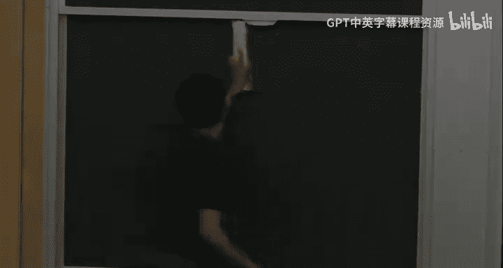

So the probability。Exactly when survives。

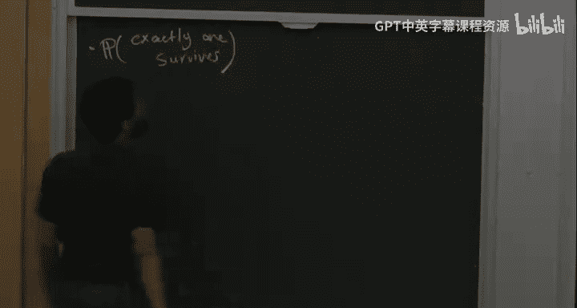

Is。This is the sum I goes from1 to T。Probability that。Item one survives。Their item I survives。

And no one else does。喂。And let's say they're all being sampled independently。

 So this is a sum I goes from1 to T。The probability that item I survives is one overt。

And probably that no one else survives。Its something like1 minus1 over t。To the。啊。

To the1 to the t -1。谁？So this thing gives me one。 So this is equal to 1 minus1 over t to the t -1。

And。Kind of 1 minus1 over x to the x is roughly。Is roughly1 over E。Right， so this is roughly。

This is roughly one over E。对。

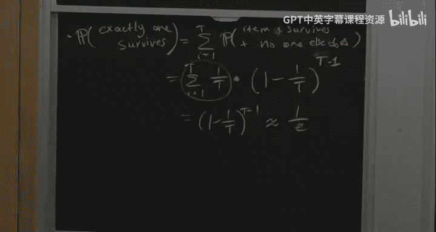

Yeah， but okay， sure。 that's， that's fair enough， but。One over this， I guess。That's right， yeah。

 but I'm still calling that whatever。The only thing I really care about is that this thing is a constant。

对。All the only thing I really care about is that it's at least a constant。う。嗯。And in reality。

We have T items， but we're sampling at a rate， which is not really one over T。

 but it's between one over T and2 over T， but that doesn't really change this calculation by much。

 The point at the end of the day is the problem that exactly one person survives is still a constant。

So good。 So now what do we have。嗯。Basically， we're done now， right。

If we do one instantiation of this geometric sampling。

 what we know is that there is going there is going to be a level， namely level J star。😡，Such that。

With constant probability， Y of J star will actually be one sparse。

And what is that index that survived， Well， because we're doing random sampling， it's a random index。

Okay， and by A and B， we're gonna to be able to recover that random index。Well， by a。

 we'll be able to recover that random index。 And for all the other YJs that weren't actually sparse。

 B will detect that， and then we'll reject them。Now， that's only constant probability of success。

 If I want Delta probability of failure， then I repeat， I repeat the geometric sampling thing。

 log one over deelta times and take the first one that actually gives me a sample that works。

And at the end of the day。The final space bound。So let's， let's count in machine words。 Each counter。

 let's say， takes one unit of space。So each time we do a geometric sampling。We have log n。

 different A's and B's that are running。A just takes two counters， B takes log one relative counters。

😡，So that's log n times log n over delta。I'm repeating the geometric sampling thing。

 another log over Delta times。So。嗯。Actually made me a little careful。 I guess you want to say that。

You want to say that be always succeeded for all of the log n different levels。

So you should really run B with a failure probability that's like deelta over log n。系。

Because you're you're calling B on log n different。

 You're doing B on log n different levels of this geometric stream。But， okay， but anyway。

 let's ignore that， that thing because we're gonna have a log of whatever adults anyway。

 So it's roughly basically log n。Times log squaredd one over Delta counters。

And if you try and derandomize this， you know， let's say I don't have random hash functions。嗯。

I guess the A M S， A M S catches here just need four Y independence。 That's fine。

We do also have this hash function， that hash function， H。And。The when I analyzed H。

I said that kind of all of these were independent。 That's why I got one over t times 1 -1 over t to the t -1。

If I wanted to be able to carry out exactly this analysis。Then。I need full independence。Right。

 which means。T could be as big as N。 I need Nwise independence。 I can't afford that。

 That requires n space with a hash function。 So I'll just deranize， you know。

 if I don't want to think about it， I'll just deranize this whole thing using Niss's P G。

So I'll leave that as an exercise。 How do you set up the branching program， ettera。

 that needs to be fooled。 But basically， this is a small space algorithm。

And if you feed the randomness。That determines the hash function H to this small space algorithm。

 Then， you know， you can， you can instead feed it a pseudo random H specified by Nissan。

So that will blow you up by another factor of log R where you need R random bits。

How many random bits do you need in that hash function？Polynomial and N。Right。They're N hash。

Their n inputs that hash function。 Each one is a number between log n，1 and log n。

 So the total number of bits to specify H is something like n times log log n。 Anyway。

 it's like poly N。So theness the amount of randomness you need to feed in the small space algorithm is poly N。

And Nissan blows your space up by another log R factor So log n。Log squared n。

 log squared1 over delta。Counters。After Nissan。So it's polylogarmic。

It's much less than n is the bottom line。

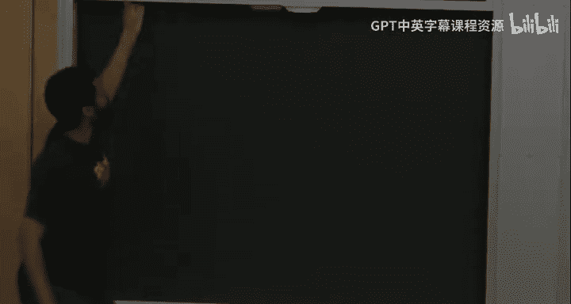

And I should point out， I'll just say this。

It's known。

That you can achieve。

Oh log n times log whenever Delta counters or machine words。 I'm imagining。

 let's say each machine word holds log n bits。

No onebody can achieve like log machine log n has long amounts of machine words。That was due to。

Jenna Harry。Saam tardish。And and they also proved a lower bound saying that for constant delta。

 this is optimal。Okay， so I believe it's an open problem as to whether or not you can do better for small Delta than this。

 Maybe you could hope for log n plus log1 for Delta。 I'm not sure。嗯。

And I don't want to get into the details。Fully。We're gonna to see。

 because there are some tools they use that we're gonna to see more in the compress sensing world when we get there。

 But the basic idea there is as follows。 So the reason that we kind of suffered in our space bound。

 is the following。 So there are two reasons， One is。We detected， we recovered Y sparse vectors。

 We recovered a sparse vector。 let's say we had actually put S here。 It's S sparse。

Or let's go back to one。 So we have this one sparse vector。

We recovered it using O of one measurements， measurements。But part B。

 which detected whether it was one sparse， actually took log one of our delta measurements。Right。

 so even though it's one sparse， we spent to log whatever delta measurements that detect that。

So what JST does is actually they replace one sparse with S sparse。

 where s is some theta of log 1 over delta。They can detect whether you're not actually S sparse using log1 del measurements。

 And that's exactly what you said。 Basically， the way they do it is。run your thing from A。

 and this becomes theta S。😡，Run your thing from A， that's going to give you a vector。😡。

And then test whether y prime minus y is 0 using the AMS S sketch。

So there's no log1 over Dl to overhead。Right， this thing is already S farrse。

 And you're spending kind of S extra measurements to test that。That's one way they're winning。

And the way that you do A is there are several algorithms that do this。 One is proy's method。

 I don't know if anyone's heard of Pronie's method。Which apparently was discovered in 1795， Okay， so。

Basically， people were doing streaming， since back then。Well， no， no， that really。

 actually basically what Prony's method says is。Take do the following thing。

Let your sketch matrix be the first two S rows of the discrete Fourier matrix。😡。

If your input vector is actually S sparse。😡，Py's method can recover。

Can recover the vector using those first two S rows of the discrete4 matrix。So in fact， two Soids。

It was also like Bla Camp Ma algorithm from the 60s， which also can get you theta S rows。Okay。

 so that's one place they win。 And then the other place is they say。Rather than try to sample。😡。

Rather than try to sample to the place where there's only one guy surviving。

 which succeeds with constant probability。Sample to the place where S guyss survive。Okay。

 where S is theta log winner to red delta。 And if you sample to the place where S guys survive in expectation。

Then you'll actually have roughly S guyss survive with probability 1 minus Dlta。

 That's the turn off found。Because S is long one realta。And actually， those two things。

 those changes are really the， the only differences between what they did and what I just said on the board。

I just didn't want to cover that because while you guys， you know。

 you don't know the details of pronie's method yet， Why does it work， Brocat masss， eta。

 But you know even this the best known algorithm is not very far from what I just showed you。

So questions about L0 sampling。 that's that is L0 sampling。诶。There are no questions then。

Let's see how to use it for some problems。I promised you that today we would actually do some graph problems in the streaming model。

So。

On to graphs。So let's say that G is equal to VE。And then， we see。Edges。E and E。In the stream。对。

Let's look at one problem， a simple problem。Connectivity。We're allowed to query。IJ。

And this should be。1。If I and J let's say J， this is an undirected graph。If IJ are in the same。

Connected component。And zero otherwise， we just want to know is I reachable from J or vice versa？

So let's pretend there are no deletions， insertion only。谁。

Who thinks you can solve this problem in polylog space。Okay， no one raise their hand。

 does anyone think that you cannot solve this problem in polylo in space？So， sorry。Well。

 the number of edges is always almost n squared。 So poly log n poly are the same thing。

 But let's say。The size of V。Is n and the size of E is M。So， any。So what's one algorithm。

 what's the most know， straightforward space bound that you can achieve？Don't think just。Just the。

Something that someone who's never even been in this class， would we would say。

You you use O of M space， right， Do you just remember all the edges。And then at the end of the day。

 do a DFS and then figure out if they're in the same connected component。So。

 but M could be as big as n squared or n choose 2 in an undirected graph， right。So my question is。

 can we do better？Well。Yes， we can do。 okay， we can definitely do better than M。So。

Let's say insertion only。So straightforward。Is。Let's say， OM space。

I claim there's still something that's pretty straightforward， but I'll call it straightforward。

Minus minus。So it's just slightly less straightforward， but it's still pretty straightforward。

 Can you beat M space， I just want to be able to answer our connectivity queries。

That's the only kind of query I care about。So the straightforward one is you remember every single edge。

 and then do a DFS stance with the query。Something。Slightly less straightforward， but less space。

So I is there again？O space。 Okay， how can you do oven space。Oh， but okay， so when a query comes。

 you don't know ahead of time what I and J are going to be for the query， they could be any INJ。😡。

So if you just remember the neighbors of a single vertex。

 I might ask you connectivity about people over here and then you have no idea。Yeah， so store。

 store a spanning forest， basically， right， So O of end space。

You store a spanning forest。A forest can have at most n minus1 edges。There's no reason to store。

 like， if there are no deletions， there's no reason to remember edges that are connecting things that are already in the same connected component anyway。

Right，So just remember the tree edges， basically。Okay， and。So claim。

Any。Deterministic algorithm。Needs。Omega n space。Proof。嗯。The proof is that again。

 by an encoding argument。😡，So I'll just show you。Suppose we had an x， which is in01 to the n。

And we wanted to encode X。We'll have vertex 1 over here。And then we'll have vertex 0 over here。

 I'm sorry。And then we'll have vertex 1，2，3 up to vertex n。哎。If the I bit， if the I bit of if。

 if the first bit of x is a1， we'll put the edge。 If the second bit of x is not a1。

 we won't put the edge。 So some of these will have edges and some。Now， who is0 connected to。

 He's exactly connected to。The people who have a1 and the if bit of x。Right， so if you can solve。

 if you have， if you have a sketch of this。In Ss of space。

 you can use that sketch to answer all the connectivity queries and figure out which bits were1 and recover X。

Therefore， your S has to be at least n。What have you had a randomized algorithm？😡。

Then by an argument very similar to what was in your PSAT。😡，There's like a large。

There's like a large subset of 01 to the end that you could still recover。Therefore。

 you still need Oomega n bits。So。So this is even true for randomized algorithm。嗯。Okay， so。

This motivated folks back in 05， so。嗯。I't he was Feigenbaum at all。

 I'll put the exact reference in the notes。

They use this term semistreaming。What you want。You know， O of n times polylog n space。Right。

 so for graph problems， clearly you can always solve the problem in M space， which is n squared。

Potentially， they wanted to be able to solve graph problems in n times poly log n space。

 So much less than n squared。Because it turns out for lots of graph homes that you might want to solve。

You can prove that you can't do anything with sublinear space。So。Good， so this is connectivity。

 Now I want to show you something interesting。 We're gonna get to L 0 sampling at some point， right。

 What if now my graph has insertions and deletions。 So I'm on a social network， people can friend me。

 and they can also unfriend me。😊，And now I want to be able to detect whether or not two people have a path of friends between them。

So connectivity queries or yeah， connectivity queries in。

In the in the turnst model， where edges can be inserted and deleted。

So there was a paper about graph sketching。Which is what I'm going to present now。

And this was due to on。Guhan McGreor。It it's a very nice and clean idea。Okay， so。First。

 let me write down an algorithm that's not a streaming algorithm。

 and then we'll show that we can implement it using L0 sampling in the streaming model in n times polyloin space。

So。And actually， we， we' won to just answer connectivity queries。

 We'll actually be able to know all like the connected components of the graph。对。So。

 connected components。G is V。So initially， what we're going to do。

We're going to maintain。A， we're going to maintain a。A set of connected components。Okay。

 but they're not going be maximal。 And then iteratively。

 we're going to grow them until they are maximal。

So， initially。S is our set of components that we're maintaining。 That's going to be the family of。

 you know， basically。V1。V 2。V案。So we start each vertex in its own component。😡，And then what we do is。

For i equals1 to log n。You know for each。S in capital S。

Let's let's say all these steps happen in parallel。For each S and little S。

 for each little S and capital S。Pick an edge。异。Equals SW。For some。W and capitalist。

Contract the edge。哎。Yeah。Yeah， so I'm as set of sets。

And I'm thinking of these elements of S as being super nodes。So。Yeah。

 so little S will be a component。But I'm treating that component as like a super node。

To some other super node， That's right。 Yeah， exactly。Exactly。For example。

Let's say that I start off with。嗯。You know， this graph。对。Let me call these ABCD， E， F， G，H。

So initially， each one of these。Is an element of capitalize。 capital is is size 8。Then。

Each super node is going to select someone to contract with。

So this guy is gonna pick an edge that leaves him。And this guy， there should be an edge here as well。

 let's say。Maybe A And E choose each other。 B and F choose each other。 C and G choose each other。

 D and H choose each other。

So we contract all those edges。 So this becomes。AE becomes like a super node。

B F becomes a super node。CG becomes a super node， And so it does DH。

And what are the edges between the super nodes。 Well， there's an edge from A to B。

 So that's an edge from these guys。 There's an edge from F to G。 That's this guy。

 And there's an edge from C to D。 That's that， right。And then we do the same thing。 Maybe the。

 They don't even have to choose the same people。 Maybe 8 E will choose B， F and B， F will choose C。

 G。Okay， well， I guess if that happens， then everyone will just contract in one step。 But again。

 you know， these two guys might merge together and these two guys might merge together。 And then。

 and then in the next iteration， finally， they'll merged with each other。

 and we have one connected component。So。Okay， so this thing is a correct algorithm to find all the connected components in a graph。

 Why is it correct。诶。Because at any step， if I have a number K of components which aren't actually maximal。

😡，That if they're not maximal， that means they'll find a partner to merge with this step。😡。

So if I have K guys who aren't maximal， and the next step， I'll have that most K over two。Initially。

 the number of components I have is n because every vertex is by itself。 So after log n。

After login iterations of this， I can be sure that all the non maximmal components have disappeared。

They've h log end times， yeah。So yeah， so this is like a meta algorithm。

knowNow we're going to actually implement it。In the streaming model。 So I。

 I didn't give you any details about how to actually implement this。Yeah， I mean， I guess， you know。

 in traditional algorithms， one thing， one way you can implement this is using like a union find data structure。

Right。Kind of the name of the component is， is a fine， an union find。

 And then a contraction would just be a union of those two。

And you can do those in like inverse acromen and amortize time。Really fast。Okay， so。So now how about。

The streaming a turns style streaming implementation。So here's what we're going to do。Each vertex。

We'll store。A vector F of V。Which is an n choose 2 dimensional vector。Okay。And if you look at the。

The EF entry。Let's say the。The Ath entry。Of this thingy。嗯。This is equal to。0。If。V is not A or B。Or。嗯。

AB is not an edge。So， basically。A B is a potential edge。If A B doesn't involve me at all， it's 0。

If it's either if， if one of these things is actually V， then it's， it's not it'。It'll be zero still。

Edges is actually not in our set of edges， otherwise。It'll be plus one。If V is equal to the min。

Of A B。And minus-1。If me is equals to the max of8。Okay。And then what we'll say is。

For S in the set capital S over there。F of S is the sum over all V and S of F of V。哎。

I have a question， what is the support？😡。

OfF of S。What is the support of F and V？

Yeah， that's the size of the support。 But yeah， the but the support itself。

 the support is the set of all edges in upon a V。What's the support of F of S？

Let's say that U and V are both in S。😡，And let's say that U And V is U V is an edge。 U V is an edge。

 and they're both in S。Right。Then if you look at F of U。And look at that edges entry。

 It'll be either plus 1 or -1。 If you look at F of V and look at that entry。

 it'll be the opposite sign。 so they cancel。So edges that stay within S get canceled。

Edges that don't exist at all are zero。The only things that survive in this are edges that leave us。

Right。Instead sort of all edges in E。Such that E。Is in S cross v minus S， basically。say。Little S。

 cross， capital S， minus little S basically。So something like that。Those don't cancel。

Because we only sum over the things in little， this is little less。 I'm sorry。

So if there's an edge that leaves little S， there is a guy who has the opposite sign who would have canceled it。

But he doesn't participate in this sum。 We're only sum over the guys in little less。Yeah。

 it is it is either positive make。 That's right。Right， so。So here here's little S， right。

 And then there are a bunch of other components that live other places。

There are a bunch of edges in here。There are some edges that leave。😡，Right。This guy and this guy。

 their Fs are getting some together， which means this edge gets canceled。

We're're summing up all of the F values in here。 this is my little S。

 We're suming up all these F values， right？😡，That's what this is。

So we're summing up this guy's at value as well。So this gets canceled because this guy's here。

 This gets canceled。 this energy gets canceled because of this guy' as well。 This edge out leaves。

We're not summing this guy because he's not in little S。 So this doesn't get canceled。

 So he stays in the support of F of little S。So now we're done。We can implement this algorithm。

Using L 0 sampling。Why。At every vertex， we're not actually going to store F of V。

 What do we need to be able to do， We need to be able to sample from the support of vectors。

We're not going to actually store F of V at every vertex。😡，We're going to store an L0 sampler sketch。

Of FV。And an L0 sampler sketch only takes polylo space。So their n vertices。

 each one is storing this polylo space L0 sampler sketch。 That's n times polylo。诶。And then now。

 when we want to know a vert， when we want to know an edge that leaves。

 when we want to know an edge that leaves V， let's say in the very first iteration。

 when S is just instead of all vertices。 We want to know an edge that leaves V。

We just ask the L zero sampler， give me an edge。And itll give me one。Right。

 and then now I want to do this contraction。I want to merge those two components together。😡。

What do I do？I just sum their F values。 This one had an F value。 This one had an F vector。

 This one had F vector。 This one had an F vector。 I sum them together。

 And the new F vector is exactly the edges that leave that new component。Right。

But I'm storing a linear sketch。 So to add these vectors。

 I just need to add the linear sketches together。So that's it。 There's one thing。

 you have to be a little careful about。Is。We're going to use。Login。Different。L zero sampler sketches。

You know， basically， a one of。F of the。Up to a log n。OfFV。So in iteration1， we're going use sketch 1。

 this iteration。In iteration 2。 So okay， now we've used。

 we've used all the A1 sketches in iteration1。We've done our L 0 sampling。

 We contracted a bunch of edges。So now what we're going to do is。

The first sketch told us which edges to contract。We're gonna do that contraction in all of the remaining sketches。

 Basically by just adding the appropriate sketches together。And then in iteration2 of that loop。

 we're going to use a2 as our L 0 sampler。 That's going to tell us some edges to contract。

We're gonna add all those sketches together in a 3 and beyond。 Now。

 we're gonna use a 3 to do our L0 sampling in the third iteration， etc cetera。

 Why don't we just use the same sketches throughout the entire algorithm。So this is。

 this is actually somewhat subtle。对呀。Yeah， it's， it's exactly that this adaptivity issue。

If you have a randomized algorithm。What does the correctness guarantee mean for your randomized algorithm。

It assumes that the queries that you are going to make。😡。

Are independent of the randomness of the algorithm itself。

 When we say that an algorithm works with probability 1 minus delta。

 it's assuming that the queries you're making that algorithm don't depend on your previous interaction with that algorithm。

 There's no adaptivity here。So。If we do the edge contract， if， if we contract some edges。

Which edges are we contracting， We're contracting the edges that A1 told us to contract。Right。

 so then in the future， when we do more queries。Right。

 those queries depend upon the state of the graph that was influenced by a1's randomness。

So this is an adaptive setting。 So we can't just use the same sketch to answer queries based on that graph。

Which is why we use a fresh sketch using completely independent randomness， namely a 2。Right。

And our correctness guarantee will still hold。 But that just blows up our overall space by a log n factor because we're just sting log n sketches instead of one。

So overall， we're using N polyloone space。So there are some other things that， you know。

 we're out of time basically， but this idea of L zero sampling has been used for。Min cut。

 vertex connectivity， vertex cover。嗯。Well， lots of， actually， lots of problems。

 There are some nice papers too upcoming in this soda in 2016。Maxum weight matching。

 maximum case colorable subgraph， there are lots of graph problems where。

 this primitive and other nice sketching primitives are useful for solving those problems。

So questions。So I'll see you guys Tuesday。