# 哈佛大学《大数据算法｜Harvard Algorithms for Big Data (COMPSCI 229r) 2016》deepseek - P8：-08-Algorithms for Big Data (COMPSCI 229r), Lecture 8.zh_en - GPT中英字幕课程资源 - BV1yGdNYvEMo

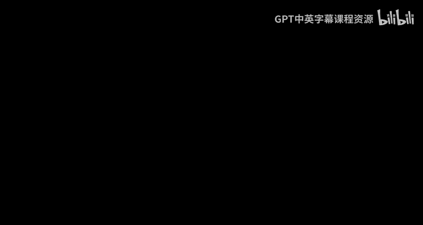

Okay， so today is the last day that I'm going to。Fcus。Exclusively on streaming upper bounds。

Next week， we're going to talk some about lower bounds beyond just proving that sub linear space is impossible。

 We'll prove that。Next week， even if you have randomization and approximation。

There is still some lower bound on this space， like log n bits or one over Epsilon squared。

 et cetera，Today， what I want to talk about is something again different from just the turnstyle model which we've been focusing a lot of attention on。

And different from graph streaming， I'm going to talk about dynamic programming in the streaming model。

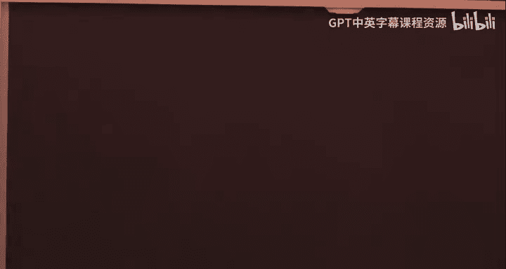

对。And in this lecture， I'll focus particularly on two problems， well really one problem。

 which is the two problems are longest increasing sub sequenceequence。And distance to monohoicity。

So how are these problems defined？So in both problems。We have an input sequence of let's say。

 numbers。And each number is between1 and M， let's say。可以。And the goal here。

So an increasing sub sequenceequence。Is a sub sequenceequence of this sequence such that all the numbers are。

 let's say， non decreasing。 So weakly increasing， so。对。And in the L I S problem。

 what you want to find is。An increasing sub sequenceequence that's as long as possible。

 the longest increasing subence。Okay， this is a standard dynamic programming problem。

 You might have seen in undergrad algorithms。Kind of the most straightforward way to solve this problem using DP。

 would take n squared time。 But if you throw into binary search， there's a way to do it in log n。

 I'm not going to talk about that here。 We're going to focus more on space。嗯。

So LIS is the longest increasing sub。 What's distance to monotononicity？So。

What does it mean for a sequence to be monotone For us， we're going to mean monotonically increasing。

For it to be monotone， it means that it's an increasing sub sequenceequence。

Distance to monoity means what's the minimum number。

Of elements in this sequence that I need to delete。

Such that what's left over is an increasing substanceence。So I'm given this sequence as input。

 forget about streaming。 I' given the sequences input。

 And I just want to delete as few elements as possible so that what's left is increasing。 so anyone。

 you know， these two problems are related。Right， so in terms of the。

 in terms of the length of the L I S versus。The distance to make it monotone。

 the least of elements I need to make it monotone。 Yeah how are these things related。Yeah。

 one is n minus the other， right？The distance monoity。

It's just n minus the length of the longest increasing sub。So， you know。

 what what should you do to make it monotone， You should identify the L I S and then delete everybody else。

Who's not in the Alls。🤧。So。Great。So the thing about this dynamic programming approach to solve this problem。

 though， we'll see I'll write down a dynamic program to solve this problem soon and then make it streaming。

Is that the natural D P for this uses linear space。

You know you need to maintain your DP table that takes linear space， end space。So people have asked。

 can we approximate？These quantities using sublinear space。And the first work that did this。

There was work by， I guess， Go Paan。嗯。I JM。Craft gamer and Kummar。This was soda 07。Which said。

You can get。A one plus。 So you're not going actually find the L I S。

 You're just gonna approximate its length because writing down the L I S could take linear space。

 right， Maybe the whole sequence is increasing。 You can't afford to write that down， but you can。

 you can approximate the length of the L I S。In something like， I believe， Ru end over Epsilon。

 maybe I'm off by a log。Words of space。And it's a deterministic algorithm。对。

And then later in two independent works， I think they were independent。1 was。

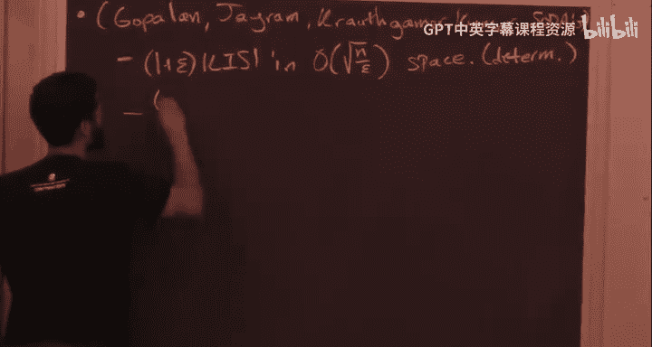

I believe Erguoon and Johari。So Harry， is is。Sa 08。And then there's also。On a gall in Pris of goalan。

Flockox of seven。What these two works showed is that you really need to have root end space。

 So the exact。The exact lower bound is。As follows。Actually， I think it's matching。

So any deterministic。One plus epsilon approximation algorithm for the L I S problem needs square root n over epsilon words of space。

And so essentially this algorithm from Soto7 is optimal。嗯。So these are for LIS。😡，RightAnd by the way。

 it's open。To you out a randomized。You know， can you solve L I S。

 Can you approximate L S up to one pluspsilon in poly logarithmic space， people， people don't know。

 Okay， so we know that you can do it deterministically。

 but maybe you can do it with a randomized algorithm that succeeds with high probability。Okay。

So we said that DTM and LIS are basically the same problem。Right。So question， does that imply that？

We have something for you know， if we had， if we had a polylo space algorithm。For。

LIS would that imply one for DTM and vice versa？Oh， I'm just saying the length of the。

 So this is just giving us the length of the L I S versus the the distance。

 the distance monoity is the number。 The minimum number have to delete。I mean， the length of the LS。

 I'm always it yeah， so yeah。Right。So， the issue is。You know， notice that if you have。

 let's say a one plus epsilon approximation to the LIS。Then you would say， well， my estimate for DTM。

 my estimate for it is going be n minus my estimate for the L I S。

Which is n minus1 plus or minus epsilon times the length of the LIS。N minus the L S is the DTM。

And then I have an error term， which is plus minus epsilon times the length of the LIS。So what I get。

 my estimator for DTM satisfies it's the true DTM plus some error。And this is not。

A multiplicative approximation necessarily， because what if the DTM is very small。

 What if the whole thing were increasing， then the L I S has length N。But the DTM is 0。

 So you're getting that your estimate is 0 plus or minus epsilon n。 So the problem is that。This。

 you know， one of them might be small while the other is huge。

So just because you have a multiplicative of approximation for one doesn't mean you have a multiplicative approximation for the other one。

If you have a multiplicd approximation for one， it does mean that you have an epsilon and additive error for the other one just by this。

 because neither of them can be bigger than n。But it doesn't carry over to multiplative。In any case。

 it turns out that， as we will see today， there is a very efficient。

 randomized There is a very efficient algorithm for。For DTM， so。We're going to have a poly。

Log n over Epsilon。Space algorithm。For DTM。That's what I'm going to show you today。

There's a randomized algorithm， which is a little more space efficient than the deterministic one。

 There's actually also a deterministic poly log n over epsilon space algorithm for a GTM。

 which we know can't exist for L I S， right So already。

 that's telling you that the complexityities complexities of these two problems are different。嗯。

So we， we have， we have pretty good algorithms for DTM。 It's still unknown。 You know。

 the answer to this open problem。So today， the algorithm that we're going to cover。This one。

Is an algorithm due to Ss， Mike sacks and。It's a saery。Soda of 2013。So it's a very recent algorithm。

It's randomized。And the success probability。At least let's say 1 minus delta。

And the space consumption is。One over epsilon times log。I guess。嗯。Log n over delta times log n。

Words of space。ううん。Good。嗯。I will say that。Subsequently。

We're not going to cover theses them the day or the lower bound。There was a paper。

 a follow up paper by。I'm gonna。Mture the spelling of his name。

 I'm sure or here I have it written down。I might have still forgotten the T before the Z。

 I'm not sure，nemobititz and Sas。Soda 2015， so that's this year。So there's still， you。

 there's still a lot of activity going on and streaming。 So， you know。

 be bold in your final projects actually。Yeah， I think。The last time I taught this course。

Some people actually solved some open problems subsequent to the course and you know。

Submitted them to various theoretical C S venues。 So you shouldn't feel like it's impossible， okay。

 so。嗯。This is the problems are new enough that it's not unreasonable to expect that you might be able to have ideas on some of them。

 These aren't 1 hundred year old problems。

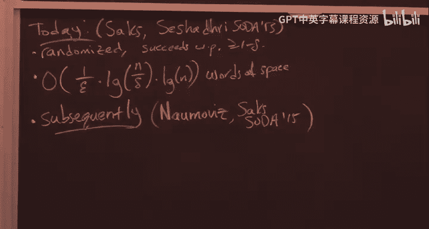

So anyway， subsequently this year。They showed that。嗯。There is a lower bound of one eruppson times。

 I believe， log n over log log n bits， maybe。This is a space lower bound。For randomized。

And then if it has to be a deterministic algorithm。Then， you know， they can。

 they can move the log log in。Okay， so。The lower bounds for determin and randomized are very similar that they get in their paper。

 And they also give something like。One over epsilon squared log to the fifth end。line。

Or I guess words anyway， I would have then with words， let's say。Algorithm。And this is deterministic。

So so the randomized upper bound has one over uppsilon in the space。

 the deterministic upper bound has one of uppsilon squared。There's like two log ends here。

 There are five over there。So it is， you know， worse space， but it's deterministic。

And always is correct。So even here there are some open problems， can you get， you know。

 I'm just saying things maybe for project ideas， can you improve this。

 perhaps log in the fifth just looks too big to me to be。The truth。Also。

 there's a gap here between this upper bound and this lower bound。

In terms of the dependence on epsilon。 So there's， you know， there's still things to ask here。

Of course， there's that open problem I wrote there as well。

So today what I'm going to do is I'm going to cover just this algorithm。

Any questions before I get into some technical stuff and actually discuss the algorithm and analyze it。

🤧ふん。Good， so。The way that this algorithm works right here is it takes a natural dynamic programming approach。

To solving DTM。And then it， it adds kind of one extra step。 Okay， so we'll。

 we'll see what that is in a second。 So let me write down this， this natural D P approach。Good。Okay。

 so one， step one。Give each item。Wait。WI， so give each item， let's say I wait WI。

So I runs from one to n。嗯。Okay， what I also will do is two。嗯。Prepend。Slash postpen。

Minus infinity and plus infinity。With weights。W0 equals w and plus 1。Okay， so now the GTM problem is。

Remove items with the minimum weight。Such that what's left is increasing， right， and。Basically。

 because these guys at the beginning of the end have weighted infinity。

 I wouldn't want to remove them。 and minus infinities at the beginning now。 So these are。

 I don't know if people are familiar with the term sententinels and programming。

 So has anyone heard that term。Putting Sentinels in your code， basically。

This prevents me from having to deal with like like some special cases when I'm at the edges of the array。

 Okay， so by doing this， I ensure that minus infinity and infinity are part of the actual L I S。

There's no incentive to remove them， and they are smaller and bigger than everyone else。嗯。Actually。

 I guess this part's not really as important。

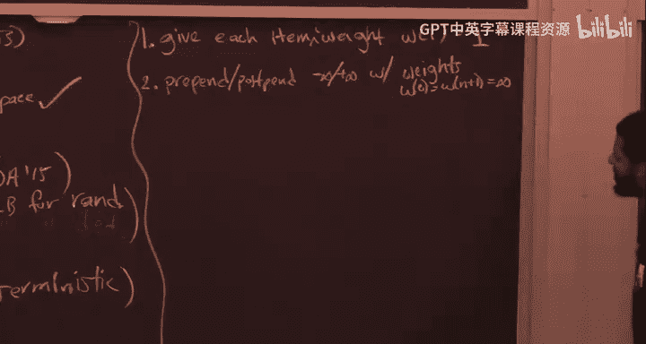

Well， it will be for what I say soon。Anyway， I'm not going to remove these guys。Okay。

 and then what I'll do is also。嗯。Initialize。R to be the set containing just 0。W of zero to be zero。

And。S of0 to be0。So let me write this down somewhere。S of I is going to represent。DTM。

Of the sequence。X1。X1 up to。Or x to0， I guess now that I' prevented minus infinity up to X I。

Such that。I。Enforced。To not delete。Item I。Does that definition make sense。

 So if I just look at the sub sequenceence from the beginning to I and I tell you you're not allowed to delete I。

What's the distance amount ethnicity then？And that's what SI stores。Good。

So now that we're done with initialization。Let's the main loop is as follows。

For T goes from1 to n plus1。嗯。嗯。WT。Becomes。W T-1 plus little W of T。

So the capital WO H stores prefix sums of weights。

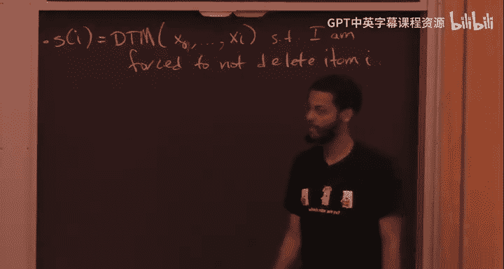

Then B， B is， B is the main is where the action is at。 It's the recurrence。 Okay。

 so what's the recurrence for this dynamic program， basically。What I want to figure out now is SFT。

 right？So what's the optimal thing to do for S of T well。I need to pick， you know。

 if the sequence has to end in T， if I'm not allowed to delete T， I have to pick some I。

 which came before T， such that X I is at most X of T。

And I recursively try all of them and pick the one that does best。So。This becomes the men。

Over all I less than equal actually let me put it like this over all I and R。So R。

 R is just going to store all the indices I've seen so far。Okay， so when I get。

 when I get to T in the loopt， R is storing 0，1，2，3 up to t -1。So， you know。

 why did I specify it that way， It's because when we do the streaming version。

 it'll be easier to write the change。So the mint overall all INR。

 which for now just means everyone who's before tea。Such that。Xi is at most Xt。

So everyone who actually could be before me in a sequence in an increasing sub sequenceequence。

So what？What expression should go in here？S of I， so what this is telling me is。

I'm forming an increasing sub sequenceequence that in Z T such that the thing right before T was I。

 which means I have to delete everything between I and T or between I plus1 and T。

 So this is going be plus。W。Of t minus1 minus w of I。Right。And then what I'm going to do is。

Insert T into R。And then， at the end。What I'm going to do is I'm going to return。S and n plus one。

So it's a simple enoughDP。Okay， so now。You know。Big W。 big W is the prefix sum， so。

Capital W of T is supposed to be the sum I goes from。1 to T of W of I。It storesores the prefix sums。

 I just want to be able。 The only reason I do that is I want to be able to get the total weight of this interval in constant time。

 So I store prefix sums。嗯。Okay， so。Good。Now， here's the， you know。

 ingenious step of Saxon Saoddri to make the streaming。 So this is right now， this is。

Not that great from a stream perspective because the space is linear。

You need to remember all the Ss before you。And the streaming version。嗯。When me use a different color。

 So the streaming version is's just to make sure that we。嗯。Distinguish them。

 So let's say R is the streaming version。Okay， so everything's the same little R。

 And then here what I'm going to do is R of T。Is going to get that。There's a streaming version。

 And then there's one extra step in the streaming version， which is D。And what we're going to do is。

For each element。😡，Of capital R。We're just going to remove it from capital R with some probability。

So every iteration we go through this loop， through this main loop。

 we're going go through capital R and randomly delete some of the DP table。

So usually when we're at time T， there are already T elements in the D P table that we're remembering。

 basically everyone before us。We're going to rig things so that there's something like polylog tea who are left before us。

So。For each。I and R。I remove。I from R。With probability。1 minus P of I T。

I'll define what P is for you in a second。And this removal is done independently for each eye。

 We independently decide whether or not to remove it。对。Oh， this is one minus。So basically。

 PI T is the probability that we keep it。And then one minus P T is probably that we remove it。

Oh is it， sorry， okay。Can you， anything you still can't， all these a different color next time， but。

that you understand what's going on now。And the point is。When we're doing step B。

We only need to know the SI values and the capital W values for the I that are in T。

So we can throw away most of the information at every step and only keep kind of polylo information。

so。嗯。You know， to make this a well defined algorithm， I should also define what P of IT is。So first。

 I'll define。Q of I T。This is going to be the men。Of one。And。1 plus epsilon over epsilon times。

Lwn of 4T cubed over Delta。Times。The weight。呃。C。

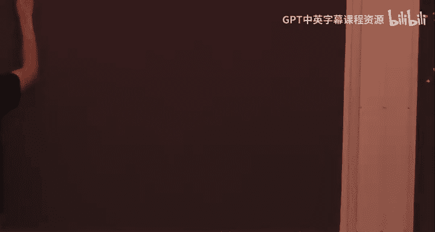

Over the weight of eyes， sorry。Over the weight。Of。The interval from Iot T。Okay， so。By that。

 I just mean。The weight of A B is just the sum I goes from A to B。M w y。The weight of the interval。

 which I can get by subtracting two prefix sums， yeah。Yeah， yeah， they're not changing capital sorry。

 capital W is changing。I mean， capital is companies being built。

Think about the little WI as being one， how about that？😡，It's being incremented。Yeah， yeah， yeah。

 it is。I mean， except for。呃。Little okay， so yeah， it's just tea。So。So okay， so maybe this was， yeah。

 just think of this。 This is think of this for now as t minus plus1。

This algorithm would work even if the items had weights and there's a cost associated to deleting each item。

Okay。Little W is one for everyone except the Sentinel。 The Sentinels have weight， infinity。

 which by this formula means you would never want to delete them。I didn't tell them what P is， but。

In the second， you'll see that。But yeah， so I guess one short answer is， yeah。

 this algorithm works even when items have weights and the the distance amountfinities and some of the weights of items you've deleted。

Okay， so。Good， so anyway， so in the， in the case of interest， as you said， the Wis are one。

This thing is basically t minus I or t minus I plus1。So ignore， ignore the epsilon。

 ignore the log whenever Delta T over Delta。 Basically， what's going on is the， you know。

 this thing is going be for us。The probability。That I。This is going to be for us the probability。I。

And RT。RRT is。RRT is R。At。After the teeth。Iteration。Of main。That's what that represents for us。

And then。Ping of IT。It's just Q of IT。Over a Q of IT。-1。For。For a T bigger than I。

And then it's equal to1 for T equals I。So if you have item I and you look at it some future time T。

 what's the probability that it's still in R， well what's the probability that it survived step I and then conditioned on that was the probability that it survived step I plus1。

 etca up to step T。It's the product of all of these。

When things cancel on what you're left with is Q I T。 So Q。

 I T is the probability that item I is still in R after the T iteration。

And PI T is the probability that， conditioned on。Condition on item I being in R at the beginning of iteration T is the problem that you keep it there by the end of iteration T。

And what this formula is telling us， if you know， look at this as1 and t minus I， basically。嗯。

An item that happened， know K steps in the past。Is kind of kept around with probability1 over k。

So how many items do you expect to be kept around。It's like a harmonic series。

It's like the sum over k of 1 over k。Which。And when if we're at iteration T。

 it's the sum where K goes from1 to T of1 over K， which is like log T。

That's how harmonic series behaves。So in expectation。

 we're only remembering a logarithmic number of entries in the DP table as opposed to T numbers。

So does that make sense？So。RightSo we remove I from R with probability1 minus P I T at step T。

 So we keep it with probability P I T。 right So for it to still be in R T。

 we had to keep it after iteration I after iteration I plus1， etc ceter， include after iteration T。

 So it's like the product of all of these and they cancel on your're left with just Q I T at the end。

Because QII is one。Yeah， question。Sorry， so I guess what I'm meant to say is。嗯。

Little S is storing the DP table if you had remembered everything。

Little R for me is what would be stored in your DP table if you're doing this randomized deletion。

So little less story like the actual answer is， we don't have that in our algorithm because we're not running that algorithm。

 It takes linear space。In our algorithm， we're storing little Rs。😡，Okay。So basically little S。

There are actually two algorithms I wrote here where algorithm1。

 everything in Blue chalk does not exist。That's the standard linear space algorithm， Dp。

Algorithm 2 is。嗯。Everything in Blue Cha does exist。 And instead of storing S's， orreoring Rs。

 little Rs。Yeah。所以。Right， so I mean， the algorithm just stores one set R， capital R。😡，Right。

 and what I mean by capital R of T is RF of T just denotes。

It's kind of like looking at the trace of the execution of the program。

 like looking our capital R of T just denotes what capital R was after the teeth iteration。Oh yeah。

 yeah。 Sorry。 Yeah。 So we're only going to store the little R values and the capital W values。

For the items that are in capital R。Yeah。Questions。We want sublineer space。

 We want like log space or something。Yeah， but so since we're doing step D。

RightWe expect the size of capital R to be logarithmic anyway。So capital is actually quite small。

 and we can store it all。

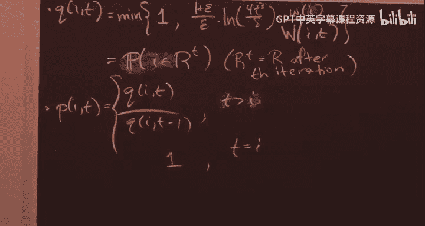

We'll get to this， a formal space analysis in a second。I guess what we actually want is that。

Capital remains small throughout the entire execution of the algorithm of high probability。

 but that's also true。So。So we want two things。A， we want that。 So first of all。Notice that。

For all for all tea。R of T。Is at least S of T。And that's just because。With little S。

 we remembered all of ours。 So we're taking a man over more things。

But when we're doing the streaming variant。Capital is shrinking because we're randomly forgetting stuff。

 So we're taking a min over fewer things。So little r is going to be bigger， potentially bigger。

So we always have that little R is it potentially an overest。

 It's never an underestimate of the true answer。So what we want is we want that。With probability。

 y minus， let's say delta over 2。Little R is that most one plus epsilon times or actually the only here at the end are little R of n plus1 is that most one plus epsilon S of n plus1。

Basically， we want correctness。And B， we also want with that with probability。

At least one minus delta over  two。嗯。You know， R T。For alt， RT is small。

Like polylagrimic inside in size。来。If we had those two things。Then by a union bound。

The probability that either of them fails is delta， So we succeed with probably1 minus delta。

Notice also that。We know what the size of R T is。 Re'reoring R T。 So if it ever gets too big。

 we could always just abort and say fail。So we can guarantee that our space is never bigger than whatever spacebound rereclaiming。

So now we just need to prove these two things。 And that's what I'm going to do in the remaining part of class。

 So questions about。Before end， it's approveds question about anything。Yeah。Okay， so。嗯。Good， so。Now。

 let me think of the best way to answer that。So ignore this for a second， know。

 the fact that we have this here is basically to be able to union down somewhere and get some high probability claim。

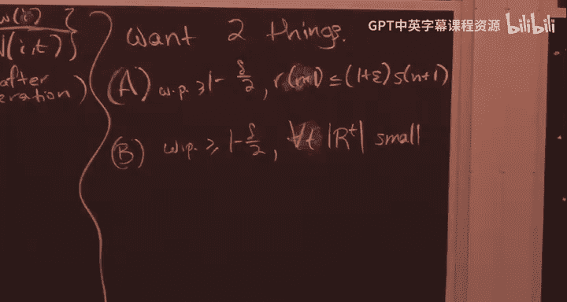

So really， this is something like roughly one over epsilon times1 over t minus I plus1。

So the probability that we're at position T。The probability that we still remember someone。

From position I in the past。Is proportional to like one over the distance of how far back they were。

Okay， so。Why is that？ So the fact that。The fact that the right scaling is like one over the distance to half far back。

 I mean， we'll see an analysis。 But in terms of what the what the higher level idea is is okay， so。

Let me just say one。Thing about the analysis。Fix C。To be sees a subset。Of one to n。

 So it it's a sub sequenceequence。Fix C to be。A particular。LIS。人。So。嗯。Here's our sequence。

And some of these elements actually， well， items 0 always belong in the L I S。

 Some of these actually。Belong to the L。嘿。Now we're at some time T。诶。

The kind of high level intuition behind this algorithm is。嗯。Basically。When are we screwed， Okay。

 We're screwed if， so where are we not screwed？Well， if we remembered this guy。

 if we remembered him in the DP table， let's pretend that everything was okay until we got the team。

And let's say that we remembered him。If we remembered him。

 then we don't really have to remember anyone before him。😡，Right，So kind of people who are。

 as long as we like bias ourselves towards remembering recent people。

 the hope is that there's someone recent who actually belongs to this LIS SC。

And since he's close to us， we remember him。And it's okay if we forget people who are further back in the past。

 So this is why we bias ourselves towards remembering recent people more。嗯。And。Right， so。

I guess what I can say is。两了 me。Let me leave it at that right now for does that give you some intuition。

 I guess？So what can you say again。Should yeah。 So I， yeah， I is less equal。 That's right。Oh。

 just because。Cute， you know， the probability that you're still in R after the teeth iteration is basically the product of all of these guys。

Right。Because the problem that you're kicked out of R is 1 minus p。

 so the problem that you're kept in R is P。So the problem that you're kept in R is this。😡。

And then you keep multiplying these together， and basically everything cancels except the first numerator in the last denominator or first denominator and the last numerator。

So let's prove these things， okay。そい。And。Oh， actually， I should have looked at。Okay，So we are going。

 in fact， in the analysis fix。Fix a particular L I S。 And we're going to compare our cost by。

Looking at how we're doing versus that LS。Good， so now I want to write down one lemma。

Or let me give some definitions first。Definition。🤧。嗯。So we'll say that。H。Is。Unsafe。At time T。Yes。

C intersected with IT。Is， is imp。So。

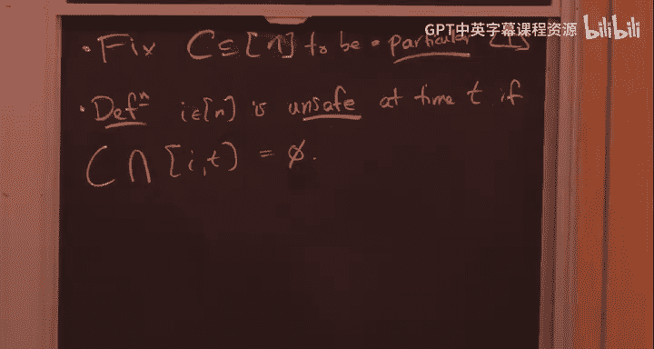

And。Oh， whoops， that's not。Yeah， that's what I wanted to say。嗯。Very good so what this means is。

If you look at the interval I T and look at all the people in the L I S from that interval I T。

 we didn't remember any of them。Okay， so we're gonna to say that I as unsafe if this happens。

 Notice that being safe or unsafe is a random event。It depends on what we deleted， potentially。And。

U T is going be the set of I， such that。I and is onC。At time T。And then， you。

Is basically the items that are ever unsafe at any point in time。 This is the union overall T。

T from1 to n。To。Of U T。对啊。It's the set of all inices I， which are unsafe at time T。 Yeah。

 so you look at the interval from I to T and none of the L I S。Indices were remembered in art。

In ourie。So now we have alema。We're going to say that R of n plus1， remember。

What we want to show is we want to show our input plus one is small。

So I claim that R of n plus1 is at most。The following weight。Okay。By capital W of a set。

 I just mean the sum of weights in that set。Basically， for us， all these Ws or little Ws were one。

 So the size of this set。By the way， you know， what is， what is S of n plus1。

 S of n plus1 is just the weight of C bar。C is the actual LIS。😡。

So C bar is everything that we should delete in the optimal solution。

 So the weight of C bar is the actual optimal solution。

 And then we have this extra stuff coming from unsafe items。So ultimately。

 what we're going to try and show is that。With high probability。

Kind of the weight of the unsafe items don't hurt us too much。Oh， you have a question back there。

Oh why do I call an item unsafe？😡，嗯。Because。Basically if we had， if we never had unsafe items。

R N plus one would actually be S N plus1。 So but I guess that picture that I drew where I said。You。

 some of these elements are actually in C， and then we're here at time T。So when I get to time T。

 if I actually remembered someone from the optimal solution here。Right。Then。

As long as there's always someone in the optimal solution。

 as long as the preceding person in the optimal solution。Still lives in RT。

Then I will update my DP table in the proper way and actually continue having an optimal solution。

Right， so。Let's say that。And so I get to the first， I get to the first guy。 I take him。

 He stays in R。 I don't remove him from R。 Now I get here。As long as this guy is safe。

That means I still I still remember him。 as long as this interval is safe， I still remember him。

Right， so the optimal solution ending at this guy will be allowed to take him because he's still in R。

So now I remember this whole solution。And then now when I get here。😡，I still remember this guy。

 if he'， if this interval is safe， I still remember this guy。Right。

Or if this if this guy is safe at time T， I still remember him and then I'll update。

 I'll update accordingly as well。Basically， if no one is ever unsafe。嗯。Yeah， if is。

 if no eye is ever unsafe。That means that I will be able to maintain my DP table appropriately at every step and never have any error。

Right。I don't know if that。Oh， sorry， so。A， so what am I storing， I'm storing the R I value。

 the little R I values for every I that's in capital R。OkayAnd what I what I don't。

 what I ideally want to happen is that every time I get to the next element of C。

 the the actual L I S。The previous element of C still lives in the table， still lives in capital R。

If the previous guy from from C still lives in capital R。

 then I'll maintain my optimal solution at that point。But if I forgot the previous guy。

 that's when I'm introducing error。 That's what I'm losing out on parts of the L I S。So the unsafe。

 the unsafe。If you look at an eye， which is in C。If I gets unsafe when you reach the next element of C。

That introduces error。So unsafeness is like a source of error for us。So the proof of this。嗯。Is。

You know， define。C bar。Less than equal to。Less than equal to T as being C bar intersect。G。

The set one of tea。By induction。

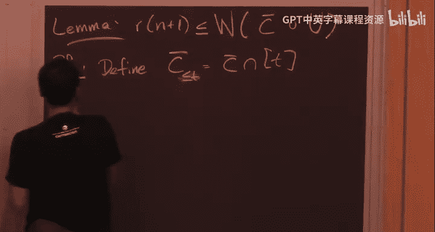

On。My induction on T， which is N C。Willll show。That R of T。

Is less than equal to W of C bar less than equal to t -1 union。有 t。So we'll show this。Okay。

So I have questions about the statement。So this is just who's not in the LIS only looking amongst the first P minus-1 elements。

This is。嗯。Who's unsafe。Kin of at the beginning of the iteration for step T。

 So who's unsafe at the end of the iteration。嗯。At the end of the t minus consideration iteration。

Yeah。嗯。Oh， like， well。So if you look at， you the U T is increasing。 So the thing is。

 if you look at a fixed。It can be。 So if you look at a particular eye， right。So let's say I is in C。

So at least that time， I， it's safe because I itself is in R。Right， I'm looking at I B and C。

 And then as you go forward in time， at some point。

 you might have like accidentally forgotten all the L I S elements from R。Now it becomes unsafe。

Now you keep going。And there's a new element from， from the L I S that happened later on。

 which got put into R。 So now I is safe again。But capital U captures for us。

 any item that's ever been unsafe at any point in time。Yeah。

 I I guess all I was just saying is it is possible for an item to be safe。 Let's say I is and C。

 It is possible for I to be safe at some given point in time。 then become unsafe。

 then become safe again， then become unsafe。So it， it's not， it's not like monotone in that way。

For fixed T。As you， if you move I backwards， yeah， things can only become things can only transition at some point from being unsafe to say。

 That's right。 That's true。Why can I， So okay， let's say eyes and C at time I。

 it's safe because the problem it is in R。Then in the future， it might happen in the future that。

All the all the elements， all the LIS S elements between I and that time T got deleted from R。

So now eyes is unsafe。But then later on at later primes he prime。

Someone else from the LIS S later on might have gotten inserted into R。Right。

 and then I is now safe again at that time T prime。Does that answer your question？Okay， so。

The base case。Is the first element of C。I'll call it element one。

 although it might be some other index， a question。嗯。Yeah， actually， I think you're， that's correct。

 we could。we won't need to。I think you're right。Good， so base case。R of 1。

 let's say the first element of C。 I'm calling it1 is definitely equal to 0。Okay。

Which is less than the weight of whatever。嗯。Oh， actually， what I should say is。I guess R of0 is0。

 let me just say a little bit。Okay， so now for the inductive step。We have two cases。Case1。Is that。嗯。

Cbar。Less than equal to t -1。呃。And let me see this。呃。O， I see。So that's case 1。 And then case 2 is。

Okay， so let's analyze those two pieces means that。嗯。Basically。

Every every single element of the LIS at this time， T is unsafe。We like forgot everyone。Okay。

 that's suck。Here is， there's at least one person we didn't forget。🤧。So， case1。Well。If it's。

 if it's the case that。So case1 basically just means that So case1 means。We forgot。Everyone。

And see listen the。In this case， the weight。Of C bar t-1 union U T -1。It's basically just everyone。

everyone before time T is either just not in the LIS。😡，Or is unsafe。😡，So this is just everything。

And certainly， RF of T is less than equal to the weight of 1 t minus1。RightWe're forced to I mean。

 remember that little R， we are forced to remember T himself。

We always have the option of just deleting everyone before us。

Because the sentinel minus infinities in the set， right， So that basically 0 is always in capital R。

 So we'll always be able to do R of 0 plus w of t -1。K2。Two， this is the case where。We didn't。

Recentlys， there exists。And so what was this， we didn't forget everyone。We didn't。嗯。呃。

So for the item zero is like the Sentinel that。Items items here for me was like the Sinel that had weight。

Yeah， so its weight was minus infinity。Well， it's， no， its weight was infinity。

 I did because I never wanted to delete it， but its value was minus infinity。

Could I say that properly we there？Yeah， so it's value like x 0 is minus infinity。

 and x N plus1 is infinity。But it's weights infinity。

 which means I never delete it because of the Q definition。R T would be t -1。

 because I don't delete T himself。I don't delete T， and I never delete like， I never delete 0。

0ero is like might infinity It's less than everyone。 It's always part of the L I S。

So I delete everyone between 1 and t -1。I always have that option。Then then， okay。So this option。

 So item， So case 2 is where I didn't forget everyone in the L I S in the past。So。

What I'll do is pick。The largest。J， which is in。C less than equal to t -1 minus U T -1。

So pick J from the L I S。 Pick the largest J from the L I S。 That's safe。Okay。Now。

 if it's the largest J from the LIS S that say， in particular， J must be in capital R。Right。

So when I do step B， I'll have that R of T。Is less than equal to R of J。Plus。The weight。

Of the interval from J plus 1 to t -1， I guess。And then now I apply the inductive hypothesis to R of J。

So R of J， by the inductive hypothesis， is at most。W of C bar less than equal to J -1 union U J -1。

Plus， the weight of J plus 1 t minus1。诶。So， now。Look at all the items from J plus1 to T -1。喂。

Some of them are unsafe。 Some of them are in the L S。And some of them are not in the LIS。😡，He。Now。

So some of them， some of them belong to C bar less than equal to t -1。

And then some of them are in the L I S。 but the ones that are in the L I S have to be unsafe。

Because I chose J to be the biggest index， which is unsafe。

So everyone after J who's in the LIS before T is unsafe。So those live in U T -1。

So this sum is actually just equal。So the weight of C bar less than equal to t -1 union U T。Yeah。

 J is the largest element of the LIS， which is safe。No， they'll be unsafe。Yeah， to be un。Sorry。

 we're done the De。

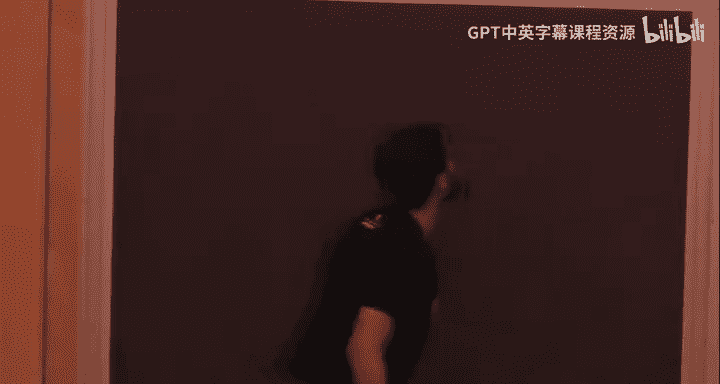

So ats the end of the。

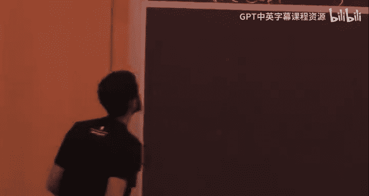

So now what we need to show is that。This thing over here。

 this right hand side is small with high probability。对。You're talking about the very last equality。

So what I said was， so we have the way to these guys， right？And then I said， we have these guys。

 So these are just all the guys from J plus1 to t -1。Each of these guys is either not in the L。😡。

In which case。嗯。It's part of C bar  T -1。Or they are in the LISS。

 but then they must be safe because Jay was chosen to be the biggest safe guy。Unsafe。

 they must be unsafe because Jay' is the biggest safe guy。

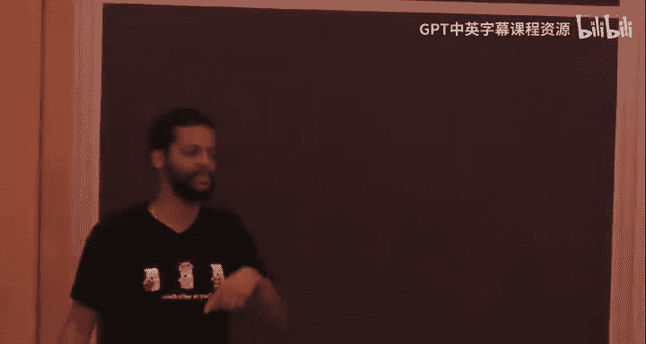

Unsfe at time tea。Yeah。就让这个战绩。Oh， actually， that's a good point。 So I really。

 I really couldn't have strengthened the alema。 Yeah， so。

I think what you're saying is what this really should be is the union。Of。

The union over k from1 to t -1 of UK。Right。Yeah， I believe you're correct。

And that's why I actually need you， okay。Someone asked me a question。

 Oh you asked me a question before。So you asked me before， couldn't I have just written UA here？

Right， and I said， yeah， you could。 But I， I was， I was lying。 That's not true。 So the point is。

When you。In this last step。There are items， some of these items here or all these items here don't live in the interval from J plus1 to t -1。

Right， so。So， actually。All the unsafe items here are getting unioned with the previous unsafe items as well。

😡，Right， so really， what I should have said is it's this。You know， union。U J minus1。Right。

 but really， this is like this would have been， this would have been the union of the over K from 1 to J -1。

Of the UK。And then that would have gotten unioned as well。 So this would have been the union over K。

S J minus-1。Yeah， would then it would be an inequality， that's right。Well。No， it's the main quality。

But the way I've written it， it would be inequality。The way I've written it would be quality。

And then you would say， because yeah， the thing is， you're right， J could be less than t -1， right。

 So there are some unsafe items that aren't appearing here。

 But then I'll just bound it again by all unsafe items before time T。So。Good。

 so let's continue with the analysis。So another definition。Paul and interval。I。

 which is a subset of one to n。Dangerous。If。If you look at I intersect C。

It's at most epsilon over one plus epsilon in times balloon。

So an interval is dangerous if most elements in that interval are not part of the LIS。😡，For I and C。

Call I dangerous。If。Actually， for any eye。嗯。所。For I and C， let's say I'll call I dangerous if。And。

I is the left endpoint。Of some。Dangerous interval。And then I'll do is I'm gonna greedily。

 this is just in the analysis。 I'm not doing this in the algorithm。

 I'm gonna greed greedily find like a maximal collection of， of dangerous intervals， as follows。呃。

Form。Dangerous collection。I1， I2。As follows。This is a collection of dangerous intervals。

 What I'm going to do is I'm gonna to find the leftmost。

The leftmost index in the sequence from one to n， which is dangerous。诶。

And then what I'm going to do is。I'm going to。Keep going to the right。Until it stops being dangerous。

 So I'm going to take the longest， the longest interval going to the right， which is dangerous。

 And I'm going to throw it into my collection。And then after that。

 I'm again going to pick the leftmost index， which is dangerous。

And then I'm going keep growing an interval to the right and and pick the maximal。

 dangerous interval that extends to the right。Yeah。嗯嗯。And actually， let's， let's do this I and N is。

Not I N C。 Okay， so basically， the picture is。And also， I'm going to let say D。Is the set？

Of dangerous indices。谁。So some of these indices are actually dangerous。

What I'm going to do is I'm to pick the leftmost element of capital D。😡，That's this。

Notice that this interval is dangerous。😡，呃。No， sorry。 that's not what I meant to say。No， no， no。

 sorry。 this is no。People left most elements of capital D and basically just extend it to the right。

Pick the longest interval that goes to the right， which is dangerous。😡，That's what I meant to say。哎。

So。I pick the long time the goes through， which is dangerous。

 it might include some other people who are also dangerous。Okay。

 so that's the interval that I that I。That I carved out。Then this guy。

 maybe the longest interval that that extends from him。

 That's dangerous is just the interval of length 1， which is just him。

 So my two intervals are this interval and that interval。 That's my collection of intervals， maybe。

Yeah， that's right。Should be in C。 That's true。Otherwise。

 you can make it longer and it would become even more dangerous。Okay， so now。Let be。Be the union。

Over all J of IJ。It's basically any， any index， which is contained in one of the dangerous intervals。

And then D itself， D is a set of dangerous indices。

So now the main claim that I want to show is as follows。嗯。A is the following chain of inequalities。

 C bar is a subset of D， is a subset of B。

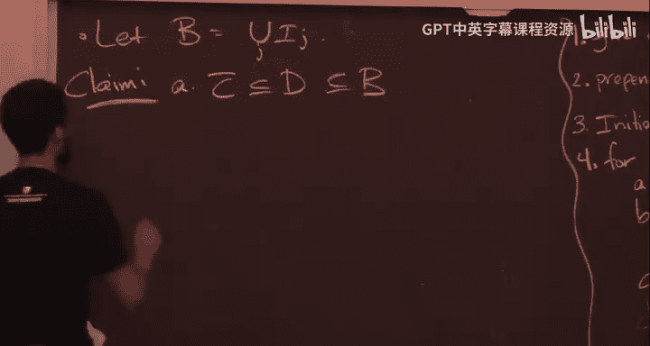

B。Is that。The weight of the。Is that most？One plus epsilon times in weight。Of C bar， which by the way。

 remember， this is just Sn plus1。And see。With probability or the probability that。You。嗯。

Is it subset sort of B？Is at least one minus delta over  two？嗯。Now。

 before we prove these claims one by one。If we could get， if we can prove these claims。

 I claim that we're done with a。Why is that？Well。We know。We know from the lemma。M claim。Ilies a。

Proof。By lemma 1 or that lemma over there， we know that Rn plus 1。Is that most？The weight of C bar。

Union you。Right。And if you a subset of B。This is at most the weight。Of C bar Union B。

With probability，1 minus delta over 2。But C bars is a subset of B。So C bar union B is just B。

So this is just equal to the weight of B。But the weight of B is at most one plus epsilon in a simple plus one。

喂。So really， it all boils down to。It'sroving A B， and C。

C is the one that requires maybe the most calculation。We'll do that。

 So let's prove those before I prove those， since we're running out of time。

I'll just say a word about capital B， because I think I won't have time to do it， Capital B。

Is actually pretty easy to prove。How do you prove capital B。

 it's basically the turnoff bound and the union bound over all time steps。

Because what is the size of R T？Well， just have an indicator random variable for every index I that comes before T。

And then the size of R T is just the sum of all those indicator random variables。

And they're independent of each other。 So it's a sum of independent indicator random variables。Okay。

 and the way that we've set these Q probabilities。The expectation of the sum is like log T cubed over Delta times another log T because of that harmonic sum。

And kind of the expectation is so big that， you know。

 the problem you're bigger than twice the expectation。Again， by turn off。

 the probably bigger than twice the expectation is like e to the minus expectation。

And that's so small that kind of by union bound over R T， R T will never be big。Okay， so。

I just want to get that out of the way。 B is， I'll put it in the notes。 Okay。

 I'll append up in the notes。 B is actually the， the pretty easy thing to prove。

Most of the work is improving A。So now let's actually prove these three claims since we see here that if we had these three。

 we'd be done with the entire proof。So， proof。Of claim。So， a。

We need to show that C bar is a subset of D。That's pretty easy because if you're an element of C bar。

😡，If I' in C bar， then the length1 interval that only contains I is dangerous。

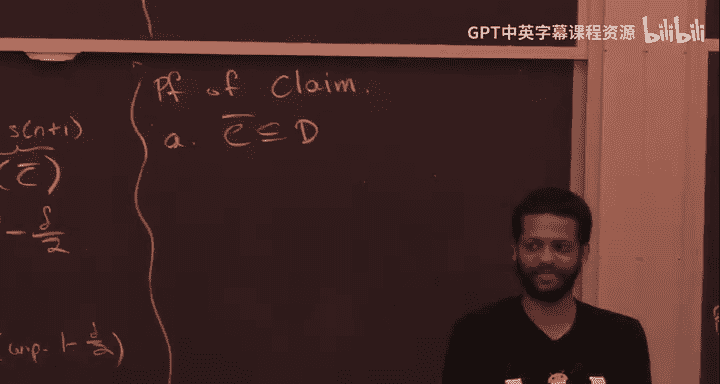

Right。Is in C bar implies that the interval I up to I is dangerous。Which implies that I is and D。And。

Jesus subset of B。Is basically by construction， because the way that we created this， you know。

 what's B， B is anything that's contained in any of these intervals。

But we had an iterative algorithm to create these intervals as long as someone dangerous wasn't covered yet。

We picked the leftmost one and then built an interval for。 So this， this is by construction。

 So a is A is not so bad。Let's do B。嗯。Well， we know that。For all J， the weight。

Of I J intersected with C。Is that most。Epsilon over one plus epsilon times the weight of Ij。

Which implies that。The weight of。IJ intersect with C bar。Ha to be， at least。

One over one plus epsilon。Times the weight of Ij。唔。Which implies that。You know， well， the weight of。

B。Intersected C bar has to be， at least。One over Wles epsilon。Times the way to beat。

The weight of B is just the sum of the weights of the I Js。

B is this disjoint collection of intervals。But let's， you know， we already proved A。

 we proved that C bar is actually。Contained in B。So C bar intersect B is just C bar。

So this is just equal to the weight。Of C bar。 So the weight of C bar is at least that。

 And just move around the inequality and you get this。So B is also done。

So the only thing we're left with the C。う嗯。We'll show。嗯。For all。For all tea。And for all I。In。嗯。You。

tea。

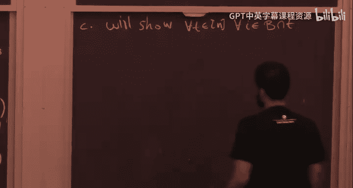

probabilityb that I。In you tee。It's going to be something small。

 it's going to be at most deelta over 4 T cubed。对。First， we， we're going to show that。

 And what I claim is that。Star， if this is true， if it's true that for all T and for all I。

 this is true， then that implies C。Okay。Why is that。The probability that u is a subset of B。嗯嗯。

Is equal to one minus the probability that。B bar intersect U。Is not the empty set。

Which is equal to 1 minus the probability that there exists to T and there exists in I。Okay。

 such that I is in UT。And then by union bound， this is at least。嗯。1 minus the sum over T。

 the sum over I in there。Of the probability that I is in UT。对。

And this is a really simple computation。 I mean， if you just， oh， it's。

 it basically comes boils down to the fact that whenever T squared converges。 So this is。

At least one minus the sum over t。There's a delta over four。1 over t squared，1 over t cubed。And。嗯嗯。

Well， sorry。So。The sum over t， this thing is delta over 4 t cubed。

 but they're at most T of them here。 So this is one over t squared。

 and the sum of one over t squared is less than a half or is less than 2。

 So this is at least one minus delta over  t。Right， so。There are are most T things in that sum。

Each one of those things is delta over 40 cubed。So t times that is delta over 4 t squared。

 and we're summing over t。So the only thing then is to show this。Okay， and。

It's also a simple computation。 I think what I'll do is I'll just put that into notes because we're actually out of time。

So whatever you send me， I'll just append it to the end。And， you know， basically。

 once you prove this， you're done， right， That's the， that's the end of the proof。

I'll just say we have PSsets back， PSets1 back that are graded so that the next class can come in。

 let's just all meet right outside the door there and then you can get your PS setsets back。Okay。

 and PS at2 is due， I believe Monday night， right？