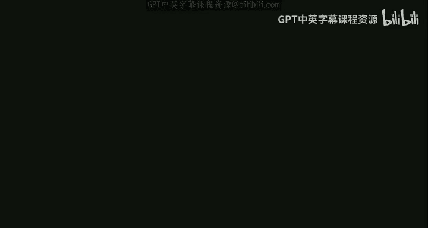
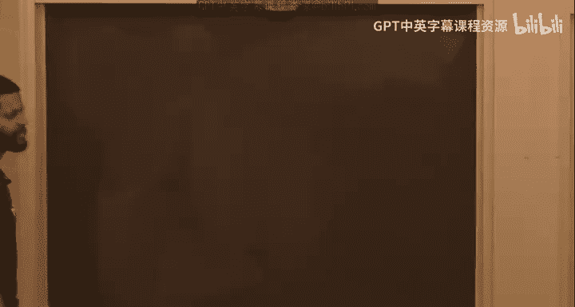
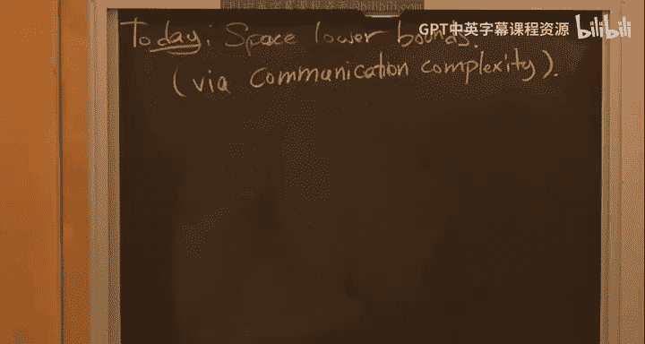
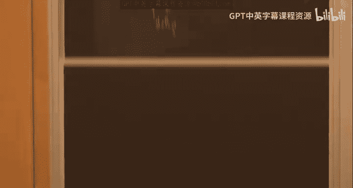
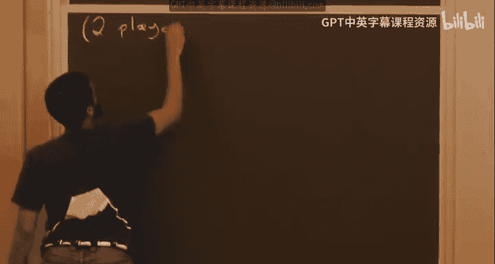
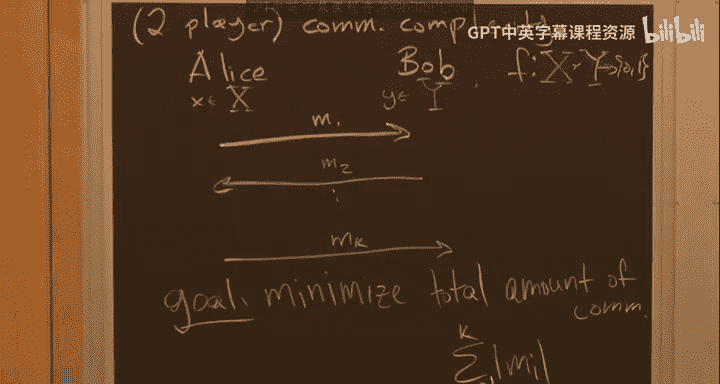
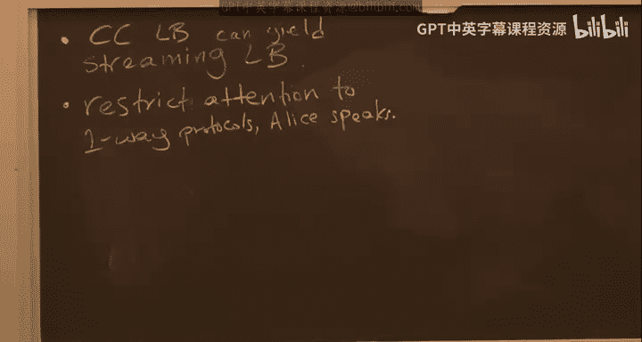
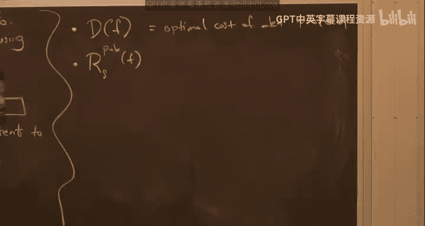
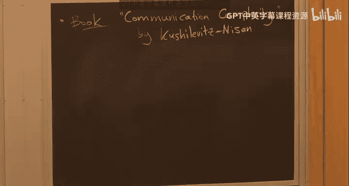
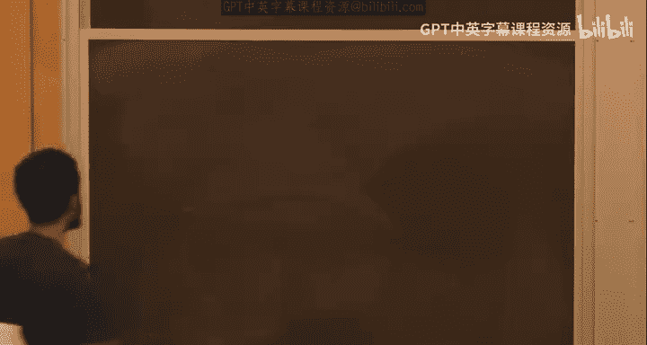

# 哈佛大学《大数据算法｜Harvard Algorithms for Big Data (COMPSCI 229r) 2016》deepseek - P9：-09-Algorithms for Big Data (COMPSCI 229r), Lecture 9.zh_en - GPT中英字幕课程资源 - BV1yGdNYvEMo

So today we're going to talk about。Proving space lower bounds for streaming algorithms。

So we've already talked a little bit about this。 We showed some linear lower bounds。 Oh。

 you're describingbing today， Is that right， Okay， great。

We showed linear load bounds for several problems， both randomized and deterministic。

But sometimes we want to prove， we want to pin down like exactly the space complexity。

 even for the randomized approximate algorithms， right。

 So we know that we can solve something in one Rson squared times login space。

Can we get one of reppslon plus login space right so know pinning it down exactly。

 So we're going to see some more sophisticated techniques today to prove space overs。

And all the space lower bounds today are going be。Via something called communication complexity。

And I'll say what that is in a second。うん。Ws anyone heard of communication complexity？Good。

And the problems we're going to look at today。Are F 0。Distinct elements。

And the lower bound here is going to be winner uppson squared plus log n bits。

So we're going to show any streaming algorithm， one past streaming algorithm。Which solves。

The number of distinct elements up to one plus epsilon factor must use space when it'ps on squared plus login bits。

And， you know， after that， historically， after that lower bound was proven， we did come up。

 we got an algorithm that actually matched that。 So this is the optimal space complexity of distinct elements。

嗯。We'll also see。mediaian。Randomize。Exact meeting。So I'm not writing these in the order that I'm going to present。

In class， we're going to do median before of0 because the argument is simpler。

And then we're going to also show。FP。Or P bigger than 2。Needs so this， this here is going to need。

Omega n。Okay， so if you can give the exact median of a stream in。

One pass with two third success probability。That's gonna require a linear space。

 And F P for P bigger than2。 This is remember。X estimating the LP norm well to the P， let's say。

Up to one plus or minus epsilon。This is going to require。To the 1 minus2 over repeat。And again。

 I believe its， yeah， so in this case， the lower bound was proven first。嗯。That's right。 And the。

Upper bound was proven。A few years later， by Inic and Woodruff up to log factors。So anyone who。

 too approximates FP needs at least this much space in bits。For this one。

 I'm not going to show the whole argument because it's more involved。

 but I'll once you get to know what communication complexity is， I'll assert。

That a certain communication complexity problem is hard。There is a proof。

 I'm not gonna do the proof in class。 And then given that it's hard， we're gonna show why it implies。

嗯。钱了。So good， I said via communication complexity。 So what is communication complexity。

So first， let's look at two plan。

Communication。Complexity。嗯。So there's some Alice。And there's some bob。They each get。

 there's also a function。Which maps？X by。Why。Into01。True false。Okay。

So Alice secretly gets some little x in that set capital X。

 and Bob secretly gets some little y in that set capital Y。

And what they'd like to do is compute the function F。 They want to compute F of X， Y。So Alice。

 let's say Alice is the one who。Starts the conversation。Alice will send。Some message M1 to Bob。可。

Bob will then get that message and then decide to send another message back to Alice。Et cetera。

And after some number of rounds of this conversation， someone will say， okay。

 given what everything that's been said so far， I can determine that I you know I can calculate F。

 and then that person will say， I declare that F is this。And the goal。Is to minimize。 Well。

 the goal for us today is gonna to be minimized。The total。Amounts of communication。Or in other words。

 the sum of。Am I or I goes from one。Or I by that， I mean the length of the string， MI。

 let's say this is a binary string， so the total amount of information that was sent。So， you know。

 there's always， there's always like some trivial。Protocol， okay， so you know。

 we're gonna talk about communication protocols。 A protocol is。You know。

 what a communication protocol is some way of conversing that All and Bob agree on ahead of time。

So Alice and Bob both know F。Right，They both know but they want to be able to compute。

 They just don't know the other person's private input。So ahead of time。

 they're gonna agree on a protocol and they're gonna say， okay。

 this is exactly how we're gonna behave as a function of like the messages we've seen already and。

The private input that we have。And then they're gonna to start executing this conversation protocol。

 this communication protocol。And this is the goal。 So there's always one protocol。

 which is there always there， there are two protocols which are kind of trivial and always work。

 One is that Alice just immediately sends the X to Bob。Right。

So how many bits does it take to send x to Bob， log the size of capital X？

To describe an element of capital X。 So that's always one trivial protocol。 Another one is。

 Bob will just send Y to Alice。Okay， so they're always。Kin of two trivial protocols。And you know。

 the goal really is to beat that or sometimes to show that there is no nontrial protocol。

There is no protocol that does better than the trivial protocol that's also going to be the kind of thing we'll shift。

Make sense。Now， there's a natural， let me stay on this board。 There's a natural connection。

Between communication complexity and。看到。Space lower bounds for streaming algorithms that works as follows。

So suppose we had a communication complexity lower bound。I claim that。没有。

A communication complexity all can yield。A streaming。Lower bound。Okay。And how is that？

So there are different ways of measuring the complexity of a communication problem。Okay。

 so we'll restrict our attention attention。To one way protocols。Where Alice speaks。Okay。

 what do I mean by that？I mean。Communication can only flow from Alice to Bob。

 We don't allow Bob to ever speak。In other words， Alice just sees her X and sends a message to Bob。

Okay。So we don't allow this back and forth。Now， suppose we had。

You know， suppose we had。A lower bound for some one way communication problem。So， Alice has some X。

She has an X， let me write it like this to be suggested。Bob has some why。

And we only allow Alice to send a message to Bob at which point Bob has to then and output the answer to the function。

Right。So。The connection is， look。Suppose， I know。They want F of XY。诶。

I'm gonna start writing things and introduce notation， as I write。 Suppose we know。A lower bound。

On the optimal complexity， on the optimal。Communication complexity。We call it D1 way。Okay。

 so what I mean by this is。What what D of F is is what's the cheapest communication protocol that solves F。

 So going back to this board。You know， what's the protocol that that minimizes this no matter what the input is over minimize over the max input of this quantity。

That's D of F。 D Ar O F means it's one way。 So Alice can only speak to Bob。

 And D means the deterministic。 So there are communication protocols deterministic。

So suppose that I know that。嗯。You know。Suppose that I know a lower bound on this thing。

 right I know that no matter what one way protocol you use。

 you to Alice needs to send at least this many bits。Right， what we can do the thing we usually do。

 which is， well， if there's a streaming problem that can compute F for you。

Then Alice will like view her X as a stream。She'll run the streaming algorithm on it。😡。

And then once she get to the end of the stream， she'll send。

The memory contents of that streaming algorithm to Bob。

 who can then continue running the stream on Y， and then he'll query the streaming algorithm。

And then get an answer。RightThe total communication here was S， the space of the streaming algorithm。

So here we have a protocol， a communication protocol that's using only S bits of space。

But any protocol needs that many bits of space， therefore s is at least。

The one way communication complexity of that。 Okay， so this is。

 I'm gonna instantiate this with actual examples soon。But that's basically the connection。Yeah。

What's why？So essentially， so why， what I imagine do what I imagine is going on here is that there's a stream and the stream got cut in half and the left half got given to Alice and the right half got given to Bob。

Right。谁？对 so。Yeah。Is F the function。Yeah， F well， okay， well， let me。

 let me instantiate this with an example。 and then you'll see， you'll see what I mean。嗯。Yeah。

 because you're saying often our F， the outputs of our Fs are not binary， right。

 but I'll show you an example to make this concrete in a second。So。So let's go back to actually。

 let's go to F 0， the number of distinct elements。So we've already shown。

We've already shown suppose we know。 So you know， we can basically get。Yeah。S bit。Comm protocol。

This is the space。Which implies that S has to be at least D1 way。

So let me instantiate this with an example。Exact， deterministic。F0。喂。Requires。Omega n。是て。

We saw this via compression argument very early in， in class a few weeks ago。

 But I just want to phrase basically an identical argument in the language of communication complexity just so that you get used to。

You know， arguing this way。So notice， as I said it here。

 we have to start with some communication problem that we know is hard。Okay。

Start with the problem that we know you need a certain amount of communication to solve。

 And then what we're going to do is we're going to reduce that hard problem。To our streaming problem。

 we're gonna say that if you could solve the streaming problem。

Then you could solve that hard communication problem。 Therefore， the string problem must be hard to。

 it's， you know， reductions are a big thing in complexity。 You know， you've seen， I guess。

 N hardness and things like that iss the same principle。 Okay。

 you reduce the hard problem to a problem。 And therefore， that problem must also be hard。Hey， so。

We're going to do a reduction。From the equality function。Okay。

 so equality is a function that takes two arguments， X and Y。

 X and Y are both bit strings of length n。And。It's either 0 or1。 It's 0， if they're not equal。

 It's one if they're equal。Okay。As the equality function。And claim。

The communication complexity of equality。Is。Omega n。

We actually only care about the one way communication complexity。But， in fact， even， even the。

Just even if you allow conversation back and forth， it's still omega and bits， okay。

So I'm not going to prove this。 You know， if you think about it for one way protocols。

 it's pretty simple to prove， right， Basically， the way we proved the compression argument before。

 it's pigeonhole principle。Right， so in the one way， in the one way。For one way protocols。

 Alice just gets X and has to send a message。 That's all that And then Bob， based on that message。

 has to figure out whether x equals y or not。Right。But。

So let's say that Alice sends an M bit message。Right。Well， unless M is at least n。

 there are two different bit strings that will yield the same message。By pigeonhole。Right。

And then then basically Bob， So Bob will get one of them wrong。Right，Let's say there， there's two。

 there are two inputs。X1 and Y， X1 and x 2。That my pigeonhole yield the same message。So。嗯。

So if Alice has x1 versus x2， like she won't know which one Bob had， right。

So one of those will get wrong。 And then it won't be。 It won't be actually a correct protocol。 So。

 in fact， for what， you know， in fact， this thing actually has to be at least n anyway。

We just proved it has to be at least n for one way protocols。

 but it has to be omega n for no matter how much communication there is。Okay。

 so we know that any protocol for equality needs n bits of communication。

So now we're going to reduce equality to F0。Okay， so suppose。There exists an algorithm。

 a streaming algorithm for F0。Using。That' bits of space。嗯。嗯。So。Alice。And Bob we here。Alice has her X。

X is a binary string， an endbit binary string。 We're going to do the usual thing where if X I is1。

 she imagines that I is in the stream。 And if X I is 0， it's not in the stream。

She's going to run a their existing algorithm A。She's going to run this streaming algorithm A on her stream。

😡，She's going to send the memory contents to Bob。Okay， and then Bob is going to。Oh yeah， actually。

 she's also going to send， let's say。Alice。Sends。嗯。Oh， yeah。 Yeah。 Okay good。 So Alice sends。

Mem contents to Bob。谁？And as soon as he gets it， he can basically do， Bob can just， I mean。

 this is really just a reformulation of the previous argument in terms of this communication reduction。

 right， So Bob can query F 0 and know how many nonze entries are in X。

And then for I goes from one to n， you can append I to the stream。

And then see whether or not I'm query of 0 again and see whether it went up or not。😡。

And if it went up， that means that。X I had been was 0。 And if it didn't go up。

 that means X I was a ready one。 So you can recover what X is， and then therefore， determine。

Determine whether or not it matches his why。And solve the equality problem。

But we know that any solution to equality requires n bits。

 So this message had to have at least n bit。 So S is at least that。Questions。

So we're going to see some more。It's， it's the same argument。 I'm just。

 I'm just rephrasing it as a communication。It as a reduction from some communication problem。Yeah。

 there's nothing kind of under the hood。 It's all the same argument。 But we're gonna。

 the language of communication complexity is going to。Help us solve some harder problems very soon。

 So I just wanted， I wanted to be able to phrase what we did in the language of communication。

Very good。So youve seen in one example。Before we get into other examples。I want to， know。

 define some terms and notation， so。I already told you DF。Is。You know， optimal。Cost。

I'm the deterministic。Protocol。Right。We're also going to look at。Something I'll call R。Our Delta。Pub。

Of F。

This is again， the optimal cost。😡，Of a randomized。Protocol。With failure probability。Delta。Such that。

The random string。Is public。It was written in the sky， what do I mean by public？Basically。

 Alice and Bob are actually deterministic people。But there's like an infinite random string written in the sky that both of them can see。

Okay， and whenever they want to make a random choice。

 they'll look at that random string to help them make that random choice。But since it's public。

 kind of， I， I， as Bob know。The randomness that Alice has access to。 So we can like。

 we can use that randomness collaboratively。No， so like， for example。

 what we could say is remember the protocol is decided ahead of time， right？

 So Alice and Bob might say， okay， look， there's this random string in the sky。

 Alice is going to use the odd indexed random bits for her for her decisions。

 and Bob's going to use the even index ones Okay so they're using different independent random bits。

 But the point is， they know each other's random bits。Right， so they don't have to， for example。

 I mean， they can use that to their advantage at some point to have even cheaper communication。

Because they know something if you think about those random bits as being their private inputs。

They know something about their private input， right， They know what that random string was anyway。

I know what randomness Alice is using。And Bob knows what。Well， they can do whatever they want， right。

 right， So they can。There's this random string they knows in the sky。 If they want。

 they can ahead of time split up and say， use the odds。 I'll use the evens， or they can say。

 we'll both use， you know， we'll both use random bit 5 at index 5 to do something together， right。

 I mean， they can do whatever they want。There's also R Delta private。Which is similar。But。But。一起。

OfAllison Bob。Have a primate。Random string。And then there's also what I'll call the distributional complexity。

This is the optimal cost。OfDeministic。Protocol。With failure。Probability。Delta。When。The pair X。

 Y is drawn according to the distribution mu。 So this is called the distributional complexity。

You imagine the input's actually random。Okay。Questions about。Any of these definitions。

So I'll assert something， so claim。D F is always at least the private communication complexity。呃。

I's always at least the public。Is always at least。デミュー。Okay。Remember。This measures the best protocol。

 like the cost of the best protocol。So this one is pretty simple， right？Look。If I'm allowed。

 if Alice and Bob have access to private random strings。They can just choose to not use them。

And just be deterministic。So any deterministic protocol。Can be simulated in the private coin model。

therefore， you can only do better by having access to the private coins。So that's this inequality。

This one。Look， so you can do what I said ahead of time。 ahead of time。

 Alice will say she'll use the even indexed random bits in the sky。

 and Bob says he'll use the odd index random bits in the sky。From then on。

They just simulate now the private coin communication protocol。So that's this inequality。

This one is basically by an averaging argument。Essentially， what we know is， what does this mean。

 This means that。You know， for all X。For all XY。The probability over the random string S。

That let's say the protocol， let's call the protocol pi， or let's call the protocol。P。

 the problem in the protocol is correct。Is at least one minus delta？

But that implies that this says it's true for all X， Y。 It's true for a random X， Y。

 So the probability。Over XY coming from you。Of the probability over the randomness。

Let call it me call it P。 P is the protocol when it's fed randomous S。That P S， correct。

Is at least1 minus delta。 And then now you just switch the order of the probabilities。

 So this implies that。The probability over S。The probability over Xy coming from you。That PS。

 correct。呃。Is that at least one minus delta？But if for a random S。

 this probability is at least1 minus delta。 that implies that there exists in S。

For which this thing is at least well minus delta。 So this implies that there exists in S。Such that。

Is that at least one minus delta？So。Let's call， let's call it， you know， S star。

Their existent S star。 So that implies。 So PSR。Is a deterministic protocol？

Implies that d of mu delta。Is。At most， the cost of the cost of a scar。第二。Does makes sense。

I just switched the order of these。在的。If the probability of rest of this thing being large。

If a random S has this thing being large， Has this probability being large。

 that means there exists in S where this thing is large。Yeah。S is the randomness。 So。

 so what do we know。 So what what I'm saying is that there is， there is a protocol。

So what is R deelta pub F？😡，It's's the cost of the best randomized protocol， right。

 with public randomness。So call that protocol P。😡，P is using some public random string。

 which I'm calling S。And what I'm saying is I can now use P to come up with a good deterministic protocol。

For， for the distribution mu。And that's what this is doing。So I know that。For all。

 basically what I establish is that。You know。For random。For a random draw from you。

A random protocol P S works with good probability。 Once you fix S， P S is a deterministic protocol。P。

 is the protocol P。 If you fix the random strain to be S。Right and then I reversed this inequalities。

 And I said， look， that means that for a random protocol。It works with high probability。

So if a random protocol works with high probability。

 that means there exists a protocol that works with high probability。Oh， I mean， these are just。

They're just different， these are just different ways of defining the communication complexity of a function app。

Right， so Dm Dlta is just one way of defining the complexity。

 It's the complexity under distribution mu。So this， this inequality holds no matter what mu was。

 it holds for all new。But， of course， S star will depend on mu。 There exists in S star。

 which is a function of mu。But。So if we want lower bounds against the termministic streaming algorithms。

 we'll usually want to lower bound DF。Which is easier because D F is the biggest of the mole。

If we want to lower bound， randomize streaming algorithms。😡，Okay， so which of these。

Which of these most naturally fits randomized streaming algorithms in your mind。Is it distributional。

 is it public coin， is it private？Thing like why public？Okay， so。

 so Alice gets half the stream and Bob gets the other half， right。

 Alice is gonna to send the memory contents to Bob。Right。So， for Bob to， So you know。

 in a lot of these streaming algorithms， there are some hash functions that are being defined。

And those hash functions， they don't live in the sky。Right。

You have to actually pay to store the hash function。So。

In order for Bob to continue running the algorithm。

 he needs to know what the randomness was in your hashing。Right。

 that's not communicated for free time。Right， so， so really the thing that models most closely what we care about is private randomness。

So we want to lower bound。When we deal with randomized streaming algorithms is our is the second one。

 the private communication complexity， the the randomized communication complexity with private coins。

确是。Oh， just because。A randomized streaming algorithm needs to actually know like， so， you know。

 your randomized algorithm。You're， let's say you're looking at， you know。

 distinct elements or whatever。 These randomized algorithms we've been looking at， right。

 Where's the randomness coming from， It's coming from some hash functions that the algorithm is computing。

 right。So in this， in this example where Alice runs the algorithm on her input。

 then sends it over to Bob。You know。Bob had better also know that the hash function that Alice is using。

 Otherwise， he can't continue running the algorithm properly。It's not public though， right？

That hash function is not public in the sense that。Bob just doesn't know it， right？😡，Basically。

 the only to continue running。 So let's say that I ran my。Count count me Sc algorithm， right。

Which is all about hashing。So count min had this grid of counters。I had half the dream。

After half the stream， some of these counters have numbers in them。Now， you're Bob。

 I send you these counters。And then you have the second half of the stream。

 and you're supposed to continue running the algorithm。Yeah， you need the hash functions。

So the hash function is not written in the sky。 I need to actually tell it to you。Yeah。Right。

all the description of the randomness that Alice is using needs to be communicated to Bob for Bob to be able to continue running the algorithm。

So we're gonna model that as private randomness。It needs to be。

 needs to be included in the space that's set， right， So that's for us， private randomness。ok。Now。

 even though private randomness most naturally models what we care about。

 we we're often going to lower bound the public communication complexity because。

Private is at least public。So if we lower bound public， that will be a valid lower bound for private。

 And， in fact， often， the way we're gonna lower bound the public communication complexity is to lower bound the distribution。

 Okay， so。We're going come up with a hard distribution， mu。

This lower bound holds no matter what mu is。So we might as well make it as hard as possible by making mu it would be as hard as possible。

 So we're gonna cook up a hard distribution mu oftentimes and then show a lower bound on the distributional。

And that will imply a lower bound on the private。Which will imply a lower bound on the streaming algorithms space complexity。

Does that make sense？So if you want to learn more about this stuff。You know。

I recommend there's a book。It's an older book。 There are some more recent surveys as well。

 but there's。A book by it's called communication complexity，And it's by Khi Levittz and Nissan。Yeah。

 there's some， there's some。Interesting things with communication。 So， for example， we saw that。

 you know， D， X is omega N。Anyone have an idea of what。Our pub of。Ac might be。

Well I'll just tell you， if it's a hard thing to just come up if you've never seen this before。

 It's constant。 You can actually solve equality with public randomness in a constant number of bits。

If you're well， let's say that Dlta is a third。And the private communication complexity of equality。

 private coin is log n。Basically， what you do is。Alice picks a random prime。And then a random prime。

 which is at most， you know， N cubed or something。And then she sends X mod P。

As well as the prime itself。Okay。And Bob then can compute X minus y mod P。

Because he knows the prime and he knows X modp。Right， and if they're actually different。

 then a random prime would witness that difference with good probability。

 if you pick the prime big enough。And actually， both of these things are optimal。

 It really is constant for public， and it really is log n for private。

 There are low matching lower bounds。 And， in fact， this gap of log n is the worst possible example。

 So there's something called Newman's theorem， which says that。嗯。

So you can basically reverse that middle inequality at the cost of an additive log n。

 The private coin complexity is always at most the public coin complexity plus log n。

So there are some very， you know， nontri and interesting things going on there。 I'm not， you know。

 this is not a class in communication complexity。 I just want to。

Yet you're familiar enough with it that you can use it for some problems that are relevant to us。O。

Yeah。Yeah， that's right。Free quality。And I'm imagining Delta is a constant。

 like a third or something。O。So now， in order to get some of the other things I wanted to show you。

 like this onepson squared bit lower bound for F 0 and this median lower bound。

I'm going to need to get into a problem。

A communication problem。Called index。We're going to show that index is hard。For one way protocols。

Okay， and then we're gonna reduce index to some other。 We're gonna reduce index to。ItTo median。

 So like this is， let me let me now show you the map。 So， first of all。

We're going to show that index。Reduces to something called gap hamming。

I'm just giving you a map of where we're going， and then gaphammming is going to reduce to F0。

And we're also going to show that index reduces to median。

And we're also going to define another thing called disjointness。Okay。So。T player sentenceness。

 So so far， we've just been talking about。Communication complexity with two players。

 You could imagine having T players where each one has their own private input。

 And then the first player speaks to the second， who then speaks to the next third。

 who then speaks to the fourth， etc ceter。And finally， the last player。

 at least in one way protocols。 the last player has to then。Output for F of all the inputs。

So that's T player one way protocols。 T Okay， We're going to show that there's a problem called this jointness with T players where T is appropriately chosen。

 such that。Such that that thing reduces to。FP。For P bigger than two。And we're going to do it where。

In this reduction， T is going to be something2 n to the1 over P。

So this is a map of the rest of the lecture， okay。I'm going to define what index is for you。

And what destroyjotness is。价个。And this is just today。 But actually， I mean。

 I'm index has been used for probably dozens of streaming lower bounds in the literature。 Okay。

 so it's a very like canonical， hard problem。When you， when you deal with NP hard。

 think like three sad， right， you often try and reduce from3 sad。嗯。And it's a very simple problem。

 So index。

It's like two player problem。So， Alice。She gets some x， which is in 01 to the n。And Bob。Get some J。

 which is between1 and n。An index。Index of Xj。X sub J。谁。And the claim。Is that the public。嗯。

The public。Delta。Complexity。Index。Is at least1 minus H2 delta。

And where H2 is the binary entrytropy function。 So H2。Delta is defined to be Delta log Delta。

Plus1 minus delta log， one minus delta。对。🤧。So， as long as。The way， so I'm not gonna， you know。

 you can plot this function if you'd like。 But the point of this function is as long as。

As long as Delta is significantly larger than a half。Or sorry， significantly less than a half。

 Delta is a failure probability。 So let's say Delta is a third。 This thing is some constant。

When you move toward a half， it then becomes like then。I guess move towards one。Yeah， H2。

 So H2 of Delta， it's called the binary injury function。 And this is the definition。So if， if H2。

 if Dlta is like a third， H2 of deelta is some constant， that's less than one。

 So 1 minus it is some constant。 So this is linear log。对。In fact。

 it's even true that the distributional complexity of this problem。

Where me is the uniform distribution。Okay， so Alice gets a random string， and Bob gets。

And Bob gets a random index。Even that thing has the same lower。诶。Yeah，他是。Yeah， sorry， so。Pub。

 one way。So if it's not a one- way protocol， there's a trivial thing。

 which is Bob can just send his input to Alice that takes log n bits。

 And now Alice knows the answer because she knows the entire string X。

The reason it's hard is because it's one way。 Alice has her input。

 and she has no idea what index Bob cares about。She can try sending a random subset of her bits。But。

For that random subset to contain Bob's index， If Bob is like a random index， you know。

 you need to basically send。Most of your indices， right？Long ways， too。Lg base2。

LG is long base two for me right now。Sorry。Yeah， okay。 so I yeah， yeah， So it's long ways to for now。

 Yeah sorry about that。Okay， so， you know， it's a lower bound you might not be surprised by。

 makes sense， right， But basically says Alice can't do any better than sending her whole for。

So we're going to prove this lower bound。But before I prove it， I'm going to have to give a little。

Information theory。Crash course。I'm not going to prove much。

 I'm just going to like define things and then state things。If you wantan to。嗯。

If you want to learn more， there's a book by Cover and Thomass。

Which is called like theEssentials of information theory or something。

 I might be getting it slightly wrong。 but if you Google cover and Thomas。

 I'm sure you'll get you find the book easily。If you want to learn more about this or take。

 you can find some lecture notes， et ceter。So。Some definitions。So if we have a random variable x。

I'm going to say that the entropy of x， H of x is the Shannon entropy。Is the sum over x。

 the probability， so P little x means the probability that capital x equals little x。Times。Wg。

Let me put a minus sign here， log P of x。This is log based 2， sorry for any confusion。

 So this is equals the negative of that。So。If you have two variables， H of X Y。Then really。

 what I'm looking at this is is a joint distribution over X Y， right， So this would be。

Negative to sum of X， Y， px，y log of Px，y。I also wanted to find for you what's called a conditional entropy。

This is just。The expectation。Over why？Of the entropy of x。Given that y is equal to little y。对。

And what other definitions do I want to give you。There's also the mutual information。

Which is equal to。H of x minus H of x given y， which happens to be the same thing as the information between y and X。

Okay， so。Entropy， conditional entropy， mutual information。Okay， so I'll just say maybe a little bit。

 so。Let's say that。哎，受。Let's look at the support of X。 Let's say that X is， yeah。

 let's look at the support of X。 Let's say X is a discrete random variable。Okay。

 how many people have seen all these definitions。Okay， so some， some， some not。 Okay。

 so I'll just say， you know， spend a minute， basically。

Look at the support of this distribution of this random variable。The entropy is like the。

 if you're trying to minimize the expected encoding length。Of specifying， you know。

 an event that happened in our， or the value of the random variable X。

 What's like the expectation of。Of the， the length of the message you need to send to specify what event happened。

 that's one way of interpreting entropy。I'm not going to justify that statement。But it's achieved by。

 for example， like Huffman coding。嗯。And then mutual information is basically telling you。You know。

 how much？How much so you， how much of the randomness of x。Is， is。

Is revealed to you if you know why that's sort of the intuitive meaning of it。Okay， so， for example。

嗯。If x is just a function of y， these are not independent random variables necessarily， right。

If x is just a function of y。Then y tells you all the information you need to know about X。

 If you know Y， you know everything about X。So， therefore。

The mutual information in that case should be the entropy of x。 You know all the randomness of x。

 And indeed， it is because the entropy of x is here。 and then you subtract the entropy of X given y。

But it that's just a function of why。Then there is no entropy left in X Once you know Y。

 So this is 0。嗯。Anyway， so just， I just wanted to say those things。

 So you have some sense of what these things sort of mean。

And there are some basic lemmas concerning these quantities。Which I won't prove。But we'll use them。

There's the chain rule。Which says that。H of xY。Is equal to H of x。Plus H of Y given x。

And there's also the chain rule for information， which says that。The information between x and Y。

If you're given Z。Conditioned on Z。Is the same as the information of X。嗯。Between X and Z。Plus。

 the information。Between Y and Z。嗯。嗯。There's also sub addivity。Which says that。H of xY。Is that most？

H of X plus H of Y。诶。The amount of randomness in this。

 in this pair of random variables is at most the sum of the randomness in each of them。

 And this is an equality， if and only effects and y are independent。If X， if X and Y are independent。

 then you really are separately learning the information of X and the information of Y。

 But if there's some correlation， then there's less randomness in their joint distribution。

And you can also get， you know， these two things。嗯。Chain。Plus， so the addivity。Imply that。Oh okay。

 well， this is。I guess this makes sense。Intuitively， again， not doing the math but just。

Going with intuition about entropy capturing how much information is in the random variable。Well。

Conditioned on， if you condition on anything， basically the amount of randomness can't go up。Okay。

 that's what that's what this inequality says。嗯。Also， let me write two more things。

H of x is always at most log the size of x， log the size of the support of x。

Andequality is achieved by the uniform distribution。Also， H of x。I'm sorry。This one。

This one is at most。X might have no entropy， right， Like if x， if x is always one， it has no entropy。

 even though and， and it's like， it's two thread with probability 0。Also， H of F of X。Is that most？

H of x。For any function F。And the last thing I want to write。

It's something called thanhanos inequality。So foundos inequ。Is basically。

 let me say it in words before I tell you the actual inequality。 What fe inequality says is。Okay。

There's an actual random。 There's a random variable X。And there's a random variable Y。

Suppose I only gave you Y。 your some prediction algorithm。 All you have is Y。 You don't have X。

And based on why you make a guess for what X， what you think X is。诶。Then if your guess is good with。

 if there is a way to estimate what x is with good probability。

It implies that there's like a lot of correlation between Y and X， right。

So what it says is that the conditional entropy of x given y can't be that big。

So ph inequality says that。If， you know， for。For two random variables。

 they're not necessarily independent。 The interesting cases when they're not independent。

 for two random variables， X， Y。If。There exists a predicting algorithm。G can even be randomized。

Such that the probability that G of Y。Is not equal to x。Is that most Delta？Then。

There can't be too much entropy left in X conditioned on Y。The entropy of x given y is at most。

The binary entropy of Delta。Plus， deelta times log base 2。Of the support size of x。-1。

Usually when we invoke fantasyine inality in you， in a second。

 when we're proving lower bounds for index for index。

We're going to be dealing with random variables that are binary。So， this is。This is going be 2。

2 -1 is1。 log base of 1 is 0。 So this term won't really matter。

So what we're gonna say is that the conditional interview are gonna be at most H2 of Delta。

I think I forgot a minus。So if you think of Delta。You know。

 negative log delta is the same as log1 over Delta。So if you think of Delta as being very small。

This is basically deelta times log winner over delta。Which up， you know。

 the log log whatever Delta grows much， much more slowly than one Delta does。 So this is basically。

 think of it as like Delta。Morally， okay？So。This thing is basically for small Dta。 It's like Delta。

 It's like Delta log whenever Delta。 So if you're able to predict with good。

 if you're able to predict such that your failure probably is at most Delta。

 the conditional entropy is at most Delta times log whenever over deta。Okay。That's fantasy。Questions。

And so。So now we're going to go back to indexing。We want to prove。

I want to prove that lower bound that claim that I said over there。So let。Pie。Be the。Transcript。

Of the。Communication protocol。So in this case， it's a one way protocol。 So the transcript。

 by the transcript， I just mean the history， the log history of like， who said what， when。Okay。

 in a one way protocol， the transcript is just a single string。 It's just what did Alice said。

There's no back and forth。So when I put this arrow， I mean it's one way。So only Alice speaks。

And then Bob has to declare answer。 Yeah， if it's two way。

 Bob can just tell J and that takes log n bits， right。

 So if this is not a hard problem for two way protocols。It's only hard for one way protocols。So。Good。

 so we know that， so let Pi be the transfer of communication protocol of the， let's say。

 of the optimal。Communication protocol for the problem。 So pi is the thing that actually achieves。

The optimal cost。So we know that。嗯。Our Delta pub。Index。Is。Equal to the length of pi。Okay。🤧う。嗯。

Which is at least。The entropy of pi。Which is at least the mutual information between pi and。

Say the input。Which is the same thing as initial information between the input。And pie。

RightSo here I mean， by the input， I mean the input to Aliison Bob， So the string X as well as J。

Thiss equality。Yeah， theres no differences。 You mean， this line and this line。

This is the mutual information between pi and the input versus between input and pi。

 But those two things are equal。Yeah。嗯嗯。Okay。So what do we know， We know that。We know that for all X。

That for all X that Alice is getting。The probability over the random string in the sky。

That Bob's output。Is correct。Is at least1 minus delta？哎。Which implies that， you know。

If you take a random X。This is a uniformly random X。And then。The probability that Bob's output。

There's at least one minus delta。嗯。Okay。So。Bob。Is basically。Let's say let's call this now capital X。

 iss a random variable。Bob is basically G。Right。What does Bob have access to？😡，He has access to why。

 Why is the transcript of the protocol。And just given the transcript of the protocol。

 he's able to predict。What the。What the Jeth bit of x was。Okay。So。No， actually。

 I should have said like this。嗯。Right， so I guess what I should say is。嗯。

I should have put a line in here which says， okay， I'm going to put like this。So this implies。

For all x and for all J。for all listen， for all Jay， sorry。

Bob was output put his curriculum probably at least for minus delta。So。For a random X。嗯。So for all J。

 for a random X。He's able to correct it。He's able to guess Xj。

So this implies that for all J by Phhanno。The conditional entropy。Of嗯。X J。Given the transcript。

Is that most？H2 delta。Right。So。In a general protocol， pi is a sequence of strings。

The first string is what did what was Alice's first message。

 The next string is what was Bob's first message。 The next string is what was Alice's second message。

 et ceter。 For us， Pi is just now a single message because the one way protocol Pi is just。

 what's the message that Alice sent。Yeah， it's a sequence of zeros and ones。Yeah。

 so let's say that pi always sends the same number of bits。Yeah， because since we're measuring。

 since we're measuring the cost of a protocol by the worst amount of communication it ever sends。

We might as well， if it ever wants to send less than that， just pad it so that it sends exactly that。

So。Yeah。Yeah， so pi is a random variable because there's a random string in the sky。Right。

Pser random reals is a random string in the sky。 So what Aliceice sends depends on that randomness。

And then here。You know， here I switched to the case where capital X is now itself also random。

So pi also is random in that it depends on x。Very good。Okay， so now let's start arguing。Okay， so。嗯。

Good。So what we had before was that the length of。嗯。The length of pi。

Is at least the mutual information between x。And， and np。And then we're going to use the chain rule。

This is the sum over all I from one to n of the information of X I。呃。And pi。

 given everything that came before it， right， that's the chain rule。嗯。

'll just call this like x less than I。So I did the chain rule basically n -1 times。

And then I'm gonna write down the definition of mutual information。 This is the sum of I of。

The entropy。呃。Xi。Given this thingingy。Minus the entropy of X I given。Pie。Okay。What's this number？

It's one。Right， if x is a uniformly random string， then X I is independent of all the X I of all the X Js before it。

 So this is the same thing。 This is the same thing as H of X I， which is one。喂。And this thing。Right。

Well， we have this inequality， which says that conditioning can only lose you entropy。

If you condition on anything， you can only lose entropy。So this thing is at most。H of X given pi。

But by ph's inequality， we know that that thing is at most H2 of Delta。

So this whole sum is at most or at least， sorry。Yeah， so this quantity is at most H2 of delta。

 which means minus this quantity is at least H2 of delta。There is at least minus H2 of delta。

 So this whole thing is at least n times 1 minus H2。What did the。

 because I'm summing from I equals1 to n。And each sumand is at least one minus H2 of delta。其身。

So now that we have indexing。Let's use it to prove another lower bound。嗯。🤧う。So example problem。Mion。

So we have a stream。Let's call it x1 up to Xn。Xi is in the range from1 to M。

And we're looking at streaming algorithms here and want to know， what's the， you know。

 let's look at randomized exact median computation。So。Computer。The median。Of this input x1 up to Xn。

With probability， at least one minus delta。So I want to show you now a reduction from indexing to median。

 So if we could actually solve median， that means we can solve indexing。

 So there's a lower bound for median。So claim。Index。On 01 to the n。Reduces。To million。嗯。With。

And being something like。2 n plus 2。And。Stream length。You know，2 n -1 or something。J。So。Remember now。

 Alice， we have to do a reduction， right， So Alice， so has to do the proof now。

Alice gets some x and 01 to the n。And then， Bob。Bob just gets a J from 1 to n。

 and he wants to know what Xj is。So Alice has to like create a stream。

 run the media algorithm on her stream， send the memory contents。And then Bob now then will。

 you know， append some stuff to the stream and then ask， what's the median。Alice。Inserts。2 plus x1。

4 plus x2。6 plus x3， et cetera， into the stream。And then Bob。Inserts。I believe the right。

I'm always sending to get off by ones on this。 So I think n minus J -1 copies of 0。

And another J my J copies。Of2 n plus2。So let me just draw a little picture。Right， so。Here's like。2，3。

4，5，6，7。Let me get rid of this，2，3。Four， five。6，7。So let's say that n is3。Alice inserts。 So Alice。

 let's say Alice。Has 101。So she's going to insert into the stream 1，0，1， or put seven next to six。

So kind of from each pair， she'll pick the element of the pair that corresponds to her bit and put that in the stream。

对。Does that make sense？So she'll insert  two plus one。And then 4 plus 0， and then 6 plus1。

 because she has 1，0，1。And then now Bob actually cares about a particular index。

 like the first index。😡，I think， by the way。I might be off by once here。 We'll see in a second。

 But the point is。Bob wants a particular index。 So this stream has length 3 right now。

What he's going to do is he's going to make the stream be length 5。

Such that the index he wants is exactly in the middle。

So if you want this guy to be exactly in the middle。

 what you should do is you should add two zeros to the beginning of the stream。Well， I mean。

 he's going to add it to the end of the stream， But the median is of the whole set， right。

 So he's going to add 0 twice to the set。Zero is less than everyone。😡，So basically。

 what he's doing is he's shifting over this guy to be closer to the middle of of the sorted order。

And then he's going to ask what the median is。And based on what the median is this or this。

 he knows which bit it was。Right，And if wanted， if he wanted a guy who was closer to the end。

 he won't put the zeros here。 He'll put two n plus twos here。And now， this guy's in the middle。

And basically， by balancing how many zeros he puts on the left and how many two n plus twos he puts on the right。

 he can make the median be whoever he wants。And then get the index that he cares about。That's it。

 that's the proof。Since we're running on time。嗯。I'll put a pointer to a proof in the notes for gap hamming。

 And so remember， I also said。I also said that index reduces to。Jaappaning。Which reduces。ToF0。

I'll put this in the， I'll put a pointer to that in the notes， Okay。

 and then I'll show you this right now。So what's gaphamm， Let me define the problem。

 So the gap hamm problem。Alice。Yes。0ero1 to the N。And gets x and 01 to the N。 And then Bob。Gets why。

And 01 to the N。And there's a promise。 This is a promise problem。 They're promised。Either。

The hamming distance between x and Y。Is bigger than n over 2 plus root n。

Or it's less than n over2 minus again。And they have to decide which。So。You know。

 one way you can show that gaphamming has high communication complexity in the one way model。

Is to reduce from a problem that's hard in the one way model， like indexing。 And， in fact。

 such a reduction exists。So you can look at， for example。I'll put the link in the notes， but， J Ram。

 Kumar and Shiva Kumar in， I believe，08。Showed that index。Reduces to gaphamming。They were not so imp。

This implies that。Our pub， let's say， a third， one way of gap hamming。Is omega n。

So the communication box of gap hamming in the one way models Oomega N。

 they were not the first to show this。 So actually。

 there were previous papers of Inic and Woodruff and Woodruff who also who got this result。

 but they did a clean reduction from indexing。Okay， later after them。

 it was shown that even if you don't， even if you allow yourself an arbitrary number of rounds。

 you still need linear communication for gap happeningm。

 That was actually an open problem for several years。

And then Chakrabarti and Reev showed that even with multiple rounds of communication。

 you still need Oomega n。We're not going to get into that。嗯。But good， so let'。

 let's say now we know gap happening is hard。And actually。Okay， let's let's do this， so。So， claim。

You， failure probability。One third。For one plus epsilon。Approximate。Of zero。Requires。Space。

Omega1 over epson squared。How would you prove that？是。Will reduce。From。Gap hamming。Okay。

 so this is going to be assuming。1 over Epson squared is less than n。 Of course。

 you're never going to get a little bit better than n。Reduced from gaphamming。So， Alice。Bob。Get X。

 Y in 01 to the t。 So we're going to reduce from gap hamming， where they each get T bit vectors。

 where T is something like theta1 over uppson squared。诶。And now。We're going to do the usual thing。

if if there' if there's a one in in Alice's input， she's going to include I in the stream。

 And if it's a 0， she's not going to include I in the stream。She's going to send that to Bob。

Bob is going gonna to continue running the algorithm。 and then he's going to based on that。

 determine what， whether we're in this case or this case。

 whether it's at least two over two plus root T or T over2 minus root T。Notice， in this case。

So this implies that kind of T over 2。Minus。Actually， let's say there's some constant here。

 some small constant。So。It's T over 2 minus epsilon T versus T over 2 plus epsilon T。Right。

Because by our choice of T being one of Epsilon squared。

 root T is basically the same thing as epsilon T。Okay。Notice that。F 0。

Twice of0 is equal to the weight。Or let's call it like the support size of x。Plus。

 the support size of y。Plus， the hamming distance between x and y。Why is this the case？Well。

 let's look at each index one by one between one and n。If I is both。

In the support of x and the support of Y。Then。It will be counted twice here。😡。

But it won't be counted here， So itll be counted twice， but it'll only be counted once by F 0。

 So we put the two there to make sure it's counted twice on the left。

What if it's only in one of the supports， but not the other。 So if it's in this support。

 we count it here， we won't count it here and we'll count it again in the hamming distance。

So it'll get counted twice here as well。 whereas again， it'll get counted once here。

 So we put this two here。 So this is just an equality。谁。So Alice， basically out of time。

 I'll wrap this up。 I'll move on to thisjoness in the beginning of the next lecture。

 But let me just finish this。 So the point is Alice。Sandends。Streaming contents。Streing memory。And。

The weight。Of her vector X。This is a total of s plus log T bits。Alice sends Spost log Tbits。Right。

Now， Bob。He knows an approximate of 0。He knows the support of X because she sent it。

 He knows the support of Y because he knows why。Right， so Bob knows。He knows。

Two times 1 plus minus epsilon F 0， which is the same thing as 2 F 0 plus or minus at most epsilon T。

Let's say he even does an epsilon over two approximation。喂。And he all， and so he estimates。

The hearing distance。As being， we know， whatever it should be， so。

2 f0 plus or minus epsilon over 2 T。 this is the approximation you gets from the algorithm minus the port of x。

Minus the support of y。This is estimate， which which is the truth。Plus or minus epsilon over 2 T。

So based on this information， he knows the actual hamming distance up to this error so he can decide that problem。

 therefore， you need1 or on square bits。I didn't get to show you the additional login。

 and I didn't get to show you the final thing over here。

 I'll say that at the beginning of next lecture。And then starting next week， we're gonna to do。

Some dimensionality reduction and move move out of， well， it's gonna be related to streaming。

 as you'll see， but it's going be a different topic。And I think the P do Monday。

