# 哈佛大学《深度学习基础｜Harvard CS229br Foundations of Deep Learning 2021》中英字幕（claude-3.7-s - P1：CS 229br- Lecture 1.zh_en - GPT中英字幕课程资源 - BV1f4XCYZEMx

你认没。Okay， so sorry for people watching it it recorded I pressed the。で。

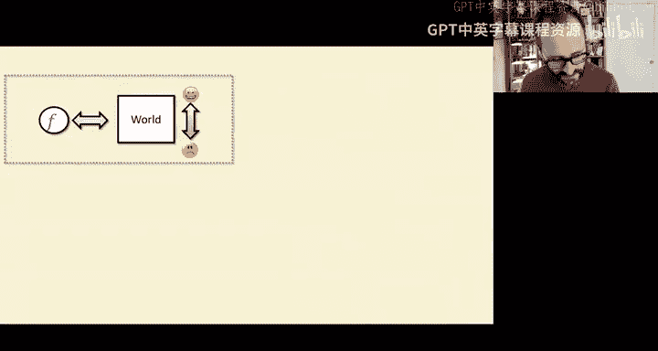

The record button too late I'll remember not to do that later。

 let me just wake up for 30 seconds we you know we talked about。

General introductions and so you didn't miss much and like the blog said I said that you know learning is a system that interacts with the world and deep learning is basically a way。

To translate more resources into better performance and to somehow split the difference between， say。

 optimizing over linear functions， which is very efficient， but leads to true performance。

And optimizing over all possible programs， which。If we could do it。

 it might have led to amazing performance， but we just cannot do it。Okay。

 and then we say the way we do learning is we start with。

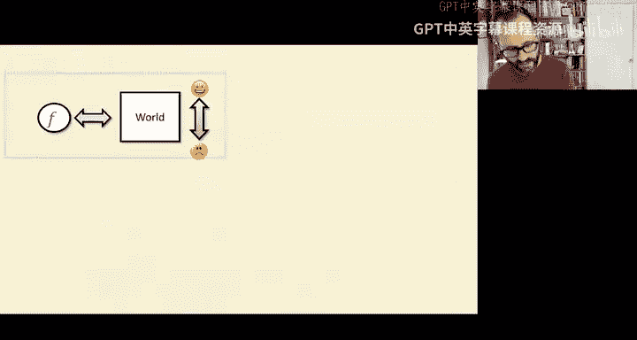

This goal of some find a system that interacts better with the world。

 We move to the more precise goal of a system that gets good score in the benchmark。

 Then we find a way to。

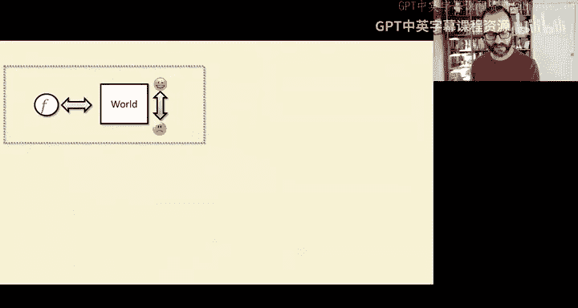

The final loss function such that we believe that F that does better well on the data will succeed on the benchmark。

And then eventually we run some optimization algorithm that given the loss function。

 the data and a cluster of potential functions。

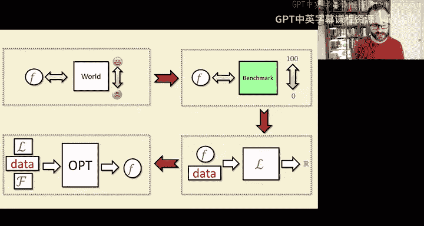

The outputs F that does well with respect to this loss function on this data。

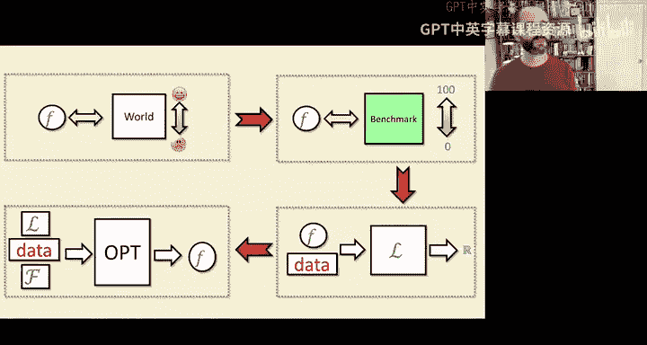

And and these kinds of functions， this is kind of， you can think of it as architectures。😊。

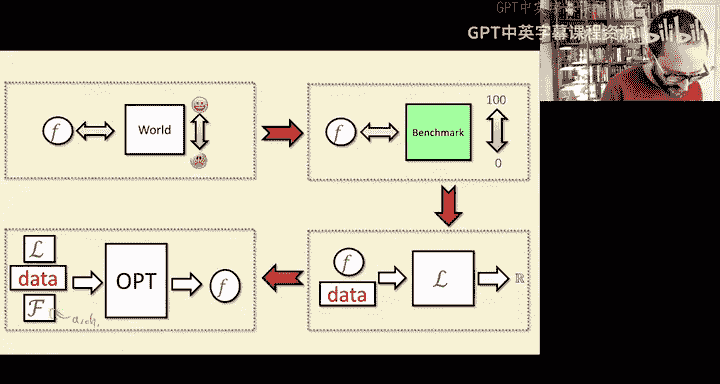

Or you can think of it as the bias of the the bias comes from several aspects。

 but one of them is the choice of class and of course you can throw in regularization as part of this F so maybe it's。

Only ifs that come from some architecture in that。Satifi some a certain name。

Certain regularization constraint。And the way it works in machine learning is that all of those things are kind of leaky abstractions。

So you kind of lose something when you move from the world to the benchmark。

 so typically you test the distribution you test on might not be the distribution the you interact with the world。

 you would want out of distribution performance， you sometimes have domain shift over time。

 sometimes in the world you want properties such as robustness。

 maybe you want properties such as fairness and others that you didn't necessarily optimize for in the benchmark。

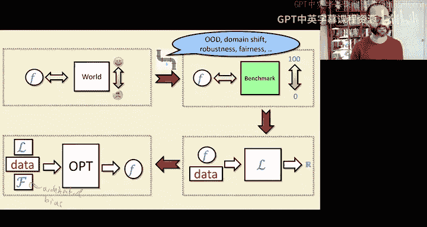

Moving between the benchmark to your data also has a gap if your benchmark is a test set your data is。

A training set， you have this issue of generalization。

 maybe a class that performs really well on the test on the training that it was trained of will actually perform really poorly on the test。

And then， you also。And then you also have this issue of optimization。And then。

And where even if you try to optimize， then you。If you even if you try to optimize you might not be able to optimize and there was a question in the chat a very good question is this only supervised learning so I think a lot of this applies to other domains as well so if you're talking about say。

Reinforcement learning， you， you often have very， very similar situations where you。For example。

 let's say even something like a video game you want the happiness might be success in a。

In a video game， there may there is no gap between the happiness and the benchmark because you can perfectly test。

Whether you're successful in a video game maybe it's less if you're talking about success in with respect to a human。

 but then you will define these reward functions that are kind of proxies for this loss then this is basically this move between the benchmark to this loss function and then you try to optimize so the interaction between F and the world。

Could be also interaction that is say interactive doesn't have to be that the world gives F and X and F gives。

F gives the world F of just a label why。So generally， I think any system that adapts。

 you do have these phases where you start with a more and more for success condition。

 you try to define it。More formally then you define an optimization problem that you try to reduce it to an optimization problem and you basically leak in all of these places。

And this is maybe the main issue with machine learning， both in practice and theory。Akashsh。

 does this answer your question？Yes， it does yeah and people can feel free to both let me recommend that people if you're comfortable with it。

 I would appreciate if you turn on your video just so we can see nodding or raised eyebrows。😊。

And then。And yeah， feel free to you know unmute yourself and ask these kind of questions。

 and I do hope it's going to be a very interactive seminar。😊，So。I should say that， basically if。

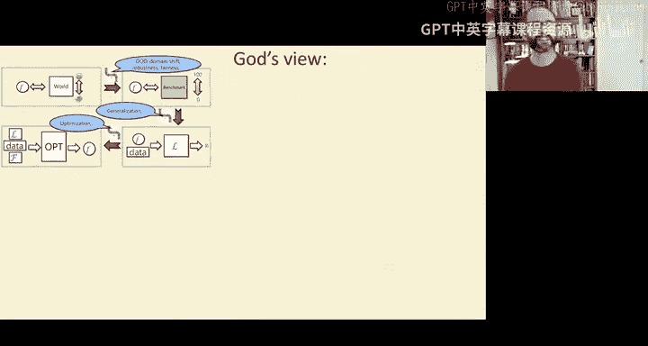

If we were looking from the point of view of God， then let's say God is someone that has infinite power but not necessarily infinite knowledge of the future。

😊，Then God would have a much simpler view。They would know， she would optimize the F。

 the F that brings the most happiness condition on the data that she observed。

Another way to say it is that given the posterior distribution of the world condition on the data。

She would maximize the F that that gives the best。in expectation the posterior distribution gives the best happiness of the interaction between F and the world。

And so for example， for God， like if you have posterior sampling， perfect posterior sampling。

 it reduces to perfect maximization of utility and。

The reason I'm mentioning this is that there is a theme that we will kind of see again and again that often。

We have reductions that if you could do task A perfectly， then you could do task B perfectly。

 but it's not clear that if you could do task A approximately。You could also do task B approximately。

 so all of these leaky pipelines。Are things we have to worry about So yes， for example。

 if you could and。Maybe optimize perfectly then you could sometimes you can prove。

That you would get something that generalizes， but what if you can optimize imperfectly。

 is it still the case？And so on and so forth， so a lot of the time what we are doing in machine learning is we're starting with some kind of a framework that would have worked perfectly cleanly and if we had infinite computation time and all of our components were perfect and now we're trying to understand。

😊，How they compose together when they're imperfect in all sorts of ways。嗯。

But sometimes they would not have even composed together even if they were perfect in them。

We'll see examples like that， as well。Okay， so。This seminar。I want to。

C some so give a collections of research results on the theory of machine learning。

 talk a lot about open questions。Experiments that suggest some intriguing phenomena and generally survey the state of the art research in this area。

Given the current state of the art， there will be， I think， more questions and answers。

But we will talk about some results。And then。And really。

 our goal is to get you to the point where you have both the kind of background and language to read。

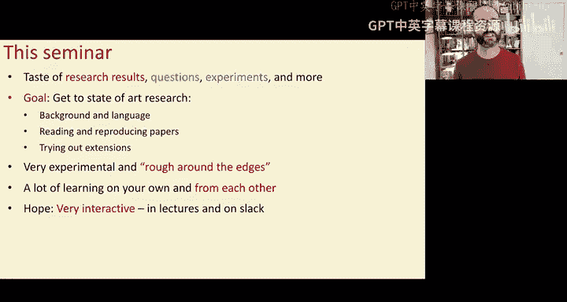

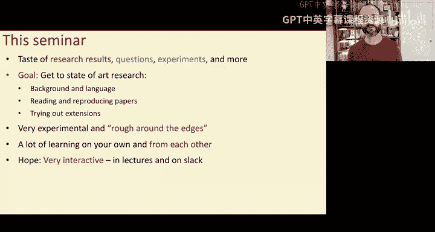

You know， the latest papers， you have the ability。At least the the。The technical。

 the mental ability to reproduce them， even though sometimes you might not have the budget to reproduce the results。

 but you know how you would go about it if you did have the budget。

 you have the possibility to try out certain questions and extensions so you could ask question like okay。

 this paper ask this question X， what about the question X prime。😊。

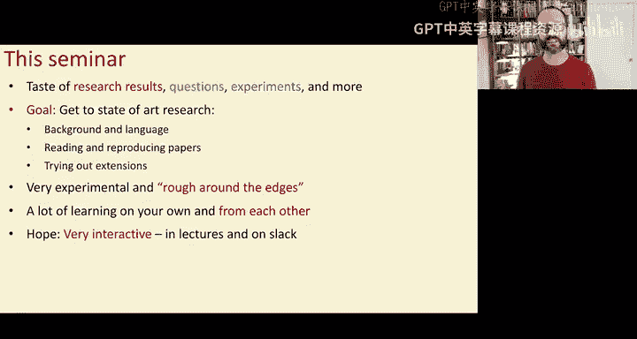

And understand what is known， what is not known， what is trivial， what is。Imposible。And the frankly。

 part of the reason I'm teaching this seminar is that I want myself to go deeper into this literature and understand things that have。

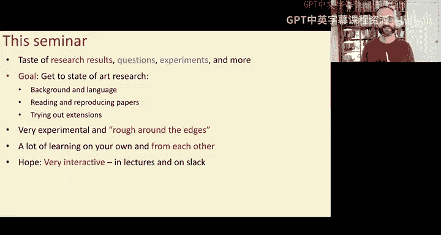

Kind of thing talks about and maybe skimmed in a deeper level so it will be very experimental also for me and a seminar that is going to be very rough around the edges so you know sometimes there are fantastic courses in Harvard and MIT。

where the lecturer has been given this course for 20 years， everything is polished。

 you get your homework graded on time， you get excellent you know excellent feedback every lecture is just like a fully scripted show this class is basically going to be the opposite of that。

So。It's going to be a little bit of a mess， but I hope it's going to be an interesting mess。

And you'll do a lot of your learning from your on and from each other。

 which is why I hope both here and in the Slack， it will be very interactive。And then。Yeah。

 and the relation between the two classes is。Both classes will talk about。

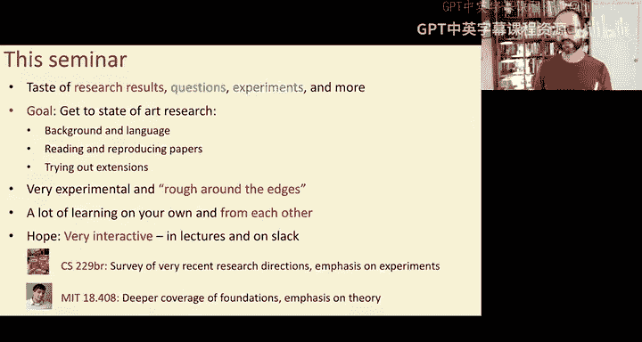

Cutting edge theory of machine learning。This class will have more of an emphasis on experimental results and on insights that we get from。

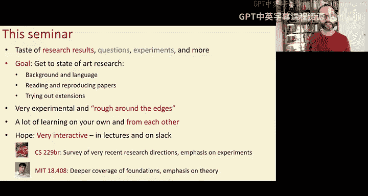

From experiments and questions that are raised me from experiments。And 18。

48 will have deeper coverage of the foundations and maybe more emphasis on theorems。

 but both classes will include you know these class will include some theorems and 18。

48 will include some experiments， so it's not going to be disjoint。

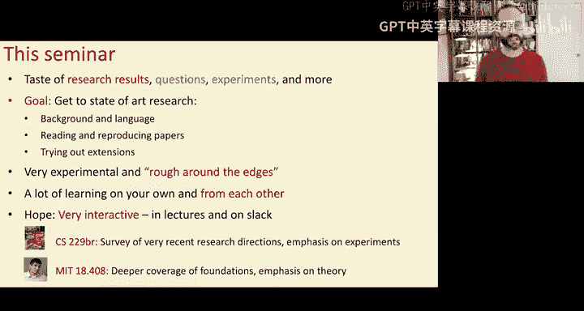

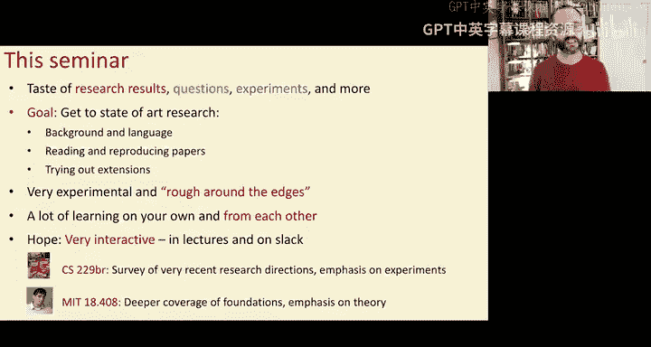

And we will have some。We may have some lectures that are formally shared， but in any case。

Students that are taking one class are very welcome to audit the other and cool is that you agree like there is no issue for people to audit your class right definitely not and also like this class we're going to record the Zoom lectures will make all the materials available to everyone regardless of which you're registered in if any I mean our goal really is expositional as Bo has mentioned I'll be focusing more on the theory it's also something that you know I think is a bit in flux i'll be doing my best to try and present a cohesive view and how this connects to classical learning theory perspectives because I think understanding both you know the way that people used to think about it and what the latest and greatest are is the best way to try and predict what are the exciting new directions to go in so it should be fun。

Yes， yeah and I think it would be a very interesting experience so what do we expect from students that are taking this for credit？

😊。

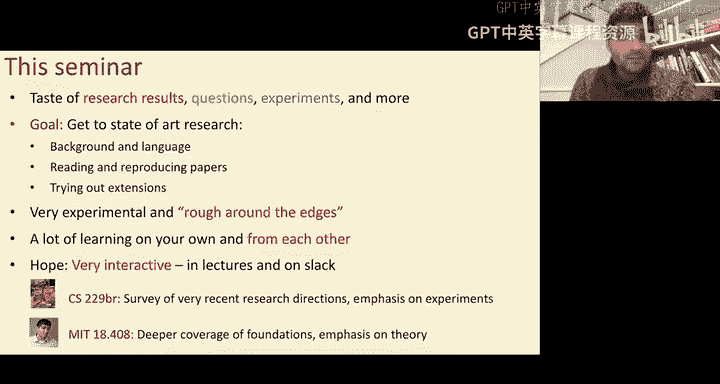

So none of the expectations I think are certain in stone。

 but this is basically what we expect we' will ask you like I did before this lecture to do some preread before the lecture we might ask you to do scribe notes there are enough students that。

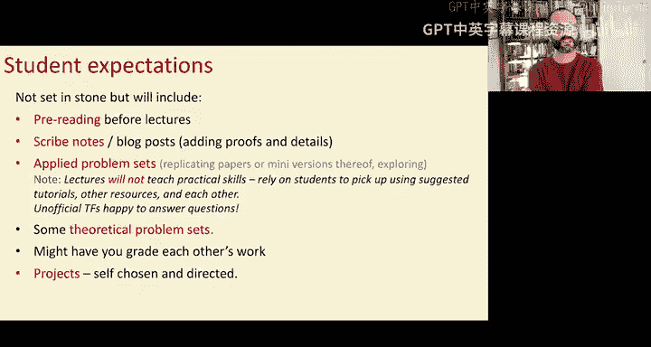

ItIt will probably be like a group of students for one lecture there would be some applied problem sets probably our。

In this course， I think it will be probably one around every two weeks and we might also have some theoretical problem sets now notice that。

Unlike in a typical class where the problem sets ask you to do things that basically the lecture taught you how to do in this course。

 the applied problem sets will I'm not going to teach you how to use Pytorch or anything like that。

 so we will rely on you。Picking up these skills and helping each other and we will have you know links to tutorials and then the TFs。

Official and unofficial ones are happy to answer your questions。

 but it will definitely involve some amount of self directness depending on your background。

To do these problem sets and similarly with the theoretical problem sets。

And we see if we still are remaining with only one official TF。

 we might have you grade each other's work， we'll see how that works out。😊。

And we will I really hope to have projects in this course that's。

 I think maybe the most important part of a research seminar like that and we'll discuss it maybe towards later in the semester and that those will be。

Topics of your choice and really directed by you and projects will be in groups。

Or it's optional unless someone really wants to do something on their own。And yes。

 homework your part of it is already on Slack， the other part will come there soon and with grading I still don't know。

😊，え。Yes， we haven't figured out that loss function yet。

 I hope this is not what you're trying to optimize。 someone asked in the。

What's the time commitment expected， it's really hard for me to answer。

Partially because I don't really know。Exactly what will the length for you will see homework zero。

 I think I'm not completely sure the length for each homework and project and partly because a lot of it is up to you in two ways。

 first of all， it depends。😊。

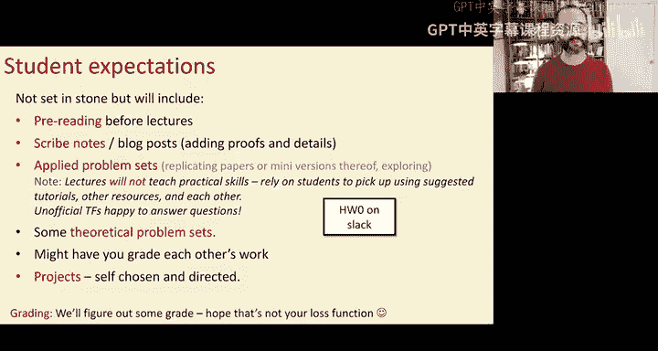

On how much experience you had looked for some people。You know， doing training， et cetera。

 This is something that you know， they do every day。

 maybe these homework will be very quick for them for other people。

 this may to create require more work， but actually I think they。😊。

That also means that it contributes more it's actually more important for you to do these homeworks because you learn more from it then and you get a valuable skill and with projects you know what you put in is what you get out of it so its you might decide to invest many。

 many hours in the project because you really like it and the grade is the least important part of it you maybe I hope that some projects could turn into papers so。

😊，So it's very hard for me to say what's the time commitment that is expected。 this whole thing。

 there is a lot of。Unknown uncertainty。So any other questions okay。

 so how theoretical the course is going to be the papers will are going to be right。😊。

So I think a lot of the papers are not going to be。😡，We are not going to read papers that talk about。

Here is a state of the art technique for achieving something。

Most of the papers we are going to read are going to be papers that say。

Here is some insight on a theoretical questions sometimes the paper could be a very good technique because it is theoretically interesting so for example。

The Sclair paper happens to I think give the state of the art a technique for maybe self supervised learning for images。

 but I think this is interesting it's theoretically interesting so that's the reason。😊。

We might talk about it， but not because it gives state of the art technique and I'm not even sure it gives state of the technique probably by the time probably by now there has been better papers so the point would be more insights than state of art。

So I'm not sure if that kind of answers the question and some papers will be very mathematical there would be mathematical theorem some paper will say。

 okay， here are some cool experiments and。😊，That either suggest a question or。Suggeesting an answer。

Yeah， I think maybe one of the things to keep in mind is that you know。

 even when we cover theory things， it's a little bit different than， you know。

 if you're taking like an advanced algorithms course where really the techniques build on each other and it's very clear you know what new algorithmic tools you have in your toolkit。

You know when it comes to the theory of deep learning。

 there are all kinds of contributions that are out there because even trying to articulate experimental phenomenon is about choosing the right。

 you know mathematical， statistical algorithmic definitions。

 critiquing other ones to try and understand why they're not the right thing then you know sometimes it's about finding toy models that capture much more complicated phenomenon。

 I'd say that in the lectures that I'm going to do the most technically involved things will be you know when it comes to trying to understand what gradient descent does on different settings。

 then you we will draw on a lot of optimization and statistical techniques。

 just to be able to understand you know some basic building blocks of those theorems。

But my emphasis isn't going to be on doing the latest and greatest， it'll be on you know。

 are there simpler versions of the theorems that have appeared in the literature that give you a bit more broader insight？

你死。So yeah， so let's maybe， so for the rest of today's lecture。

 I'll try to kind of bleitz through classical learning theory。😊。

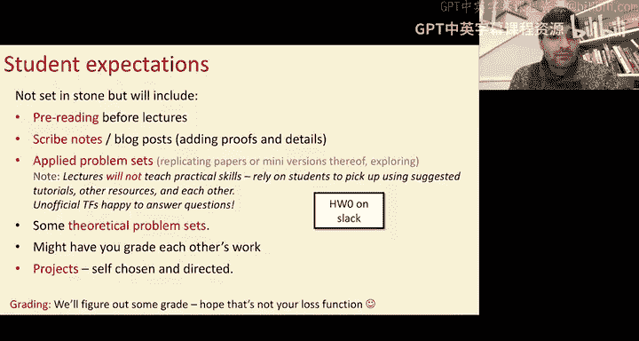

And we'll do some proofs by pictures， special cases。

 maybe some of these will be maybe very familiar to some of you some of these might not be so I think there is very。

 very。😊，People in this class have very， very different backgrounds and stress。

 so I'm guessing some of it will be boring so some people some of it might be new to others。

like I mentioned in the onlack， I really recommend this upcoming book by H and Weckton。😊。

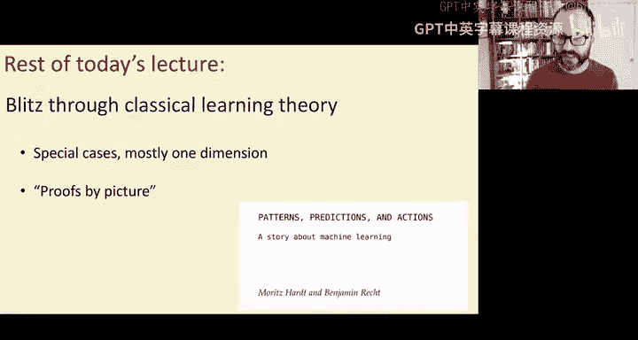

Which maybe as we go along， we'll post more parts of it。

And I'm not exactly following their exposition， but。

It's really useful if anything is unclear when you can go and see there and get more and there are also other books I think an excellent book on learning theories understanding。

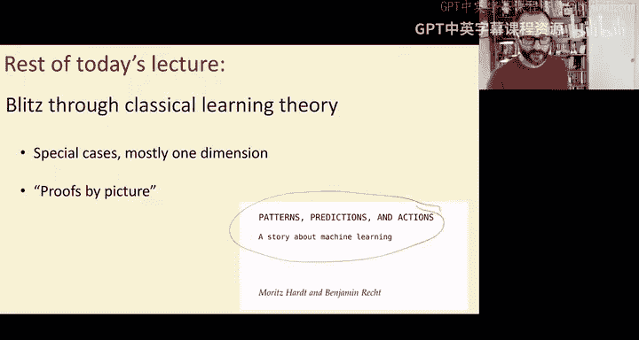

ML by Shai Sheib Schvatz and Shaib B David。And。I'm not sure if I'mco。

 do you want any other book youd recommend？Those are the two main ones。Okay， yes， so yeah。

 so let let's go quickly for classical learning theory before we go to deep learning and at some point we'll break we'll see if people start getting very tired and I haven't got to a break yet and just let me know in the chat and you'll probably need to ask questions to slow me down otherwise we might finish a classical learning theory in 15 minutes and we have not learned anything。

😊。

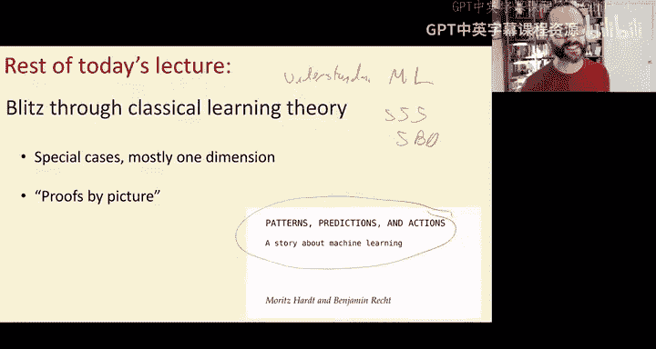

Okay， so let's start with。Convexity and optimization。 Okay。

 so a function is convex If one way to define it is the line and we'll talk about。

Uivariate function functions on one dimension， but these things extend to multi dimension so one version one one definition of complexity is that the line between。

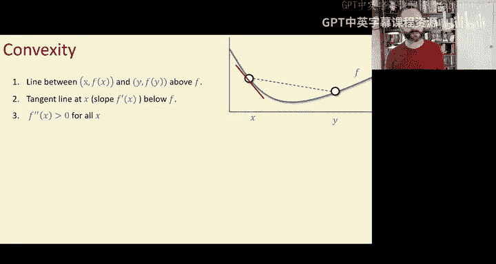

F of x and f of y is above the line is above the function another definition is that the tangent line which has the slope。

 the derivative of x is below the function and the third definition is that the second derivative of F is positive for all x so now just two comments。

First of all， I will typically assume that functions have you continuous first derivative second derivative whatever you need them to have if it's nice。

 let's assume that they have it second I'm not going to distinguish this point between strong convexity and convexity so are we talking about strictly above or strictly positive or non- negative。

 let's assume strong convexity for now but。😊，Kind of put this issue put it under the rug。

And one way to say， for example， the two， all of these things are equivalent， for example。

 how to prove that two implies three， so let's do the con positive。😊。

So I want to say that if the second derivative is negative and again you see I don't really distinguish between greater or equal or greater。

 so if the second derivative is negative， then the tangent line at x。😊。

I claim that it is actually above。😡，F and why why is that the case so we do the tail of approximation。

 so F at x plus delta is going to be。诶。F of x plus delta prime f of x。

Plus deelta squared F double prime x plus something that if delta is small enough。

 it's negligible right so we can ignore this because if delta is small enough， this is the line。

Sorry， is your sign off？Ifで sorry。If the。If the second derivative， okay。

 so have want to say it if the second derivative is negative。Did I get it off。え。I have to draw this。

 So， so what does it mean that the the tangent line， the second derivative is is negative。

 Then it means the something like this， right？ And then the tangent line。Yes。

 the the tangent line is above right。 Yes， no， I think the sign is not of。Right so this is the line。

 this is the tangent line， the fx plus the delta x because this is negative。😊。

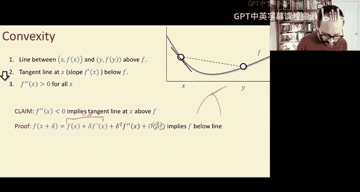

Then F itself will be below the line。😡，I think it's correct。

 You're just proving the converse statement to the one you had on the list。 That's all。 Yes， yes。

 I I'm improvingrov the converse statement， right， so if the the second derivative Okay。

 the tangent line is above。

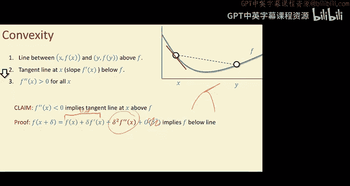

I above F。Okay。😊，Yes， so that proves the two implies free。😊，And again。

 we use the taillor approximation， which will of course use use later in the course and as we mentioned later you know you sometimes you move from this to。

😊，knowThe delta becomes a vector， so youll do something likeelta delta transpose the gradient delta and this becomes a hesian。

And。That'sYes， so the tail of approximation becomes， you change to gradients and Hatsians。

And Hassians and yeah， another thing is say if F is above the line then must exist Z with tangangan line above F and we kind of do a proof by picture if at some point you go over the line。

😊，And then you know you're going to have to come back to below it because you end up so so if you just focus on。

So if you just focus on this part， say you just look at the part of F。

Above the line you subtract the line from F then you know you're going to go above this line and below so at some point the time is going to have to be above F so this where you can prove all of these equivalents and some of them are kind of useful。

And now let's talk about gradient descent。So gradient descent you start at any given point Xt。

 you adjust you're trying to minimize F so you go in the direction opposite to the gradient。

 so you subtract Eta times f prime Xt to go to xt plus1 right。So if here the gradient is negative。

 then you add the positive quantities so you move to the right。

 if the gradient would have been say like at this point the gradient would be positive。

 then you would move to the left。And。How do you analyze that。

 then again we use the tail approximation， we know that f of xt plus delta is roughly f of xt plus delta times f prime of xt and delta squared over to FW prime。

So that means that if we plug in right so we know in this case deelta is at a times f prime。

 so if we pair at x。So if we plug in this delta， then。We get this equation。

 which means that collecting terms。What we see is that the new value will be the old value。minus。

This quantity。So notice that you know Eta will be a positive number square is always positive。

 so this is minus。This is a positive quantity and this will be positive as long as this value is between0 and this value is between0 and 1。

Right， so we want this value to be between zero and1。 and then we are making progress。

 So as long as you know， we want this value to be。So F double prime。XT is positive。

 right we assume let's assume we are doing convex optimization， so this is a convex function。

So what we want。Is that Eta would be for us to make progress we want Eta to be smaller than something like you know some constant over the second derivative and if it's roughly constant by times the second derivative then we drop by Eta times the first derivative square so we want Eta to be not too big so we actually make progress and don't go the other direction and so we want this quantity to stay positive so we want ET to be not too big and condition that it's not being too big。

 the bigger it is the more progress we make。

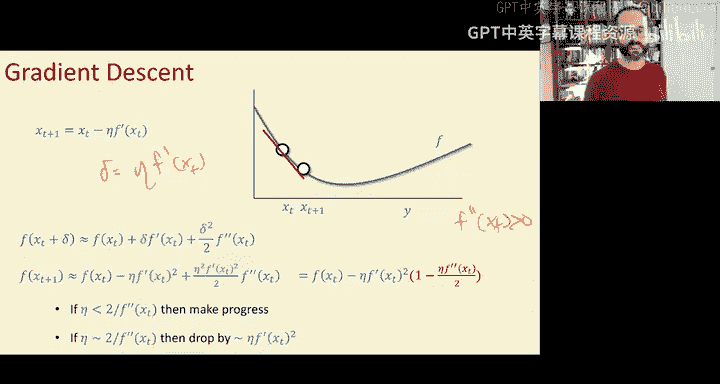

And when we move to a higher dimension。Then you know derivatives becomes gradients。

 second derivatives becomes Hasians， this is kind of the matrix of partial derivatives and for the two conditions you have to look at the two extreme eigenvalue so you need a。

😊。

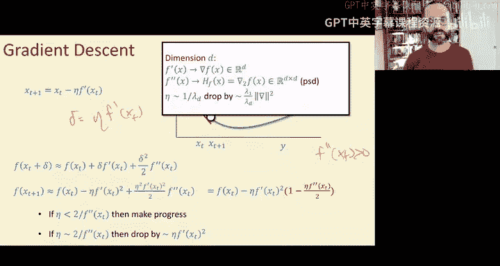

You need Eta to be。Smallest， smaller than the you need E to be smaller than one of the the largest eggenvalue。

 And what you you win is something like the smallest eggenvalue。 So you win something like。

You win something like the condition number of the。

You win corresponding to the condition number of this matrix。

 which is the ratio between its biggest and smallest。Eganvalue and this is all very fuzzy。

 but I'm sure A will actually show these things with more mathematical detail。😊。

So what is stochastic gradient descent？In stochastic gradient descent。

 instead of updating by at a times F prime， we update by some estimator。F I hot。

So what is this estimator， so this is some random variable。That its expectation is F prime Xt。

 so it is an unbiased estimator and its variance is something。Let's us just call it sigma squared。

So instead of updating by moving along the direction of the gradient we are update along this estimate。

 so now let's just kind of heuristically try to imagine what will happen let's just suppose。

That the estimator you obtain by taking F prime x plus an independent。

Independent normal variable of mean zero and vary sigma squared。

The normal is not really the assumption， the assumption is the independence。

 but let's just assume this to get a sense of what we' expect to happen。So yeah。

 so we're going to assume that n as mean zero variance sigma squared and that it is independent。

So in this case， using the same tailor approximation。Now， what we'll see is the following。

 we now Delta。Right， so now Delta is。Eta of F prime X plus N。

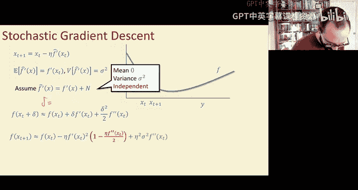

And now。If we look at in expectation， what happens when we plug in this delta？

Then whenever we have n by itself， it has mean zero， so that cancels out in the expectation。

 this is mean zero。And all of those are independent， so it's not going to cause us any issue。Whenby。

When we have a square， when we have an n squared， we are going to get a contribution of sigma squared。

So basically what will happen is that we're going to get this extra contribution。

Of Eta squared sigma squared F double prime of X T。So we get the same thing that we got before。

This is what we get from the same thing that we got before in normal grading December set。

 but we get also this extra term。And notice that this extra term is bad for us's it's a positive term we were trying to make F of xt smaller this extra term is positive so this is kind of a bad term for uss it's not a term we like but。

But as long as you， we can make it small enough。Then we can make progress and notice that say in the beginning。

 when the gradient is large， you can afford the Eta to be bigger。

And as you get closer and closer the maximum to the optimal point and the gradient becomes smaller。

 then you really need Eta to become smaller。So and this is indeed what really happens with SGD so this is just kind of an intuition why you'd expect this kind of behavior。

RightAnd again， you drop as long as you satisfy this condition。

 then you will drop by a similar amount of gradient descent。Yeah in machine learning。

 the particular estimate that we use is the following so typically the function we are trying to optimize is some loss function。

😊，Which is an average of LIs where L is the loss associated with some sample I。

And the estimator we obtain is by simply picking one of those eyes at random and using the loss for that sample。

 or sometimes in mini batch we pick a。

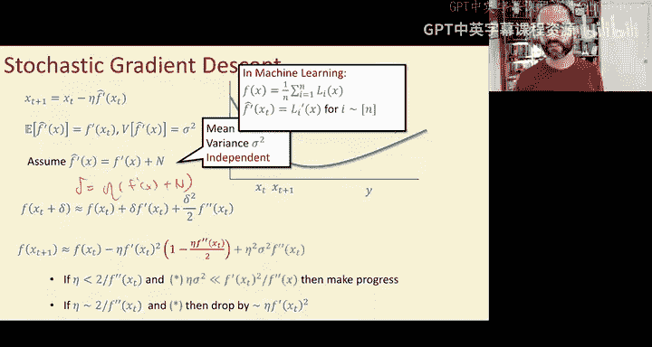

A collection of these samples at random and use that。And use that。As our， as our estimator。

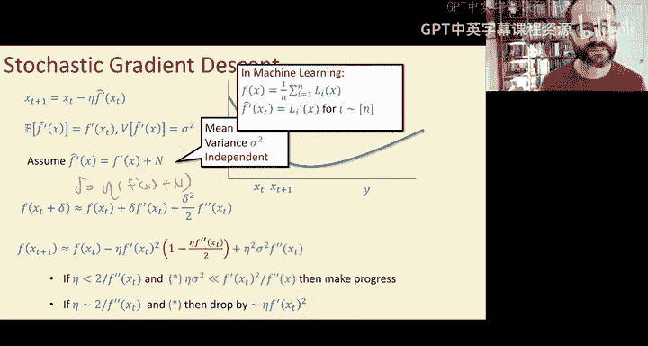

So this is just Portugue kind of intuition， but are there any questions about this？

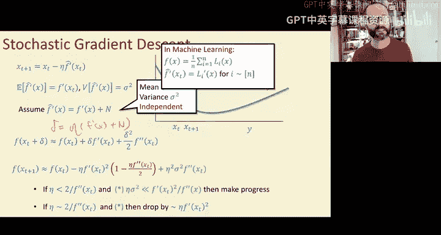

可以搜于。No questions thats move from optimization to generalization。

Do the noise ever depend on the parameters。I mean， I think the actual noise of in stochastic graded descent。

 the distribution of it is， I don't think fully understood。

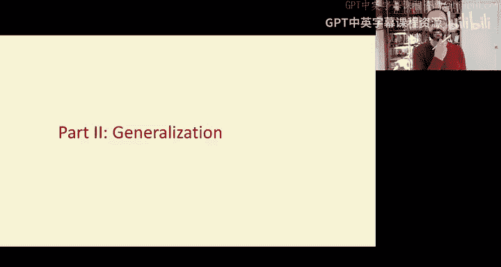

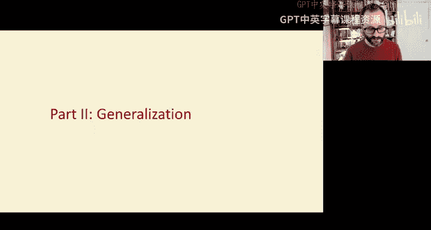

And also it's standard deviationvation， I'm not sure if it's completely。

If it's completely understood。So I'm not sure which parameters you're discussing。

 but definitely the the noise could change the distribution of the noise so what does mean X Y。

 the the sample X T， Yes， the distribution of the noise can change over time。

 I think in stochastic gradient and decent because the。And yeah。

 the distribution of the noise can can change can change with time and actually analyzing the。

The trajectory is the dynamics of SGDR is。Fairly detailed and Aku will talk a lot about it。Yeah。

 so just to say a little bit more， I mean， a lot of times there are different models that we assume as toy models that you know hope to give some insights about what SGD is doing。

 but the real thing， the noise is actually dependent across iterations so that makes things very complicated because usually you know the noise might have to do with which particular example you're plugging into your loss function。

When you really care about the loss function over your entire set of examples， so there's dependency。

 it's not Gaussian。And also the thing that we're usually trying to optimize is non convex。

 so you know， in the convex setting， the noise hurts you because it's pushing you away from the optimum。

For non convex things， the noise can actually help you in different ways because you can escape bad local minimum。

 so there's sort of sort of hierarchy of different ways that people study these things。Yes。

 this is very much a very toy model just to give a very documentation of what's going on。

 but this is not。😊，Will SGD， like the notion of SGD is not really gradient de with independent Gaussian noise if it was our life would be much easier。

Okay， yes， very。 good。 Thank you， Nari for asking。 Yes。 So generally any estimator right。

 whenever you have an estimator。 So if you estimate。😊，The quantity F prime of x。

 then you can write the estimator。 You can always write the estimator as a。

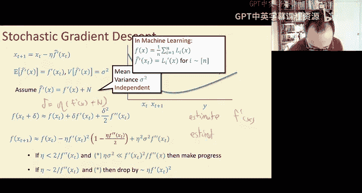

F of x equals F hat prime of x equals F prime of x plus n， where n is simply the random variable。

 which is defined to be the difference between the estimator and the original thing。

 So n is a random variable。What I assumed here was that well。

 this random variable has mean zero and that's。By definition of an unbiased estimator。

 I assume that the standard deviation is always the same always a sigma that's an assumption maybe not a very strong one because if it was always bounded by sigma it would be also fine。

 I assumed very strongly that assumed that these things are independent which is very helpful that's an assumption that's not true and I guess I didn't really use the normality I just used that expectation of n squared is。

😊，That the expectation of n squared is。Is zero here and not really the normality。Okay。

So now generalization， so now let's talk about supervised learning。😊。

Focus on the binary classification case， although I think most of I said what I say will have。

Just work as ease for multiclass。

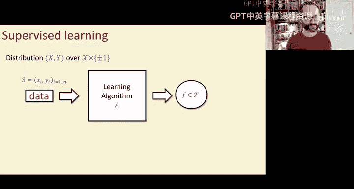

So in supervised learning。There is a certain distribution over Xy over x and labels。

 let's say the labels are plus or minus1。A learning algorithm gets a training set， X I。

Y I and samples， we will typically use little n for the number of samples。And produces a classifier。

And the population loss， this is really in supervised learning what to be typically trying to minimize。

😊。

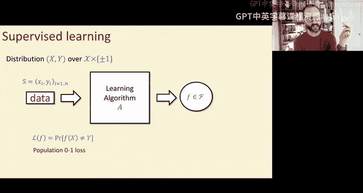

Is the expected loss over the entire distribution X Y。

 or the probability that you make a mistake that f of x is different from y。

Over this distribution and the empirical loss is the error over the training set。

 the fraction of training samples on which you make a mistake。

So empirical risk minimization is a particular learning algorithm。😊。

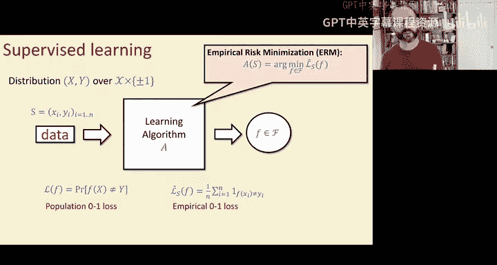

That minimizes the empirical loss over the training set。

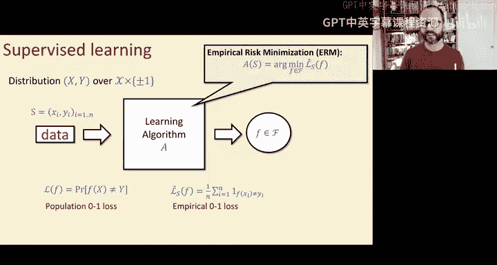

And sometimes we use different loss function， not necessarily the zero1 loss。

 but empirical risk minimization is one that minimizes the loss。Typically in machine learning。

 what we do is pretend we're running empirical risk minimization。

 although we don't really know how to optimize it exactly so because it's often nonconvexs。

So we run some optimization procedure that we hope does something like the ERM。

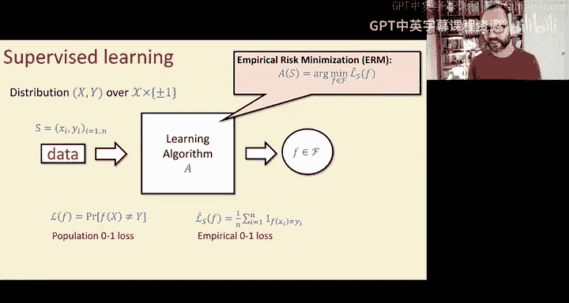

But let's look at the EM specifically and the generalization gap of any learning algorithm is。😊。

The generals go of a particular classifier if。😊，Is the。

Difference between its performance on its loss on on the actual population and its loss on the training set。

 maybe you should we should put an absolute value here。

 but typically the loss would be bigger on typically the loss would be bigger on the。

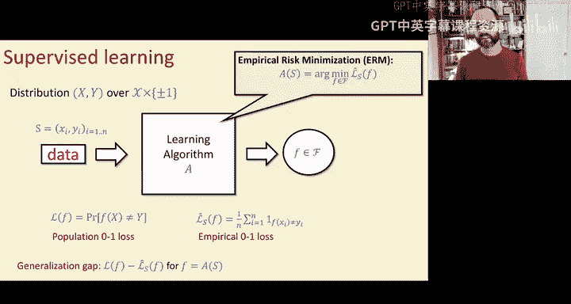

On the population that it is on the training set， the training set loss sometimes is zero。

 so typically we can think of it also without the absolute value and for an algorithm that would be you know the expected value of this quantity for the F that this algorithm produces where the expectation is taken。

Over the training set and over the randomness that the algorithm uses， if any。Okay。

So a classical notion in。😊，A classical notion in classical learning theory is the notion known as the bias variance trade of。

so。Best trade of one way to think about is the following。

 Let's suppose we have a hierarchy an ever growing hierarchy of。Classes of classifiers。

 So F 1 contains one1 classifier。 F2 contains F1 and additional F 2， F 3 contains F 1， F2， F 3。

 So we have an ever bigger and bigger， bigger set of potential classifiers。And for every classifier。

 so for every classifier， if we look at。😊，It's an empirical loss。So empirical loss。

 we can think of it as an estimator for the population loss。

 so just for every particular classifier if we pick N random training examples at random。

Then the loss of F， the empirical loss of F is a random variable。That has bias。

 which is the has expectation， which is the population loss。

 so the this term is known as the bias so。So if we take a classifier F。

 so just make sure that we are on the same page， so we have some F。And we pick at random X 1。

 y 1 till X， and， Y， N。Then the empirical loss。Of a F。

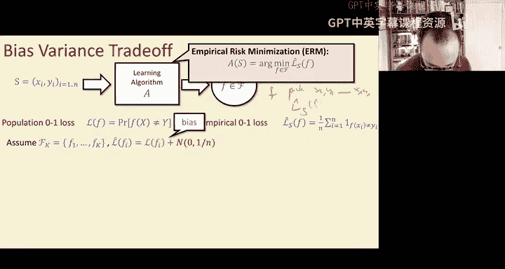

Is a random variable。 This is a random variable over the choice of S。

 and the expectation of that is the is the loss of F。

And let us if the loss is bounded by at most one， then we can show that the standard deviation of this estimator is at most one over square to n。

 and now let's just make this assumption which is not exactly accurate that the losses are say independent Garsians with mean zero。

 the difference， the difference between the population and empirical loss for any fixed classifier is。

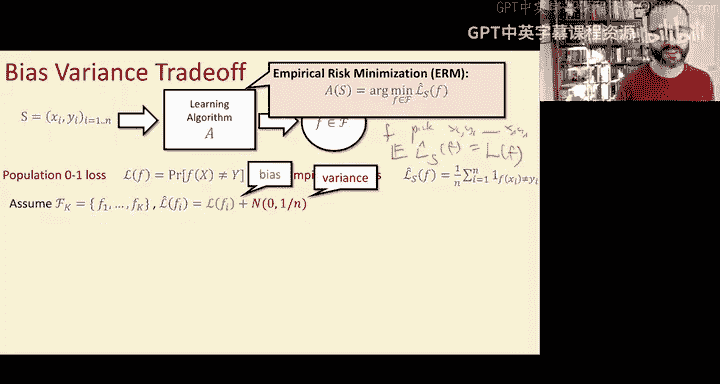

An independent Gaussian with mean zero and the standard deviation one over growth end。Now。

 if that was the case， then now let's try to think what happens if we do empirical risk minimization on the class FK and we let K grow。

So we look at maybe the best thing on the training set among the class F1。

 and then we look at the best thing on the training set among the class F2 and so on and so forth。So。

你诶。If you look at the maximum。At the maximum variance。 So the maximum。

The maximum of the variance term。Then that will grow if you have ke dependent Gaussians。

Each of standard deviation one over scrolled n， then you expect the maximum number of them to be roughly scrolled lo over n so basically the variance terms grow as you increase the number of the size the function family so as you increase size of the of the number of models you're considering。

It's more and more likely that you'll see there some models where there is a big difference between。

the performance in the population and their performance on the training set， just because。

 you know you sample many， many Gaussians， some of them will turn out to be very big or very small。

And if you look at the performance， then that really depends on the data， but generally speaking。

 youd think that you could get better and better performance。😊。

Over your population as you allow yourself a richer and richer family of models。

 definitely you don't get worse， you allow yourself more models。

 the models so this curve is basically this is curved is like the maximum of the variance term。😊。

And this curve is the minimum。Of the biot。So this is basically so this green curve is basically the performance。

😊，Of the best estimator， the， the best classifier in the class F sub K。

And the red curve is the the maximum difference between the true estimate the true bias and the。

And the two population loss。And the empirical loss for any estimator for any classifier in this class。

And generally。Right， so he Jimmy is asking question。 So yes， K is not the number。 Okay。

 so this is important。 N is the number of samples。And this is fixed here， it doesn't change k。

 you can think of it as it's the number of models， or you can think of log k as the number of parameters in the model。

So in this graph， k is the number of models that we are considering。And in the end。

 the number of samples is fixed， so you write that variance shrinks with the number of samples。

But the maximum variance grows with the number of models。 Does this clarify it。Right。

 so so in this graph， the green curve is the performance。Over the actual population。

 the actual distribution X Y of the best classifier in this class， and the bigger the class。

 the better the performance。😊，The red curve is the deviation between the performance on the population and the performance。

 the maximum deviation between the performance。Of the。

The performance of a classifier on the population and empirical performance on the training set。

And the bigger the class， the bigger the red curve。And basically， once the curve becomes very large。

 then in some sense， yes， you have excellent you have excellent。

You have excellent classifiers in this class， but maybe you will not find them because you will there would be some mediocre classifier in the class that just because of。

Randomness issues manage to do very well on the training set。Yes， yes。

 so and there was a question and answer and yes thank you for Yameni for answering the question and please feel free people to also answer questions and ask and answer questions on the chat。

😊，So basically， if you look at this curve， you kind of imagine that it would be kind of a sweet spot。

Well basically the model is not so big that you just get great performance on the training set。

 but just because you have so many models that you can fit the training set。

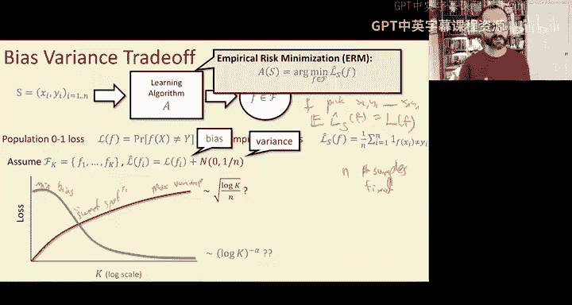

But it's not so small that you would get poor performance even on the。

On the on the population and then。Well we made this assumption and this is actually known as the。

 this is a classical thing， it's known as the bias variance Stroff and in every book on classical learning theory。

 you would see these kind of curve， which basically says you want to choose new models so that they're not underfitting so theyre sufficiently good so they actually can get performance on the population。

😊，But they are not overfitting， so they don't have such big capacity so that they can perfectly fit the the training set but do terrible。

On the on the actual。P。And and。And this is actually yes， and in fact。

 while we made this assumption that these are independent Gaussians， you can actually see that。😊，诶。

Yes yeah and Pif ask a question F1 and FK here it's very abstract so you can think of ordering your models by complexity and F1 till FK are the K models in your family of least complexity or you can think of them as as varying so at this point this discussion is very very abstract it asks for any model it talks about any model family。

 but when you want to。😊。

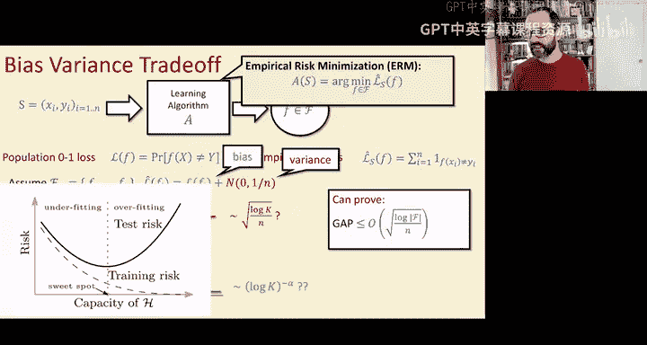

Yeah， and Jimmy raising the point isn't usually infinite， yes， it usually is。

 but usually you can discretize。😊，So so we are also putting this kind of under the rug but we'll bring these things out from under the rug in just a slide two so just just to add to that so even if you consider K to be infinite it's really about the description complexity of you know which class which model you're outputting so even if you have something like you know a single separating hyperplane and D dimensions then it's still an infinite class because therere infinitely many directions you can point in。

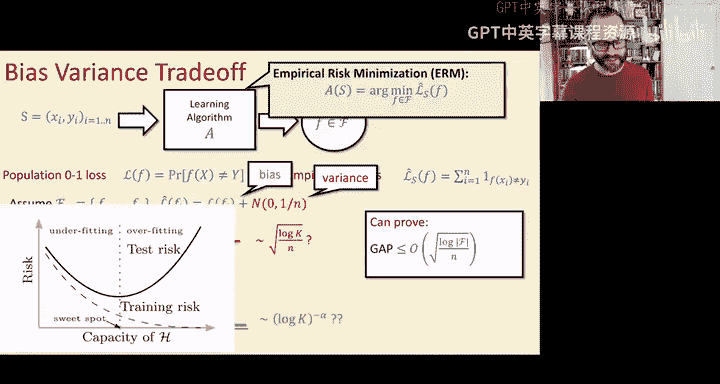

But once you have a finite amount of data， then you can describe which of those hypotheses you care about。

 using a finite number of bits， for example。Yes。😊，So we can actually prove that the generalization gap。

 so this variance stem， which I said for if there were independent normals。

 it would grow something like log the size of the function family divided by n， the growth of that。

 we can actually prove that this is true in general for every function family。😊。

So we can prove the following CRM that with high probability over a training set of N independent samples。

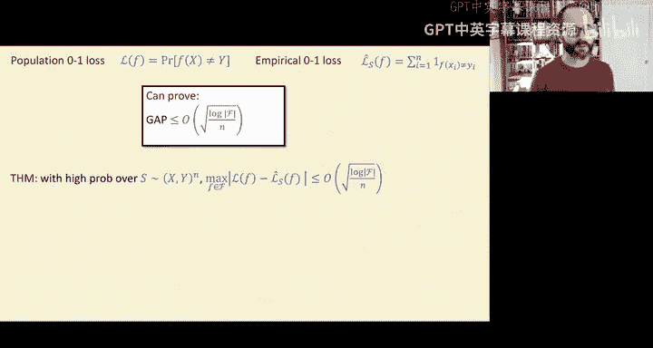

The maximum over F。From the function family F， the maximum gap between the population and empirical loss will be at most constant times the square root of log the size of the function family divide by n so let's just do this proof just so as a warm up we want to have at least some proof in this。

😊，Lecture。So how do you prove this thing， So you say you use the followinglemma so for every fixed F。

If we just look at the probability over the sample set， the deviation in F。

 the probability that this will deviate more than k over squared n will be smaller than something exponential minus some constant times k squared。

And let me give you like the intuition， if you have not seen this before。

 is this basically follows from results that are known in different communities under different names。

 you can call it central limit CRm， you can call it channel， you can call it hofing。

 you can probably call it like five different names， but generally the point is the following。😊。

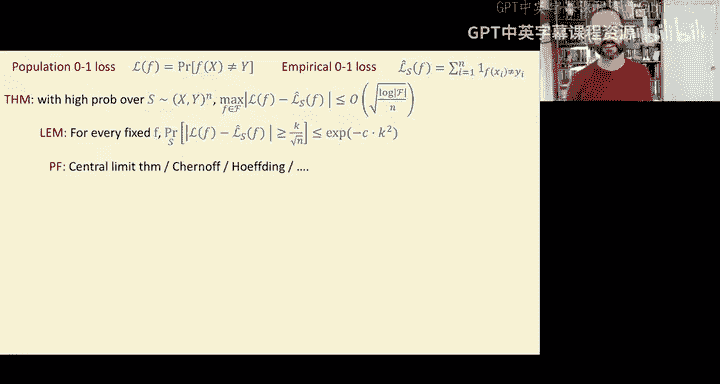

If you estimate， if you fix F。And you're now trying to estimate the loss by sampling n samples。

 then the distribution of the empirical loss is going to look like a bell curve and it's going to have the normal distribution and the standard deviation because you have the n samples will be something like one over Sced n。

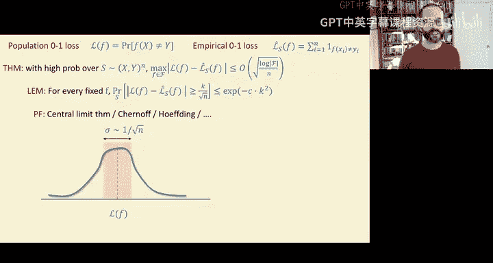

This is assuming this loss is bounded。You， it's always at most some constant like the zero1 law。

 so this but this is really true for any bounded loss。So it's going to be a random variable。

 which is the normally distributed with standard deviation something like one over a squared。

 and so basically if you go， the probability that you deviate by more than K standard deviation drops like e to the minus k squared。

😊，So that proves dilemma and then to prove the CRM you just set k to be something like large constant times scroll log f divided by c and then you can do a union bound right so then this probability becomes smaller than one over the you know or maybe 0。

01 divide by the size of F so you can do a union bound so if for every particular f，😊，In the family。

 the probability that you deviate by more than that match is less than 0。

01 divided by the size of F then you can do a union bound and prove that for every function in this family。

 the deviation will be at most this much。

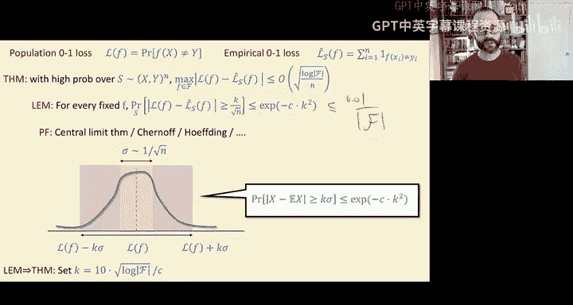

Okay so this basically gives us maybe the most basic generalization bound that the generalization gap if you have any class of models and it doesn't really matter what it is then the generalization gap is never more than square root of the log of the size of the class divided by n and the main thing is the square root is not so important。

 it's important for in some cases but it is not important here the main thing you want to look at it is that's basically。

😊，If n goes to infinity， this goes to zero。 So if you have a fixed size。A fixed collection of models。

And you increase the number of samples， then eventually the generalization gap will go to zero。And。

Unfortunately， in modern situations， typically the families we consider grow with the data and actually grow quite a lot with the data。

 but at least this is still important to know。😊。

So诶。

Before we go on are there any questions about this slide？

What are cases this is a great question what are cases where this bound is tight or vacuums so there many。

 many cases where this bound these vacuums indeed if you look naively when F is infinite then there bound is vacuums。

😊，If you were to look at say random functions， if your classifiers were kind of completely random。

 then this bound would be tight generally speaking if the。If for different Fs。

 you expect the deviation to basically be independent of each other， then this bound would be tight。

And when， when they。But when the class family has a lot of structure and a lot of Fs are kind of similar to each other。

 then you'd expect this bound to be very far from right。And。

And this also relates to all this theory of Gaussian processes and where you look at the maximum of a collection of correlated random variables。

 ettera。😊，で。The state case is when they' are all independent。And are low bounds if yes。

 if we impose more structure。So if they are alone let me talk a little bit about generalization the bounds that use more structure。

 so maybe that will answer your question so but generally we said okay for any class we can prove this kind of gap。

😊，But sometimes it's vac， maybe often it's vac actually。

 so basically there are a lot of generalization bounds。But basically。

 we place log F with another term。In that term， you can think of it as the dimensionality or capacity of F。

 you can kind of heuristically think of it as something related to the effective number of parameters of F。

😊。

A lot of the time when you have。Some natural model family that log F chrom corresponds to the number of parameters that it uses so there are some many bounds of this notion and I'm not going to go。

And I think in As in 1848， there will be some proofs of some of these bounds and some of them appear in the books that I mentioned。

 so one classical bound is the V dimension。Where you replace instead of log F。

So instead of for log F， you use this the following quantity， the maximum D such that you can。

For any for any D samples and the labels on these samples。

 you can find a model you can find so what does it mean fit you， you can find some F in F。Such that。

F of X I equal by I so this is known as the shattering dimension so you can replace so this is a quantity that can be finite even for for functions for families that have infinite and number of functions and basically if the VC dimension of a class is D you can put a D instead of。

So you can put a D instead of log F here and the bound still works。

Another notion that can sometimes prove better bound than V dimension is rather macro complexity and of it's kind of an average case version of VC so rather than asking about so this is with respect to a particular probability distribution and rather than asking。

😊，For the maximum D that you can fit every possible set of labels， you ask。

 what's the maximum D that you can fit random labels on random inputs that come from your distribution？

And roughly speaking， this is all this slide is kind of。😊，An intuitive rough slide。

 this is not precise statements， but roughly speaking if you have a boundary on the radar mark complexity。

 then you can again you can plug it in here， you get something like all of the over scrowing。😊。

And then there is another bound， which is PA Bay， it has all sorts of technical conditions。😊。

But roughly speaking， now you put D as the mutual information between the training set and the classifier you finally output。

So just to get kind of an intuitive sense。If you could describe the classifier that you output using DBs。

Then there is at most d bits of information that it contains about the training set。

 so the PAb kind of generalize it and says as long as the most D bits of information in the classifier with respect to the training set。

 then again you could plug in this bound and get another bound of the form scroll D over N。😊。

And then there are all sorts of margin bounds where。The idea there is that， say。

And there are margin bounds for linear classifier， margin bound for linear classifier。😊。

One intuitive way to think about it is the following if you had a generic。Victors。

诶 in dimension d。Then for generic vectors， you kind of expect for random vectors。

 say you'd expect that say W X。Is roughly plus minus one over scroll D。

Times the norms of these things。So even if you're living in a much higher dimensional space。

 if your dot product is something like one over Sc D， you can say okay。

 effectively you're really in dimension D and then you can again use these type of thing so again you can have a bound that looks something like d over a Sc then。

Right， and yeah， and anchor makes an important point here， this is think of the backpack base。

The PA basease talks about an algorithm and it has some conditions on this algorithm。

 but basically the algorithm takes as input a training set and spits out a classifier and so this is a random variable over the choice of the training set。

😊。

And you need to have some kind of a prior distribution on the classifier。

 so you're really looking at by how much the difference between the classifier that you output in the end and the classifier that the prior one。

Okay， so in。So these are all sorts of generalization bounds that can be。Yes， and and。

What does learned mean as a condition for generalization bound？

诶 okay， so。So I'll be maybe you want to say this out loud， I'm not sure completely I understand sure。

 sorry that wasn't very clear this bounds you're giving in this slide， this AS。

 this algorithm that gives us an estimator given the training set。

Are we saying that these bounces hold specifically when we have when we found the minima of some loss function where we know we can find the minima or do these hold for。

😡。

Any algorithm that's going to spit out any。😡，AndClifier based on S。

So that kind of this depends on the bound， I think in many cases these bounds are uniform bounds。

 they hold so I think one and two and the original bound。

 they really prove that any function in this class。

Would have at most this gap so yes a poor algorithm might give you a bound might give you something that performs poorly on the training set but the gap would still be small so these are kind of uniform these are known as uniform generalization bound。

😊，And and。Yes and yeah whatever yes mutual information is symmetric yes and for PABase this is really specific to the algorithm and there are some kind of condition on the algorithm。

😊，And for margin bounds， these are I think any any bound。

 but now you only count on the training set you really only count a correct guess if that guess is really correct with respect to。

No， your rightTC should be W， yes， this is an error， yes。So， and。Yes， any any correct。

Any correct guess has to be correct with a margin on the training on the training set well for the test that any direction that's correct should be fine maybe I mean this is already there's a lot in generalization bounds that's good to maybe take a step back and even from what Bo has talked about there are a ton of open questions right that we just don't understand so margin bounds you know the first places that were used was even just you know learning linear separators in half spaces。

And one of the challenges with generalization bounds is that they're one sided they prove some kind of bound on what your generalization error is。

 but oftentimes you really do do much better so one of the issues is like if you naively follow these bounds and say aha let me choose you know the largest margin classifier turns out in a lot of cases even though that improves the bound that you've shown on generalization error。

 you do strictly worse on real data。Just kind of nasty。

 so there's oftentimes a disconnect between these kinds of things。And you know。

 the same way for things like PAC Bay is they a very convenient way to get around worse case。

Because you know in deep learning， in principle， your algorithm could spit out any kind of hypothesis you could imagine。

 so here you're trying to you know leverage the fact that it doesn't。

 that it spits out something with maybe a shorter description length。

But because it's such a complicated optimization problem that we're solving and it's not convex。

 we don't really have a good way of taming， you know。

 the complexity of how complicated the thing we spit out actually is。Yes， and so， so yeah。

 there have been a lot of。Yes， so there are two questions in generalization well one is related to what I think Hannah was saying sometimes they're vacuous。

And the other thing is， even if there are independently of values。

 it's not always clear that something with smaller bound。😊。

Is actually better it might say more about what you can prove than what the actual performance and related to that so the general form of kind of this generalization bound is something like the following。

 you have some kind of a complexity measure of the classifiers that you spit out and the general form would be that if this complexity measure is sufficiently smaller than the number of。

😊，Then the number of samples， then the gaps should be zero。

The intuition is really you can't overfi if you do well on end samples。

 then you must do well on the population and and the challenge was that you know many。

Many modern deep networks for natural notions of complexity measures that doesn't work。

 they have a lot of numbers and natural complexity measures actually show that they had in many settings。

 not all settings but let's say many vision settings。

 the complexity measure was actually more than the size of the data。

 so say if you have data sets such as CFFA， it has 50K examples while the networks that we use to train it own have millions of parameters。

😊，So the hope was maybe we can maybe okay， so natural。Maybe we just didn't search had enough。

 maybe there is a different C that will show that these networks are actually simpler。

 so maybe the problem is not with the general approach but just the problem is with the choice of C right what is C so C is some measure of complexity。

😊，So it could be， you know， the log of F。 it could be something like the mutual information。

 It could be some the VC dimension， some some measure of some some measure of the complexity of the class that F belongs to。

And so the general hope was in deep learning research。

And people still have this hope that maybe they can find a different。

Measure of complexity that using that we can prove all these generalization bound and yeah there is a question about regularization so the hope could be that sometimes regularization will interact with the generalization bound so even if the full F。

😊，So maybe we could hope that even if the full class F doesn't has large complexity when you put into the algorithm and regularization term。

 then maybe it will spit out something with small complexity。But basically。

 these things turned out to be there was a very interesting paper that showed that there is a very。

There is a barrier to doing that。

So basically there is a barrier to trying to prove this type of generalization about so our hope was we won't guarantee so maybe to answer Jimmy's question。

诶。And just read。 So what what is our hope， Our hope is to we ideally would have liked a guarantee。

 right， we would have liked to say if we get。I don't know， let's say 95% on training set。Then。

We get at least， I don't know，92% on test set。That's kind of how we are used to do things in statistics right if we run copied phase3 vaccine trial on 30000 on 30。

000 people and we get a certain level of effectiveness then that allows us to give certain error bars on how good is the effectiveness on the population at large so。

😊，So generalization bound is really about the same thing ideally we would like to say that the performance on your training set is indicative for the performance on your test set and so we would like to prove this kind of thing and maybe the classical tools that of this dimension etc cea。

 don't really allow us to prove it for deep learning but maybe we're just not using the right measure so I said you know in the last slide I showed the four different different measures of complexity maybe one would just be looking for the fifth one and then we would find something that would on realistic examples would give us say a bound of I don't know2% on generalization gap and would also shows us how it goes it will also tell us something like you get this type of gap and if you're now going to double the training set size then you're going to shrink your generalization gap。

By a fact of one over scroll two or something like that。

But this paper of Zangital showed that there is really an inherent barrier to trying to prove this type of results。

And what they showed is the following， so they took kind of state of the art at the time。

 state of the art or decent maybe not state of the art。

 but decent neural networks that do pretty well on the CFA data set。

And。So they took them and they did this kind of interesting experiment they went the same experiment。

 but they the CF data set has is a data set where there are 10 classes the CF 10 data set they we randomize so they went the same experiment in on the distribution let's call this C。

😊。

Prime where basically you take x sample from the same data set。

But y is just completely random between one and 10？So why is a completely random label？So， obviously。

If y is a completely random label， not your probability of predicting why is going to be at most 10%。

 you cannot predict a random number between one and 10 better than 10%。😡。

So this part， this is not surprising。😡，So on this new distribution which is on natural data but just on maybe unnatural labels。

 these classifiers did very very poorly in test performance that's not surprising what is surprising is that they still did exactly as well as they did in fact 100%。

😊。

On the training， so this is surprising。So basically。

Before you might have said maybe the gap is small， maybe the generalization gap is small。

 and there is some notion of complexity where these things are complex。

 but these kind of demonstrate that for any visible notion of complexity。

 these networks that the algorithm actually produces and not just the thing that hypothetically belong to the architectures。

😊，Have a very large complexity， they could feed completely random data。

 have 100% success on the training and have very poor success on the test。

 so that really shows you that certain type of generalization bounds are just not going to be true。😊。

And in a paper with Gar and Yemen， and actually Yemeni is one when these experiments。

 we tried to we played around with this net， adding more and more noise。😊。

So I think this is a nice illustration。Well basically you start with CFA with zero noise。

 so then these models have very little gap between the train and test performance。

 but as you add more and more noise to the models where here 90% more noise basically means completely random that 90% of the samples are wrong then the gap the generalization gap just grows and grows and grows while training stays stuck up here so basically。

You see that training。

Is always here。No matter what is test， so basically this means that this is not informative the train。

Training performance does not give us much information about test performance。

 so you know past performance is no guarantee of future results。

And just to give you a hint of something we might talk about later in this course。

 we actually the reason we ran this was to try to compare to different class of algorithms。😊。

That use semi supervised learning and interestingly， they do not display this behavior。

So while classical supervised learning does display this behavior。

 there are other types of algorithms that have very similar performance but don't have this kind of generalization gap at least empirically。

 but that's something we might talk about later in the course。

So， generally。We see that this performance these。We see that these algorithms。

 these modern deep learning， they have often a lot of capacity。😊。

But they actually perform pretty well。And Bellkkin et al gave this hypothesis to what the behavior that is actually going on is something that they call double descent。

And the idea is the following that if you start， this is kind of the classical regime of that you see in the classical learning theory textbooks。

 you see the bias variance curve curve so you see that。😊，As you increase the capacity。

 increase the number of parameters of the model， then you increase your increase performance until you start to overfit and then you actually perform worse。

 you get better and better on your training set but you perform worse。😊。

But what seems to happen is that when you reach the when you basically get。

To the point where you have enough capacity to fit your training set perfectly。😊。

And you continue still increasing the capacity even more， so you're doing overfitting。

 then it suddenly performance becomes better and better and sometimes better than what it was even originally。

😊，So it's kind of a strange phenomenon。But it's kind of a st on that say too much of a bad thing can be good。

It's like， you know， yeah， it's。Yeah， it's it's it's interesting。

 Maybe you could try to think about it as yeah， I don't know if you。诶。You know。

 if you were taking some a small number of performance enhancing drugs。

 you'll do better if you're taking a lot of them， you'll probably be very sick。

 but this is not medical advice， it doesn't work this way in humans but imagine that if you would take like five kilos of them。

 you'd suddenly be much better。😊，So so this is exactly somehow what happens in neural networks that you。

😊，You increase you turn this dial and you increase and you increase the size of the networks and at some point it's worse and then at some point it becomes better and then。

😊，This is kind of surprising， we are an empirical paper where we show this really happens in modern networks so you see exactly this behavior。

 so if you look at the test as you increase the size of the network here we increase the width then。

😊，Then the test becomes worse and then becomes better。

And roughly the point where it starts to become better is roughly the point where you start to getting very low train error。

And。And some intuition why something like that could happen。

 you can get from looking at very simple example of just fitting a polynomial。

 so suppose that your data is just a single function on one variable。😊。

And the unknown ground truth is that the function， the data really comes from the D polynomial。

 single itta is like the5 polynomial。😊，And suppose you want stochastic gradienting decent to try to minimize。

Minimize the square difference and the class you're minimizing over is the greedD polynomials。

So the complexity of the class grows as you increase the degree。😡。

So it turns out that in kind of in a cartoon sort of way。First of all。

 as you increase more and more the degree， you get lower and lower to error in particular when you if you have a polynomial of degree N。

 let's suppose that you had some little bit of noise so yes we had assume that so when you get the N you can interpolate you examples perfectly right so if you're getting samples of the form X I Y I。

😊，And you have N samples， if you're given a degree N polynomial。

 you can interpolate these samples perfectly。If you given the degree D star polynomial。

 you'll do a little bit worse， so with training error will that will decrease。

Withve the degree decrease more and more with the dec and。Essentially to zero。And test error。

 it turns out that it behaves like a double descent curve。

 so there is a very low test error when you actually have the ground tooth。

 this star and then it kind of shoots up around the point where you interpo it and then it goes back down。

😊，And maybe some intuition why this happens is。When you have a very large degree。

 you have lots of freedom， you can fit the samples in many different ways。

 and SGD will try to fit it with the least norm solution， so that will be kind of a smooth function。

So here is an animation， so suppose you have this is the ground roof and these are so the purple curve is the ground roof and the orange points are the actual data that you get。

😊。

Then if you now start。You now start fitting it with higher and higher degree then you see in the beginning it was linear。

 it was very bad， but now you fit it towards the ground roof。

 it's good and now it becomes as you interpolate it becomes terrible and then as you go beyond interpolation。

😊。

It actually becomes better。Yeah so you can see it now going again so it kind of becomes better it becomes better as you go to close the ground roof then becomes much worse as you interpolate and then as you go to the00 so here with our 30 points and we went to the 100 I think of something like that。

 then it actually becomes a very small function that does a very pretty good job on the ground too。

So that'll give you maybe some intuition why a phenomenal like that。It could happen。

And maybe we can take。A 10 minute break now， so it is now 131， let's say we are back。At one。

 let's make it round， One，40 pm Eastern。And I've around people can talk to me during the break。

 but you can also feel free to stretch。And then。

Yes。诶。Yes， so， so yeah， Sanka is asking this question。

 shouldn't the the generalization bound be dependent on the distribution， So first of all。

 note that some generalization bound do depend on the distribution like Wadamaka and here in the Zatto experiment they did。

😊，they they啲で。

They did use the same input distribution as two natural images。😊，Now。

 the training labels and the test samples use the same exact distribution。

On the same exact distribution on the labels which was completely uniform。

 so it's not exactly that they gave no information， yes。

 they gave the same information and if you look at our hybrid for example。

 where the label is a 50% correct and 50% random，😊，Then you would have expected， yes。

 this definitely would degrade test。This definitely will degrade test performance。

 but would also should have degraded training performance。By the way。

 typically with these kind of things。If you were to replace the random label with an actual label。

 but one that is very difficult for this type of networks to。

To compute， you would probably have the same effect。So it's hard for me to think ofhand。

 but say you have some kind of a class that is really beyond the capacity of these networks to try to say say you get an image and the label depends on say。

And whether they， you know， I don't know what is would be something that would be something that we don't expect these networks to do。

And。I guess my question was about you。I think the premise of like machine learning is that similar things have similar like similar inputs of similar outputs and if you sort of make similar inputs say two dogs now have random labels just because the input looks like a dog doesn't mean that the output will look like a dog and so that what I meant by less information is that。

Now， just because the input looks similar doesn't mean the output is similar and when。

shouldnn't set of。That's what makes it hard in my like the noisy labels trying to predict the output of the noisy labels。

 the reason it's hard is because you don't like the training data is fit with random labels。

 the test data is fit with random labels。

Sort of learning the training data gives you no utility on the test data and so what I was wondering was。

In all these generalizations it seems to me that if you have like a constant function that would be the easiest to learn and if you have this completely random function that would be the hardest to learn and I was wondering if sort of the nature of the distribution of the function you're trying to learn affects。

😊。

Sort of the generalizability and whether there's research in that。Yes。

 so I mean definitely like random function would be the hardest to learn the question is whether you should or there should be a gap so so in some methods。

そそ in in some areas you knowで they they。They fail， all methods fail to learn random functions。

 but some methods know that they fail。So so诶。数 so诶。

SoSo yeah so so it's not clear like for for some simpler classical learning things they also fail on random methods but they they don't they don't pretend to know and if you replaced random we say again like a finer notion like a finer semantic notion like。

Yeah， so for example。Yeah， I find it hard now to think or of the end of of an example。

 but you could imagine， for example， say， maybe there are。

There are some things that right now neural networks are not really great at looking at。

 say they get an image and the label is supposed to be something caused supposed to say something about causality。

 what made something happen and maybe neural networks are right now not very good at that。

So you could imagine a case where basically for neural networks this label is like a random label。

 so it will still be a similar thing where on the training set it will pretend to be very good at that。

 but then on the test set it will do very bad。😊，Even though they like the information is there。

 it's just simply it's not there in a form that they can extract it。

So so I guess these different neural networks and yourself semiupviseding they do equally well it's just that on train data it's not clear that the training performance is indicative of how well they'll actually do on test right not that the test performance will be worse yeah so so basically yes actually like if you compare to these selfsupervised things these selfsupervised things the one we studied they are like a little bit worse than the and they are like 2% worse on test。

But their main advantage in some sense is that they're much worse on train。

 so they know they might be a tiny bit worse， but they actually know how bad they are。😊，Yes。

 and I see there are some questions in the chat， let's see if maybe all of them have been answered。😊。

I have a quick question about related to the selfP supervised methods if there are no more in the chat。

Yeah， so let me just make sure there is the question like just with Moit's question。😊，Yeah。

 people have tried to look for information from the training history and。And there are like。

 I think there's lots of workers trying to understand things through the dynamics of great and descent and we'll talk about some of these works。

 I think both An and I will talk about some of。Some of these works。And yes， what was the question？

Oh yeah。 So for these selfservised methods， I know that sometimes for like selfsupervised image recognition。

 one common paradigm， I don't know if this is what you use， but is to like you know。

 train some sort of selfsupervised thing and then actually just put a linear classifier on top of the the embeddings that come out of that and use that to learn like the image labels。

 for instance， So in that case， don't you actually have like Vc dimension guarantees that that you should have a small generalization gap because the only the thing that you're fitting on the label is like a simple linear classifier。

 And so you would actually like provably know that you should see that that those things falling together that's true if the pre tradinging set was independent and these joint from one use for fit。

In Paris sometimes you reuse the same data so you use the same data to pretrain and then the same data to fit the linear classifier and then you don't really have that kind of a guarantee but yeah that paper wheat we gave some guaranteeees under some conditions。

 but this is still an open problem like precisely understanding it。

Co， thanks。イ projectジググ test。So Alex test risk converge as capacity goes to infinity。え。

So this depends also on how you converge to infinity。

So you know there's only one regime where people can really analyze it。

 so there are the notions called infinitely wide nets。

So actually if you make your nets infinitely wide they converge to something called a kernel limit and there's something called a neural tangent kernel and it's understood what exactly you converge to but otherwise if you vary the architecture in different ways。

 it's really not understood what you would converge to Yeah and there might be some kind of a trivial notion in which yes if you went to infinite capacity。

 you could compute all functions because all finite functions can be computed by Boolean circuit or large enough neural network。

 which will actually is what we'll talk about in the second， so。

So but but it's not clear that this infinite limit is informative about what actually happens。

 and yes， generally regularization， et cetera。 they typically still might have these issues。

And but yeah yeah， maybe we could now continue to the second part to the but yeah generalization is is a you know and A will talk about it more generalization for deep learning is an open problem and in two ways way one is it's very hard to find bounds that are not vac and unrealistic parameters and way two is what An alluded to is that。

😊，Often we want these bounds to also be informative that being better on the bound will also correspond to being actually better in practice and that's even maybe harder。

And even beyond informative， you can also ask prescriptive because there's a notion of like。

 you know， as you could see from Boaz as example， the interpolation that you're selecting among all of the things that interpolate something that's smoother。

Now， I mean， a lot of times people plot like the complexity measures as you you know run your training algorithm。

 the problem is that then when you see some correlation that you know， the network being smoother。

 the network having smaller lips shititz constant makes it seem to do better when you bake that into your training algorithm。

 you actually do worse。Yes and and Samka's question is， yeah in general。

 why is the generalization objection as the gap simply give just a testing performance。

 I mean mainly is we often want guarantees right so this is kind of just related to the general thing that we have in machine learning we would like our abstractions not to be there are anyway leaky and we would like them to leak less。

😊，Ideally， even test performance is not really what we care about because in real life we are likely to use distributions that we are likely to encounter inputs that that are not from exactly our test distribution so if you go back to this kind of thing we are this benchmark。

😊，We have training。And we have the real world。So yes， we can do you know， if we we can do， you know。

 suppose we do 100% here。You know， 90% here and we don't exactly know what we do here。

 but the fact that maybe we if we have a large gap。

It doesn't necessarily instill confidence unless we really understand where the gap comes from so we generally want to have some guarantees on performance and to try to make these abstractstructions less leaky as possible。

 so we have some kind of assurances that are our nets work things work only also on things that we haven't seen。

Yes。Yes， okay。 let's continue now to on our blitzful classical learning theory to approximation presentation。

 So in this example， I recorded。😊。

Me saying hello。And my sons saying hello and I recorded the wave。

 uploaded it to Python and plotted out the wave and just suspiciously it looks like I just doodled it with PowerPoint and just an accident that it looks like I doodled it with PowerPoint and couldn't even be bothered to do it on the pen or it looks like I doodled it with a mouse。

 but this is precisely the way sounds form I'm still not sure why in this thing the function even went a little bit to the left。

 but it's probably。😊，Just a feature of physics。So so yeah， so if I say hello and my son say hello。

 we get and we plot the。😊，You know， the air pressure over time， we get these two these two lines。

 but if we wanted the task of trying to distinguish between an adult and a child voice。

 then what we would do is perform Foury yet transform and after you perform Foury yet transform。

 you get this very， very precise curves which again are scientifically derived and not at all just random PowerPoint doodles。

 and you would see that most of the mass of my waveform is on the lower frequency domain and most of the mass of growings waveform is on the higher frequency domain in particular you could have like a linear classifier that just you know given if you represented the signal using the Fourier basis。

You could have a very simple classifier that。let you know basically would be able to tell apart these whether the signal is an adult voice or a child's voice。

So yeah， so the Four advanced form is basically a theorem that says you know every continuous function。

 you can arbitrarily approximate by G， which is of the form of a linear combination of the sine and cosine wave。

😊，And what does it mean arbitrarily approximate， let's say on average over between0 and1。

 the absolute value is at most epsilon， doesn't really matter for all of these things if it's the absolute value or squared。

 et cetera， these are all same for what we are going to say now。😊。

And what it means is really that f is approximated by a function that is just linear in these functions phi byome to phi n。

 which where phi1 to phi n is each of5 j is this sine wave。😊。

So F might not be a linear function at all， but is linear in this coefficients， it is linear。

In this presentation， so one way to think about it is that the foyer transform gives us an embedding。

We take a single X。And we embedded it in capital n dimensions。

 where the embedding is map X to its value under all these different wave functions。

And under this embedding， F becomes linear。And every function， every continuous function。

 you can approximate it this way。And for some natural data it's actually a smart way thing to do right so for sound waves。

 this is actually a smart thing to do， this representation would be nice。

 it will give maybe a lot of the mass on the first few way maybe it will be sparse linearly separ and all those kind of nice things。

😊，So this is something that happens not just with the free transform often。Tasks。

 learning tasks become easier after we find some transformation where we embed X in some other space。

And for example， lucky， example you've seen many， I don't know machine learning text。

 I lifted it from the web， thank you Javier Borisiccottte。

 that you could have like an original data that is not linearly separable and then you em it in this larger space so you take the two- dimensional data embedded in three dimensional space according to the map that's written here。

😊，And then this data becomes linearly separable。So yes， so let's talk about more approximation。

 not just using the。な not just using the。For yeah approximation。

 so it turns out that you can also approximate any continuous function arbitrarily well by a linear combination of valuess。

Vus， as I'm guessing most of you know， is a maximum between x and 0。

 typically we also say of a value is a maximum between some you apply some linear transformation to x and say the maximum between thatt and0。

😊，So how do we prove that， let's do a proof by picture。😊，So here is a value。

 you take x over delta minus a， so this has you know it's0 up to the point a and after the point a it's aligned with a slope of one over a delta and let's look at g of a plus delta。

So it's up to the a plus delta0 and then it's a aligned with the same slope。

 since the lines have the same slope， once you get to the point a plus delta， the difference is one。

And because the difference was delta right so the difference is one from the 0。

 a plus delta up to the 0。80 from the 0。 a plus delta onwards is1 and as you make delta smaller and smaller。

 this becomes more and more like a step function。So you basically and now you can subtract two of them so you can subtract two of them and now you can get a bump function。

 take Dlta to be very close to zero， so you get kind of a bump function that is zero up to a。

 one essentially between A and B and0 from B and above。Once you have these bump functions。

 you can approximate any function， right so any continuous function。

 you can if you take a fine enough intervals。😊，嗯。If you take fine enough intervals。

 then you could approximate F。😊，Yes， so basically this is a proof that every function can be every one dimensional Uniivari function can be approximated arbitrarily well by a linear combination of res and now you can also move to higher dimensions。

😊，So a higher dimension value is you have say in dimension D。

 then you have D plus one parameters for you know you apply some linear thing to x。

 which is D parameters and you apply a biast， which is another one parameter。

So if for example， we looked at our bump function in two dimensions。

 we'll just do the proof in two dimensions， then right so it will suppose we ignore the y dimension we just do on the x。

 so it will look like this function。😊，Now we can look at all possible linear transformation。

 do kind of a rotation， and add all of it up and we get something like a small bump like a circle。😊。

And we can now add a bunch of them together。And we will get。

Essentially a function that is one on a rectangle on a small or small rectangle and zero elsewhere now we can take any two dimensional function and just express it as a linear combination of dot and we can extend this to any number of dimensions so basically any so basically every function from D to r can be approximated as a sum of valuess。

😊。

And now you can ask the question of how many res do you need？😊。

So this is where you get intuitively we are going to be intuitive but I think MCCO is going to be more precise。

 so roughly speaking every RE is parameterized by D plus one numbers so we could imagine that we discretize this to a fine enough epsilon then we only need something like one over epsilon to the D plus one or you constant to the D。

😊。

Points so you could imagine that there only exist something like constant to the D values indeed I mentioned because otherwise they're all similar and so you shouldn't need moral early speaking。

 you shouldn't need more than a constant to the power D but I think Anco is going to show some of these results which give you precise upper bounds on。

On the number of valuess that you need and by the way。

 what I said about valuelu is not really specific to valuelu。

 any non nonlinearity would work basically equally well。And for some functions。

 it turns out that this is actually necessary， so let's just give an example。

 these are like random functions， so how do you make a random continuous function。😊。

So you could do it like the following， so you could basically choose one the value of the function on the coordinates of the form。

 you know， this is the coordinate。😊，Say， three quarters。One quarter。

 so you choose these values on the quarter coordinates on the you choose those values at random。

And then you can just extend it to be continuous in some kind of extended linearly。

 so you could have different ways。 maybe you could decide that。So you could just basically。六。

Extend these things to be the function to be like this。Here and then。Yeah， like。could be you et。

So you can extend these linearly， so you choose these2 to the D random values and then you extend these linearly。

And the claim that you can make is that for every fixed function G， if you tweak f at random。

 the probability that G has， say 0。1 approximation to F。😊，Is double exponentially small。And。

And basically， the reason is the following that G， any fixed G。😊，At each given point。

 G will have to be either so or say the average of G in this region。

Will have to be either at least half or at most half。

Right so if it's at least half and we choose this to be zero。

 then we will get some contribution like 10% at least deviation。

 if it' as most half and you choose it to be one， then we'll get at least 10% deviation either way。

There is going to be some， say， for every one of those small cells。With probability have。

 we are going to have at least， say， 0。2 deviation in gapping approximation inside that cell。

And then since each one of them has probability at least half。

 so this is kind of the formal proof which maybe I'll kind of skip。

 but the point is that you just use kind of standard concentration bounds。😊，诶诶。Yeah。

 so basically the bottom line is， so the bottom line is we can embed。😊。

Functions诶。So for every function， if we take n to be big enough。

 we can find a phi that such that F will be roughly linear。

Linear composed with an embedding fee， but we want to find embeddings that are useful for many interesting functions。

And。Or sometimes what we think of an interesting function is not necessarily that F will become linear or maybe we'll add some another non linearity on top。

 but that's kind of。😊，Ignore that for now， so what does it mean useful？😊。

So we would like the embedding to be。Not too big。 So for example。

 the there was discussion in the chat by Daniel Levy。

 et cetera that with Fuier coefficients it's interesting when you may you can use fuke Fourier coefficients when you don't have to use like many。

Many of these high frequency or the free coefficients that correspond to high frequency。

 then the Fuge embedding becomes very useful。😊，Another property that we often like for these embeddings is that we can efficiently compute the embedding。

😊。

And sometimes and this is what happens and maybe we'll get time to talk about this a little bit。

 but these what happens in kernelnal methods。That in。

What we want is the possibility to compute sometimes that we can compute the dot product of two embeddings without having to compute the embedding explicitly。

So sometimes that's a nice thing about embedding another thing that we kind of want。

The embedding to have this property that if the dot product。

SoSo if the dot product of the embedding is large， then that should kind correspond to the two objects to being semantically similar。

So诶。Sorry， before going to Corel。

Okay， so， so， so for example， this is actually very explicitly in the Sclr paper。

 It's trying to find the Sclr paper is trying to find。😊，And I think my。

Internet is getting a little bit。Behind。Let's see，I hope that， let me see for a second， Let's see。

Thell hot button and see if that works better。

St better。 I don't know。 What you see so。So诶 the诶。

So some algorithms really are trying explicitly to create this notion that the dot product is two vectors are close to each other if they are semantically similar。

And sometimes you really want to have this kind of notion that the coefficients。

Of these embedding are structured in the sense that for interesting functions， for example。

 there would be a sparse combination， There would be few combinations， et cetera。

 So so in a lot of ways， what we're trying to do with deep learning is trying to find these kind of。

Useful embeddings。And， you know， possibly like a。Again， like if you were to have， you know， maybe。

I don't know。You know， what would be kind of God's embedding for an image？You know。

 it might have a coordinate to whether it's indoor or outdoor。

 it might have a coordinate to whether it contains a dog and coordinate to whether it contains a cat。

 I don't know if it could be you could imagine various ways how you would what would have been the optimal embedding for or maybe it will have a coordinate to whether you know it contains an animal vegetable or mineral。

 etter。And诶。And you would hope that say。And image is embedded with a sparse combination， et cetera。

But the point I guess I'm trying to make is that， yes。

 these neural networks are sufficiently expressive。

They can approximate any functions but not for but this is not very informative of useful that particular fact that they are expressive because from some functions the expressivity would be exponentially big and you know not it's not necessarily what you want so so you're really trying to find a way to represent things that。

With a small enough and， and then。And with some efficient efficiency and some semantic properties。So。

 so this was basically what I wanted to say about the approximation theory before we move to kernels。

 maybe any。Questions。What do we mean by structured on that last bullet point right。

 so structured could depend could be different things。 So for example。

 one way you could say structured could be that say in the embedding the interesting functions of our spars。

So， so， so for example， you， you could imagine that if you had an embedding that。

So this could be like you had an embedding that would em an image with basically。

 does it contain a dog， does it contain a car， does it contain whole lot of different objects。

 the N might not be small here。😊，But what you would expect is that what you'd expect is that it is sparse。

 another thing would be that the embedding naturally has some kind of a hierarchy that they are like these high level features。

And then there was features of different， so the FR are structured in that way。

So basically this is both the coefficients so both the excesss maybe will have structured representation in the embedding and the semantic functions will therefore therefore also be。

It depend on on the few features。Or instructions features。诶。Okay。

 so there's a good question about alternative to kernels。

 let's talk about that when we talk about kernels。😊，诶。Any other questions？Okay， so basically。

 this is what I wanted to say about approximation theory， but there is going to be。

We are going to see Bo Ste and what else will we see， uncle？So we'll also see depth separation。

 so that's another important thing so just you know as a quick ad。

 so Baron's theorem tells you things like you know if you take a function。

 you take its Fourier transform。If you have some understanding of its Fourier coefficients。

 you can say that you do have a good approximation with a depth through network and you don't incur this exponential blowup。

But one of the things that researchers have asked after that is， all right， so you know。

 can I create depth three functions that take exponentially large depth two circuits to express？

Some people have proven hierarchy theorems here。Yeah， so that is yeah。

 so excsivity of different depths again it's not。It's not completely clear that the things we actually learn in depth 30 are inexpressible in depth5。

 we don't know， but it is interesting to know that some things at least are these things are not equally expressing。

 there are some functions expressible in say three and not expressible in depth2 without in this exponential over it because basically the CRorM that have just shown or didn't really see a feworem。

More or less morally， we have seen that every function。

 every continuous function is expressable is approximately arbitrarily well approximated by a depth to neural network。

 but its basically just a linear combination of failures。😊，O。

So now the final part would be kernelels here we will be。

talk about much， but we'll do some and we might even finish early because you guys didn't stop me enough for questions。

As much as I hoped， but we'll see and there's still time。So and。So what is in your net？😡。

Right so a neural net one way to think about it and this is fairly arbitrary right we just took out the last layer and separated it for the rest。

 we could say a neural net is you have a nonlinear embedding fee and then you apply in linear function on top of that。

 say a neural net with one output。😊，And yes， you typically might also apply some non nonlinearity here。

 but let's ignore that maybe that's part of our loss function， et cetera。

 so so neural net we can think of it as basically。

You have a nonlinear embedding that goes all the way up to the penultimate layer。

And then you apply a linear function on top。And this is kind of a， we could have also broken it here。

 but let me just do it this way。And now what's a kernel so I don't know what is the definition of a kernelel so and I think people use different definitions。

 but one way to think of a kernel is。😊，As you have nonlinear embedding of inputs。

 and then you apply a linear function on top。And you might。

See that there is a lot of similarity and again， you could you know。

 even do some lonely energy on the top of it， but let's。You can know that。

So you might see that these two things look。The two images look very similar， in fact。

 the way I got the second one is I copy and pasteed the first one。

 so what is the difference between neuralnet and a kernelel？😊。

And I think you could find different definitions。诶。I kind of think of the difference between。

 and I'm not a kernel expert and maybe there are going to be some howls of protest。

 but the way I think about the difference between a neural network and a kernel。

Is that it really depends on the application whether you call something a neural network or a kernel and it's a little bit more of a spectrum than an actual distinction so basically I view them as kind of living on a spectrum neural networks and a kernel。

 there are some things that are definitely neural networks and there are some things that are definitely kernel and then there are some things that maybe it depends on how you squint and look at them so for example if you go and you train P and L together N to end。

😊，For the task at hand， so this is definitely a neural network。

 your algorithm doesn't really distinguish between P and L。

 it trains them all together end to end to optimize the say if we're looking up about a regression for example。

 let's just fixed regression to have some fixed thing in mind then we're just trying to approximate。

Fun by training end to end fee composed with L on an。

On the input so that I think definitely neural network now what is definitely a kernelel if he was not trained at all。

 in fact it was headcrafted preferably by some Russian in the 1800s but as long as it's you know someone before people started doing neural networks then that's probably you know definitely a kernelel and with bonus points of course maybe to me be will definitely a kernel then you can implicitly and that's that sometimes is really the most important point you can implicitly compute of X fee of y the dot product without having to。

😊。

The computer。Because you have a very clean mathematical description of P so you can compute phi of x dot p of y without having to compute phi of x and p of y separately。

 so the dimension might be very large but you still are able to do the dot product。😊。

So that is kind of， I think， definitely a kernel。Now， if you have fee。

That we did not learn together with L， but you kind of pretrained it with the same data and then so you did separate out the P and the L。

 but it's really the same data。Then I think it's still basically neural on networks。

If you perwin it on different data， now it becomes a little bit like maybe you can think of it as you learned the crane kernel that feels still a kernel。

 but it's just a kernel that you learned from a different data。But on the other hand。

 if you just learned it from training， then you're likely。

Not to have a very efficient way to do it except just evaluate it。

 so maybe it's still more on the neural network side。If he is pre traineded on synthetic data。Then。

 in some sense。This is a kernel because this is one way to define a kernel is that you have an embedding that is not learned from data that you have a fixed embedding that takes the input X and embed it into a different domain and it's not learned from data and if you're pretrainwining on synthetic data。

 then you have not used data at all right it might look in practice these two things might actually not look that different from each other。

But philosophically， this was learned。😊，And this was， you know， not。

But was it really not learned as a human， you've really learned a lot by all this deep learning research to come up with the architecture and the training task and the synthetic data。

😊，So this I think is kind of on the boundary。And。You know。

 if he is handcrafted based on neural and architectures and this is like the NK and now they are like a neural and。

😊，NK without the tangs， so these kind of tech kernels they are they are really kernels in many ways because you know they are handcrafted and sometimes you do have this notion of more efficient evaluation so they。

😊，They're kind of not。Some of philosophically they take something from this but maybe they're closer here so so that's kind of the way I view it and I think it also kind of depends what you want to do why do you want to call something a kernelel so if you want to call it。

And so if you want to call it a kernelel just because you like to say you work on kernel methods or you don't want to to work on kernel methods。

 then you could。Use whatever you want to use。But。Yeah。

 and I'm sorry I'm saying what is kernelel and I should have started with I'm kind of assumed if people have heard of kernelels and I'm sorry this is not a right thing to assume so basically。

One way to think of a kernel is an embedding map， just typically a fixed one that's not learned from data。

And there are reasons why you would want to use a fixed map。😊。

And one of them is and there are several reasons and the reasons why you want to use them would change whether you want to call something a kernel。

 so one reason is that if it's a very clean map， so for example。

 one map could be something like the Four yet transform is a kernel。

And you might be able to do a lot of efficient things you could say compute the dot product。😊。

So you can think of the free advance from x。Goes to this very huge domain。

 a single number goes to this very huge pink n， and you can take y。

But you can compute the dot product of the Four year transform of x and the Four year transform of y without having to。

To evaluate this huge vector。And so that that's。One reason to use a kernel。

 others are some generalization bounds， et cetera， they're proven for kernels not proven necessarily for neural networks。

 but they're pretrained on independent data might you could still use the same kind of bounds。

So it kind of depends。I think it's also good to mention that one of the reasons that I mean I agree it's kind of a fuzzy distinction between neural nets and kernels。

 sometimes by kernels people mean you know things which are very explicit feature maps and one of the advantages that sometimes they're more interpretable because you can say what are the features that you're using as a part of your linear classifier。

 but as you sort of go more towards neural nets or you know kernels that are related to the neural nets that you've learned it's less true。

Yeah， so people have sometimes used kernel as a positive term as something that maybe is more efficient or more interpretable。

 and that's I think or something that maybe you have generalization bound and that could basically depend really on what kernel it is。

 like it's not necessarily by just calling it a kernel it's automatically interpretable like An is saying。

😊，And people sometimes use kernelel as a derogatory as something that this is something from the 2000s and it can never get state of the art。

😊，And again。Just because the word kernel is attached to it doesn't mean it cannot get the state of the art almost by definition。

😊，If it's the same method， the exact same method that people used in in the 1990s is probably cannot get the state of the art because otherwise it would have already gotten it。

 but there are things that are basically kernels and。😊，Can get me very well。And。So and。So yeah。

 so this is just kind of about the language because sometimes you'll see kernel used in different ways and I don't really know of a good definition。

 but what are these kernel methods and let me say and I'm really sorry because this slide probably should have come before the previous slide。

😊。

So what are these kind of methods so the way I kind of view it is the following so the way I view it is that they are kind of a。

Maybe fractional variant。Of nearest neighbor method and what our nearest neighbors？

So suppose you have some kind of a distance measure right so you have some kind of a notion that X is far from X prime or x is close to X prime。

😊，AndNow you're trying to approximate some function。

 so you're getting these inputs X IYi such that Yi is close to being the F star of XI。

 so F star is unknown。And the goal。Is to find an approximation for。

So the goal is to be able to given a new x， find something that's close to F staru of x。

So something that's kind of reasonable to do is when were given right so we have these X1。😊，X2 xn。

 and now we are given this new x， so we see where it is located。

Right we see where it is located according to the K metric。

And now we'll just use y2 because that's the value of the thing that's closest to x。So， that's a。So。

 so that's kind of decent and。That's kind of something decent to do and then maybe you could say okay。

 maybe take few the ones that are close and do some kind of an average or do some other things。

And more generally what you could say is maybe what we should really be doing is doing some kind of a weighted average of the outputs of these YIs。

 which depends where the coefficient should be depend on this K where if you're if x is closer to X side the coefficient will be bigger and x is farther then the coefficient will be smaller and that's basically this。

😊，Cal methods。So some kind of properties of kind of methods that typically they are like nearest neighbor。

 they are kind of non parametric methods， so you have x1 y1。😊，X and Y N。

 then the parameters of the models。😊，So in typical。

 the way the parameters of the model are really all X I，Y I。😊。

As armss for the function， Okay， yes。was a question？儿作比。Not not sure。 I didn't get it。

 Maybe you can put it in the chat if the if your voice is not。If your connection is not that great。

So，诶。Yes。😊，So诶。So basically in a kind of method the parameters would be the parameters that you use to compute the distance measure if it's not something explicit but doesn't have any parameters at all。

And now you' just remember the entire training set。And you and now when you're given a new thing。

 you basically output some approximation of it based on the based on the。

On its kind of distance to the original things and the way kind of more mathematically you can think of the notion of Hilbert space。

Right so what is a hillilber space？Over the wheels not complex so you have some linear subspace you can add you can multiply by scalar and you have a notion of a dot product that has this notion that you know the dot product is bi linear Uv is equal to dot V V dot U if youre in the。

Over the real numbers and the dot product of effectively itself is always no negative。

So now the point in a Hilbert space can if you're given the dot products of V and VJ。

 you can solve all linear equations of the form V dot x equals B。

 you don't need to know you don't need to know the actual vectors。

 you only need to know the dot products and you can also do dot least square minimization just knowing the dot product。

 can so even if the space itself is very high dimensional suppose you have these V1 till VN。

They' keeping some。In where capital N is much bigger than little N。

 you don't really need to do all these calculations， you don't really need to。

You only need to know the dot products。And what is a dot product you can define a dot product using any。

Asymmetric matrix， so symmetric PSD matrix so the definition of PSD a matrix is PSD if Vpo KV is not negative for every vector V and another equivalent way is because it's a symmetric you know it has eigenvalues and all the eigenvalues are no negative。

😊，And any symmetric PSD matrix defines an inner product I formerly speaking， it should be full one。

 but let's ignore that。

And the reason is the following if you have a symmetric matrix。😊。

Then the you can define think of it as a dot product。

 you can think of it as take any vector U right so so there's any matrix like that is in in the appropriate basis。

 it is just。Lambda1 t Lada and it's just diagonal and then V to expose the matrix U。Is just。

 you can think of it as sum of scroll Lada I U I。Thanks scroll lambda I。VI right so。

So you can think of it as you just do the transformation that you take V to Sct Lada 1， V1。

 Sct Lada and VN。And similarly to you。And then just do the the standard dot product。Okay。

 so so basically any PD metrics defined in the based so。

So in kernelnel methods you basically have the idea is that you have this embedding。

 but you don't need to compute it explicitly， it's enough to just be able to compute this function。

 this is known as the kernel function。

And you can do right， so you can do this mis or solving linear equation other things just using this function。

And typically when you describe in criminal methods， there are two ways to describe them。

 one is to first。You know， give fee。And then， there arrive K。And the other is just the R K。

And don not just give K。And not describe fee at all because it doesn't really matter。

So often when you're describing kernel methods， you don't really。

You don't really need to describe you don't really need to describe P at all。

 you just want to show that the matrix you're given this function K。

And you just want to show that the matrix， K X， I， X J。When I this matrix。

 maybe I should not write it to be curly braces。

Okay，Yes， so we can compute。 Yes， so， so， so you don want to just oops。

You just want to show that this matrix is a PSD。

And maybe I'll erase the pin marking Yeah and you can compute predictions on new X。

四诶。So if you have linear predictions， if you're getting the new X， you can kind of express。

You can you can use the dot product of X and X I to make new predictions。

Okay， so I didn't really want to go into again， like too much depth。Too much the fear。Let me just。

 maybe。This is。Yes， so you can give so basically you can often give K and not describe。So。

So this was just kind of a very this was kind of a very brief overview of this classical learning theory and there are probably like some areas which I didn't cover。

😊，And。And I didn't really want to go into。You know， much more depth than this in this first lecture。

 I actually thought。We might not even get to the kernel methods we were a little bit。

I think too quick， and I'm sorry if that meant that things were a little bit confusing。

So maybe now it's time to just open it up to both questions and discussions and not just about kernels。

 but about anything that we talk or anything that we will talk about。

So just feel free to unmute yourself and ask a question or raise a comment。

So people ask what are some common functions， K， So I think maybe yeah， I mean。

 there there was there there is a Gaussian kernel like there is like K X。ワイイー to the minus。

Is that like x minus y squared or alpha x minus y squared and there is a number of others maybe theres polynomial kernel where basically a polynomial kernel is like phi is1 x x squared this is a polynomial kernel in one dimension and generally would be evaluating。

All polynomials multiied polynomial up to the D， and An， do you want to mention any others？

Those are the main ones in terms of you know analytical things。

 I mean also there was mentioned in the chat radial basis function kernels。

 but you know these are related to the Gaussian kernels and stuff。

Right and maybe you can already see that sometimes it's easier to describe a kernel using the embedding function and sometimes it's easier to describe it using the K function。

Yeah there are also some interesting papers about approximating the kernel function too。

 so there are a lot of ways where you know Bo has talked about the Fourier transform and sometimes instead of explicitly computing the kernel。

 you can instead use the Fourier transform to create some sort of infinite dimensional representation from it。

And then sample， so there's this very nice Rohimi reced paper。

 which does this and it serves as a basis for a lot of other things in terms of feature extraction。

Right， so so actually， yes， some so some。Yeah，で these。Yeah。

 sometimes you can imagine like this the embedding function to be say to be really an infinite dimensional collection of so this is kind of the these random features models where basically you are。

You might think of like you have w Vox is wx for all possible ws， for all vectors。

 for all units vectors。And then。And so this is an infinite dimensional embedding。

 but you can still define the corresponding kernel which is so even though this is an infinite dimensional embedding。

 you can work with it。And also one place where you know the choosing the right kernel makes a pretty big difference are sometimes you're doing predictions with like structured data。

 like think about you trees for fogenetics or things like this。

 and there are a lot of interesting choices of kernels that show up。helello。Any general questions。

 discussions， et cetera， not just about kernels。佢做嗯。So we might actually finish early。

 which is not a bad thing。So诶。So I'm still a little bit debating what will be the topic of Monday's lecture。

Debating between self supervised and。And maybe some works。

 but I don't want to overstep on An but some more experimental works on the I think we might do some experimental works on the dynamics of gradient descent which then An will later do the more theory things so we'll see I'll make up my mind today and。

And let people know。And generally， I hope that the Slack will be very active that we will be learning from each other and then。

一你好片。系 what people name。Enjoy the seminar。So thank you， I'm going to hang around here for a while。

 so if anyone has questions for me or any wants to talk then just feel free。Yeah。

 so so how do people usually handle the infinite dimensional kernel is really by just doing the yeah。

 so so you define this KxY right so a KxY is in some sense。😊。

The dot product over say the integral， if it's a continuous dimension， then the integral of VX。

I should write it this way。So let's start maybe with a son。Then we can make it into an integral。

So you can define right， so you can define this as some iPhone 1 to infinity。FX I。PY I。

And you can compute this the sum or this integral or。Explicitly， if it's a nice。

 explicit kind kernel。But sometimes for analysis， like in the random features paper。

 I think sometimes for analysis its nice to think of it's nice to move between the two things。

 so even if the infinite dimensional even if the infinite dimensional embedding is not something you can actually you know compute。

😊。

Thinking about it as an infinite dimensional vector sometimes is helpful。

Any other questions， comments。It's going to take me so long to do theory corresponding to this lecture。

I mean， you covered like four lectures and I finished there， I thought， yeah， I guess。

I should have governed five。😀。

Yes， yeah， when you allow yourself to do poofs by pictures or not poof at all， things could go。😊，Yes。

Much quicker， but I probably should have gar a little bit of slower pace， so I will try。😊。

To be slower， but I hope that people also just stop me and ask more questions because。Otherwise， it诶。

No， it's hard to understand。

People are going too fast。Okay， so I think if there are no more questions。

 I think we'll finish early for today， which is not a bad thing and we'll please everyone join the Slack right so if you haven't already joined the Slack。

😊，And all announcements will be there。So see you all next week and then。And thank you for coming bye。

