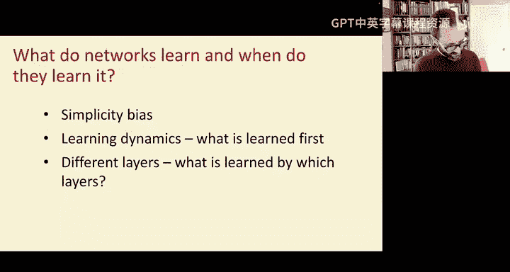
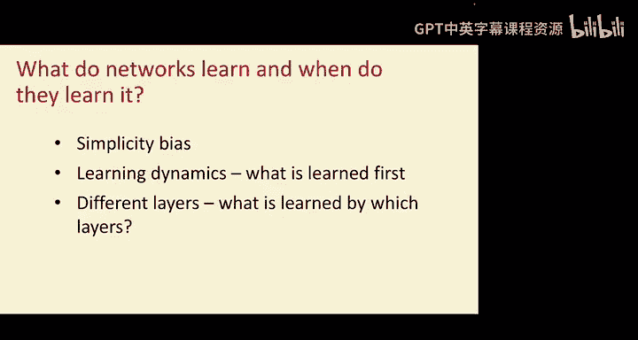
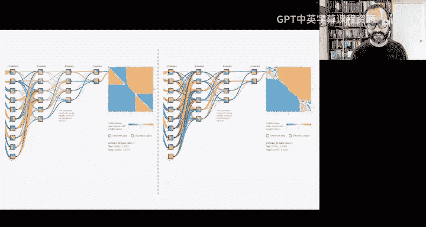
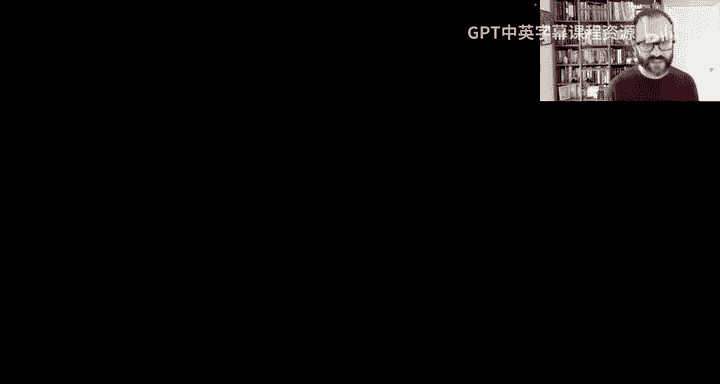
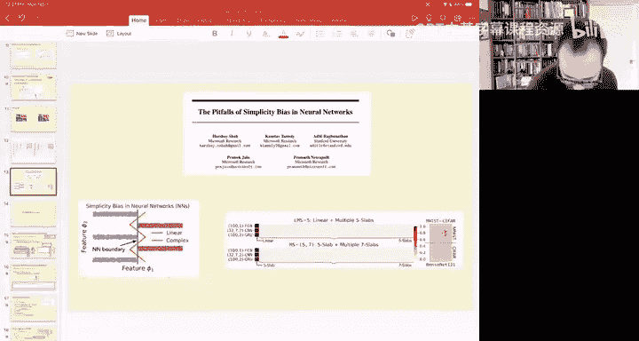
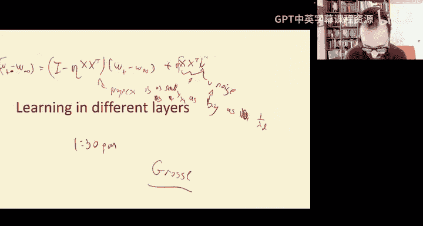
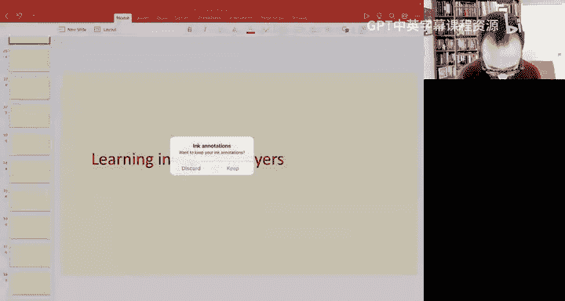
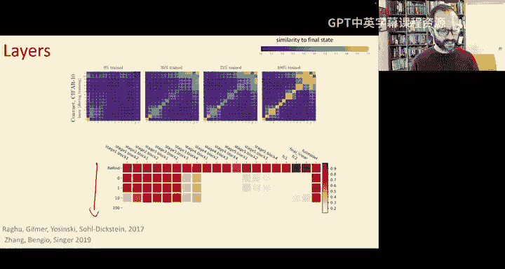
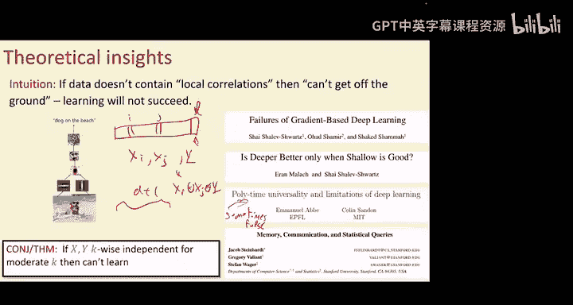
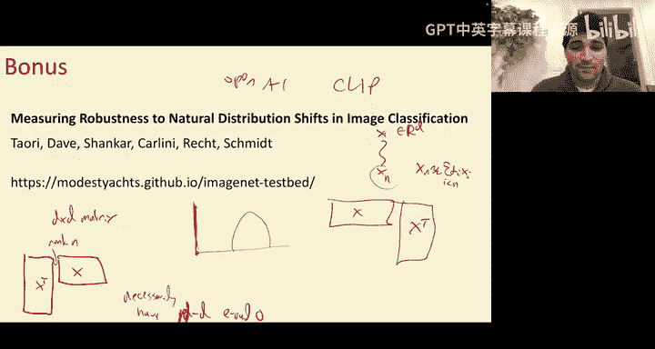

# 哈佛大学《深度学习基础｜Harvard CS229br Foundations of Deep Learning 2021》中英字幕（claude-3.7-s - P2：CS 229br Lecture 2.zh_en - GPT中英字幕课程资源 - BV1f4XCYZEMx

Hi everyone， welcome to the lecture number two in our machine learning seminar。And。

I've been known I can post these videos online， but if you don't want your face to show up just。

don't turn your camera on， but I'm really happy if you do turn your camera on because then I can see you and the chat is not posted online so in a public place so feel free to ask any questions using the chat。

Okay， so if you。Administrative reminders。Homeoke zero， the deadline is a week from today。

 see the Homeoke Zes channel for more information on Slack。

 some other useful channels on the Slack lectures， I put there the recordings of the Sla and the slides。

 Q&A for questions and answers his help for help with any technical issues and。Papers。

 Pri just started it for。For discussing cool papers that you've read and then。

We just started the project channel for discussing the final project。Okay。So， today。

What we' talk about is what networks learn and。When did they learn it。Some aspects of this are in。

Simplicity bias。 and I need to。

And hot spots。

AndTo my phone I works better。嗯。え。Yeah。Yes。U。So诶。Don't let what when you to implement concept first。

 yes。嗯。I think you may be lagging quite a bit your or your person thank you。Okay。

 let me check on my network。I know， okay。O嘞。Let's see。

I'm going to close some programs and see if that makes a difference。嗯。Right now it's okay。

 and I think we can hear you。Can can you hear me know。Yeah。Ok。So I hope， let me maybe。イクネト。

Supposed to be connected。The good network。 but let's see。

How do you guys see me now hear me now。 I it then。Is the connection better？Yeah， we can hear you now。

Okay。So just let me know if it starts loggging again and try to switch hotspots and do whatever needs to be done。

Okay， so and。Yes。😊，So just let me know how it works okay。

 so we are going to talk about what do networks learn and when do they learn it and aspects include simplicity bias networks tend deep networks tend to learn simple concepts and simple concepts first and that well see somehow and prefer simpler concepts to complicated ones that's not just deep networks but generally these gradient based algorithms。

And we'll talk about both experimental evidence and some cases where we can actually prove stuff。O。

So what do networks learn so here is a baby network and let's see。

What kind of features does it learn， so this is a baby network which we run on inputs which are say XY。

And these ones， the orange ones are a plus one and the blue ones are negative ones。

 so this is our distribution and we get samples on this distribution in the network。

And so the networks tries to。Toify to classify the examples from this distribution so this is。

The training process， and you can see it goes by pretty quickly， it's very simple distribution。

And one of the things you can see is that the features that it learns so in the this is the。😊。

Say bottom must。Or you know the layer that connected most closest to the input。

 I'm never sure if you。You should refer to it as bottom or left or in some other way。

 but the layer that's most connected to the input the say the first layer and here you have these。

If you're learning really a linear classifier and what you can see is that often the linear classifiers that you learn are ones that have the you know an angle that is kind of correlated with the input。

😊，Right， there are a few。A few that kind of that are newly horizontal。

 so this one is maybe not as much and this one is not as much correlated with the input but you also see that its weight is pretty weak。

 it doesn't really contribute much。🎼And so so basically the features that these when you train the network the features that it learns in the first layer。

 the ones that are kind of correlated with input and then it learns kind of more sophisticated features。

 you know， two slices， et cetera， until it eventually manages to learn。😊。

Learn what we wanted to learn right so this is kind of the intuition we the first we learn in the bottom of layer we learn very simple features and then we combine them to get more complicated ones。

And。Some people， especially Chris Olla actually will come and give a guest lecture in this seminar。

In呢。About a month we have really spent a lot of time in trying to understand what what is learned by different layers of a deep neural network and there is recently a work of Ola Kamata Schhubert Go Perovov and Carter。

 which is on Dist。If you Google distill， you'll find it and。

Where they really dug deep into a particular neural network for vision task and try to interpret。

The different neurons now we are going not going to go into details maybe increasing this stuff we go more into detail。

 but generally what you see is that in the first in the bottom of layers you learn very kind of simple。

Features that are in。You can think of as kind of simple features for detect for detecting edges or detecting certain colorlo contrasts。

 ettera， and then you learn some maybe higher more complex versions of them and some texture。

And then as you go higher up in the network， then you start learning more complex features。

 start looking detecting things like eyes and heads and curves and some other more complex textures。

And the intuition is that maybe the network also learns these bottom layers somewhat earlier。

 these simpler features， and we had a paper with some of the TFs in this class and upper。

Where we showed that in。If you train and。If you train a neural network， then what you see。Is that。

 in some sense。It learns， say the linear feature first。

 And then once it can no longer get any mileage out of the linear feature， it starts getting。

It starts with learning more complex things， so here it was kind of it learns say depth2 CNN and then such or it's that and then goes to depth4 CNN and then depth6 CNNn。

And then。This graph， basically the idea is how much of the classifier performance you can explain by the simple feature。

😊，So up until this point， you can explain basically all of the performance by the linear feature。

 then they start to diverge and they necessarily have to do it because the linear feature can never get better performance than this dotted line。

So， and。So we have some evidence that in practice SGD learns a simple concepts first and generally it prefers a simple。

Is a simple concept and yes there is a question on the chat。

 is this the mutual information between the feature and labels or yes so this is in this chat what basically you're looking at。

Is in。This is basically you're looking at the mutual information。So。

 so you're looking at the mutual information between。Okay， so this was a little bit。

So you want to know what is so you compare the mutual information between the label and the overall classifier。

 so this is kind of the performance of the classifier。

And if you look at the mutual information between the classifier and new condition。😊。

On the your condition on the linear classifier， so this is a performance that is unaccounted。😊。

By the linear。So if this mutual information if this quantity was0。

 it means that all of the performance of the classifier is explained away once you condition on the linear classifier。

And so basically this blue line here is just the first quantity minus the second quantity。

But I didn't want to go that deep into that particular paper。

 but you can read more about it and look it up online。

since both mutual information and accuracy are plotted unlike the Y axis。Its so like。

Is mutual information like just another measure of how good it's performing Yeah I mean when you're talking about binary classification。

 there's basically one to one mapping。So it's just it's mono only related accuracy and mutual information are the same。

 it's just like a different sorting of the access。Hey Boa， so question。

 so for a lot of problems in like you know learning theory when you remove the lower order information。

For the prediction problem， it becomes way harder。So I'm sort of curious if you've tried any experiments like。

 you know， even if you learn the best linear classifier early on。

Is there a way to take the best linear class ofifier and remove the signal that provides？

So that you don't have any sort of linear structure for your prediction problem。

And if it makes the task way harder。So。I think we'll see something a little bit like that。

 but it it's more extreme than。It's more extreme than just simply。

That then simply just the linear classifier， but I think there is a sense in which you can destroy some simple concepts and then。

SGD will not get off the ground。And we might see that in the context of parity and there is a nice experiment which I thought maybe at some point people could do as a project。

 I believe that for example， if you take，😊，If you take an image， very simple data set like。

 a very simple data set like。EnNist and you encode every pixel with say a random 10 pixels that XO to that pixel then。

Even though this is， in principle just as easy to learn。

 I think SGD will not get off the ground because we will not have these correlations to start with。

Does that make sense？Yep， definitely。Right so let's see and does it let me move yes so simplicity bias is in general a very good thing we we need our algorithms to have simplicity bias because if our algorithms。

 for example， if the algorithm were given our labels were to give us a completely random function that manages to fit these labels then it will never generalize right if you if you're given x1 y1 until x and Y N。

😊，And what the algorithm spits out is a random function that happens to give Yi on Xi。

 then on a new X， you'll just get a random value so that will be right if that will be random。

 then it is very unlikely to be correct。So the fact that we have bias towards being preferring simple classifier is a good thing。

 but it can also be a bad thing。So here is a cartoon， you know， if you are you know。

 if you prefer the low hanging fruits， you have a simplicity bias。

 then you will go to you know the right side of the slide to the lowest right you will go to this tree and maybe eat is fruit and you never get you know you'll never get to this food and onto the bananas and obviously missed on the monetary tree that you would have you have just taken the left hand rather than the right hand。

😊，So it seems that it does happen that for。Our learning algorithms， you give them some kind of。

A bait， a simple you give them some kind of a bait you give them a simple concept that they can latch onto they will go there even if there is a better more complex concept that is out there so here is an example and I think this is what happens in this example。

😊，Again these things are sometimes hard to interpret so but here is an example so here are two data sets that are basically they seem like they should be equally easy。

😊，To classify and fairly easy， but this is not very complicated。😊，But here you have a very strong。

 simple feature， right？So， so this feature。This linear classifier can explain much of the data。😊。

Here the the kind of Elish contribution， it still explain a lot of the data but less。😊。

Here you cannot really ignore the other features so you may be less likely to just kind of latch on the simple。

And now when you train them。What you can see is that the left one where the simple feature wasn't such a huge。

wasn't such a huge draw， it actually trains much faster and gets better resolved while the network kind of gets stuck。

 it really started with the simple feature and now it hasn't had time adjusting it to learn the other one。

😊，Even though， of course。In terms of representations。

 these are equally easy to represent and they definitely exist。😊。

A classification and eventually if we had enough patience， it might find it。

Or it would crash PowerPoint before it does。 so yes。So， let's keep ahead。

Right and there is a very cool recent paper by Schidar that talks about the pitfalls of simplicity bias in your network and they give this kind of nice example。

😊，So suppose your data set looks like this like the say plus one。😊。

Is the red points and minus-1 is the blue points。So you're trying to distinguish between the red points and the blue points。

There is a very simple classifier， which is this linear classifier， the green line。😊。

But this is not a very good one， it's not a robust。

 you would rather use the complex classifier that one is a better one which will have certain robustness。

But this is not what SGD will find， so SGD will probably find the green line and the way they demonstrate it is using this notion of adversarial robustness。

😊，They show that when they design， for example。One version of the data set is this Mni CA。

 which basically you have two images。One comes from Mnist， so it's very simple。

And the other comes from CF， which is a little bit harderer。And and。

And both of them carry a lot of signals， so you ideally the classifier would use both of them。

 but it actually ends up using just MNIS and you can show that by attacking the classifier you just pertube the MNist part and you can completely。

诶 completely modify。So yeah， so simplicity is not always a good thing。😊，Okay。And what can we do？

So these are kind of experimental insights， but what can you actually prove？😊，So。

 to try to understand。To try to understand this simplicity bias theory。

 one of them very useful a lot of questions in deep learning。If you want to understand them。

 first try to see if you can understand linear regression and there are still some open questions even for linear regression。

Not a trivial thing， but we'll show a very simple observation about over parameteraized linear regression。

What is linear regression， our input is a pair of points x1 y1 till x and yn x1 is a vector。

 Xi is a vector， Yi is a number。And we are thinking of the over parameterized case。

So the over parameterized case is when D is larger than n。

 so the dimensionality of the data is larger than the number of samples that we get。

And our goal is to find some w in RD that kind of fits the data that w doxi is equal roughly or exactly to Yi。

 and more importantly， we want wx to equal y for fresh XY is out of this distribution。

And right now I'm ignoring'm ignoring the biastem， usually there is a biast and just for notational convenience I'm ignoring it you can think of。

😊，The first coordinate of X always being one， so that accounts for the best term where you can add the best term just。

I'm often going to drop these terms， they just make notation more cumbersome and they don't make a difference conceptually for what we're trying to do now。

So we can think of it you know in linear algebra notation， the inputs is a bunch of vectors。

 y X is a vector Yi is a number， we have n of those and each of the Xs of the dimension D and we are thinking of these these。

😊，The D is larger than n， and we are trying to find a vector w and we'll make it a column vector so it looks nice and so it fits。

That gives us this value， so in another way we are trying to find the input is matrix x。

 which is wide and short， and we are trying to find a vector w such that xw。Is roughly equal to y。

And there are many choices， and we are trying to find maybe the simplest one in some way。

 according to some measure of simplicity and what we are care right now is whether we can show that。

Say if you run stochastic gradient descent， it will actually find the simplest solution among the many solution that exists and there is a sense in which SGD does that。

So there is a CRM， you can show that if you run gradientding descent with an appropriate initialization。

 stochastic gradient descent or gradient descent on the loss function。

 which is the square difference。then it will converge to the solution of minimum norm。

 so that's a notion of simplicity， it will converge to the solution to an exact solution to a w such that xw equals y。

Of minimum norm。 and this is the notion。 this is what we this kind of results we call。

Implicit will implicit。Regular realization。Or sometimes it's known as inductive bias or but basically this is the idea that the algorithm prefers。

 there are many different solutions， but the algorithm prefers simpler ones。

And it's implicit legal in the sense that you could have tried to regularize and ask the algorithm to give you a solution。

😊，With small Lome， one way to do that is to apply a regularization term。And then。

And then you can do that basically by adding like a factor like lambda times the square two normome。

So if you add an explicit regularization term， then the problem becomes has a unique solution。

And this unique solution will balance out， so it might not get xw exactly equal to y。

 but so it will balance out the the no requirement and the。

and fitting the wise requirement and basically the solution that gradientian deent does on the unregularized problem is as if you turn the lambda to zero。

And then it turns out that it will you know， then it will exactly solve the equation xw equals y。

 but it will do so with the minimum L2 solution。And yes， is there a reference for this CRorem， Yes。

 this appearss in what your gross。I don't know the right reference。

 but an nextposition of this is in gross's lecture notes。😊，but we'll see a proof in a second or yes。

We'll see proof of proof sketch。And a proper proof in uncles course and。嗯。And fake proof here。

So just reminders of convexity。These are useful in general， the function x squared is convex。

 if you don't know why you just Google it。And you see that the graph looks convex。

I didn't know until recently that you just can write plot X squared and Google with the function for you。

If you you can get more convex function， so if you know that one function is convex and you compose it with a linear function。

 then you get。Then you get a convex function， so by the fact that x squared these convex you can get functions on many higherdisional functions that are convex。

 any positive linear combination of convex function is convex and the last one is that if F is convex and Lada is positive。

Then f of x plus lambda times the norm squared of x is strongly complex。So， that's。

🎼Useful basically youre adding the identity function to the Hassian。Okay， so linear regression。

 if we do SGD on， so we are get getting this。So we are getting this loss function。

 we are trying to solve the problem of finding the minimizer for xw minus2 minus y squared。

 the square loss， and the algorithm is the following so we are going to consider initialization with zero。

And people sometimes do that， maybe zero is extreme。

 people sometimes initialize with random small values and that's kind of close to zero so let's think of the initialization as zero and then the theorem will be actually two stated。

😊，So gradient descent，tochastic gradient descent， we basically we pick a random sample X。

 and then we Wt plus1 is wt minus at the times the gradient of the square difference between X do w and Yi。

😊，And a claim is that the gradient of X dot w minus Yi squared equals2 of X transpose XiW plus minus2 Yixi transpose。

😊，And。So here is a proof， I don't know if you'll call it a proof but here is a way to see it how do you convince yourself that something like this is two then first of all you pretend that all the vectors are numbers so if all the vectors are numbers then this is just calculus。

😊，You open up the parentheses， you just do the derivatives。

Now you just want to check that you actually get the right dimensions right so now that you know that it's just calculus you kind of know that something like this claim is going to be true。

 but there going to be a bunch of transposes and it's always hard to guess which way the transpoes will look like so you just kind of draw it and see that it matches up that you know the gradient is going to be a D dimensional w is a D dimensional column vector。

 the gradient of it should be also a D dimensional column vector so。

And the way to add transpo sprinkles some transpoers until you get the the dimensions matches。😊。

Is that good。 and by the way， can you hear me because I'm suddenly getting this internet is unstable。

It's worse， quite a lot。What。😮，You are sometimes frozen again。啊，O。🎼So and。Try to again fix it。O。

Is this better？It's not worse，嗯。Okay， let's see fast dot com。It's pretty stable so far。Okay。

 I guess we'll， we'll live with that。 And I'm sorry about this。 I'm going to。Next time。

Just go to Arstone and and do it from the from the Harvard office。

Let's see hope that will work better。Okay， so yeah。

 so we plug in this claim so now the gradient and so we just plug in the value and I drop the I drop the Yi。

😊，I drop the YI sorry， I dropped the factor too because you know for gradient and descent it doesn't really matter whether you take steps with two times E or EI in the learning grade way anyway think of it as kind of some more constant。

 so I will routinely drop factors of two in this lecture。And yet maybe I can suppose things a bit。

 but yeah， it's basically it's， but yeah， it's the same。So okay。

 so so these are the steps we're taking and we anywhere at each。

Poin which take a step by X w minus Yi and now as a corollary notice that all of our steps are this is some number。

This is also a number and this is X I transpose so basically all of our steps keep us in the linear span of x1 till x n transpose we never leave that span。

😊，🎼。So。Second corollary。🎼And you assuming next weeks is non singular， which generally should happen。

We will get to an exact solution， so W infinity， the thing we end up at the end。

 will satisfy that x W infinity equals y。😊，And it's always in the span。

 so it will still be in the span。And then the claim is that this means that this is the list the。

The solution of list normome and kind of a proof by picture is the following so so think of this this span。

 this is some subspace。😊，Right we started in the 0。0， which is always in this subspace。

And this is subspace of dimension n， and now we have this a subspace。

 which is the points where xw equals y and this is of dimension d minus n。

So these two subspaces will intersect in a single point。

And if you and this will be the closest points since zero0 to the d is on this subspace。

 the point in which these two subspaces intersect is the closest point on the green line to the zero point。

 so this is going to be the minimum norm。A solution of xw equals y。

Right so this is the point that he closes to zero on this line xw equals y。

 but generally it's not a line， it's a subspace of dimension d minus n。Okay。

 so that's why it finds a solution and now you can also kind of hand waveve and say， okay。

 if it finds a solution， then since this thing is strongly convex。

So this since this thing is strongly convexed then strongly。Then for every lambda。

 there is a unique solution， w lambda that is this minimum over w of xw minus y squared plus lambda w squared。

And since for every W there is a the unique w， there is going to be and everything is here continuous and nice。

 there is going to be a limit， so if you look at know W Lada will go to some W star as lambda goes to zero and what can it go to when lambda becomes zero。

 then you put no weight on the regularization term so it must satisfy？😊，嗯X W star。

Equals y and kind of and since you are getting it as a limit of things that regularize on the square two norm。

 it should be the one with smallest square two norm you can show that。😊。

Anything else will only be strictly farther away。So yeah， this requires a proof。

 but it can be shown so this is by the way this is known sometimes as this is known as rid regression when you add this lambda term and when you don't add it。

 then this is like ridless regression。😊，Okay， so so basically so here we see that gradient descent or stochastic gradient descent will actually pick up the simplest solution in some notion by some notion of simplest and this is kind of something that's。

Yeah， and this is kind of something that's。More general。

But now if you want to know how fast this will happen， how fast this it will take。And also。

 how sensitive this is to a slight amount of noise， then you can try to。You know， do the math。

So WT plus one is WT minus the at times the gradient which RCB computer。

 this is WT minus you know the。Open it up。And so this is the value we already computed。

W this is this is now I'm looking at gradient de I'm looking at the full。

I'm looking at the full data set capital extra than a particular XI。😊，And now。

If we let W infinity be the one the solution where xw infinity equals y。

Then we can write it the following way so。This is the equation above and just yeah。

 so this is the same as right xpo y is the same as xpo x W infinity because xw infinity is y。

And now we subtract w infinity from both sides and we can write this as w T plus one minus w infinity equals this operator times d。

 So this is basically you can think of it This is distance from。This is distance from the solution。

So you see that the distance from the solution undergoes this transformation。

 so basically we are applying this transformation to the distance from the solution and basically the vector we hope that this vector shrinks if it shrinks we're making progress and now I see a question。

诶。So yes， so there's a question， the limit here is over the optimization problem and the in particular over the closed form solution。

😊，So this is true regardless of how we are optimizing the objective。

 so why do we say the regularization is implicitly done by SGD？Right， so basically。

Maybe do you want to unmute and ask the question then？Yeah sure。

 so it was mainly from Gross's text where he had the closed form solution in terms of the pseudo inverse and the inverse。

 but similarly to here， when we have the optimization objective we're taking the limit but when we're taking the limit and we get to the result that it is the same thing。

 we're not explicitly assuming SGD we're just，Especial in the en Gross's case。

 it's just an numerical limit coming from linear algebra， so I don't。

I don't understand why we're saying that then this regularization is implicit in gradient descent。

 whereas at least from my understanding it seems that it's implicit in the problem of linear regression that we're studying Yes。

 so maybe a way to say it is the following this is implicit regularization。

Right the coary3 because we have given SGD just general we have given SGD just this general loss function and there are many。

 many minimizers。And among all the possible minimizers。

 we have shown that SGD picks the one with smallest norm。

 so that is an example of implicit regularization where we didn't explicitly ask SGD to minimize the norm。

 but somehow it still did。And Coola before， maybe you saying just a math statement that shows that you can think of it as a limit。

 the solution that you get， you can also think of it as a limit of explicitly regularized problems where the regular realizationization factor goes to zero。

😊，Does these explain it？Yeah， yeah， actually this clears it up， thanks。就。So yes。

 so basically if we look at the progress， we see that we're basically looking if we track the distance from the final vector that we get。

 then we see that basically every time we take a step。

 we are applying this same gradient descent we are applying this linear operator I minus Eta x transpo x。

😊，To the to the vector that measures the distance from the end。

 So what we hope is that this operator contracts the distance。

 So every step were getting closer and closer。 So to make progress。

 what we really need is this operator to have all the。

What we want is for these operator to be contracting。

 which basically we wanted to have all its eigenvalue between。Strictly between zero and one。

 and particularly we would like them to be bounded away from one。

So that we are making progress and would'd like them to be at least zero so we are not starting to go farther away。

And for that basically what we need is that Eta， if we think of this as right so if we were to diagonalize this matrix。

 which because it's x transpose x， this is going to be a positive semi deffinite matrix。

 so all of these are no negative。😊，So what we want is that Eta is small enough。

 it has to be less than one over the biggest eenvalue。

So the decision ensures that this operator is still PSD。

 so we are not going to go backwards and then。And then the progress that we can make in the worst case。

 if wt minus w infinity is going to lie in the Een space corresponding to Laade。

 then the progress that we're going to make is going to be。

Roughly so we are going to basically be roughly multiplying this by one minus。

If Eta is1 over lambda 1 so it's going to be lambda d over lambda1。

 which is basically one over the condition number of this xpo x， so the smaller the condition number。

 the ratio between the biggest and the small eigenvalues， the better progress we are making。

And what you can actually show is that this is not just progress added if you inserted some noise to this process。

Then what you can show is that this condition number also controls how much noise you can handle and if the condition number is very poor。

 then even a little bit of noise will cause you not to reach the solution。Now for randomom X。

There are there are results in random matrix theory that basically show how the eigenvalue of x are going to be distributed like so xx so like random xx disposepo so these eigenvalue we know that。

N of them will be nonze。Because this is the rank of these matrix is at most n。

 it comes from these n vectors。And so if D is less than n。So if this doesns an right。

 the rank is the minimum between D and N。In the case that less than n。

 this is kind of a random matrix and it will be the eigenvalue will be bounded zero from below。😊。

In the case that D is roughly n， then this matrix kind of as you increase D and we get closer and closer to end。

😊，The spectrum gets shifted more and more to and oops。

More and more the to the left and then you actually have a bunch of。

 you know you have like some eenvalue that will be close to zero equal to zero。

 so then this is very poor condition value。😊，A conditiond number。So here you could be in trouble。

 it could either take you a long time or more likely you'll not get to the solution at all because of some noise。

And then when d is much larger than N， then you suddenly have a lot of zero。

 you have a lot of these n minus d minus n0 invalue， but the rest of them。😊。

A goinging to be separated away So since you can kind of ignore the zero een space。

 you basically get back to a good。A condition number。

So this basically shows you that you can have some kind of a double descent mechanism where basically if these smaller than n you're underfitting you get a good condition number you get good results。

 if these larger than N you get a good condition number significantly or larger than then you get a good condition number you get good results and in the middle you can get a poor condition number and indeed this if you look at gross's notes and this comes also from some paper by an。

😊，And Hasti Monteri was certain Tiioi you can see there other works as well， this is one of them。

 you can see that you get this double descent phenomena so here to vector to read these graphs you to compare it to double descent we've seen last time you need to look at this from the right to the left。

So here rather than thinking of the model grows and the data fixed。

 you think of the data grows of shrinks and the model is fixed so as the data shrinks and the model so so let's look at it from the。

So let's look at it from the left so as the data as the data。😊。

Shrinks or the model grows relative to the data。 we can see that we get。

We get basically some improved performance and then we get a very big spike， very bad performance。

As the very bad perform， so here this tracks the condition number in some sense。😊。

AndWhere the minimum eenvalue were。Very low means very bad condition numbers。

 So we see we kind of get somewhat improved performance。 and we get very bad performance。 and then。

And then we get somewhat better performance as it goes， it's not as it's not a clean double descent。

 but I think there are versions of this graph which will give you sort of more of a clean double descent curve。

Okay， and the grosss notes contain it and I think An you're going to show this stuff as well。Yeah。

 I'll show it， I'm not sure in this model， but I'll show some kind of dual double descent for linear regression。

Y， yes， exactly， right， so now we want to go beyond linear regression。

So let's try to talk about deep networks and the problem deep networks are very hard to understand so yeah so let's even start with a depth two network so depth two network you have。

😊，Two linear layers and you have some non nonlinearity between them。

And you typically also have nonlinearity at the very end。

 but let's ignore that we can also always kind of couple that nonlinearity。

 think of it as part of the function， so that's less important so let's just think of this intermediate nonlinearity is important。

😊，And we are going in the parameter space here， if we think of this as having say input of dimension D and output of dimension M and a hidden layer of。

A hidden layer of size age， then the parameter space。

 the nonlinearity is fixed so the parameter space comes from the weights for A1 and A2。

If it's a fully connected， then a one has an。D times H parameters and a2 has H times n parameters。

And now a depth to linear network is one where it looks the same except we took out the。

We took out the nonlinear layer， and it has the same parameter space， right A1 and A2。

And now taking out the nonlinear layer might seem like a ridiculous thing to do because you simply have a linear function if you take a product you know composition of two linear functions is still a linear function。

 so it seems like just a way you know you go like this to compute a linear function with huge number of parameters where you could have computed it with much fewer parameters you just needed。

D times em and this is completely equivalent， it computes exactly the same function as a function that a B。

 which is the matrix A2 times a1。搜。YeahBx equals a2 a1 x for every x。

 so a linear model and a depth2 linear network have the exact same functionality or expressiveness。

 they can express the same functions， but they have a different parameter space。😊，And a prior。

 you would think that this is just。😡，A con of and it is indeed like this this is so。

 so this is basically， you can think of it like linear function。But worse。

Right it''s every it doesn't compute more it doesn't compute more functions。

 but it's more complicated to expand， takes more parameters。

 but we'll see that sometimes there can be an advantage to having more parameter space so in particular。

If we look suppose we take any loss function and we look at the optimization problem of trying to minimize the loss of B and trying to minimize the loss of A1 a2。

 and we just define the loss as some function that you take。You have some inputs， some training set。

 and you compare the。And you have some metrics， some way to compare the outputs of the networked to the outputs of the labels。

And then。And the minimum of all models in the family will be the same right so this is an equality because。

the minimum over all models in the family， whether you minimize over B。

over these matrices or you minimize over the product of two matrices。

 it's the same because they have the exact same function every function。

 every function here can be described like as a function on the right and vice versa。

 but if you run gradient in descent，😊，On loss the first problem or the second problem。

 you don't necessarily get the same solution。Because。

The issue is that you know if the loss function is convex on the left。

 you might have a convex function， but on the right you'll definitely not have a convex function and that means that you will have generally speaking you could have more than one solution and it's not clear at all that gradient descent will find a solution and even if it finds a solution。

 which solution it will find could depend on the way you set up the parameters。

So here you see that the representation space matters。So even though these are， you know。

 they are equal。In a function space。They are different in representation space。

And that makes difference to the trajectory to the dynamics of gradient descent or stochastic gradient descent。

Right so if we run gradient descent on the same on this objective。

 even even though the minimum on the left and the minimum on the right is the same one。

 we are not going to get the same and。Necessarily， the same result。Is this clear？😮。

So deep linear networks are a very interesting way to why is the right function maybe non conve。

 right so a great question。So generally speaking， if you。Let's look at an example。

 let's look at even the example say of a single number right so let's suppose we are just a single。😊。

A single number， so you would look at say Vx。Bx minus y squared。

This is as a function So this is as a function of B， right， This is a function of the weights。

So B goes to b x minus y squared the simplest this is a convex function now look at the function a1 a2。

Goes to a1， a2。X minus y squared， then I think if you plot it， you will see that this is not an。

This is not convex Tf so can chime in and say why it's obviously not convex， I think it's like。

Obviously not convex， but i'm always confused with you know with the we can come up with like probably like in two seconds with an example that you can average these two things and you will get something different and yes why is the difference Why is the dimension of the。

😊，W is the dimension of the parameter space different right so again let' let's think of the input here D and the output M。

So here we just have this matrix B。😡，So this is just D times M numbers。

And here we have these D the hidden dimension H， this output M。

 so we have D time H plus H times m numbers。So you can see that the the parameter is not the same。

 you could even have an。And you can even have， you know， if age is really， really big。

 you can have like a huge you have no bound on how many parameters you'll need on the right hand side and yes。

 yeah because the function FxY Xy is not convexted then this function。

This function is not going to be convex either。So maybe the simplest way to think about it is maybe think of the case that x is1 and y is zero。

And yes， another question。So in this example， would the depth2 network have to do strictly worse on the training sets it potentially cannot reach the global minimum yes。

 so it could potentially do worse on the training set often if it's highly over parametermedized。😊。

It will fit the training set because there are many。

 many ways to fit the training set and it will find one of them and the linear model will find another one of them。

And the interesting thing is that。On the right hand side。

 the fact that we phrase things as a linear network might cause some bias to find a particular one that has some kind of a simplicity bias。

So Blake does this answer your question？Yes， thank you。Sure so so what we want linear models。

 they are a really nice lab to understand the dynamics of gradientd descent and I'm going to show like a simplified version of this analysis but there are more sophisticated ones and I think。

😊，And I'm going to mention some references。So lets let's analyze so we'll analyze gradient flow。

 which basically is like gradient descent when we push the learning grade to zero。

 so we think of it as kind of continuous optimization we think of it as。😊，A differential equation。

So our aim is to understand how does the different parameterization by linear network affected the dynamics of gradient flow and affects where we end up？

So we're going to make a simplifying assumption， we're going to assume that a1 and a2 are both symmetric and they are the same matrix a so B is a squared and they are the same matrix so so the parameter space now will be something like d times h over two it doesn't really matter much but it just simplifies the math and make sure that I don't have to worry about where to put the transpose and then。

Which is good because otherwise I usually put it in the wrong place。And under these assumptions。

 the matrix B， so we compare the how does。The network a squared evolves and b is a squared and another way to write it is a is squared B。

Because Asymmetric， it has all。Then a squared is like aA transpose。

 it's a positive semi definite matrix， the notion of square root of a matrix is well defined。😊，Okay。

 so we are going to analyze gradient flow， so we are going to look at some loss function。

We don't know what the loss function， but it's some loss function that only depends on the functionality on the network。

 So we have some kind of some the some original。Loose。Whi is L of a squared。

 so it just depends on the function that you compute， which is the function x goes to a squared of x。

And we are going to define L squared of a， which is just L tilde of a， which is L of a squared。

So this is what we give gradient descent or gradient flow as input。

And we want to understand what is the difference， what's the difference between trying to minimize so so what's the difference between you know。

 minimizing L of B and minimizing。AL hat of a， which equals L of a squared。

How do the two things differ from each other？O。So let's see so gradient flow basically we are going to run gradient flow on this we're going to run gradient flow on this loss Ltde of a is L of a squared。

 so gradient flow basically as we set the learning grade to0。

 we have this differential equation a time T。The matrix A of T is going to evolve as minus the gradient of L hat。

A養フィ。Now we're going to use yeah， and we compare that with the linear model where we would run it on B and it's going to evolve like minus the gradient of L of B。

And this analysis with some abstract loss function。

 we don't need to know anything about it except that it's nice differentiable or whatever。Right。

 so by the chain rule， the gradient of。The gradient of L hat is the gradient of L times a I dropped some two because we don't care about constant factors。

And in。Because everything here is symmetric， I can also multiply a from the left or from the right。

 it's not going to matter。And and。And I'm going to use this notation。

 I'm going to write deelta hat for the gradient on this new loss function the new loss function on a and delta for the gradient of the original loss function on the original loss function on。

😊，On a squared。 so let's make sure this only the green part is deelta。

 So or I should say Nala right maybe。Try to remember to say Nabula instead of Delta。So yeah。

 Nala tilda is the gray so we are going to we are evolving by minus Nala tilda and we compare that with the。

😊，With the gradientding flow on the linear model which evolves。Which evolves on the minus nala。

And the relation between them is that Nabla Tilda is a times Nabla。Okay。So wait so now。

AndThe derivative of right， so the derivative of a squared t is minus Nala it's equal to the derivative of a times a。

😊，Right， so。So basically， we are evolving。So this is how a evolves。

 how a squared this evolved by again by just a chain rule。😊，Is how a evolves。

 which is minus nala tilda times a and then we just plug in so evolve a squared evolves as minus a nala a。

So again， maybe the way to think about it is the following。😊，So in the linear model。We have this B。

 you know， be at times zero and be at times 1， B at times 2。😡。

And they are evolving according to this rule minus。Mus numberla。In the诶。In the linear net。

We have this a 0。A one。They are evolving according to minus minus a Nabla right because this is Nala tilda and now what we are keeping track is of a0 squared。

 a1 squared because this is something we can compare with B a2 squared and this is evolving according to minus a Nala a。

K， this is two small We。 That is minus a nala。送。So if we compare， so again。

 we want to maybe compare the two things。So， D a squared。啲滴啲。Is minus a number a。

So this is in the linear net model， so this is really the difference between the two models in one of them the evolution is by minus Nala and the other one is you multiply a on both sides。

So another way to say it is right so in the if we were to run these dynamics。

 but instead of you know if we were to watch how B evolves where b is a squared。

 how B evolves as a function of time， then it goes according to minus a， the original nala times a。

 which is like minus squared to B。you know， be at the pointee and nala times scroll to be so basically what we are doing here。

Is every time we take a gradient stamp， one way to think of what happens in linear nets is that we run the same gradient flow as or the original thing。

 but every time we take a step we also multiply the gradient from both sides by square root B。

So what does it mean that we multiply the gradient by both side by square root b？

The way to think about it is the following， so if。If B was say lambda1 till lambda D。

And suppose that B had some you know big eigenvalue， so suppose the spectrum looked like that。

 you know you had some bigger eigenvalue and some smaller eigenvalue。

Then when we multiply by square to be the gradient we are making the big bigger and the smaller smaller we are kind of accentuating this difference so we took the gradient and now in this eigen space we are making the bigger we are multiplying by the lambdas which has this effect of making of accentuating exaceperating the difference between the small eigenvalue and the larger eigenvalue so we basically。

😊，Trying to push B to be more to break symmetries between eigenvalues so if one of the eigenvalues of B was a little bit bigger it's likely to be much bigger after each step so basically you can show that what you're doing when you're doing that you're trying you're biasing B to have low rank what is a low rank matrix one way to think of a low rank matrix is one where a few of these lambdas are very big and the rest of them are very small。

So basically what you're doing here is you're doing the， you know， you're making the big。

The big a values become bigger and biasing this network to you're biasing B to become low rank。

So you can show that basically。Yes， so is great friends。

 I mean generally these things will will eventually get stuck at ever you know。😊。

They will eventually get stuck at either a local minima or。And you know， O。

What you call it when you have a line and at point？Yes。Yeah， so， yeah。 so， so it doesn't。 Yeah。

 there reason。Typically if this is over parameterized。

 you you will find it really depends on the loss function right now this is completely abstract。

I didn't say any particular loss function， but for some loss functions like say in minimizing squares。

 then it will actually。It will actually converge if you're sufficiently overpaitized and you can show that it will converge not to necessarily the lowest rank solution but to something that is like that。

 so it basically give you some kind of a bias to that is related to having low rank。

And you can show that there are certain advantages sometimes if you even take even deeper networks like you know。

 instead of De two， you can take step three， De four， etc cetera。So when。

So yeah whether it converges or not will depend on the loss function will depend on how much is' over parametermedized。

 but the main point I wanted to convey you is that you can understand for linear networks。

 for nonlinear， it's much harder， but for linear networks。

 you can understand how the evolution changes because you're doing a gradient flow on disk representation rather than the original one。

哇。And and。Yes， and generally there is you can show that if you do a gradient flow on a deep linear net。

Then what happens is that you apply you're basically applying some function。To the regional gradient。

And the function looks something like。Here I'm assuming some symmetries usually there are some kind of transpoers and you think of this gradient as a vector。

 but the function looks something like a sum of applying B to some power alpha on one side and applying B to some power one minus alpha on another side so in our case the sum had just one element and the alpha was one half but for deeper nets this will be a more complex sum and when it's not symmetric there will be some transpos here and there。

 but this is basically what you get and you can find these analysis at different levels of generality and formality in these three walks。

And then。And generally， what happens is that you really what you're doing is rather than doing gradient flow in the normal geometry。

 this is basically equivalent to doing gradient flow on a Rimanian and manifold。

And one thing that is important， this is not equivalent。You cannot simulate this by just doing。

 so you might have thought that you can write minimum the loss of B and add some regularization term。

And that will induce the same flow dynamics， so there is no regularization function that will induce the same flow dynamics。

And it is different than just it does achieve something that you cannot achieve with explicit a globalization。

 whether that something is good or bad， that depends on the application。And then。

And let me say for people that haven't seen this before。

 let me say just I'll give one slide on what is Iranian in Manifold。

But I'm not going to go into detailing that I'm not sure if you you sorry so Bo what's the statement about I mean this is known that it's not equivalent or are you making this as No no yes there is some I think I've seen that in a talk by Alla Hazaan you can show examples where you can prove that there isn't a regularization function such that will induce the same dynamics。

And and。Right， I mean， I guess is there simple intuition for that I mean， somehow。

 you know the the general structure you get from the Rimaniian manifold you know。

 you don't expect the direction that it moves in to be like you know。

 a potential I mean derived through simple scalar potential right and presumably this is the intuition Yeah think so I mean there there is basically the geodesics that you're going to go through in the Rimanian manifold not ones that you could get by。

not ones that you would you would be able to get with these but I forgot the proof so but I think it's you're probably right Okay yeah if you could put links on the slack that'd be great i'm curious but by the way so one comment I wanted to make you know it like you did the linear regression case。

So the virtues of implicit regularization， you know， and coming up with a non convex function。

 you can even see in that case， right because instead of taking AX minus b and then looking at the two norm squared and trying to minimize this。

I could replace X， you know if I was looking for something that's non negative。

I say the entry wise square of a vector y。Mmhmm。😊，So then when I do， you know。

 it's now non convex as a function of y。And you know the point that I'm going to reach won't I mean。

 it'll minimize the two norm with respect to the entry y square of y just the same thing as minimizing the one norm you mean I think the entry y square of w right because oh sorry yeah w yeah。

 so I mean you have a I mean， whichever weight vector you're optimizing over if you reparameterize it so that it entry is or the entry y square of some other vector then what you're really doing it's not designed to like you know change the you know the global optima and some meaningful way。

It's changing the geometry of how you select which of them。

And even going L2 to L1 is very powerful for like compressed sensing and stuff。Yes。

 and generally this is the the way in which the training process induces regularization。

 or it's very hard to understand the nice thing about we kind of believe that these insights about linear networks do extend in some ways to nonlinear networks is just much easier to analyze and understand in linear networks。

So we do believe that neural networks here for the understanding dynamics they're a good model for what's going on and let me say just very briefly like if you have not seen manifolds in just a very general way。

 so what is a manifold a manifold you can think of it as in two ways。

So one way is you kind of describe some object like you know， you describe。

 say this object or you describe a sphere and you say what do I mean by a manifold。

 I mean that maybe that my point is on the sphere？So if like I have a sphere， for example。

 then the notion of distance is the shortest path that I can take。

 but the path has to stay on the sphere。So， so you know。

 if if this point is kind of on the other side of the sp， you cannot just cut for here。

 you have to go。Through this fear。And there is kind of an internal intrinsic description that doesn't need to embed the manifold inside the bigger space where you say you have some abstract set M and the point is that at each point in M you have some notion of a local geometry。

 some notion of the points that are in a very tiny region around it and how what's the distances in that region。

 so the way you think about it is that you define，For each point， you define as a vector space。

 which is the space of directions that you can move in to go to nearby points on this on this manifold and then you define some notion of an inner product on this tangent space and the gradient of F is say if you were to minimize if you were to do something like you trying to find。

If you were to trying to find something like minimum f of x where x is on a manifold。

 then if you're doing gradient and descent， you're trying to take the short。

The shortest direction on the shortest direction to say increase or decrease F。

 but the shortest with respect to this metric。 So this changes when when you changes the metric。

 then it changes the way that。It changes what the gradient is because the shortest direction becomes different and generally shortest path。

 they become geodesics， they are not necessarily straight lines。And yeah。

 so basically they showed that every on a。If you're doing gradient flow on a deep linear network。

 then it basically defines a certain manifold and what you're really doing is gradient flow on that manifold。

And I think this is all I'm going to say about is manifold。

 except this is now a manifold in the space of weights。

Often in neural networks typically people talk about manifolds in deep learning。

 they talk about manifolds， they talk about very low dimensional manifolds in the space of inputs so this is something different it's the same notion of manifold but it's a different manifold。

😊，Okay， but the lesson that we get from here is that representation matters。

 the representation space matters and gradient， the fact that we are doing these gradient based algorithms can induce certain biases and change the solution that we find。

And now we're going to move to learning in different layers。

 but that might be actually a nice point for a break。 So let's maybe take an。

Let's maybe take a 10 minute break， so back at 1，30 pm。

Maybe I'll try to see if I can debug my network a little bit。Great， thank you。Okay， so let's。

So the next step is the next thing。We're going to talk about what's being learned in different layers in a network。

And。So mean PowerPoint let me and。

What's being learned in different ways。Okay， so here is kind of a cartoon of an intuition that people have about whats。

How do deep neural networks learn data？So the idea is that you know the data。

 when you can think of it as an image as a document as any other natural data。😊。

It has some high level features， for example， if it's an image。

 maybe the high level features is what is it an image of is it an image of a cat。

 is it an image of a dog， is it an image of a space laser or whatever it is？😊。

Then know where is it located？😊，Sa， you know is located on the couch。

 is's located in a car located in the beach and then you know find features of say the dog in this case like what kind of fur it has and what is the lightingning and all sorts of very minor details that kind of affect what the pixels actually look like and at the very end。

 you get this， so you imagine that the images that you see have been kind of generated by this process。

😊，The hi process where you first。There was the high end features and then the low end features and then the very you know very low end feature that generally affect whether you know。

 eventually that all determines whether this particular of you know。

 what shade of beige ground will this particular pixel be。And when you're running a deep net。

 the intuition is that you're kind of doing things backwards。

You're first kind of figuring out the low level features where the edges are in the what's the edges。

 what's the texture in this image。Then you're basing on them like basing on those to come up with some higher level features like certain patches。

 et cetera， and then you can detect things like heads。And eventually， you can decide that this is。

 you know， a dog and maybe a dog on the beach。So so basically。

 the this is kind of the intuition that。These deep nets。

 the way this is the way they walk and and the intuition is that basically also that these lower levels。

Are kind of general features that are more or less independent of the task and even largely independent of your data basically。

Any sort of image a collection of images， whether it's of you know dogs。

 whether it' of cars or whether it's of fashion or it will have edges and textures and then the higher app you go in these features it's maybe more specific to the type of images and the type of task and eventually if you depends on what the task that you're actually trying to achieve is the very high level。

Of the network。And then some upper intuition could be that basically。😊。

So these things kind of depend on low level correlation of these low level correlations of the images and maybe the intuition is that first。

As you train the network。Then it will pick up on these lower level correlations and figure out these lower layer and then figure out on correlations between these lower layers and figure out these part and so on and so forth so this doesn't exactly happen like that things kind of signals travel back and forth but maybe the intuition is that to some extent these layers are the bottom layers are learned earlier and also they would basically be the same ones learned。

😊，No matter what task and data you're performing， you end up learning the same type of things down here。

 and this is a little bit like the Anacarranina principle。

 no matter what you do you end up learning more or less the same thing。Yes， yeah。

 so there is a question it still depends on the data。

 obviously you're not if you're not looking at natural images。

 you're not going to learn on edges if the images didn't have edges。😊。

Then the images didn't have edges， you're not going to learn edges， but the intuition is that yes。

 these things are lower levels and more general and these things are higher level and more specific。

 but this is all rough intuition。😊，And one of the things people are trying to do is get experimental and theoretical evidence that ever。

And it gives more evidence to this intuition or shows that it's actually broken in very interesting ways。

So here is another type of intuition that might not be initially obvious。

 but here is some kind of intuition at what happened during training。So intuitively。

You know edge detectors these are not convex things so in the sense you know this is a good edge detector this is a good edge detector if you add them up together you don't get an edge detector and definitely if you add many of them so if you if you take you know if you take all rotations of this and add them up together you're going to get just a white noise you're going to get junk。

So generally in。Well， this is a useful feature， this is a useful feature， the linear combination。

 the convex sum is not necessarily a full feature。😊，And in。

And so part of the intuition is the following， so suppose you start you start off with some kind of a random feature。

And the random feature say accidentally instead of being half half it had and generally this is just in a cartoon typically you wouldn't have just two components you would have many。

 many components but by some because you' started off randomly maybe one of the you know one of the edges will be slightly will have slightly more weight than the ever so the intuition is that maybe as you train you're going to have this symmetry baking while you started with only。

😊，With this feature with this combination， which is only marginally useful it had like a little bit of bias towards the。

Towards the vertical and this one had some bias towards the horizontal。As you train more。

 then you will basically break the symmetry and you'll become something where basically this will become essentially just。

😊，Just vertical and this will become just horizontal so the idea is that you know initially all neurons are the same。

 they're just random but because of the initial randomness as U train they specialize。

 they become some of them become vertical edge detectors and they ever become horizontal edge detectors and the others become 30 degree edge detectors etc ce。

 but these things at the lower level they will all become edge detectors and it's not going to specialize to suddenly become a dog detector at the very bottom layer but they would specialize and the way they would specialize depends on both the randomness of the initialization and potentially also on the data that you observe。

Okay， and given this invasion it's also interesting to try to test it to what extent maybe the randomness initialization accounts for most of the symmetry baking or is it。

Is it more than that？And there is some evidence that it accounts， at least in some sense。

 it accounts for a lot， right， so some a that is not correct as stated。

 but just in terms of intuition，Is that basically。Basically and all nets are this is kind of like a strong version of the Anaakcoveina principle。

 which will be basically all the nets that you learned if they're of similar size and architecture。

 then they're basically the same up to just。😊，Transforming mapping out the neurons in one to the other and the what which neuron maps to which one depends on your initialization and your data if you be randomized。

 you would get。A different net， but it would basically be a per of the original one。

This is not true as is， but there is some intuition in which。

Which something like that or something along these lines happens and some intuition comes from this work of Frank et all。

Which is known as linear mode connectivity。And the idea is the following。

 so if you started off with a random network。And you're now trained using SGD。

You will end up with some you know with some final network F infinity so and if you started with a different one。

 you would ever end up in a different place and generally the loss function for modern deep nets is highly nonconvex which means that if you were now to take the combination of the weight so you would take the intermediate network。

Where in each weight you will just take the average of the weight from W infinity and W prime infinity you're going to get。

Something that has kind of terrible loss that the loss is much worse than so the loss of the average。

 we generally we would expect it's often to be much worse than the loss。

 the average of the losses when if those two things of good loss。

 the average should be kind of random emission have bad loss。Right。😊。

So so far this is intuitively how we would expect things to look and they do look like that if you start off with two randomized networks and you just take the average of the weights。

 even though each of them could you know you train for a long time。

 each of them has a very good loss。If you take the average of the weights， it will be a bad network。

And but the intuition is that these two are really similar and the only reason that you cannot average。

 so why would that happen is， for example， it would happen if you know here in this new neuro you had you a horizontal and here you had a vertical and you average them out。

😊，You average them out， you got something terrible， but maybe。

If if you started with the same initialization， then you're likely that the symmetry will be broken in the same way。

And indeed， something like that sometimes happens。 so basically what they showed is that sometimes。

On some data sets， if you start from the same initialization and you now run in the data。

 you shuffle the data and you run it in different order， so you get to a different net。

 but it will be one that where if you average the two you actually get good results。

So that's kind of a sense where basically these two nets are actually they are similar。

 the symmetry is kind of broken in the same way。And in。诶。I'm not sure Andrew， what's the question。

 maybe you can say I'm mute and ask it。I was just asking if。

People have done good searches of different initializations to map the non convex function。

 at least in some subset。I mean， I think when people do a hyperparmeter search。

 they're in some sense trying to do these kind of things。It's just that it's very。

 very high dimensional space。 so you really can only sample。Points of this。

But I think these guys have done quite a lot of experiments where basically they would initialize two networks and then try to see whether a conx combination of those give bad or good loss。

So in some settings， you can show that if you use the same initialization。

 then you have broken the symmetry in the same way in the sense that now if you average the final networks then you would get something with good results。

 sometimes this is not enough and you need to run for。

So you need to run for some fraction of the training steps and then at that point。

 even though your loss is not good of already broken symmetry and then you can show that this phenomena will happen and the linear。

And if you do linear， so sometimes you need to， you cannot just start with w0， but you have to。

Start with the same， so you start with the same， you do some epochs with the same data。

 so some S and then you break it into you know S and S hat。人哋。Maybe S。Let's call it S one。

 So S2 and S2 hat and then and then you'll end up with something where where you can where the average is become the average becomes。

诶。It becomes good， which in some sense， the intuition is when you get to this position。

 it means that maybe at this point。The symmetry is broken。

So if something is going to become eventually a horizontal detector。

 it's already known that it's going to become a horizontal detector and that's why eventually when you're going to average these two things out。

 you're going and some things maybe are going to be junk， but they're not going to be important junk。

 so they're not going to affect the performance。So this this seems related to some of the stuff that like Car was doing on the lottery ticket hypothesis this is a lottery and in fact sometimes to do this you actually need to prune the network so you need to not to take the regional network which might have a lot of weights when you average them out。

Sometimes this will not get a good result， but wherever you need to prune to a sparse sub network then and then you can get you can get this and basically so they have shown that you know。

This is a case where basically you can see that if you just started randomly and you took two networks。

 both of them have small loss and you interpolated between them so this is the intermediate network this is half half so you see as you interpolate them you get。

Very bad law， so this is an example of the non convexity of this function。

But then if you do this if you do this pruning and you start with the same initialization。

 you can actually get that you know or the con combination of these two networks is actually also。

Also a good network and here you add examples where if you started from from zero you would get you know you would get very high instability so you get a picture like that。

 but if you waited a few epochs and then you know did this same process。

Then the symmetry has been broken and you get something that looks more like this。

And yeah you can read on this so these basically related this linear mode connectivity and again these things maybe give us a little bit of insight of what's going on as you training and there is some insight that maybe what's going on as you training is that you initially you're kind of off going randomly and then at some point maybe you decide you are going to go in this bucket。

😊，Of the loss function and if you ended up in the same bucket。

 then two things that are in the same bucket， then if you average them out。

 you're going to still get a good loss。😊，so诶。Yes yes yes Hannahs asking a great question so what does it mean to average two networks these are two networks with the same architecture architecture so you have W and W prime and you simply take the network that is this plus half of this plus half of these so generally different combination so you I take every particular weight and individually take the average of this weight。

😊，Rather than yes， averaging on function space。Yes。

 okay so so so there is also some intuition on that indeed there is a sense in which layers are the bottom most layers or sometimes the extreme layers actually learned earlier So this is some work of vguetal where they。

😊，Basically， they looked at how similar our layers to each other and how similar are layers to their final state。

 so basically what they said is the following。this is the input layer， so it's already fixed。

 but let's so basically you start off with a random network。😊，And after you train it 35% of the way。

 these layers are already quite similar to where they are going to end up in the end。

And it turns out that also the very last layers are also often quite similar to where they are going to end up in the end。

 but the thing in the middle they take longer， so as you train more and most things become kind of closer to where they are in the end and then。

😊，And then you get this and the reason you don't get just diagonal line is that sometimes layers that are right next to each other are actually quite correlated with each other and that also depends on the architecture of the network if this was a ReNe then you would also see these kind of long range correlations that come from these residual connections。

But you can kind of somehow see that at least these earlier layers were somewhat learned before in the very last two also learned somewhat earlier。

And there is another nice paper that kind of shows the type of maybe symmetry breaking that happens。

AndThis is this work of Zang Benji and Sing， all layers created equalqu， which really shows a very。

 very interesting thing。So what they did is the following。So they train the network。

And then once they got the once they got to the final network， they asked this question。

 what would happen if I now take？Say what would now if I now take this final network？And I reset。

And what would happen if I take this final network and I re randomdomize one of the layers so that turns out to be always a uniformly terrible thing to do so if you re randomdomize any layer you get a terrible drop in performance that's what you see here so basically this will be a terrible thing。

😊，A terrible thing to do if you really random to manage this layer but。

If you don't we randomize completely， but rather we randomize to the original initialization。

 sometimes you actually don't get much performance at up at all。So basically。

 here is kind of a way to think about it， so you add this network。

And we are now focusing attention on this particular layer， right。

 so we started off with some randomness。I usually like to think of it as coin。

 so we started off with some particular randomness。😊，And then we traineded。And we got this， you know。

 final， this is the final part。You know， final input， final middle。Final output。

So we trained all of those things。And then。this layer。

 we think that it's very important we have you know we spend a lot of effort training it and now what they did is basically they said okay。

 let's just erase here and just copy all the randomness from the initial step。😊，Back back here。

 So I think the most interesting this， this role is the is the most interesting role， I think。

 in this。In this graph， so this video basically corresponds。

 you take this layer and you reinitialize it by you you put the random values but not just any random values。

 but the original random values。And it turns out that in some layers， it still works。

 so in some sense。The main role of those random values was to kind of break the symmetry to send the signals to the others of you know what kind where they should develop so one way to think about it is the following suppose here you had like these low level features。

And here you add this high level decision。And this intermediate layer might not actually be important for itself。

 it's like just this deep linear network where you can always add these layers that maybe they're not important necessarily for functionality but they are important for kind of transmitting the signals between the lowle features and the highle features so the random choice for those for this layer helped kind of break the symmetry in a certain way that these two things play nicely with each other and if you were to kind of completely revize it it will not work but the particular values that the main role of this layer was just the the initial randomness of it and it doesn't really matter if you now forget。

What you trained and reverse。 So all of these layers here were very light are layers that if you just。

Forget the final training value and we initialize them to the original random value。

 you don't get a big drop in performance。So this is very interesting。

 but I'm having a hard time reconciling these two experiments because somehow， you know。

 the zang et all experiment。I mean one hypothesis for why you know resetting something to the initial values doesn't change too much in the middle layers might be that they don't move much to begin with during training but that's not true yes yes so I think thats indeed they actually do move so it's not that they don't move but I guess the way that they move doesn't change much their final important functionality yes so it turns out that somehow the way that they move doesn't change and if other people that maybe some of the TF so some other people here might be even more deeply familiar with this experiment and welcome to chime in。

Sa if they have better intuitions than what's going on here。

So the way I kind of view it is that that this is kind of an intermediate layer which in principle you didn't need it。

 but for the dynamics of training it could be useful in the sense that it kind of serves to send signals to the low and the high level。

So I guess then I have a follow up question because it seems like the only way to reconcile these two experiments is like you need the middle layer just as a convention for you know how to transmit signals between the bottom and top layer and yet it does move a lot during training but I wonder how much training is affected if I you know really damp the learning rates and the middle layer maybe nothing much changes yeah I think in some sense there might be a problem that you will not be transmitting information so if you freeze this layer I think it doesn't work right so if you try if you say if you were to。

If you were to randomly initialize it and just freeze it as this value。

 then you basically are not I think it might not work。

 but I'm not sure if people have done this experiment， maybe some of the Ts know。No， I don't think。

I don't think people understand this very well yet Okay that's a good experiment to do maybe it's a a good project for the class so say one of those layers what does what does happened if you just randomly initialize it and freeze it and don't。

😊，诶。And don't update。And notice that also this table is only each one of those is by itself。

 I presume that if you were to try to simultaneously to try to take all of those and we initialize that will actually cause a drop in performance。

😊，And I'm guessing also that if you were to try to freeze all of those。

 then that would maybe cause a big drop in performance because you would really maybe not be transmitting much signals between the two levels。

 but I'm not completely。诶。就。Yeah。Right， so so in some sense， the randomness seems to be just for。

 you know， the symmetry baking and then。Yeah， so so so let's see what we can actually prove。

 So some intuition we can have is that， you know， if you were not。

If you didn't get a chance to learn these small correlations。

Then you're kind of not going to get off the ground。

 you're not going to be able to learn above so if your data doesn't。

If when you look at your data locally， say。Every 10 pixels look like completely random pixels。

 then even if the data has global structures you're not going to discover it so the intuition is that you know the deep learning it walks off by building these correlations。

From the ground up。 and if the data doesn't contain these local variations and it will not succeed。

 So we have some ways in which we can prove these thing。 So this is some conjecture。

So depending on what you think about it， I think this is actually usually the case for deep learning。

 these mathematical statements， you can think of them as ever theorems。

 in some settings there are theorems in some other settings these conjectures and in some other settings they are simply false。

😊，So and。And yeah， Richard was asking about the previous graph， so I think that actually。

 you know you see the final model is actually， if you reset it， that's a problem。😊，可以。

It doesnt full model yeah， so what is full model I mean。

 do you know exactly with the difference between final linear and full model？

I don't think so I actually thought that was the final layer。

 but now I see thes final linear so that's。Yeah， that's a good question。's interesting Yes， yeah。

 we' have to look at the fine print and come back to。😊，Yes， so yes。

 so the intuition is and this is again this is a statement that is in sometimes we can prove it。

 sometimes we can conjecture it and sometimes it's actually false as I'll say in a second but there is some intuition in which basically if you don't have small you know these local correlations。

 maybe you'll not be able to learn even though，😊，And the data is there。

And there are some papers that you know these are various papers that talk about this phenomena this paper actually shows like an example where this is。

So this is an example where it' sometimes false。So this shows that under certain initializations。

 if you initialize in stochastic gradient descent in a very clever way。

 then it can be P completete and P completete means it basically can simulate any polynomial time algorithm。

 including polynomial time algorithms that don't，😊，That don't that don't rely on local correlations。

 so we could have examples like parties where there is an algorithm to learn it。

 the algorithm needs to rely on non local correlations and。Most intuitively。

 we think that deep learning will not discover this algorithm that standard SGD will not work。

 but if you initialize it in a very。Very specific way and it actually will look work the way I interpret it is that it says you have to be careful on how you phrase these conjectures。

 not that the morally this is not true。😊，So morally we kind of think that if your data doesn't contain local correlations。

 so KY is independent basically means your data doesn't contain local correlations。

 if you look at any K coordinating your data then they behave as if they' are completely independent from each other so they are completely uncorrelated so the intuition is that this is。

Then gradient based methods will not succeed and sometimes we can prove this intuition sometimes and we'll see an example and sometimes we believe it and sometimes。

Depending on how exactly we define gradient based methods， sometimes it's false。

Un could you anyone to add anything on this or？No， sounds interesting， I mean， it's a nice conjector。

So I just had a question sorry to interrupt so regarding this experience from Zang where you had this label permutation doesn't make that we have some independent between Y and X because we have this random labels and Y right so yeah that isn't the case where you had independence between X and y but what we mean here is say more let's say every say every five coordinates of X are completely independent from each other so in natural images that will not happen right if these images of certain pixel then ones nearby it so images have a lot of local correlations that you can discover from the data that you know nearby images are mostly correlated to each other etc ceter so you can discover a lot of features of images。

Only by looking at a small amount of features and so what does it mean for why because y should be a label or value so mean so just think of the full vector right so you think of this of D plus one values and and if basically if you look at any small part of it like let's say every five coordinates you it's completely uniform then you have no local correlations and the intuition is maybe then gradient based method will not succeed。

Okay， thank you and just one last question， what does it mean for for y Because why should you label or value so what does it mean that you have K coordinates for the label KY is independent means this is definition of that's a good question What is the definition of KY independent Let's just say freeY is independent。

So threeYs independent would be the following thing that if you take every three coordinates so IJ and K and okay。

 maybe I use it and L， and this could be the Y coordinate。Then the distribution that you get here。

 say in this case X I X J Y， okay， the same as X I。

 the independent of the marginal so you basically get so if you look at the marginal distribution and y。

The marginal J and the marginalx I then if you project to these pre coordinates you basically get the product of the marginals so Bo this actually looks a pretty safe conjecture no I mean so to a certain extent you know the abe sandon thing so it tells you that。

That there are some exceptions， right， because you can learn some kinds of things with KY's independence。

But as soon as I modify your conjecture to have a little bit of noise， then I mean。

 it seems like it basically has to be true unless we want to rethink computational complexity。

Yeah， we it seems very believable， yeah we've that yeah something like that seems like very believable。

 yeah， but you have to be careful as Abbe and Sanddom say and yeah the conjecture is not just for conants because you know every net if we have some Kwises independent for every K coordinate regardless whether they are nearby or far away from each other。

 then locality would not matter。😊，So Eric， does this answer your question？😊，Yeah。

 so this conjecture is kind of fairly believable， but I actually another project I thought like or a start of a project could be to try to test these things out。

😊，Right so here is a case where we can actually prove these kind of things in some sense so canical hard example for these type of things is parties and I say hard with quotation marks because parties are very easy in some ways so basically you know what is parties suppose this input is you know this is I believe。

😊，This is even a number of blocks and this is odd。It's even that the halfway way around and what I'm pretty sure it's this one and parties are kind of a thing where basically yeah。

 it's not a hard。😊，It's not a hard thing to classify or to learn， but it is hard for neural networks。

And maybe it's related to the fact that this is also something that's hard for us to tell， you know。

 we can glance at an image in。😊，And in one second tell whether it's a dog or a cat。

 we cannot glance at at least I cannot glance at this image and tell you in one second whether this is even or I need to actually go and count them。

So， when。Yes， so what is the definition of parity so you think of your distribution。

 the distribution has a parameter of I， which is a subset of D。😊。

And the distribution is you get a pair X Y where x is just a uniform random plus minus1 and y is the product of the Xs for I in capital I so for example。

 suppose the d equals 7 and I is the set 1367。Then诶。I think I got like my。

I got my alignment a little bit out but you guys can understand this so yes I shaded the parts that are in the subset i so we just take the product of those things so in the first one it's the product of plus plus and minus minus it becomes plus in the second thing it's minus minus minus plus it's minus and the the first thing it's minus plus plus plus it's minus。

Right and generally this will be minus1。If the number of minus ones in when you stick to I is odd and plus one。

 if the number of minus1 is even， that's why we call it par。Okay。

 so for every eye we define a distribution and we can ask this task of can we learn this distribution。

 can we given these examples， can we learn this distribution？😊。

So can we recover the set I or can we at least predict on future access。

 whether the party is going to be plus one or minus one？

And let's suppose we get like2D exam samples and it turns out it doesn't matter like D cubed samples we also don't know how to do。

So恩。So， first of all。Yeah， so the claim is that we can actually do that if we don't care you know if we。

😊，If we don't restrict ourselves to deep learning， if say we just want to solve the problem and we don't restrict ourselves to deep learning。

 we can solve this problem， it is not a difficult computational problem。

And the proof is the following， we can move to thinking of this as zero one。

 so this transformation is basically a transformation that takes minus one to one and plus one to zero。

😊，So so after this transformation and。So we apply this observation to the x's and the Ys。😊。

And after this transformation， yeah， now let's think of the set。😊，So， let's think of S。

As just you know， the characteristic of I。 so just the thing the vector that is。You know。

 has ones in the coordinate that are members of capital I。

Then basically what we know is that for every input we have the following equations。😊。

That it' just basically a way to restate this that if we sum up so if we are given these inputs。

 so we are given these inputs which you have transformed now， so this is Z 11。Z 1 D until Z say n1。

Z andD so we are given these inputs and for every input we know that after we transform y to being 01。

 we know that the sum of Z IjSJ is even if B is one。

 then this sum would be odd and is0 then the sum would be even。

So this is just I transformed the problem to plus to one and zero and now we are just summing up right sum up one ZIjSJ is just like summing up the places。

Were in eye and summing up the ones that these are the ones where it was originally minus1 and it's odd and we just look at if the sum is odd even。

Right， so this is basically and。嗯。So this basically just becomes2 de linear equations。

 Model2 in D variables。So another way to say just because this is parity。

 this is just arithmetic model two these are linear equations。

 if I give you two the mo equations and variables。😊。

Then you can you know there would be a unique solution and you can find it by just you solving linear equations。

 you can use a Gaussian elimination。Okay， so maybe this is a kind of a simple simpler thing to just realize it on your own than just to follow the notation。

 but basically you have an unknown。😊，You have this unknown S1 till S D。These are the variables。

 these are in01。😊，And you get equations。The form sum Z I S I equals B model 2。

You get enough of these linear equations， you're going to be able to solve for the unknowns。

Is that good？Again， questions are welcome。 So basically， this is not a hard learning problem。

 We can actually recover I from samples。😊，Okay， but it turns out and moreover。

 this is not just only not hard， we can actually also the in fact even exist small linear small deep network that that expresses this so if we wanted you know for every eye。

😊，We can find some FI such that F of X is you know， on these type of xes。

 it's the product I and I X I。Okay so so the concept we are trying to learn is learnable in polynomial time and in fact can be represented by a small neural network and the way you can show it is the following you think of these inputs。

😊，Say I translate things to I do this linear transformation。

 so I translate things to01 instead of plus minus1。

And now I can find basically what I've shown to you that you can find four wells so that if you combine them linearly you can get a bump function right I've shown you that on Monday。

So you can have a band function that would be so you can have this band function okay。

 so you basically can have that the this one if the we can make sure the axis is just this linear term。

 this sum of Z I， which is also like the sum。😊，It's also like the sum of。1 minus。X I over 2。

So you can design this linear combination of valuesus will be one if the sum of the Z I is equal to k and will be zero otherwise。

So you can define one of those for every possible value。

 so you can define one of those for when the sum is zero。When the sum is one， when the sum is2。

 when the sum is maximum it can be is a D。So you would have 4D values and now the linear combinations give you one when the sum is exactly one of these values and then now you just sum up the odd ones。

And you get what we wanted。Right you'll get something that will be one when the sum is it will be one when when the sum is odd and it will be zero when the sum is。

Is even and of course now you know if this is an example where the I is the complete set all the decos。

 but we'll just if you just wanted a subset we'll just cut off the ones that we don't care about。😊。

ok。😊，So paries can be learned efficiently and can be expressed by few wells。

 so it seems like you know you know since deep learning is supposed to be the best thing since I don't know when since learning or since sliced bread。

 then it seems obvious that if you can do it， then you should be able to just do know Pythtorch one gradient descent on a pary and it will just we cover this network。

 I mean surely this is not harder than you know completing a newspaper oped or whatever is that GPT3 can do。

😊，But it turns out that this is harder， that priorities are harder for neural networks。

 even though they are kind of a trivial thing。😊，There they don't have local correlations and indeed if you try to do gra in December SGD。

 etc cetera， they would basically it doesn't get off the ground so now if you have a very over parameterized network then it will actually it will fit it because it can fit anything but it will not。

But it will not actually learn the parity， so for example。

 this is some experiments that actually the same Abbe and Stanzson did。😊，Where you know。

 they train the deep network， so you train the deep network eventually you can get。

You can fit a transit， but it didn't recognize the parity at all。

 it fitted it like it would fit a random function so it didn't get its accuracy accuracyy on fresh samples was half basically just random guessing。

So intuitively basically SGD doesn't learn anything and one way to think about it is let's think that in the case that we had no。

Suppose we didn't have we had as many training samples as we wanted， but polynomialally many。

 so suppose we were running for polynomial time。And generally。

 you could even run for almost exponential time， but let's just say polynomial time。

And every time we got a fresh sample and we were taking a gradient step。

So so the way you prove this and again， I'm not going to do the full proof， but the way。

But the way you prove this。And let me see what's the question parities with label noise Yeah actually Bo can I play devil's advocate related to this question too so I mean。

 you know it sounds like okay， we have the parodity function that we can you know solve in poly time。

😊，And deep nets fail right， but you know， to a certain extent。

 I mean that's because like when you add noise， the problem can't be solved。

 at least as far as we can tell， right？So it's still not， you know。

 I mean maybe there's an even stronger example because somehow it would be neat if there was an example where there's a computational problem we can solve with or without noise and yet deep learning fails too Yeah's that's a great question and I don't know I definitely don't know the answer off top of it so so just to make sure that we so the question was in the chat so learning learning with errors is not impossible just to make sure learning with errors is conjectured to require exponential computation time。

诶 so诶。So it would still be the case that if you added noise that be a。

 there would exist a small network with few res that does well。

🎼And but then it will be the case that we don't know if any polynomial time are' going to find it not just it's not just SGD's fault。

And yes， and it is true that if you added a constant amount of label noise。

 then we don't know how to solve it even in polynomial time because we don't know how to solve noisy linear equations。

 which is。This learning parity with noise。Learning part we know has even a longer history than learning with errors。

😊，And it is a conjectured， computationally hard problem。So yes。

 but what we can we can prove that certain gradient based methods will fail on party even without noise and generally even when the case even if we were adding noise。

 it's not trivial to prove even though we conjecture that these algorithms cannot，😊，Cannot do it。

 it's still always interesting when we can actually prove that they cannot succeed。So yeah。

 I'm not going to give you the full proof， but basically what I'm going to show or sketch。😊。

Is the main idea behind the proof and the main idea maybe be the way maybe it's easier to think about it with an example。

So with a figure。So every time when we do stochastic gradient descent。At every point。

 we are taking a random step according to the gradient。So， the gradient。Is itself。

 it's a random variable， so this is say the gradient。So so for every W。So if we are at some point W。

 the gradient is right so this gradient of the loss function， a w。

Is the random variable over the choice。Of X Y， and。

 we can also think of it over the choice of the I of the original set。

So the gradient is a random variable。😊，And what turns out to be the case is that this random variable。

😊，诶。It has a very， very tiny variance， so it have it might have some parts of it that are large。

 but they are independent of the capital I and are not going to teach you anywhere on how to progress in a way that will make you learn anything。

And the part of it， the variance， the part of it that depends on I is exponentially tiny and basically using that。

 you can show that it will take you exponential number of steps to get anywhere that you're basically not moving。

😊，Or you're moving， but not in an informative direction because you're moving in a direction that is independent of I。

So basically the main part of the proof is to prove this statement that if you think of this gradient。

 this is a vector valued random variable， then the variance of this gradient is exponentially small。

And because of that， you're basically not。Not not learning anything。And how do you prove this。

 So let's just fix one。 This is a vector， but let's just fix one of the coordinates。

 So we define this random variable， which is。😊，This random variable。

 which depends on x and depends on capital I， which is the。

Just the gradient the derivative this coordinate。Of the loss function。And yeah， these I just use the。

Right， why are we thinking about the variance of gradient， yes， so this goes back to this picture。So。

The expectation of the gradient。Is you know， since its execution， it's independent of I。

So moving in that direction will never teach you anything about I， it's not helpful for learning。😡。

So only time the only progress you're making is you're making it comes from the part of the gradient that depends。

That depends on iron the norm of that part is basically the variant。The expected and square known。

So we're looking at one coordinate and we write the gradient as these two components。

 so we just plug in the formula and we write these gradient as the two components and the main thing is that yes this part is the part that's independent of capital I。

So this again， this is the part we don't care about。

 this is not going to teach you anything about progressing along this direction。

 is' not going to teach you anything about capital I it's not helpful this direction would be because it's independent of capital I so basically what we are looking at is that the part that depends on capital I which is this red part so we want to show that this part is small。

😊，So this is basically the lemma we are trying to prove that the expected square。😊。

So we take this thing and we take this thing we define so we just define G of x to be the derivative with respect to I of Fw of x。

 So this is basically we look at the derivative。Of the I weight element of whatever model we use。

 we look at just we define this G of x。And this is some function。

 but let's just say it's polynomally bounded， whatever we don't assume anything about this function except that the expectation of a this function square is polynomally bounded。

And then it turns out that this is enough， so basically what we want to say is that for every G and in particular for this G。

 if you look at the expectation of this thing squared，😊，Which is basically the expectation you know。

 the expectation of this thing squared then。Then that thing is going to be yes。

So that thing is going to be bounded by the expectation of G squared over 2D。

So this is really the thing we want to look at and then。

And basically so basically what we want to show。ISo we do some kvas。And yeah。

 I might have needed some squared already in the middle。

But it's not going to matter much and it might be another power。Let's note。

So let's prove this statement， which is along the flavor of what we need。

 but we might have needed for the variance。To we， we might have needed for the variance to put to put the the parentheses and。

To make this more like some expectation of I。And the whole thing squared， but。

I think it's not going to my end the same type of argument works。So anyway。

 we'll prove this statement and it's on the flavor of what we need。So with do Khihivas。

 we break up to expectation of G squared and expectation in the remainder。

 which is expectation of X expectation of I。All of these squared。

And now what we do is we just open up what does it mean expectation of x expectation of I squared。

 we just write it you know， instead of writing squared we just write the same expression twice and we just use different indexes so we don't get confused。

So it's expectation of x， expectation of I。Expectation of I product of X expectation of J product of Xj。

 so just to make sure this is all inside the same expectation。

And now what we always do in expectations which we change the order of them。

 so now we take the expectation of I and J first。And put the expectation of x inside and now we have expectation of x。

Expectation of X and the products of Xi， the products of Xj。

And now the point is that x is completely uniform。😡。

So this is basically we can think of it's a product distribution we can so what does it mean it's a product distribution。

So basically， you can take maybe it's best to look at it as an example。So suppose this is I。

And this is Jay。And we are looking at expectation of x of this property， so these things get squared。

So the guys you get squared。These ones。Get a power of one。 and these one get also a power of one。

So we get to。And now so what we get you is really you know expectation。Of X I squared。

For things in the intersection。Times the product for things in the symmetric difference。X I。

 so we get power 1。these random variables these random variables get power2 when they are appearing both I and J。

 then you appear in both multiplication and you get a square。

And the other things when they appear in only one of them， they get a power of one。

 but if they appear but if。Because all these random variables are independent。

 if there is a single XIo that has the power power1， so it looks something like expectation of x。😊。

I th。Some expression， expectation of the other， the other things。

Because because expectation of X I0 you know it's before probability half it's plus one before probability half it's minus1 then this whole thing will be zero so basically whenever I is different from J this whole expression is going to be this whole expression is going to be zero so basically this is。

Going to be in。Equal to expectation， i expectation J。one。I equals Jane。Which is。2 to the minus D。

RightSo so again， this math is always a if you haven't seen if you have seen it before。

 then it's routine， if you haven't seen it before， it's always a little bit confusing。

 but basically what we're saying is，😊，If you have this type of expression。

Then this type of expression basically one， it's an expectation。😊。

Over some product of plus minus1 independent random variables。

 So what do you know about plus minus1 independent random variables， there square is one。

And any odd power in particular， if you take just power one， then expectation is0。

 So it looks like basically。if we， for example， if the term becomes something like expectation of x7 squared time x8 time x9。

😊，Squared， then this will become0 because x7 squared is1 x 9 squared is is1 and x8 is independent from both these two and it's one withability half and0ability half so this is basically the same as。

This is exactly the same as expectation over error x square times expectation of error x8 times expectation。

Of x 9 squared。Which equals one times 0 times one。Okay， so this is。Yes。

 why are we taking expectation also on I right so what we are trying to say is that weve expectation over I the variance is exponentially small so if we are so the general thing is the following we have this eye that is chosen at random。

😊，Then we have our algorithm。SGD。Would you get all these samples。

And then it outputs some classifier if。If this classifier， F， if， if F。Is independent of I。

tThen we have not done any learning right it has no information about I and if youll take a future X it will not be successful right so the samples come from the distribution D。

Which is X and the product of I and I。X I， so if， if this if， if the final final F。

Is not independent of I then we have not made any progress and what we want to show what we basically are showing is that。

你 knowで诶。They all the gradients。So the all the gradients that we take at each point。

 right so so basically we have。You know if。F infinity is going to be or F， it's not infinity。 F F T。

 the one we output at the end will be F1 plus some Eta or minus minus delta1 minus Eta numberla 2 minus。

Nlati and going what we have shown is basically for each one of those。

It has a part that so each one of those has a part that depends on I。

plus the part that doesn't depend on I。And what we have shown is that this part is exponentially small。

 so basically the final F is not going to be dependent on I。

 and that's why it's not going to be useful。Does that kind of answer the question？Yes。

 the result only holds in expectation over the set of possible choices， so in some sense。

If you could set up things you could you know， if you knew in advance the fixed I that you're trying to get so you're not really doing learning。

 for example， you could have this results is in the。So yeah， signal to noise is exponentially small。

 but that's a， very nice way to say。And。🤧Indeed。It has to talk about a random eye because you could you could。

 for example， this result is independent of the model so you could have a model。😊。

That when you initialize it， it's initialized with the railO network that solves for a particular I。

 so if you got this particular I obviously even without learning anything you're going to be successful because we can start off you know if it could be that F0 of x。

Is equal to。By I in some I0 X I， so。So then we will be successful for that particular IZO。

 but for random， I will not be successful。And can this you can find in the paper。

This comes from so go this。Oh，This is too much to go back。

 but I this this comes for the paper limits of gradient based limits of。Rraadient based learning。

And the aey and there is also similar work on in the aey。In the other things on the thing。Okay， so。

So basically and generally this is basically， by the way， just an example。

 there is a more general types of results， which I think An will talk about， maybe will which is。😊。

It's known as the statistical。A query model。So this。

 you can show that many gradient based algorithms that can be embedded in this model and then lower bounds for this model implies lower bound for these algorithms。

And then。And parity is often this kind of canonical hard example for these types of models。Okay。

 so the bottom line and the bottom line is that for learning parties。

 standard gradient based algorithms will take an exponential number of steps。

For learning random parties。So how about doing the same experiment but changing the distribution on the data？

So yeah， I mean， I guess that you could set up the data so that it will give you hints how to discover I yeah。

 like if it creates sparse vectors and stuff。Yes， so， so I think you could probably。

I'm guessing that there are ways to give hints to gradient based algorithms in a way that will。

We let them discover things， but so I think that if you set up the data so that you have these correlations。

So you kind of encourage， say for example， you kind of encourage gradient descent to figure out that say they should get like a。

They should create the feature， which is the excO of the first two variables and the second two variables et cetera。

 and then you and then after that you encourage them to do the feature of the for。

So I believe if you set the data so there are correlations in the public。

 you can set it up so give it enough hints that it will learn the party。

And there is another question so in the statistical query model， so the idea is。😊。

So I think the embedding of gradient decentcent algorithms in the statistical query model。

It's kind of a complex。I mean， I think there are theorems with various caveats。But generally。

 it's somehow similar philosophy that if you were to。And try to sum up some noisy information。

If you're given if all you can do is queries of the form。Maybe I'll erase the marking here。

So the statistical query model， if I remember it correctly。

What you can do is you basically are given an。So you have access to these samples。

X Y that come from you have sample to this sample X Y that come from this distribution D。

Why is the product。Of X， I。And what you can the typical type of things you can do is you basically you can have noisy estimates。

To expectation of some F X， Y。Where X， Y is from this distribution。

And you can show that if you only get noisy estimates for functions like this and you have to set up what is exactly noise。

 I think typically what you think of say say F is。Is some function from say plus minus-1 to D plus1 to。

Bounded domain， And you get estimates。With say， one of a poly accuracy。

Then you can show that you're going to need an exponential number of queries until you figure out I。

And this is related to failure of gradient based algorithms， I think I'm not sure。

The reduction is fully black box if there is a meta theorem that says you can always translate in the statistical query low bound into a gradient Yeah so actually there's there's a distinction between so this is the SQ model right one that you described Yes there's actually a further restriction of it which is called the correlational SQ model right when f of xy is something like y times some other function of times f of x or something than g of x Yeah exactly so this type of thing you know if you do gradient descent on the square loss。

You can write which direction you have to move in like the where you're supposed to move as a statistical aqua。

 like as a correlational statistical aquaium。So then if you， you know。

 could get an estimate up to additive one over poly accuracy。

 then you can just union bound over you know how much you're off over all the steps of your algorithm and you wouldn't pay that much。

Okay， so so basically I think what you're saying is the following if you have a statistical query lower bound。

😊，Then it implies a correlational query lower bound because correlation queries are a special form of statistical queries in that。

Implies at least a gradient descent width square loss。Yeah， that's right。Lower bound。

Right so yeah so there are relations between these these models and so this might be an alternative way to prove like say the power to result or something like that so yeah so I think it degenerates the basically the same thing because the intuition behind these things is roughly the same is that you have too large a dimension of functions that are uncorrelated with each other so and that's exactly the signal to noise you know ratio being exponentially small that you know if you make a query that looks like one of the functions you just learn it's not that function otherwise you don't learn anything。

耶稣 so yeah in the。Yeah， I guess there are different ways。

 indeed one of the intuitions why priorityity is hard is that。If you define this function， F of I。

Of X pi I in I X I， then you have2 to the D functions。

And for in they are autogonal to each other expectation over x F times fj is zero。

 so you have these two to the de orthogonal functions and these is basically the type of things where you would need。

For many natural models， they would require an exponential number of queries to discover one of thing。

yeah but the wild thing is that see we don't actually know SQ lower bounds for a bunch of these things I mean we do for parity but for other things we don't and there are actually some pretty wide separations there are a bunch of things that you can't do with gradient descent provably but you can do with other algorithms。

So sometimes， yeah， so， so， so these you sometimes lose something in some of these hours。

But generally the intuition， I think is again， if there are no local correlations。

 these type of gradient based algorithms are not going to get off the ground。Okay。So， and。

So in the last 10 minutes or so that we have， I wanted to just give you kind of a bonus。

Just mentioned this work， which maybe we'll talk again on Monday， but just give you some graphs。

And you can also play with it yourself， so this is a very nice work that。

People try to understand and again， it's part of this intuition。Our networks is similar。

So for example， if you think that then。😊，If if you think that。

Networks generally learn the same type of thing， so you might think that if a network does better on one task。

Say you， you might think that if F， you know， is good for。Sa imaginenet。

It should be also good for some other imed prime， some other set that is similar to that。And。

 and because， because basically。Being good for images is not very specific。

 it's not it didn't learn the features that are very specific to this thing and also to some related things。

And。And they had this， so they created a different version of Igenenet， which is very。

 very similar but not identical。😊，And indeed， it turned out that this is very so indeed it turned out that for this very close to Inet。

 all models are the same in the sense that，😊，In this other version， I guess it was a how dataset set。

 slightly harder data set， so this is the x equals y the way this scale is a little bit strange。

 but this is basically if a point was here， it would mean it has exact same performance on IgeneNe and on this IgeneNe V2。

😊，So typically everything had lower performance on IgeneNe V2 than on IgeneNe。

And part of it could be that IgeneNeV2 is harder and part of it that they were all trained to become good at Igenenet and not on INeB2。

 but the relation was linear， so it seems basically there is really a direct relation between how good you are on IgeneNe and how good you are on INeV2。

😊，It is also a nice thing， it means that they didn't overfit to Igenenet。

But then with some other versions of the data set， you sometimes have kind of interesting things。

 so you if you went。And looked at somewhat different data set and probably the TFs know better than me。

 what is this data set Igenenet video robust PM0？I let them chime in， if not。

I hope that one of them changes in。And then。And what you could see is that something interesting that if you look at models that were trained with more data。

😊，Then these models， even when the more data， for example， if you look at this model。

 so these more data。Didn't help necessarily to get better performance on INe。

But it really helped to get better performance on the on these other things。

 so which also kind of makes sense if youre。诶。If you're training with more data。

 you're going to be reaching more data and youre're to be more powerful also against data that didn't come from INe while if you were like a strictly IgeneNe type of model。

 then that doesn't help you so much。And then there were like。

They looked at versions where you added random corruptions。And with these random corruptions。

With these random corruptions， it turns out that if you had models that were trained to try to be robust to corruptions。

 then。they did， maybe， again， not surprisingly， they did perform better on corruptions。

 although not necessarily as much better unless they were really very badly performing anyway。So and。

And but in these random corruptions then these models that were trained to try to be robust to adversarial corruptions。

 they do show that with random corruptions as well they do better and some so there are some cases where models with more data better and there are some cases that models that are robust do better and then of course if you look at random adversarial corruptions then obviously the models that were trained to handle that they do much better and they have like a whole this was just a taste and maybe we'll talk about these more on Monday。

 but they have a whole。If you go to this webage， you'll see they have a whole testbed that you can play with yourself and I think actually could be interesting project to understand how other ways。

那て。However other ways that we train things make a difference and I don't know， for example。

 if they looked at whether self supervision models do better in this test bed or not。

Does anyone know？As far as I know selfsvised doesn't do selfupvised doesn't be tested。

 but C does much better than a clip is training on much more data with with the language also with a joint learning a joint embedding for language as well as images and that does a lot better yeah that would be because that's not specific at all to imagenet so there is no reason for it to from better to imagenet than to any。

So clip is this new model from open AI clip。😊，And it's basically has been trained on much， much。

 much more data and then。Kind of paired together and yeah， it's a very cool thing。And actually。

 I think click based projects would be very nice to having this we'll try to have something on the next problem set with clip so we should get a see。

😊，So and。Yes， any。Questions， discussions， etc cetera。

Yeah I've got a question on like the very first part about the linear regression so in the last slide I was just wondering if there's any intuition on why there is going to be like a discontinuous spectrum like there is some spectrum concentrating over zero and then others are like far away from zero for the over parameter Okay great question so so basically let's maybe one way to think about it。

Is okay， so the following。 So so if you have your this matrix that looks like。X。

Or x andpo x by the matrix looks like that， right？So it's going to be a D by D matrix。

And it's going to be of rank n because the n is smaller than the， right？So it will necessarily。

Have N mine D minus n Eenvalue that are 0， right， that's。Maybe era。Right。

 so it will necessarily have n minus the eigenvalues that are0， right？So now the question is。

 how do the remaining ones are going to look？诶 so。So guess for the remaining ones。

 there is no there is no kind of reason why。I mean， the remaining one。

 the spectrum of it is going to be basically look。LookLook。

 it's going to be the same as the spectrum of this second matrix。

 the matrix that you get this matrix。AEx pose。And this is going to be kind of a random PSD matrix。

And then it's， I guess it's。Its spectrum is well understood not well understood by me but it's well understood can I give some technical let's I mean maybe maybe we can do a back of the envelope thing it's a great question I haven't thought about it so obviously there's like a bunch of closed form expressions you could just look at them but maybe here's an intuitive way i'm not sure of this correct so you know if my my rank was equal like if n equals D right so my matrix will be full rank almost surely but if you think about that last row in X right。

😊，The you know how much it contributes to the smallest singular value will really have to do with its projection onto the orthogonal complement of all the others。

All the other rows and X。So then it's just living in one dimension so it'll be tiny so you project almost all the norm。

Of this guy you know out when you project on the orthogonal complement。

But if you're actually living in a higher dimensional space。

 like if D andN are off by constant factor in the right way。

 then when you project on a do orthogonal complement。

 you only kill like half of the norm of the vector。That's a very nice way。

 that I think is a very good way to think about it， right。So yeah。

 so where do you get like when do you get a non zero how do you get a non zero tiny singular value is really when you get this kind of linear combination where you have these vectors x1 till X XN。

 they're living in RD and you get that say XN is very close to some linear combination。

 alpha X or I less than n。And then。And if D is much larger than n， it's say d is n at two times n。

 then this is unlikely it's very likely that XN is kind of a random vector。

 it's going to have only half of its mass fall in that subspace。😊，Yeah， that makes sense， thanks。

Excellent question， thank you。So。That's a nice way to do double descent without the horrible pain。

Yeah， I mean， yeah， but I think I still made a little bit of a mess of it。

 but I think you'll probably do a better version。😊，I mean。

 all this stuff in the literature is way too computation heavy， I think。So。Okay。

 if there are no more questions， then yeah， we can keep always talking on Slack。And then see you in。

 see you next Monday。喂。

