# 哈佛大学《深度学习基础｜Harvard CS229br Foundations of Deep Learning 2021》中英字幕（claude-3.7-s - P3：Lecture 3.zh_en - GPT中英字幕课程资源 - BV1f4XCYZEMx

Okay， so we'll talk mostly about。Unsupervisor and generative models。And then。

I wanted to remind everyone of all the various channels that we have on the Slack。

Lectures where you can see the recordings in slides， Q and the A， sees help for help with training。

 et cea， administrative announcements， homeworkO zero。

 we still haven't put much on the project channel but eventually we'll start putting there some project suggestions and Priom started these wonderful channel papers to discuss cool machine learning papers。

Okay。So what does it mean unsupervised learning， it means there are no more wise or more accurately。

We don't。We will stop treating the last coordinate of the input as special。

So we just think of our data as we have some distribution which well denote by P during this lecture。

And we get some samples from this P。And we don't separate out part of the sample and say， okay。

 this part is the label and that part is the data， we just think of the sample and we want to understand P in some way。

An understanding can take various forms， one possibility is to compute or approximate the density function of P that is to map x to the probability that x arises in the distribution P。

Another。Is to sample to obtain a sampling or a generating algorithm that can sample fresh inputs from the distribution P or from a distribution that is close to it。

A third option is to given an x sample from P and looking at just one part of x， say X a predict。

Another part of a XB， which corresponds closely to supervised learning。

 so this is a generalization of supervised learning。

And another form of understanding could be given these samples。

 find a good way to represent the inputs from a P， so find some representation map that takes the x from the input space into some other space。

 some representation space， or sometimes known as latent space。

Where the representation is good in the sense that， for example， excess that are nearby each other。

 that are semantically close to each other， say if two images of a cat will get mapped to two nearby vectors。

 for example。And we'll make these things a little bit formal as we proceed。And as usual。

 just don't hesitate to stop and unmute yourself， ask me a question at any point in time。Okay。

 so before we talk about general。generatingrating models。Let me make three digressions。

 one is less technical and two of them will be more technical。

So does anyone know what are these images？You can just unmute and say。Cargo called， yes。

 so during World War I， there was in。And there were some Pacific islands that have been used as bases。

 airfield bases for the Japanese and mostly。

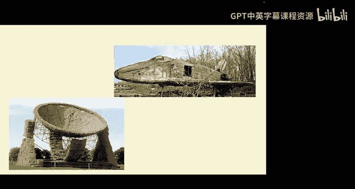

Allied forces。And those in。The Allied forces in particular left quite a bit of food and equipment which the islanders were very happy about and after World War II。

 some folks there started some cultts where people would build replicas of planes and airfields using S with the hope that if you build these airplanes and store airplanes and airfields。

 then their planes would come back and would bring more cargo with them。And an influential essay。

 Richard Feynman term named the term cargo called science where he called。

He called this for the activity when you pretend to follow the scientific method and you follow the rituals of the scientific method。

 but you're not really doing something scientific。And you can ask whether deep learning is a cargo cult。

And why do I say that， because in deep learning， we often do that。 We take rituals， we take。

We do something like say one stochastic gradient descent。

 which is an algorithm that was designed for minimizing or gradient based algorithm that are designed for minimizing convex functions and we run them on nonconvex functions where there is no guarantee that they would not get stuck in a local minima and not do anything good。

 or similarly we do empirical risk minimization， which is an algorithm that makes sense and is analyzed when。

The capacity is smaller than the data and it cannot overfit。

 but we use it in a setting where you can and will overfit wait so I have to push back on this but the planes never came back and cargo called science right okay right so the difference is that in。

The difference is that in deep learning， the planes actually do land sometimes。😊，Right。

 so that's that's the main difference， sorry I stole your punchline， I guess yes， yes。

No this is a good point， right， so we sometimes we do these things that。😊，To a certain extent。

 I like cargo cultult， but somehow the planes do land。

And why is this the case is something that we don't understand and sometimes they don't plan。

 not always， you know， sometimes you will really overfit。

 sometimes you will run SGD and it will not and it will not work or ever there is more than these examples。

You sometimes in Monte Carlo Mark chain， algorithms you。

You have a process that if you run it for infinitely long， it would give you the right distribution。

 but you you run it for a finite number of steps or a small number of steps and there is no guarantee at all what it will do and maybe sometimes it works and sometimes it doesn't。

And in general， there are two scenarios when you do something like that。

 you use something that was meant。And。Yeah， so there's a question。

 could it be attributed stochically in the algorithm themselves， So I think no。

 the answer is no in the sense that。Regardless of the algorithms being randomized。

 typically there would be a strong concentration of measure phenomena if you're using it in the same setting。

 it will ever， you know even though it's a randomized algorithm and there is randomized initialization even it will succeed all of the time we probably 99% or fail we probably 99% or or typically you can amplify。

 but when it fails。So it will really fail and you'll not be able to get out of failing by just be randomizing。

So when you're doing this kind of thing， you're taking a tool that was meant for situation A and you're using it into situation B。

 the two ways this can play out， one version is Murphys low。

 anything that can go wrong will go wrong if this hasn't been proven to work in this situation it will probably not work。

And the other is Mali's law， every little thing is going to be al right。

 and even though it was not meant to work it will still work out。😊。

I think in classical computer science， people have learned the hard way that usually Murphy's Law operates far more frequently than Marley's law。

😊，And surprisingly， in deep learning， sometimes Mali's law is。Is the scenario that takes。

 although not always， sometimes we do see merphy is low as well。

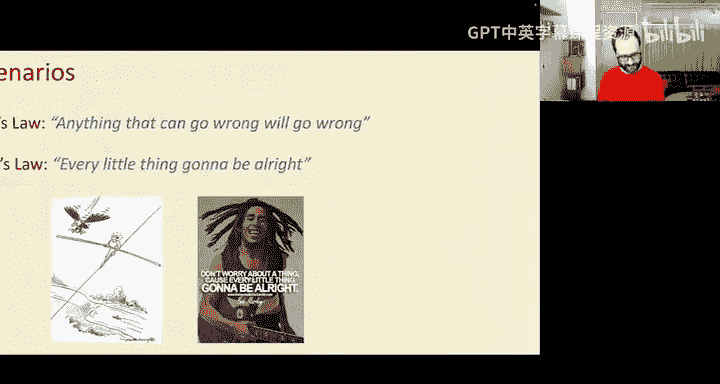

So now let's make two technical digressions of two tools that will be useful for us later today。😊。

So one is distance between distribution， so we can there are several ways to measure distance between probability distributions and I guess many of you know this but。

A brief refresher will not hurt。So suppose we have P andQ probability distributions over some domain D and D could be discrete or continuous。

So one measure of a distance between P andQ。Is the total variation distance， This is we sum up the。

We sum up the difference between the probabilities。

 the absolute value of the difference between the probabilities and for technical reasons。

 people sometimes。え。Multipliied by a normalization factor of half。And generally， this is。

And basically one way to think about it is that。You you take the area that is between the green and red curve。

That's the total variation distance。And。And it turns out to be equivalent， so if you wanted to。

Distinguished between P and Q， what you would do is you would have some function F that would give。

 say， with output one here。You know one here would output put zero here， without output put one here。

Z here and one here。And that would be。So basically with output one， on x。

 when the probability of x according to P is larger than that of Q。

 that would be the optimal thing to do。And it would get advantage， basically the advantage over half。

 it would be the total variation distance or twice the total variation distance always get these things confused。

The advantage over half will be basically the total variation distance measures the advantage over half to guess whether x came from P or x came from Q。

And then there is another measure which is common， which is the KL divergence。And the K dirgrgence。

Is you take the expectation between P and Q， you take the expectation over P of the log of the ratio of the probabilities。

And the K versions is defined in this way so that it will be done negative if if you find it hard to remember whether P needs to be on top。

Or bottom one way to think about it is the following， we want this to be non negative。

 so we want typically this ratio to be at least one larger or equal to one。

And that kind of makes sense if you're taking x according to the measure P then it's more likely that p is larger than  Q it will give heavier weights to the places where P is large。

 so that's why will be negative， so it's the ratio is always larger than one but on average the log of the ratio non negative。

And an intuition for the kale divergence one intuition you can think of it in two regimes if the k divergence is low。

 say it's smaller than one it's some small constant delta then roughly speaking。

 it means that you would need one over delta samples from a P to distinguish between P and Q to rule out if you're doing hypothesis testing if you got one over delta samples from P you will know with high probability that。

😊，You can rule out the null hypothesispo that this came from Q。

And in the regime where you the k divergence is large， suppose the k divergence is k。

 then you can think of it as if Q。If you get a sample from Q， it's like telling UK bits about P。

 so here is kind of a concrete example， suppose that P is a distribution of a documents and Q is a distribution of documents with a specific topic Y。

So the kale divergence between P and Q is the entropy of y。

 so much you how many bits of surprise in some sense。

 how many bits you learn by the fact that this comes from Q and it's all the same topic。Okay。

 any questions about those two comments I hope you have seen them before。

 so this is just a refresher。But yes， your formula for total variation distance looks a little bit different from something I've seen in the past i'm not sure if this is just like。

Maybe maybe I have this wrong， but I feel like I've seen it like as sort of a supre over like all points in the distribution is that equivalent in some way that I'm not seeing No I mean you probably have seen this typically people write you soup instead of Max you've probably seen this so you maximize over all functions mapping the support into zero1 the difference between the difference between the expectation so that's the super one version is typically。

😊，And this definition。and sometimes maybe it's the set， like maybe maybe people write it as Mac。

 you can write it as supermo over all sets of the probability of the S minus probability of the set under Q。

So how is that maybe I'm just not saying how is that how is that equivalent to the one half with the sum that you have right so the reason it's equivalent is because this is basically the argument I made here is that the best thing to do if you wanted to maximize the difference between the two things。

 the best thing is to do is to have a function that outputs one when the green is larger than the red than zero and the green is smaller than the red。

So that will be what achieves this maximum or superm by the way。

 I kind of when I say max or soup I mean the same thing。

 when I say sum or integral I mean the same thing so if these continues this should be an integral。😊。

诶。We're not going to quibble with these things and yes so。So you could if this was continuous。

 this would be an integral， this would be a soup。😊，But but basically the if you wanted to maximize。

 if you wanted to maximize the advantage， you would put one when when the green is above the。One。

 when the green is above the red and zero otherwise and then if you measure this advantage it will over half and maybe there is another factor of two here。

 which I never remember， but basically disadvantage will exactly be the advantage over half will exactly be this。

😊，Oh， exactly de fact。Yes， and by the way， both of those can be generalized and are generalized often actually in machine learning so。

😊，KL divergence is generalized to F divergence， we use a different function of the ratio between the two probabilities。

And a total variation is generalized to integral probability metrics where you use。

So rather than looking at the set say of all function from the domain to01。

 you look at some subset of say functions from the domain to the res and you do a maximum supermo overdose。

So now let's do two examples， so let's consider the normal distribution。

So in the normal distribution， let's say that p is just standard normal， just univariate normal。

 where the probability of x is e to the minus x squared。

And say Q is a shifted normal where the mean is minus epsilon and same standard deviation。

So in this case just to get kind of a sense for constant x you know when x is very is very large or very small then probability is very tiny and we can kind of ignore it it's not going to contribute much but for constant x the ratio between P and Q is the ratio between e to the minus x squared then e to the minus x plus epsilon squared so now if you open this it's like you know x squared plus2 x epsilon plus some epsilon squared this epsilon squared is constant not going to matter much。

So roughly speaking， this is going to be the ratio is going to be e to the two epsilon x。

When x is constant epsilon is small， then this is roughly like one plus a constant times epsilon。

So basically， say if you looked at the distinguishisher that between P and Q。

 let's say output one here and0 there， then you see that the advantage over half will be something like constant over Epsilon。

Right， so so basically that shows that。The total variation distance is roughly constant times epsilon。

If we look at kL divergence， we see that probably generally for half the x's。

 the ratio is like half the constant x， the ratio is one plus epsilon and half the constant xs。

 the ratio is like one minus epsilon。And when we select x according to P。

 we give slightly more weight， something like epsilon more weight to the ones where P over Q is one plus epsilon as opposed to P over Q。

One minus epsilon， so when you sum these up together。

 you get basically a contribution of epsilon squared。

Right so with probabilityability so it's almost balanced。

 right it's almost balanced the ratio between one plus epsilon。

 one minus epsilon but there is a little bit more there is kind of epsilon more weight on this part。

So you get a contribution of epsilon squared so the KL divergence is epsilon squared。

 the total variation is epsilon and indeed by the way。

 if you wanted to distinguish between these two normals you would need one over epsilon squared samples until you can with high probability rule out one。

😊，And from there other。And yeah in the high dimensional case this just extends。

 so if you have a standard normal standard high dimension and normal where the variance matrixes the identity。

 then compare to some normal where the mean variance is still the identity。

 but the mean is some vector mu， then the total variation corresponds to the norm of mu and the KL divergence corresponds to the norm of mu squared。

Okay。So， in。嗯。Now let's consider the case where the difference is in the variance rather than in the mean。

 so suppose that p is standard normal and now Q is much more now normal and normal with standard deviation epsilon or variance epsilon squared。

So in this case， the total variation distance is not very interesting。

 it's basically going to be one because with most probability， you're going to be in。

 if you say select something according to P， you can see very unlikely that it will be in this narrow regime。

So the kale divergence is more interesting。 So in the kale divergence with constant probability。

 the ratio is。😊，You know， log。Of the exponent of。Minus x squared divide divide by the exponent of minus x squared over epsilon squared now log of you know log of an exponent so we just so it becomes basically you know minus of a minus is plus so you get x squared over epsilon squared minus x squared this term will dominate so basically what we get is that。

If x is constant， this is the main contribution， so the main contribution will be。

One over epsilon squared。So this will be the divergence。And in the high dimensional case， again。

 this generalizes， so if say Q p is a standard normal and  Q is n0V where v is the matrix。

 the variance matrix。Then or the covariance matrix。

 then the KL will be the trace of the inverse of V and some additional factors that。In many cases。

 are not going to be。Very significant， so for example in。

And I see there is a question on the chat in a second， I'll take a look at them and then。

An answer so for example， you know this will be if the non singular values of V are lambda1 to lambda n to lambda D。

 then this will be the sum of the inverses。Minus D plus some of the land of the lambda I。

 and in particular， for example， if these is epsilon square times I， then each one of those。

Each one of those non singular values is one over epsilon squared， so you get d over epsilon squared。

And the other terms are dominated， yes。And I see maybe the questions have been a。

Maybe the questions are in。Okay， so there is a question。

 is there a reason why the number of samples is proportional inversely to the KL or TV distance and not depending on any other term？

And so。One， you can prove it that basically the idea would be that the best。

The best test to distinguish between two distribution is based on the log likelihood。

On the log likelihood test， where basically would say how do you distinguish between two distributions？

诶。You obtain， say you want to distinguish between P and Q， you get x1 until xn。

Where this is the number of samples and you decide based on whether you decide based on whether P。

The product， iPhone 1 till end。P of X I divided by the product， iPhone 1 till n of Q of X I。

Is larger than some threshold so you can show that this is the best test to distinguish between PM andQ and of course。

You can just write it in logs so you can write just the log of this larger than the log of the threshold and then it becomes a log of a product is of some of logs and it becomes。

And you can show that basically it becomes it boils down to the kale divergence stem。

So Pani is that helpful and I think this argument appears in the how to affect text。😊。

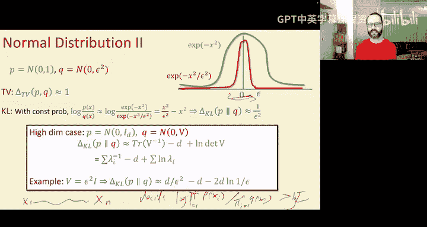

Yeah， this is very helpful， so probably that's why they also makes this make this argument in terms of a hypothesis testing yes。

Yes， so the best kind of the optimal hypothesis test would be based on the log likelihood ratio and that basically corresponds analyzing this。

 you see that the KL term kind of pops up。Sure yeah， thanks。

 but I'll still do some homework just to reread and reconfirm for myself。

 but thanks for the direction。

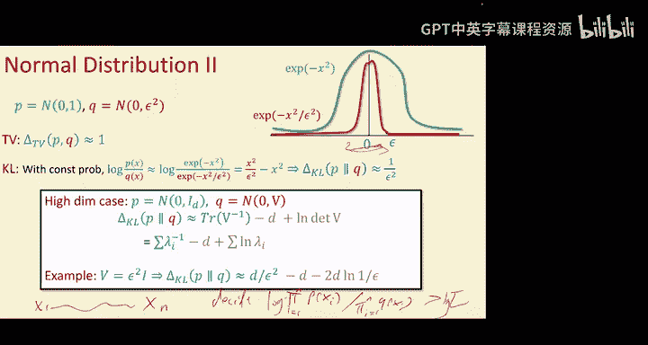

Okay， so today we're going to talk about generative models。😊，And in this problem。

 you basically you're given some distribution P and often you're only given it in terms of access。

 you say you get many images or many pieces of text and you and you want to。

And you want to generate something that's close to this distribution。

 so you're able to generate some distribution， say little G and now we want to see how good this little G is。

And。Kll divergence is a pretty good metric here。😊，Especially because at least in the beginning。

 if we try to do total variation distance probably the total variation。

 at least in the beginning is going to be very very close to one and it's not going to be something we can really optimize over so so KL kind of measures the number of bits we are missing so we just do the math so the KL divergence between P andG。

😊，Is then。If we open up this log， it is the。So we can separate it out to two terms。

 it's the expectation under P of log p of x minus the expectation under P of log g of x。

So now this term， does anyone know what's the name for this term？Me entropy， yes。

 this is the entropy or negative entropy right entropy is with a minus so this is minus the entropy of P。

And this term is known as the cross entropy。Right so you can so the cross entropy of P and G is basically when you take the entropy of G。

 but instead of taking expectation with respect to G， you take expectation with respect to B。

So and if you want to do and。If you wanted to minimize kale divergence。

 youre trying to minimize the cross entropy minus the entropy。Of course， if P and G are equal。

 then the course entropy is equal to the entropy and then this thing is0。And so since。

If we want to minimize over G。Then you know this term doesn't depend on G at all。

 so basically minimizing kale divergence corresponds to maximizing the expectation under P of log g of x。

And this corresponds when another way to say it is basically we are minimizing the course entropy。

 we could say that we are minimizing the course entropy。

 we are minimizing K divergence that the same thing。

 or maximizing this quantity which is the log likelihood right so we are maximizing the expectation under P of the log likelihood of x under G。

And the nice thing about this term is yeah so and this is also intuitive right we want a model G such that if we sample a typical x under P。

 it is going to be likely under G。Ideally as likely as PR at least close to that。

And the nice thing about this is that this is a quantity we can actually evaluate as long as we can both sample from P。

😊，And compute the G's density map so we can compute the map that maps x into geox。So if we have。

 you know， the Ps usually comes from nature， so this is some probability distribution that we cannot really evaluate P of x。

 but we can get samples from it。And but G is something that we constructed in actual generators。

 so if we are lucky， we might be able to actually compute the density map。And。

And if we're trying to maximize it so we could do the standard thing where we get a training sample and we try to maximize log of GX and again we have this issue of overfitting and in some sense we have an even more severe issue of overfitting in generative models than we have in classifying。

😊，And the reason is the following。😊，If you can allow yourself to memorize your entire training set。

 then。You can have the G， which is basically if you're given these x1 till xn。

You can have a generative model G。Which is the outputs just the uniform distribution over the training set。

Now for training examples， the probability for each training example is going to be one over n。

 this is actually huge。Because if you think about it， say suppose you got 10，000 images。

In the true distribution of the world， there are millions and millions of images。

 any particular image in your training settings， you know the true probability distribution is one over millions of billions。

So a probability of one over 10，000 is very large， which means that the training。

 if you're trying to maximize this quantity。You memorizing model is actually much much better than the real model。

 the log likelihood under G is actually much larger than the log likelihood under the two probability distribution。

 but of course this is completely going to be completely useless。

 this model is going to be completely useless for anything you haven't seen before。😊。

So the point here is that you have to be really worried about generative models if you're trying to maximize look likelihood。

 even more maybe than you do with classifying models。Okay。

So now I wanted to make another technical digress。And talk about what you want to do if you want to optimize multiple objectives。

And。If you want to multiply these multiple objectives， suppose we have two objectives。

 but of course you can have also five or you want your weights or your network to satisfy more than one desirable property。

So。诶。So we want both L1 and L2 to be small， so one way to think about it is to think of this Perreto curve。

 so what is the Perreto curve。So there are trade offs that you can make between the two parameters。

And you might not be able to get to this point which minimize completely both L1 and L2。

 but however you have these these locally optimal points which basically they cannot be improved upon in both directions so for example。

 if you compare this point and this point，So。maybe let's give them name。

 let's say this is point A and this is point B。So。Point a is better o。

So point A is better than point B in an。With respect to L2， but it is worse with respect to L1。

So this is the perreto curve of things the solutions that are incomparable to each other。

 where this is basically all the points that you can achieve， all the feasible set。

 all the combination of losses that you can achieve。

 and this is the combinations that you cannot achieve。

So there is a nice CRM that says that if L1 and L2 are convex。

 then for every pair of points on the Perreto curve。

 you can actually reach them by just minimizing a linear combination of the losses。

And here is proof by picture。So basically the idea is the following。

 if you minimize a linear combination of the losses。

 it's like you basically choose which direction say if you started from some this point。

 you can choose on which directions to optimize。And depending on the choice of the direction。

 you're going to hit one of these points in the perito curve。And another way to say is the following。

 if you take any point on the perireto curve and you take the plane that is the tangent plane this point。

 then because this is a convex function， then this point is the minimizer。

 this tangent plane lies below the curve。And so this point is the minimizer if you're minimizing this function a plus lambda B。

And this is great， but what happens if it's non convex， so if it's non convex。

 everything can break down。😊，There could be some points that are not the minima some points that you cannot reach by a linear combination。

 so for example this。This point here。If you look at the tangent plane here， it is not above the。

So if you if you pass any any plane there is no there is no plane no line sorry it no line that is below the curve that touches this point here。

 which means that there is no lambda such that this point is the minimum of L1 plus lambda 2 so this point is in some sense not achievable by。

This linear combination， you can also have multiple minima。

 so for example you could have this minima that is achieved in both cases and even if you have multiple minima when you run a local algorithm you could get stuck。

On something that is not the minimum so you can get stuck on this point。

 even though there are these points here that are better so everything can go wrong。

But sometimes it does work and this is actually another one of those cargo cult things where people often minimize linear combinations of objectives。

 even though they。😊，Even though this is not guaranteed to work。

 but sometimes it does go wrong and there is a nice blog post which kind of demonstrates when things go right and things go wrong。

诶。In this issue， so these issues sometimes do arise in practice， but let's。For this this lecture。

 we are just going to imagine that we can always minimize if a bunch of objectives， oops。

 and I guess gifts are not very。PowerPoint on the iPad doesn't like gifts as much。Good to know。ok。

End of the aggressions。Okay， so we're going to talk about unvised self supervised learning。

 so we want to understand this probability distribution。

And the dream is to at least my dream I don't know if it's the dream of everyone in this field is to find basically a combination of an encoder and the decoder that is going to solve all of these problems so what would be something like that so you would have some encoder which takes。

😊，And x from the input space。And finds a good representation of X in some latent space。And。

This good representation will be good in this sense。

 it will allow you to find this kind of semantic meaning so for example， if x is an image。

 then maybe there would be some coordinate or some direction here in this space that would correspond to how much whether there is a cut in this image or not。

诶。And then yes I see there is a a comment on the chat by the way if I forget to answer a question on the chat please unmute and ask I might sometimes miss it so what practical settings would we want to simultaneously optimize two different functions without aggregating them into a single function so I think many setting will seem setting where we want to optimize two different functions the question is how do you aggregate so you can aggregate by typically just heuristic you really want to minimize two things and you just minimize one plus the lambda of the other and you treat lambda as some hyperparameter。

But you could imagine some other aggregation functions and sometimes people use some other aggregation。

Functions， but we will see a practical setting where we want to do this thing in I think a slide or two on variational auto encodes。

😊，Yes。😊，And that is the link to that a blog。So yeah， we would like。

 you know to find a good representation one where say。

 yes two images of cats will become closed in Euclidean space here and maybe there will be a direction that corresponds to the cutness and direction that corresponds to sunglasses。

 if it's a picture of a person and et cetera， et cetera。

And then we would also want to be able to decode this。

 in particular we would like maybe the probability distribution that's induced here to be one that we can sample from so we can also generate。

So we can do this thing， we can sample fresh things from a P and also if it's a nice probability distribution。

And then which we can compute the density of and D say e is the inverter of D。

 then we can maybe also， or we have some other way to compute the density here。

 then that would also be really nice。And hopefully this representation will also help us do this kind of prediction task。

So ideally， we would like maybe a single combination of encoder and decoder that will let us solve all these problems and I think。

I'm not a practitioner， but I think we are not there yet。

We have some very good things for parts of this picture。

 but nothing that really works completely together very nicely。Let's see what we do have。

So so this is a dream and one way to say it is the following thing， so remember like we said。

We believe that our data is arising by somehow there is some process which makes these kind of high level to lower level choice that eventually result in the data。

So and then we have our systems that。Take the data and hope to maybe go back and recover these high level choices so the idea would be that maybe these choices are the latent variables right so the choice of which object will be Z1 and the choice of where the object is will be Z2 etctera。

 etc ceter。And we will have a decoder that。Takes these latent choices and translates it into a piece of data and we'll have an encoder that takes a piece of data and recovers these latent choices。

And then from these latent choices， it's very easy to say that this is a dog on the beach。

 so that would be kind of the dream。Like I said， I think we're not there yet。

 but we have all sorts of tools that suggest we could be there at some point。Okay。

 so let's see what we actually people do。 So the kind of common approach is the following。

 So we treat it as some kind of a communication problem， we say。

Because obviously you can achieve this by just the identity map right you can an encoder could just map x to X and the decoder could map x to x back without any understanding or doing anything to analyze the input so typically we want to force some constraints here to ensure that both the encoder and decoder do something non trivial。

So one way to think about it is that we think of it as a communication problem。

 the encodeder tries to communicate to the decoder and we restrict the channel。

 maybe we add noise or restrict it in some way that will force the encoder to put some meaningful signal here and to have nice Latin space。

So one yeah， one yeah and what does it mean meaningful right we could say we want the dimensions。

 we want directions in z to be semantic， we want that if x is similar to x prime。

 then z will be close or correlated with Z prime in Euclidean space will have large inner product。

 we would want maybe z to be sampleable， for example。

 we want maybe z to be just a standard normal and maybe some other conditions。

So this so we hope to achieve that by restricting the channel and basically the idea is yeah。

 maybe merely's law will work and we just restrict the channel and suddenly it will force the encode coder to become to put all sorts of semantic information。

 everything will just work and it doesn't always exactly just work but we'll see。😊，So auto encoders。

 the channel is we just put maybe the simplest constraint， we just make the channel short。

 so we just say， okay， if the length of x is D we'll make the length here r for some r smaller than D。

And we think， okay， that will kind of force。And to compress this Z。

 it will force the encoder to really understand it。いいね？

In variational autoenrs and also in flow based generative models。

 we can think of this noise as basically we add normal noise， so we add a lot of normal noise。

To the channel which corresponds to minimizing the k divergence between normal distribution and the encoding。

And there are some other noise models， I think the vector quantized VAEs correspond to some kind of coding。

 I'm not sure what the noise model for which this encoding is optimal but maybe there is one that's a good question to figure out。

😊，So let's start with autotoenr， the simplest thing。

So in outer encoders we want to force understanding by setting the dimension of z to be much smaller than the dimension of x and once we put this hard constraint on。

 we just minimize the least the sum of squares reconstruction error so we're given right so we are given these x1 till xn。

And then we want to basically minimize over E and D。で。

Some of squares of the difference between x and x hat。ok。😊，So here is an example。

 PCA is a special case of autoenr where the。Where the E andD are linear so PCA is principal content analysis so what do we do in PCA so so this is generally an auto encoder we want to find an encoder and decor that minimizes this difference。

And if they are linear， this basically corresponds to。Finding a rank R matrix， right？

 So what do we really， What are we trying to do， What is D E， if， if this is linear。

 then D E looks something like。I won't get it wrong。Yeah， it looks something like this。

 right This is。This is our。This isデ thisスイ。This is thedisional， this is thedisional。

Right so we are trying basically this is a general way to describe a rank R matrix。

 so we're basically just trying to find the rank R matrix L that will minimize this and just doing some math which basically we are trying if capital x is the matrix of our input。

 then we're just trying to minimize the square norm of I minus L times x or you can open this up and it will be this trace of this matrix。

Generally， if we move to the een space， we so if we， if we move to this een space X X transpose。

 then you can see that what you really want to do。Is to what you really want to do is to zero out。

Is for for L to keep the largest dimensions， the largest eigenvalue。

 so L would just be the span of the top R eigenves。

And you can you know you can do the math and prove it so basically this corresponds to PCA so PCA is basically finding the top r directions and this is basically what you're going to do if you want to find a linear encoder and a decoder。

And autoer encoder is basically just the nonlinear version of PCA。And again。

 there were places where you could find formal。AndDescripts of this I。

I will find when if it's not on the work recile in the。Or in the my understanding machine learning。

 if people ask me， I'll find on the slacklack， I'll find sources where you can see like a full formal analysis of this。

嗯。Okay， so out encoder is just a nonlinear version of this and it does indeed work better than PCA so this is just an example I took from someplace I now forgot。

 so you can see that reconstruction using this nonlinear if you restrict z to be 30 dimension when you reconstruct using this nonlinear out encoder it works much nicer than if you did it with PCA。

It's not that it's completely terrible with PCA， but it's better with a nonlinear。So。

So basically how to encoder we are trying to minimize this you know this norm and you could hope that this is kind of one case with Marli's low that maybe by simply requiring Z to be short。

 you automatically force the encoder to be。To contain meaningful。

 a lot of meaningful information and that the Z is going to be。Z is going to be distributed。

 say like uniform or normal or something like that。And。Yes， so this would。

 I should have written here。So you might expose sorry。You might hope that say yes， that's。

Let's see I made them man。So you might hope thats say the E E of will。

Will be roughly like uniform or normal and therefore D of uniform will be roughly like wheel so you could sample。

And in some sense， I think in some optimal version of the world， if everything was infinite。

 probably that might be true。But this is one of those cases where there is actually murphy is low so I think and again I'm not a practitioner and people can。

😊，Yeah， so here。😊，Dniiel is asking about the parameter。 The parameter is yes， the dimension of the。

 just oh， the dimension of the。So and I think what happens essentially is that so if you run it on images。

 then autoto encodecor kind of rediscovers somewhat slightly worse version of JPEG or something like that。

😊，And again， if people have more practical insights they can chime in。

 but basically you get something like a compression like JPEEC compression。

 now I don't know if you've ever tried， for example。

 to generate a random image by taking a random file and trying to run JPEG decompressor on it。

 but this is not going to work out。😊，So it's not going to give you a generative distribution by taking a random file and also if you try to decide whether something is a cat or a dog。

 it's likely looking at the JPE compression of a file is not going to make it more helpful if anything is going to make it less helpful。

😊，So this is not really a way yes， I mean， it does kind of can pick up on some low level patterns like some textures and。

Whi helps with compression， but it's not going to be really a very meaningful representation。

 so this is one of those cases where we don't really we have Murphy's low not me's low so simply just asking this latent space to be sure doesn't work。

So variational auto encoder tries to you know fix these issues and the idea is to really try to enforce to make the latent space normal。

😊，And the way we do it is we add this is answering a previous question。

 this is a case where we basically have put two objective。

 so we had one objective which is to minimize the square loss reconstruction error。

 but we also had another objective。😊，Which is to minimize the KL divergence between the。

Output of the encoder and the normal distribution。And I want to emphasize that we want to minimize this。

 want it's something that we need to measure。And the way we talk about it， with respect to a fixed X。

So that means that E has to be randomized because otherwise the K divergence will be infinite。

So is is now a randomizedco。That is a randomized encoding and we want to minimize the k divergence between e of x and the normal distribution and you can have half variations where maybe it's not the normal distribution but we'll fix it to the normal here。

And。😊，And how do how do you find the randomized neural network so you can think of you have a randomized randomization gate。

 a gate that or neuron if you want that the weights are mu in sigma and it spits out a normal with mean mu andvari sigma squared。

😊，And。How do you train this kind of thing do how do you train this kind of thing and do SGD over these weights the way people do it is they think of it differently so they fix they choose some random standard normal T and then you can write v as mu plus sigma T and now you can just do the kind of you can think of it as a deterministic gate and and just do this。

😊，Do back propagation for it， et cetera。And。That's a great question Andrew is asking what the point in some cases was to have for Z to have semantic meaning isn't en forcing its distribution to be normal antithetical to that so interestingly。

😊，It's not。And in。And I'll say maybe something about why it's not later。

 so but maybe just as a hint you basically。A going to force that nearby X has to be mapped to nearby Zs。

 but we'll talk about it in a second。So there is another way to view VAE so as we said。

 so VAs are we have this multi objective problem with trying to minimize the square difference and we trying to minimize the KL divergence between the output and the normal distribution。

 which is at least good， yes， maybe it's not going to it's not clear why it will give a semantic meaning but at least。

It's clear that EC will be very helpful if we want to get a generative model。

And let's see another way to view the same thing。 So let me define the distribution Px。

As being the conditional distribution on Z condition on the decoder outputting x。So， and。诶。

Is constraint on the spherical normal to disentangle the representation so let let me say a little bit to how the constraint so right now let's say the constraint is on the normal just to make sure that can we can generate right so we want a sampleable distribution the nice sampleplable distribution is the normal distribution so we are trying to ensure that the encoding of a real thing is as close as possible to the normal distribution so then so then we can also generate something by just feeding a normal to the decoder。

So now let me show you another way to view the same thing。

 so suppose we just our focus is on the decoder and we want to make it a good generative model and let's see what this means。

😊，So， and。So consider Px to be the conditional distribution you take a random Z condition of the decoder outputting X on z。

Okay， now and let me define QX this is just for notational convenienceqX is the encoding on x we remember that we said the encoder with randomized it's going to be a distribution。

 so QX is a distribution。😊，Now， you know the the。If we look at the chaoss。

If we look at the KL divergence between QX and Px。Then first of all。

 it's not negative because it's a k divergence。😊，And we as before we know。

 it is the entropy of QX minus the expectation of z according to QX of the log px of z now px was defined as this conditional probability distribution so we can you just write out the formula for that。

And now we're just going to take the terms apart right so a log you know log of this divided by this is log of this minus log of this minus of minus is plus we rearrange the terms and we get the following thing right so we get this part moved here and this part moved here and this part moved here and so we get。

That this equals this non negative quantity equals to log of the probability that d of n equals x。

Minus。This winter。Which is this expectation of z according to Qx。

 the log of the probability that n equals z and d z equals x。And minus the entropy of。

The entropy of QX。Now， so since this whole thing is not negative。

 what it means is that the red thing is always smaller or equal to the green thing。

So now the green thing is the log likelihood right this is exactly the thing that we want to maximize if we want to make this D of N be as close to our actual distribution as possible。

😊，So if we， since the green thing is always at least as large as the red thing。

 if we maximize the red thing， then which is a low bound on the green on the low likelihood。

 we could also you know be maximizing the green thing so this is known。😊。

This red thing is known as the evidence based lower bound， I think I wrote。Evience老板诶。It's elbow。

 what's the。It's elbow written right or did I get it's everyday or a blue I don't know？

So it's evidence based lower bounds or some version of this and this is。

And we can think of trying to maximize， yes， evidence lower bound， okay。

So it's the evidence log bound or the elbow and you can think of trying to maximize this as a good way to try to maximize this logbe likelihood。

😊，And especially when you don't have and you cannot maximize the log likelihood directly if you don't know how to compute。

 if you don't know how to compute these density functions， but you can maximize these。

Or you don't want to maximize local likelihoodli also， like I said。

 because of this over parametermatization issue， but you can try to maximize this expression。

And now you want to try to break out this expression and understand so it's basically it's。This term。

Which is basically this term is。Basically， the。We can think of it as the probability that if you take an encoding of x。

 basically and you decode it， you get back。X， so this is like the corresponds to the decoding error and this negative entropy。

So the entropy ofq is higher the closer is to the normal so so if you're trying to maximize the elbow so you can see you can split it into two terms and it turns out that this term is basically like because we are talking about normals this is basically like the negative of the square difference。

And this term is like k minus the divergence。So basically， if you're trying to maximize the elbow。

 what you're really trying to do is minimize the reconstruction term and the divergence term and here is just a constant so you're basically trying to。

You're trying to maximize you're trying to maximize minus the reconstruction term。

 so you're trying to minimize this and minimize this， which is exactly what we have here。

So basically， this is another just another way to view the same thing， so often if you see。

Expositions of AAE， they would maybe start with the first view rather than the second view。

 but basically。It amounts to the same thing， you're trying to do two things。

 you're trying to make the lightens close to normal and you're trying to make the decoder succeed in decoding the encoded。

Any questions here？嗯。Okay， so yes， so in practice。😊。

This does work somewhat well these VAEs I think and in particular it does seem like that the latent dimensions have some kind of geometry in a sense。

 like at least for these features like you know， when you do it in faces you can think of there are vectors that seem to correspond to say blonde hair or adding sunglasses。

😊，So there does seem to be some features， whether blonde hair or sunglasses is really a semantic feature。

 that's really a matter for debate because。Arguably this is not really this is kind of a photoshop type transformation that's not really very semantic。

 it's not really changing you know， taking a picture of a cat and making it into a dog and more like。

Some image manipulation。But so what are the pros in the cons so ED are randomized which often I think corresponds to blurry images。

 there may be some other reasons why VA is tend to output blurry images。

 but randomization definitely doesn't help。On the other hand。

 the fact that they are randomized and these often are randomized well。

 it really does need force kind of geometry on the latent variables because it kind of forces that。😊。

If z is close to z prime。You still need to decode successfully。

So that kind of requires things that are near by each other。

 like Z and Z prime that are near by each other to also have nearby decoding which is a useful thing。

But another thing you could a problem could be is that you could have this kind of Merrphy's low situation where basically you really have two objectives so basically you can imagine that the latent space kind of splits into two piecess and they just kind of coordinate with each other so one of them says you know I'm going to keep this part completely normal so that will be very good for the KL term and you go and do a JP compression and that will be very good for the reconstruction term and this way they can somehow。

😊，Managed to get。To work on the VAE objective without doing something very meaningful and I think this is known as posterior collapse sometimes in the VAE literature and sometimes happens and you have to watch against it so this is an issue where somehow these two objectives you might be able to satisfy them in not in the way that you want。

There have been people are doing some various workss to try to improve on this and as there is some of these issues and there is vector quantized VAEes and hierarchical VAEs that。

Do much nicer。And。Yes， there is a question。So I think we don't know if the features learned from VAs are useful for discriminative task I don't I don't know if there is any。

Work showing that these features are useful and that's a good question I don't know if。

Anyone else has more to add it。 So I think the the people have managed to do better on the people have managed to do better on the blurriiness side。

 but not as much for the。And discriminative side， and actually that， I think。

 is like a big question in general。So yes， and there are some tools。

 maybe I'll kind of go here quickly， I'm sure we'll talk more about transformers。

Later in this course so maybe i'll kind of go quickly about so there are some tools where basically use some kind of another notion of。

No， is it channel where you try to discretize the signal by。

Somehow taking the pointing a Latin space and mapping it to the closest vector or maybe in a soft way to the closest vectors from some code book。

And you can then try to also optimize over this codebook。

And another model that people use and people use it a lot and actually does sometimes get a good representation is this。

😊，Autto aggressivegressive models。 So one way to think about these auto aggressivegressive models is that you have kind of a very trivial decoder。

But so all the work comes up in the encoder， although I think ther and the encoder are used in transformer literature differently。

 so I'm not。Show this maps matches up with the standard notation。

 but the idea is that following you what you try to do is you given an input。

You try to build something that given a prefix。Say that that really outputs for you a sequence of probability distribution over the outputs which each one is is supposed to be the probability distribution。

 which is the。😊，Basically the probability distribution of the IF element in your data conditioned on all the previous ones。

😊，If you have something like that， you can just sample from the probability distribution。

 you can sample Z1 is just from a finite set， then sample Z2 condition on Z1。

 Z3 conditiondition on Z2， ettera， so it takes some time， but you can do that。

And the idea is now the encoder might get like the input with say masked bits and we need to guess。

 say X I based on the other ones and sometimes the other versions where the masking doesn't necessarily has to be。

As to be at the end， but some'm asking in the middle， et cetera。And interestingly。

 these the ones and itself is usually not。Useful for classification task。

 but as was shown in the work on image DT sometimes if you go and look at some of the internal states that are if you go in some of these intermediate layers。

 you actually get useful representations that are useful for。😊。

That are useful for classification tasks， so this is quite interesting that this happens and maybe we'll talk more about it some later lecture。

Okay， so now how do you measure if you have a generative model。

 So there are all sorts of generative models and， but maybe the main difference between。

These generative models is ones where you can actually explicitly compute the density and implicitly compute the density。

 So if you can explicitly compute the density， then you have these metrics and basically it seems like it's always the same metrics you're trying to。

😊，You're trying to maximize the logo likelihood or minimize the negative logo likelihood。

 so sometimes people measure you know you'll see in a paper a negative logo likelihood or Bitsburg P and sometimes it's log and sometimes it's long but it's basically the same measure。

And sometimes in the NLP， people use this perplexity message， which is basically like。

You take the exponential of G。And they typically use this when you have like a long sequence of the probabilities。

 the product。Of the conditional probabilities。But basically， you're always trying。

 if you can compute the density， then a great measure is just to try to maximize local likelihood。

Maximize likelihood。If you cannot compute the density， then you're in more of an issue。

What does density mean very good density is just this right the probability。

 you have some generative model。😊，Which we think of it as a decoder， it takes as input randomness。

And spits out X。And we want to be able to compute or approximate the probability that it outputs particular x。

Does he answer the question？Yes， thanks， very good yes， so if you can compute it。

 you can compute g of x or approximate it， then you can do all of those things if you can't。

Then you have to somehow do something else and sometimes I think the people use。

 I know it when I see it。And for example， if you look at figure one right。

 so typically if you look at the machine learning paper。

 figure one is going to be the main figure right what the main thing that you're showing and if you look at papers on guns。

 usually figure one will not be some metric on which it does very well but whatever just the images that it spits out and because basically we will just look at it and say okay。

 this looks good。😊，And。Because maybe we don't really have yet very good things。

 people have tried to do something like some creative ways to measure。

 so one was the inception score。😊，Which we basically。

 suppose you have like you have a generative model that spits out things that look a little bit like INe。

Then what you want is to measure the scale divergence， which basically the way to think about it。

Is it's trying to again maximize two things for one thing。

 it wants to make sure that you're outputting images that have many classes in INe。

And the second thing is that the things you are outputting。

 the inception the inception is very confident about those labels。

 so you're kind of outputting something that's。Somehow and。

That somehow looks to that particular network as if it came from the uniform distribution over Igenenet classes but it doesn't really work out and these things don't really look like INe so for example。

 there was a nice workshop paper of Ra in Vinieialis from 2019 where they took a very you know a model that looks really nice and also got us very nice inception score。

And they took various variants of it they show that if you trained with images generated from this model instead of IgeneNe。

Then you get huge accuracy drops。So the accuracy was originally 74% and then it dropped to sometimes 5% or at best was 43%。

And the drop was kind of uncorrelated with the inception score and just to compare that。

 if you did this you look at this experiment I mentioned last lecture and we'll go back to publish in the next one。

If you compare that with what happens if you take， you train on one version of IgeneNe and you test with respect to another version of IgeneNe。

 you typically get very reliably like a 10 point drop。

So here you get something like a 70% point drop or at best like a 30% point drop。

 so this is really these guns don't really output。Yeah， they don't really successfully do。诶要种。

A replacement for imaginative in all metrics， but they do that doesn't mean they're not useful。

 it just means that you have to be careful。And the reason' important to try to find nice metrics that don't are not just i know when I see it。

Okay。So。The next thing I want to talk about are flow models。But now my debate is。

 should we go directly to flow models or maybe ask get some。Before we go to law flow models。

 maybe we'll just ask some questions and take a break and then we'll go to flow models。

So any questions？Or comments。I had a question regarding the VAE yes。

 and my question was about the fact that。I couldn't understand this like standard gusian。

 because I think that this was the prior on the。On the encoding space in that the posterior was not like standard。

And this is why we introduce this thing like approximate inference。

 and we introduce this secondary neural network for the encoding parts。

So again is this the slide where you were the question Okay absolutely because the way I understood VAE was that we have like a deeplate and variable model and we need to do like the variational inference for every one of the data points and what we are saying is that okay we are no longer going to do that were going to say that the mean and the covariance metrics of。

The distribution can be written as a function and this function is going to be a neural network and this neural network is like this encode encoder side Yes。

 and so I don't like when you say make the latent space to dark oceansion like so so Im think there are two views of VAes right and they tend up to be basically the same mathematically so view number one is forget about like everything you have seen in a typical lecture on VE。

So view number one is basically just you're trying to minimize two quantities。

 quantity one is the reconstruction error， that's a very natural quantity to try to minimize right and quantity two is the k divergence between the encoding and the normal distribution。

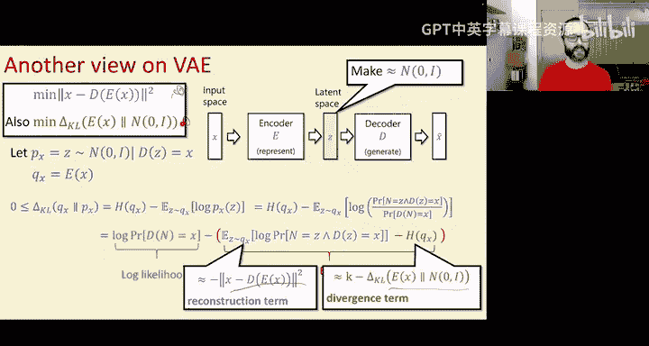

Okay， okay， so if you think of this， then this basically corresponds to saying you have an encoder。

 standard encoder decoder with square error， but you also add an additional objective which is to try to get the k divergence to be as small as possible。

 okay？So this this is the first view and that view translates into this multi objective problem that you want to minimize these two terms。

 right？YeahNow now the second view is the following。

 the second view is that you're trying to maximize the logo likelihood， but because you know this is。

And not something you want to estimate directly using this variational thing。

So you're maximizing the variational lower bound for the log likelihood， okay？

And now if you look at this variation the lower bound。

 then it really splits out into two terms one term is you're trying to you're trying to。

You're trying to maximize。The entropy of Q。Also， and keep。Yes， you're trying to。Okay。

 so now I'm keep keep getting this backwards， right， So the entropy of Q gets here with。

Yes so there are two minus signs yes， so there are two minus signs right so if you're trying to maximize the elbow。

You're trying to minimize the en P of Q。 So now let's get a。You're trying to minimize the。

Entropy of Q。That actually is like the opposite for what。

So now I have to think about it so let's start with this term so this term is really you're choosing Z according to E of x and so that basically is the you end up basically being something proportional to just the distribution。

That d of z equals x and because you have a normal。

 then it's basically going to be like exponentially small in the distance between x and d of e of x so that that term going corresponds。

Thatium is going to correspond to。That term is going to correspond to basically the reconstruction term。

 okay？And this term is supposed to end up being trying to minimize the divergence between n and the Q E of x and the normal。

 and now I just have to think exactly how it will work。But generally。

The smaller the divergence between E and the normal should be the higher the entropy。

 which is somehow now confusing me， but probably got some minus one in some place。But basically。

 this is going to be a divergence term。 If someone knows the magic， they can chime in， if not。

Figur it out during the break。Yeah， and so just one last question。 So this EFX。

It's like the posterior distribution of Z given x right so EFX we think of it as an encode network but in typical way people talk about VAE。

 we think of it as an approximation to Px。Yeah。W an approximation to this posterior distribution。

So this is this encoder we think of this encoder as trying to approximate this posterior。Okay。

 the posterior of。Of z right the distribution over z that arises after fixing x light。

 both P ofx and Q x are distributions over z。Okay。Okay， thank you。 okay。

But that's a quick notation question on this slide Yes。

 when we have n in the probability distribution， we mean a random variable that's distributed as a multivariable standard multivariate standard normal。

Yes， yes， yes， exactly。 I just wanted to ran out of form so I just used N as a standard normal Yeah by the way。

 I figured out this thing this is right。This is okay， so。Okay， no。

 I have to figure it out completely yeah I'll figure out this age of where it's plus where it's plus or minus and。

And then we'll figure it out。Okay。And。Any other question？

A couple slides later we have we were like looking at。

Improving improved VAE and and that's like what were the pictures for？

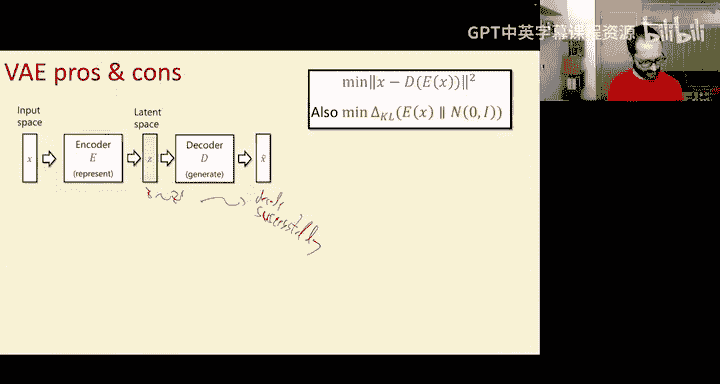

Those are models those are generated images from these better models。

So you see theyre significantly less blurry。I see。They do look pretty good。Yes， they do look good。

 I mean， buts it's a problem， like I said， about the know when I see it metric is problem because you know。

 you feed。You feed in a model millions of pictures that look very good and it output something that looks very good。

 okay that's or you know the figuring out a that makes a picture look good is not necessarily the hardest problem in the world。

😊，Could I ask also。The motivation for VAEs was that they。

 how is it that they're superior to autoenrs in some cases， what is it they do better？

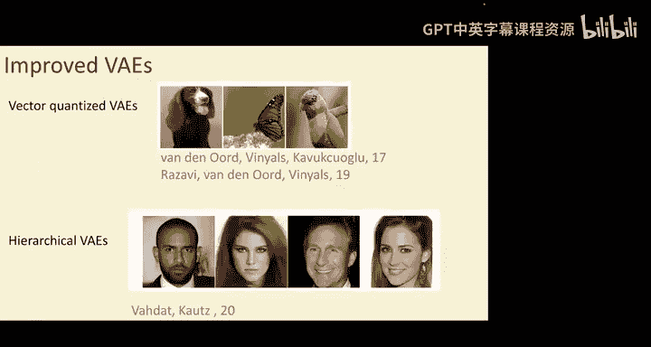

So I think， you know， for example， this kind of。

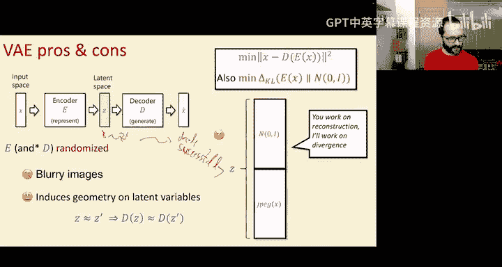

So first of all， auto encoders don't give a generative model at all。

And they also will not give way to maybe to have these kind of slightly。

 at least meaningful latent dimensions， like a sunglasses dimension or。Or a blond hair dimension。

And yeah an auto encoder won't give a generative model at all。

 so if you think of auto encodeder just giving you an JPEG compression。

 JPEG compression is a nice compression， but it won't give you a way to say generate a new image or to add the sunglasses to a face of things like that。

😊，I see， well， I don't see why VE's latent layer would be any more interpretable。

Then a but you do get something gene out of bit of sound like you get something generative and I guess if interpretable you know。

 you get some low level features like for example， it's very easy I guess to find a classifier whether someone is wearing the sunglasses or not that's not a very interesting。

Vision problem， but so it gets partial。 you can say it gets part of the way there。Thank you。Okay。

 so maybe we can take a 10 minute break。 so we were here， right。Before flow models。 so and。Yes。

 so we will take a 10 minutes break， so it's now 126， let's meet in 136。was' the recording？

Hi everyone。Hope people are back。So， maybe before we。Before we continue。

 let me just fix the sign mistake that I had on the slide before。So yes， the K divergrgence。

s the term in the KA urge is negative the entropy of QOX。

Minus this term expectation of according to z of log px。

 because by the entropy is the expectation of negative the log， not expectation of the log。

So when we put this into the elbow， then this becomes a plus。

 so when we're trying to maximize the elbow we are trying to maximize the entropy ofqX and maximizing the entropy ofqx is basically like minimizing the divergence between that between E of x and n and the standard normal。

Okay so basically when we're trying to maximize the elbow。

 what we're really doing is there are really two objectives there。

 one of them is to try to minimize the reconstruction term to make x close to d of e of x。

 and the other one is to minimize the divergence term to make E of x close to being a normal。And and。

And I don't know。 I find it easier to think about as two separate objectives。

 which are both very natural than to think about this elbow thing but。

Anyone can follow whatever they prefer。I see my video is not on yet。That's。

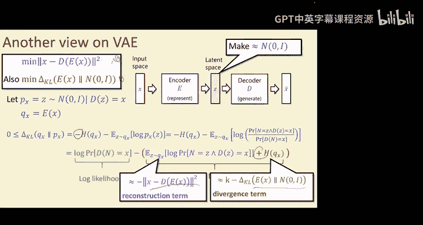

Okay， so at。Any questions about this elbow thing？No， okay。Okay， so let's。So， let's continue and。Yes。

 so yeah， so auto regressiongressive models， as I mentioned， there are again。

 these are generative models where the probability what what you do is really spit out a set of conditional probabilities so just。

😊，If every。So if every one of those can be a member of some set S， let's say ss of size。

 I don't know 1000， then you can represent a probability like that by 1000 numbers。

And the point is that these are the conditional probabilities， so Z I is basically the conditional。

Distribution of X I。Conditioned。On X 1 till X， I， -1。And。

And now you don't get sampling in kind of one shot。

 you're going to have to you know to sample it one symbol at a time， but it can be。

But these seem to work。Fairly well in the。And this is maybe the one example of say imageGPT and the general GPT。

 they are the example of models that both do good generation and have semantic。

Internal representation。Okay。So let's see these flow models， which are， I think very nice。你细啲啊。

K能 t v。Okay， I guess these markings are here to stay okay。That's it。 that's good。So， and。Yes。

 so flow models so the idea in flow models is similar to maybe maybe maybe it's kind of inverting thender and decoder in terms of the way we think about it so we think of a mapping from the Latin space to。

So we focus mostly on the decoder part。So the decoder is a map of the Latin space to x and the encoder will simply be the inverse of the decoder。

 so by definition it will give us back z。Okay， so we want to construct a decocode there such that we can construct also the inverse。

 so it's going to be an inverttable map。And now we are going to force Z to to be say standard normal as a hard constraint。

 rather than saying minimize the kale divergence between Z and then minimize the k divergence between Z and normal。

 we just force this as a hard constraint， this has to be normal。😊。

So we first z to be normal and now we're just trying to find D that will achieve。

The probability distribution。And the way we do that。

Is basically the idea is that we want to compose a very kind of complex。

We want to so now we are given x from P and we want to find a decoder that will map z to x。

We map normal to X and the idea here is that。Is this general notion of trying to map a complex distribution a simple distribution into a complex one this is something actually we do all the time in computer science so for example you know what is a randomized algorithm a randomized algorithm typically takes a simple distribution just the uniform distribution over coins right over zero1 and maps it into a more complex distribution so this is something very natural。

And the idea is we really we want to find an invertible and differentiable map such that D of N。

 we are now in the continuous setting such that D of N is the probability distribution。😊。

That we are shooting for。And there is a very， very nice survey that。

I recommend people read about everything about normalized flows for you for modeling and inference。

 and they give this example， so you start with a standard normal distribution。

 you can apply some sequence of simple transformation and eventually make it into say this star distribution and generally。

😊，So what do we do so first of all， we want to understand what does happen when you apply a function f to a probability distribution。

 how does the new probability distribution look like so suppose you have this function f that takes this set A into this set B。

And so we first had this measure P on A， what happens to the measure Q on B？So if a point x。

Is mapped。To you know， so if if we look at the point X。 So this is the point。

 it's just convenient for us。 just call this F inverse of x。So the point F inverse of x。

I's map to the point x。So what will be the density of？So， what would be the density of。Of x。

So we know that the total density is one， right， So we， we know that。Some of。

Some over or maybe we should write it as an integral。

 so we know that the integral over a of P of a P of a P of let's call it Z。Is one。

integral we need integral over a b ofq of x。Also has to be one。So， we know that。

And we need thatq of x should be proportional to p of f inverse of x。

So to make sure that the integral is one， what you really need is that q of x will be equal to p of f inverse of x times the ratio of the volumes。

 so you take the volume of a divided by the volume of B。

 this will ensure that if you take the integral that will give us that it's a probability distribution。

Soq of x， the density at x is going to be P at f inverse of x times the volume of a divided by the volume of B。

Does this make sense？我 so诶。So if to think about it if， if， for example。

 you took a small box into like a big box， then。The density。

 right if here you have like a certain density here。

 everything will have to have like a smaller density。

 so the integral is still one and not loud than one。😊，Okay， we good。

So most people don't have the videos on， so I don't see you nodding or。So yeah， actually。

 if people can turn on the video， that will be nice， I can see people nodding。

 but least Richard is nodding for everyone so。😊，Thanks， Richard。😊，Okay。

 so now let's think about okay so this was a distribution that maps you know a to B in a kind of a uniform way。

 but generally what we do we are talking about continuous differentiable nice maps so we just look at a very。

 very small box what does F does if you look at a small box delta by delta box then basically what F does is it maps this box so F is in this case is a function from I' say r2 to r2。

And generally， it will be from RD to RD。So what does it do。

It will map this box into this parallelogram where it maps the dimension here right so they take delta one step on the x coordinate。

So that will be basically corresponds to taking if you look at F。

 then that may basically means you look at the difference。

The derivative of F of the first output of F， the x output of F with respect to x and derivative of the y output of F with respect to x。

 So this is going to be so this。Taking a step in this direction will correspond to taking a step of according to this vector。

And taking a step in the y direction will correspond to taking a step according to the derivative of F with respect to X the。

You know， the of Fx with respect to y and derivative of FY with respect to Y。Okay。

 is that kind of clear right。 So if you look at the right F of。You know， let's call it。

F of诶 some point a。If we， if we add Delta and and B， then that basically corresponds to。

F of a the coordinate x plus delta times the derivative of Fx。

The derivative of x and f y coordinate so a B f y to coordinate a B plus delta times the derivative of fy。

With respect to deelta x， and then if we do a B plus delta， we get this other thing。

Okay so this is so basically this small square is going to mark this parallelogram。

 so now the nice thing is we can compute the right so if we don't want to do the ratio the of the vectors。

 the ratio of the volumes， then we get delta squared in both like the green parallel the green square。

😊，Mpped to the red parallelogram， there is a factor of deelta square that cancels out and what we are left with is the determinant。

😊，Is one over so because this is volume B in the denominator。

 we get one over the determinant of this matrix。And can anyone tell me what is this matrix called？

Jacobian Jacobbian exactly yes， so this is the Jacobian of F just to make sure there are two kind of matrices that people talk about when they talk about functions。

😊，So if you have a function F from RD。To啊。Then the Hassian of F。

Is this matrix where you talk about second derivatives right so the point I J you look at the the derivative according you take second derivative derivative according to X and Xj。

 and if you have F that maps from RD to RD。Then Jacobian is these first derivatives where you look at the derivative of the if coordinates of F with respect to the JF input right so this is the Jacobian of F。

So the nice thing is right if F is differentiable and invertible。

 then we can actually explicitly map the density of the input to the density of the output。😊。

And now so that gives us way so whenever we have an inver invertible differentiable function we can compute the density and that gives us a way now we can start composing them right so we basically just do what we always do in neural network we combine a lot of simple operations to create something complicated so the nice thing is that if you take a reversible function and you apply another reversible function or if you take a differentiable reversible function and you apply another differentiable reversible function then you get a reversible function。

😊，So so this actually the idea of making computation reversible is something that doesn't really just happen in flow models。

 it also happens when in quantum computing where we want quantum circuits to be reversible and also happens when you want to construct block ciphers。

 which are these，😊，Again， complex blockifphers are complex invertible mappings and you often want to take some nonreverible block and build out of it something invertible。

And the transformation people use in both cases actually in all three cases looks kind of similar。

 this is a very common transformation where you basically split out your data into two parts。

 you have the first part and the second part。😊，And maybe sometimes the last part is only one bit。

 but in general， it could be anything else。And。Suppose you already had you already mapped this to a prime using some。

You already constructed something some complicated map here。

And now you want to do another invertible operation。

 So what you do is the following thing you can decide， you can choose。Sa how are you l逼。

As a function of。Of a prime。 And that function doesn't have to be invertible。

 It can be any crazy function。 So basically， you choose which reversible operation to apply to B。

As input as a function of a prime， and then you get the output a prime and say R based on a prime of B。

And you can invert it because you can invert it because based on if you're given a prime。

 you can figure out what was the reversible operation and invert it back to gett B。

 and now you can recursively invert this part and get back to a。

So if you do it one variable at a time， you get an autoaggressive flow model and you can think of how these flow models are generalizing auto aggressivegressive models。

 but you can also do it in bigger pieces and then there are like all sorts of different flows and different ways to construct it。

😊，And I'm not going to go deep into。

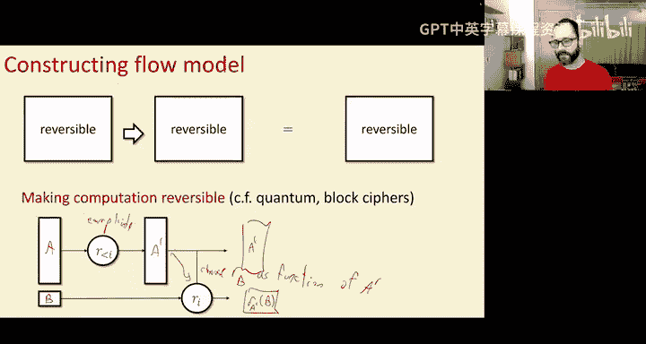

Flo theory here， but they do that in practice。And they gave， I guess。

 somewhat more decent generating models and again you have these types of。Some。

 some ways of translating maybe between。Quas semantic things， by the way。

 these things often typically。Yes， both A and B are we recovered。 yes， good question， Yes。

 so let's go back。

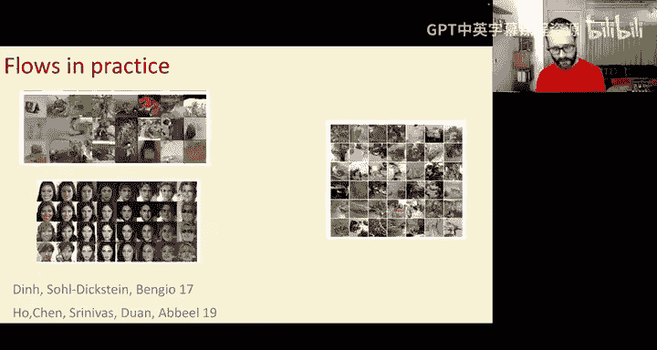

So again， if you have the transformation， if you have a transformation， oops。

If you have a transformation that looks like the following， you have A and B。

And you apply the following transformation， you don't change a at all。

 and you apply to be a reversible map。You apply to be a reversible map based on a。

 and it can be based on a based on any function of a。Then this is always going to be reversible。

So so， so you can always recover both A and B。Right。

 and and and generally what So what you would do is first find some reive way to find the complete some kind of a。

You find some way to find a reversible map from a to a prime so you can recover from a prime and then you use some function of a prime to come up with a reversible transformation on B and now the final thing is you get a reversible transformation that you can recover both A and B。

Piff does this answer the question？Yeah it does I got confused because there was this example you wrote about block cphers in the brackets above so I thought maybe it's a cipher so there is something a crypto related that is not being recovered no no no yes no in block cphers a lot of the time the reversible transformation is a function of the key but they still have the same if you look at the the reason I say I say this if you look at the fiveyle transformation。

This is the wrong course for me to go into detail about it， but if you search this app。

 you will see that it looks really like that， exactly like that。😊。

And if you look at if you take let' say quantum computing course， and they typically will say。

 how do you take a nonreversible operation like an end and make it into an or into a reversible。

 so they typically will say， okay， you take you know， A B and C。😊，And you map it into a。

Say A and B and and then you map C into this this will be basically this will be so of A and B。

 so this goes6， so A and B。And that's kind of a way to take the non reversible end and map it into a reversible operation。

And it's kind of like similar to actually， if you look at the fine flows。

 it's kind of the same type the same idea where you this is a model2。

 but you define you take A and B and use that to define some kind of an a transformation on the input。

Go it yeah， thanks for clarifying Yes， so so if you look at in the survey about the fine fine flows or linear flows。

 I think this is basically the this idea。

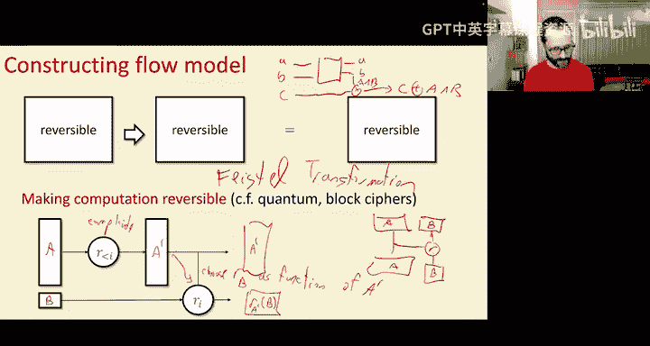

And yeah， in practice， they seem to also give like nice generation。

 I think they're not as nice as guns， but they do have like some kind of。Ebedding the suns。

Some kind of quasi meaningful， but again， I don't know if they are used for。

Classification successfully， but they're still interesting。So we said we have this kind of dream。

Of maybe having both it encodeder and decoder that will do everything。And。嗯。At the moment。

 we are not really able to fulfill this dream right now。So there is many works which basically say。

 okay， let's give up on part of it。So self supervised learning just focuses on the encoder。Says。

 okay， let's find a good representation and forget about the problem of generation。

 let's just find a good representation。And then there are guns。

 generative adversarial networks that again， kind of focus on the generation and say。

 let's forget about representation and even forget about trying to estimate density。And。

And when you give up on one of those things things become easier and you can actually do very nice things and then there are like non-gans like guns is not the only way necessarily to do these things。

 but so I think a very nice very recent example where the details of one of them is not even I think public as far as I know is from openAI。

 these two models clip and DE， which basically break this issue to two things。

 so you have the distribution now is a pair text and images where the text are some kind of captions of the images。

😊，And they basically have separated out to two models that right now I think don't exactly share the Latin space again if people know better please correct me。

So C finds a representation for a pair text image。And that representation can be very useful in particular。

 it makes it quite easy to do things like classification by。😊。

Putting some very simple or linear thing on top and D E generates a text image pair and by the way。

 the nice thing about these type of generators。I'll talk about begun in a second。😊，So yeah。

 so the nice so the nice thing about auto aggressive models， which。

Which I should have mentioned is that when you have an auto aggressive model。

 then it's very easy to do conditional generation so you can fix。You know。

 you can fix this part and now you can generate。And you can generate the remaining conditional distribution。

 the post fix of this condition on this distribution， so in particular。

 if you say I have a distribution over a text image pairs then you can fix the text part and now you can generate the image。

And。Yes， and and I think what happens we've we've clip is， yes。

 it kind of generates some Latin encoding， I think， which is basically like。

Corresponds to encoding T and I with some encoding of T and encoding of I that are somehow aligned in a sense。

And it's kind of a good representation and there you can you can basically by say representing if you wanted to distinguish between an image of a cat or a dog。

 you can basically，Find the representation， you can run this encoder。

 this encoder kind of is breaks out to two parts so can you can run E of cut。

And then if you get just an image， you can compare that。You can see the dot product of that with've。

With the image and tell apart cats from dogs， etc cetera。

So these kind of two things get you know very very nice， they show that can you can do generation。

 you can do representation， I think we still don't know how to do kind of everything together。

 but we were maybe getting closer。😊，And。They theyre in。

And yes and clip itself as well as many other you know good representation they use what's known as contrastive learning I think this is right now probably the best method we have to get semantic representation and the idea is really the following idea that we want similar。

One similar objects。To have to have similar representations。

Now the first thing is a little bit less loosely defined what does it mean for two objects to be similar that's kind of less less formally defined is。

What do we mean by two similar objects， say two images of a cat or two images that are of the same thing。

 this part typically we just say， okay， we just want the dot product to be large。

So we kind of want for two things， the dot product to be large if they're similar and to be small。

 if they're different。And the fantastic learning， the way they do it is the following so they get。

 so you get some representation， suppose right now you have some representation and you want to know if it's good or bad。

😊，So you have representations U1 till UNN and V1 until VN。

 where UI represents a similar object to VI。And there are different ways in which you get this similar object。

So in Sclair， the way you get these similar objects is that you started with the same image and you apply some augmentation。

 to independent augmentations to it， and that's how you got two images that are similars in clip you get a piece of text and a piece of text and an image that are related。

And now what you do is you find some kind of a monotton function。

 so you take the dot product matrix and you apply some kind of a function to it。

 maybe you take an explanation but some kind of a function， some kind of a monotton function。😊，And。

You can even think of it as the identity， but basically want you what does it mean that the M is good。

 So you want to say that M is good。If the di aagonal is big。

If the things that are similar have larger dot product than the things that are not similar。😊。

So and then so basically your loss is going to be the sum of the entries on the diagonal divided by the sum of the of diagonal entries。

And barely won this。To be non negative so not want to divide by zero or have any cancellations or anything like that。

So you basically contrastive learning， you're basically trying to create this contrast where things that are。

 get a similar representation and things that are dissimilar， they get dissimilar representation。

And yes， and in Sclair yes the inputs are like I said。

 the independents include clip their matching text image， maybe you can have some other ways as well。

 but the idea is you take this block and there are also different kind of variants of this I think。😊。

The way I describe it is not exactly the way it is done because。

You can actually reuse right now I'm kind of wasting I'm not comparing U1 to U 17。

 but this is a little bit of a waste of samples and。If you're a practitioner。

 you don't want to waste any samples。 So you would take like a mini batch。

 And basically what you want to do is make sure that the。

The things that are supposed to be similar to each other are large。

Lrgish dot product compared to the things that are dissimilar。And by the way。

 large dot product here doesn't mean that it's close to one that it's the same vector。

 basically what you if you have like high dimensional vectors then。You know randomandom。

U and V in our D let's call it K because it doesn't have to be D。 we have that the Uv。

 the dot product of Uv might be roughly。Plus minus1 over squared k。

 so you would want maybe vectors that come from thisimilar objects to be smaller。

 maybe to be something like that and vectors that come from similar objects they should have significant dot product so they might not be perfectly aligned but they might be nearby and how nearby maybe also depends。

I mean， if they really truly are the same image， maybe you want the dot product to really be very close to one if they just share like the same class。

 maybe you just want it to be a little bit close。Yeah。Okay。

 so so contrast learning is basically a way this is self supervised learning and this is a way to learn representation。

The output the output of this latent representation doesn't have to be distributed normal or anything like that。

 so it's not necessarily good for generation， but it does work quite well with。

Qu quite well for presentation。 I should say that in Simclair， I think there are like some extra。😊。

Capyats or differences so basically。What they do in Sinclair， I think it ends up being。

Useful for them。Is to。To also learn some so。What's the easiest way to describe it？

So the way I describe it this is the representation， this encoder。

And youre applying the and you're applying the loss directly to here。I think in Simclair。

 they found it useful to have some kind of a projection head。诶B。

So you're applying the loss to this projection head。

 but eventually you're going to use this as the representation， so the loss。He's in。The loss is。

 I think f of G of UI times G of Vj， where G is some function that you're also optimizing over。

When you're minimizing the loss。And Tlet loss， I don't know， maybe people can I think that yeah。

 I'm not sure if people， I mean I think Tlet loss by this you mean basically something like n equals three。

😊，And then I think this is kind of the extreme version of this。 but I， like I said。

 I'm not a practitioner。 I just wanted to give like this general。😊。

The general tool of contrastive learning， I believe that people use a larger batch than three。

Someone can correct me。Yes， yeah。 D you you typically would want some maybe potentially some kind of。

normalmalization although dont note that you are that the loss is yeah。

 but it's not going to be exactly scale free， but so you would want to do something。

I guess if you were to。I guess if you were to square this or something like that。

 there might be some way where you could make this scale free so that if you multiply UNV by the same amount。

 but this is not that way。So yeah， this is a good point， you need to some kind of a normalization。

 this thing right as it is now， I think it's not。Scall 3， possibly the right thing。

To do might have been something like this， not true。And。Yes。

 and now the other so this basically contrastive learning， so if we go back here。😊，So basically。

 this is given up on the。So contrastive learning focuses on the encoder part。

ization generative adversar network focuses only on the decoder part or the generator part。

And I think you。I don't have much to say just because we don't really have as much theory as we would like to have about these guns。

 I mean， we have some theory， but it's。Not not as well developed。And。But basically。

 what do we do right so here we have this decoder and what we define is that the loss。😊。

Is the maximum over the difference in expectation between say the two probability distribution and。

And the probability distribution that is generated by this decoder。

 when this maximum is taken over the some sets of functions F。

So you basically have this discriminator F。And when you're trying to minimize the loss。

 you're really trying to。Right， so you you have this so minimize the loss。

Is youre trying to minimize over D the maximum over F。And then you also train F where for F。

 it will be for F， you will be basically we want to maximize over F the minimum。The minimum over。

So you of the same expression。 So you you view this as basically some kind of a game between the D player and the F player where the。

deep layer。Wants to find the D layer find wants to minimize the loss。

And the F player wants to maximize the loss。So the F player tries to discriminate as good as possible and the D player tries to and。

And the deep layer triess to。Driinate possible and we this is kind of a simplistic version we typically might apply some different function here to measure the differences the differences in probabilities to encourage these kind of things and are there any convergence issues yes there are lots of convergence issues so the idea and here again like I think we really don't have a lot of theory and this is maybe yeah so so this is something maybe I should go into more deeply again as usually。

I got too quickly for the material which I think we should have gone slower rather than trying I either should have tried to prepare even more or to go slower。

 but basically，😊，And when you have this kind of mean Max objective。

 so when you have a mean Max objective。The typical way we don't know really how to optimize over these kind of objectives。

 so the typical way we do it is by think of it as a game。

And trying to reach an equilibrium to this game by kind of a best response mechanism。

 so the D player makes a move it optimizes then the F player makes a move back and the D player makes another move and this thing is quite。

Quite delicate， for example。If you。You know， you could have if one of them is kind of junk。

Then it's very hard for the other to make any meaningful progress， right so if you have。

I think in both cases， so you want them to kind of be in similar abilities。

 if you have say an excellent discriminator then maybe the decoder will not move off the ground and similarly if you have a terrible discriminator and the decoder is very good maybe it's not clear what the discriminator will do so。

So this is kind of。Deliccate to try to optimize the this game and sometimes I think in very simple mechanism in very。

 very simple settings like learning some mixture of Gaussians which you can do in a million different other ways then you can also show that something like that would work。

 but generally this type of things are it's very hard and this is a very。😊。

This is generally these kind of alternating algorithms are ones that are used quite often。Such as。

 you know， expectation， maximization。 and and this is something that's quite often used when you have these types of。

To two terms or when you fix one terms， you optimize the other and you fix the other and optimize this one and。

It often does work in practice， but not always。😡，And I think theory about when it works doesn't work it's actually quite interesting maybe at some point we'll talk not so much theory about guns。

 but about expectation minimization， there are some works and performance of guns as I mentioned。

 it's unclear I mean they clearly produce very beautiful images。

 it's less clear to know how big of the is the entropy of the images that they produce how reaches is it。

 some attempt to study it have not given such。Great。

Great bounds and in particular the test of if the gun is so good then you should be able to say take replace train on the gun output instead of INe that doesn't seem to work at all in given the same performance。

And at least that was in the big gun， there was a question about the bigger gun and I don't know about that one。

So。Yes， any questions or comments？Yes， in this case。

 why don't we have to add in this discriminator function when we do a loss and like。

I think in all the cases before we were thinking a lot about chaout diversions。

What makes K not work in this case。Right， so so here we， we are trying， right。

 So So that's a good question。 So what are we trying to do here。 So here we want to say。

 we want to find an say， a generator。That generates images that look real， right？So we can。

But we don't really have a nice definition for looking real， right。

And here we don't have so we don't have this notion of an encoder or some posterior。

 et cetera that we used in the previous versions， so if since we don't have this notion of so we can't really try to。

Optimize scale divergence directly。 And I， as I said， if we simply try to。

Maximize the log probability of the training set will get some memorizing scene that would be completely noninterest so what we do is we say okay。

 we want images that look real well we know something that does very good way think on discriminating images that's neuraler networks。

So if the image looks， so maybe the starting point would be something like that if the image looks real to say a fixed network like inception。

Then。If then if the image looks real to something like inception， then it will be maybe real。

 but then you say， okay， this wasn't really trained the thisinception or et cetera。

 wasn't really trained to try to。To full your。To fool you and to catch you decoder。

 so then you start trending in with respect to another。

 And maybe here is a kind of a point that's worth making so。And if you fix。

Say a particular F discriminator。It is， And let's suppose just for simplicity， F。

 say outputs from RD to。0，1， okay。Or generally， it could be a real number。

 let's even that doesn't have to be。即这诶。If you if you have some F that outputs from R D to R。

And suppose that expectation of F on wheel images。Iさ numberピ。Okay。

 and the same thing applies the same type of arguments。

 I would say would also apply if you're not looking at just general wheel images， but also at。

But images of a particular class， et cetera。😊，So suppose that expectation of real images is P it's kind of super super easy to find like complete nonsense thing which would fit P right you can find you can find x1 till X。

One over epsilon that is such that the average。Or of eye you know one of。One of her epsilon F X I。

Is roughly， you know， it's P plus minus epsilon。It's kind of very very easy you can find thing that doesn't look like images at all that somehow that's kind of fit。

Fit this discriminator。 So if you know the discriminator and。If you know the discriminator。

 it's very easy to。To cheat on it and now if you know the generator。

 it's not clear that that is' easy， but also could be that you know。

 it could be things that the generator actually looks。😊，Looks kind of in。Looks kind very good。

 but you find like a very you know small statistical  query， et cetera。

 between the generator and the discriminator so you want。So it is you know。

 the task of the discriminator in some sense is harder and you want to make sure that the generator somehow。

Doesn't cheat in a sense that you don't want to let the generator maybe optimize too much for a fixed discriminator。

 but rather you want to somehow create a situation where the generator really has to go to work with respect to all discriminator to a large fraction of discriminator。

So that's kind of and。What makes these things maybe a little bit more challenging？

And do you see the reverse problem where？You have sort of the discriminator is。

Working well for a while on the generator， but the generator kind of moves into a different area and weight space and suddenly kind of the bad outputs it giving start looking different they're still bad but they look different and you kind of get into a failure mode of the。

😡，Discriminator， like do you also have those issues？So again， maybe like I said。

 I don't want to say to talk about the practical issues unless people here can chime in but but generally。

 yes， if the job of the discriminator is harder， you could。I mean。

 you could definitely have bad images that succeed with respect to the discriminator。

I think if you got to an point in an equilibrium where you can train the discriminator for very long and years。

 you're not。But you could still， okay， let let me say another another issue that that can also arise。

 Okay， so suppose you have so this is diverse。 So this is why。You know， this is why maybe generators。

Have it easy。Okay， maybe， this is never never way。 I mean， the problem is we we want to。

 we want to make our life hard for a generator， right。And and。

We want to make life hard for the generator and the problem is that generators could have it easy there is another way there another version which generators could have it easy and this is the following thing suppose you know the two distribution。

😊，Is some distribution X， right。And now look at the following generator。

 So this is the following kind of generator， which is basically you sample。X1。T X，K。At random from x。

 and you fix them。And and， and， and now you basically， you just always output。え Xアイフア at one from k。

So you kind of expect that， you know， for every discriminator。

 you kind of expect that expectation of F of this generator。

Minus expectation of F on the 2 dX will be roughly， I don't know， one over a squared k。

 so it will be kind of pretty close to each other。But this is much。

 much lower entropy right you so this is kind of another problem where you could maybe have。

You could have completely fake images that match the statistic or you could have just too few images。

That matched the statistics and I think forcing large entropy。I think this is， to my understanding。

 this is an open problem。You know， the best thing you can do is by trying to demonstrate that you have some reach。

Which space by showing that you can kind of interpolate， you know。

 the fact that you can have like these images， you can take two images and you can kind of interpolate between them that somehow demonstrate that you have like that you're not just have memorized images and you're doing nothing except spitting out one of them but。

I think。😊，Really demonstrating that you have large enpiece is somewhat of fail。An open problem。

And yeah， gun loss and inception， I think they are similar， Yes。

 I think you can think of inception because。😊，Some version of gun with respect to a fixed distinguisher。

 But I think if you train the the gun loss with the inception。

 that would be a problem because it would just kind of。Even right now。

 it's a problem that certainly you can have like maybe good inception score and not necessarily good performance in some other ways。

Do we see the phenomena we talked about last week， ability to interpolate extreme simplicity some layers being an important。

 Yeah， I think so you do see that in these unsupervised and gener models。 So I think， especially。

 for example， the。😊。

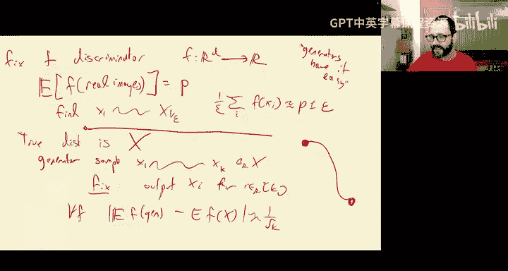

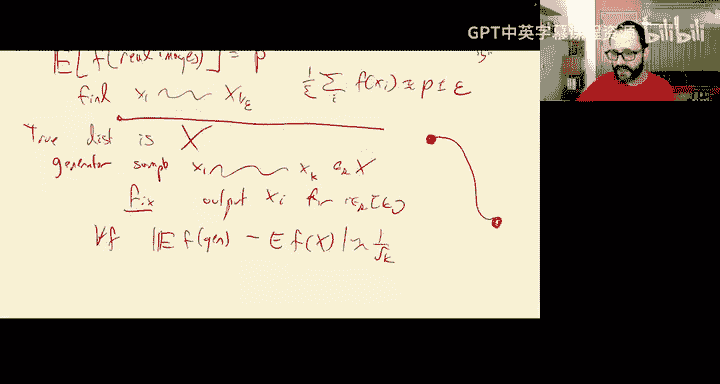

I think what you learn and this is still to some extent not completely understood。

 but I think there is intuition， which is that what you learn， let me maybe。

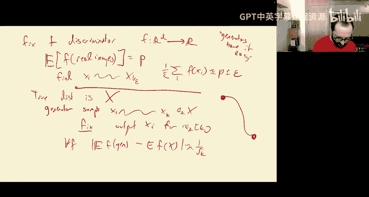

Let's see。 How do I。

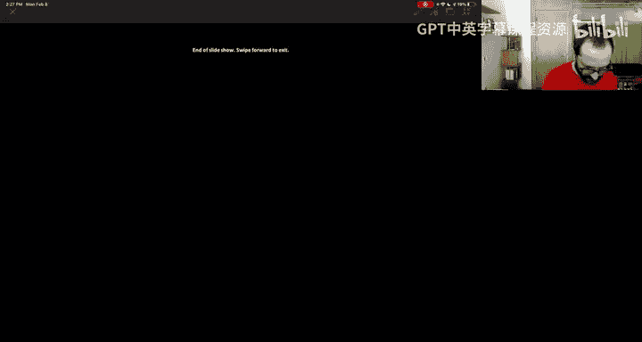

Okay。How do I write here Let's next time I'll make more empty slides here。

 But I think there there is intuition that's say if you train Sclair。To learn a representation。

Then they say the first few layers。A goinging to be quite similar to what you learn if you do supervised learning。

So in general， it's not clear it makes a big difference like so it's not。So you can， for example。

 what you can do in you can do say， self supervised learning and then find tuning to get a network。

Or you can just train it end to end。 and you will get some differences in performance。

 but they not don't seem very， very major。 And it's not clear。It's fundamentally different。

 so it's quite possible that you basically the same layers。Are learning more or less the same thing。

 whether you learn it whether you learn by self supervised learning like Sclair or some a ways or whether you learn it by。

or you learn it end to end by standard supervised training。

 so I do think we see this phenomena but I don't think there is a lot of proofs or even enough experiments to demonstrate that。

So any other questions？does this super self supervised setting reduce the amount of label data， Yes。

 yes， you definitely can using self supervisorvised setting you can do。😊，I mean。

 you typically will lose maybe a little bit， but really you know。

 you can maybe reduce the data by a factor of 10 and get a very small hit in performance and you can。

And you can see the Sair papers for this， so you can get basically comparable performance and classification task while getting say。

😊，Say 10% label data in the average 90% is unlabeled， this is really the power of these methods。Okay。

Okay， so ourgan is part of a larger paradigm of learning objective functions。I think。

I'm not sure if I would say as learning objective functions。

 but maybe more complex objective functions， so there is you see it in adversarial training。

 you see it in meta learning when you have more complex objective functions。And I think。

It's still a little bit of an open question of。Whether these very as you get more and more complex subject functions is that。

I is that a good thing or maybe we are just kind of。

Complicating things for ourselves And when we understand things better。

 we will find the simpler objective functions that achieve the same thing。

 So sometimes in meta learning， which we'll talk about there is this。

People have done at least kind of complex objective functions。

 but then maybe there are simpler ones that achieve the same thing， so there are。

That is case where we define more more complex objective functions and try to use this idea that we can essentially back propagate for anything。

 but and sometimes it' really is helpful I don't know if it always is and sometimes。

When it becomes more and more complex， it becomes harder and harder to understand。Okay。

 so if there are no more questions， I think we'll finish earlier today so。😊。

Thank you and keep asking questions also on the slackla。Thank you。😊，Thank you。 Thanks， bye， bye Yes。

 yes， you can。 you can， yes。😊，I just couldn't notice the similarity between the GAN structure and the minimax theorem and I was curious something that prevented the minimax theorem from applying in this case。

 the existence of equiria or they are and they're just hard to find。So， yes， I think。

If you were to talk about the set of。So the mini max theorem generally applies when you're talking about。

A set of strategies that you can have a complex set of strategies。

So I think in the context of a zero sum game， yes。Yeah， so the zero sum game。

 the mini Max theM is that every zero sum game this is a zero you can phrase guns as a zero sum game and indeed people are looking at it as a game equilibrium。

And I think for zero sum game， the TheM is basically if you have a convex set of strategies。

 then is be there is going to be an equilibrium， there is a kind of a well definedfin value for this game and there is going to be an equilibrium。

 but it's not。Yeah， I think I think when when it's a non convex set。

 then it's not it's not clear that it is an。And I think here it's definitely not kind of not a convex set because you can have like say a trivial generator that outputs a single image。

And if it was closed under a convex combination， you could have any probability distribution over the images you could think of it as a convex combination of these things。

 so I think it's not a convicx set and it's not clear that there is an equilibrium mode that best response achieves it。

😊，Right， now that I another we talk， but I think the classic presentation of the minimax theorem applies when players have finite sets of strategies and these are looking at a continuous space of functions here。

 I think finite is even less that yes， so finite is even less than what important is typically in。

Typically in zero sum games， we allow mixed strategies， right？

The standard presentation allows mixed randomized strategies。出是。嗯。

From whatever I say you only actually have in the game definition。

 you only have a finite set of moves， but then if you were to repeatedly play the game you can you have so actually yeah。

 maybe let me。

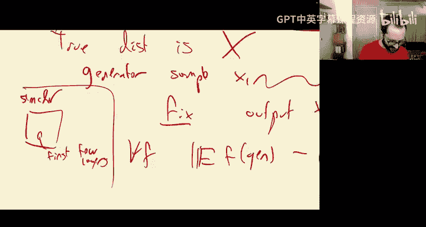

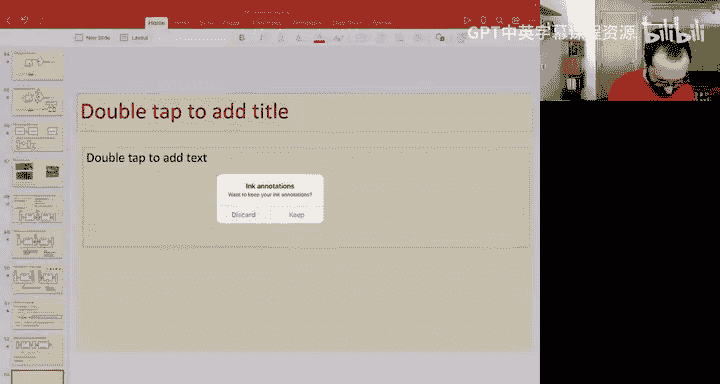

it says the condition for minimax theorem is that the players have a finite set of strategies no the finite is less important so so let's I mean there are there are these right so typically you have strategies right and strategies but what does it mean the value of the minim right the value of the minim is not。

There can be a game like I think the matching pennies game is a game like that。

 there can be a game where there is no equilibrium when when you have a few strategy where you fix one action and you stick to that there will be no equilibrium so as anyone know by how the matching penny or whatever there are these examples。

I think you。Both players choose heads or tails and the first player wins if it's the pennies match。

 the second player wins when the players when the pennies don't match。

Right so so let's say it's something like this right so yes so whatever I mean the person that plays second will always win here right？

They revealed their coin like at the same time right so but mean Max。

 if you define it as mean Max is not the same as Max Min right the player that plays first will always win when mean Max is equal to man Max Min is when you allow a randomized strategies when you allow a strategy that says with probability half。

 I will choose heads and re probability half， I will choose mean I will choose tails。

And that basically means that you have turned your set of strategies into a convex set。

So that's really the mean Max theory really when you expand your set of strategies to allow mixed strategies。

 you make it into a convex set and then the mean max is equal to the max mean。Does this make sense？

Yeah， remind me what the definition is of convexity per sets is。

So convexity for sets is basically that if U is in S and V is in S。

 then P U plus1 minus P V is in S for everyp in0。very simple， yes。

 so basically think of it if you think of it as strategies。

 then you can think of it if you have the strategy you and you have the strategy P。

 you have the strategy where you with probability P you do U and with probability1 minus P you do V。

😊，So in games， you have this when but here in generation， it' it's somewhat complicated because。

you could have like the trivial generator just outputs one image and then for every image there is a trivial generator that just outputs this image and if you looked at the conx combination of all these images it's basically everything so it's not really closed under convex combinations。

😊，Cool， thank you。S。Okay， so and we can keep asking these kind of questions also on the slack and。

In't yet figured out completely what I will do next week， but we'll announce it shortly。😊，喂。喂。

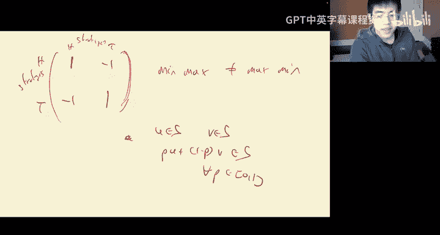