# 哈佛大学《深度学习基础｜Harvard CS229br Foundations of Deep Learning 2021》中英字幕（claude-3.7-s - P4：Lecture 4.zh_en - GPT中英字幕课程资源 - BV1f4XCYZEMx

Okay， welcome to the fourth lecture of CS229 BR。

And I also wanted to welcome our new teaching fellow， I don't know if Javin did you manage to。

you join us oh he's he has a class at this time so he won。

Okay。Okay， but he will， he's on slackck。

And he's eager to join the team。Help us out。As I mentioned before。

 but this is also for the people that are watching the recording。

 if you're taking this class for credit， please make sure to join all the relevant channels。

 basically everything that starts with 2 to9 and in particular make sure to join 229 HW1 channel there are some updates to homework one there have been some typo which pretm has fixed。

You can watch it there for the latest updates。

Okay。So。Our plan for today will be to review a little bit of math and maybe some of it will not be exactly with you。

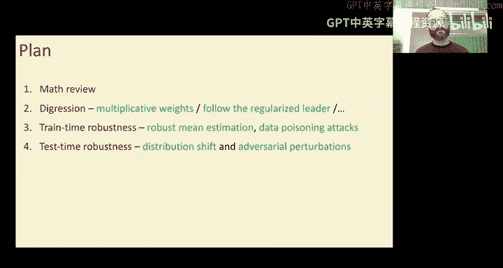

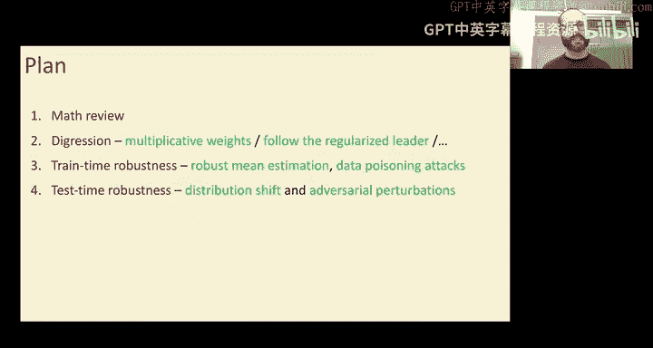

And then to do a digression into the multiplicative weights algorithm that also has。

Seven different other names。And then we'll talk about our main focus for today， which is robustness。

And we'll talk about both robustness， with respect to training time， which corresponds to say。

 data poisoning attacks or robust mean estimation and robust statistics more in general。

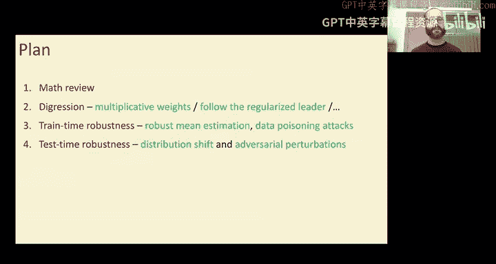

And robustness we have test time， which corresponds to distribution shifts and adversarial perturbations。

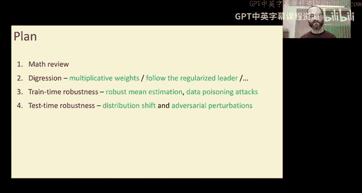

And please do ask questions as we continue。

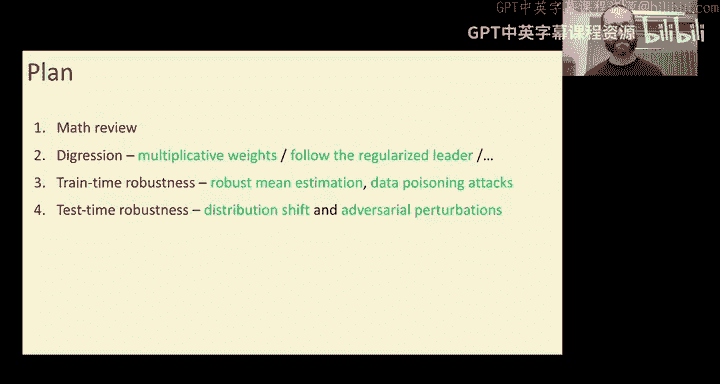

Okay， so let's do a very quick in math review。So just to refresh the KL divergence between probability distribution P and probability distribution Q is the expectation of the log of probability ratio and as we have seen we can decompose it into two parts。

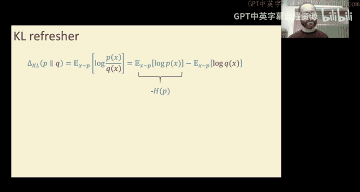

One part is minus h of P so the negative of the entropy of P and the other part is H Pq the cross entropy of P and Q so this is basically you do the same expectation of low  Qx as you would do when you compute the entropy of Q。

Or minus the expectation of that， but you take the expectation with respect to P。And。

We know that the kale divergence is always not negative。

 so in particular that means that for any two probability distributions， P andQ。

 the cross entropy of P&Q is always at least as larger or equal than the entropy of P。

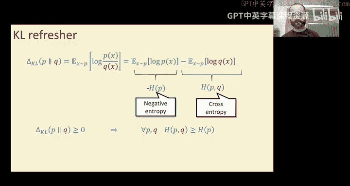

Okay so far so good。Another thing that we'll see many times in this course happens。

And a phenomenon that we use time and again in statistics and computer science is concentration。

So what do we mean by concentration let's recall what is a standard normal variable so we say that x is sampled from n mu sigma squared。

 which mean it's a normal random variable with mean mu and standard deviation sigma so this is basically just this。

Gusia， normal， bell curve， whatever you want to call it， where most of the mass。

Is in an interval of size roughly sigma around the mean and you can do be very specific it something like。

66% of the mass is started it work， 66% is within sigma。

 95 is within two sigma I never remember the exact numbers， probably someone here knows it better。

Three standard deviations is like 99% or something like that。So yeah。

 so we're not going to care about a particular constant。

 but generally the probability of deviating T standard deviation decays exponentially in T squared。

And there is some constant there， but were kind of going to ignore it。And what is concentration。

 basically concentration is this phenomena low fl numbers。

Central limitor there's many words for that， but basically it's the phenomena that if you have。

Independent。Identally distributed random variables that have say expectation new then when you take。

En of them and you take the empirical average that is going to converge to behave something like a normal with mu and。

Standard deviation one over square root n or variance one over n。

 this is when it's bounded by say one。At least at most this thing。So basically。

 another way to think about it is right so it's like N1 and we divide it by one over Sc n。

It's always useful to remember these things in the when we say normal disease variants。

And the standard deviation is a square root of the variance。So if you multiply。

A randomand variable by a facto k， you are multiplying its standard deviation by factor k and you're multiplying its variance by a facto k squared。

Why the one over and here became the one of growth in here。So basically， this is the phenomena that。

Initially， if we chose just a single random y， been it might have behaved something like that。

 say mean mu and standard deviation roughly one， but when we choose nYs and average them out。

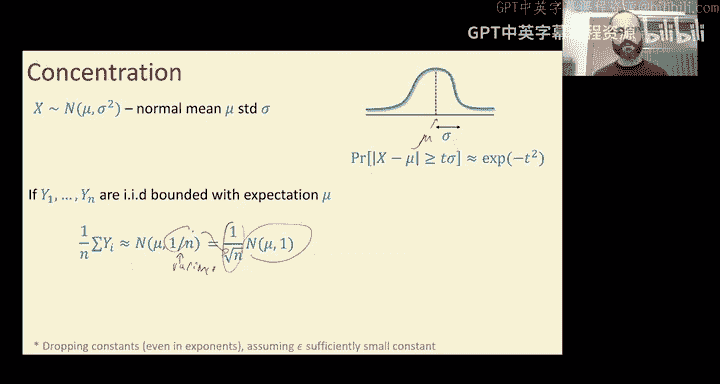

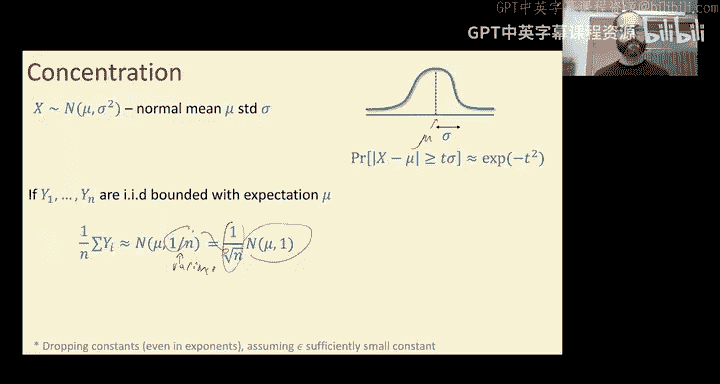

Then we dropped the standard deviation by a factor about Sc n。Right， so and。

So another way to say it is。Say the probability that's say you deviate by Epsilon n amount。

 then that basically would correspond to Epsilon squared and standard deviation。

 so that probability will be exponentially small in Epsilon squared n。

When you have a y1 t y and random independent variables and this。This kind of inequality。

 tale inequality goes under many names， Cha of Hosti Hof Benernstein， I don't know。

 probablyub million ever names。But the idea is that if you do this empirical。

An empirical estimation of an expectation then。Once you have something like more than one over epsilon squared samples。

 then accuracy becomes very good and the probability of getting things off。

The decreases exponentially with the number of samples。

You can please do stop and ask me any questions。If anything is unclear or you want。

Anything any more details， otherwise we'll just continue on。

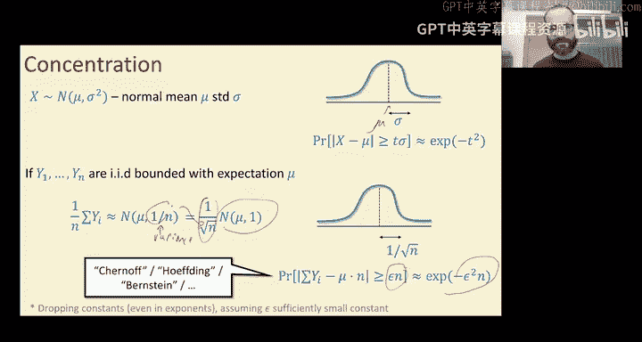

Okay， so we're going to use some fact about linear algebra in this lecture。

So a matrix a symmetric matrix M is PSD if all its eigenvalues are no negative。

And we write this as Emmy's。Bigger equal with this kind of squiggly bigger of equal zero。

So that means it's a positive semiphony。Oh， no negative semideinite。

 I never remember if it's positive， strictly positive or no negative and it usually doesn't matter。

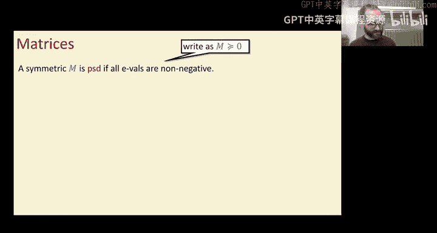

And equivalently， V trans transposeMV is no negative for all vectors V。

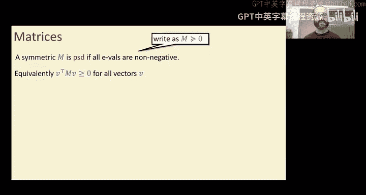

And we use this， we extend this notion to talk about inequalities between matrices。

 so we say you know a is smaller or smaller than equal than B， if for every vector。

Vi1 suppose A is at most。V transpose Bv， right so。this kind of makes sense。

 this basically is the same as saying that being minus a is at least zero。And。

And we can say that you， A' is in some interval， say A BI if a is between AI and BI where I is the identity matrix。

 which basically corresponds to all the Eigenvalue of A lie in the interval AB。Now。

 the spectral norm。Of the matrix A is the maximum norm of AV where v is a unit vector and when a is symmetric that also corresponds to the maximum the eigenvalue of a if it's not symmetric。

 it's the maximum a。Sing value， these say singular or non singular。

And the Frrobinus norm is the norm of a， if you just treat it as a vector。

 so you just take the sum of the squares of all its entries and you take the square root of that。

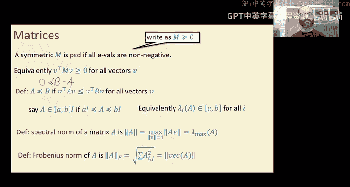

And。I think actually today we' mostly talk when we talk about norms， we'll talk about the spectrum。

Okay。And by the way， there was some kind of Kushvas between the spectral norm and the Forbiius norm。

So。で。The Forbius no would be in。The sum of the lambda I squared and the spec is lambda max。

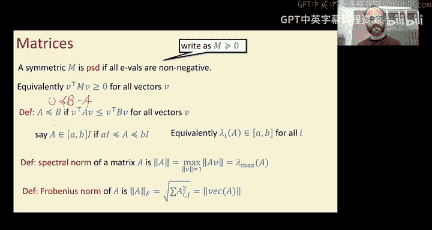

Yes， we can relate the to him。By some factors of something like scroll deeper。

Have to remember which direction。

Okay。So Mawes valued random variables。Great。So we can talk about vector valued random variables。

 for example， we already use this notation， if a mu is a D dimensionsional vector and v is a D by D positive semi deffinite matrix。

 then we can write x is sampled from n with mu and V that means just it's just a normal。

Over a vector valued normal where this is the expectation and this is the covariance matrix。

So you know， expectation of XI is a UI and expectation for every IJ。

 expectation of Xi minus mui and x times Xj minus muj is VIj。And。By this formula。

 you can show that V has to be PSD。

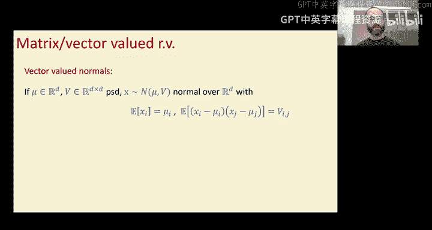

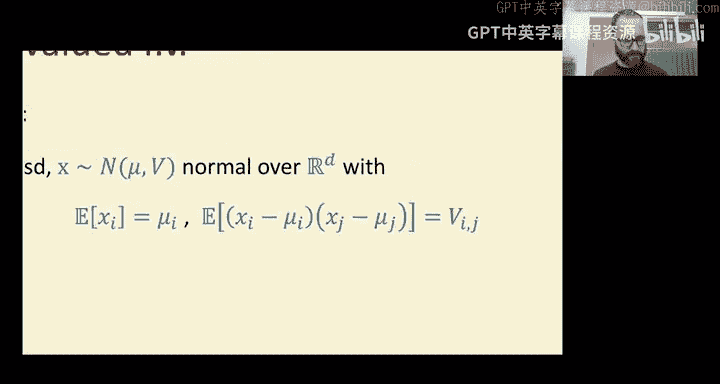

And for every PSD。B weeks， you can find a normal that satisfies this。

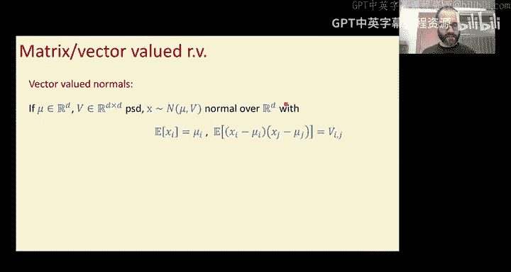

Okay， this is not completely obvious， but it's not that hard to show。

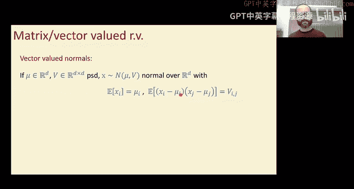

The second part。So and standard valued normal value vectors would be just when mu is zero and the covariance is the identity and we just sometimes when the dimension is clear from context that sometimes just write it as n0i。

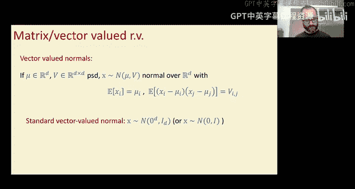

And， that means that the expectation is the zero vector， the expectation of X transposes I。O。

And once again， if people have questions， please do ask them。

Okay。So it turns out that we can extend these notions of concentration to matrix and vector valued in particular matrix valued random variables。

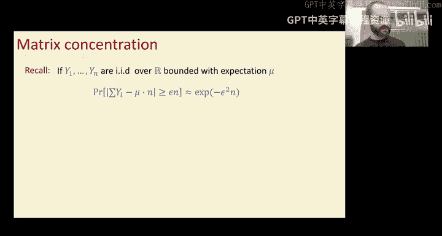

So we called that we said that if y1 until YN are bounded IID random variables with expectation nu。

 then we had this expression， the probability that they deviate epsilon from the expectation is exponentially small in epsilon squared n。

We can now ask a generalization of that when these vectors with these random variables。

Actually matrices。 so you can also generalize it to vectors， but it turns out that for vectors。

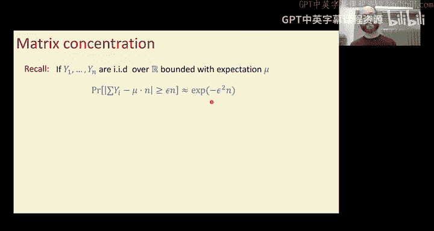

It's it's not that interesting in a sense， so for vectors if they are if they are random variables over RD。

 you can kind of think of them as。And simply nD variables overall。

 it's not going to matter that much。But for but。But for matrixri says it's actually deeper and more interesting。

 especially when you move to the spectral norm as opposed to just Forbius' norm。

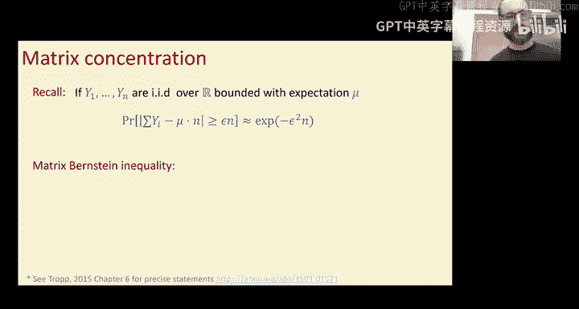

And there is this following inequality。Or a concentration bound if these are symmetric matrices over RD times D。

WhenAnd they are bounded inspector norm， then you basically get the same thing except here。

And here we are looking at the spectral norm， so we're measuring distance。

Between so mu the mu is a matrix， right the mean the expectation of each random variable is a matrix。

And we measure a distance inspect along。And this decay like minus epsilon squared n。

 except we'll pay this factoro D。Here， or if you wanted。

 you could think that you could pay like an additive factor of log D in the exponent。

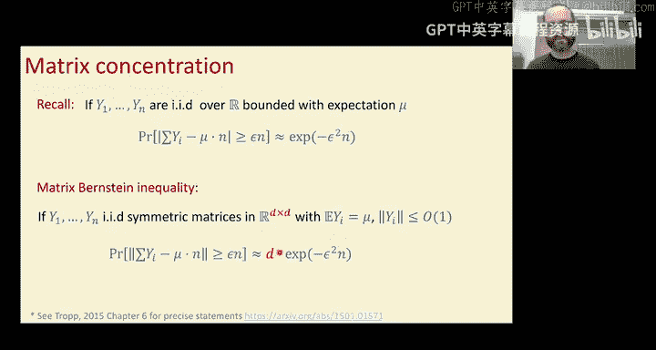

So。

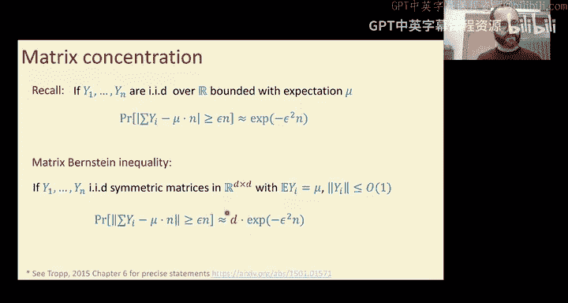

So this is this matrix of events inequality， another thing you can say is that。The difference。

 the expected norm of the difference will be at most of Sced n。 so Sc n would have been an。

would have been there if this was numbers and again， you pay some logarithmic factor。ロデ。

And by the way， a lot of very deep questions are sometimes when can you get rid of this Loity？

So some very longstanding conjectures have been about cases where you can get rid of this logD。

 I think anchoror has worked on some of those so so sometimes in some situations you have。

You can appeal directly to concentration when you want to say I am allowing myself n times logan samples。

 but if you want to。Oh， for samples， then that becomes much deeper in the video question there。

So if you have。He of things like sixth。Six standard deviation suffice。

So that was a paper of Spencer from I forgot when that showed in a case where somehow for certain concentration you could have done it the naive thing would have given you。

Log N， but he showed that you can do it with a constant and a constant happened to be less than six。

Yes， and yeah well get to your question in a second and then there have been these several questions that have been in this form。

 so there was a very recent result。That's。Now I always forget what's the name of this problem anchor are you around it。

 do you remember the what's the name of this of the ceiling that？

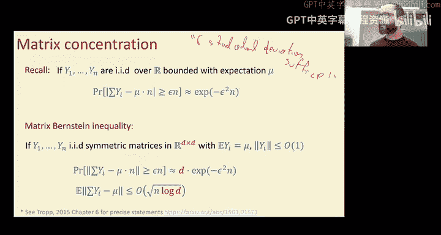

The six standard deviation suffice for the Spmansvadiisonisonison is you know another thing of that flavor basically and then you had a recent result on something like that right another problem where it's the differences between Logan and a constant。

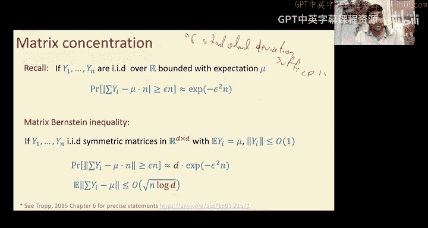

Oh， this for the Psson problem。Yes。That one was a little bit simpler I think we trimmed 100 pages off the proof Okay。

 but the the main thing was the  hand page proof was the 00 page proof was get to replace a login with a constant and then。

And then you improve the constant in terms of the constant number of pages。

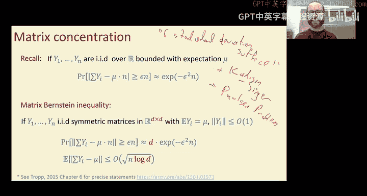

Yeah， it was two。

😀Yeah。Two pages of size。So yes， what is the question。

 bioometri is not simply a vector space with dimension D times D。😊。

The main thing is that we measure things with the spectrum。So if we were to use the phobius norm。

 then it would have basically been looking at these matrices as if there were vectors。

 but since we use the spectral norm then it doesn't it's not really the case and part of。

The ideas that often happen in these kind of results is that basically we first imagine that these matrices are diagonal and then things are easy and then we somehow have to work really hard to try to show that the diagonal case is really the worst case。

That making them non diagonal somehow only helps them concentrate even better。Okay。

 so this I think this was the math review of probably magic concentration not everyone has seen。

So now let's talk a little bit about random matrices。And just state some results。

So if a is a random matrix， which basically just say standard normal entries。

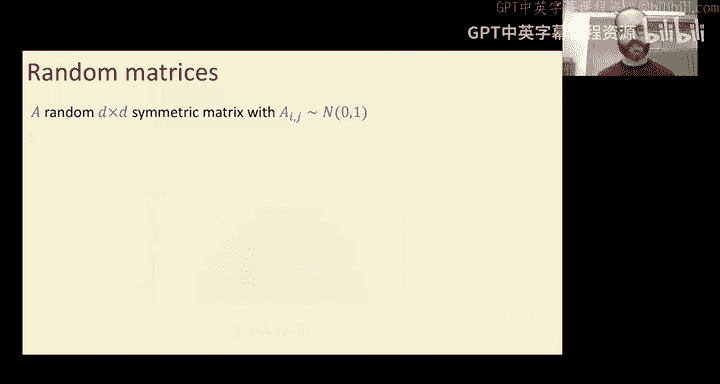

Then the spectrum right， so it has if it's a D by D matrix， it has the eigenvalue。

 let's say we make it the matrix so it has these real eigenvalues。

And it turns out that the spectrum of this matrix will be distributed according to the semi seeker law。

 which basically means it's asymptotically as you go for enter to infinity。

 it really does look like a circle。

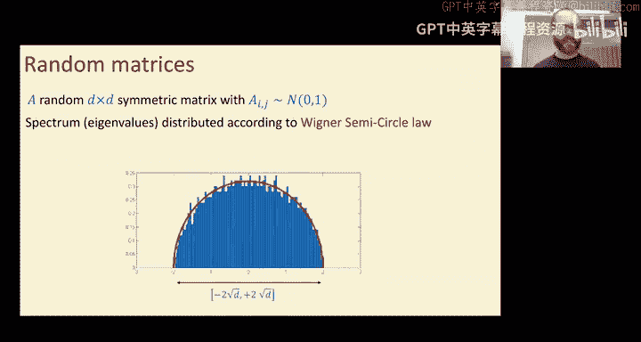

Right so。If you wanted to know the number of。If you wanted to know the number of eenvalue at this point。

 T， it would be you basically would do。Signs of Cosine inverse years later。So， and。

So it is distributed like a circle and with the integral being two times square d。

 so basically all of the eigenvalue will be between two and two square d and minus2 square d with more mass with more mass in the areas that are close to zero。

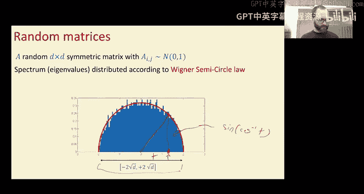

And。Another random matrix that people look like is when a is random。

 say just standard random matrix and x is。

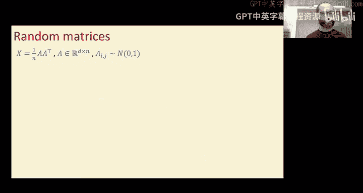

AA transpose， so one way to think about it might think of them as rectular matrices。

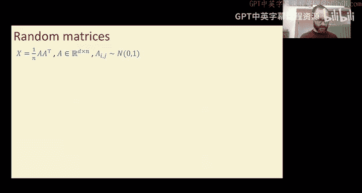

And。And this would be a D matrix that' say maybe has this form。This is the。This is the。

Say this is a a transpose。 This is a and this。Is N， This is N。And yeah。

 D might be smaller bigger than N and one way to think about it is that。Ex。

Is the empirical estimate for the covariance of these。 So you have。So if a is a random D by N matrix。

 you can think of it as just each。AndEach column and。

So each column of a is just an independent D dimensional vector and we get n of them。

And this matrix x is the empirical estimate for the covariance of these matrices。

 let's suppose the mini zero just make life simpler。So it turns out that there is a distribution。

 Maenco Pa2 distribution， we kind of mentioned it before。

 but we didn't say specifically what this distribution is。

 that where the spectrum of these eigenvalue where the spectrum of these matrices will be distributed。

 so it turned out that if D is smaller than n，Then and we mentioned it before。

 then the eigenvalue will be larger than zero will be kind of bounded away from zero。

If or at least if these is sufficiently smaller smaller than n。

 they will be bounded away from zero if these roughly n then basically becomes。

It basically becomes like a square of this semi circlecle thing distribution and you get even more mass。

So the semicircle has a good chunk of mass around zero。

 but when you square things it becomes even a mod， so you get lots of eigenvalue close to zero。

So lots here。And when D is larger than n， you get this spike。

 you get a d minus n evalue is at zero because it's a matrix of flow1。

 but the rest of them are again bounded away from zero and that relates when we talked about linear regressionggress。

Overpometized why this is like the least stable part。

You have many eenvalue that are close to them。Okay， and again。

 we'm not going to go into proof of Markchco Paur， you can read it up。

But it's good to have this integrationtuition just know。

Okay。So we that。Let's talk about the multiplicative weights update method that has so many different names and appears in so many different ways。

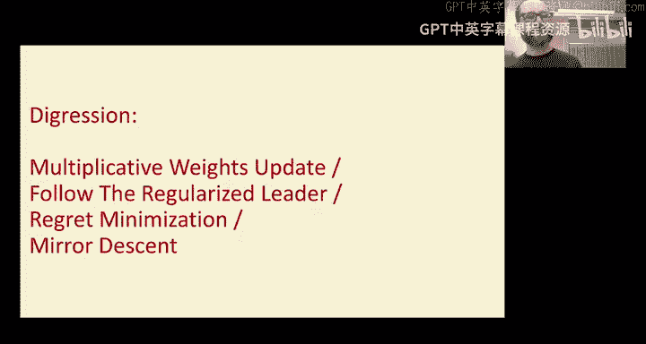

嗯。I。Actually， one the maybe uncle knows， what's the best。

There used to be a survey by Kaen and Hazaan， but that's probably outdated。

 so I don't know what's the best survey for this multiplicative weight。

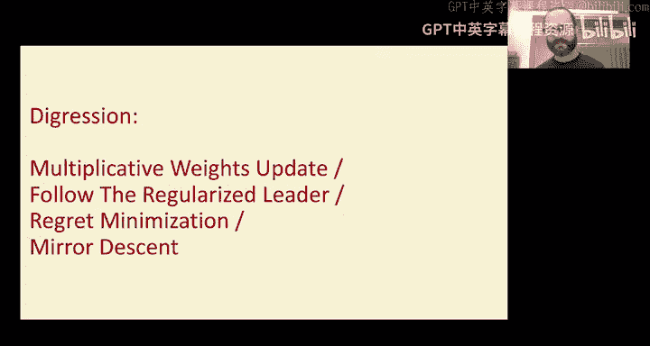

I quite I mean for multiplicative weights or for online convex optimization more generally， yeah。

 I guess that's a good question， maybe online convex optimization more generally。

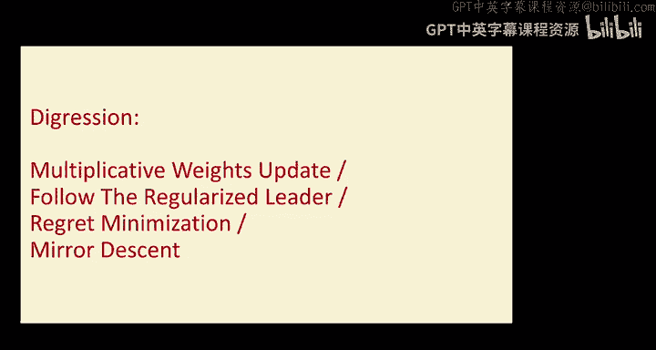

Yeah， so I quite like Haan's lecture notes， so he has。

 I think it's just called online convex optimization。

I mean， the Aurora Haan Klay thing is perfectly good for you know multiplicative and matrix multiplicative weights。

 but I think the sort of Haan lecture notes talk a little bit more about how it's related to you other topics and other optimization problems。

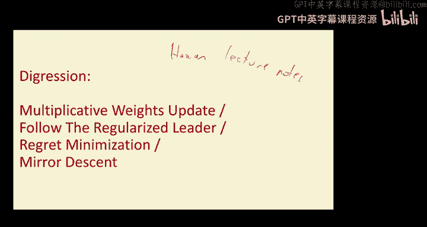

Yes， sounds good yes so please take a look at I see now there is a question in the chat。

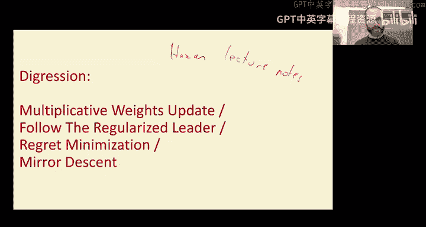

So there is a question in the chat， does this explain why D is smaller than n is easier than D larger than and it's not clear that D smaller than n is easier。

 I think in both cases you have a very stable thing。

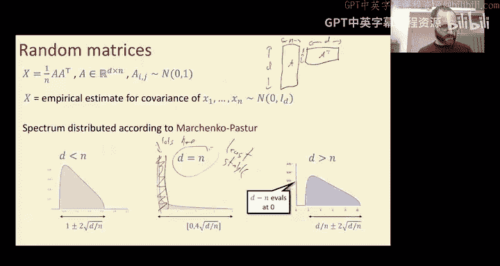

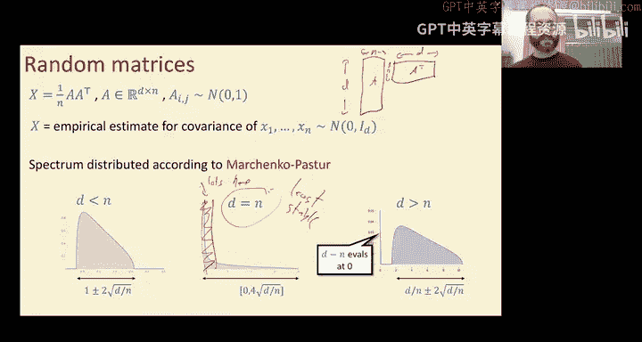

When these is larger than N， then the problem is over parameter advised so you cannot really or so you cannot solve it exactly but。

But you can。But you can obtain and。You can say linear regression。

 but here maybe maybe does show that you have maybe bigger。

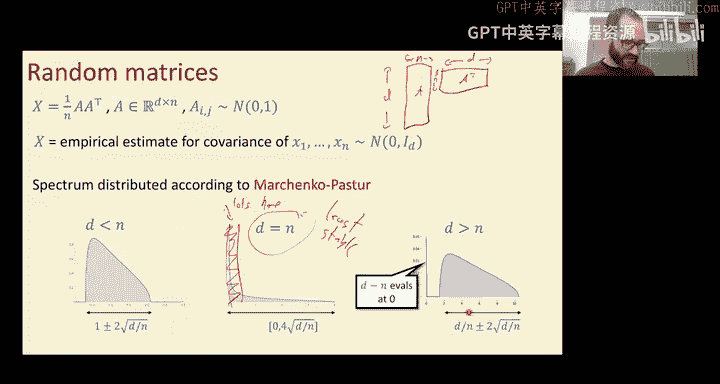

In some measure it's spread out more， so you'll get worse estimates and that's kind of clear。

But some students had to question the officers hours if the overparmetricized case means that the condition numbers in finite and how that relates to learning。

So the overall parameterized case does mean that some of the condition number is infinite and so we typically what we do in this over parameter case case is we can often ignore everything that as zero so often if you see that's actually a very good question so often if you see papers。

😊。

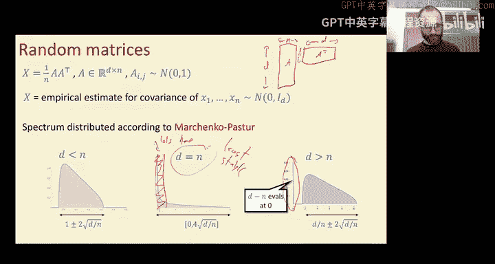

instead of say there will be some matrix， say B， and in a place where you would imagine that there should be B inverse。

 you will see B plus。

Ptoだけ。Is it usually plus or dagger？dagger so basically this what does it mean when you do dagger。

 you basically mean that you do an inverse， but only you ignore the subspace on which the matrix has zero aigenvalue。

So you basically you can always think of a matrix that has a bunch of zero eigenvalue as just a matrix that lives in a smaller dimensional subspace。

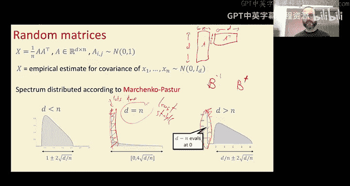

And basically what happens when you do these gradient descent。

 it turns out that all the action only happens in that subspace， nothing ever happens in。

That's not necessarily always the case， but in the case of analyzing linear regression。

 all the action only happens in the subspace of nonzero eigenvalue。

 so you can basically grow that part and then you will all really only care about some of the condition number of the condition number inside this subspace which so that's why it will not be infinite。

But that's something that often happens if a matrix is somehow obviously low rank。

 often the thing that you want to do is when you want to take inverse of it is just restrict yourself to the subspace where ignoring the zero values。

And I kind of don't like that dagger because it doesn't look enough as like minus one to my test。

But so I probably or usually。

When I do that， I'll just write B to the minus1。Just pretend that these zero evalue don't exist。

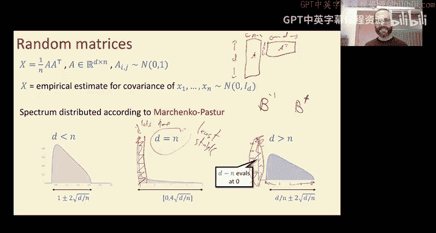

YeahIt's like the kids， you're right， if you close your eyes， if you can see them。

 maybe they can see you。So， in。Okay， so let's make。

The regressiongress to multiplicative weight algorithm。And that's going to be useful for us。

Later in this lecture。

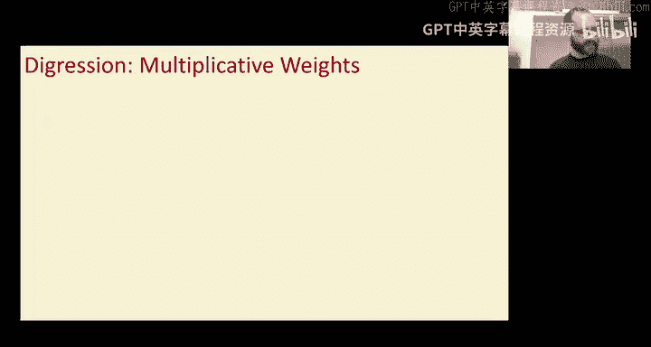

So the setup in multiplicative ways and is kind of a general setup in the。Online optimization。

 online learning。Is the following we have ends possible actions， let's call them A1 till AN。

And basically we can make an action， so this is some kind of a game where at every point in time there is time one。

 time two， time three until time capital T。

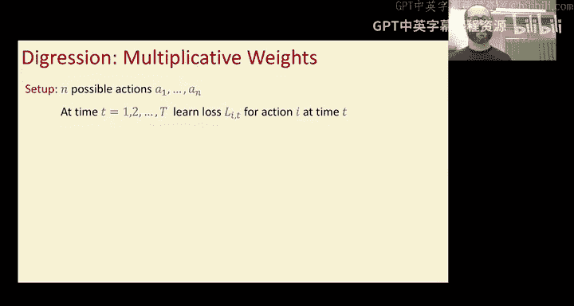

We can make one of our action。And we will incur some loss， you know the loss could be。

 you can think of it also as negative so it might be gained， but we'll always call it loss。

 so we'll incur some loss。So time T will incur loss IET for action I at time T。

 and we are in the setup， which is so called the experts model。

Where we actually learn the loss after we make this action action I。

 we learned the loss also for the actions that we didn't take。

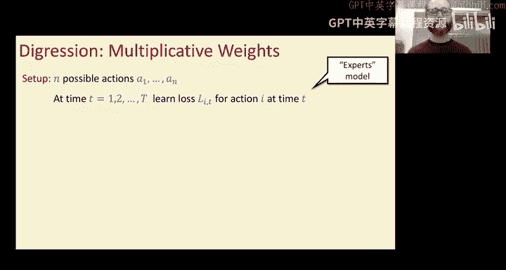

And in the literature on online learning that's called the experts model。

 which basically one way to think about it， you had the N experts given you advice。

 you decided to follow the advice of expert I， but you do learn what would have happened if you had followed the advice of the other experts。

And this is in contrast to the bandit model where the idea is that there is n different buttons you can push or arms in some slot machine that you can pull down and you only learn the loss for the action that you have taken。

 you don't learn the loss for the action that you didn't take。

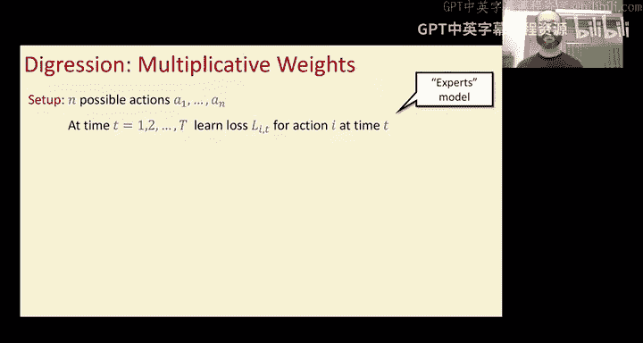

So the expert model is easier in some sense， you gets more information。

And then there is a very natural way to try to optimize it and it turns out that this is a good thing to do so the idea is the following we are going to consider some randomized choices for these actions。

 so we'll start by sign probability distribution P0 over the set of possible actions。

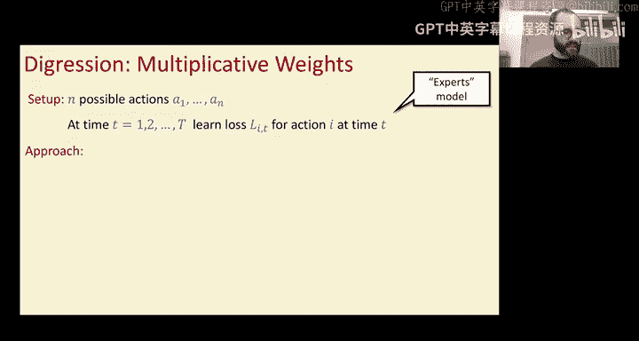

And at every point we are going to take and so we are going to at step one。

 we'll select an action according to P0， then we'll update to have probability distribution P1。

 and then we'll use that in step two， et cetera， et ceter。

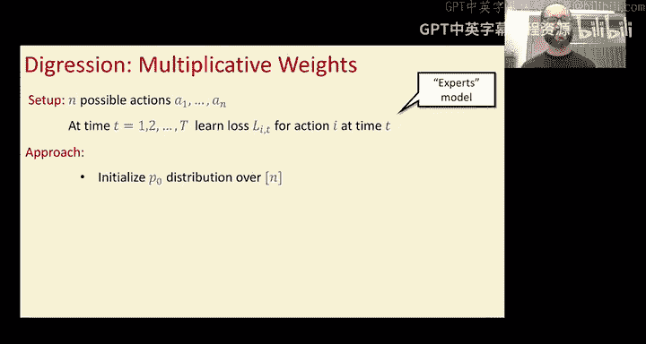

How are we going to update the probability distribution？So it makes sense to say。

 you know if an action。Gave us bad outcome， it had a lot of loss。

We probably don't want to use that this action as much， right， We want to downweigh its probability。

So this is exactly what you do in this multiplicative weight algorithm you multiply。The probability。

Of taking I， you down weighted by e to the minus at a times the loss of I at 0。0。

So the bigger the loss， the bigger the penalty and you can think of it often in this kind of setting。

 this will be roughly the same as saying one minus atta times LaI。If everything is small enough。

 this is basically the same so you are in。So you're down weighting it maybe not by tons。

 but you're down weighting the ones that had bigger loss， you're down weighting them by more。Okay。

 and this is known as the multiplicative weights updates because you multiply every the weight of an action by a factor that。

Is the bigger the loss， the smaller the factor。诶对知等。

And the hope is that basically this will converge to some good aggregation。

 so eventually you will learn a probability distribution that gives higher weight to the better experts and lower weight to the worst experts。

And what does it mean a good aggregation， so the idea is we want to compare and this is this is the standard way that people want to compare so they want to compare two things so they want to compare this is basically how much。

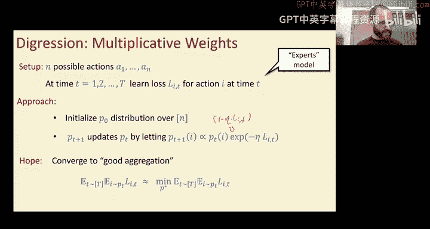

This is the loss that we have incurred if at any point in time we。Make the probability distribution。

 maybe we should have said Pt minus one probably。So based on this notation。So。

This is the idea this is and this is piar。So basically this is the loss that we have incurred if we follow this algorithm。

 so at every step T， we are going to use PT minus1 as our probability distribution for actions。

And this is the best loss possible in this is the best loss possible if not necessarily the best loss possible because if you were adaptive you could and could see the future。

 you could maybe select the best answer in advance， but this is basically。

The be if you looked at any distribution of if you looked at any distribution over experts。

 this is the you take the best possible distribution over experts and then you look at the loss that you fixed the probably distribution and went for the you know in all steps that's the loss you would incur so this basically is the average loss and this is kind of the best loss in hindsight for and nonadive。

Strategy where you just fix the probability distribution of experts。

And the between these two the difference between these two is known as the regret。

And this is how much you lose because you weren't so smart and you didn't do in hindsight the right thing to do。

Okay， is there a framework of what we are trying to achieve clear？

Let's take that as he is。

So this is our hope， so we want to bound this regret。And the main thing is basically the。

The main theorem is basically we can bound the regret。😊。

Which is basically the expectation under PT compared to the expectation under P star。

I think I just kind of did the。A slightlylight。I mean。

 I think my notation is slightly off in this version。

So let's define PT as the thing we act on at step T rather than the thing we act on at step T+ one。

就诶。

So we can bound regret。By these two terms， so one term is the k divergence between the k divergence between the best thing。

 say the P star。

And our initial estimate so that kind of captures our prior ignorance if we were not ignorant。

 then we could have done better right we could have already started if P star was equal to p0 then this term will be0 that means basically we have not。

We didn't need to lose anything。And the second thing is this Eta， which。

Corresponds to our sensitivity per step， how much do we lose in some sense by the potential difference between PT and T+1？

So you can also see that you want to balance these two things on the one hand。

because Eta appears down here。So you can see that on the one hand， a big learning rate。

 like a big Eta would minimize this term， the left hand term。

So a large EA would help you minimize this term， but then it would cost you in this term so you kind of want to balance this out and typically like way this theorem is often stated with this idea we say okay the kale divergence。

 the worst case of it is log n because kale divergence is always bounded by the entropy of。

I always bounded by the enOpy and then。And the entropy is at most log n if there are any elements and then if we set Eta to be。

If we set Eta to be one over scroll T then we get when or scrolled log n over T then we kind of get exactly this thing Yes a good question this is true for any P0 this is true for any P star and P0。

No， basically this is a。You compare。You compare based on the versusP staff versus what you started for。

if P0 is concentrated on like one term。

So you could it could be the case that this is not interesting right so it could be the case that this is an inequality right so it could be the case that okay okay okay right so so typically if people don't know then they use the uniform distribution。

 yes， so okay， this is true for any P。😊。

Maybe that's what God was asking this part is true for NPp0。

 this part is true if you're smart or you know。If this part is true。

 if you use P0 as the uniform distribution。And then you'd set the E to be a square root login over here。

Another question， wouldn't P star be always a delta function as the argument ofI that's a very good point。

 that's true if P star was simply the if this P star was the minimum then it would always be a delta function and again the KL divergence of know P0 is the uniform distribution P star is a delta function will get this log n。

But this theorem is actually true for every P star。So in particular。

 if there happen to be an initial P star that has very large entropy， then maybe you could lose less。

 And then maybe you would also want to choose your。

And potentially that would also affect the parameter et。

 so that's why I kind of prefer to state this theorem in this way。

So often it is stated in this way which basically assume Z P star is a delta function and PC is the uniform distribution。

 but I kind of prefer。To state it in this way。Does this answer your question？

I think so， so I just want to clarify then you're not defining P star as always。😡。

Right by this minimization you have in the hope line right so the theory is for every piece okay。

 thank you。😡。

So the theorem this part of the theorem is for every P stand for every piece0。

This part。And this part is when you set P0 to be uniform and it to be screwed log n overty。

Okay， so now we want to prove this theorem。

So let's make some observations， so what does it mean that this is proportional。

 it means that PT plus one of I is PT of I times something exponentially small in the loss。

Sometimes this factoro， right？And then there is some kind of an normalization that's only that depends only on the T distribution so every step。

 there is some kind of different normalization。

诶。And just rewriting the same thing above and taking logs。

 we get that LTI is one over Eta log of I divided by PT plus1i times theI。

SoSo we're just basically just taking logs of this thing over here。

So， now。Okay， so what is the regret？So。We look at this outer expectation。

 so we just look at this outer expectation so it's sum over all T and divided by one over capital T。

 and then we have these two terms， this term and this term。

Okay， so one term is。Reivide it as so if the loss。

If if the loss at time T is basically one over at the times the log of the。

the log of these ratios and these zeddis， then we just write it as expectation of a logo。

 we just you know break it out。So you know， log of expectation and log of product is sum of logs。

 so we just write it like this。

诶。And then we subtract this and that is subtract this avatm which basically corresponds to this loss when you act according to P star。

Right， so so basically。When you act according to PT。

You pay pay a loss that basically relates to the the ratio the log ratio of P and p plus one because that's exactly how how these things yes Z is a normalization constant yes so so and the point is that it's going to fall out right so we are not going to care about it right so LP。

This is the loss。But this is the loss。For at step T for action I。

And this is going to be one over at times the log of the probabilities， which kind of makes sense。

 right？

诶で。Because the bigger the loss， then the bigger the loss。

 the loss really corresponds to the ratio of these probabilities， right， so it's exactly。

Corresponds to the loss and then there is some kind of normalization factor。

 but it's going to fall out。

So it's it's going it's going to follow out so we basically just have。

These terms。And then we just collect them together。And we can we can write it as the following。

 so we have these terms we just。Okay， so what we want to do， what we want now to notice。

Is that we have here。We have you a telescopic some。

So these you see expectation of P star PT minus expectation of P star p plus one。

 so when we kind of add all of those together then they cancel right so so you'll have。诶。

Because this was with a minus， you'll have， you know minus。P star log of P。Of P0。Plus。

E P style log of P P1 and then minus E P style。Log of P1， ettera， so basically these in these terms。

Or when you add them up。You're only left with minus expectation according to P star or log of P0 and expectation of P star log of P。

 so we are only left with this。Okay， and here what we are here we have these T terms and we just。

And they just basically just corresponds to expectation according to PT of log P divided by log P plus one。

 so which is exactly just the K of thergrgence。Of maybe I should have used this notation K divergence of PT and PT plus one。

Okay？So basically， we just express the regret。We use the fact this the telescopic sum so we expressed the red part of this part of the equation we just expressed。

As a。This difference between two expectations and this part of the equation is just the sum of all these KL terms。

And now this is basically now we just do the math right this is just。

So this is basically the cross entropy。

Of P P star and P0 minus the cost entropy of P star。And Pity。

there is a question， is P star the optimal distribution。

 this is a theorem that's two for every P star， we'll use it when P star is the optimal one。

 but this is a theorem that's two for every P star。😊，Okay。

 so now this is basically just the difference between two cross entroies and because cross entropy is always at least as large as the entropy。

So this will only be will be bigger if we subtract a smaller quantity。

 So instead of subing course entropy of P star and P， we just can subtract the entropy of P star。

And that will just give us now we just get the formula for KL divergence。

 so we get this is the one over Eta KL divergence of P style N P0。

So this。We got this。Okay。😊，So诶。So hows that， can you repeat your question， what do you mean。

 why did we choose this particular loss function？

Oh， it's just said can go back to the previous slide， okay？

Yeah I guess I just wasn't sure why LTI takes this specific form I think I'm okay okay that's a a good point right so that's a nice point so basicallyLIT or LTI is completely not under our control right？

Right philosophy comes from the adversary， but what is under our control is how we update the probabilities。

Yeah， so we update the probabilities by following this formula。Right right。

 so now suppose you take this formula and now you divide by P of I multiply by Z， right？

And now take logs。Yeah， so youll get that minus so you'll get that oh LIT is the log of PT I I you see I see it's an identity that can be derived from IC right it's an identity but that's actually a very good point I'm really glad you ask this question right so it allows us。

 I mean we don't control LIT we we control the relation between PTI and PT plus one。

 but because we control it， we can express LTI as a ratio of this as。😊，As depending on this。Okay。

 all right， thank you Okay shoot and I'm really glad you asked this question because it is somewhat confusing because LTI was not something that just came to us how do we know that we can write it in this form？

😊。

Good， so so basically now we have so now we got this first term。

 so now basically what we need to do is bound the purple term by all of Eta。

And just intuitively， it kind of makes sense， you know， the smaller， so just basically， you know。

 even if you don't follow every line of the， you kind of want to see that what we are doing kind of makes sense。

So first of all， example makes sense that the better the closer， the point we started from to piA。

 the better we will do。

So that may be not surprising that this we term will appear somewhere。

And luckily， it does。And now the second thing is kind of also makes sense that the smaller our learning rate will be the closer PT and PT plus1 will be right if the learning rate Eta goes to zero。

 then you're not changing much， then the probability distribution at step T plus1 is very close to probability distribution at stepT。

So the the closer we are the closerta the smaller Eta。

 the smaller so it may be not kind of surprising at least that this will be some function of Eta。

 but the question is why is it exactly O of Eta and not some other function that goes to zero with Eta？

And now let's just do this math。

Right so this is so this is where we are so now how do we do that so basically the point is the following。

And the idea is the following， so for any two probability distribution。If you get。If you obtain。

诶片。By if you obtain P by reweighing Q with a factor that is between one minus eta and one plus Eta。

Then that will kind of be the case when L is constant。

 so it will be one minus of theta1 plus over theta。

 so then the kL divergence is at most at a squared。Okay， so if you take any probability distribution。

 you take any probability distribution queue。

And now you have this a probability distribution， maybe you can use a different color。

And now you have this other distribution P。

And you maintain this environmentvariant that。At any eye。P of I over Q of I。

Is between one plus minus eta。Then the K the divergence will be at most atta squared。

And that basically will， in our case， this will be kind of off e because we some of the losses are bounded。

 so this will be at most yeah and the proof。

The idea is you can write write P of。

Okay， so。I can do the math right so this is the proof。

 but let me just kind of give you the intuition。😊，So yeah， I mean， the math is quite easy。

 but let me just give you the intuition you can see the map over here。😊，So。

The intuition is the following so you can kind of separate。

The parts where p is bigger than Q and the parts where Q is bigger than P。

LikeYou can separate the sample space to these parts。And because the way you have done this。

 you know that this is。Half minus plus minus Eta。Right， so roughly speaking。

Because every element is modified by at most one plus Eta。

 maximum the maximum these can differ is by an Eta fraction。

 so basically half plus minus Eta fraction of the points p is bigger than  Q and half plus minus fraction of the points  Q is bigger than p。

So now if we。So basically， that means that。Things will kind of cancel out when we take the kale divergence and we look at expectation of log。

P overQ。Then things will kind of cancel out except for probability Eta so except for probability per Eta things will cancel cancel out and when they don't。

 it will be something like one plus Eta logo of 1+ Eta which will be roughly Eta squared because logo of 1+ Eta is roughly Eta。

So this is kind of intuition， but as you can see the math is actually quite simple。

 so you can also just follow the math and just do the calculation。😊，Okay。

 but this is kind of also believable。So now if each one of those terms is Eta squared and you are summing up a capitality of them。

 then you get t times Eta squared divided by t times Eta， so you get Eta。So that's how you get。

listister of。Okay so so basically this concludes the proof do you any questions about it and again it's the particular lines of the math you can follow and they're not hard。

 but the main point I kind of want you to get is that these things are kind of believable the type of。

The one term corresponds to how much you move between steps and one terms corresponds to how much was your ignorance in the first step。

Ms asked how do we go from expectation to the max log so if you have definitely expectation right so this is。

Expectation is just the sum of P。😡，Right， so this is basically just some。

PI minus Qi times log of P right this is equal。Right expectation is some PI times the quantity。

 so this is some PI times minus QI times log of PI。And these will be definitely。Right。

 so this will be smaller than sorry we should put you absolute values。

 so this will be smaller than the maximum times somepi minus qI and that will be at most。Go。

 can we frame with applicable weight as graduate decide of some objective， yes。

And we'll talk about it in a second。😊，That诶。Yeah， I think is the Kale bound hole for continuous random variables。

 yes， I think this whole thing generalizes to continuous random variables。

 though I'm not sure if there are caveats， I don't know if anyone An or anyone else here knows better about any caveats will when you just extend this to a continuous space。

But I don't think it should me。Right so you can generalize these multiplicative weights to more and this is kind of follow the regular leader and that's the idea is that you have a set of actions。

And assumed set of actions is convex。What does it mean the set of actions is convex， I mean。

 after all， in my case， the set of actions was discrete。

But we can think of the set of probability distribution on those discrete things as convex so generally you have some convex set of actions。

And at time T+ one， you make a choice。In this action and you learn the cost function。

 so this is why it's still an expert model， you don't just learn how much you lost。

 you learn how much you would have lost。

For any possible action。And now follow the regular leader。

 the idea is now the natural thing would be to say your new action would be the thing that minimizes the sum of the losses up to this point in time。

And that can sometimes fail really， really badly， so you are the regularizing term and that's followed the regularized leader。

And basically， there is。😊。

There is a COM that you can so there is aM that the minimum regret corresponds to the difference between this regularization bound at say Xta。

 which is say the optimal choice。Minus the hour at your choice。Plus。

Some of the differences in differences in loss between the two the two actions action T and action T plus one。

 and again this kind of corresponds to two terms， one of which is prior ignorance and the other is sensitivity per step and the multiplicative weight is just a special case of this thing where the。

Just a special case of this when the set of actions is the set of all distributions on the end discrete actions so that's a convex set and the regularizer is minus one over atta times the entropy so we are trying to。

So minus entropy means we're trying to say maximize entropy right we try and minimize the regularizing corresponding to maximize entropy。

 so we're basically trying to make things。So we're trying to do something that on one hand minimizes the loss but on the other hand is still a very flat function as far as as much as we want to flat and if you think about it it's kind of very similar to what you're doing in multiplicative weights。

 you're trying to make as minimum changes as possible so try to think keeps things as flat as possible having large entropy while improving your loss。

So yeah there is plenty of yeah general and electrode notess on all of these things and it's a very rich area and and there is a way to think of multiplicative weights as also a mirrordesscent and then。

I'm less familiar with this point of view， but I think。

Probably the lecture notess that Anco mentioned should have that and I think N visionary also have some lecture notess of this。

Okay， but that was kind of， I just wanted to mention it because we'll see a version of these most D weights elsewhere with analysis。

 but I just want to kind of mention it。

Okay， so now。We're going to move to robustness， but actually maybe。

This would actually not be a bad point to take a 10 minute break。

So it's 105 Eastern time， let's take a break until 115。

边。

Okay， so I'm going to post the recordinging。

So before we move on to robustness， any questions so far？

Okay， so when。

Let's talk about robustness。So。

We have this following pipeline， right we give our algorithmating data。Then it spits out a model。

 which we can think of as a classifier， regressor or whatever it is， but some kind of a model。

And this part is what we call training。Again。We feed this model new data X， and it gets an output y。

And this part is what we call testing。Now in the real world people might actually do something with the model and other than test it but that's really way beyond what we ever think about for us so maybe maybe there are rumors that there is also something known as deploying but let's not go。

😊，Let's not go there so we have the training and the testing。

And。And there are several ways we could be attacked that this process could break down。

So for example， there could be a data poisoning attack that means that's say some adversary or maybe just happens that the data is just faulty or biased in some way。

That for one reason or another， our data。Doesn't come from the distribution that we thought it comes from and doesn't represent the real world in which this model is going to be deployed as much as we wanted it to represent。

And in the extreme case where this data is actually adversarial。

 which is what we'll focus about today， we call this data poisoning。

Another thing could be and in some sense it's a different way to view the mismatch between the two cases。

 so there could also just be the case that say there was no data poisoning the data was fine but because of the time because of some other reason the data which we。

Test our model and we wanted to work on is not coming from the same distribution on which it was tested。

 in which it was trained。And it could also even be the case that the data is。

Adversarial so what does it mean to test on an adversarial thing because？Obviously。

 if an adversary could completely change what you tested on and be something that has nothing to do with what you were trained and we don't really expect the model to work。

 but we think of say adversarial perturbations in particular there have been all sorts of attacks。

Where。You take say an image classifier and you modify the image in a way that humans think it's the same image。

 but suddenly the classifiers think that it completely something completely different。

So these are the sort of and we would like our training and our models to be robust against such。

All these types of attacks or deficiencies。So our in。

Our initial focus is going to be on train time robustness and in particular on this data poisoning attack。

And we'll start by talking about this， not even in the context of machine learning。

 but of the simple problem of just estimating the mean of pieces of data。

喂。So let's start thinking about the following things。

 so suppose that we have data that one minus epsilon fraction of them are sampled independently from some distribution x over say R to the D。

And then epsilon fraction of them are sampled arbitrarily， so some adversary chooses them。And。

Of course， just for notal convenience， I assume that the arbitrary part is indexed by the index says one million stepsps n plus one until n。

 but this is of course。Our model just gets them as an unaudered set so doesn't know which ones were the outliers or they've maliciously chosen and which one came from the distribution。

So let's start with the simplest possible statistic that you want to estimate which is simply the average right so we want to estimate what is the average of a vector in this according to the distribution x。

And。In the noisest case， if we didn't have this。So if we didn't have this arbitrary part。

 then the average， the best way to estimate the average is just to take the empirical mean。

 just take your x1 t and just average them and just take the empirical average。

And to analyze this now， we'll assume that even that at least for the。

And so just so we can give bounds and don't have to carry out norm， well assume that for the。

That for the vectors that。For the vectors that are sampled from x， their normome is one。

Or after won。So in this case。Kind of concentration standard concentration of measure type of results can show that the difference in norm between mu hat and mu will be at most all of one over Sc n。

So in ds one， this is difference in absolute value。

 so for general D you'd pay like a square of the factor。Okay。

 so this is kind of standard concentration results。

So you can get an estimate up to one over square n or scroll d over n or scroll d over Scton。

If you were just take the empiricalperial can mean， assuming there was no noise。

And in adversarial case， we kind of all know that the empirical mean could be arbitrarily bad right so if we wanted to。

Sa诶。Take like say say if we wanted to take an average of。You know， if you want to take some average。

 then if you have some errors in data， then they could skew things off。Completely arbitrarily。

And sometimes you do have errors of data， not necessarily。Even malicious。

 I just read in the news that there was a guy in England。That received。

 even though he's 30 years old， he received a letter that due to his comorbidities and preexisting conditions。

 he's going to get a COVID vaccine。And it turns out that the reason that he was listed as having comorbidities is because his height instead of being registered as six foot two inches was registered as 6。

2 centimeters， which gave him a BMI index of something like 28，000。

So。So since according to commuters， his height was disted。Then he you know。

He got an invitation to get COI vaccine， I think he canceled the invitation before he found whether the vaccine the intend to give him was kind of this big。

But in any case， this is kind of an example where you have some， you know。

 the empirical mean could be completely screwed， you know， you can have like an average of。😊。

100 numbers each between zero and 10 and then you add one number which is a billion and it's completely skewews the mean so empirical mean is clearly not a thing to do and everyone kind of learns that for d equals one what you really want to do is the median。

So why is the median better than I mean exactly because it is more outlier resistant？😡。

So what is the median， you just sort them and you just take the middle element and this is going to be guaranteed if you have epsilon outliers no matter how arbitrary they are。

You're guaranteed。

That you know up to some one of growth and kind of sampling and errors that we kind of ignore right now。

 you're guaranteed to lie in the quant that maybe not exactly the 50 percentile but it will be between half minus epsilon half plus epsilon so that's why we like the median it's more robust to outliers。

But what do we do with higherdimen？Right， so诶。So let's try to get some sense right。If。诶为咗诶。

So just to get right so first of all， maybe get a sense what does it mean to be the quantile what does it mean that it's in this quantile so basically。

If New story is the median， let's think of the normal case， right so in the normal case。

Around this area， this is something that's good to know in general around this area where you have in this area the of the curve of the。

If they gosh him killed。In this area， the distribution is roughly flat。So basically。

 it means that if you shift by epsilon。So if shifting by epsilon corresponds to a mass。

Probability mass of about of epsilon。So the quantile。

 so if you move to the half plus epsilon quantile or the half minus epsilon quantile。

 you're going to change the mean by so if that was the true mean and you estator is mu star you're going to change the mean by atmost epsilon plus one over quot1 so the sampling error plus one over quot1 and this epsilon is inherent because you could not distinguish right if you say for example it's normal with mu normal mean1。

 you could emulate a normal with mu plus epsilon one by just。

By just perturbing epsilon fraction of the data， so this loss of epsilon is really inherent。

And the median doesn't lose more than epsilon， so it really is optimal。

And I think it's also optimal after to the constant， but let's ignore the constant。

 but basically up to constant， the median gives you an estimator that is as robust best to outliers as you could ever hope for。

But in higher dimension， then maybe the first thing you would think of is to do the median of coordinates。

So you take your vector， you take your vectors and in each different coordinate。

 you compute the median and you estimate will be the median of coordinates。诶。

The problem is the following thing。

So if for example， let's just assume say that even the case that x is a standard normal。

If I'm an adversary。

By just having anpson of the epsilon fraction of the points B。

Expsilon fraction of the points B the vector 1111。Then I can make the median of coordinates always be basically epsilon。

So the median of coordinates will be。D vectorect epsilon， epsilon， epsilon epsilon， which will。

Which which will differ from the actual vector by something like Epsilon scroll D。

And that's somehow bigger than what we really want to be。

 so the question is do we need really to pay that S price？And it turns out that we don't。

And this really comes from this paper of Tki from 1970s where we asked this question。

How it's a very nice paper to read， by the way， even independently of the Tki Midian。

 actually it's not the best paper to read about the Tki Mid and it doesn't explain it very well。

 but it's a nice paper to read regardless。😊，So what tookki was defined as the following。

Soie said what is a Tki median and I'm going to use a simplified definition。If you have endpoints。

At2kimediaian， let's say， is some new star。So that if you。

If you subtract new staff from all of these points。

Then every half space is going to be roughly balanced。

 so what does it mean so suppose you have all of these points。

And new out。Will be some points such that no matter how you any direction。

 so you take any direction V。It will always if you look at this direction V。From you star。

 then always about half the points will be on one side of it and half the points will be on the other side。

 so let's say at most three epsilon or generally it's a parameter。

Okay， so again， the idea is the following that you。So new start。

So what does it mean that Mustar is a tool comedian that basically you take。You take this mue down。

And no matter which direction V you choose。If you look at the things that are on this side。

 so these are the xs such that x。

X minus mu star dotv is positive and these are the x such that x minus mu star。v is negative。

 then about half， likes say half plus minus3 epsilon and you have plus minus3 epsilon。

This is the definition of a2kiedian。Okay， and this turns out to be you can think of it as a notion of median that unlike the median of coordinates。

Is not。It's not restricted to the standard basis， it doesn't care about the coordinate system。

 it's a notion that's invariant to any rotations or anything like that。

yes here that something like this should always exist， for example。

 if you have lots of points in one kind of line and then some points away from that so if you see the direction parallel to that then maybe points will all too many points will be on one side compared to the other it's a good point that's a great point so it might not be it might not necessarily exist but when it exists。

It's a good medium so in particular if say one minus epsilon fraction of the points are say from the standard normal or and let's just make it normal with new standard comp。

And we think of epsilon as being we think of the sampling error slow de over as being smaller than epsilon。

First of all， there exist Tuki Midian， which as Yamini said it's not obvious。

 but it does exist in Tooki Midian， and the second thing is that the difference between new and newstar is off epsilon。

 so we don't need to lose this extra scroll D that we lost in the median of coordinates。

Okay， yeah， thanks。And and。

So let's see why this is the case。

So first， we need to prove that there exists tokiedian。

And that the nonexistence of2ki medium gear， it tells us about the degree of the distribution。

That's。That's a good question I don't know for sure one of the problems with Tki Midian which we will talk about is that it's not an easily testable solution so even though tookki you know this is in the 1970s that doesn't really。

It doesn't help us a lot because we cannot the question of whether or not Tokimediaian exists is not something that we know how to answer efficiently。

 so what we do in practice is we use some proxies for this as we'll see。

But I think it could be some way to define some kind of skewedness of the distribution or something like that。

So the mean itself。

Is a2ki media in this case。So why is it2ki media， the way to think about it is the following。

Try to think about it so for every particular direction V。

 we can define these plus minus1 random variables which are plus1 if you take x1 minus mu is positive and minus1 if you take x1 minus mu is negative。

So and。So you look at， if you set K to be1 minus epsilon n。

 when all of these come from the same probability distribution x， in our case it's N UV。

Then these are going to be just IID plus minus one random variables and in fact。

 because you know it's a balanced distribution， they're going to be。You know。

 equal probability being plus one and equal probability being minus one probability are featured each case。

So now that means that the mean zero， so the probability。

That the probability that are larger than epsilon k and here we just use the fact that k is roughly n single of it is at least n over two and we don't care about exponents。

 it's going to be exponentially small in epsilon squared n。

So under our conditions， we assume that epsilon is bigger than the scroll the over and this is much going to smaller than exponential in minus D。

And now this is something we often do in this course we are sloppy and we say。

 you know the D dimensional space， we think of it as if it has constant to the power D like 10 to the D number of points。

Because we could， in principle， we could。Deretize it into some net。

 but we kind of put these arguments under the rugd。

 which basically means that if the probability is smaller than x to the minus d。

 then we imagine that we can do a union bound over all possible vectors B。

So that basically means that we can assume that up to some epsilon。

Up to Epsilon in the first version in the first y10 YK。

 there will be at most epsilon deviation from one site to another and then you can add an extra epsilon deviation because of the adversary。

 but it will still be at most， say two epsilon， something like that。

Okay， so that's part one， and maybe we're a little bit sloppy about the constants， but who care。

Sounds good。

Okay， so so next the mean itself is a2kimediaian， but suppose we were looking for atokimediaian we might not find the mean。

 we will find a bunch of vectors so what we want to show is that for this part two is that for every Tokimediaian。

You start。We are guaranteed that the difference between that and the mean is of epsilon。

 so if we found the twokimeian， we know that this is a good estimator for the mean。

And how do we do that， let's suppose for the sake of contradiction that a mu minus mu star is at least 10 epsilon。

And let's giveb the direction that corresponds to the difference between， so this is the true mean。

And we have these things。And there is also whatever the adversary did。And then here is the。mus store。

And。And we want to claim that it cannot be the case。That they are too far from each other。

And even if thatversary tries as much as possible with their epsilon malicious thingsinx to try to move it as much as possible。

 so let V be mu minus new star。So we look at this。We look at this term， so it's X minus mu star。

 the dot product with V divided by the so this is just the unit version， the normalized version of V。

ok。So诶。I， I mean， since Mu star is Mu Star is just。M minus v right by this definition。

 then we can just write it as X minus mu plus v dot product the。The normalized versions of free。

So now we can write this just。

Let's just take this term out so this is going to be。で。

This is going to be the dot product of Vb itself which is the norm of v squared divided by the norm of v。

 so let's assume this is just equal to 10 epsilon just for simplicity so we'll get a 10 epsilon here and we were left here with X minus mu dot product with this normalized version of V。

I mean， this is just a little bit of map manipulation， but is there anything unclear？

yes， why can't you use the mean then if it's a2kimediaian and so think of it as in terms of it that's that's a great question so you think of it as in terms of your algorithm you can enumerate all2ki Midians。

 right。

But how do you know that if you found the Tokiedian， that it's a good estimate for the mean？

So what we want to prove in part two of this CR is that for every2ki Midian。

It's not too far from the mean。So therefore， if you found the Toki Midian。

 you know for sure that it is a good estimate for the mean。

Does this clarify things？😮，So didnt in one we proved that the empirical mean is a Tokimiian， yes。

But two is that for every right， so so two is the I should have phrase it this way。

 two is the following for every2ki media new star。The difference between mu and new style is at most of Epsilom。

到。So there are many， there is more than one2yedian， one of them is the mean。

But there could be also others。now the nice thing， okay so maybe the point is the following tokimediaian is defined the mean that actually is very。

 very good point， so maybe that's a point that we should really emphasize。😊。

Tokymediaian is only defined in terms of the sample of x1 until xn。

So it is defined based on things that you know as the estimator。

The mean is defined based on the population thing of this distribution， which you don't know。So。

 at least if computation wasn't a constraint， then you could enumerate all twokiedians。

One of them will be the mean。But that doesn't necessarily help you right you could have also enumerated all vectors and one of them is the mean you just want to know which one so you know that so number step1 tells you that at least this set is not going to be empty that there will be at least one tokimediaian。

And step two tells you that any vector you pick from this set will be a good estimator for theamine。

Got it thanks Ash sure no but thank you for asking because this is yeah this is confusing and also like very important points this is much more important than you know the following the math。

😊。

Right so we now we want to prove that any new star will satisfy that the difference will be small and so we did this algebraic manipulation。

 we basically said， okay。We' let V be the difference between me and mu star normalized and now if we assume that the norm of v squared is 10 epsilon。

 then we can just write this。We can write X minus mu star dot product with this unit vector as X minus mu。

That product we've。This unit vector plus 10 epsilon。No， these。

Is just distributed like a standard normal because X minus mu。This is the actual beam。

 so XI managed new is just distributed like just like normally NZI and high dimensional normal and if you take a high dimensional standard in normal and you don't product it with a unit vector。

 you just get a normal。

And now it's let to define why I to be design。

So we let why I be the sign of this term。Which is basically。So why be the sign of this term。诶。

The probability that Y I equals。So the probability over the choice of these x1 t xn there for fixed B the probability that y is minus1 is going to be the probability that a normal is smaller than minus 10 epsilon because there is this bias here towards 10 epsilon so this is going to be a probability that's say less than half minus5 epsilon this is just kind of by looking at a normal distribution if you have a standard normal the probability that you're going to be。

10 epsilon away from the mean is going to be。say half minus five epsilon， something like that。

So that means that with high probability。Because of standards kind of concentration with high probability there are going to be at less than n half minus4 epsilon n such that Yi is equals to minus1 and now even if you added this epsilon n controlled by the adversaries it's not going to be enough to make new star so that basically means that new star。

Hes note。It took me in。So it's the same type of argument。

 you basically say that you basically say that。There is a bias here， at least an epsilon。

 so it cannot be balanced。Okay， but that doesn't actually help us in because the2ki Midn is not something we can compute so it turns out that actually computing the2ki Midn is NP hard or even some kind of a harness of approximation results。

 you can see Jerry Lee's lecture notes。

They discuss some of these， but it turns out that there are efficient algorithms for doing meanAP estimation of nos and even other distributions and I'll just give one thing that is not the optimal thing but just kind of give you the flavor of what you can do。

😊。

And so what you can do is the following。You can look at the empirical covariance matrix。

Empirical mean an empirical covariance matrix so generally。

These are not going to be the empirical I mean， as we said， could be arbitrarily bad。

But it turns out that you can tell if it's bad。Or at least you can certify if it's good if the empirical covariance matrix happens to have small spectral norm。

 so if the empirical covariance matrix has small spectral norm。

 then you know that the empirical mean is actually a good estimator。

So， this is呃。

These are the claim that basically the。A gap between the empirical mean and the new is。

You know， scroll D over end that's kind of the typical thing that we lose from sampling。

 so that's not som worried about。

AndSo this basically is a term that becomes smaller if the spec of the empirical covariance is small。

And here by the way， we lose growth epsilon where from similar arguments as before。

 we really should have wanted to lose only epsilon and a lot of algorithms and more advanced algorithms and how to make this growth epsilon into an epsilon。

 but we are not going to go into this。

So the main thing is the following。You know， the quality of your approximation。

 this is something you don't know the thing on the right hand side you do know right you can compute the empirical covariance matrix。

 you can check its spectral norm， so that basically means that you have a way to certify to efficiently certify。

😊，The quality of your estimate on the mean and if that bound is good enough for you。

 then you know you're done。

And in particular， just to get kind of a sense。

Of what would be the。That's a good kind of a sense of what would be the。

How big do we expect the spectralome to be then the spectralome will be something like square would D over in。

When so if the number of sampless becomes very large， then we are kind of in a good shape。And so。

Okay， so let's lets let's give the proof， or at least。

Go through the proof quickly and we love the notes here so let's just assume that shift everything so assume mu is0 just to either make the notation easier so now we just want to bound the norm of mu hat so we assume that mu is zero just for the proof and yes this is an upper bound right？

Yes Rams makess a good point， this is an upper bound。

 but typically yeah what you might want to do yes， it's an upper bound but often the emamine is also really bad and。

😊。

Yes， and uncle is already predicting what we'll talk about in a second how you can make that into an algorithm。

 even when the upper bound is bad。😊。

So yes， but let's start by proving this so we want to bound in the case that muic was zero。

 we simply want to bound the norm of muhad。So muhan is the empirical means so we can just write it as the dot product of muha with the definition of muha。

 which is。😊，You know， one over ends some of the exercises。

So now we'll just split it into summing up on the good Xs and the bad Xs。

Right so the good are the first one minus epsilon and the bad are the last epsilon n。

And now for the good exercise， it's random， then this is basically like we have this kind of this similar thing that we have seen before。

 then this is basically distributed like a normal。And we can assume you know that we can do a union bound so that this thing is never never going to be bigger than scroll the over n times the norm of a mu hat this is kind of by standard concentration。

So we bound this part by scrollD over n times the mu hat。

now we have these two terms and what we do is。I just subtracted Muha and added it back in。

In this term so I just did nothing， so I just view the red term as one over in muha X minus muha and then added back in so we get one over in some over the best part of muha Muha which is of course the same as。

The norm of me square。

So this is just basically your summing over epsilon n things divided by epsilon n this is just epsilon and muhat squared which we can just kind of ignore and just multiply this part by one minus epsilon so this just you know add the subtract epsilon times the norm of mehat squared from both sides so we really left with this。

We want to evaluate this。

Now by Ksh Shivaz。诶。

WeWe can do the math and this is one over n sum over this ping would be smaller than square root of there are epsilon n terms zero。

 so this epsilon will come here so we'll do epsilon over n sum over these pings。

And this term squared。Now the nice thing is term this thing squared is exactly。

Evaluating the covariance matrix as mura。

So if this is the covariance matrix and you were to look at mu hat， transpose sigma hat mu hat。

Then then you will get。ででうs。

Then if you were to look at these matrix and evaluated that the vector you heart。

Then you get exactly you would get exactly this， so for every vector V。

 this matrix you know V transpose sigma hat V。

Is some。Over the dot product of V and X I minus mu hat squared。

That just you can do the algebra right that that's just basically what this covariance matrix does if you take a dot product of you know if you take dot product of three with both sides。

 then you get twice the same term， which is just the dot product of x minus me dot Vv。

So basically this is evaluating this term is evaluating the covariance matrix on mu hat transpose mu。

 and that is bounded by the spectral norm of the covariance matrix times the norm squared of mu。

 which is， of course the squaret epsilon。Times the norm of an immuno cells。

 and now we just kind of rearrange things。

Right， so so now we just we arrange things， so we get one minus。

So we just rearrange things and we get we divide by mu by the norm few and we get that one minus epsilon times the norm of few is less than o of square the over n plus epsilon times the norm of the spectralome。

 which is exactly what we wanted。

Okay， so this is the proof of this thing and again。

 if you didn't follow all calculations you can follow later it's nothing is deep here。

So now let's do what Anco said， so the problem is this gives us a certificate when the empirical the empirical mean is good。

 but what happens if the certificate is a very large bounce so it doesn't really help you this a prior this spectrum known could be extremely large。

So the idea is the following。😊。

So we can kind of generalize the same argument and say that for any distribution that is somewhat flat。

 flat basically means that it doesn't place too much mass on any particular element。

Then instead of looking at the average， empirical the empirical covariance with respect to the uniform distribution over the samples。

 we can look at the empirical distribution empirical mean and empirical covariance with respect to some different weighing。

 say where you say maybe give some elements a little bit more weight and some elements a little bit less weight。

And it turns out that you can do the same proof and show that it still holds the same chiH statement still holds the。

 the empirical mean is going to be bounded by scroll d over n times the scroll times the empirical spectral norms of the empirical covariance。

And so this is basically just the same the same exact proof。

 except now instead of doing a uniform bounding， you just do a。

You just do a different re weighing。And that kind suggest the following algorithm。

 so we start with the uniform distribution。

And if we。

If you find a nice bound， if the empirical covariance has small spectral bone， no。

 we are happy we return the empirical mean and we go home。

If not。Then basically we know， like Anco said， we know who to blame， if the specome is large。

 it means that there is a large aen vector。And now we can basically define the loss of X as the dot product of X with this large eggendirect。

And we can basically penalize every variable， every input based on this loss and go back to two and a similar analysis to what we have seen will show that this will result in a good estimation。

 this loses an extra log factor and again there are like lots of work on trying to do things better。

But this gives the idea and Jerry Lee and Jacob Steinert both are very nice lecture notes they gave a full semester course just on robustness。

You can see there all their analysis， but I just wanted to give you the flavor of what you can do。

And there are lots of works that give you optimal bounds using some of Square's algorithm。

诶。What if we don't restrict to flood distribution part of these Kshivas this oh you lose something about in the non flatness。

So that could be an issue。So we do want to keep the distribution somewhat flat。

Yeah， maybe let me explain my question， I guess I can understand that if you don't have a flight distribution then you probably like there is an extra overhead。

 but is there like a tradeoff between this and also like like the converters rate when you apply the robust estimation I mean if you don't restrict to flightness condition maybe for the later part you can also move faster I'm not sure about this sure I think that somehow youre likely if you move fast if you started from a uniform distribution and you didn't move fast then maybe naturally you'll still be flat。

Just because you didn't have a chance to modify your original uniform p and in this case also you kind of know that the。

 the ground too that you're looking for is flat because all but ideally what you really would have wanted to do is just drop epsilon fractionction。

so so this actually flatness is like not a big this condition here it's somehow。😊。

So you typically would start yes with a uniform because you don't have any prior and ideally what you would do is filter out you know you'd filter out something like off Epsilon of the that's in the ideal case you'll filter out off epsilon of the input and which will。

Hopefully hopefully will remove all outliers or at least all outliers that cause you problems。

I see I see thanks so I guess here BoA is also presenting this with you know multiplicative weights。

 but you know there' are also like convex programs that you can just write down that you know you can prove that do the thing and there what's important is having an upper bound on the weights。

So you can't afford the upper bound one n because you know only one minus epsilon times n points are actually uncorrupted。

 but what's important is that sort of like upper bound of one over one minus epsilon times n because you do pay statistically for how rich that family of distributions is。

So like if you care how well the empirical mean cap converges。

And you have this quantifier over for all one minus epsilon sets of the points。

 it doesn't actually converge arbitrarily well as the number of samples goes to infinity it only converges up to epsilon so it's actually like if you lose that kind of upper bound then it's just not true you union bounding over too many things and you pay。

So basically whatever you pay here and ideally you know that the ground truth。

Is that this is at most one over one minus epsilon M because kind of the ground truth is that you could。

 there is a probability submission will just put all the weights on the good things and no weights on the bad things and whatever constant you have here。

 it will somehow find yourself in this bound here。And just you know a bunch of this stuff is very intuitive even though there's a bunch of math behind it。

 right， like even if I take a single like one in as simple as possible。

 and I quantify over all one minus epsilon subsets of the samples。

 I claim that doesn't converge arbitrarily well to the true mean because I can just lop off one side of the tail。

😊，嗯。And then it's always going to be skewed away from that's why we said before that the epsilom price is kind of inherent。

诶 so诶。You can never get an estimate better than the epsilon of。Right， right， right， I see， I see。

 got。

Yeah， thanks for the discussions。

So yeah， there is lots of work on getting like the optimal things for all sorts of。

 so this is the whole field of statistical robustness。And sometimes。

 so you get two types of algorithms。Or maybe three types of algorithmgoithating。

 one type of algorithmgoit is algorithmgoithium like we showed before that。😊。

You can run it quite efficiently or decently efficiently， you can run it in practice。

 but doesn't give you the tight bounds。Other algorithms which come from some of squares or algorithms that often will give you the exact tight bounds and will give you as good as you could hope for。

 but they will typically be things that they are kind of polynomial time but nothing you want to actually run and then sometimes you can merge the two sometimes inspired by the sum of squares algorithm and that actually happened with mean estimation。

That you find algorithms that both run in decent running time and give you the tight bounds you know statistically the best you could hope for and I think now this is the situation for mean estimation for some of those other problems I think there is still a gap some of them we believe there might be inherent gap between computational efficiency and。

Statistical accuracy。Annkor， would you like to add anything on this？No that was great。

 I mean one of the funny things I think about it is you know back in the day for like， yeah。

 so Jerry was my PhD student so we started some of those things。

 but one of the things which is a bit subtle is what your model for corruption is。So in fact。

 like you know， back in the day， Tki had his models。

 Huber had other models where he only do injections。

And a lot of these things like when you do slight changes in the robustness model。

 it seems to change the computational complexity of like what's the right limit and whether there are gaps or not pretty drastically so it's kind of funny that there's a proliferation of so many different models。

So statistically they're all the same but computationally there might be differences Yeah that's right so I mean one huge difference is that so after Tki's paper Huber defined a version where you're only allowed injections so then if you start with something like a Gaussian you're only you know you can't move it in total variation necessarily because you can't delete things from it。

And so that's exactly where there is a gap in the sort of huber contamination model where you only inject that's something where you can get down to O epsilon but in the sort of arbitrary corruption model you always pay this extra root log when of epsilon because it comes from the tails like it would have to be a horribly brittle algorithm if somehow you could realize that an adversary had cut off one of the tails and then you sort of imput it and added back in so a lot of these different models lead to very subtly different problems I see I okay。

So I also have your like a slide full of references and I'm not going to read it out to just basically I put it there and you know the slide is I'm going to put it on the web page just so。

You are。You know， just so if you want to look up。There is plenty of places to dig into Okay。

 so this was mean estimation now what happens in the neural network。

And how does it look these kind of data poisoning attacks， et cetera。

 so they turn out to be quite sensitive。To changes in the training set and here is kind of a cartoon。

Or but it's not maybe complete cartoon so roughly speaking you can think of the following so what is a neural network we embed。

Right we basically embed our data into some high dimensional subspace and then in this subspace the questions we want to answer like whether something is a picture of a cat or a dog are going to become very simple to answer like let's say maybe they are linearly separable。

So how is it going to look like so maybe there would be you would embed you know the vector this image as one vector and the image of a cat as another vector and basically you would have one dimension I kind of put it as if it's part of the standard basis but it doesn't really matter one dimension that kind of corresponds to the dog dimension and another corresponds to the cat dimension and then there is and let's say。

That roughly speaking， let's imagine that each one of those directions individually kind of looks distributed roughly like a normal。

 then you could imagine that something like you know having a tool there kind of corresponds that you maybe have two standard deviation certainty that this is a dog。

And here maybe in the vector below， maybe you have 1。

5 standard deviation certainty that this is a cut。And then you have all of these other parts and they are like M minus two other dimensions。

 so actually most of the mass on of the vector is not on neither the cat nor the dog， it's elsewhere。

 but you can distinguish within cat and dog fairly well because this here this dimension is much bigger than this one and its all。

So yeah most of the norm is in this other part， so so in turns it looks geometric as it looks something like this。

 you have in this high dimensional space， most of the norm is in this everything else。

 but when you want to just distinguish within cut and dog。

You're going to project。You're going to project these two things into the dog cut plane and based on whether you know it falls on the dog part of the plane or the cut part of the plane。

 you're going to。you're going to decide whether you classify this as a dog or a cat。

And right， and because the you know， this projection really is most of the norm is not there。

 then in such if you。

Relatively small perturbations。Relatively small perturbations to an image could result in a kind of large perturbation。

 so something that kind of looks if you just shipped this by a small angle。

So it would be a small shift here to very related it could shift this， you know。

 it could shift this arbitrarily in the dog cat plane and that also happens in this adversarial perturbations model so if you have this cat this image you shift it just by a little bit you can make the thing that it's a dog。

That's basically part of the reason why you kind of。

Your networks things seem to become quite hard。

And let me talk about a little bit about you know attacks and defenses， so for example。

 here is an example that Spoo distribution looks like this。😊，And right now。

 you have a very good classifier that classifies。So this comes from this paper of Steinal this example。

 so you have a very good classifier that classifier you know separates all the red points from the blue points。

Now you inject a bunch of red points here。So in natural， you know。

 minimizing so once you injected this spring here， so you injected those here。

Maybe there are a few of them， but the loss is huge。They contribute to a huge loss。

So this this incentivizes the algorithm to completely change its classifier and to choose this classifier。

But this is actually obviously a terrible classifier， it maybe dropped the loss。

 but it actually is almost。right it has a little bit more red on this side and a little bit more blue on this side。

 but not by much for it became a really terrible thing。

And they show some defenses and these defenses don't always work， maybe I'm not going into this part。

 and then there are these kind of very nice attacks where you say you take a fish。

And say you you take a dog and you add to it something that's you don't see the difference。

 but it's something that's related to this image and then suddenly。

When after the classifier has been trained on this particular dog image。

 then you will think that this is a dog。

Oh， this is a dog， et cetera。

So you can and。

You can kind of have labels that look good， but they cause you。

 so this is a label where in the trainings that you'll see this and dog that actually looks like a very reasonable thing to do。

 but it turns out that this is special to the label that was designed to cause this fish become to look like a dog。

And yes， then there is twin time robust robustsmith。So now we want to talk about test robust。And。嗯。

Maybe before we move to test。So another question is。

 should we do a five minute break or people are good， Yamin， I let you decide。

I think it's good， I guess it depends on I think there's not too much math in the later slides。😊。

So I think we we can handle it right。Yeah but please type in the chat if if it is more math easier or harder I forget yes no I think I think friends which you can turn off the math processing unit in your brain and let it rest while。

Yeah。嗯。

So okay， so this part we now going to talk about domain shift and adversial perturbation。

 so domain shift。

So we train on a certain data and then we test on data that comes from a different distribution。

 D prime。

And there've been work， and I think Ludwig Schmiditz and I have done massive amount of work on testing all sorts of shifts。

Basically， you train on this and you test on that and very curiously。In many cases。

 we see that there is this interesting linear relation， so a priorri。

 you might think that there shouldn't be much。Okay， so maybe say the following thing。

If you wanted to compare， we wanted to compare expectation of the loss。

我诶。F of x Y。When x Y。Example from D versus expectation of the loss。Of F x X Y。

When x y is sampling from decline。So we want to compare these two things。

And there are various metrics that can bound these things so once you could define things like。

The total variation distance， say if L is bounded， if all you know about L that it's bounded。

 then you can look at the total variation distance。

 if you know something about its leaf sheets constant。

 then you could look at other things like elf mover distance。There are all sorts of things。

 but the problem with this type of theoretical bounds that often。

They will give you a very big band and in fact probably this is just a cartoon。

 probably the bounds will often be vacuous because。

If you think of say。Images of a。You take a probability distribution of dogs。

Take images of dogs taken in the forest and images of dogs。Taken in the。I don't know on the beach。

 it could well be that you know by any normal metric that you would think of these huge probability these are huge distance because you know many of the pixels are completely different they're maybe not the important pixels。

 but most of the pixels are completely different。So by many many notions of probability distributions。

 these two completely different and you could have a classifier that does amazingly well on one and terrible on the other。

 etcter。And you might think that there shouldn't be necessarily correlation if a classifier does better on thispo distribution doesn't mean that it should do better on the other。

And the thing that's。不。Somehow magically is the case。Is that in？

It appears to be the case that there is often this linear relation where if you sketch if you say look at。

Accuracy on D prime。

Firstus the Qacy。本啲。Then you get this line。Wherere basically things that have this so you get this linear relation。

诶。And basically this kind of graphs typically， if you think of a classifier that was trained on D and you measure it with respect to D prime。

 then you could expect that this would be below the x equals y line。

 so you basically would expect that if you trained say this graph for example。

 is example of classifiers that were trained on C 10。And tested on a slightly different data set。

 which we will describe later， which is C4 10。2。So it's maybe not surprising this is a little bit below the x equals y line because you're testing them on something different than what they were trained on。

 but what is surprising is that there is a very strong correlation that being better here also means being better there。

And that it's actually even a linear correlation that you can really predict how well you do on C4 1。

2 by just knowing how well you'll do in C410 and it's even more surprising when there are some of different data sets like in these other examples and they even have these works where you compare performance on photons to performance on illustrations of the same objects。

 etc cetera， and this is，Not always， but fairly often you see this linear relation， which is just。

 I mean to me it's just somewhat mind blowing， I don't know what other people think。有。

I wouldn't have guessed it， I don't know， maybe uncle would you have guessed it。Definitely not。

Yes so I think there's a question in the chat can D be arbitrarily different from D prime so if I remember correctly I've seen this talk I think this is a very specific type of distribution shift they're talking about because in the original imagenet paper they described a lot the methodology of how they got you know photos from Flickr so in this particular case they were actually able to recreate you know using the same type of methodology but on updated on new Flickr photos。

So I think， you know it's not so clear if this type of linear relationship is like specific to you know just a very benign type of distribution shift or if it holds more generally。

I should also mention， I think Percy Liang has some very interesting data sets he put up online recently。

You know that measure different types of distribution shifts， so I think people are still。

So this is from this kind of mirror things and there is the whole website which I mentioned before so they also some of these things our distribution where D prime is really very very close to D you kind of generated it using the same methodology。

 but some of these are where maybe D prime you take images that are like D but you one of them there are pictures and one of them there are photos and one of them there are drawings or one of them there are。

And there was like some in the rain and fog I actually don't know all the particular data set。

 I'm not sure if some of the Ts maybe Yaminigal， you know more。No， not， not in this blood。Yes。

There's also， I think， another paper does anyone know？

so I think there's another paper too like a follow up to the Ludwig Schmidt at al paper you know by Marie and Steinhart too I think which evaluate some of the statistical right we'll mention that so but but basically this is kind of a very interesting phenomena and let's talk indeed about this particular data sets so first of all。

What the data sets that we use in machine learning you probably come across C410。

 but it might be actually useful， I don't know if anyone everyone knows exactly how it was constructed。

 I certainly didn't know before I started looking it up so so this C410 is a data that in Cevki or constructed in 2009 and it contains 60 a000 images distributed into 10 classes they are very small images 32 by 32。

😊。

And typically there is a split， 50，000 of them are trained and 10，000 of them are test。

And the basis of this， they started with a data set called tiny images。

Which the idea of tiny images they took there was this。

Wnet project that had the relations with all sorts of relations of set of wars and nouns and related things and the relations so they took 75。

000 nouns from Wordnet， then they used them to search for images from seven search engines so there are some search engines which you are all familiar with like Alta Vista and ask but there are also some others。

😊。

ItDefinite maybe youre less than you haven't heard of like someone something like Google or Google and then。

And then basically they use that to get up to 3，000 images per search term。

And they somes it because。

They didn't want the data set to be too big， so they subsampled these images to 32 by 32。

And the particular way they constructed is once they have these so once they had basically these。30。

000 then。So for C410 they also have c400， well let's focus on C410。

So once they added these terms so they had for each one of the categories， there was a。

So tiny images gives you know these millions of images。

And then what Sira attended is that they took by the way tiny images is no longer online because it turns out that he had also lots of offensive images and words so they took it down。

But what Si attended is start with the tiny images。

And then they looked at the class like say airplane and they looked at or a class like cow and they looked at hyponyms like I don't know。

 race car， etc cetera。So they searched all images corresponding to the class and hyperponnym so for each term they have 3。

000 images， so they got I guess， I don't know， let's say 15，000 or 20，000 per。

It's a number that ranges for each one of those classes and then they。

They had the students work on reducing for each class to have 6。

000 labels and then so they filtered it to 6K images that were hand verified and split to these 5k versus 1k。

So that's how they got Croin。And now basically these works。

Of these authors， Retur， Lu etol and Luch have been involved a lot in these works。

Was to reconstruct versions of that so basically they follow the same procedure but smaller size。

 so the idea in CF flow 10。1 was just do it just for the test。And even a smaller test set。

 because for statistical accuracy， you don't really need 10，000 images， or they just produced new 2。

000 images that were chosen by the same distribution and C for 10。

2 they actually wanted to see what happens if you train so they gave a bigger set。

So that's 10 plus 2000。

And then。And it turns out that these images so it turns out to be a very reliable linear curve linear fit between so it's a linear fit if you measure if you look at accuracy。

 you scale it based on the kind of log。

Log of one minus accuracy so if you if you scale it based on the based on this。

 then it it becomes a very。very nice linear relation。And it seems to be robust。

 so no matter how you can use various ways to get models that succeed in different ways in different levels on the original test set。

 you can do that by tuning hyperparameters by tu the time of the training。

 but in the size of the training set， and it turns out that there is kind of a very reliable linear relation between the two。

And。There has been this work that An referred to and by people from the Madville La and they have by the way a great blog。

 great great insightscis。org and you can take a look there。

And one of the issues they said that you could， even though you think that you're regenerating by the same procedure。

 you could create potentially。Some bias into when you're doing this， into slightly more difficult。

That's really more relevant， maybe for INe than for CFAR， but you could have。

You could have somehow they described us some of the reason why you could ask why。

Why the slope is not one。So why do you have an accuracy Qacy D right so if those email data sets are so similar to each other。

 why do you have an accuracy Qacy drop？And there are various different potential explanation to why there is an accuracy though。

 one could be that you're overfitting on C test， even though you haven't traineded on it somehow。

Some of the architectures have evolved to be overfit to C for 10。

 we don't see really evidence of that， but that's one possibility。

And another could be that even though they tried hard to replicate it， they actually did find。

How do sit？And there are two reasons why they could have harder sets， so one of them in the INe。

one of them in the imagenet could be that is explaining this gradient sense。

 and basically they argue that if you use fewer human vans per image。

 actually not just that could actually give a skew towards a hardness。And that's a nice。

 very nice statistical exercise to show that。And the other thing in CFFAR it could be that you。

 I mean they did kind of run into issues where they're kind of running out of images。

 there weren't so many images related to these search terms in the original tiny image data set。

And it could well be that the original people that did C4 10 kind of picked the low hanging fruit。

 so the images that are now added to C4 10。1 and 10。2 are actually a little bit harder。😊，But in。

But in any case， they appear to be somewhat a little bit other now you can actually try to predict。

Yes， so they have done this， there is a very cool workshop paper that looks at the accuracy gap in the other direction train that's actually why they created 10。

2。😊，So yes。So this is exactly， yes。James's question。

 so there is a a cool workshop paper of Schmidt and I forgot all the others。

 but the reason they created C 1。2 was exactly so that they could test the accuracy gap in the other direction。

 at least when you're training on 10，000 samples。诶。Okay， so there is another question。

 the argument of the harder sets。😊，Could we observe something that reaches yes， if something。Yeah。

 so definitely， I think if you train on a data set。And D， and then you do better on D prime。

 that's strong indication that D is harder than D prime。If you do worse。

 it's not completely clear if it's because it's harder。

 it's because more idiosyncratic and here is the and let's try to make this more concrete by coming up with some kind of a theoretical model。

 which is not perfect， but maybe captures some of it。

Yes， you are reading it correctly， CF 10 is I think 2009。

And CFA 1。2 is from a few months ago， yes。No， I mean， if you think about it。

 why is the time difference， I mean there is no reason if you're a practical person。

 there is no reason for CF 10。2。😊。

The only reason for C 1。2 and to spend all this effort right so the only only reason for you to go and spend all this effort to recreate。

To recreate and do again all of that work of annotating these images is if you really want to understand this really cool theoretical question of how much are we overfitting potentially to the test set and what's the cause of distribution shift？

😊。

So and I think that's the first thing I would think of is what happened to the kind of pictures that were being uploaded over those 10 years and they went from you know。

 I no no no they didn't， they recreated from the original tiny image dataset set so they took it so C410 was based on the tiny images data set from 2008 and C410。

2 is based on the same exact same data no new images very sample sorry no no no no so no no new they are based on the same 8 million data set of tiny images。

Okay， thanks。Yes， true， true。 No， no， thats would Okay。 Yeah， that now I understand your question。

 Yes， if， if there were the shift was that they would have looked at。

And you know。New random images that people have uploaded。

Yeah， probably there is a difference on what you find on the TikTok these days and what you found on the Flr in 2008。

Maybe cuts are invariant， it's always the same。So。Right so so so so what's the kind of here is kind of a baby toy theoretical model for how we can think of domain shift so let's kind of just imagine that things were linear of course they're not linear but's just kind of imagine that that you basically have。

A vector cut。So after present things maybe we make things linear or so maybe it's not as strong with an assumption。

 so you have some vector cut in our dimensions where basically distinguished between things being cut and not cut and this is kind of the two cut direction。

😊。

And now there are you know data sets are also kind of correlated directions。

 so maybe these are kind of idiosyncratic correlations， so for example。

 maybe it's because cats tends to be photographed more indoors than outdoors or maybe in some other。

You know， in some other data set， maybe cats tend to dogs tend to haves and that cats don't tend to have colors。

 so you have these kind of idsyancratic correlations。

And you can think of the following that in some database D。😊。

The probability that X is labeled car is kind of proportional to。

You know the exponent of the dot product。Of X withve cut plus the idiosyncratic direction and how much how big is the idiosyncratic factor is kind of alpha so bigger alpha is the more there are idiosyncratic correlations。

 more the less of them。And then。And basically， you can also think of better as kind of the signal to noise ratio。

 like how much in that data set you can actually tell apart whether x is a cutter or not。

So you can do that for data setD and that the saidD prime。😊。

And it's intuitively like the signal to noise ratio is like a better primary so you could。😊。

You could imagine that if better prime is smaller than better。

that kind of corresponds that in this data set the prime is hard than the maybe the data set you can think of it as it looks like a。

The cats are like cats with a lot of noise or cuts with a little noise。If you have more noise。

 it's harder there。So in this storyy model， we can say exactly what would be the accuracy。

 the best accuracy you can kind of switch or say if you have a linear classifier for any linear classifier。

 then the accuracy of it。So if， if we think of a classifier that someone will be supposed to predict the kind of。

The soft marks of this classifier is supposed to be the probability of a cut， then you basically get。

That the。でアきし。Is going to be the dot product of this classifier we've cut。

Plus the alpha times is you know the dot product of this classifier with I the idiosyncratic term so this is just the toy model that allows that we want to capture that there are two things in the data set。

 one part that's universal and should be transferable and another part that's idiosyncratic to it。

And now the accuracyC in another data set would be。

Again， the same thing just with different， you know。

 it's a different direction I prime and it's a different constants。

And now。So far， by the way， even in this ultra simple model。

 we don't expect to see a linear relationship， but let's see what assumptions do we need to make that will make it a linear relationship。

So we can imagine that you if you trained on D。

Then you know the idiosyncratic directions of D and D prime are orthogonal to each other so you can assume that if you trained on D there is no reason for you to have picked up any bias towards the idiosyncratic direction of I prime so let's assume that C dot I prime is roughly zero so in this case。

If she is traineded on a。换啲。Then the accuracy on the prime will just be this product。

So again， here we can assume that the accuracy will just be disorder now if we learn by gradient descent。

Then you know the gradient you always take basically the gradient is。

The gradient direction will always look like cutD plus alpha I or proportional to cutD plus alpha I。

So you basically。A're going to eventually end up with a classifier that has some proportion。

 so some factoro times cut plus alpha I plus some noise。

And now you know we just give a name to this proportionality factor。

 so we basically can write this as you know gamma over。

The norm of cut plus alpha I squared times this spin plus some noise。And we ignore the noise。

 so the accuracy。Is simply going to be you know the dot product of this will simply be gamma。

 this is the way we scale it， so the accuracy will be better gamma。

And the QVC on D prime will be。

You know， we just plug this in so we get a。So because eye and eye prime so we think of eye as being orthogonal to both cut and to both cut and eye crime。

 then what we get here is。Right， accuracy the accuracy on decline prime would be just。

This being better upon gamma times cut squared divided by a cut squared plus。Alfa square。

 ice So again this。Basically， maybe just a simple way to say it is the following。

When we we train on D， we are going to get a vector that。Somewhere here。

So this is going to be its performance。And because I is autogonal。

 it not going to be because I is autogonal， it's not going to help us in deep prime。

 so the performance of the prime。So basically， this is going to be the performance on D。This length。

And this is going to be the performance of the prime。冇力。

So we we can kind of see this linear relation。

as we train， we are going to go in this direction and theres going to be a linear relation between performance and D and performance and D tribe。

就诶。So basically， we'll get this linear relation that the accuracy on the D prime of C will be better prime over better times。

This factor some factor of some positive number that you get by， you know。

 so we divide by cut squared both these thingss， so we get one。And then one。Plus， this thing。

 alpha squared， I squared or squared。SoAnd this is what we call the squared。

So this model at least predicts a linear relationship， I don't know how good the model is。

 I think this is interesting， the nice thing about this model is because you know this status squared is negative。

 the slope will always be smaller than better time over better。😊。

So， if。If better prime harder， if the prime is harder then this is definitely the slope will be smaller than one。

 but it could also be smaller than one， even if the prime is not harder because of the idiosyncratic component。

So that's kind of just the toy model that will predict some of those things。

How much does this model meet so I think some of those works also have their own to model I'm not sure if it's identical or not。

 I think that actually would be interesting to figure out。

And it could be a nice project to try to find what is the best kind of toy model that predicts these type of things that we see in real life and fit it to build data sets and see how it predicts some estimates of what is how。

 et。

But the end。Yes。So and。

So that's at least one why we would think maybe we would see this kind of relationship in Bad and indeed if you see C410 versus C410。

2， we kind of see this。

This type of linear relation。And。Yes， and then as I mentioned， they have kind of done a lot of it。

Yes。So now for the final part of this lecture。Let's talk about adversarial perturbations。

 right so these we have seen domain shift。Now let's talk about adversarial perturbations。

And we can be somewhat brief here。

So in we the pertu， we start with an image X， say this image of Fairhog。

And so here I'm copying this from this nice tutorial by Mad et Al。

 so you take this image and you ask you classify， they ask this renet 50 to classify and it said that you know with probability 0。

0 you know the probability that it's not a hog is like 0。

04 or the probability that it is a hog is like 99。6%。

Okay， that's so far so good， I think we all agree with this estimate of the probability。😊。

Now they added to it something a very small amount of noise。

 this is multiplied by 50 so we can view it if we didn't multiply by 50 it will just look like nothing。

And so。And then we get this image。

Which to me？Looks the same。But apparently it's not。诶。And people。

You know are welcome to say if it is or it's not。就是。

诶。Yeah， by the way， this is the first time I'm looking at this。

 I'm noticing that there is a little bit of a pattern here in terms of these pixels seem be in the noise seem to be a little bit different than these pixels are actually irrelevant to being a hog。

😊。

Seem to be somewhat to having a pattern in which I'm not completely sure I understand why。

 but anyway。😊，Mike would not want to read too much into it。So so it turns out that after you do that。

 then this image express deelta， which most of us will still agree， it is a hog。诶 actually。

It turns out that the neural network WestsNe 50s thinks it's very unlikely to be a ho。

 it thinks it's actually most likely to be a wba。And it turns out that you can also make a ho into an plane or whatever you want to do。

So now theres a question of why so。So why did this happen。

 why did two images that for us look like they are identical actually get。

A different label。

And should we be surprised？So let me try to give you a kind of a sense why maybe this is not super surprising。

But of course it's not surprising in hindsight， these are the kind of things where you want to explain to yourself in hindsight why if you were smarter than you are then you wouldn't have been surprised。

 but it was actually surprising to me， I mean not that I really walked in this area。😊，In some sense。

 I think it was really surprising。

So why why should it be surprising why shouldn't it be surprising so let's think about it so in in this example it turns out that the magnitude of each element oflta delta I is roughly one over 64 the magnitude of the corresponding element of X。

If I do the math correctly and it's not really really going to matter for this argument。

 whether it's one over 64， one over 100 or whatever， but something like that。

And that basically means that the norm， say the two norm of this is roughly of this vector is roughly1 over 64。

 the two norm of x。😊，Now let's this was a Re 50， the how does the Renet 50 look like it takes an image。

😊。

That's a bunch of stuff。It gets a vector of 2048 dimension。

And then it maps this into the thousand0 Igenenet classes。ok。So。So basically we map a vector x。

 the image X into our x in RD in 2048， and let's assume that we kind of scale this so that the norm of Rx behaves like the norm of a standard norm its says squareD。

Just for convenience。嗯。There is a certain kind of leaf sheets constant。So this map。

 let's say you know， if we add delta to an image， we expect the difference in norms to be something like L times delta。

 and this will be the if it's constant L， which's not clear it's a constant， but it's some number。

If it was a linear map， this number might be just a fixed constant regardless of what x and delta is。

 if it's not linear， then it could vary。So RX is in RD is 2048， so we can think of the following。

 so ultimately the decision is going to be by taking dot product of C with a hog。

That's how we make these classifications so we can think of RX as being you know c times hogan。

 let's say suppose it was the region sequence equals c times hogen just for heuristically with some just the rest of it discussed completely random。

All the a coordinatediness is just standard normals。

Just for a kind of convenience and oristically and hog is this unit vector such that the probability that x is a hog is kind of proportional to the dot product between and。

Dot product between Hogan and RFX。So诶。So let's kind of imagine so probability that x is not a hog will be somewhere like proportion to the dot product of minus sealt。

 so this will be this term which basically if we look at right if the probability that x is not a hog。

s0。04%。Then that would kind of correspond to seeing being roughly three and again this doesn't if the numbers if three was right。

 that's a good question right so so C is the dot product。

So sees the dot product of Hog in the representation so the way we think about it is the following。

We are the decision。The decision that WestNe makes is basically X。The talk。

Corresponds to the decision that takes ourx。But so it wasn't it。Maybe I'll zoom in and say you。

Great。So isn it takes X。

Mps it into our X。And now how does it decide what's the probability so the probability that x is a hog？

Is going to be proportional to x of the dot product of R of x and some unit vector ho。Okay。

 because that's kind of how image classification works。

And now we just expressed this x， our x， right， so we just write。

Our X， it has the hog component that's C and it has some other random junk。

 so the dot product of a X and hog will be C。Is that clear？Yes， good。

 so that product of x andO will be C and we can calculate because we just because we knew that probability of x of fogg is 99。

6% we can calculate that C is going to be roughly3。😊。

And if it's roughly three or roughly four or five， it doesn't。Matter as much necessarily。

So basically， the dot product of x and ho squared we expect it to be。😊，So。

We expect it to be maybe the way I should have written it is the following， it should be three。

Time so it should be three。Which basically the way we think about it is 3 over d times the norm of x。

Square do one so。So three over d times in the norm of x squared so I should have of x squared。

The way I wanted to write this。Is the following this。Maybe I'm going to erase this。The marking。

So the norm of our x， we kind of normalize it， the norm square of this， we normalize it to B D。

 so the dot product of this is just free。And we we since。This is 2048。

We can think of it as just the norm of r of x squared divided by 700。The normalそそ。

So another way to say it is that。Basically， the norm of the projection of x to the hook direction。

Is something like 1 over 25 the total norm of x。Or I fix。

And that's something we have seen before right so we have seen before。

 so you have these 2048 dimensional vector。And you have maybe one part of it that is kind of laggish。

 I don't know it's。Three or five table and then the rest of the are kind of small。

 but they're not that。Much smaller so ultimately， so if that is the kind of the hog direction。

It big element， it's a big element， you know， it's bigger than the others， but it still accounts for。

 much smaller a smaller fraction of the total norm of this vector。

So basically maybe one way to think about it is that if you had this vector of x。

And you wanted to zero out the hog direction so that longer it no longer needed to be a hog。

Then you wouldn't need to go very far so you can have a vector。Our crime。Which is close to r of x。

Well the hook direction has been zeroed out and it no longer thinks it's a hook。

And this is one over 25 why is it one over 25 and not one over 64 so basically the way to think about it is。

😊，The way to think about it is that。It's not going to be surprising。😡。

So basically the way to think about it。Is if L is larger than say， 65 or 24。

 if the lifts constant is larger than 2。5 or something like that。Then it's going to be。

It's going to be it's not surprising that you can find the perturbation。

That you know you can take a perturbation that say is one over 64 fraction of x。

 and it will cause to move our effects by one over 25 fraction。

 and that will be enough to zero out the hog direction。

So there are complications here because it's not clear not these are nonlinear maps not clear what perturbation you need to do to make this here and but on the other end because it's nonlinear map these slip sheet constant is probably much larger so so ultimately it actually。

Ends up being basically it's maybe not surprising that it happens。

 or you can understand why there would be vectors whose representations are very similar but where they coordinate is very different and why you could find two images that have very very similar to each other but the representations are also fairly similar。

So these two things together are particular representationation are maybe slightly less similar to。

 so these two things together allow us to perrobe things。

So this was basically supposed to be just intuition。

 why maybe we shouldn't be shocked that you could do these things to neural networks。

And it also potentially also shows some trade off in the sense that the richer the representation space that we live in。

 maybe the more likely that these kind of things will happen。诶。

So does it imply that this will always be a problem。

 so in instance we know that humans are able to do that， right？

So we could imagine that some some kind of some kind of better neural networks that somehow are not sensitive to perturbations。

 and indeed， we do know。But this is a question we I mean I think we look at humans as a proof。

That this doesn't have to be this way。So maybe there is a way where you somehow。

 when you project to these dimensions， then。They would actually not。

You would somehow be a very separate thing from the hog dimension to the other dimensions and they could not interact with each other。

So yeah， it doesn't mean that this has to be the case。

Okay， so now let's talk about how do people try to make how do people try to make neural networks that are resistant to perturbations so this is something that I think again goes from there is。

Really many resources， if you go on the Madwe lab， they have lots of resources on robustness and I think they are the paper that。

I think started making these things much more formal and better than others。So， you get。

So the way you can think about it is the following。

 you have a set of transformations and these are transformations that we believe do not really change the true nature of the data。

So for example， it could be transformations that only pertube if you're talking about images。

 they only pertube every image by at most in epsilon。

 or it could be that it just rotates the image by at most some degree or it could be that it does something else。

 but there is a set of transformations that we believe in image if or any data point if you apply this it doesn't have to be images。

Any data point， if you apply T transformation T to that， comes from this set， it should not change。

The label that the output of the classifier or the model。

Now you have some original loss function and you have some classifier。

 so now you can define the robust。

The were loss of this classifier at the point， X Y。

As the maximum loss under all possible perturbations。

So if the classifier doesn't care about the perturbations at all。

 the robust loss will be the same as the loss right so you take the input X。You pro it。To T of x。

Then you feed it into F。

And you get this Y hat and you look at the loss of why hat and why。

And you look at the worst possible。Transformation。

So robust training is basically when you try to minimize the robust loss， so you try to find the F。

That minimizes the sum for bus loss over your training set or sensor bus loss involve maximization。

 so it's like the minimum of the maximum。

And。I still forget to do the animation in these slides。

 but that's okay that's maybe bit of so so this is robust training and so if we wanted to you know if we wanted to do。

If we wanted to minimize the robust loss， we suppose we wanted to do gradient descent。

 we need to compute the gradient。So you want to compute the gradient of this maximum。

And then there is a very nice CRM known as a Dunkin TheorM。

 which basically says that for any function that depends on some F and T。

As long as you have T is nice， it's compact， then the gradient to compute the gradient of this function。

The gradient of the maximum of the function you can just find the maximizer if you can find the maximizer。

A T star that maximizes for any particular F， then that can give you the gradient。

And there are some fine prints and caveats， but let's in particular if there is not a unique maximizer。

 but basically this kind of this tells you that if you could exactly solve this maximization problem then you could find the gradient and solve and do gradient on the outer things so you have something that looks like minimum。

Over if maximum。Over T G。50。And basically， if you have a box that' given F。Outputs to you T star。

That maximizes a GFT star。Then given this box， you can then given this box， you can do you can find。

This is F。て？Given these books， find you can find the。The gradient of this expression。For any of。And。

But that is only if you can do things exactly。And what people do is they try to it approximately and hope that these things still works and it seems to often work so in practice。

But what's kind of interesting and I don't have a lot of time to go into it is that。

You can。That。

There seemed to be a trade off。So， you know， it's。

There seem to be a tradeoff basically if you want to do better adversarial robustness。

Then you have to pay in your clean accuracy。So you can see various things。

 this is kind of like the state of the art paper on C410 and for various attacks it achieves certain level of accuracy。

But it pays for it by losing somewhat in the standard accuracy and generally people have done drawn these curves。

 basically you want better protection against adversarial attacks。

 you kind of lose by having worse accuracy if there is no noise at all。

And people have asked is this is inherent？So there were some papers try claiming that it might be inherent and there was a whole of discussion which actually Pretm also contributed to on what these papers mean and how they。

They should be interpreted and indeed one of the papers， the trades paper， which was。

 I guess until this smart paper was the best kind of approach。

 it talked about trade of between robustness and accuracy。

So explicitly trying to do with this Peretto curve。

 but let me just kind of leave you with a puzzle is it really clear that there should be a poetetto curve at all and and I'll just leave you with a puzzle that I don't think I know a good solution to this puzzle so maybe it's never could be a。

Start of a project， so let's look at two things augmentation and robustness。

So the robust loss is you maximize over a set of transformation and so that's the loss you optimize。

And when you do that， you tend to have voice clean accuracy。

Augmented loss is when you take random transformation。

And when you train that， you tend to increase clean accuracy。😊，Now， a priori。

 they kind of look similar， I mean at least it's in the same flavor and it's not clear why one would help and the other would hurt you。

嗯。诶。I don't know， I mean I guess we are running towards the end of the official end of this lecture。

 but maybe we can leave this as discussion if people want to suggest why this is the case。

And we can discuss it or we can leave it as something to think about later。So questions， discussions。

 and anything。

So by argumentation， do you mean like the troout the patch， horizontal flip that kind of thing yes。

 okay right so so it's in some it's in spirit it's the same thing you apply some some transformation that is not supposed to change the label。

And。And somehow， in some， it looks quite similar to。It looks quite similar to thebalo。

 it's not clear if it， I mean， why the monotonity is the opposite。

 why one of them helps you compared to not doing it and what about hering。

So one issue is maybe the transformations are different。😊。

And that is true I actually don't know what happens if you try to use。

The transformations from one of them in the other。In some sense。

 like the transformation in augmented loss are usually more dramatic。Than the ones in robust loss。

So they are it's interesting like you would think that you would think that for example。

 in robust loss， if even perttuing by tiny amounts of pixels already decreases accuracy accuracy。

 if you were to pertube to hit it with like big hammers as they do in the augmentation。

 it would even。😊。

Yes。

I have a question。 Could it be that theyre not as， I guess theyre dramatic vision when you flip the。

When you flip an image， it has a it's very visually different。 but in the robust list。

 I guess you're computing like a worst case input for a particular。Model。

 and it could be that maybe the the。The function you're calling dramatic is it could be more dramatic even though you're computing worst case input versus flipping an image。

That's actually a very interesting thing so and I think some of it could be tested。

 I don't know if it has been tested， so for example you could。😊。

You could to do instead of you you try to do this maximum over the set of transformation。

 you could do a robust loss over the set of transformation that typically use in augmented loss。

Or mental loss over the set of transformation that are typically using in adversarial loss。

It could well be that there is a big difference right again between probability and maximum， yeah。

 I guess I just don't have a good intuition why the I mean。

 there doesn' have any differences between these two procedures。

But it would be interesting to have intuition why。Yes， why they would behave in a different way。

 so An is pointing to a paper。

So I've at least seen， I mean， some works try and explicitly do robust loss。

 but over some notion of natural transformations。

So in this case it's like translation and rotation kinds of things。

 but I don't know if there's I mean you bring up an interesting point I'm not sure if there's the same tension between being robust to natural perturbations versus you know your clean accuracy when you have natural transformations。

But yeah， it might be interesting to see if yeah， what happens if you try to train with respect to be robust to that。

 does that actually help you with clean accuracy？And and。Yeah， it could be that I mean， there is。

 I guess， when you have a very， very high dimensional input。😊。

So suppose your transformation is really pertturbing by a small vector with small Linfinityome when you have a very high dimensional input。

Then when you're doing it， when you're adding something random。

It's basically like you're doing nothing， it really just averages out and it is as if you did nothing。

When you're adding the worst case you have lots of degrees of freedom and these things could really adapt。

 so that could also。They say that these two things are very different。

 but why are they different in a way that ends up killing cleaner accuracy。

 that's something I think that。Yeah， I mean， by the way， another type of possible explanation。

 I don't know if that would be the explanation。Is that the issue is really with the algorithm that we use。

So it could be， I mean， we know that there is certain algorithmic bias。

 it could be that the type of algorithms you use for adversarial low robustness。Induce a proof bias。

And if you were to solve the true robust， it could well be that if you were able to solve the true robust optimization problem and you didn't use any。

 you know， you didn't use a particular algorithm， but wherever you really found the true optimizer and there was a unique minimizer。

 maybe it would have been the case that，You actually improve clean accuracy as well。

Yeah I think that's a good point because I mean even how the adversarial robustness started with it started with you know boy we should definitely be robust to L infinity perturbations we don't know what the real ones are but we have to be able to do that and somehow we kind of got stuck on that one。

So anyway， I think I think there are like many questions here。

 maybe some of them I mean the way machine learning works。

 maybe some of them have been answered already or being answered as we speak but I'm not sure if all of them and I think that could be also potential for people that are interested in projects。

 I think there are still。😊。

Cool questions here。

So since we are already five minutes over time and I think I'm five minutes later to the next meeting。

Maybe we can end with that and I'm happy to keep chatting on Slack。

喂。

