# 哈佛大学《深度学习基础｜Harvard CS229br Foundations of Deep Learning 2021》中英字幕（claude-3.7-s - P5：Lecture 5.zh_en - GPT中英字幕课程资源 - BV1f4XCYZEMx

So welcome to a fifth lecture。And today we'll talk about relations between machine learning and statistical physics。

😊，And talk about a little bit about。Inference problems and the relation to Bolsman distributions。

 et cea， and actually anchor probably knows about these things more than I do so anchor feel free to chime in at any point。

诶。I just wanted to mention one thing one fact that you probably have noticed is that。

YouWhen you're teaching an advanced course such as this one recruiting teaching fellowels is hard。

We have two， which is not enough for the size of this course and anchor has zero。And so naturally。

 not everything will be as smooth and you might。You might need to walk a little bit you know look up some things and students should need to kind of help each other and I already am seeing this in the ss and i'm very grateful for students that are helping out each other we are in。

Trying to do our best， but our resources are limited so。

But I think this luck is working well and people are helping each other when they get stuck in any technical issues and if things are not 100% polished and some problem sets we are。

😊，We need to fix after they're published， please bear with us。

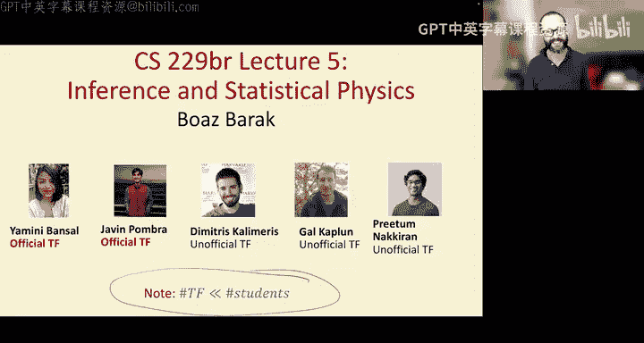

We are trying to do the best we can。Okay。So before we talk about。

Before we talk about statistical physics， let me take a brief detailtour and talk about frequentism versus Bayesianism。

😊，This is a long standing feud in statistics， which I think。They have reached some kind of。

A coldd War， even a peace in recent years。But then。They have they have been。

At it for much of the 20th century so from the point of your people frequentist。

 the only thing that makes sense to talk about probability is when you have an event that you can in principle you have an experiment that you can in principle repeat many。

 many， many times and then the。😊，And then the probability is the frequency or the probability of an event is the frequency that it will occur if you repeat it again and again and again and so for them like to talk about a probability like 548 does a probability that Biden will win the election that has no meaning whatsoever because this is an event that only happens once and so。

😊，From the point of view of frequencies that has no meaning whatsoever。

 and then from the point of view of。Oftenian of people that are。

 I don't know how you call the Bayesianists。The probability of an experiment when you do toss coins and you do something。

It might also doesn't mean a lot because you basically the frequency is in some alternative universe。

 you would have done something else and it doesn't really make sense so for。

Jas who's maybe the most probably more Bayesian that bass himself wrote in influential books where or least a book where he kind of distilled the Bayesian point of view where he said probability is an extension of logic。

 so the idea is that probability really captures the degree of belief。

And and some frequencies kind of mock it as a psychological。

 So there there are kind of these two views。 So one view is that。AProbability。

Is an extension of combinatorics。Of counting， really。

And the other view is that probability is an extension。Of logic。So if you obey。

 the probability really is about how you believe， so in logic you ever believe something 100% or0% here。

 you can believe a statement with 75% and frequencies just you generalize combinators just generalize counting things。

And。😊，And I don't want to go into this debate and philosophy too much， but we。

This sometimes does manifest in the ways we actually do things in whether you take this perspective or the other perspective sometimes manifest in the way you think about or you solve certain inference problems。

Okay， let's say go to a technical level。So suppose we consider the following setup。

 we have some probability distribution which we can get samples from， so x is a vector of samples。

And then， we want to。Determine we want to decide on some hypothesis about this probability distribution。

 so it could be that we are doing hypothesis tests we are trying to distinguish between the case that a certain distribution or the nu hypothesis it could be that we are trying to come up with a predictor or regressiongress but we're trying to do some kind of an hypothesis and there is some kind of so the age somehow perform some task with respect to D。

And there is an notion of。Expected loss like there is a notion of whether age is good or bad with respect to D and we are trying to minimize this loss so this kind of a very general setting that could capture prediction or regression and hypothesis testing etcter。

And the main point is that we can， if we wanted to know how good or bad this loss is。

 this is kind of a population was， but we could by samples， we could approximate it to measure this。

And for now， let's say that we didn't have any computational limitations， we just wanted to do that。

So the way frequencies would look at this task。Is the following they would say， okay。

 we are going to define。So to make this task make sense。

 we're going to take some kind of a worst case view we'd say， okay。

 D can come from some set of potential distributions。

And we are trying to find any transformation that maps this vector x into this age that depends on x that would minimize the cost。

 would minimize the worst case cost when D comes from this set of distribution。

So the way youd think about it is age is you know the thing that minimizes the maximum cost over DB。

 I mean， if you knew the distribution D。Then you would simply， if you knew the distribution D。

 then you know you simply output the age that minimizes the loss。

 but you don't know the distribution D， so you're trying to find the transformation that。

Would have the smallest loss on average。 And the main point is that。This component。

Maybe I should use a different coloian， maybe like。This nice be nicer the orange。

And try that so this component， this is really probability。Over地。

So these are probabilities that we can actually。So for any fixed D we can actually estimate how well our transformation is working and we only talk about probabilities over a DS so these are kind of way to think about its probability that is forward looking once these fixed then you look at probabilities of things that will happen over the future。

😊，And。So that's a very reasonable thing to do and the reasonable reasonable thing to do that way。

 first of all， just notice that he kind of doesn't really make a lot of sense to talk about probabilities if these deterministic。

 the only probabilities that happen here are probabilities of OD。😊。

But the Bayesian kind of thinks of this differently。

 the way they the Bayesian think about it is that this family of distributions really comes because of some latent variables so there is this。

So the idea of invasion is that there was some kind of prior distribution。比。😊。

And some hidden latent variables W were picked and now D depends on this W。

And the way and what you do is you basically you define。

A posterior distribution over this W by after you observe， so you see this。

And then that defines this posterior。Which is basically the probability of W condition on x。

And now what you want to do is you want to find the thing that minimizes the probability。

 the expected loss according to the posterior， and this probability is over a different object than the upper probability。

 so this probability is over these latent variables that you cannot see。😊。

So you cannot really measure and probability here although the procedureeri is kind of backward looking。

😊，And the a settings where basically it ends up that you will do the same thing and say linear least square regression under certain models。

 it will turn out that you do the same thing you do least query regression would be the right thing to do if your evas or your frequencies。

 but there are some settings where you will do something different。😊。

And this can make sense even if D itself is a deterministic process。😊。

And another thing that's useful is that and this is a point that we might come back to。

 and An is very familiar with that if you have the posterior， if you can do this posterior。

 you can do some other things other than minimize loss。

 so sometimes if you can sample from the posterior。

 sometimes you want to do other things then just minimize a single function so that can be a useful field。

😊，Okay， and and。And a big question when you're doing Bay statistics is， how do you choose prior？

Because it's kind of something you invent。And the idea is if you don't if you have some information about the py the pyro can encode the information that you have and if you don't have information。

 then a central approach is the approach which is actually James was the one that I think formulated it is the maximum entropy principle so the idea is you take the pro with the maximum entropy so think of the pyro say the uniform distribution and that's somehow the least informative pro so it's kind of the least risky and as you you learn more information then you basically。

Will get more but you could in some sense you could not go on by taking the maximum entropy distribution。

 so in some sense if the two prior was some probability P that has less entropy then by taking the uniform entropy you can think of piers condition as being a uniform condition on something。

And maybe it will cost you a few more samples that you took a less informative ps。

 but you couldn't go wrong， but if you took a wrong p， then you could go very wrong。So， any。

Questions or comments about this。So was the previous approach the frequentest approach and the vision approach how should we think about the relation between the two of them like for example like is there some kind of prioritiess that will give us the frequentest solutions under certain kind of problems or should we just think of them as different objects so I think there are some cases where they coincide。

嗯But诶。There are some cases where they cr， but maybe one thing that will clever is what do you do maybe one way to compare the two approaches is what do you do when they are computational constraints？

So I think in some ideal version， there could be ways in which they would kind of coincide。

But in some， when you have computational constraints。

 it's very natural for them to diverge and to look at it in somewhat two different ways。

So if you think of a frequencies， the frequencies， the objects that they are really concerned with is this transformation。

 right？So they are trying to find any transformation that takes samples and spits out an hypoposthes。

And the object that Beijingesian is concerned with is the。Poserior is this posterior distribution。So。

So in some dream setting， in some ideal setting， if you had no computational constraints。

 you might be able to kind of translate between one and the two， it would be not necessarily。

 say computationally easier。To find the transformation then it is to sample from the posterior if you had like no computational bounds whatsoever。

 but when you have computational bounds， then the way the two comes will diverge is the following so the natural thing for the frequencies would say。

 okay we cannot minimize over the set of all possible transformations。So mini is over a smaller set。

 like a set of efficient transformations。

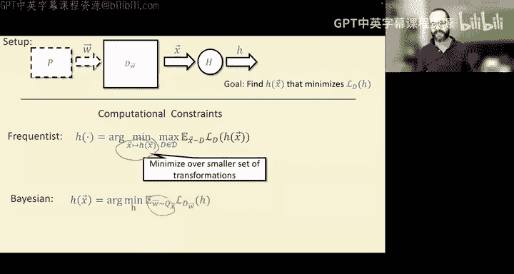

And the Bayesian， what they do， you would say， okay。

 we cannot sample from a very complicated posterior so they basically they do two things and sometimes a combination of both。

So they could say the following thing， so they could say， okay， my。

If you ask me to tell you anything I know and anything I believe about these Ws。

 it would be a very complicated distribution。But I'll just approximate it by a simple distribution just because of computational reasons。

But I still am Bay and it would be against for my religion not to sample from something so the object that I'm looking at is always sampling from some distribution。

 it just me might be not the same distribution that I could that ideally I would because it's too complicated。

😊，And the other thing that you sometimes do is you take a sampling algorithm。

That would have worked for the complicated distribution。

 but you kind of stop it before it really had a chance to work so you can ever say you are you sampling。

From a simpler distribution， which approximate the original distribution。

 or you are approximately sampling from the original distribution。

And which you can think of them as being the same thing but。It somehow operationally。

 you do things a little bit differently and sometimes you do a combination of both。

So you both take the original p that you might have wanted posterior and then you approximated by a simple distribution and then you cannot even sample exactly from that distribution so you approximately sample and the notion。

 unfortunately often you don't really get very precise bounds。

But what does it mean to be approximate？And yeah， so you tend to do some of different things but。

But not in all settings。And there could be clean settings where they coincide。Does this help。

 that's Julie helpful thank you。😊，And I don't know，ku， do you want to add anything？No。

 I think that was good， okay， I didn't make you queens too badly yet。No。

 I like the summary of the frequentist versus Bayesian，Yeah， so yeah。

 I'll make you cring in the statistical physics don't worry。😊，So yes。

 now let's move to statistical physics。😊，And there is a sense in which it's kind of quite analogous to has a very nice connection with the Bayesian type of view。

Okay。So I don't know much of physics， but my understanding is that if you look at what's the difference between water and ice。

Water is hotter。And the molecules are kind of more jigly。And we're very in ice。

 you know it's colder and then they tend to kind of form together in a very rigid type of format that kind of minimizes energy。

So there is a sense in which you increase the temperature and then you。

So as you decrease the temperature， the system kind of goes into some kind of a minimal energy configuration。

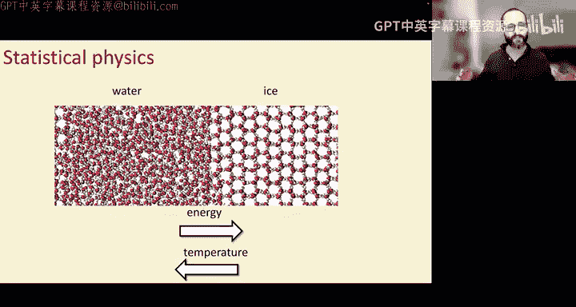

And yeah， and I found this nice gift。

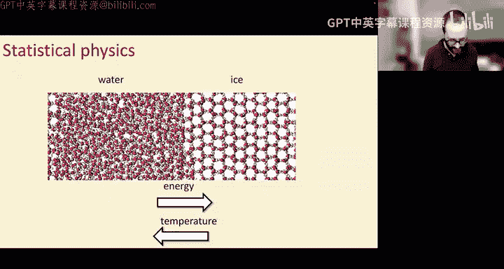

So you know， if you're start in the absolute zero temperature。

 then it doesn't move the system doesn't move at all and then at some point you know it undergoes these kind of phase transitions to solid and liquid liquid and gas。

 etc。

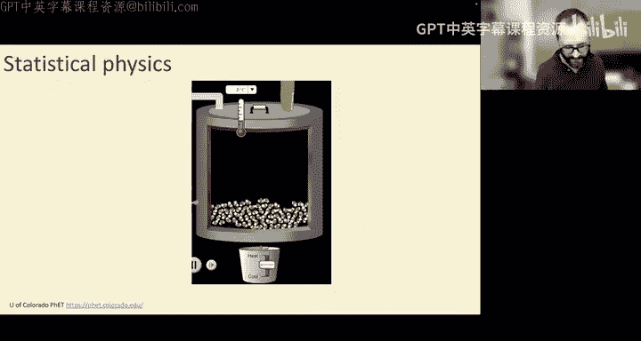

And one way to think about it is the following。And there is a system。😊，And it has a state， okay。

 the state doesn't have to be n bits， but let's just think of it as n bits。

 but generally it has a state， you can think of the state as whatever the positions the positions of each molecule or what's contained in each unit space unit of space。

 but let's think of the state as a twin。And。And this is kind of the atomic state。

 but the state this is statistical physics and that's kind of the maybe the main。😊。

Maybe the main intellectual contribution was that people realized that。

You cannot really understand these systems by thinking of them deterministically。

 the way to understand them is syn them as a whole as a distribution。

So why these molecules keep jiggling around， so in some sense they're really in a probability distribution of state rather than in a single state。

 so the system state。😊，Is really a distribution of these atomic states。Or configurations。

And what we think about it is that there is a certain utility。

 so in statistical physics they typically think of minimizing energy。

 let me think of maximizing it up to sign it's the same so think that there is some function W that is a utility function such that you know the system wants to have large w so it wants to have to have a state with a large utility so you can think of for example of the I state as having very low energy so it's very high utility so that's the state the system would really want to be in。

😊，But then there is also a temperature。And when the temperature is high。

 the system also wants to have high entropy。In essence。

 what the system does is it finds this kind of equilibrium。

 it finds it solves this optimization problem， which is basically you want to maximize the。

So you want to maximize this utility。

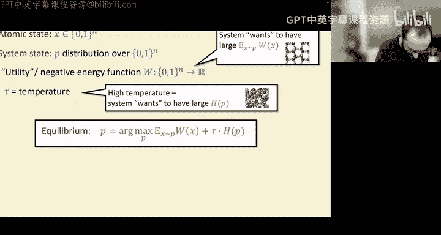

less。You know， temperature。Time is enthtropy。In the right units it will be temperature temp enthtroies so basically that kind of captures right so if temperature is zero。

 you are in the absolute zero， then you don't care about anything。

 you're just trying to maximize the utility。😊，If the temperature is very high。

 then you place premium on you place you place premium on having a。

High enalpy and eventually if the temperature is infinite。

 then you'll just completely ignore the utility and the system will just be in the uniform distribution。

 which is the maximal entropy distribution。😊，Okay， so one way to think of statistical physics is that you posit。

😡，That this is what the system will do。And then there is this beautiful alternative characterization and the variation of principle is really that you can these two things are equivalent characterization。

😊，And the alternative characterization is that the probability of x will be proportional to something exponential in inverse temperature times w of x。

😊，So again notice that this kind of makes sense if temperature is zero then invest temperature is like infinity。

 so you really basically are just trying to go to the maximum maximum element element with maximum w of x if temperature is。

😊，So if temperature is infinite then you're basically having the uniform distribution。

 right all of Ps are proportionals to the same thing， so that would just be the uniform distribution。

And what does it mean proportional right it really means that this completely defines the probability distribution。

 you just need to scale it by some factor that will make it all the probabilities sum up to one so the way you can right and this is known as the Boltzman distribution and so the way you can write it is。

😊，诶。It's an expectation of tau inverse times Wx minus。

A tau of w aauu of W is just this what what you need to put there so that the all the probabilities will sum up to one。

 So the way you think about it is。I will use integralgr or sum interchangeably so when you see integralgr single with a summing over all the x's。

 so if ATAO is like the sum of all the xs of this value then the log of that then if you put your minus。

😊，A tau of w， it's like dividing by this， so it's like dividing by this quantity， right？😊。

So which normalizes things and makes the probabilities sum up to one。

So this is actually kind of important for everything that we'll do from this point onwards。

 so that would be an excellent point to ask me questions if anything is even a little bit unclear。

It's all perfectly clear。😊，Okay， so and。Okay， so so we I mean。

 please do don't hesitate to stop me asking， okay so basically the point in statistical physics。

 there is this variation principle that says that you can express the same probability distribution in two way。

 you can express it as the maximum the probability distribution that maximizes this linear combination of entropy and utility or negative energy or you can express it as something proportional to e to the minus inputverse temperature times utility。

😊。

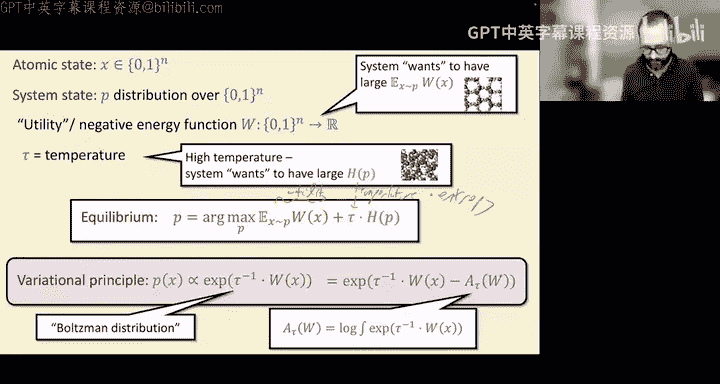

Okay。So。So this is the Bosman distribution， let me give some examples。So first example。

 this icing model。So this is a model of a system where x often people write it as plus -1 or01 it not doesn't matter and the idea they this is a model of some。

Some materials that can have these kind of magnetization。

 which is going either up or down each particle and they are in some， say two dimensional lattice。

And there are different versions of this model， a classical version is that there is an interaction J。

 so if J is positive， that means。😊，ANeighing neighboring INJ want to have the same spin and ifJ is negative。

 they want to have a different spin， so let's say they want to have the same spin。

And sometimes you also have some kind of in the na。

Term that says you have a bias towards having spin one and sometimes you can also have like different bias for each site。

 but let's ignore that and one of the things that notice if this is the case。

 then this is the energy or utility。是。And it's a linear combination。😊。

Of it's a linear combination of these Xs and XXj。So诶。

So this is often known as sufficient statistics so basically if you wanted to know what is the utility of x it's going to be just a what you need to know is in this case these moments。

 these second moments of x or the first and second moments of x that would be enough for you to know the utility would be a linear combination of these statistics so this is known as sufficient statistics in the sense that。

If you know that， for example， if you had a probability distribution and you knew these moments。

 then that would be enough to know the average utility of this probability distribution。

So that's why it's known as sufficient statistics。Okay in and。And now let's see if this works。

 it's kind of beautiful。so if you if you see the  I think models and you start very， you start hot。

 then it's an。When you start hotden it's very uniform and as you start coldder。

 you go coldder and Calder， you start to have these regions where things want to be to have the same spins so you're starting to have more and more these regions。

Where it's very regions of black and white。And in。だ使いません。very。

very nice picture to look at and this is。Yeah， there is a critical temperature at which point it will or summer break symmetry and one of the colors will start dominate eventually will have only white or only black。

So。Yes。So black and white mean in math that's a good question that's plus one and minus one right so you have a configuration neighboring things wants to have the same sign want to have both plus or both minus so as you make the system colder and colder you get into this situation where so initially it looked like a uniform distribution over。

😊，So initially it looked like the uniform distribution over plus and minus and as you make the system colder and colder。

 then it becomes these big regions where it's all white or all black。

And so the sign of J is positive in that example， so they want to agree。

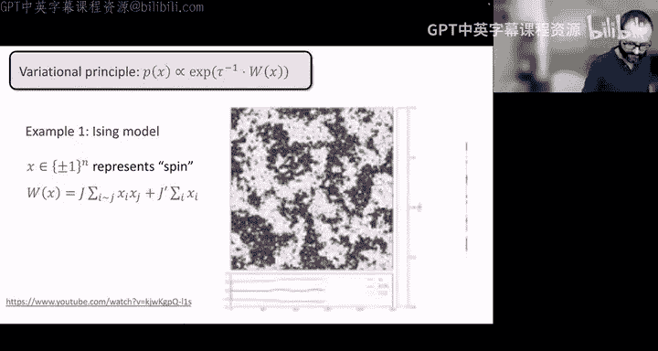

Another example is the Sharington Kpatwick model， so that's basically it's like an icing model。

 but now it's a random graph and it's a random say a complete graph with say random signs on the edges or random normal weights on the edges。

And so because it's a complete graph or a random graph where there is no notion of geometry。😊。

And you have so you don't have a notion of like theas eing model where some things are closed and some things are far。

 when you don't have this notion of geometry， then that's known as a meanfield model。

And because it's random， that's known as a disordered model。So in the Shengton Kpa。

 you still have plus minus1N， but now the weight is just you just pick at random the WIJs。

As normals and then the weight is you add all those up and it's very， I don't know if is 9。

000 papers in Google Scholar impressive or not， I don't know。

 I know it's very well studied Sharonton Kiopat。And then。

It's really is a model that has driven a lot of the advances in statistical physics。

And there's a lot of beautiful theory about it， we might touch a little bit towards the very end。

Okay， and another third example is maybe the example that's most motivated from say Asian analysis or learning the idea is the following。

 so suppose that。😊，X here is a hidden variable， variable we don't know we a uniform p。

So initially we just took the maximum entropy prior the uniform distribution and now we make K independent observations about x。

 so basically there is this x。Which we don't know。And now we observe some things or102， okay。

 so you could think of these O's as say， random variables that are correlated with x and we get to observe their values。

So now we want to define the probability， the posterior， right。

 so the probability of x condition on observing01 OK。

So that can be hard to compute but we know that it is kind of proportional to you know if usually the forward direction is easy to compute probabilities so if we knew X it would be easy for us to compute what's the probability that that we would observe the observation01。

 what's the probability that we observe the observation02 etc cetera。

 so if these are independent observations。😊，Then the probability that the probability of x in the posterior is proportional。

To it's proportional to this product。You， the probability that x will lead the value01。

 the probability that x will lead to the value02， the probability that x will lead to the observation K。

And now we could just write it as you know expectation of。Not minus log。

Just log the log of the sum of the probabilities。Right so now basically we see that you know。

 if we wanted to sample。AndSo now basically， if we wanted to sample from this posterior。

 what we would do is you know， something from this posterior really corresponds to sampling from this Bolsman distribution where the probability where now the utility function is the log likelihood。

SoAnd notice that basically this will be usually something we can compute。

The thing that will be how to compute is the scaling factor and that's why actually it is challenging to sample from this。

 but if you find a way to sample from it then that's a good way and the way you could think about in this case。

Is what does it mean to have high temperature， it's kind of like a low learning rate it's kind of like you are this you're starting with the uniform prior and every new observations you。

Yeah， you're right， it's the sum of the logs， thank you。It's some of the logs。

And and every new observation you don't allow it to shift your prior by too much。

 so basically high temperature can of correspond to having a low learning rate。

Where you would say start you would then not update your uniform power by too much when you observe new observation。

And you can already maybe see that somehow in this case。

 you might need more observations to reach to the same point， but on the other hand。

 higher temperature usually means it's easier to sample form so it actually could make it computationally better。

Okay， so the variational principle is really important， so let me now show the proof of it。😊，Okay。😊。

So。So this is the variational principle， one way to phrase it。

 so the variational principle is that Fp is the Balsman distribution。

 so the probability of x is proportional to tau inverse times w of x。

Then P is the ag maximum over all probability distributions。Of。

The expectation of W under P plus tau times the enal P of P。

So I hope everyone agrees what is this theorem that we are trying to prove and now we'll re it。

 but if anyone has any question about what is this theorem that we are trying to prove。

 please do ask。Okay， so let's prove it。So let me write the expression for the enOpy of P right so the enOpy of P is if P is of that form it's you know negative of the。

Expect expectation of log P， so we just write as you know the integral of log p times p and what is log P？

😊，Just this number right， this is just by definition， right。This is P of x， so this is log P of x。

So far we haven't done nothing。And now we。Now we just separate this out right so what we have here this term。

It's tau inverse times the expectation of integralte of wx times P of x just the expectation and the P of w of x。

And what we have here is minus minus is plus so we have here the expectation。And the P of 88uu of W。

Yes， this is log P as P question frankly， this is not generic generic P。

 this is log P when P is defined as as above。😊，So this is log P of the P that is defined as above。

Does this cl fitting things？Yeah， yeah。 yes。Probably I should write to your you。Okay。😊，是。So。

So the point is that now atau of w it doesn't depend on x right so the expectation of this is simply a tau of w right it doesn't depend on x now we can kind of rearrange things so basically for the P for the P that is the Baltzman distribution we have this equality。

That tau times so I'm going to multiply everything by tau。

So we get taut multiply everything right now， this goes here， I'm going to shift this to this side。

 so we get that a tau times a tau of w equals tau times H of P plus the expectation under W。And。

This quantity tau times a tau of w and I think sometimes it's without the tau in front of it and sometimes it is with。

 but this quantity is typically known as the free energy。😊。

We'll often think of toweru as equal one then we don't have to worry about it so this quantity is known as the free energy it's also known as the log partition function。

 so sometimes in some text you will see this thing before the log this is known would be known as Z of w。

And so a of w would be like log of Z of w。And the tautta is the H of P。

 or H ofP is known as the canonical entropy。So that's the entropy of this boltman distribution and this is the internal energy or typically when we think of energy as something that you're trying to minimize。

 then this will be like the negation of the internal。😊，energy。But then。

So this is an important claim that would be useful for us beyond just proving the variational principle。

😊，So this equality and now given that equality now we can do the now we can prove the variational principle。

 so let Q be some other distribution so again we say okay we compare this with some Q and now we want to show that this is going to be that P is going to be larger than than this so we just write。

You know taau times the KA versionence of Q and P， that's a non negative number and we can just write by the definition。

 it's you know tau times the expectation of K Q minus tau times the expectation of KO P。Now and。

If p is defined as above， we can split this log P。😡，To these two parts。

 just similar to what we did before。And notice that a tau of w doesn't depend on x。

 so that is a constant expectation of Q of that is simply just tau times the a tau of w。

So we just split it into these two terms and now。And now we can split tau times8 tau value using the formula below。

 we can split it into tau times Hp。Plus， expectation and the P of W of x。And。So we split this part。

 this part， we see， you know， this is Tau and tau inverse。Cancel each other。

 so we get that here we get minus tu times age ofq minus the expectation underq of w of x。

So what we see is basically， so this really proves what's up there because we see this。😊。

This expression。This expression for D is larger or equal to than this expression to Q。

 and the only time where there is equality is when the KL divergence is zero and they are the same distribution。

ok。😊，And again， it's kind of natural， I mean， even if you you know this one thing you always maybe have to do it yourself a bit later。

 but it's kind of natural right that if you were trying to maximize。

If you're trying to find a probability distribution that on one hand tries to have as much entropy as possible and on the other hand tries to have w of x large。

 then you'd start with the uniform distribution and then you reweight by trying to re reing e to the w of x kind of make sense。

 you're trying to weigh towards the thing where W is large。And the bigger the temperature。

 the smaller dis weighing wind it's very if the temperature is zero。

 then this re weighing is you just care about w， you don't care about anything else。

Any questions about this？Or we at least。Yeah， I mean the math is not hard。

 but you know sometimes it's confusing to go through therivation on the slides。

 but you'll have the slides later， but。But we I think you should， I hope you are confident that the。

Variational principle is true。Okay， so we recorded these two facts。

 we have the variational principle and we have this claim， which is also useful。😊。

And just the corollary for that for tau equals one， we just you know。

 a of w is the maximum over all cus of this combination of。The entropy plus the average utility。And。

In particular， you know it's the maximum for every Q A of w is at least as large as age of Q plus。

The the expectation of utility。And now is this familiar to anyone from a previous lecture？

It's a bit like the elbow derivation， exactly， yes。So yes。

 so this is exactly the elbow derivation so if you think about it what is you know if it was a probability distribution like a posterior。

 then AW would be the log likelihood。😊，And basically what you're doing here is you find some cue。

So this is always a low bound for every queue， but if you found the IQ where you can sample form then you could actually estimate or aQ that you know you have the density of so you could actually。

You could actually compute this thing， then that will give you a low bound and efficient low bound。

And yeah if you looked at the variation， if you remember the variation auto to encoder。

 then there we had two terms， one was to we tried to minimize the k divergence between E of x and the uniform distribution and the other thing we tried to minimize the decoding error and we can think of this as basically minimizing divergence from uniform is like trying to increase enpy so this is basically the green term corresponds to the green term this is the divergence term and there we had you know certain we were trying our utility function was to try to get the encoding to be correct so that's kind of energy or the reconstruction error。

Or you know reconstruction success。And then and the AW was the log likelihood of。

Of the particular sample that we got， so basically this is the same thing。

That's why it's also called variation and outputd。And this is also something that we can see and we'll see it again that sometimes you know。

 this P might be hard to sample form。And we trying to approximate it in some sense by the Q that to it some that is closer to it but still tractable and that's a lot of what these variational algorithms are about。

All， so sampling from this Balsan distribution。😊，So this A tau of w is you know。

 this log of integral of exponent and this is generally something that's how to compute。

You can think of it as if you think of it as a sum。In the case that were thinking。

 so it's a sum over all x in01 to the n。So that's a sum of exponential in many terms。

 and that's something that's generally hard for us to compute。So we typically we can compute w of x。

 give me an x， I can tell you what would be the。The energy of it。

 but we cannot compute the atau of w。So we cannot compute this partition function。

Or log partition function。But the fact that we can compute w of x means that we can compute ratios of probabilities。

So I don't know the scaling factor， but if you give me x and X prime。

 I can compute the ratio between which one of them is more likely than the ever。

So that just an algorithm which is known as metropolis hasings or I think also sometimes gib sampling depending on the particular details。

 so the idea is you start with say uniform X0 and then you're trying to get to the probability distribution。

 the bosno distribution and the idea is the following。You can and。

You choose some x prime that is near， you suppose you have sampled X minus1。

 you choose an X prime that is near X minus1。AndFor example， one option。

 which I think this is what's called Gib sampling， is when x prime agree with x minus1 in all coordinates except one。

But maybe some you can also have some other versions。

And then the idea is that you're going to let X be and you're choosing kind of a random X prime under a random neighbor of X minus1。

 and then what you're going to do is let X be X prime with probability that is basically P of X prime divided by Px unless the probability need can be at most one so this will be the minimum between one and p of X prime divided by Px。

 and otherwise you stay in the same place you stay in X minus1。

So you basically are doing this right say going from x0 to x1 to x2。Exre。ettera。

 and you're using the fact that you know how to compute ratios and probabilities。

 so you're trying to move to your neighbors based on how much they are more likely than you to be to fall under this probability distribution and eventually you want to sample from P。

😊，And it turns out that if you take this for a long enough time you will sample from P and by the way this is how do you do this part this is known as rejection sampling so so how do we how do we do this part so we basically we just。

We have this value， we have this value。Let's call it alpha P of x by divided px or minimum of that in one。

So we have this valued alpha and so we can look at the interval from01。😊。

And now we can choose a random point between zero and1 if it falls under alpha we accept X prime and so we move from X to X prime if it's above alpha then we stay with X minus-1 so that's kind of we rejected X prime so this is known as rejection sampling it's used again and again and again in many times so that's how we can we can sample X prime with this probability。

And notice that。This can be very， very inefficient if say alpha is very very tiny。

 so that's one reason why we prefer to get X prime to be near X minus1 so the ratios we are not going to diverge that much。

嗯。And the claim is that P is a stationary distribution of this algorithm。

 which means that if eventually we get to the point where X minus1 is distributed according to P。

 then X will also be distributed according to P and the way you can show it is the following you can show that if you look at the probability of arriving at X prime。

From X times the probability arriving。At x， if you're already assuming that the P of x already was distributed according to P。

Then just by the way we have defined these probabilities。

 it's going to be the minimum between P of x and P of x prime。Because you multiply。

This is just because you multiply here one p of x prime by px。Or one the opposite thing。So right。

 so this will be right this will be。P of X times minimum。Of one P of x prime divided variable P of x。

And this will be。P of x prime times minimum of one。要 fix prime你拜 by。P of x divided P of x plane。

So in both cases you get the same， so basically what it really means this condition is known as detailed balance and what it means is that if X minus1 already came from P。

 then the probability ratios will remain the probability ratios of x and X prime will stay the same so it means it will stay the same probability distribution and you can often prove that under certain not two strict conditions that the stationary distribution is unique。

😊，And because it is unique， then it means that eventually if you take this thing for long enough。

 eventually you will reach the probability P that you're trying to sample from。

 but the main issue with these types of algorithms is how long is long enough and often it's too long。

So these are known as this whole family of algorithm is known as Monte Carlo Markov chainin algorithms and the idea is that you're trying to set up some random walk。

So that the stationary distribution of this random work is the probability distribution that you're interested in。

ok。😊，So and here is in。So this is about sampling。 Here's what we can do sometimes for optimization。

 So suppose our goal is to find a。Mor a max let's usually we'll say agam so we want to find the maximum the maximum element of w w you know you're given this w and you want to find the x that maximizes W of x so the idea is that we are going to sample initially from some infinite temperature and we'll have some schedule where we start to lower the temperature。

Slight slightly more more and more with time so sampling from infinite temperature it's easy's just a uniform distribution and at each stage we are going to move from x to x prime with probability。

That you basically do the same algorithm as before we read a given temperature。

 so we were slightly we're kind of making things slightly colder。

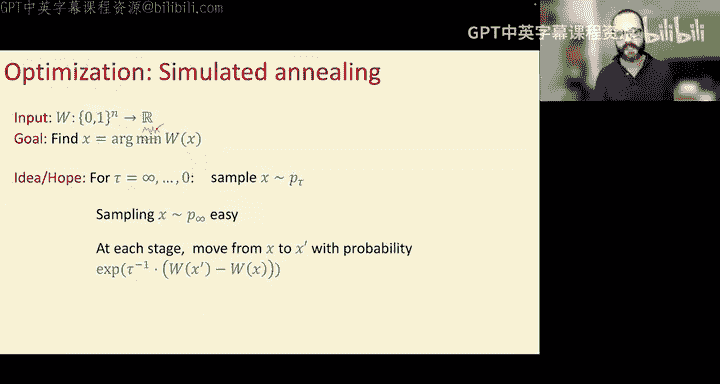

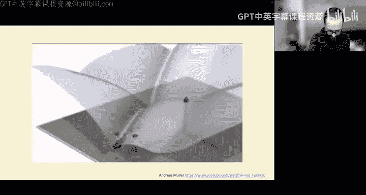

So this is an example of a minimization problem where you're basically sampling in this way and you're slightly lowering slowly。

 slowly lowering the temperature。😊，So initially you have the uniform distribution and as you're lowering the temperature。

 you're getting to lower and lower energy configurations。

And so this is this simulated anneing algorithm。And an kneeing is kind of the process of cooling。

えマグネト。How do you get。

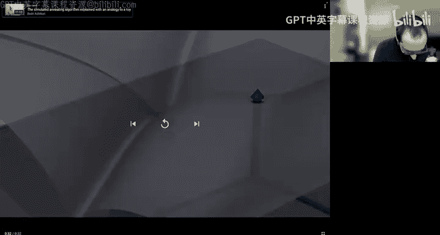

Yes，So a niing is kind of process of cooling and metal， I think。

Slowly and so the idea is again you can you can sample from infinite temperature and you can slightly if you already manage to sample from some temperature tau。

 if you only try to lower the temperature by a little bit then you should be able to do it because the difference between the probability distribution is not that much so you can slowly slowly get down to eventually you can get you know you can go all the way from say infinite temperature to temperature zero。

 but how slowly you need to go that's a big overhead question which is。I mean， in some cases。

 we can prove that these will take exponential time。

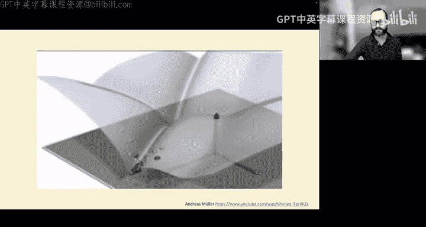

So yeah and barriers in simulated the new， so sometimes it will we will not succeed and it will get stuck and so anyone can tell me why。

What the image has to do with barriers for simulated dneing？

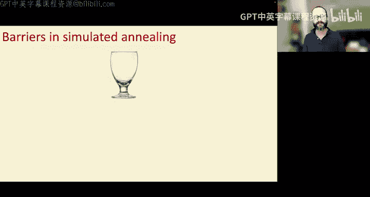

It looks like it could be some optimization surface so not exactly， you know。

 that's that's a good guess， but this is a glass， right？😊，And what is a glass， right， glass is is。

I's not a solid and not a liquid right what happens with glass is that you take some material and you heat it to become a liquid。

 but then you cool it too fast。And when you call it too fast， it doesn't reach down。

 it gets stuck in non equilibrium position， so when you call it， it doesn't become solid。

 it becomes stuck in this intermediate phase， which is this glass phase。

And that actually can happen we've simulated the kneeing you know， you could， if you go slow enough。

 if you cool slow enough。Then it will take you a long time， but eventually you will reach。

 say you'll go to lower temperature and you will reach the actual minimum energy。

But if you try to actually run it in reasonable time。

 you need to cool it quicker and then you could get stuck at a glassy phase basically which basically is a point it's like a local minima that you get stuck in and you simply。

 even though you're trying to lower the temperature more and more。

 you're still stuck in that phase and you'll never reach the actual let' say solid phase or like the minimum energy phase。

So basically these glassy states， and they are like these and these things happen it's kind of like related to local minima。

😊，And then。Getting stuck in local media， and maybe we'll go back to it later in this lecture。

 but there is a certain relation between basically getting glassy states corresponds to kind of local minima corresponds to basically getting stuck in place that's not inequable when you cool things too fast。

Okay， so that was。A very brief overview of some statistical physics and now let me say a little bit about。

😊，Relation to learning。嗯。😊，I'm wondering if this is a good part to break or maybe we can do two breaks so people have a time to breathe。

Let's do a seven minute break until 110。Okay， so people can take time。

 but I'm around so people can just ask me questions。😊，I just post the recording， but。😊。

Will we start at one thing？Okay， so now let's talk about how we move from physics to learning。

 so the relation really is the most natural way to think about it。啊。The easing model that we showed。

 I don't know how this simulation， but I would imagine that it came from doing some。

Some kind of gi sampling from the type of sampling that I showed when you move from x to X prime that is near x。

 so then that will be the while you have these temporal correlations。

 why this it didn't move that fast between x and X prime。James， does this clarify？Yep， thanks。

So yeah so the typically way which you think about statistical physics and learning that's for Bayesian analysis so you think of this setting where there is some hidden distributions lightnt variables W and you observe X and one of the annoying thing is that。

😊，And part of it is my fault with notation， I couldn't figure out maybe a nice notation to do that it's going to be a little bit inverted the way we'll talk about things。

 but I guess that will be okay。😊，So we have these， let me start with thinking about it in the forward direction。

😊，So we are trying to do this probability， we want to analyze the posterior distribution。

 so we want to analyze。The probability of w given the observations x1 till xn。

So that's going to be the you know probability of w D by probability of x times the probability of。

X1 till xn condition on W。And if we just define X capital X of W as log probability of X condition on W。

So we we think of those as fixed。Then basically we get here so this P of w， let's say it's just。One。

 one of， like this is just a constant， let's think the W the prior was the uniform distribution。

So this is generally going to be how to compute the probability of x。It might be how to compute。

But this part is going to be easy to compute， so basically we have here Bolsman the posterior is a Balzman distribution where the probability of W。

It's proportional to this is like we've seen before and again I have this minus。

 but it really shouldn't be minus， it's proportional to exponential in sum of XR of W。😊。

So basically the yeah for fixed x， the probability of w is Bolzman。

 but just know that the ruless of flip now we're looking at probability we're looking at this posterior。

 so it's a probability over the ws rather than the x's。😊。

And so that means basically UX defines some energy function and inference this corresponds to sampling from the posterior。

 so if you want to do inference， we want to obtain w to sample from this posterior。

So so basically it all becomes sampling from probability distribution so let's now look at a very special as a somewhat special。

 but really the case that almost always。Is the case。

 which is exponential distributions and for these few slides we are going to assume that tau equals one。

So if tau equals one， right we have a probability distribution such that the probability of x under w is w of x minus a of w so again。

😊，I'm going back to the statistical physics notation， the previous slide。

 I just wanted to make you understand why sampling from an exponential distribution from a Bolzman distribution is something you would like to do if you do Bayesian inference。

 but I will usually stick to this notation that we have probability distributions over x。

And this w defines the energy function or utility function。So now exponential distributions。

 the idea is that the w of x。😊，Is the dot product of W with X hatt。

 X hatt is going to be some sufficient statistics of x。

So we saw these examples that say X hatt could be you know X1 t XN and the preparewise products。

 that's typically the examples we think about， but generally it could be something else as well。

And this is very， very common， this is maybe typically the case that so that this energy function is just a linear combination of some simple terms and the simple terms are these local statistics just depends on these local statistics of X。

So one example is， for example， think of these excess as a labeling of vertices on some tree。

And the Ws are weights on the edges of the three。And here maybe the energy would be something like say sum of WIj。

 Xxj， where Xj， these are edges of these three。And here。

 so the sufficient statistics are say the X6j for all edges， IJ。And notice that if you want to know。

If you want to know what's the expected value of w of x。

 it's enough to know what's the average of the sufficient statistics on Pw。Okay。

 so we'll call this mu。Because the reason is that you know this is simply why this is expectation。

Great expectation of W Xat。Is equal just by linearity of that product， W dot expectation of exit。

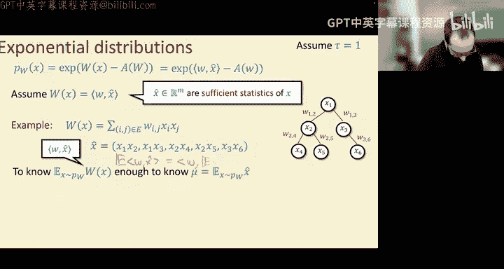

So if you know the average sufficient statistics， you know。

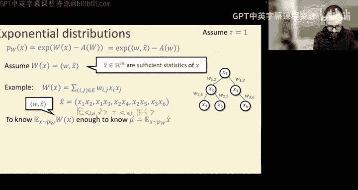

You can know what's the average utility。Or in what's known as the internal energy。

And in this example， when things are a three it's actually easy to figure this out and one way to do it is you can basically define the。

😊，So you can first define the expectations if you wanted to know the average over the vertices you know you can figure it out basically by some linear equations。

And then once you have the marginals on the vertices。

 you can basically sample from the original distribution by basically your first sample from this。

So you sample xx x x6 for its a marginal and then once you condition on this you can that tells you the probability distribution induced on x3 and you can do something similar here so you can sample from the tree so this is basically。

This algorithm is basically the belief propagation。

The lipcomplication is kind of a general algorithm that will perfectly walk on trees。

 but the nice thing about it is that it seems to do something reasonable even when the graph is not on tree not a tree so generally if the graph is a tree we can sample from the we are actually able to efficiently sample from this bolttzman distribution。

😊，Okay， so we have these average statistics。😊，And now。

So the variational principle one way to tell us you know if you fix the average statistics。

 then you know the expected energy or utility， so the variational principle basically tells us that among all the probability distribution that have these statistics。

😊，PW will be the one that has maximum entropy because all of them will have same the same average。

The same average utility， and we know that PW maximizes entropy given the average utility。诶。

We we had this claim that AW is the enroppy of PW plus the average of W according to。According to x。

 so thats equals in this exponential case， it equals age of Pw plus the dot product of w and mu。

And based on that， you can show that the gradient of a at the point， W is actually new。

The average statistics， and in fact you can also show that the hessian of a is the covariance matrix of X hat and because the covariance matrix are always a positive semidefinite then that also means that a is a convex function。

Of W。Which is nice。Okay， and then this is requires some map。

 but it's not just some calculation that's not hard to do， but just basically this thing。

It should be intuitive so if you're fixing the average statistics。

 then among all probability distribution with these average statistics。

 the Bsband should be the one with highest entropy。😊，And there is yeah。

 so PW is kind of the maximum enthtropy distribution that consistent with say the observations。

 the average is new and another version way to look at it is that new。😊。

I what you get if you try to maximize W of mu。If you try to maximize the W mu under the constraint。

 that age of mu has to be at least the entropy of the Bsman distribution。And what does mean age of P。

 you take the maximum probability distribution， the entropy of the maximum probability distribution that has。

That has statistics me。So this is kind of like just a dual way to look at it so if you what are the average statistics you want to take the you want to maximize。

Overall， probability distributions with at least entropy。As PW。

 you want to maximize the energy or the utility or another way to say it for all probability distribution with the same statistics。

 you want to maximize the enthtropy。And。And this is you know am I maximizing over convex set so that's also a convex problem so generally the way you can think about it is that mu and mu and the W。

These are two different ways to represent the same probability distribution。If you know mu。

 then you can figure out the probability distribution it completely determines the probability distribution。

 if you know W it obviously also completely determines the probability distribution。

 so these are just two different ways to represent the same probability distribution。

 there is the parameter representation W and there is the mean representation new。😊。

Now if you could sample from the probability exhibition。

 you could estimate mu so basically if you had sampling that's a way to transfer from the W representation to the mu representation。

And。And generally， if you can compute A of w， you'd be able to sample and youd be able to also because mu is the gradient of AW youd also be able to to。

To compute mu。So if youre able to sample， you can move from W to mu。And the version of you inference。

 you can think of it as you got， suppose you had many samples。

From these Bsman distribution so you can compute the statistics mu now you want to go back and compute W and that's also generally a hard problem and the way you can think about it is that what you really need to do is compute a dual function a star mu which kind of corresponds to minus the end of your mu I' not go into it too much but。

The Wayne Wright and Jordan。Text has a lot about translating the they call this the forward map and this is the Inverse map if I remember thenotation。

So basically， you have these two ways to represent these exponential distributions and generally its computational difficult to move from one of them to the other。

And it's basically equivalent to computing this free energy or log partition。And when P posterio。

 then wordss kind of flip like inference really inference really corresponds to moving from W to mu and maybe sampling corresponds to moving from mu to W。

😊，But in general， it's just a question of moving from one representation to the other。

And a central question in this whole theory is you've given W and you want to at least you want to compute mu or approximate mu but and along the way。

 you typically will need to also sample from。Compute this A of W and and sample from the probability distribution。

Okay。Yes， and some examples of these exponential distributions。Maybe I'll not go。

 we've seen the aIing models normal， we can think of it also and yeah typically the sufficient statistics would be low order moments of these X。

And then。And there is a Gaussian mean random field mixture of Gaussian like in the nuclear location。

 lots of probability distribution falls into it， and maybe I should just mention there is a little bit of fine print when I'm cheating here。

 I said that you can go， these are two equivalent representations。😊。

There is a sense in which these are two equivalent representations only when the sufficient statistics are minimal。

the statistics， if your sufficient statistics are not minimal then potentially you could have maybe more than 1W that leads to the same mu。

 it's kind of a technical point that's not very important。

 but if you read Wayne White and Jordan they will discuss this。But generally。

 you can think of these are two equivalent representations。Okay， so。

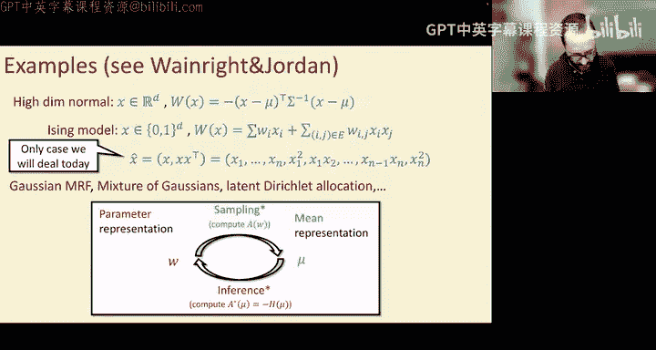

So here is so this is a task we would like to do right so this is a task we would like to do we would like to move from W to mu。

And generally it's hard you is set an example where you can actually do that and this is in the case where this is a meanfield and often we do a meanfield approximation so we approximate the distribution that we care about by meanfield probability distribution。

Okay， so so we have these situation setting boltman distribution the。

A of w is the maximum over orq of。W do this is the internal energy and this is the entropy。

And suppose now we restrict to Q that is a product distribution over x1 to the xd。

 and right now I'll think of them as01 values although this generalizes beyond that。So， and then。

And that means that if sufficient statistics are just new IUJ then mu IJ is just the product of new IUJ right so the marginals if you know the marginals you know everything they used to know about is probably the distribution。

So in this case， we can write so here we are looking maximum over all。

And now we're just looking at maximum over that are product distributions。So in this case。

 we can write the following thing。A of W will be the maximum。Over this is。This is going to be。😡。

RightThis is going to be this right so this is going to be the dot product of W with the averages of this product distribution so U I and new imagej。

And here you will have this， if this is a product distribution。

 you just have like the enalpy is just the sum of the entroies。So， this is and。

Just the enalpy for each single bit， which is edge of alpha， the just the enalpy function。so。Okay。

 so the people want to ask a question， so basically what I want to say is the following if a is maximum over all probability distributions。

Then in particular， this is larger than this maximum where I just restrict to product distributions and when I restrict to product distributions。

 these two terms become much simpler right so one of them is just this sum。

And the entropy is just the sum of individual entroies。So is this。Clear or any questions。Comments。

So this is basically what's known as meanfield approximation where you kind of approximate this probability distribution that you don't know by you're just searching over the space of product distributions。

And now you want to solve this maximization problem generally maximizing the function。

 you want to maximize the concave function。But this function is not concave。

 which is annoying and sometimes this maximization can be hard。😊。

The nice thing about it is that if you fix all coordinates and you just want to maximize one of them。

 then it is concave， and the reason is that the entropy function is concaved。

So that suggests the natural algorithm and this is known as coordinateor a sensed meanfield variational inference or CAV。

 where basically you're trying to maximize these things so you start with some new one muity。

And then at each point you fix all coordinates except one in the one coordinate that tells you just maximize because it's just maximizing a concave function。

And this turns out to be actually work in practice a lot， so people use it and that's。

Basically what people do when they talk about meanfield approximation。

And then there are all sorts of generalizations where you could rather than restrict into Q which is a product distribution。

 you could restrict to Q which comes from it's the distribution over a three。

 maybe it's not product but distribution over a three or anything that's tractable and that's kind of the general idea of these meanfield or these general variational methods is。

We want to compute a of w we cannot do it exactly what we'll do is we'll try to find probability distribution that。

From some class that we can have a handle on and use that。And maximize over this class。

And so these are all these average generalization。And yeah， so when you do Bayesian analysis。

 you basically， this is what you're trying to do， you basically you have a Bman distribution over a W and this kind of corresponds to sampling you observe this x and you want to find this latent W。

And a nice thing that's important to notice in meanfield approximation on。

And when you do it for Bayesian analysis is that the assumption is not as strong as you might think at the beginning。

 so you might think product distribution that's。Such a strong assumption that is completely meaningless。

 but you don't have to assume that to do the mean field approximation。

 you don't have to assume that the original probability distribution on say the original probability distribution is the same product distribution。

 wherever you only assume that after you fix x， then it induces，Some product distribution。

 but the parameters could depend on x so that allows for more。

More complex notions of product distributions and that's I think where the power of this method comes from。

So I think in the Bal survey， it's called the conjugal product distribution， something like that。

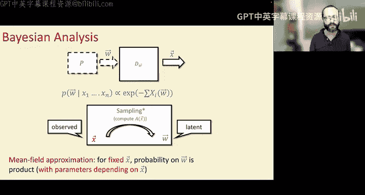

So can you elaborate a little bit I know in the context of the physics computations when we do the meanfield approximation。

 they tend to fall down when when you have like strong correlational effects and everything what's the corresponding failure in this。

😡，Type of a meanfield approximation。I mean I would guess it's still the same but it's a good question don' I don't know I mean maybe other people here on the know better than me but generally so that's why also people use you know so they generalize they use trees or things like that to try to capture some of these。

😊，Maybe other correlations。But yeah， generally， it doesn't always work。

And but I'm not sure if I know exactly the。I don't know if A or anyone else here knows better than failure modes。

Sorry， this is failure modes for like mean field types of things。Well， yeah。

 I'm not sure what's the best way to describe it， but a lot of these calculations do have failure modes in the sense that they start off with some kind of onss。

About what they think the optimal distributions look like。

 but there's sort of at least for some things there's like a hierarchy of how you can。

Make the ons a bit more expressive and then make progress。

So that sort of comes up through things like symmetry breaking and stuff like this is really you're not optimizing over the right class of distributions。

So you incorporate some kind of like hierarchical structure with it and then keep going。Mmhm。😊。

Right so yeah， and this was really just a template in some sense for this general idea where basically you trying you're trying to solve this sampling problem and what you do is you basically start with this。

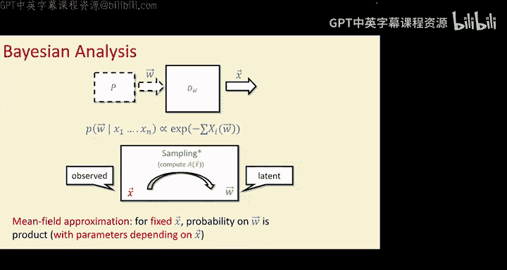

You have this inequality or maximum and you just maximize over a queue in some larger family queue and you find the little queue that maximizes it and use that as an approximation。

And in some， that's kind of equivalent to trying to find the cu that minimizes scale divergence from the probability distribution you're looking for。

And whether that family can approximate well what you're looking for or not。

 that's a good question I think it's。Not completely clear。Okay， so then last part。And。Yeah。

 that's a good question， whether we should take another break or we might just finish early。So。

Maybe we just finish early so the last part is I'll give a very high level not completely formal or discussion of solution landscape of these bolttzman distributions。

 how do they look and a little bit about the replica method which。😊，I think An already hinted that。

So here's kind of a cartoon， okay？

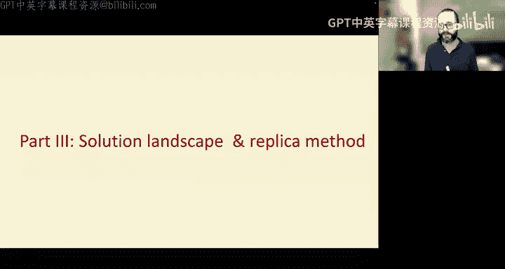

And this is a cartoon that doesn't necessarily happen in the kind of problems we care about。

 but let's just start with this type of cartoon， maybe this is a little bit like what's happening in。

When you're making water coldder and water turns into ice。So。

You the have the following probability distribution initially when the system is very hot。

 the temperature is very high。Then。And we will go back so the system is very hot。

 you have the uniform distribution， so this is basically like the support of the distribution is everything。

😊，So I'm thinking of the distribution as if it's uniform over a set so it's easier for me to do it so and as you increase as you decrease the temperature。

😊，You诶。As you decrease the temperature， you I don't know why it goes by itself。Okay。

 and I think now I know but。 Okay， so as you decrease the temperature， you。You诶。In the system。

 the entropy decreases and then sometimes what happens is that the entropy is discontinuous。

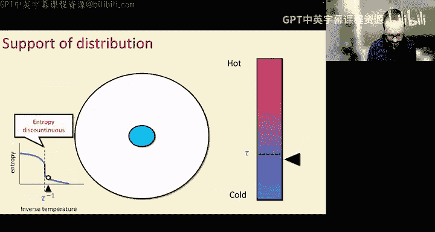

That's。I think this is one going to be really annoying for me unless。

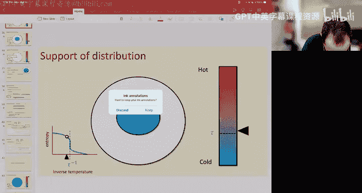

跟。Okay， it's not going to let me deal yeah it remembers some transition so it's going to transition automatically and we'll just have to leave it。

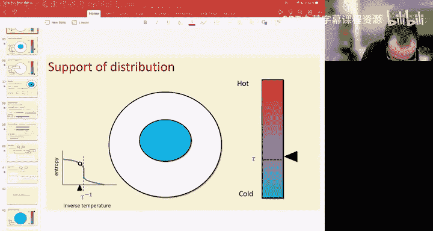

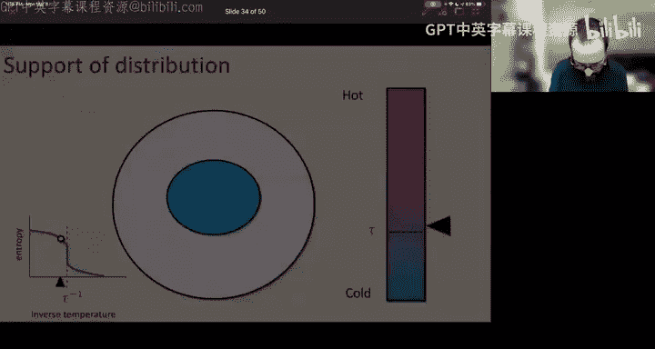

So yeah， so at some point you basically go a phrase transition and the entropy is。

Is discontinuous so it just drops by so the overall energy of a system is the overall energy of the system has to be maintained。

 So what happens here is that you know if the entropy the entropy drops there is kind of a release of heat or some but。

But the overall kind of energy of the system goes the same and eventually you go colder and colder。

 you get to a zero temperature。And yeah， and often what we what happens in our case is that the。

often in cases like sampling from Bayesian distributions， et cetera。

 what happens we don't necessarily have this discontinuity of entropy。

 but we can have discontinuities in say the derivative of entropy。

So these are known as higher order phase transitions where maybe the entropy is continuous。

 but its' derivative or second derivative is not continuous。

 but it still kind of corresponds to something that happens in the probability distribution。Okay。

 now let's suppose that in。Let's suppose that you so if we are in this situation。

 so this is kind of known as a replica symmetric situation where basically throughout as you're changing the temperature。

 you always indicate case that the probability distribution looks like kind of a ball or something like that doesn't have to be exactly a ball。

 but some kind of a convex type of somewhat large set。

And this is known as kind of the replica symmetric case。

 so suppose that you know it does look like a ball around some center Px0。😊，So in this case。

 if we were to sample x1 to xn independently from this probability distribution。

 then there would be kind of points in this ball and in high dimensions would kind of expect that they would be roughly orthogonal to each other。

So basically， what it would mean is that they all roughly have the same distance。

 the same pairwise distances from each other， which means that say if there are unit vectors。

 then if you were to write the overlap matrix， the matrix where you put the dot products of XIXj。

 then the diagonal you have one and the off diagonal youll have the same number Q more or less。

Does this kind of make sense on an intuitive level？

So if your probability distribution looks like kind of uniform over a ball over a high dimensional ball。

Then if you pick a few， you know， it's very high dimension and you pick very， you know。

 you pick a few samples like end samples。Then。When you pick。In in random points。

 the pairway distance is going to be the same mo， so your overlap matrix will be ones on the diagonal in the same constant queue of diagonal。

We good。😊，Okay。Okay， so what's so the replica method is the idea is to try to guess that this is what happens and use that to do some kind of calculations and the idea is the following so suppose you know W comes from a probability distribution W。

😊，And we want to so this is a disordered model， right so we think of a disordered model。

Well basically。You have， you choose W from some probability distribution W， and now this defines。

This Bzman distribution Pw Pw of x is proportional to W X hat。

And now you want to figure out what is say。A of W。Okay。

 so suppose you want to figure out what's the free energy。

So you want to figure out the expected free energy， and that's the expectation over W of this log of。

This exponential sum。And that turns out to be something that's really hard to calculate。

And on the other hand， if you were to put the log outside the expectation， that often turns out。

 you know if w is like a nice probability distribution that often turns out to be much easier to calculate and the main reason is because you can basically。

😊，You can exchange sum of the expectation and now if for example this w is from a product distribution it's like W1 till W some D and these are product distributions then you know expectation of this thing。

 it will just break out to products of the different expectations and that's something you can calculate。

So a problem is that putting you know， a computing expectation of the log is hard log of the expectation is easy。

But we really want to but this is really the quantity we want to know this is a quantity that is expected free energy of。

Of the system。She。So here is what physicists do and this is partially black magic。😊，But in。

This has successfully worked so what they do is the following so first you write the following expression。

 so expectation of AW you can write it as know the limit as n goes to zero of expectation that of n times aW minus1 divided by n right because if n goes to01 plus。

Expectation of n times AW is something like one plus， you know。

 this thing is basically one plus n times AW。Okay so so far this is a true equation。

 except there is one thing that's wrong with this equation。

 can someone tell me what's wrong with this equation？😊。

I think you interchange order of limit and expectation。So you are white。

 I interchange other limits and yes， so that probably still can work。

 I think this is still probably true but you're right。

That interchange and the other thing which I meant is maybe more joking， but I shouldn't。

 no mathematician would ever write end for the variable that goes down to zero， right？😊。

We usually don't use n as a variable that goes to zero， typically use n only for integers。But yeah。

 but so far， this is sort of okay。😊，And。Yes， and now。You know。

 we can just write this as you know expectation of something end is just like expectation of this。

So we just why this is a of W。This is basically。This is expectation of A of w right A of w was defined to be A of w was E to sorry。

I'm starting to say X when I mean starting to say expectation。So。

So this is if I so I can write this as e to the a of w。

All that to the power N E to the a of w is you just remove the remove the log。

 So this is just the integral of。X， W， X。All that to the power end。ok。Now， if n was integralteger。

 then what is integral of x all this to the power n。

 we can also think of it as just the integral over x1 till xn。Okay， so we can write this expression。

Whi is kind of nice， right it's just the integral over x1 till xn and then the E to the W dot x1 plus or you know the sufficient statistics of x1 all the way plus xN。

But so if n was in theger， then we can write this green expression， which we can actually calculate。

But， but we are taking。N to0， so these x1 electron， these are known as replicas。😊。

And what we're doing here is basically we are yeah now。

 but now we are what we're doing is we're taking the limit of。Of this of n to zero， which is very。

 very suspicious。

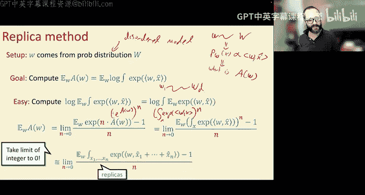

But this is the idea basically of physics。😊，Is basically to say。

 okay we can now we can you know if this is an integral。

 we can change the order of the integral and the expectation of a W。And。

So now we basically wrote this expression， which doesn't exactly make sense。

 but we can hope that so what's the hope， the hope is that we will compute this。

And we'll get some function psi of n。And the hope is that psi of n will be kind of a nice analytical function that will kind of make sense even to plug in n equals0 and to you know to take the limit so we can then maybe look at the limit of this angle goal to zero psi of n over n and hope that it will kind of come up to be something reasonable。

😊，And。And the idea is the following that for many natural distributions W。

 if you look at this expression， it will really only depend on the overlaps。Of these。

 of these replicas。So you basically are going to change you're going to guess the shape of this of the Q that's going to dominate the term and we kind of hope that one type of Q will going to dominate the term and you check if it makes sense and what typically happens in the replica method is that you will get。

So basically this is not a very rigorous calculation and it's。Something highly non rigorous。

 but basically we willll give you some， if you guessed correctly。

You will get maybe more several solutions and some of them will not make physical sense and usually there will only be one that makes physical sense and that would be the correct one。

That's kind of the argument that people do in particular。

 the replica guess would be that you guess that Q has this shape。

 so you guess that Q has this shape that is say one internally in and some Q outside and then you can figure out by doing some derivatives what if this Q had it was the truly if that term was dominant。

 if the term that dominates has this shape， you can figure out what is little Q it will just become calculus。

 so it's kind of annoying and a lot of calculation but eventually just calculation。

And I'm not going to go through a full thing， but I'm going to tell you like what type of how people use this。

 say in learning。So and then and I don't know An， if you have recommendations for what's the best source and I I mean selfishly I actually would love it if you are going to。

Teach this at some point。Did you plan。Yeah， so I might teach it maybe towards the end。

 but I'm basically only going to do the parts of statistical physics that connect。

You know some parts of deep learning that I know yes i'm going to try and cover maybe some of the monri and song may style you know analysis of two layer networks yes so so yes that would be very that would be beautiful so basically and。

So the general kind of form of this type of approach is the following so you。

Maybe way too right it is the that you say this only depends this will generally depend on queuees so you would basically have。

This。嗯。This is basically some going to be some function of Q。

So you can write this as something like some。Over all possible queue of exponential in。

This function of Q plus log the probability of Q。Under the uniform distribution。And now。

And now basically if you this is still kind of messy。

 but if you guess that Q has this really nice replica symmetric form， then it becomes。You know。

 then it becomes fairly you know， then it becomes fairly standard calculations are some calculations so you will get some kind of a psi of Q。

And the n right so n goes into it。And now you can try to take the limit of n goes to zero。

And you get some function of Q and you take its derivative。

 so you assume that some the experimental points of this Q， the points where the derivative。

 according to Q vanishes are the ones that going to contribute。

A the ones that are going to contribute the most are going to dominate these sum so you just check out so you'll have a few candidates when this the derivative according to Q vanishes and you can plug all these values and check them out and what typically will be the case is that some of these solutions make sense and some of these note really really after you do enough checks only one of them makes sense so that will have to be the correct one and also often you have like this threshold phenomena where as you change say the temperature of the system。

 the solution that makes change sense could change。

And so some things that people have done with this。😊，And I think An has a paper on。

On on spiketenzs where you basically say you have the system where you get a signal which is。

There is a certain， so you have a matrix that's hidden and you add to it some noise。

And here the probability so now you're trying， you observe why。And you want to recover it。

And you can do it in a patient way， you can sample from S prime N according to the posterior。

 and that will come out to be basically a boltzman distribution。

And we would want to analyze the so to know how well you could cover as typically what you want to know is how well so this is known as the overlap so you basically want to know if you sample from this Bayesian posterior。

How close will it be to the original S？And generally。

 this is going to be the Lada is going to be the signal to noise ratio。

So the bigger lambda is the more signal there is。And more likely you' are going to recover as and the smaller the less likely and it open happens that there is。

And。The reason。A threshold， so there was this paper by actually Amelia and Alex were uncle's students。

😊，And then。And they showed， I mean， for the matrix case， this was already known。

 but they showed also for Tenzo all sorts of statistical limits using these kind of methods。

And I think they also have a very beautiful。😊，We write up on the lecture notes on the。

On statistical versus computational limits and。I don't know， An。

 if you want to say any some words about Aillia。Yeah。

 I wasn't ready for that one sorry yes so yeah so I might punt on that one Okay sorry yes。

 but we it was tragic in yes。And of and then。Yes， so。And other examples are。😊。

Teacher student models and there is this recent work by Florent Kirk Ka and Len Cazi who analyzed。

In others as well and there was also older work with a percept model。

 where basically the idea is you observe samples X Y and。And you can then。

And the signal here is the weights of this say neural network or perceptron and the question is you add noise。

 so there is also another model where the noise doesn't come necessarily just from an adddjectitive thing。

 but maybe the neural network is not applied to the same data that you observe but to a correlated data so they add like this thing where the model is that what you observe apply is a teacher。

 the teacher and the student。Look at correlated features rather than features that are identical。

 and interestingly they show that with these replica calculations they can kind of find a theoretical model where they can calculate the relation between sample complexity and performance and it somehow captures a lot of the time what really happens in real data。

😊，Its kind of niceイス。And。I think that's I wanted to say something about replica we making。

 but maybe before that， maybe if there are any questions， comments or anything else。😊。

Right so there's several models where basically you can do this with kind of replica calculations to try to figure out very。

 very precise thresholds of when in the so I think this is the。😊，The case before you have。

So this is often the case where you have these thresholds where say if Lada is smaller than one。

 you have no overlap。So in this regime you you have no overlap you're learning nothing about the hidden signal and then what's lambda is larger than one so this is I think this example is for。

spikeike matrix where S is a random quantum matrix and n is a random matrix randomsymmetric matrix and and when lambda becomes larger than one then you start being able to。

Can we cover the signal。So this is so you undergo this phase transition。So this replica method the。

Its really very， very useful， but there are cases where it doesn't work as is and this was like a huge discovery in the 1970s and has still since been like a lot very deep work in statistical physics so sometimes you know so replica symmetry。

Is basically you guess that your solutions， the overlaps will look something like like that。

 it would be alpha on the diagonal and beta of the diagonal。

 so it basically means that the distribution， you kind of guess that it looks like something like a bullish type of distribution where you have a certain center and maybe you know x2 until xn。

 all of those are roughly，诶。Theobin and in particular， another way to think about it。

 they don't really have like long range correlations。Between the X I and Xj。

And sometimes this doesn't really happen so this is again like really very much a cartoon。

 but just to give kind of a sense so sometimes what could happen is that。😊。

You could have a different threshold where the entropy will not change but what will happen is that you suddenly break into several clusters。

And then you could continue with these clusters as it was before。But basically。

 when you break into these several clusters， you no longer have this assumption。

You can that you can no longer say here that if you take two replicas。

If they happen to be in the same cluster， they would have large overlap。

 if they happen to be in different clusters， they would have small overlap。So in the in this kind of。

Relica symmetric so in this one OSB case， this could be。

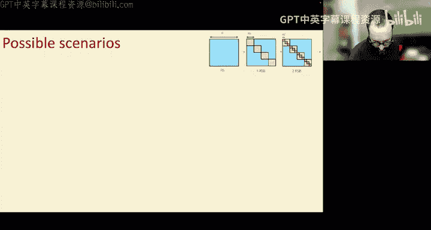

You have， you know， the replicacy metric that basically all the overlaps are like， you know。

 you have ones on diagonals and maybe Q elsewhere here you could have。You know。

 the Q here and Q prime here so you could have these in。

one RB where basically you are a set of clusters and if you're in the same cluster you'll have a certain overlap。

 if you're in two different clusters， you'll have a different overlaps。

And then it could be that you go into a case where the clusters break into sub clusters so you could have。

😊，two RSB，3 hoursSB， and eventually like full RSB where it's kind of like an infinite level of if the system is as the dimensions of the system go to infinity。

 you have like an infinite number of clusters and subpls and subcls and Parisisi showed that this behavior or at least Parisisi conjecture and gave heuristic evidence that this behavior happens in the Sharaton Kioppat。

😊，A model and then。After 30 years of work， the people have been proving most of Parisis。

 but not all of his conjectures， but all of them were right and it has taken mathematicians 30 years to try to prove。

ItTo take to prove in。That this is accurate and so this becomes like much more。Yeah。

 this becomes more complicated than there is a whole theory of now of how。

This how these work and there is also。A notionion there is notion of static。

OB and then there is dynamic replica symmetry breaking， but basically by dynamic。

 this is like these glassy states where basically the Btzman distribution。

Doesn't necessarily the break。Into this small number of clusters。

 but it breaks into maybe exponentially many clusters and any algorithm will get stuck in one of them。

And so so by now we have ways to try to at leasturally predict also when these problems will be computationally hard and when they will be computationally easy of say sampling from these probability distributions and this has to do with this。

诶。Landscape of these probability distributions and generally when you have this dynamic replica symmetry baking。

 you believe that algorithms are going to get stuck in one of those clusters that will never reach the average。

And I think this is really all I had to say， we're going to finish a little earlier unless I don't know。

 An anyone else wants to add anything。😊，Yeah， I think it's an interesting question how to sort of reconcile the statistical physics ways of thinking with some of the ways that we traditionally think about it。

I mean， it's amazing how precise they are， although one of the things that I've personally worked on is also trying to understand whether they're brittle to some particular distributional assumptions。

And mostly the theory is sort of best developed for search problems and it's I think recently people have been trying to adapt it to deep learnings。

 I'll try and cover some elements of that although you know I put it at the end of the semester because I'm not entirely sure if I can。

 but I have to figure out if there's a version of these things that you know can be covered。Yeah。

 I mean this was just I wanted to give a flavor and also just so if you read about it and you hear this term you know。

 replica calculations， replica symmetry， etc cetera， so at least you know，What's it about？

And I'll try maybe to put some sources for more。More information online。

A glass going back to Q Y is N。Going to zero makes sense right that's that's that's a good that's a nice question。

 So why does N zero go to zero。 So I think the way okay。

 so I think the way they view it is the following。

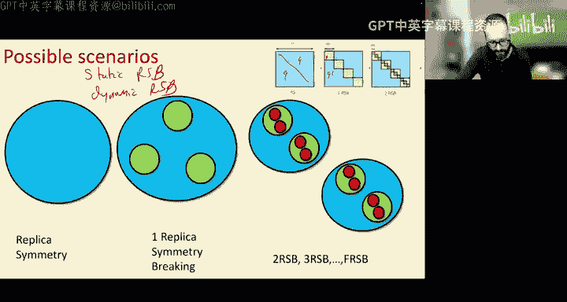

Yeah。诶。It's not exactly that it makes sense completely。

 the way I think the way they would view it is roughly the following。So。え。Okay。

 maybe we'll do it like this。 So you have the quantity you have you want to know。

This is the quantity， say this is what you want to know， right？And。

Now they now or maybe we should write it as Psi N and Q。So you want to know this quantity。

And it turns out that for some large， you know， so when n is kind of an integer。

Then it is analytical。So you kind of think that maybe。

If it turns out that if Pi Q is some kind of a polynomial。

 then it might make sense that you could plug in n equals zero and it will work。

But I think what happens is that you cannot really predict。For a fixed cu。

 so I think for any fixed cu， you， it's sometimes hard to predict in advance which one will dominate eventually this crazy sum。

So you basically get。So you basically get several candidates， so this going to zero。

 someone gives you several candidates of solutions。And。And you will still need to use some physics。

 some upper considerations to narrow them down to one， but this the I mean。

 I think the idea of this replica method is somehow。诶。

You guessed by making this guess of Q which somehow makes sense the guess why Q have the guess whyq will have this form of say alphas on diagonals and better off the diagonal that has some physical sense why the distribution could look like that so that's a reasonable guess。

And once you've made this guess， you've basically reduced the problem into a problem with。

And into the problem with only say two， three， you know， a constant number of variables。

And now you somehow want to figure out which one of those variables。

Is going to be the one that which values of this variable is going to be the one that dominates and somehow are it makes sense to them that you're going to push entry to zero and。

And take derivatives and that will give you the type of candidates this will give you the candidates and and you they don't want to completely calculate it。

 but rather come up with several candidates， which they can then run sanity checks on to reduce it to one I don't know if that's。

Yeah， I mean， I think that I'm not the person maybe to explain it more when uncle knows better。Yeah。

 I'm not sure there's a good answer other than maybe they invented it as a way to annoy mathematicians or something。

 and it just kind of works。嗯。I mean it's yeah it's a major question to try and justify those those steps that they're making and usually the proofs of their predictions go via another route so in fact like the first proof of Pari's formula is by toground and even after he proved it through different methods it was like a sort of major result to try and have a alternative proof using something calledultmetricity that's sort of more parallel the physicist's intuition so even here it's really not known to me for sure but。

Maybe someone like Nike Sun or Elkennon muscle might be even better to ask。媒天你知你。Yeah。

 yes there are several ways， but I mean I guess maybe there are several magical steps。

 but one of maybe of the main ones is the you get this intuition that。

That the overlap is going to to have this very nice simple form。

And in when there is replica setic breaking， it's a little bit less of a simple form and once you get this intuition maybe。

😊，So I can also I can tell you one other I mean there's a nice way at least that made sense to me for thinking about like what some of these calculations are supposed to mean this is a slightly different way of thinking about things。

 but you can think about a lot of these contexts and these calculations like context of random graph theory too。

So imagine you take like a you know random graph and it's very sparse so maybe you connect each pair of nodes with some like constant over n probability you can do things like you can ask you know what's the expected number of triangles that's a very simple computation and you can also ask what are the tail bound so what is the probability that you get way more triangles than you expected you know maybe you expect a constant number and you end up with you know n or n squared triangles or something like that。

And， you know， that's one of the ways where you can think about optimizing over distributions gives you an answer。

 like optimizing in the sense of replica symmetry breaking。

Because if you did have a graph from this model and it had tons of triangles。You know。

 there are two different ways that you could imagine it happening instead of maybe connecting every pair of nodes with some。

 you know constant over n probability P。Then maybe instead you should connect every pair of nodes with a much larger probability queue and you can talk about。

 you know， sort of the cost in a distribution sense of moving one distribution into another。

And that might produce the right expect number of triangles。

Another way to do it is actually to sort of plant a really dense graph inside like a cleeique。

And you could talk about moving your original distribution into that one。

 and whichever is the cheapest route is the thing that actually dominates the contribution in the tail bound。

So there's a sense in which， you know， even for elementary questions about。You know。

 tail balance for random graphs。You implicitly have to study what kind of phase it's in。

 like if I sample a sparse graph and it really does have tons more triangles。What does it look like。

 does it look like the average density is much higher。

 or does it look like there's really some sort of random planted piece。

 which could be anywhere that is closer to a cleaique？So a lot of these types of calculations。

 I mean， there's an art to it， but from the analytical formulas that you have， people。

 not me are able to sort of look at them and tell you structural properties about the distribution。

So that's partially why these things are related to understanding deep learning as in nice statistical models。

People get a lot of insights about you know what the landscape of optimization looks like from some of these kinds of calculations yeah I think they maybe that the intuition is somehow that when you have a you have some something that looks like you know something exponential to some。

If of Q。Then you are going to physists look at this and they say， okay。

 one of those things is going to dominate this thing right so so basically。

So they think you know eventually there are going to be constantly many irrelevant types of cues and one of them is going to one of them is going to dominate this whole expression。

 so out and if you now let's just figure out which one。

And then yeah and I think that's also like what happens in these tail bounces。

 so there's one eventually this probability， say the probability of getting a higher density of triangles。

 it is sum of some exponentially small terms and some of them come from this scenario and some of them come from this other scenario and one of them is going to dominate。

😊，Okay， and I think with that。We finish early today， so and。

But I'll try to think of good references to write for this to post on if people want to read further and An。

 if you have some suggestion， please also post。Okay， bye。

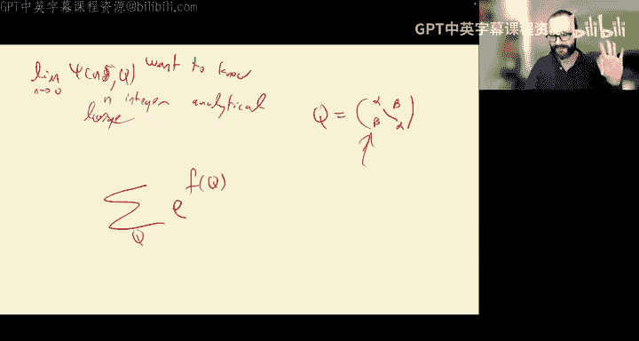