# 哈佛大学《深度学习基础｜Harvard CS229br Foundations of Deep Learning 2021》中英字幕（claude-3.7-s - P6：Lecture 6.zh_en - GPT中英字幕课程资源 - BV1f4XCYZEMx

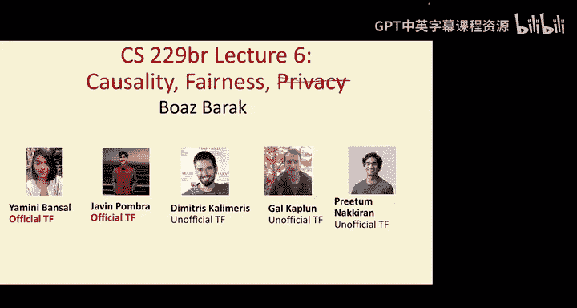

So， and。Today we'll talk about causality and fairness and there is some relation。😊，Perhaps more than。

We see its first site and even more than we can explore in this lecture。

Maybe I'll just mute or participants if people can always unmute themselves。So， and。

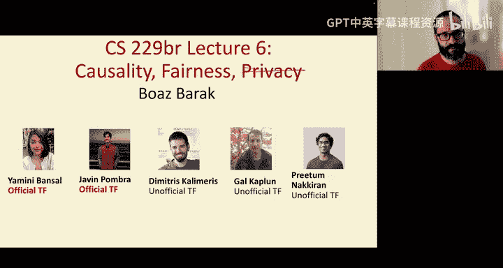

And Yamii you'll set up a slide oro to ask questions so actually integrating it with Zoom will require some extra steps so I think Sasha had it being displayed on his zoom screen at all the time I think no we'll not do that fancy we can just put it in the chat like the link Oh okay yeah I can do that。

Yeah， I think that that part might be like requires like super complicated thing with ops or something like that。

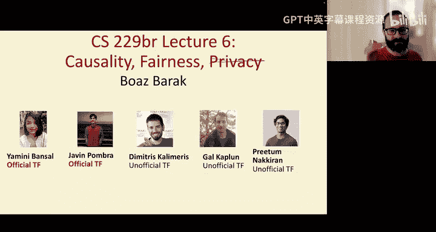

Yes。So okay， so we'll start with causality and then talk about furace。

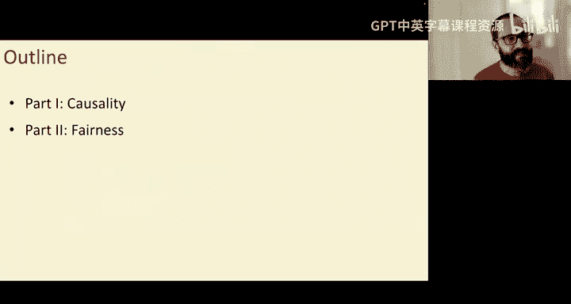

And the kind of Bible of causality， the textbook is this book by Judy App Perl。

 but I'll actually be mostly following the presentation from the Heart and Wech book and there are several schools of causality and I think we'll try not to adhere to any particular one here。

He's not too much。

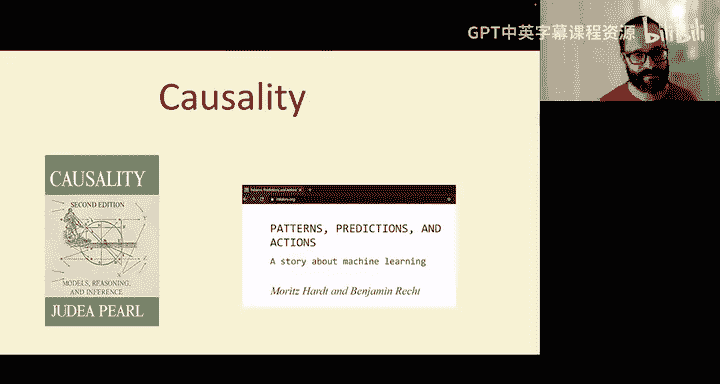

So and。Okay， so what is causality so I guess everyone knows that correlation is not the same as causation。

 this is something that we people keep saying， but what is exactly causation right？

So people are not always so clear about what it is and in fact。

 it is somewhat controversial exactly how to define causation。But one thing is。

 if you say that a causes B。

You can ask what does it really even mean， what are these entities A and B？And typically。

 what we would think is that A is an intervention。Is something where we in action where we change the state of the world in some way。

And B is an observation。So when you say a causes B。

 you're really not meaning that two things that are of the same status， you mean that the action。

The action that A causes the observation B。So for example， smoking causes cancer。

 maybe the intervention is someone was not smoking。

 then they started smoking and that will increase the likelihood that they will get lung cancer。

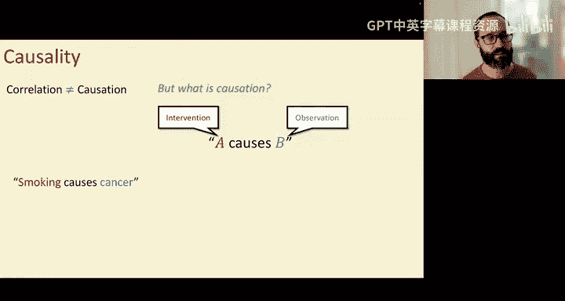

And it's a little bit more。It's a little bit more ambiguous what it means obesity causes heart disease。

So typically in the setting of causation， we kind of imagine that we could actually change the variable。

 we could have an intervention where it changes the variable of a person's weight。

 but of course typically what will happen is that it doesn't really directly work this way there are some interventions like maybe a diet or exercise that causes。

Increase or decrease with the weight and that potentially causes heart disease。

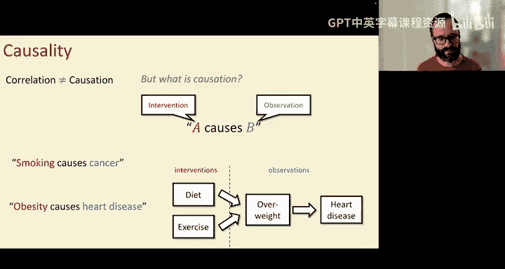

But。We in the formal setting of studying causality。

 we will imagine that all our variables are observations and we assume that we have the ability to do these interventions which are to set a variable to a certain value。

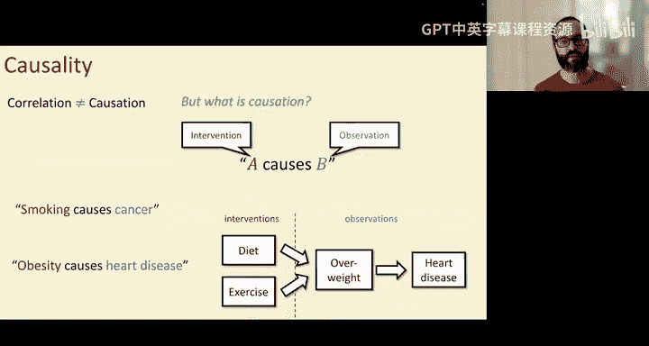

So for example， to set the variable corresponding to weight or to set the variable corresponding to whether someone is exercising or not。

 etc。

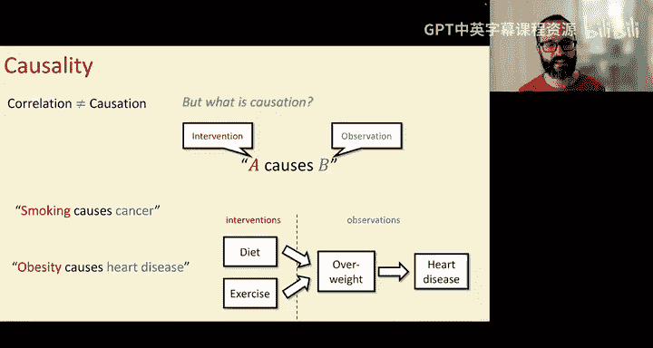

So one way to think about the theory of causality is that it seeks to understands what is the condition under which correlation actually does equal causation。

 so typically what we try to do is ensure that we can actually infer from conditional probabilities that one thing causes the other。

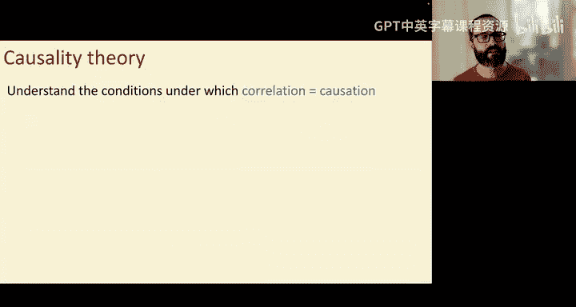

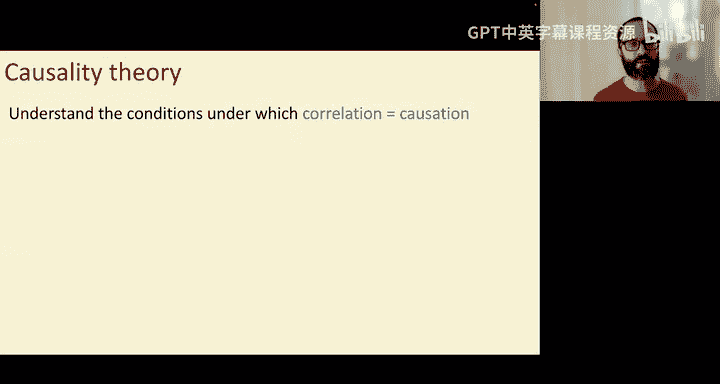

So the setup is the following。We assume that there are these observables column AB，C D， et cetera。

 and we have some interventions and interventions are basically to set the value of an observable to a certain value。

Now correlation is basically conditional probabilitybabilities。

 so the correlation between B and A is captured by the conditional probaities is the probability that B observation B equals some value little B to under the condition that observable capital a equals some value little A。

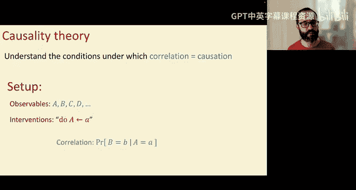

And causation is the probability that b equals B under the condition that we made the intervention and changed the value of capital a to little A。

😊，And intuitively， we might think that these are the same thing and we will see that they're not。😡。

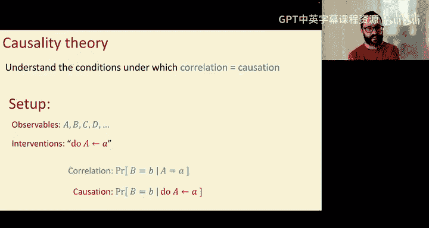

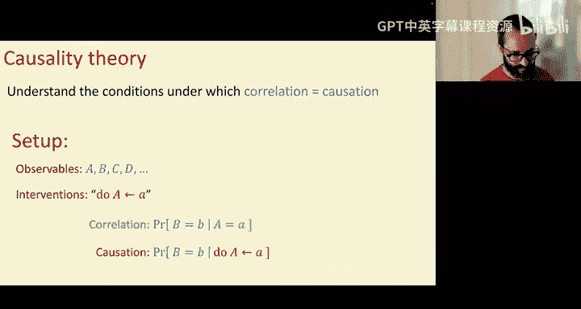

Okay so so let's do an example and again this is not please don't use this lecture as any kind of medical advice and these are just you know a hypothetical example this is I'm just using things that we can think of so to get concrete things and this is a variant of an example in the hardworked book but。

😊。

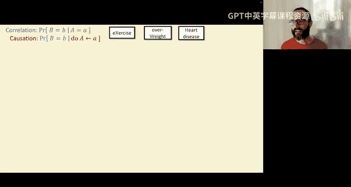

This is none of those causal models here are necessarily realistic in any way。😊。

So so suppose we have these three observations whether someone exercises or not， we call this X。

 whether someone is overweight or not we call this W and whether someone has a heart disease or not and we call this H so the first scenario is that we assume that say whether someone exercise or not is a variable that we probably have someone will decide to exercise and then x equals one and the probability have someone will decide not to exercise and then equal x equals zero and then we assume that this。

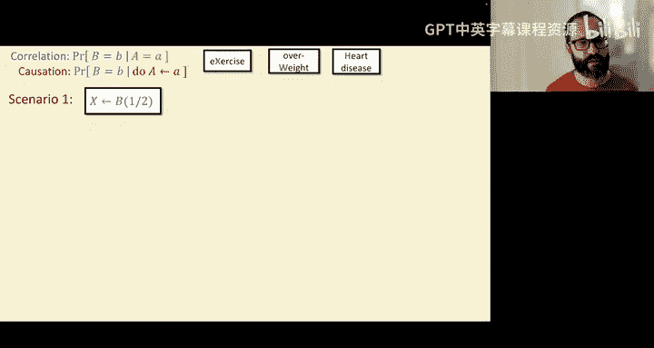

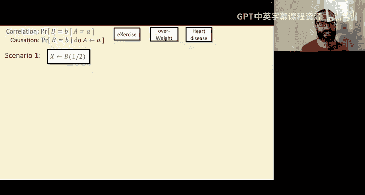

Has a causal relation to。Being overweight if you exercise you will definitely not be overweight so w will equals zero if x equals one and if x equals0。

 then w will equals one with probability half right so sample from this beernoli distribution with probability half probability half is equal to one probability half is equal to zero。

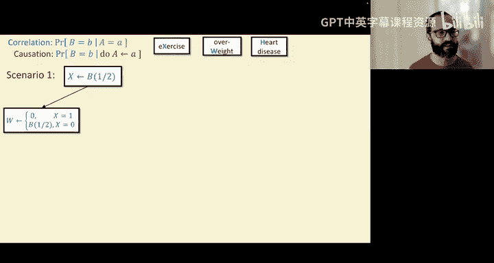

And we think that also exercise has a direct relation to heart disease。

 if you exercise you will not get heart disease again don't。Don't take this as medical advice。

 this is actually not true but just。😊，嗯。This is really just for the for the， for this。

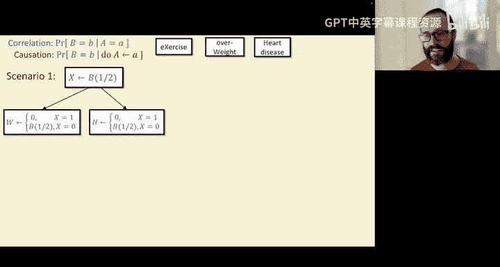

This is really just for this example that we assume that say if you exercise。

 then you will not get heart disease and if you do not exercise you will get how disease with probability have and under this kind of causal model being assuming you don't enter the exercise is the overweight and being having heart disease is each happens with probability half independently。

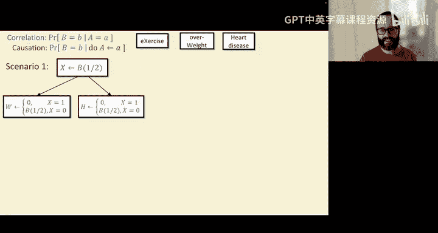

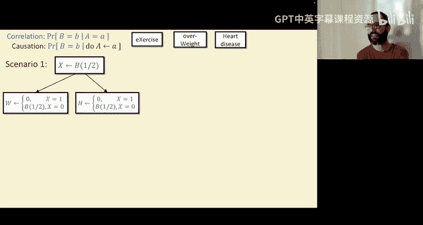

And yes。

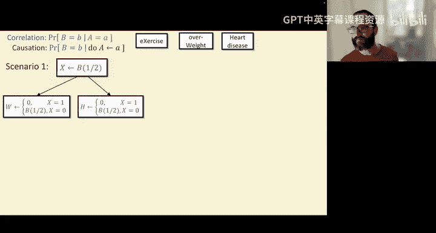

And people can ask anonymous questions if they prefer that。

 you can ask questions through the chat or you can also ask questions using a slide AO and Jaman put the link in the chat。

And。Yeah， I mean youll want to told them let me know if I'll keep that window open。

 but if I forget to answer something， let me know okay， yeah。

 I think there's a separate link for asking the questions I'm going to send that one chat to。

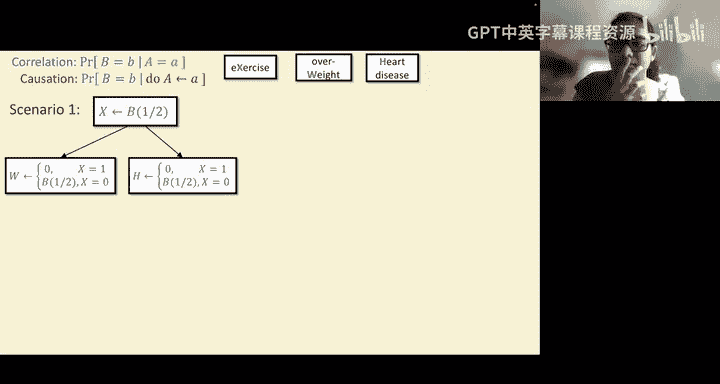

But the link that you're looking at right now will show you the questions okay okay。

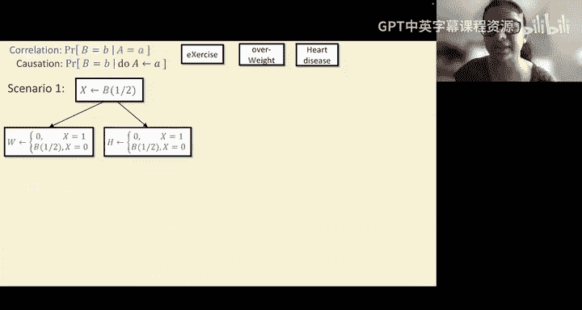

Good。O。So and so if we spell out what we will see the probability。

 if we look at these free variables x W and H， we can see that we， you know， probability have。😊。

We will see x equals to one in which case both w equals to zero and。

Both w equals to0 and age equals to zero。😊，And then we probability have x equals to zero。

 in which case all four possibilities for W and H，00，0，1， 10 and 11 are equally likely。

Any questions so far？对。Okay， and now let's think of a potentially different causal model。

So in this causal model， there is a random variable。

 which maybe it's your genetic predisposition to being overweight and with probability one quarter w equals1 and with probability three quarters。

 w equals zero。

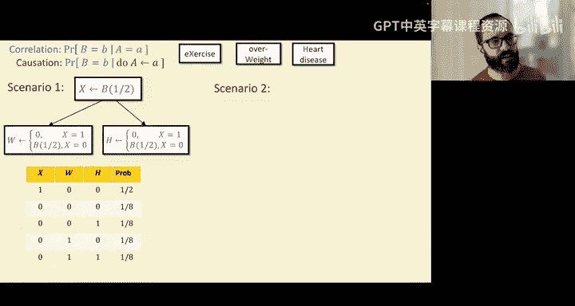

And we assume that say people that are overweight， some they don't want to exercise or can't exercise so then equals zero。

 if w equals one， and if w equals zero， then with probability one third。

With probability 1 third， then x equals one。

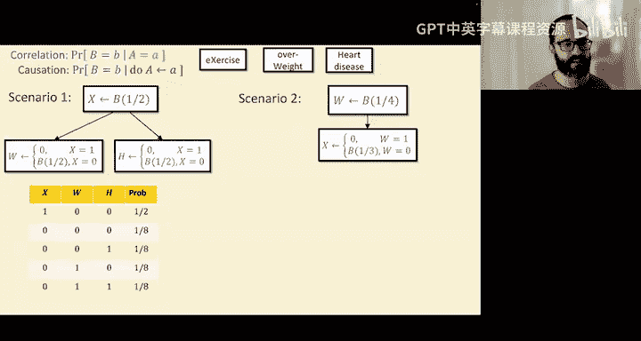

And we assume that heart disease is just controlled by exercise， if you exercise。

 you do not get a heart disease， and if you don't， then with probability have you get heart disease。

Okay， so this is a different causal model。But now if we take a look at the probabilities。

So let's think of the probabilities， right？😊。

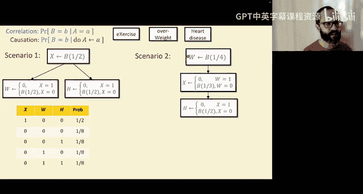

So with probability one quarter， w will equal1， that's the same probability as here right with probability one quarter。

 w will equal one。

If w does equal 1， then x must equal0， this is the same here and H will equal one with probability half。

This is exactly as it is here。If w equals zero， which happens with probability three quarters。Then。

Then we see that X。Okay， I think you I did。

A mistake weve X， I might have made a mistake with X。X should be so the age。If if w equals0。😊，Then。

AndThen x should be equal one with probability， I think it's half divided by six8。

 so I think its it should be two third am I right if I want to match the probabilities？

I think it should be two/ thirds that x is one with probability 2/ thirds。And if x is one， then。

If x is one， then this is zero and if x is zero， then H should be one with probability half so now I might have gotten the numbers wrong。

 but the idea is that basically scenario one and scenario two will be identical in terms of observations。

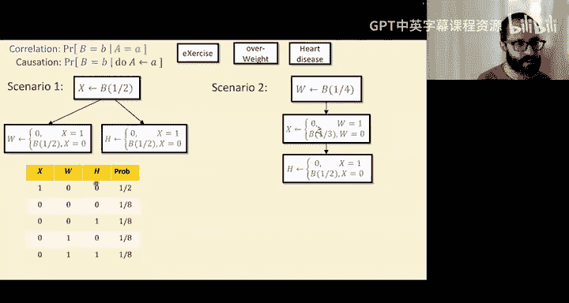

Okay， please check me now if these numbers are okay or should they modify another。

So I think if x equals1， then w is0， if x equals0， then。

Then that should check that when x equals zero， then I think the condition on x equals equaling zero。

 the probability of age to be1 is exactly half because that comes from this part。

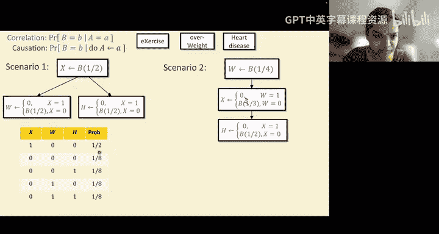

And on condition on W being grade1。So conditional w being zero。

 then the probability of x to be1 should be。Right， it should be in。

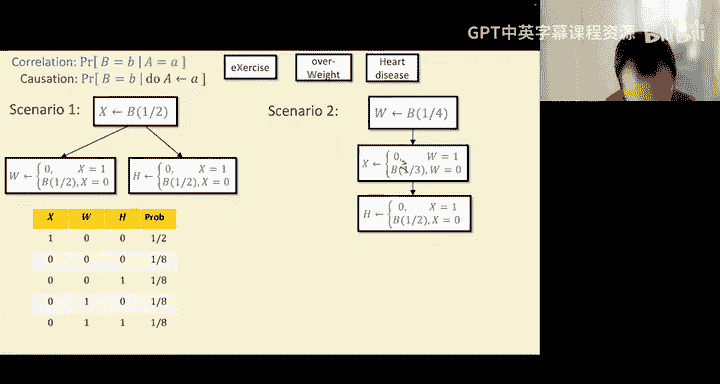

Two8s divided by half plus28s。

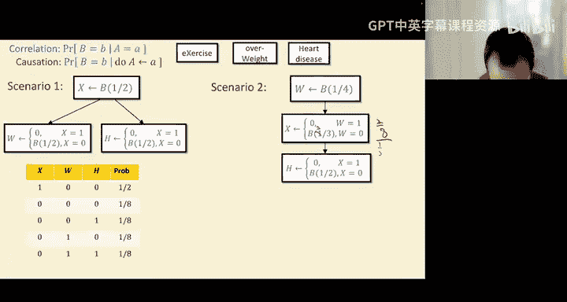

We should be。嗯，喂。So it should be half divided by half it it should be。4 divide by6 or two first。

And Daniel asked， is there any way in the causal literature to factor in assumptions we might have missed yes。

 that's really the main thing about like this causal literature is trying to understand exactly what do we do if we have。

😊。

Yeah， if we have missed such assumptions and the main thing is to try to， yeah。

 and it is complicated and we'll see a little bit more maybe it will become clear with more examples。

But the main point here is that， yes， if we look at say the probability that w equals one condition on x equals zero。

Then these probabilities， the probability distribution is identical in scenario one and scenario two。

 so you cannot distinguish between these scenarios by looking at any conditional probabilities or conditional probabilities are just。

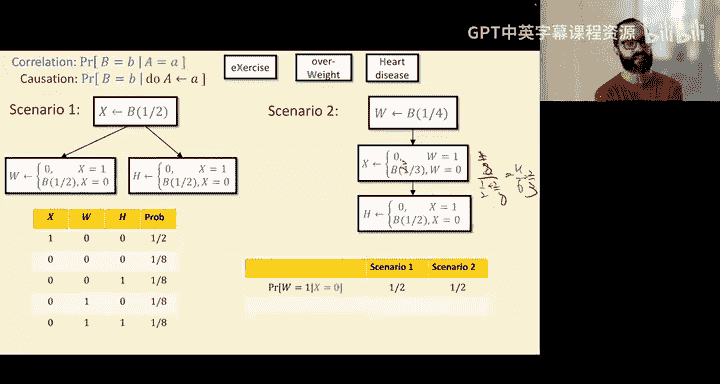

All of them can be derived from this table， so it means that any all conditional probabilities will be the same in scenario one and scenario two。

 but if you make the intervention， if you say you make the intervention and decide that someone is not going to exercise。

Then scenario in scenario one。

That will mean that they get they will be overweight with probability half。In scenario2。

We assume that you have a genetic predisposition to be overweight and whether or not you exercise does not the causality relation is from being overweight to exercising rather than the other way around。

 which means that if you make the intervention and you decide not to exercise that will not matter。

That will not matter for you probability to become overweight。

 the probability to become overweight is still one quarter， whether you decided to exercise or not。

 so the causal probability the causal probability is different than the conditional probability。

Okay so this is actually an important point， so these two scenarios are identical。

As long as we don't make any intervention， we can observe them for as long as we want we can and we will never be able to distinguish between these two cases as long as we don't make any intervention。

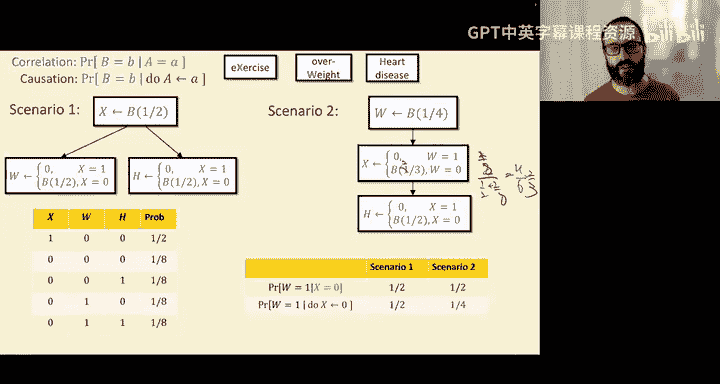

But if we did were to make an intervention， we would see something different。If someone。

 if we made the intervention and decided to stop someone that would have exercised otherwise and we decided to make them stop exercising。

 we would see the difference。ok。😊。

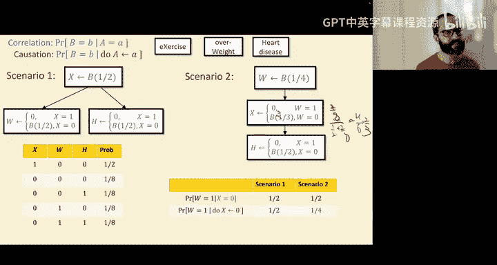

So is this is kind of a crucial point， so you can have these two scenarios that are identical in terms of observations。

But where a causal， there is a difference in terms of the。

Or in terms of if you were to make an expert So how do we get a probability when we added intervention。

 Great question。 Okay， so the idea is the following， that that's a great question。

 So the idea of intervention is that you modify this。

🎼What does it mean to intervene and to say x0 is that you modify this part of the Gene model and you change this to this new model x gets zero so basically you intervene them instead of the previous thing where x was this function of w you change this to x gets zero。

But you do not。But you did not modify anything else。

 so the process is that first w is chosen with probability one quarter is one if probability three quarters is0。

 then now in the new model x gets zero。AndNot that we kind of imagine that this happened later in time。

 so this had no effect on W。And now you modify and now age is based on X the same thing here。

But the point is that if you make this change here， if you make the same intervention here。

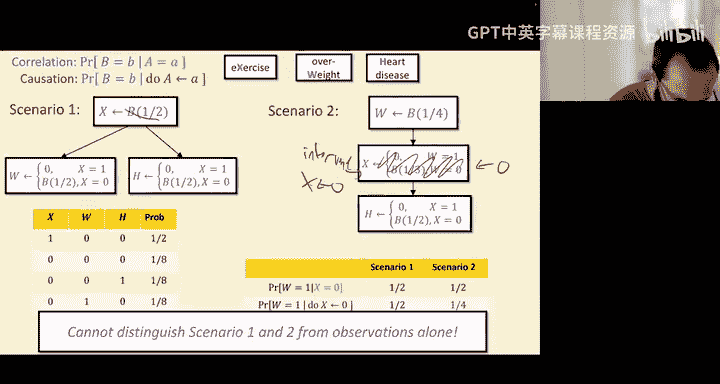

So this intervention will change W。While this intervention in this model will not change W。

 but we couldn't know we couldn't know that until we intervene so we have these two。

Two models of the world， one when x causes w and the other where W has a causal relation to x。

And before we intervened， before we made an intervention and modified the x to become zero。

 we couldn't distinguish between the two of them just based on observations。

I hope that clarifies things。The one thing we've got anonymous question that I don't know if it clarifies。

 but please feel free to ask an extra question if something is not completely clear。😊。

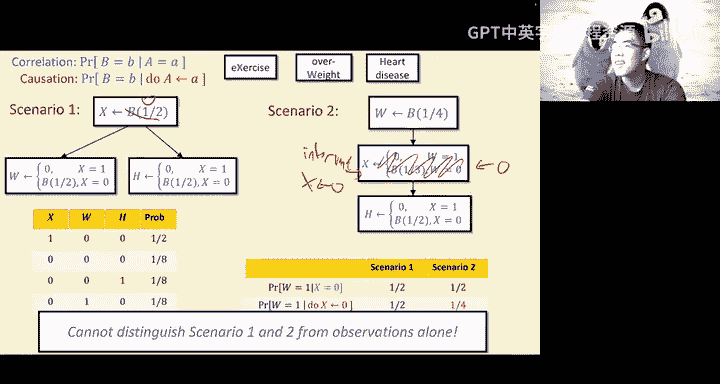

Okay， let's see now will the iPad let me move to the next slide。

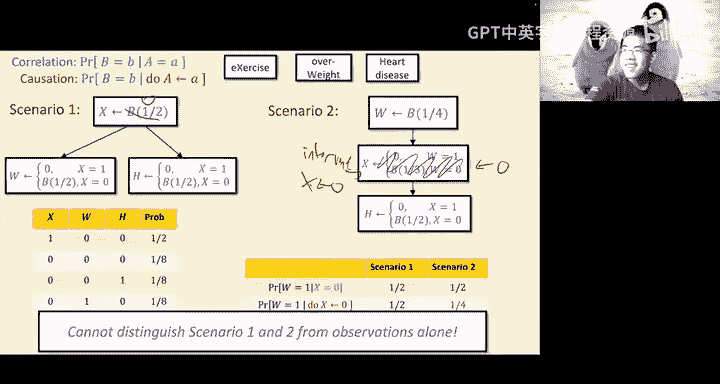

Okay， so now really the heart of。Of this causality theory is to。

Great thank you so the health of causality theory is to try to estimate these causal probabilities and the main tool is make we try to make sure that the causal probabilities become conditional probabilities。

😊。

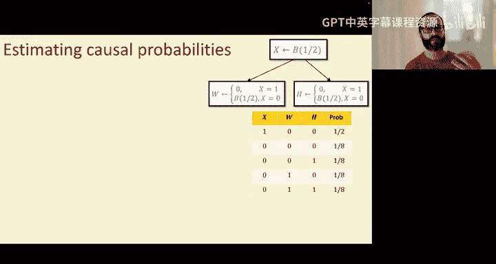

So let's assume that we know and that's often a major assumption that we know the causal graph we might just not know the numbers right so so the idea is that we know。

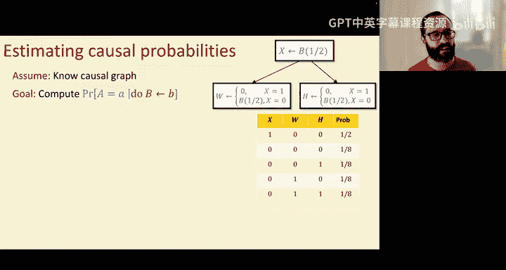

The shape。But we might not know these numbers， so these kind of numbers we might not know and we then want to estimate them。

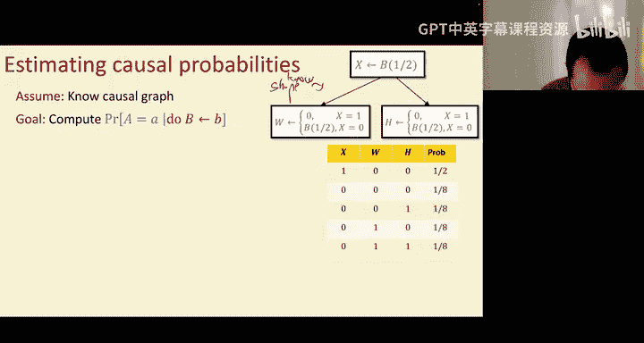

So in this case。What can we do right so our goal is to compute causal probabilities which are of the form what's the probability of a equals some value under the intervention that B gets the value B so let's kind of look at this graph so for example we look at probability that a equals one condition on w equals zero。

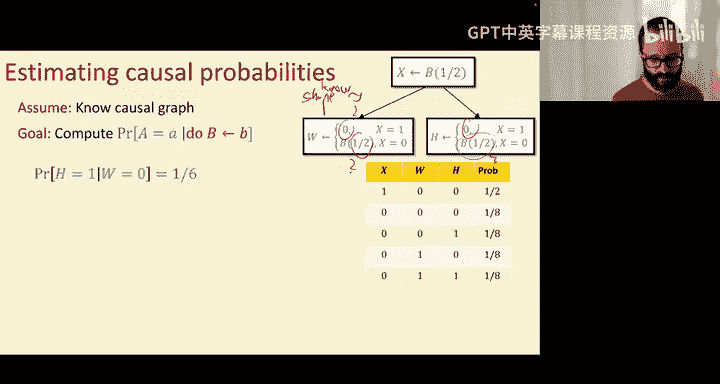

So w equals zero。That has total68 probability and one of those six corresponds to a equals  one。

 so this is 16。Probability in this graph of。AndProbability in this graph often when we say do。

DoW gets zero。So when we make w to zero， then let's see so in this case。We make this intervention。

 but in this causal graph this will not modify the probability of age because we think there is no direct in this graph there is no direct relation causal relation from W to age that means that the probability of age will remain one quarter as it was before。

So this is a case where the conditional probability and the conditional probability and the causal probability are not the same。

😊，And the reason for that。Is that this exercise。Is a confounder so this is what we call confounder in causal theory so exercise is a common factor that influences both W and H and it creates this dependency between the two。

 even though there is no causal relation between them。😊。

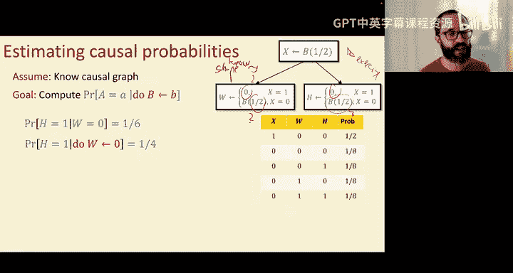

And again， I'm not saying that there is no causal relation between them in the real world。

 what I'm saying is that there is in this causal graph model。

 there is no causal relation between them。😊，So this is a case where they are not independent as。

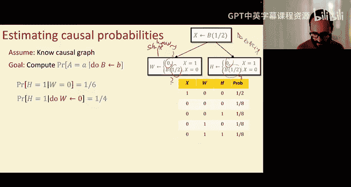

They are not independent as a probability variable as random variables。

 but they are that changing W does not an impact H。And the way to do this， the way to get the true。

The way to get a two causal probability is to do what is called control for x what does it mean to control for x we fix the value of x and then we can estimate the which is this common factor and then we can really estimate the causal probability so then what we say is that。

The probability of age equaling one under the intervention， the w gets zero。

 which upper year you don't know is the following。It's the probability。

 the conditional probability when we so we look at the probability x equals0 that's half。

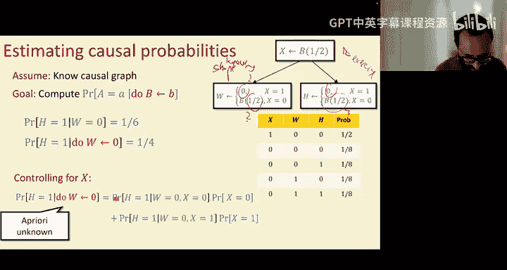

The probability that if x equals0 and w equals0， then that H will equal one so that。

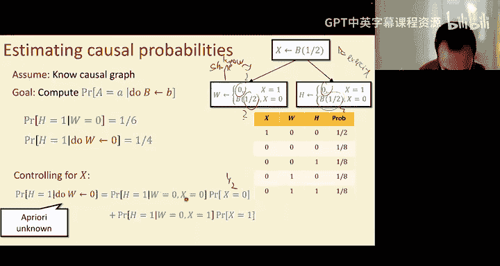

So we can see this is right the probability when x equals0 and w equals0。

 then the probability that h equals1 is exactly half。So so this is half when x equals one。

 then the probability that h equals one is0， so this will be zero so we get this is going to be。

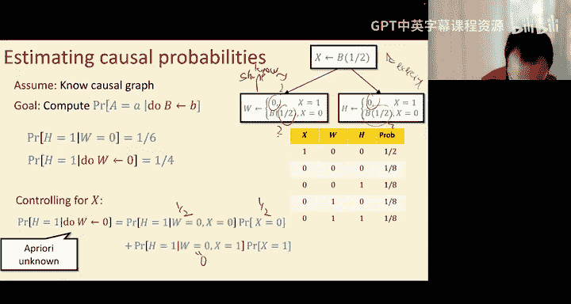

One quarter right so this gives us so using these two terms。Which are we can get from observations。

 we can estimate this。This term， this causal term。So basically， if you know the graph。

 if you know the causal graph， but you just don't know the numbers， you can obtain。

 you can calculate all the causal probabilities through observations and the idea is that you control for these common factors and we'll see a more formal definition of what to control for soon。

Okay， so the original uncontrolled conditional probability distribution didn't capture the causal relation。

😊，But after we control for x， then we get the right causal probability。Any other any questions？ok。

And this is just a special case of something that's known as the adjustment formula。

 and the idea is the following， you take the parents。

 so Z in general is if x has more parents than so you take all the parents of x in the causal graph。

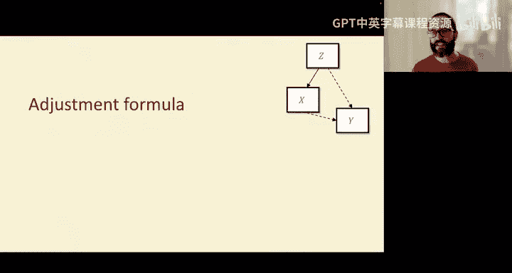

And then the causal probability y equals y under the intervention x equals x is you take you sum over all possible assignments to those parents and you look at the conditional probability。

 but when you condition on this value of Z， so that's going to the controlling for Z。

And the main thing is that this is a causal probability that a priority is unknown。

 but now we can we can get from observations。😊，And the reason I'm putting an asterisk here is that you don't always know。

 so this is the potential confounders。

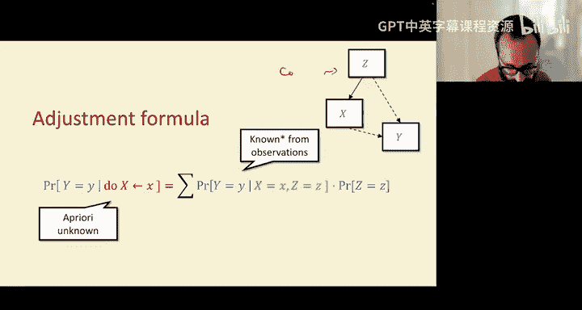

But this assumes that you know the confounders so you can control for them。

 that's not always the case and that can create a big problem of course。

But if you do know them， then you're good。ok。😊。

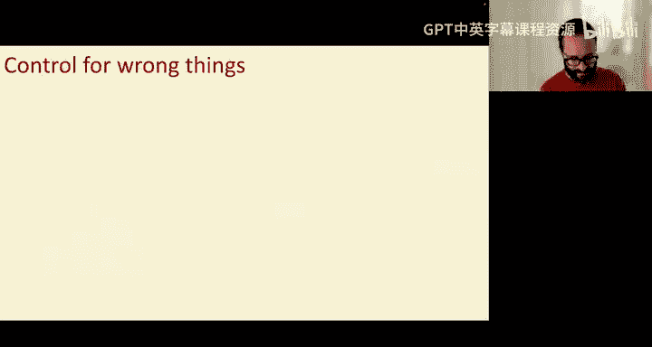

So the。How is it different than marginalizing y over x condition x over Z， I think it's not I mean。

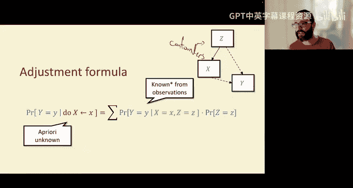

I I think it's the same as marginalizing Y conditional excs。

 but note that it doesn't give you the same number right just know that probability of。诶 why。

dition equal y condition on x equals x is not necessarily the same as the sum of the conditional probabilities。

Right so just know that this is not marginalizing in a sense that it will become the same it's the same probability。

 so when when you sum up the conditional probabilities。

 it's not the same as just the original probability when you didn't control for it。Great。

 but I think you can think of it as marginalizing over it。But maybe I'm not 100% sure。

I'm using the term marginalizing correctlyly， so if someone else knows， please feel free to chime in。

Okay， so so the previous problem I might say you know。

 what's the best thing you could do if you're not sure about the causal graph just control for everything inside control control control and maybe you'll all be you'll be good so there are two reasons why this is not a good idea。

One issue is that when you do these conditional probabilities and this is important。

You are whenever you do something like that。You basically have fewer samples。

Because you're trying in real life you're going to estimate this probability distribution from samples and when you are conditioning on only the cases where capital Z equals little Z。

 then you can only estimate this probability distribution from samples that satisfy this property。

So you will have fewer samples and you'll get worse estimates。When you control for more things。

 so that's one reason， important reason not to try to control for everything inside。

The other reason is that sometimes actually controlling small things actually might make things worse。

😡。

So you can control for the wrong things and here is a kind of a canonical example。

Suppose。That there is two possible diseases that people can get， so x is equal to one。

 say if you get disease number one and y is equal to one if you get disease number two。

And let's assume that these two diseases are completely independent。

 there is no causal forbilistic relation between them。

 you can get each one of them with foityP independently。

But let's assume that you know both of them leads to being you being hospitalized and we are in this universe where that's the only reason why you would ever be hospitalized so everyone in the hospital is there because they either got disease one or disease two or both。

And we assume assume the probability of getting each one of those this this is very small。

 it's a small number of P。So now if you look at the population of people that are currently say in the hospital。

 so the total population of people is you know this。White rectangle。And we mark you。

 the blue rectangleal is the people that have disease one and the red rectangleal is the people that have。

Disease two and the union of those is the people that are currently in the hospital。

 people were z equals one so each one of them must measure P and the intersection has measure P squared。

And the total number， the fraction of people that are in a hospital is 2p minus p squared。

 if P is very small and you can think of it as basically 2p。No。

If you look at the probability that x equals one condition and y equals one。

 that's the same as the causal probability that if you infected someone with disease two。

 it will not make them more likely to be developed disease one。

 so these are completely independent so the causal probability and the condition probability are the same they are equal to P。

However， if you thought you were smart or maybe you did you know a survey and you only looked at people in the hospital because that's where usually you find sick people so if you were to control for Z say and。

Then if you were to control X and Y。Originally unconfounded。

 initially the conditional probabilities and the causal probabilities are the same。

But if you were to control for Z。Any were to look at them。

You know the two cases where z equals 1 and z equals zero， so let's just do the math。

Right， so when in。If that equals one， you're in the hospital。

 then basically the probability that you get both diseases is P squared and the total probability of being in hospital is roughly2 p。

 so this is roughly P over to this green term。And the probability that you will land up in the hospital is roughly 2p。

😊，So this contribution from this term is roughly。ピース square。On the other hand， the probability。

 if you are not in the hospital then you are not sick， then therefore this probability is zero。

 so we get a this contribution that if we control for Zed， then the probability is much smaller。

So P squared， so basically these two diseases become they look they are actually completely independent and not correlated。

 but if you just condition to the population that is in the hospital。

 they become anti correlatedrelated， so they look like they are anti correlatedrelated and therefore it would seem that basically infecting you with disease one will infecting you with disease two will make you less likely to develop disease one。

So you know if that would be kind of pretty bad， like so imagine that disease one is kind of much worse than disease two。

 but disease two is still kind of pretty bad and someone would say found a great treatment for people with you know。

 a great way for people with disease one， let's infect them with disease two。😊。

And then at least probabilically， it looks like that if you look at hospitalized people。

 they are less likely to have disease one if they already have disease two。😊。

And this is a little bit like， you know the famous joke of if you want to。

The probability of having two bones on a plane is really， really low。

 so the best way to avoid having you know。

The best way to ensure that no one a on your plane is to bring the bomb yourself。

Okay， but but the point here is that this if the causal graph was inverted where variable z was a cause of x and y。

 then controlling for z would have been important to。

To make sure that the conditional probability is the same as the causal probability。

 but when x and y are a cause of z， then it's the other way around and you don't want to control fusI。

Yes， the question is is the following statement to probability x condition y equals probability x do y and I'm assuming like for given a particular values。

 if and only if x y are not confounded， yes in a sense that this is the definition of being not confounded so I mean there are different ways that people define not confounded。

 I'll use slightly different definition but basically is the same this is one way to define being not confounded。

😊，You can also define not confounded in a slightly stronger way and then not confounded will be。

will imply this statement but will not be equivalent into it。

 but you can think of not confounded as basically defines us this way that for all possible values。

 the conditional probabilities and the causal probabilities are the same。

Okay， and there's kind of different relations between， there can be many different relation。

 but here are three common ones that you could find in this causality literature about relation between X。

 y， and z。So say Z is say a common cause of x and y。

In this case in this case the z can be confound x and y so z x and y could be confounded and you can control to if you control then if you control to z then they will become unconfounded a mediator is when x causes z and z causes y and there might be also indirect some direct relation between x and y in this case。

 then z is not a confounder if that's all there is to the graph then the。

The causal and conditional abilities are the same and colider is when both x and y。

 this is what we saw in the example before， then both x and y implies z。And in this case， again。

 the Z is not a confounder and if you confound for something。

 if you control for something that is not a confounder。

 you could actually make so thats that's good to do in the case of a fork that will make the probabilities right。

 but that could actually that could actually make the conditional probabilities differ different from the。

Cause of probabilities。In the two other cases。So basically。

 let's try to make me make things a little bit more formal。

So there are two general ways to think about causal models and it corresponds to the way you think about probabilities。

So a frequent model， you can think of there is a repeated experiment。😊。

And the probability A under do B is the frequency of times in this experiment that a will occur if we make the intervention B。

And the Bayesian view is you think that something already happened， something already happened。

 and now you ask the counterfactual what if we went back in time and would have done what would have the probability that a still have happened。

 maybe happened in the real world or didn't happen in the real world and now you want' to understand would been the probability that it would have happened in this counterfactual world where you went back and。

It did be， you know， for example， you know， you're sitting here and listening to me blabb or on about causality and you can ask what's the probability that I would be sitting here and listening to Profesor bbbing on about causality if I hadn't registered for CS2 29 ILB。

😊，And the。

And so that would be a counterfacty。

So we will like we do with probability will typically the math is easier to think about when we talk about frequencies。

 although sometimes you want to use causality in interpretations where the Bayesian or。

It would have been more natural， right？So I guess the question is is the Bayian approach more natural in the setting of interventions。

 I think it kind of depends if you're looking it's true that we only have finite samples but。😊。

It kind of depends whether you're thinking in the forward direction or the backwards。

 so if you're looking at one of events and you're trying to figure out what could have happened if say the Federal reserveserve did instead of setting the interest rate to X said the interest way to wide and the Bay。

Approach works best if you're trying to set up some kind of experiment where you could actually do interventions like a。

Say a double blind control experiment and the frequentist approach actually makes sense so it's actually quite similar I think to the question in general probabilities sometimes you think of probilities that are forward looking when you think okay there is going to be a repeated experiment even it's repeated only finite number of times。

But at least it's kind of repeated with fresh randomness each time and sometimes you think of an。

You're trying to assign posterior probabilities to based on the evidence that you have observed。

So I think both can make sense。And。And it kind of depends on the setting and the general way we think of the world。

 we think though okay， there is time that goes in one direction and the future cannot influence the past。

😊，And we think that there is some sources in hard work。

 they call it noise variables or exogenous randomness， or there is some sources of random choices。

That impacts the observations that we see， so say x1 is some function。

Of say U1 and then maybe there is an extra randomness u2 and then x2 depends there is a causal relation from x1 to x2。

And so x2 is some function of both x1 and its own randomness U2 and then maybe for example it could be the case that there is a causal relation from x1 to x3 but not one bit from x2 to x3 so x3 might depend only on x1 and on its own randomness U3 and so we think of this causal graph as some kind of directed thecyclic graph。

The fact that time goes forward means that it has to be directed ascyclic。

 but not always the case that everything that happened before impacts something that would happen in the future and as far as causality is involved if this is the causal model then we could switch the order of x2 and x2 in time and it would not make a difference。

 any kind of topological ordering of these。

Of these events would happen and another way to think about it you can think of it as the world is generated according to some program and every and this is one line of this program and this is another line and this is another line and each line of the program。

Basically generates an observation based on fresh randomness and on observations that happened before。

And the intervention is basically like changing one of those lines of the program。

 so if we went and intervened and change the value x1 to something。

 then we just modify the model so maybe it ignores U1 and now sends x1 to something but and now this something is used in everything that follows that。

Okay， so there is a notion of back door path and this is the following so the idea is that we can define two variables to be confounded X and y if there is and this is when we and this is in the context of。

Would we want to assume a mark of condition when we unravel the causal diagram in time so I'm not sure I understand what a mark of condition here is maybe you can unmute and explain more or。

So yeah， I mean i'm not completely sure like maybe if you mean like it's a Markov chain or sorry it only depends on directly proceedceding time six state no it doesn't necessarily right so so the causal relation the graph could be。

I mean， I guess you that you could imagine that the state on each point of time remembers also all the observations that happened before and then it would only depend on directly proceeding time state。

So what you do at each situation depends on all the observations that happened before and the fresh randomness。

 so if that counts as a markov condition than it does。Okay， thanks。

So let's suppose we are trying to understand we're trying to look at whether probability x equals x sorry y equals y condition on。

X equals x is the same as probability of y equals y condition on do x。Equals x。

 so we say that they are confounded in this case， if there is what's called the back dooror path。

An a Bcao path is basically a path from y and the path might involve edges in either direction。

 so that's why I'm saying you know it could be in either direction。

 but some kind of a causal connection。From y to an ancestor of X。But it doesn't go for x。

And if there is such a connection， this is called a backdo path and then X and y are confounded if they're not confounded。

Or maybe I should have adopted some kind of definition that make sure that x and y this is not a symmetric definition。

 this is when we are trying to look at probability of y condition and doing something for x。

 so if x and y are not confounded， then the probability the causal probability is the same as the conditional probability。

And he was kind of proof by picture， so suppose that they are not confounded。

 so there isn't a path like that。So we can imagine running this program and we can sort the program so we can imagine that we can sort this according to topological sort。

And we can run all of those steps。

Up to this point。And we get。You know， some values Z1 till Z n。

And now we run the code x equals some function f of Z1 till Z n and some additional randomnessU。And。

And that's it。 And now the point is that。

And now the point is that when we are going to get to the problem the to the value of。So who are。

Nothing here is going to depend nothing we can shift everything that kind of depends on everything that depends on this stuff we can kind of shift over here。

So why？We just be sampled from some distribution that's only a function of little x。

 we can forget all of these values。

We're not going to need them to compute the value of y。

So y is going to just be a sample from a distribution that only depends on x。So we can kind of in。

In the topological sort， move everything that dependent on these values。

 we can move it to before X will sample。So because that there is there is nothing that is on the that we need for sampling why that would require us to know the ancestor of。

That would require us to know the ancestors of X。So there is no notion of time。

 but they are directed as stickly graph， so you can think of it that the result will be the same no matter what topological sort you make。

Okay so so the notion of time is implicit in the fact that we assume that they are a cyclic。

So we assume that we cannot have a cycle where say x indirectly causes y and y indirectly causes x so that we do not allow。

And any topological thought would be okay。Great， so basically if the variables are not confounded。

 then we can sort in topological sorts such that why only depends the probability distribution of y only depends on x doesn't depend on anything that happened before x so it could depend on extra so it could depend on these things which have like an extra sources of randomness that happened after x。

 but basically the probability distribution of y only depends on x so the conditional probability distribution is the same as the as probability distribution you get if you made the intervention and set capital x to some value little x。

Is this clearer？😮，Any any questions。So please do yes， don't hesitate to stop and ask me questions。

Okay so if there is no back dopa then the variables are not confounded and then the causal and the conditional probability now let's think of application for say experimental design so let's think of something that's in the news today。

 say you have going experiment for a COVID vaccine。

So you there is a event whether you chose to participate in the experiment or not and whether you got a vaccine or not。

 and if you participate in the vaccine， if you participate in the experiment。

 it can maybe make all sort change the way you act in all sorts of ways。

And eventually you get COVID or not， right so if ss one， you got COVID if ss0。

 you didn't get it and the event of you getting COVID depends on many things。

Some of you which have been would have been affected by participating in the trial and also depends。

 at least we hope it depends on whether or not you got the vaccine。So then generally。

 this is a backdo path。RightSo there is a path。😊，From the variable whether you got COVID or not。

 to the variable P， whether you participated in the trial or not。

 which has an impact on whether you got the vaccine or not。So because you have this backdo path。

 then the probability， the conditional probability that you got COVID condition on getting the vaccine is not necessarily the same。

As the probability， the causal probability， which is what we really care about。

 what's the probability that you get covered if we made the intervention and gave you the vaccine right this is what the trial really wants to figure out。

😊，So basically， how do we avoid this， the idea is exactly this is why we use placebo。😊。

So by using placebo， we erase this edge。The probability of whether you get a vaccine or not becomes independent on whether you participated in the trial or not right you'll get the vaccine with probability have or you know you'll get a vaccine and and nothing and because because you don't know whether you get a vaccine or not。

 there will be no there is not going to be any hour you know there's not going to be some causal relation between getting the vaccine and changing the way you act。

So basically， we get to the position such that the probability that you get COVID is deconfounded from the event B。

So then so then we can actually measure so then there is no backdo path and we can measure you know the treatment and typically what we care about is this treatment effect we compare the probability that。

So we look at people that already participated in the trial。

 so then we of course hope that there are somewhat representative population， but at least for them。

 we can estimate the causal probabilities of the intervention V。

We can the probably get copied based on this intervention that we set b equals1 versus b equals  zero。

Okay， so one way to think about principlebo is that we are trying to cut these we are trying to cut these。

A backward path。

バドパス。And what's in general this effect of conditioning or controlling so the idea is you can think about the following so suppose you had like this experiment and this is the thing that happened before。

Say before we set Z and this is the thing that happened after said Z。

 and now we make this condition the condition on Z equals some value little Z。

So that basically kind of breaks apart everything that happened before from everything that happened after。

And it can create some correlations between the things that cause z， right。

 because we now have this kind of posterior distribution。

But everything after you basically just depends。On just on this value of that so we can basically kind of kill these paths and but introduce spurious correlation here。

收。As I mentioned， one of the things we really care about is to。

Understand the effect of say a treatment variable we have。Some treatment variable。

 something that we can do set e to zero to one and we won't understand what will be the effect on say y if we change T to1 T to1 sorry so we defined the probability y0 to be the probability of y condition on doing t gets zero and defined probability y1。

 the probability of distribution of y。

If if we make the intervention， T gets one。And the goal is really to estimate a treatment effect。

 which you can think of is the difference between the expectation of y1 and the expectation of y0。

What is the effect of treating versus not treating？And the idea is that， yes。

 t and y are iorable controlling for z if after you control for z。

 then t is independent of these two probability distributions， y0 and y1。

So another way to say it is that。Another way to say it is that。

The probability distribution really doesn't have an impact chose whether you made a choice to treatment doesn't affect。

That doesn't affect these two probability distributions and maybe and we call this may also the admissible and basic thing is the thing that we really care about and you can think of this as the definition of being ignoable is that the deconfounding formula works that if T and Y are ignoable when controlling for Z then you can estimate。

😊，The probability of y equals y under the action， capital t gets little t using the deconfounding formula。

And the idea is the following。So， if。If the probability， if we look at the E。

Say let's set a little t to be equals zero。So if you look at the probability。

At the the probability of。This de confounding probability。

Then if we assume that condition on Z control setting T， this is independent。

 then we can kind of erase this。We can kind of eravase this formula， eravase this condition。

And then basically， we get that this is just the probability that y0 equals y。

Condition on say condition on z equals z。And we just sum up these things。

And now we basically just get， we just basically can estimate the right so we just want to estimate the expectation say of y0。

The probability that y0 equals y。So0 is we just basically estimate the probability of y0 equals y conditioning on Z。

啊。So， basically， and。So you maybe a little bit made a mess of it。

 but basically you can think of this as the definition of ignoable so basically if。

If you have this causal graph， z implies T implies y。

Then after you control and potentially you might have like this back path。

 after you control for Z you can estimate the effect of T on y using the same formula。Okay。

 and if let's assume that we can control for so that this is the case that we can controlling for Z gives us the。

ATrement effect。So now here is a way to estimate it in practice。😡。

So let's define this admissible score propensity score， so propensity score is the expectation of T。

 the treatment variable condition on a particular value。Of Z， the variable that we can from。工作。です？

收。So now the thing is that。This is something we can you know。

 little Z and capital T is something we can measure。

 so this is something we can actually estimate from samples this little E of Z。

Now the claim is that if z is admissible， if we can indeed control for Z。

 then if we wanted to calculate this， the expectation of probability under the treatment that we set capital T21。

 this is going to be the expectation of y times t divided by E of Z。

So just note that if we know all of these， if we know E of Z， we know Y and T。Right。

 so what are we trying to measure with the propensity score so basically the thing is with the propensity score is that it allows us is something we can estimate from from data。

😊。

And it allows us to measure this thing on the left， which is what we care about right。

 so this is what we care about。で。What's the probability of why if we make a treatment？

And this is something we can measure。we can get if we have samples， we can observe。We can observe Y。

 T and Z。Okay， so we are so just to make sure。In this context think of treatment as something that you don't necessarily control right so this might be a natural experiment。

 so you're not necessarily able to change T but you want to observe information like Y T and Z and use that to evaluate what's the effect of a treatment。

Which of these that makes sense？Okay， good， right。What is if E of z equals zero great question yes so let's assume that let's assume that E of z is never zero right so the treatment for any one of the there is always some nonzero probability of some nonze probability otherwise yes otherwise we can use this right so let's assume that the treatment is such that it happens with some nonzero probability for any setting of little Z if you think about it obviously if the treatment never happens for some values of little z you'll never be able to guess you'll never never be able to estimate what's the effect of the treatment on this type of on these cases right so it it's a necessary condition if you're trying to estimate the effect of。

😊。

A treatment and that effect could change so one way to think about it you know maybe the capital Z is the underlying conditions and the underlying conditions could influence the effect of a treatment and if the treatment never happens for people with a certain type of underlying conditions you'll never be able to estimate that so。

So we assume that E is never zero。But that's a good point and of course， if E is really。

 really small， that's also an issue。😊，In practice。So now right。

 so if z admissible just means that we can do the deconfounding calculation。

 so we just sum up probability y equals y t equals1 and z。

And now。Now we just kind of shift around right， so basically what do we do。

We just we ordereddered things。So we move this conditioning instead of t equals one。

 so we said this is the intersection of the probabilities and we divide。So we still condition on z。

 but instead of conditioning on t equals one， we just said， okay。

 this is equals to probability that y equals y and capital t equals one condition on z。

And divided by the probability that equals one conditional z right and we moved probability of z from just to the beginning of the expression so now this looks like an expectation right so we can write it as an expectation and if you look at it right what is the expectation of。

😊，So down here it's。It really is because t is a binary variable that is equal 01 this is just e of z right this is the same as expectation of T condition on capital Z equals little z。

😊。

And above， we have the probability that y equals y and t equals one conditionency so。

If we if we assume that y little y is different from zero。

 then this is the same as saying that y times capital t equals。Little y， right。

 if y little y is different from zero， then if t equals one， then。

Then y times t equals little y if and only if。Y equals little y and t equals one， right？

So now we now if we just。Now if we just write this expression。

 so we write this as probability y equals y。Dutty gets one times y， so this is just this expectation。

And we' are going to just plug in right so we're going to plug in for this。This value。So we get。The三。

Overall y of expectation under z of probability of y times capital t equals little y condition and z。

 all these times y because because of this divided by E of z。

 notice that when y equals zero doesn't really matter because doesn't contribute anything to this when y equals zero then this term doesn't contribute anything。

To the expectation and this is just the expectation of YMt divided by E ofc。This， this is。The猪。

And again， it's just some simple manipulations。But the point is。

Is again this is something we on the left is something we care about and on the right is something we can estimate from Santa and specifically what often happens is that。

What often happens is that maybe so think of capital Z as the really the conditions， say you know。

 there could be all sorts of properties of say individuals。

And these properties might imply how they respond to some treatment and the treatment doesn't have to be medical。

 this could be the treatment could be showing the person an ad and we want show to know whether that makes them more likely to that would make them more likely to buy the product。

But the issuesu in practice is the typically capital Z will be high dimensional。

 so we were not going to be able to observe all possible values of capital Z。

 all possible observations and then。And then use that to estimate。

 but what we could do is maybe and this is where machine learning comes in， we could learn a model。

E of Z that will estimate for us， so we'll get some samples and then we'll learn some kind of a model that estimates for us this probability。

And now there is a technical issue， which is why we sometimes want to do something called double machine learninger。

 which you'll see in the next slide and the technical issue is that this is something we can measure。

 that's great。But this estimate is in the denominator。

And that's often not a good thing because that means that sometimes we can have relatively small errors to this estimate E of Z and they could translate into very large errors on this quantity that we care about。

So especially if e of these is very small， then if we get some approximation to it could translate into very big error here。

So we would like some estimate where the things we are estimating are not in the denominator and sometimes we can do that。

And this is what we'll see in the next slide， but before that any questions about this slide？

Okay so so this is the idea of doubleM so we start with the same thing we have this model for the propensity score and now let's assume that the shape of the y is kind of nice in the following way。

 so we assume that we have kind of a linear model where basically y there is some unknown function of Z。

😊。

pl。The treatment effect right so tau times t so if t equals1， we get an extra tau。

 this is the treatment effect plus some mean zero noise。

That's kind of a reasonable assumption in many cases。And in this case。

 what we are trying to evaluate， what we are trying to approximate is tau， okay， so we get。😡。

To observe。Y， T and Z。And we want。Exactly I want yeah， and we want to know T， right？😊，O。

So from these observations， we said we can learn the model that estimates for us expectation of T condition on Z equal Z。

And we can also estimate expectation of why condition on the deposit。

so we can use that to learn these two models。Now。Okay， so F of Z is approximately。

Since the noises mean zero， so f of z is approximately thissi of z。

 which we don't know plus tau times。

E of Z， right because E of z is the expectation of T。

Okay， so this is。Basically what I did is I just plugged in。

 I took expectation and condition on some value of Z， I should put your little Z。

And condition on some value of z。And it just plugged in the format。Okay。

 so from observations I can learn。This F of Z。

And no。If I just subtract， so I take y minus f of z。

Then I get that this equals so this psi of z will。condition on Z。

 psi of z will disappear and we get t minus e of z。So in expectation。

So this will equal this plus something that is mean zero。

So if we now just notice that basically we made ourselves into some linear regression problem。

 so after we have these models F and E， then we can measure we can measure this and measure this。

And the ratio between those will be tau can so we basically reduce our problem to measuring tau to some linear regression。

So we get some y minus f of z equals tau times t minus e of z plus some mean zero noise。

Next this is plus sun noiseise。And so this is again。

 something we can estimate from data now and we don't have these none of our estimates are kind of in the denominators so we are。

So we can make an unbiased estimator and these can be less more numerically stable。

Okay， so sometimes we cannot。We cannot set up。Bandomized control trial。

 we have these back doors so so we we have these。Potentially。

 we cannot set up like randomized control。Controlll trial because we have these uncontrolled for confounders right so suppose we have these ws that could impact both T and y。

And we don't observe them so we cannot control for them。

So but let's assume that we do have this variable z。Which impacts the？And we can that we can observe。

So in some situations that would be good enough for us to understand the treatment effect。

 so let's assume that why。Equals tau times t plus f of w where F。

Is this you know F is some unknown function W is this unknown thing that we don't observe again tau is the treatment effect which we try to estimate。

And let's assume that we。The Z doesn't have so this is a crucial assumption and if it's true。

 then we can actually use Z as an instrument or variable。

 so we assume that the covariance of z and Fw is0。😊。

So there is no't have direct impact on z doesn't have any impact on y not through T。

 so the only correlation that happens between z and y comes through its impact on T。

If that's the case。

Then we basically just invite the covariance of Z and Y。

I's going to equal to tau times the covariance of ZntT。

 so we can say that tau equals the covariance of Z and y divided by the covariance of Z andT。

So now if ZMT are independent and this is meaningless this is zero and this is meaningless if ZMT are very weak dependent then that also will be very noisy estimate but if say Z has some some relation with。

If T the covariance is not that tiny， then this can be a way to estimate the impact of T on y。

 even though we don't have direct。

Direct relations， so this is known as instrumental virus。

So I think I'm not going to talk about counterfactuals except that say that they exist and see the heart book and basically I want。

😊。

so maybe we'll stop here before and take a break before moving to furness。

 but let's see if there are any questions about causality before we move to fairness。

So any question about any of these material？

Sorry， could you give an example of。

Um， basically this sort of like a sort of intuitive example of this ZTY setup and what in that context。

 iorability would mean。Okay， so so I mean the odd example is not bad right so so suppose that Z is some demographic。

Demographic variables。Right。And T is show and a。And why is buy the product？

So you're trying to understand what's the impact if you show a person an ad。

 what would be someone with particular demographics。

 how likely that is going to make them to buy the product。Okay， and in that context。

 what would admissibility mean？So in this case， what admissibility means is that you assume that after you controlled for this。

After after you controlled for these demographic variabless， the treatment effect kind of。😊。

There is no relation， let's say。

Supposed that for example。诶。

What would be a nice example where you could have confounders？So。嗯。

Maybe so these not just demographic variables， but also what they search for， okay？So， for example。

If you didn't control for what they searched for then。

You you could see so for example， that people that see an ad for I don't know， razs often buy razs。

 but they would be a confounding variable because they see an ad for razs because they search for razzos and because they search for razs then they。

Then they bought them also， right？So after you control for what they set for， then it becomes。

 you can actually estimate the causal effect of showing the ad of the treatment。

Okay， so that would be a case where you I mean， after you convert for Z now the confounding formula works and the conditional probabilities is the same as the causal probability。

But if you didn't control for what they search for， then you could always you could say， a wow。

 these ads is really effective because many people that see this ad and buying razors。

 but they only saw this ad because they search for razors in the first place and they would have bought them independently of the ad。

😊。

So I guess that's a case where it's admissible what what about a case where it's inadmissible right so if you say if you had Zda didn't contain this information it would be inadmissible right oh okay so if you didn't if you missed out in controlling for what they search for then it would be inadmissible okay。

 that makes sense their conditional probability would not be the same as the causal probability。

Okay， thanks。And Richard。

让恩安露。Wondering is there any further research in this topic and also when we are building our ML models。

 how should these causality work inform us？就。So I think there's tons of research and I'm definitely not an expert in causality and a starting point could be this hardwi textbook。

 which I think also has like pretty extensive if I run correctly bibliographic notes。😊。

And。And generally， I guess it's a question of what you're building the models for right if you're building them to predict something that's。

Has a causalal flavor， then you have to try to think because。Machine learning models are generally。

In many cases， they are aimed at estimating conditional probabilities。Right， so you basically are。

You have these two variables x and y， and you build a model basically f of x is often a model that's supposed to be roughly the expectation of a y condition on capital x equals little x right？

That's often what model that's what the model sees right it sees a lot of examples x comma y and what it tries to do is estimate these conditional probabilities or generally maybe the marginal distribution of capital y。

😊。

Condition of little X。If you're trying to differ from that。A causal。

 then you have to be a little bit careful and try to understand under what conditions you can if you wanted to infer from that like a causal relation。

Between x and y， then under what conditions you could do that。

Was there any other question？So。

If there are no more questions， let's take a break until 135。

嗯。

Okay， so the second topic of today's lecture is fairness。

And诶。And this is based largely on this book， fairness and Ma learning， it's fair ML。

Fre m l。Book。And this book also links to several lecture notes and the tutorial in particular。

 this tutorial， and also some things are based on this very more recent。

C IM review article。And one note is that I'm going to focus on furnace in classification。

There is also an issue of fairness in representation and there was a very recent work on that。

Which you can look at and also look at the references and this is an issue of furest in。

In models that represent data in say maybe replicate biases， et cetera。

 but our focus for this lecture will be furnished in classification。

So yeah algorithms have been doing very well， we know you know machine learning have been doing very well and there have been all sorts of letters where you know algorithms can replace humans and can do better。

 maybe they can hire better than a human and they can detect lung cancer better than doctor， etc。😊。

And that sounds great， I mean， if they can do their job better， maybe that's really good。

 but the question is， are they going to do it really better uniformly for everyone or are they going to do it maybe better for some people and most for others？

诶。And this is there have been several kind of high profile examples of issues with fairness in。

In machine learning， so for example， there was the system that has been used by。

There was this system that has been used by various jurisdictions， I don't remember then which ones。

 I think particularly in Florida， so it's called Compass。

And the idea of the system is that it is tries to estimate a risk score whether someone is low or high risk。

And then。Where someone is low or high risk and based on that。

 whether they should be get a bail or not， so they were defendants。

And the system gave a recommendation whether someone is low or high risk and that often was whether or not they got bail or not。

In a very influential article in Poublica， people Anguin Lausson Matt Kitchner。

Did an evaluation of this study this data and they came to the conclusion that it was highly biased in the sense that。

If you。If you looked at African American defendants that didn't offend that ended up not reoffending。

 they were much more likely than white people to get labeled as higher risk as a medium or high risk and on the other hand。

Among the people that did offend， the white people were much more likely to be labeled lower risk。

And another example was in gender detection by Boenwin and Gru and they showed and this is kind of an average face。

 so they showed that on average white men they looked at several commercial。

They， they look at several commercial and。In face recognition and particularly ones that did gender detection。

And they show that on white men， these systems， and I don't remember actually which system this one is。

 but it's one of them was like 99。7% correct and on black women， it was only 65。3% correct。

 which is not that much better than random chance。And。And here it's a case where maybe you'd say。

 you know， it's not。Discriminating is just less accurate。

 but we'll see in a second that being less accurate can also cause discrimination。

So now furnace in our society and biases is of course not something that we invented with machine learning and it has happened long before people have used algorithms to make decisions。

So there was a famous。In 2004， there was a。A paper by Beronton。

Mulla Nathanthan who showed an experiment where they basically send out resumes where the only difference in the resume was changes in the name to either white sounding names or African American sounding names and it turned out that。

White named received 50% more callbacks for interviews and the callbacks were also more accurate more responsive for resume quality for the white names than for African American ones and this is a classical intervention study the only thing you modify is the you run an experiment and the only thing you modify you do the intervention you flip the name。

And。And there has been a meta analysis say in  2017， so things haven't changed that much。

 unfortunately there was this more recent paper show that looked at all those kind of experiments and hasn't really shown that much improvement。

Over time。So definitely we don't need an MAM machine learnings to。To make biased decisions。

And in fact， you could imagine that algorithms would help。

 they would become more objective and would help and there was some papers that showed something to dis effectect for example this in 2010。

And one of the interesting things in this。

In this paper was this figure。

Which it's independent of machine learning or not， it shows。

The considerations when you make lending decisions。So basically。

IfIf you try to make a lending decision， then you predicted the probability of default。

And more the more accurate you prediction， the more it would be aggressive in the sense that it would give you know many there are many people that really have very the two probability of default might be zero。

 but when you have a model and you're not very certain than you might give probability higher than zero so more accurate model will be kind of more aggressive with more。

More of the weight on say probability close to zero。

 which would mean that even if you keep the risk cut off the same。

 then you would lend to more people if you have a more accurate model。

But in fact， when you have a more accurate model you can also you can allow the risk cut off to move to the right and be more aggressive in you risk because it becomes less risky for you in a sense that the risk involved with a non- accuratecurate model becomes smaller for you so basically their claim and these are people from Freddie from one of those companies Freddie Mac or the other so they know what they're doing they claim that say a more accurate model means you can lend to more people so the share the area under the curve so it's going to be like the share。

TheThe people that you lend to is the area under the curve to the left of the risk cut off and that will be that that chair would be larger when you have a more accurate model that also means that if you are less accurate on one population and more accurate on another and you're a profit maximizing then you're likely to be。

To lend more to the population you're more accurate on。

So that also shows related to what I said before when you have less accuracy。

 that could actually harm people in the sense that even if you're unbiased and you're calibrated。

 if you have a more accurate model on population A and less accurate model on population B。

 then you will lend。

If your're profit maximizing， you will lend to population A more。

Okay， another case was in predictive policing was another very interesting article by Christian Loman William Isaac and what they looked at is。

Dag West and drug usage in Oakland。And in particular， if you look at the drag of vests。

 then it's very much not uniformly distributed in Auckland。😊。

It's focused on in these particular neighborhoods， while if you looked at drug usage。

 which they use some other survey to do that， then it's much more uniform。

Aaccross the city， so if you live in a certain area。

 you're much more likely to get arrested you in condition on using drugs。

 you're much more likely to get arrested for it。And they show that actually predictive policing models can create this kind of positive feedback loop。

 where basically the predictive system used the rests as a data for where crime is more likely to happen。

😊。

And when you use and then it sent more police to those places。

 so basically in the areas where police arrest more people。

 then they would send more police there because the。

They predict there would be more crime then these police would make more arrests and then that would increase the prediction so so as a。

Cly with that， they analyze that basically even though the percentage of the population that actually uses drugs is kind of similar between different demographics。

 the population that would be targeted for which because these neighborhoods are unfortunately。

These neighborhoods are。And proportionportionately African American。

 then there would be African American people would be much higher likelihood of being targeted by this system by areas that are flagged by this predictive policing。

So basically by measuring by the fact that you're measuring crime for arrest and then as targeting。

 predicting policing and making decisions where to send police for these measurements。

 you can create this kind of a positive feedback loop。

So now these are kind of some examples and let's try to say how we can talk about fairness in a formal way。

So there are various versions of unfairnness definitions and I'll mostly be focusing on kind of group fairness definitions here。

 there are some notions of individual fairness and these group fairness definitions are typically are two components。

So first of all。Because people have。Endless amount you know people have many。

 many attributes and no two people are the same to make definitions of fairness you typically have to focus on some kind of a class that you want to protect some kind of a difference where you want to say it's not okay to discriminate based on this difference so for example employment law。

Allows us to discriminate based on any。Notion that's not explicitly prohibited。

 so you know an employer cannot discriminate based on say gender or race or religion。

 but they if say an employer says I don't like people with tattoos and I don't want get to hire them for a job as long as it's not a proxy for a protected class they are allowed to do that。

So you have some kind of a notion of protected class and then you want to measure in some sense into to what extent you're being unfair and these protected classes say in the US there are there are various。

There are various bills that。

AndDeterm what classes are considered protected。And there are basically two general forms of measuring what it means to be unfair。

 one is thisparate treatment where you want to say the process has been unfair。

And the other is dispar impact where you don't look at the process and you say， okay， if the outcome。

Has been that members of class A get worse outcomes than members of class B then this is evidence for discrimination and in different settings people use。

These different models and sometimes also this dispar impact。

Is necessary but not sufficient condition to say that there has been discrimination now you can go in and say has been is there a valid non discriminatory reason why we see this dispar impact？

And to kind of understand how fairness would unfairness would arise from algorithms that are supposed to be。

 in some， we think of algorithms as being objective and not caring about furness。

So so here is how algorithms despite being you know having neutral seemingly neutral objective functions that are similarly group agnostic could end up discriminating so this is a nice example from Google and let's assume that there are two that you're looking at instance of lending were。

The lender has a blue population and an orange population。And in this case。

 the difference between the blue and the orange population。

 there is no difference in the fraction of them that would repay the loan。

 but there is a difference in the accuracy of your model for them。

 so for the orange population you have a better model so the people that would pay back and default are more cleanly separated。

And in the blue population， the models are less。The modeling is less good。

 so there is a more overlap between the blue and the people that would default and the people that would。

So if you gave the funding to everyone， then the people here that are listed gray would default and the people that are full would pay back。

And you can see that in the orange， there would be actually a very clean threshold which would make things very accurate while in the blue population if all you have is these scores。

 you don't really have a good way to separate them out。

So let's see what happens if you run an algorithm and we right so this is what happens if we say you know we give the money to everyone。

 then we would lose a lot of money because we lose more when we pay when people don't pay us the loan than when they。

Pay us back and it's 5050 so this would be a case where we are being completely fair because we give everyone the loan。

 but we also go completely bankrupt because。We would and。Half of the people would pay back the loan。

 half of the people want and we will lose more on the people that。

That default and we win on the people that。

被ば。Okay， so here is what happens if you were to maximize profit。

So if you were to maximize profit。😡。

And you allow the algorithm to set different threshold for the blue and the orange。

Then what it would do is it would set a lower threshold for the orange。

Than it would for for the blue。 So these thresholds are calibrated， so it means that basically。

If you set up this threshold for you know at 61， then。

You're basically ensuring that 60% of the people that you get loans will return the loan to you。

And and。Oh I think this is the version of the calibration。

 maybe I looking at the calibration in the wrong way。嗯。I think。

Okay， so I have to。No， I think I think maybe it's okay。

 so maybe the calibration is the one way so let me not say exactly what's the calibration。

 but basically you set up you can see that you will loan to more you will loan to more orange。

You will belong to more of the orange population。And you'll actually also make more money based on them because you're more accurate。

So you basically， if you were just maximizing profit。

Then you would set the different threshold for the blue and the orange population。And you would。

So you would loan to more orange folks。Eny with。And you would earn more money for them and if you think about it that's typically if you don't regulate a lender that is what will happen because even if the lender doesn't have in their database directly uses the blue and the orange。

 often they would have some kind of pro that would allow them in effect。

To set different thresholds for the blue population and the orange population so typically if you if you don't。

If there is no regulation no need for no reason for someone to be fed then they basically they would penalize the population for which they have a less accurate model so in this case there is no underlying difference in the probability of。

Right， so maybe there is a question I just noticed it can there be disparate impact without disparate treatment whether negative or positive though so let's see that okay。

 so I think in a second we'll see an example of disparate impact without disparate treatment so here you can say there is disparate treatment you are actually positively discriminating towards the in favor of the orange population because you put a lower loan threshold for them。

😊。

And you are in。And you are going to get。And you are going yes， so they are going to get more money。

 it's better to be an orange person where the model is more accurate than a blue person。

 but you could say this is a case of both disparate treatment and disparate impact。

But let's say here is a case where you don't。

But you decide you're not going to do this part treatment， so you're going to set the same threshold。

ok。😊，So here， if you decided to set the same threshold。

 then you're still trying to maximize the rate， then it turns out that in this case。

 and this really kind of depends on the setting， but in this case。

 what ends up happening is that you actually end up lending more to the blue population。

So there is actually disparate impact without disparate treatment。

So we are setting the same threshold for both。So， but it turns out that we end up so so basically setting the same threshold to both means that we are。

We equalize these two terms， so in both terms we will have 79% of the loans。779%。

Of the loans we give are to people that will pay us back。

And 21% of the loans we give to people that will default。So we equalize these two things。

 but then we the positive rate。There is actually this part impact because the positive rate will not be the same for both。

For both populations。

So in this case， this is calibrated from the lender point of view， from the lender point of view。

 they are equal condition on having given a loan。

Condition on having given a loan， the probability of the loan defaulting is the same no matter whether you're blue or orange。

But if you think of the applicant's point of view， then the people that are， in this case。

 the orange people。have a right to maybe be still discriminated because these are people。

 basically if you're an orange person and you would have been the kind of person you know that you would have paid the loan back。

 then if you were blue， you get you would get the loan probability 81%， but because you're orange。

 you're only getting it with 60%。

So now you could decide we don't want that， we want to ensure that both populations have the same positive rate。

So both populations， you look at the people that get loans， it will be exactly the same 37%。

And this will ensure demographic clarity， but to do that， you actually need to set the threshold。

Different for the blue and the orange population。 So to get demographic priority。

 you actually need to set。The threshold differently for the blue and the orange。And so in this case。

 you get kind of the same total loan， but here in some sense。

 you would actually get the advantage and accuracy will will go partially to the。

To the orange it kind of be split between the lender and the applicant。

 so because you have a more accurate model on the orange population when you decide on giving the same total number of loans。

 you will actually。And you actually， if you look at the people that are like say the true positive way。

 the people that will pay back you get they're more likely to be。

To be correct in the orange。

So another opportunity is to say， okay， we want equality from the lender point of view。

So equality from the lender point of view would mean。That we want for from the Lee point of view。

 sorry from the applicant point of view， so that would mean for the applicants that are going to pay back the loan。

 we want them to have the same probability of getting the loan no matter whether they are blue or orange。

And we can do that if we had the foresight at least we could do that。

 but again it would say it would mean we would need to set the thresholds differently for the blue and orange so in some sense what I wanted to say here is that。

You know that if you actually wanted to get many notions of equality。

So if you wanted to get demographic parity。

If you wanted to get demographic parity， if you wanted to get equal opportunity。

Then in both cases， you actually cannot use a colorblind algorithm。

 you actually need to use an algorithm that would give different that would set the thresholds differently。

And on the other hand， said if you decide to use a completely colorblind algorithm。

 you actually would get thispar treatment in some sense。So。Yeah。

 and another thing is let's so let's look at a kind of free world example。

 so this is from heart price and cerebral。😊。

So this is the Fico score， the credit score。And this is the question basically。

If you were to use one of those algorithms， what would you set the threshold？

For what would you say the threshold？

How would you set the threshold for when you were landing？

So basically， here is something interesting， right so if you were。

if you restrict to yourself as people usually do to single threshold on。

So that would mean that basically if you set the same threshold。

 that would mean that the threshold say is set for Asian applicants。

 it set up something like 30 something， so basically 75% of the people get loans。

 while for black candidates， it set up the 80 percentile。Which means that 20%。

 only 20% people get loans。If you wanted to ensure that all groups get loans at the same rate。

Say half of the people get loans and have done， then you would have to set the thresholds。

You would have to set the thresholds very differently。

If you wanted to make sure that it's fair from the point of view of the applicants。

And if you wanted to that people that actually are going to pay their loans back will in fact。

We'll in fact get loans with the same weight， you you basically still have to set the threshold differently。

So if you wanted to equalize opportunity， so this is an interesting thing。

 so if you wanted to equalize opportunity， you cannot use that with a colorbld algorithm。

 you will need to set the thresholds somewhat differently。

Okay so so this is so this is interesting so how do these algorithms consider the applicants that don't report these kind of demographic demographic information do they Google them as ever or just exclude them so okay so there are two cases the blue and the orange was a hypothetical synthetic example from Google that you know so there wasn't this issue。

😊，In the paper of Hs Price and Se， where did they get this data from and I'm not sure it could be that they are obligated to report this demographic information I don't remember。

I don't know how they got this data from， maybe they just dropped。

 maybe they just excluded these people from the data so I don't know the answer if you look at the Facebook of how to price and server。

But the point is not as much the particular setting， but wherever that。

You can have different notions of what it means to be fair。And these different notions would result。

In kind of different in different algorithms。

And also， probably if you had no regulation at all， then you would get。

And then you would get something that is。That basically does discriminate。And in particular。

 while you know， it's。Well， maybe the algorithm that would have discriminated maximally。

Did have so one way to think about it is the following and this is just speculation by just looking at this data。

 so the algorithms that would have discriminated maximum to get a profit would not have used a single threshold。

😊。

But it was not， maybe it wouldn't have been that far off from the algorithm that say。

 equalized opportunity。So one way to think about it is that say， if you wanted to add。

 if you were a lender and initially your first attempt at a FICO score gave you something gave you a score where the outcome would look like that。

which would equalize opportunity， but it would not maximize your profit， maybe you'd say okay。

 let's add some more things in the data until I get more profit and then the outcome is closer to this。

Is closer to this setting where it's unfair， but it maximizes your profit。

So that's an argument why you would want to， I mean， if you don't ask for fairness。

 there is no reason why you would get it。

Because again， notice that Pho score is not something that comes from right and these scores theyre not something that comes from the heavens。

 it's not that God gave us the score。你。Companies have come up with the score and the goal in coming up with the score was to maximize profit。

so诶。So' and presumably if they have a less accurate model on a certain group。😊，And yes。

 then that group would suffer and maybe for maximizing profit， that might not make a big impact。

 but it could make a big impact on that group。

Okay， so now let's talk about another really world example。😊。

And this is this example that I mentioned before of this compas debate of predictive policing。

So here there was this graph that seems to show in possibly shows a stronger discrimination right so it shows that。

If you didn't reoffend， you had the only， let's just focus on this。On this line， it's bad enough。So。

If you didn't be offend friend， you had a 44。9% chance of being labeled higher risk。

If you were black， and only 20 sleep 4。5% of if you were white。

So this basically almost doubled the chance of being labeled high risk condition or not reoffending if you're black versus white。

And now this is a point where we have to kind of see why it's delicate。

Why these different notions of fairness can be sometimes at odds with each other。

And this is this paper as。This paper had a rejoinder from the company that made this。

That made this algorithm and this company said no， the algorithm is completely fair。

And the main issue is really just different notions of fairness so this is the raw data I rounded the numbers to the nearest 50s so it's easier for us to do the calculation and also I bunch together like for public I did medium and high risk so here when I say high risk it's what's the algorithm would have said either medium risk or high risk。

So basically in that particular county in Florida for that period of time。

About there was a total about 7，000 people that they looked at and among them the black defendant。

 so00 were labeled low risk and indeed did not recivrate so I think I forgot the exact definition but there is a definition。

 I think they didn't have another offense in the next two years。800 were labeled high risk。

 but did not receive debate and then 550 were labeled low risk。

 but did receive the debate and  1400 labeled high risk， but did receive。

And the corresponding numbers for white defendants are 1150。Low risk but did not 350 high risk。

 but did not 450 low risk indeed and 500 high risk indeed。Okay。

 so now let's see how did they came up with these numbers， so basically they looked at。

Condition on being the defendant not committing another offense in the next two years。

 what's the probability of them being labeled high risk？

And this probability so write on condition on them not committing so the denominator is 1800。

 so it's 800 divided by 1800 this is about 44%。

And here this is 1450 oh of course I made a ma， but so it's maybe 1500。

But it will be roughly the same， so it's about 24%。So诶。So you see that the chances。

 so this is basically what Proublica did and they said you know the chances of being labeled as high risk condition on you not committing an offense were basically almost double as much for a black defendant than for a white defendant。

Okay， so this is why Poublic has said this algorithm is unfair。And then the company。Said no。

The algorithm team is varied， if anything， it's a little bit biased toward the other side because they looked at the other proba。

 so they said。

Conditioning on high risk， so conditioning on say someone being high risk。

 what's the probability that they that we made an error in thislaing and and they didn't。

And the DN commit crime， and they said， okay， this probability is 36% for black people and 41%。

So this is 550 divided by 850 for white people， so if anything。😊。

It's in the other direction。We were more likely they said we were actually more likely make to make an error in the direction of。

Labelling is high诶 high risk。White people than black people。收。一次。

There are a million and there are very there are lots of the discussion papers which I can post later in the slacklack on this issue this issue is much。

It cannot be summarized in these8 to 12 numbers。But this point is that this is the reason reason why Proica looked at this way and the company looked at this other way。

 so if you think about it。This is from the point of view of a defendant。

 this is the probability they care about， they know that they're not going to commit a crime and this is the probability that even though they are not going to commit a crime unfair they are going to be labeled as high risk。

If you are from the point of view of the predictor。What do you care about。

 what would give you an embarrassing headline？If you you what you're really looking at is trying to minimize the people that you labeled low risk and then went on to commit a say a violent offense and generally so you look at the probability of。

Of someone， so you condition on your prediction and then you wanted to say， look at what happened。

In the future。So from the point of view of。So the final view of the predictor。

 they could look at their algorithmism and say this was roughly calibrated conditional eye risk。😊。

The probability of an error was the same， roughly the same for black and white people from the point of view of the defendant。

 this was blatantly unfair。

And one of the issues is that。And one of the issues is that really these two things。

 often you cannot reconcile them。But sometimes you can actually make them better and better closer and closer if you make a more accurate model。

 So one of the things is that it could well be that their model was less accurate for。

For black people then for white people， and then when you wanted to equalize these people。

 these numbers， you end up skewing these numbers。

But in。But here really， the point is that。It's kind of delicate to understand what do we actually mean by fair？

And there is more than one way to do it。

And we can we should also not think of these things as kind of。

ableAs immutable because you can put a responsibility on the person that came up with the algorithm to find maybe a better algorithm where they could make these numbers closer to each other。

But it well could be that condition， if all you have to do with is live with these all you have to at your disposal is these labels。

 then you have a problem， it will be very hard with these labels to come up with a fair prediction。

And make fair decisions。收。So this is really， I mean。There is really many more aspects to this。

To this issue， but I just wanted to kind of mention and basically。

There is also this relation between furnace and causality。

And let's look at another example， so this is the Berkeley graduated Misss， 1973。So诶。

Here there is a clear case of disparate outcomes。So 44% of the male applicants were admitted and 35% of the female applicants were admitted。

 so it looks like there is discrimination here， more male applicants are admitted rather than female applicants。

However， if we looked at the level of departments， then actually typically conditioning on departments。

 the acceptance rate of female is higher。So basically诶。If you looked at admissions。

 then the percentage of women that applied。

Was typically higher in most departments， most of the say the large departments was higher than the men that applied。

诶收。So this is kind of is one of those you know， standard kind of statistical paradoxes it's similar。

Yeah， it could be the case that you are in。You know。

 female are admitted higher than men in most departments， but still overall and the main reason。

 the main kind of reason for these。

For the main resolution of these paradox is basically that departments don't have equal acceptance rate and women ended up being applying to departments that have a lower acceptance rate。

So basically， after your condition on the department， this disappears。

So some people said this is an example of a fair actually the decision because they said， you know。

 maybe gender somehow has some impact on which department the student wants to apply for。

 but condition on that there is no direct impact on admission and。

And so admissions is fair and you cannot really rule out。😊，And you cannot really rule out。

You cannot rule out the。

Discrimination in this way in particular， it could be that the women were actually more qualified so even equal admission where it could have been discrimination。

 but yeah so this is Simpson paradox indeed。😊。

But another thing is to say that there is also an importance to understand the contents of these boxes。

Because there was another case where and this is also mentioned in the how to direct book。

 there was another case where basically。It looks the casual was looked pretty much like that。

 there was the power company for the higher paying jobs they required a high school diploma。

And that ended up that ended up being。That ended up making it much less likely for African American candidates to get these jobs。

And it looked the same in terms of the diagram， but the court ruled out that the job offer has the job in question did not need a high school diploma。

 so this was just kind of a way of this was kind of a way to。

Asking for diploma was just an indirect way to discriminate according to race。

So we could say that here department actually makes sense to discriminate in because maybe different departments have different slots and you cannot admit。

Some that applied for geography admitted them to I don't know astrophysics。

So you can say that the hearing it's kind of a relevant factor for the admission and here。

 maybe for that particular job， the high school diploma wasn't a irrelevant factor。

 but it just says that you can just not just look at statistics。And so given some statistics。

 you cannot just decide where her。Where you have。

wver discrimination took place or not and it kind of depends on the actual on the actual contents of the of these boxes and yeah Anco says that this is basically sometimes called redlining where you somehow create you create f for the for what you want to discriminate based on。

And using so so you create a， you want to discriminate based on some property that you're not allowed to。

 so you create some proxies and then。AndAnd discriminate based on that。

So， basically。Furnace is very complicated。

I think there is nice yes， so so you really cannot come up with unfortunately there is not going to be a box that would take data and an algorithm is spit out and says this algorithm is fair。

 this algorithm is unfair and you really have a lot of assumptions to even talk about fairness so you need to assume of you know how do you。

How do you represent data what you chose to measure and what you chose not to measure。

 so for example， if you measure crime by number of arrests。

It excuses the data in a certain sense。嗯。And this is also you want to understand typically what you really care about of things you cannot measure so you have to understand what is the relation between the things that you can measure and the things that you cannot measure and there is also the decision you make have themselves an impact。

By the way， so there is this stuff comes up in medicine a lot too。

 so there's this very interesting paper in science from a year ago or so。

 so lot times in machine learning you know we don't have access to the variables that we wish so we use other variables as a proxy。

So in health in particular， instead of using the actual severity of the health outcome as a proxy for the different cost benefit analysis for different types of treatment。

 they literally used the cost of the medical care going forward。

And this actually has some pretty bad effects when you control for you know， race and gender。

 where the thing that you're optimizing is a biased proxy for the thing that you really cared about。

 so it's pretty interesting and scary。Yes， so so that's that's yeah， I mean。

 I think this is there are all sorts of ways which basically you left to their own devices。

 you do things that seem sensible and you don't seem discriminatory at all。

 but they end up being very discriminatory。

And I think that's。There is been this。Yeah， so there's always kind of a recurring theme whether unfairnness is just a cause of is just blamed on the algorithms or on the data or it has to do with the algorithms and I think。

There is a sense in which we have to understand that this is not just the data。

Right so there are these things that we don't necessarily measure and then we make a choice as the people that make a system make a choice which inputs to measure。

And then we make a choice on what decisions to make based on these measure the inputs and those decisions has an effect on many things but we cannot measure all of them。

 and we measure the outcome。And obviously also there is were going to be。

 our decisions are going to influence how the world we look at going forward。

So our algorithms will influence the data， our choice of what to measure will make a difference。

And。So to me at least when you say something like it's not the algorithm which the data。

 it means that the problem will be solved if you simply collected more representative data。

 you if you just did everything you kept your inputs the same， you kept the output the same。

 you kept the algorithms the same and you just went and collected more and more data。

 the problem will be solved。

And sometimes that could be true， but I think that's probably more the exception than the rule。

So sometimes you don't have to change anything in your pipeline and you have some current status that is unfair and they only and you could fix it by simply going and just collecting more data of the same type that you had before you don't need to change what you're measuring you don't need to change the algorithm you don't need to change what you're outputting and everything and at least you know this unfairness would be。

Would be resolved by just collecting more data。And I'm not disputing that this can sometimes happen。

 but I think this is more of the exception than the rules。 so I think that's why probably when。

People that are in this area here something like yeah。

 the only problem is with the data they get justifiably upset because most of the time you cannot just collect more data and solve the problem you really need do change what you're doing。

And An these example is another example like that， you could collect as as many data as you want about the cost but。

Right so so when won that be true I infinite data would give the best result so think again like the issue with infinite data is the the issue of what data you decide to measure right so if you measure。

Say if you measure a crime by the number of arrests。Then you could collect tons and tons of data。

 but because you decided to measure crime in this way， you were going to be skewing。

You're going to be screw your result so in this case， measuring more will not necessarily help。

RightSo and similarly， if you measure things by cost of future you know cost of future healthcare or I didn't read this paper。

 so maybe I can say more about it， but for example you could be indirectly just measuring whether someone is going to get pertinent or not。

AndSo it's not an issue of lack of measurement， it's issue of maybe measuring the wrong thing or optimizing for the wrong outcome。

 but but sometimes it could be the case that say you know you could actually solve the problem with。

You could actually solve the problem with more the problem is， for example。

 it could be sometimes that you have a less accurate model on a certain subgroup and if you measured more。

Masured more than you would actually。Geting a more accurate model and that particular bias will disappear anchor use you mentioned redlining do you know where red comes from I guess it will people do on the line lines on the map of where yeah that's right so I think if I remember correctly redline is a sort of historical you know term for the use of zip codes in giving loan rates。

So if you put， you know， as a feeder into your algorithm， just what the zip code is。

 then that's a way that you can that's a standard and you know。

 historically used and now illegal approach towards embedding bias and the sort of hidden variables。

嗯。Yeah and I think by the way， when this practice started it wasn't implicit it was very explicit like people drew lines on the map and they explicitly wanted these lines to be to ensure that they only give out loans to white people's no it wasn't accidental or anything like that and maybe it became。

😊。

嗯。Yeah so maybe I can add I mean in my work I think a bit more about you know the I mean robust machine learning these days a lot so can you design you know algorithms that are provably robust and I think one of the interesting things is that there might be connections between robustness and fairness so some of the stuff that we've been doing was related to something called the Masart noise model which basically you know allows noise rates to vary across demographic groups。

And the same way that algorithmically it's hard to tolerate varying noise rates across your distribution。

 it turns out that many algorithms that try and optimize the overall performance actually do similar things where they amplify bias。

But there's at least some hope that， you know， by designing algorithms that can explicitly model variations and noise rights that you might be able to mitigate some of these types of things。

So I don't know much about it， but I at least you know learned a bunch from more its about these things and if anyone wants to chat about any of this stuff I'm happy to。

 but I'll put a link in the chat in case you're curious Yeah there were also recently two talks that have had run by Percy Youngang and by Ati Raoon how do you pronounce her last name？

Ragathaththan and and they both talked about how sometimes when you do things that are better overall accuracy。

 you can sometimes get worse performance for the。

For a sub population， so they had examples where actually you make a larger model in more data and it improves overall accuracy but makes performance on the sub population worse。

就诶。

So these are kind of other examples where you have to be careful if you want a robust performance。

I mean， I don't know if you have many remember the links or。No， I don't have them on hand。

 but I can send them on slightly too。也是。Yeah， so you could say。

 I mean Shalom is saying fairness a worst case category I mean in some sense it's not it's usually like not worst case in this exact same because we are thinking of very few that typically you could not do really fairness I think if you were trying to be I mean there have been some works of trying to do individual fairness where it's really worst case like for every particular individual you're not discriminating game against any average individual but a lot of the works are looking at a smaller number of groups。

 so it's worst case but it's worst case over at least relatively small number of。

Osets， but again， it seems like if you're not explicitly trying to be fair。

 often the equilibrium of things where you're just going about your way and trying to maximize profit will make you unfair。

I think one of the other classic learning topics of this is related to you know Bo has mentioned calibration。

 so there's this classic problem in learning theory about you know calibration so you want to let's say predict the probability it's going to rain tomorrow。

So one measure that you can have for are you making good predictions is if you go back through and you look at some small window。

 let's say P to P plus epsilon， and you look at all the days where you predicted the probability was between those two balance and you ask what fraction of days that it actually rained。

And so you want this to be close to P and P plus epsilon， so that's called calibration。

 you have to choose the right quantifier for you know how epsilon and Dlta relate to each other。

But I think one of the big surprises this work of Foster and Voora who showed that you can calibrate even when you don't know anything about the distribution。

So that is one of the complications in this space is that you know there are different notions of fairness that are at odds with each other。

 there are some impossibility statements that say to the effect that if you could achieve equalized odds and calibrated predictions or some such thing that it must mean you have a perfect predictor。

 so you know it's very hard and usually information theoretically impossible。

 but even then you know calibration sometimes isn't a super meaningful goal because you can be calibrated even without knowing anything。

And as Boaz was mentioning， one of the ways that people talk about fairness is by being explicitly calibrated against some predefined set of subgroups。

 for example。Yes。Yeah， and it did like in the compass debate。

 basically the compass people said we were calibrated。

 we were for white and black people we had like a similar you could think of our things as calibrated prediction condition on our making the prediction that someone is high risk。

 the probability of them we are offending was basically the same， whether they were white or black。

But if you reverse the condition， you condition on someone not to your offending them the probability of them making the prediction that they are high risk was not was not the same。

Yeah， and and let me just maybe mention at the end。

 there is this recent CACM article that talks about furnace and basically they's try to say。

 you know， when we're doing furnace we can say， okay， this is what we don't measure。

And this is what we can measure right so we want maybe to measure something like we do college。

We do college admission we want to capture something like I don't know grid we cannot really measure grid。

 but we observe some things and then we。And we use that。

As some proxies for the things that we didn't really measure。

And now you know we made our decisions and then what we really want maybe is right so this is maybe you can think of it as time before and after。

So we made our decisions and what we really want to know if the decision was good or not。

 we want to do know maybe if someone succeeded or they did the important things for society and for themselves。

After college but again we don't we cannot really even measure that we can measure whether you know someone got good grades in college where they got high salary。

 whether they graduated on time so what ends up being is that we designed an algorithm that basically based on these inputs。

ItTries to predict， make a decision on admission that it tries to maybe maximize these outputs。

But we have made tons of assumptions along the way。

So we have made some assumptions that these inputs can of correspond to these features that we don't know。

 and we have made some assumptions that these outputs correspond to this success。

And so already， when we've done that we've made many many assumptions and you cannot say that the algorithm is value free。

 even if it's just tries to， you know does the information theoretically best prediction of this based on this。

😊，So basically， I guess their points is just。When you're designing any kind of system that makes decisions。

 you are making some value judgments and it's just kind of impossible to avoid them so you better be maybe explicit about them。

明明。And I guess that's。All I have to say on this topic， so any questions？

Yeah so and I should mention I didn't yeah， didn't talk to all about fairness in representation and there are some works in that way as well。

And generally， this fair mail books is still under construction。

 but the chapters that are already there are already quite good。Okay。

 so if there are normal questions， then thank you everyone and yet next week we'll have Shamkaka they talk about bandits and reinforcement learning。

嗯，拜拜 thank you 系。

