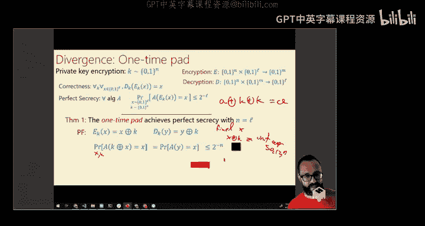
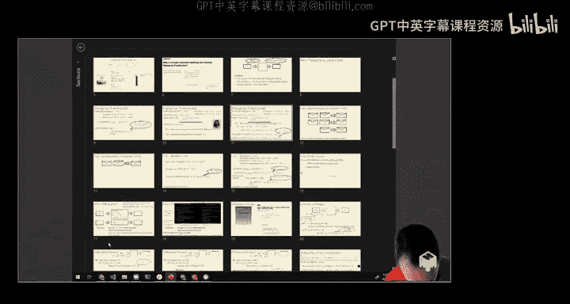
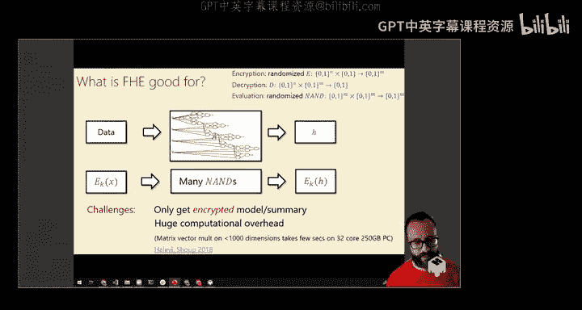
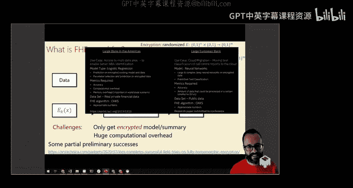
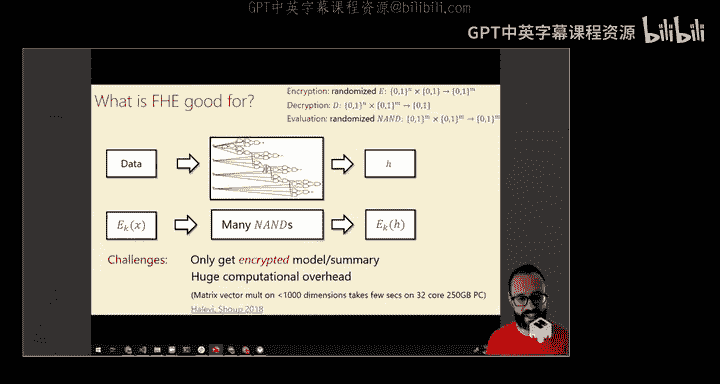
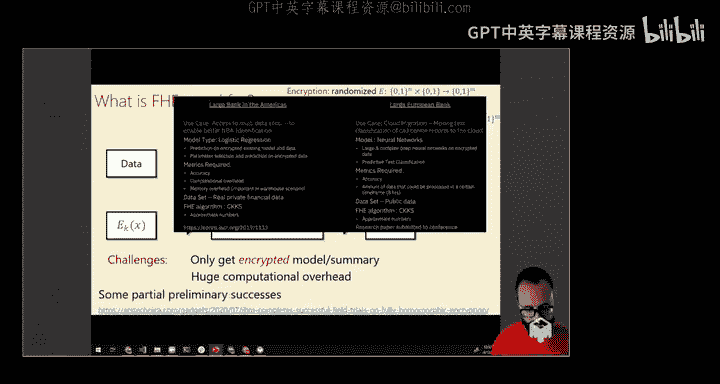
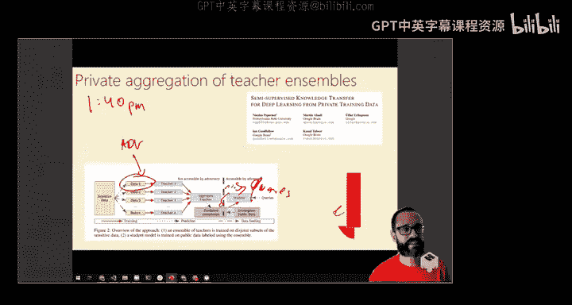
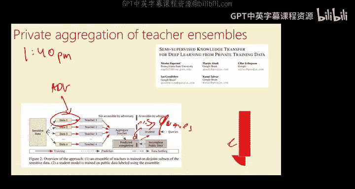
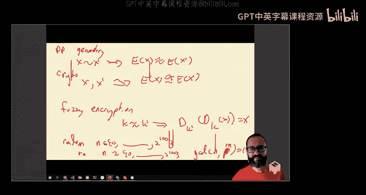
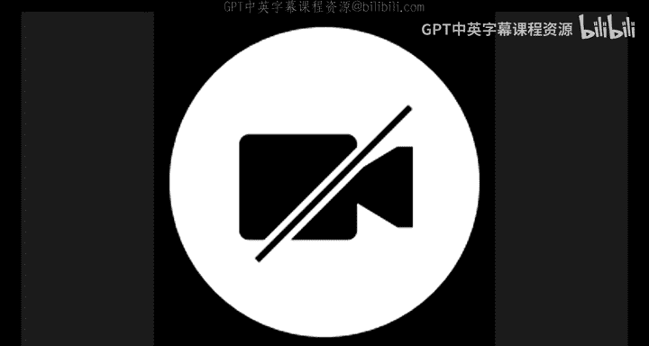

# 哈佛大学《深度学习基础｜Harvard CS229br Foundations of Deep Learning 2021》中英字幕（claude-3.7-s - P7：Lecture 7.zh_en - GPT中英字幕课程资源 - BV1f4XCYZEMx

Hands downHey， boys， can you tell us the weather while you're at it。Yeah。

 we're going to have some turbulence over here at Pretom and then I can tell you that galleys in Israel and the weather is much better。

😊，嗯。So today we'll talk about privacy。So。Learning and not just machine learning。

It can be sort of as the following。I have some data。We。Play some algorithm that。Learn from this data。

 from this training data。And。Then comes up with something that something could be。And model。

 it could be some summary statistics， it could be some you know， some some data about the。

Could be a classifier， a generative model， summaries of the underlying population， but something。Now。

 typically。でえ。The training data that the algorithm used often could be private。

 so you might have an algorithm that uses say patient data in a hospital to try to determine what are certain risk factors for disease。

 you might have companies using their customers' data to gain some insights or come up with machine learning models。

And you might have universities using student data。

Typically the data could be private and this is an issue because sometimes this age reveals more than we wanted it to reveal。

And there have been many examples of this。So went and。

Latania Williamm whos now a professor in the government department here showed in 1997 how some publicly available summaries that were supposed to be non personal。

 I think were。Some medical data that was。Basically on a number of people that visited and I guess was。

Some medical logs where they said the zip code， maybe the birth date and the gender or sex and。

She crossed it out with some vote list and managed to get it。Then。

Medical records of the then governor of Massachusetts。And。

And she showed that this crossing out of different data sets can be a general concern。

And in the Netflix， that Netflix Pri。In 2006， I believe Netflix published an anonymized。

A subset of its users rating in order to do a prize for finding the best machine learning algorithm to predict whether people will like the movie or not based on their history。

But it turned out that by crossing these ratings with the IMDB database。

 you could deanonymize the people in this data set。And more recently。

 Colinaal showed that certain machine learning models。You can extract from them credit。

 so you train a language model on a data set， for example， on the N1 email data set。

And you can extract information such as credit card numbers and social security numbers from the trained model。

 so the trained model remembers more about its data set than we wanted it to。And。And indeed。

This is even the case if you use selling machine learning as a service。So even for example。

 if a company trains。An algorithm on the data and doesn't release the model。

 but just gives people query access to the model， it can still be the case that through queries to the model。

 you can reconstruct the model or enough of it and then go back and even reconstruct the data or parts of the data from the model。

And sometimes you can skip the middlemen and just form queries。

 you can reconstruct parts of the data。And one example of a paper。

 a recent paper that is this paper by Colin Eal。Where they show that using black box queries to GPT3。

 where the queries had the form of say you're given some kind of an address and a prefix and then it spits out。

Some personally identifi information that it has seen in its really large that has said that it was trained on。

 so they show that you can extract all sorts of information。

 very specific information that you might not have wanted the language model to memorize。

And some of them could have been okay。But some you would really have prepared。

That the model didn't recognize， including some personally identifiable information and contact information。

 etc。They also showed this tendency of the model to memorize。And is very strong。

 so even though you know GPT2 is trained on I forget how many hundreds of gigabytes of data。

 it memorized strings that appeared in only a single document。

So if a string appeared only in a single document， as little as 10 times。

 the model memorized the full swing with 87 length characters。And similarly。

 shorterest swings that appeared in more times。Another example of this memorization phenomena happens when Google translate。

 people notice that when you try to translate from languages that have a limited amount of data。

And you put in nonsense input the output seems to be kind of crazy。

 you would have thought that it would be a nonsense output where the output is some very specific and somewhat。

😊，Woeing sentences。And then。And one of the and the reason is probably that basically when you train the language model for Google translate。

 it memorizes some sentences， and particularly if it's a language that doesn't have a lot of source material。

 the Bible is often one text that can be reliably counted upon to be translated into many。

 many languages， so the model actually memorizes some sentences of the。

Sentences in the Bible and if it doesn't know what to do， you give it some nonsense input。

 it just spits out some of those sentences that it memorized。Okay， so what do we do about it？😡。

And this is the content of this lecture。So there are basically kind of three general approaches for solutions to this problem。

So。Crypttography can achieve what is basically。Essentially 100% privacy， it's not 1 hundred0%。

 it's  hundred0 minus。Something exponentially small， but we can imagine it 1 hundred0%。

 but it comes at a huge efficiency cost at the moment based on current technology and also some cost of control on who gets to see this information。

Differentential privacy is a very promising approach and Aco mentioned it briefly and it allows us to somehow trade like privacy versus utility where you give up some of the privacy。

 but getting some utility， the privacy versus utility trade off at the moment for say deep learning is not that great。

But potentially it could be improved and it's definitely not trivial。Euristics。

 there are some heuristic approaches and we'll mention one of them today intah that they try to get the best of both world kind of try to give you 100% privacy at the best efficiency and not lose a lot in a utility。

 but the problem with heuristics is that you have no guarantee on exactly what type of privacy you're getting and you might end up getting zero privacy so and we'll see that can actually happen。

So today we're going to talk about these sleep parts。Any， any questions so far。能。Everyone is fine。

 even uncle。Okay， so let me continue。So。😊，The first part we'll talk about protecting machine learning using cryptography。

So I'll make a brief divergence into the one time pad。

 which I'm guessing many of you have seen but it will be short and if you haven't seen it you really should so it's a good thing to see。

So what is the one time pad？So the one time pad is a private key encryption。

It takes us input some an encryption scheme is composed of an encryption algorithm and a decption algorithm。

 and both take as input a private key， which we'll call here and think of it as just a string of length n。

So the encryption takes us input this key。我所啊。And this key and a plain text message。

And it outputs a ciphertex。I see。 I didn't plan my。That will。嗯。Okay， so let's see and so yeah。

 so so let me so this is the key， so both encryption and encryption take a key。😊，And encryption。

It takes also a plain text message。And theption takes a ciphertex。ちです。

My technology is not really perfect。And encryption outputs ciphertext。😊。

And theption decrypts and gets back the plain text。

And the correctness of the encryption is that when you encrypt a plain text and you decry it back with the same key。

 you get back the same message okay so that's so far what I've said is not specific to the one time pad it' just generally for any type of private key encryption。

Now， in one time part， the property that it has is known as perfect secrecy。😡。

This is defined as follows one way to define it there's several ways to the equivalent ways to define it。

 but one of them is the following that if you choose the message at random and you and you choose the。

Kia random， the probability for every adversary， no matter what strategy it uses。

To guess the original message is at most2 to the minus l， which is the trivial probability。

 the one you'll get by chance。So basically after observing， so the game is the following。

 there is this encryption and it takes this input k。😊。

You take the secret message X and then you look at the encryption of x under the keyK and you let the adversary observe this。

And now that adversary needs to output some guess X prime。

So if the probability that x equals x prime is2 to the minus L， then we say this is perfectly secret。

 you cannot guess better than chance even so observing the。

Observing the encrypted message does not give you any information about the message beyond what you could have just guessed a priori just by knowing that it is of length L bits。

Sounds good。So most of you have your video off， so I don't really see if you're nodding or but so if there are any questions。

 please do let me know。ok。So。So one this is the definition of perfect secrecy。

 and now let's see the construction。😊，What if a is DK， great question。

 soaryt know the adversary doesn't know the secret key。So the averary gets its input to Cyphertext。

 but doesn't get the key。The key and the probability of guessing the key。

Is at most two to the minus n， right？So basically the adversary to guess the key。

 they would have to just choose a random random message and actually that shows a theorem that I will mention later that that can be shown to give this theoryorem that I will mention later that for perfect secrecy。

 it must be the case that n is at least L。😊，James， did he say answer your question？Good。

This is actually very important to so basically Shannon proved in 1947 or eight。

 I think two major theorems about information the cryptography。😊，And one is that this。

Cpher that was actually known before Shannon'sstein。

 but Shannon proved this CRM that it achieves perfect secrecy。

And it has the property that the size n of the key is the same as the size L of the message。

And the second theorem proved that every perfectly secret scheme requires。

N is at least L in particular， if you want。If you want to encrypt two messages。

 then you have to use two independent keys。And generally。

 the number of randomdom beats is at least the number of。Input in and。Inputts in the message。

 just one second。诶同啲。老兵。我喺我边。嗯。你说啊？只。好。Okay， so。So I'm back。😊，嗯。Okay。So yes。

 so Shannon proved that the one type had to achieved this pay secrecy and in fact。

 every perfectly secret scheme requires。😊，N at least L。

 and that's actually the reason why we say one time pad because you really need to use for perfect secrecy to use the key at least once。

And at most once， you cannot use the same key twice for two different messages。And then。

And that's actually a huge logistical issue if you think about it， suppose you want to communicate。😊。

Say for example， these days。😊，Typically， we would then。You know， share。

Sa with a secret key encryption， we would show maybe a 128 bit key。😊，And， you know， communicate。

Many gigabytes or even terabytes。So for practical reason， we really want the key to be much。

 much shorter than the message。And this is not just today， so in the 19。4 days。

Jinger Bill started a program in the。Whatever was the predecessor to the NSCA at the time。

To try to look at Russian encrypted communication and at the time the Russians were using a one time pad and the way they were using it。

 they were giving out books with the keys， you know printed books。

 I think maybe microfi books with the keys to all their operatives。

 but it was a huge logistical issue to have so many keys， so the Soviets were reusing the keys。

And I guess they thought maybe it won't be the end of the world if we just reuse the same pad for different messages。

And it turned out to be very bad for them because Jean and her collaborators actually found this out and they have used that this was known as the Verona project and was used。

To uncover， I forget how many， maybe 50 or more and。

Kga Bay operatives in the West including some very high profile ones。

 so yeah if you're using one time pad you better use the key only ones。And。And in particular， okay。

 so what is this one time priority， it's a very simple encryption scheme。😊，So the input is。

So the key and the inputs in the message are N bit strings。And。To encrypt a message X with the key K。

 you simply exel them together。 That means that basically for every bit of。

Of the output is the XO of the corresponding bits of x and K。

Just adding and them modluum and encryption is the same thing。

 so you use the fact that for every that a。X O K x O K equals a。For every bits A and K。

 right if you add one in one modulu2 it's0 modlu2。So a good question。

So typically the number of in practice。People use computational security。

And they use key that is much， much， much shorter than the message size。

 so the message could be so they use schemes where you can encrypt more and more and more messages with the same key and the key could be exponentially smaller。

And。诶。And I'm not sure， Perif， maybe you can unmute and say you a second question so the Shannon theorem that you were talking about where the perfect security can be achieved when K equal to L yes but is that security good enough even when K and L are small numbers because yeah because typically L is very large than K in real life use cases but if there was a specific use case where the message was always only 128 bits even if it was only one beat it would still be good enough if it was a fresh key because basically you would have no。

 I mean， if the message was one beat say suppose the message you know that someone is going to send a message if yes or no。

So already up priori， you have probability half of guessing the message。😡。

could not you could not hope for more， that's because you already know even without using any encryption that the message is even yes or no。

 but a perfectly secret encryption would not give you any more information apart from that。

Cart is the strength of this coming because of the hardness of the the modlo problem or is this some other lengthy notion that Shannon introduced as to why this is secure So so we'll see the proof in a second Okay why this is secure so but and it's very simple So so let's see the proof so。

So basically we're trying to look at the probability， we have some unknown function A。

And we try to look at the probability that a applied to k x or x equals x。😡。

So now the main point is the following， so if n equals L。Then if you fix x。

And now you look at this probability， this is a probability， say， taken over x and K。

And now suppose we first fix X。And now we take this probability over k。So。For fixed X。X。

 X okay for random K is just the uniform distribution。Over01 to the n。Because if you fix any string。

 and now you exate with a random string， you get all possible other strings with equal probability。

So there are many ways to see that one is you can just look at it bit by bit for every bit。

Say if it's zero， then you x zero with a random bit。

 then you get zero with probability half and one with probability half and if it's one。

 it's still the case。You get zero probability half and one probability half。so。

So basically these two are equal。Right， so so these two are equal。

just equals a probability statement and now this is clear that it is at most2 to the minus n because for any function f。

 if you apply if those two are independently chosen y and x are independently chosen then you can think of y as being chosen first and then you apply a of y and you get some fixed string whatever it is。

 but now you choose x completely independently and the probability that x will hit this fixed string is at most2 to the minus n。

Okay， so this basically is the proof。Os， so。I'm still figuring this out。Okay。

 so so this is basically the proof and。

嗯。你 is。

没ally bad。And yes， and we can equivalently describe this。We can equivalently describe this as a。

As in a plus minus1 basis， well K and x are strings in plus minus1。And the encryption of x with k。

 you take the product， so when you think of it as plus minus1。

 then because plus times plus is plus and plus times minus is minus。

 then xO becomes a product so basically it is we are multiplying x1 by K1 and x n by kn。

So this is clear。嗯。嗯，我 did你 do you。Eventually I'll figure this out。

 but I'm not sure if it will be today。Okay， so let me try to。

runun away from this as okay so and we can extend this by the way。

 so the one time pad and this is actually a point I wanted to make both these points are not just me trying to teach crypto in the machine learning course they are related to this Inshe crypttoist heuristic that we'll see later。

So and。So if the message and the key， if we wanted to extend the one time pad to say messages that are not beat。

 so one way to do it would be to extend both the message and the key。

So we could think of x and k as both strings not over say01。

 but over say the numbers between 0 and t minus1， and then we can just do the same encryption scheme where we apply the map that takes x to x plus k modular T。

But it is really important for the proof that the number of total number of keys is at least as large as the number of messages because otherwise we could not have had this property that a random encryption is uniform over the set of all possible messages。

 so if you look at messages that are not just zero1 but have more every coordinate can be more numbers。

 then the key also needs to grow。And this is the point we'll return return to。

So now we' are going to end this divergence， any questions about the one time path。No， okay。

 so let me continue。So now the main tool that we could use for private learning and it's actually a tool that can be used in many other learning applications is fully ommorphic encryption and there is also a very related notion that I'll not talk about which is multipart secure computation。

😊，So诶。What is fully ammorphic encryption so the idea of the following so if you think of an encryption of x as kind of putting x inside an envelope。

 then a fullyommorphic encryption has the property。

That you can take an encryption of x and an encryption of x prime。And。

Apply some operation to them that transforms it into the encryption of x and x prime。

So that's so the key is that we can do that without knowing the secret key。

 so obviously if we knew the secret key， we can decrypt。The encryption of x gets x。

 the encrypted encryption of x prime， get x prime and then encrypt it back and get computer end and get the encryption of x and X prime。

 but in a fully homomorphic encryption we can do this without knowing the decption key so there is a public algorithm that can take a ciphertex corresponding to x a sphertex corresponding to X prime and combine them into a ciphertex corresponding to the end。

 the logical end of x and X prime。And suppose that the x and x prime are bits， and similarly。

 we can do that for the or and the n。😊，And this is actually you know equivalent to saying that we could do that for the N operation if you have taken a course such as CS121 you have seen it if not it's kind of an easy exercise to show that。

You can use Nand to evaluate both all of and or a not。And basically。

 also if you have seen any kind of course on a theoretical computer science or a logic。

 then you know that this is what's known as a universal basis。

 that means that basically any computation you can express as just a combination of many， many nuuns。

Okay， so so now let's define formally what is a fullyliomorphic encryption。

So we'll consider the secret key variant if you look at the literature。

 you'll also see public key variants， it turns out that for fully ommorphic encryption the difference between secret key and public key is very minor and in fact you can usually translate between one form and the other。

So encryption。It's going to be now a randomized algorithm but it still has the same form now we will think of an encryption that we can reuse again and again and again with the same key for different messages so it has to be only computationally secure and that means that I can just think of encrypting a single bit if I want to encrypt many bits a longer messages just encrypt them bit by bit。

So encryption takes this input the key。And the message。And outputs acipher textex。

And it's going to be， as I said， it's going to be a randomized algorithm。Now， decryption。

It takes also as input， you know a key。And a ciphertext。And the crs back the message。

 a single beat message。So so far， this is the same as any other encryption scheme。

 but what makes a fully homomorphic encryption fully homomorphic encryption is that it has。😊。

A special additional algorithm， which is this evaluation。This is also a randomized algorithm。

 typically。And。It does not take the key as input。😡，We call this algorithm N。

 it takes an input two ciphers， you know cipher one。And cipher tomb。And it outputs some fer cipher。

So it maps。Two encryptions into another encryption。And the idea is that， yes。

 he does not get a secret key and the idea is that。😊。

This will be you're taking an encryption of x and encryption of x prime and you're outputting an encryption of the nuand of x and x prime。

And specifically。I'm going to use a slightly simplified definition。

 but generally the idea would be the following so first we have the normal notion of correctness if we dec what we encrypt is we get back the same thing and then we want this evaluation and evaluation we want the following thing and it turns out this is important that。

😊，If we are encrypt B an encrypt B prime and we apply this non algorithm。

Then it corresponds to the same probability distribution up to exponentially small statistical distance。

As if we just apply the Nand， which is the not of end operation to Bnb prime and then encrypted。Okay。

 so we want these to have say total variation distance exponentially small in end。And in this。

In the context of foliomorphic encryption， I'll kind of not distinguish between exponentially small in n and exponentially small in Scrotton or some other power of n。

😊，Different schemes of different security properties， and I'm not going to go into that。Okay。

 so the Nand operation takes two Cyphertext and produces a Cyphertex that looks like the encryption of a nuand of the corresponding plain text。

And now we have the computational secrecy and I'm going to talk only about the definition for one bit。

 but the main point of computational secrecy is that this is preserved even if we get several samples。

 Delta TV is a total variation distance I mentioned it's like maybe five lectures back so but think of it as the two probability distributions are the same if you want。

😊，They basically says that you could never distinguish between the two。Is that a is that good enough。

 Sam。Good。周恩。So computational secrecy， so it's a computational secrecy right so so what does it mean it's computational secrecy。

 it means that we are only looking at in。😊，So computational secrescy means that we are only。

We we only。And consider algorithms that one in feasible time。

 let's say feasible here is at most exponential and again not clear if it's exponential in n or in squaret n let's not worry about that so for every algorithm a of time that is you know significantly smaller than exponential in n or squared n。

😊，The probability that it guesses the correct message is again not better than chance。

 so exponentially small to chance， closer to chance。

And so you cannot distinguish between encryption and zero and encryption of one。

 and that's even if you have seen many， many other previously。

 exponentially many previously previous encryptions with the same key。

So that basically means that this is as good security as perfect secrecy in practice for。

Anyone that doesn't have exponential power of computation。Okay， so FAG is a very cool concept。

And if you're not completely pressing the computational secrecy， you can just think of it as this is。

😊，Basically， as secure an encryption that satisfies this notion of security。

Sharing with someone an encrypted string。Is as good as not sharing with them anything at all。

 it's basically completely hiding it's 10% privacy。😡，So any questions about this definition？Okay。

 so how does the evaluation Blake， how does the evaluation criteria ability to form land connect to computational complexity？

So。Eat。I'm not sure if it immediately connects to computational complexity。

 except this main thing that we know that if you can have that the number of times you will need to if you want to evaluate a function。

 say a more complicated function on，安三面。On some input。

 then the number of times you will need to evaluate it will be professional to the complexity of this function to the number of NN operations that are needed to compute it。

And I should say that this is kind of a simplified definition of FAG。

 if you look in the literature you might see more complicated ones。

 and for while NN is a universal basis， it's not necessarily the most efficient basis for practical operations。

 so practical fully homomorphic encryption， although right now this is not this is a little bit of a contradiction in terms。

 but practical systems they don't necessarily work with bits and don't necessarily work with NNs because they try to directly do more efficient computation on numbers。

 just for overhead reasons。😊，Okay， so what do we know about fully homomorphic encryption yes and I want it was meant to add a lot of references here and I didn't get to。

 but there are some surveys and I can put in the slackla some surveys on the。What's known。

 but basically the big breakthrough happened by when Craig Gentry in 2009 showed that for a long fully homomorphic encryption exists。

And the reasonable assumption that was really a huge thing because for many years people really people asked this question。

 does it exist or not， but many actually suspected that there is some fundamental reason why something like that should not exist。

And then gently show that there is is really no fundamental reason and that。

Produced really a flurry of works by。Bakowski Vi Kunattan and Gentry， Levy。

 and many other researchers。And which and。ItEventually got to the point where to show that FG exists under standard assumptions。

 basically this learning with error assumption that is by now very central to cryptography。

And there have been also some work on implementations。

 so there is an implementation age lead from IBM and implementation from Microsoft。And then。

So you can actually run it， but it's kind of slow right now it's not yet。You know。

 the overhead is quite significant， but it's not。It's not completely theoretical。

 it's something you can actually run。And now how can we use it in the context of learning so let's go back to this issue。

 we have this data we have。This algorithm a and we have this that produces this hypothesis or summary age so what one thing we could do is the following any algorithm。

We can express it as just a combination of many， many land operations。

Because any algorithm is ultimately just doing many， many simple operations。

 which we could use NN to express。So now what we could do is we could take an encryption of our data。

Apply you know， express these finger as none so we applied the operation for evaluation and then we could obtain encryption of age。

So we could do all of the learning on encrypted data。

 we could take encrypted data one the whole training algorithm spit out and encrypted the model。😊。

And there are two challenges with this approach， so one thing is that we only get an encrypted model。

😊，So now there are lots of fancy cryptographic tools to make queries to encrypted models。

 so you could potentially even make some queries to this encrypted model and release in a very controlled way。

 whatever parts。😊，You want or maybe even encrypted model could be good enough if for example。

 the data and the model belong to the same party so they just wanted to make sure that whoever does the training doesn't get to know any private information but this is an issue you only get an encrypted model and another issue is that this is huge computational over it and frankly in machine learning we already are when we're doing training at the very edge of our computational capabilities。

So even an overhead of say， factor 10。Will be。With people probably a deal breaker and or at least possibly and the overheads here are more like a million or something like that。

 so for example and probably some people here know better to。

To get an understanding of what this example means。

 but say the latest optimized version of that I saw of foliomonmorphic encryption。

 which was really optimized to try to do arithmetic operations very quickly so it can to do a matrix vector multiplication on。

😊，Something like 800 dimensions。It takes them a few seconds on a PC that has 32 codes and 250 gigabytes of memory。

And this is not the most expensive preparation in the fullylimorphic encryption。

 then there is something known as bootstping which is。😊，A whole and you know。

 another order of magnitude more and one or two orders of magnitude slower so I don't know if there' is anyone practical here who can say roughly how slower that is compared to。

What you expect a matrix vector multiplication。I don't know。

 but I'm guessing that you know GPUs do usually like much much cheaper pieces usually do many more。😊。

Ma we expect the multiplications per second then。But then。In any case this is a significant overhead。

 but it's not as if this is completely completely theoretical。

 there has been some work from an example from IBM at using fullyliomorphmmorphic encryption for exactly these type of questions like doing learning on private data。

 so theres two works on logistic regression and neural networks and they exactly did these type of things of using fullyliomorphmorphic encryption for learning so it's not。

😊。

It's not completely。It's not completely crazy， but right now it's really not ready for most applications of say machine learning。

B yes what is the main computational bottleneck， what is the step that takes such a long time computationalally so basically。

In fully homomorphic encryption， so that goes kind of a little bit into how this is done。😊，So。

So there are two two issues so first of all you typically need to expand by quite a lot and then there are very smart techniques to try to minimize like the most naive version I think。

Of fullyliommorphic encryption might take a single bit。😊，And expand it to maybe a large vector。

 an integer vector of several hundreds， maybe even thousands of dimensions。

 so that would be like a huge memory overhead and that will translate into time overhead。

And even more clever things that people do are still have quite a significant overhead。

 so they basically map these numbers into large。Large integer vectors that are used for these lattice based assumptions and I'm guessing that this is by the way why they needed a 250 gigabyte memory PC to multiply matrix1000 by000 matrix。

So Boaz， which which of the expansions are sort of fundamental because so for something like。

 you know， just searching for an index in a database for like private information retrieval。

 there you need to expand the sort of complexity of the， you know。

 the algorithm and of the inputs to have any hope of privacy， right？

So I don't think there are any low bounds showing you what is fundamental in some sense。

 so I don't know if there is any low bounds in particular， for example。

 I think you can show that theoretically thinking，You could have essentially zero asymptotic overhead because what you could do is you can encrypt all of your data using the standard private key encryption that doesn't have any overhead。

And then using a fullyomorphic encryption just encrypt the private key。😊。

And do the decryption on the fly so thept， but the problem is that evaluating private key encryption homomorphically that becomes really。

 really slow and very very painful so people don't want to use that。

 but this is something you could in principle do。😊，so颖。Yeah。

 but this is actually a benchmark that people have looked at， I think， how long does it take to say。

 perform an AES encryption almostmorphically？And an AS encryption is something that every web server does。

 I don't know how many thousands of millions times a second。

 and I think last time that I saw it took a day or a week， maybe a few hours。

 so it's very significant。And then there is another thing which is this。

When the computation becomes more complex， then you have to perform a step known as bootstping and that is typically expensive in its own right or known as wiing or bootstping and it's expensive in its own right。

 but this is a very active area of research。And the。Already in the it's say 11 years since January。

 I think we have lost， people have managed to reduce many orders of magnitude， so there's。

I have no doubt that the research will continue and we will see more improvements。But right now。

 at least， I guess FAG cannot be used for most applications， at least large scale applications。

So the average contender， which I think is actually can be used and is used。😊。

Is differential privacy and actually Harvard is one of the main areas of strength in differential privacy。

 we have a large differential privacy tools project headed by。Is Seil van。Gary King， I think。

And many of the large companies， I think Apple and Microsoft。

 Google have all incorporated differential privacy to some extent in their tools and in their work。

And there is a great book by Harvard Professor Cynthia Wok and A Wolff。

About the differential privacy， so this is。Kind of like the canonical text of this field。

 which has know all the mathematical details。So now I'm going to the second part。

 I'm going to talk about differential privacy。Maybe just to see。

 was there any other question about crypto before I moved to differential privacy？No， okay。

So what's the differential p about and we I think those of you that are in Amcos class have seen it a little bit。

so诶。So we think of the data again， the let's think of it the data as a set of data points by training samples。

And we think of the case that say XI is the data that belongs to the I person or individual of someone who's purchasingsing want to protect。

And the idea is the following so we look at any kind of mechanism that takes data as input and spits out something。

 it could be a model， it could be some summary statistics。

 it could be anything and we say that this algorithm is epsilon differentially private if。

And I'll say it first somewhat informally and then more formally。Informally。

 if the posterior probability。😡，That say X I is in x after observing age is more or less。

Up to a factor of e to the plus minus epsilon， and whenever you see this。

 you can think of one plus minus epsilon。So诶。So after a factor of you know E to the plus minus epsilon。

 it was the prior probability， so after observing age you don't really know whether I was in the data set or not more than you did before you observed it and more formally this is the following so we look at any two data sets that only differ in one coordinate so this denotes the symmetric difference。

So we look at any two dozen sets that only differ in the。I've coordinate in。

And we look at any possible output of A and we want the condition。

That the probability that a produces this output is up to a factor of e to the plus minus epsilon the same as the probability that a on x prime produces this output。

So whether or not？I was in the data set will not change。

The probability of age will not change the probability of seeing some output age more by more than a factor of one plus minus epsilon。

 so this is the definition。And we'll slightly generalize it in a second and one of the things we can see by here is that for this really a。

 we have to talk about probabilities and what is the probability over the probability is over the randomness in a。

😊，So a must be a randomized mechanism， so it cannot be some deterministic algorithm that just spits out a statistic that will never satisfy this definition。

And so so and in fact， we're going of do this。Well slightly generalize the definition。

 we'll say that you know for every set S， this is basically the same for every set S。

 the probability that a of x is in this S is the up to plus minus epsilon to the plus minus epsilon。

 the same as the probability that a of x prime is in this set S。

And sometimes we also add this notion or this additive delta。

 and we call this epsilon delta differential private。诶 but诶。

We'll usually focus here on the Epsilon case， but so you can kind of think of delta equals zero because typically when we use Epsilon Dlta differential privacy。

 Delta is much smaller than epsilon。Okay。So in。So the way I see it is the following thing。

 so suppose I want to sell to you， I want to convince you to contribute data to my training set when I'm using a differentially private mechanism。

So you are afraid， for example， to contribute data to my data set because you are afraid that maybe you will get some kind of a bad decision。

And what I can tell you is the following if I'm using a differentially private mechanism， then。

You will not suffer a bad event。😡，Because you contributed your data to the data set with probability more than one plus epsilon times the probability that you would have suffered it anyway。

So say for example， to give an example， suppose that someone。

Asks me if I'm willing to contribute my data to some experiment that is going to determine whether or not short people are less likely to return their loans。

And I could be very afraid because as a result of this experiment。

 maybe people would not be willing to lend to short people。

 but that might happen regardless of whether I joined the data set or not so that doesn't affect my differential privacy。

 but what I can know is that，My own， no one would be able to say determine my height or have some bad outcome on me personally with higher probability。

 or at least not significantly higher probability because I joined the data set。Okay。

 so so there is a very nice。😊，Guarante you that basically you are okay。

 you do not suffer bad consequences， or at least you almost don't suffer bad consequences because you decided to join this deficit set。

And then yeah， so this was this example。And then but it cannot prevent you from any bad consequences sequences because someone collected some statistical data。

 which might make sense。And the first question that people ask when they see this definition。😊。

And that was also a question that I think was raised in Ans lecture。

 why do we have this multiplicative and why not just had an additive？😊，Constraint。

Why do we not just ask？😡，That the probability of ax in S is at most the probability that Ax prime is in s plus epsilon。

 why do we insist on this times1 plus epsilon so the multiplicative is stronger。But why is the week？

The additive guarantee not enough。And the example is the following。

 so think of the following things so suppose。I do the following thing that my mechanism。

 what it does is it takes。The input x。And it just chooses some K random subset of this input and just spits out their entire data so it basically。

I call this usually the sacrificial La strategy where basically I take this data set that I was given and I just decided to spit out to choose k random unlucky people and say。

 okay， you guys。😊，You have lost all your privacy I'm going to sp out all your data。

So this is definitely not perfect it。😡，But if you think about it。

 the probability that if you look at x and x prime。😊。

If they differ in one coordinate with probability at most K over end that coordinate will be one of those chosen and if it's not the one that is chosen。

 then the output。AndThe output of a of x and a of x prime will be the same so this will satisfy the additive definition。

 but it's very much not an algorithm we would like to call private so that's why we don't like the additive definition because it allows us。

To it it will。It will allow us to call private algorithms that are blatantly non private。

Is this clear Any questions。Okay， so that's why we use this multiplicative approach。

And it also has some very nice properties。 So for example， we can prove that if。

A is epsilon differentially private and a prime is epsilon differentially private。

 then if we look at the mechanism B that releases both the data of a and the data of a prime。A crime。

Then it is epsilon plus epsilon prime and differentially private and this is not hard to prove。

 you just show that you know for every two possible outputs and data set that differ by most one。

 then the probability that these pair of mechanism equals this pair ageH prime it is most。

E to the epsilon times the probability that the first mechanism equals a e to the epsilon prime times the probability that the second mechanism gives。

H prime。And so we get e to the epsilon plus epsilon prime。In the end。Yeah。

 and this is the upper bound， of course the lower bound is symmetric。

And we also can show that differential privacy is preserved under processing by this。

 I mean that if you take a differentially private mechanism and then you apply some function on the output。

 it is still private and that's very intuitive。If age was private。

 then whatever you do to age should not be less private because it doesn't reveal more information and indeed you can prove that you can say。

 okay， the probability that f of AX equals age is you just sum up over all the pre image of age。

And you look at the probabilities， each one of them， you know it grows。

 but the most factor of e to the epsilon， so you get this e to the epsilon。

So these are just two nice properties of differential privacy and there are several other very nice properties。

 which is why this has become very popular and influential notion。so。For example。

 one kind of guarantee is that at least if you use differential privacy。

 something is not kind of blatantly broken， so we could say that say a training mechanism is completely broken if say given the model we can completely recover some data point some training sample。

Or broken in the notion of privacy and you can show that if a mechanism is。

Epsilon Dlta differential privacy， then you can bound the probability by at most。

 say epsilon over n plus delta where one over n is the probability that you could have just guessed a training sample without seeing anything。

And诶。And yeah and this kind of notion is known as membership influence attacks and it actually can be used。

 so these things are real and the mechanisms that don't use differential privacy。

 you can actually do that you can recover whether something was in the training set or not。

So now before we talk about learning the deep models， I'd like to talk about。😡。

How do we do differentially private statistics？So suppose we want to publish some estimates。

 so we have some functions of the data。Say F until FK and we just want to know the sum of these functions on our data sets。

 so we want to get estimates that are close to the sums， but make sure that we respect privacy。

So again， just make sure that we are on the same page， we have some data set X。

And we want to know something like， you know the sum over all x。

Right so the sum over all x of say F1 of x and the sum over all x of Fk of x。

 so you can think for example of something like x is the set of all the data。

 the private data which is all COVID cases in Massachusetts and maybe F1 is one if x corresponds to someone that is a resident of Cambridge and a professor at Harvard and you want to know how many of those total are in the data etc。

So you could ask， you know， sums。They seem to be actually privacy protecting by nature right they are summing over the entire database。

 maybe we can just publish them。😡，Why do we have to worry so much about privacy if we just want to know the total sum of you know people with I don't know。

 people that own two cuts and a car in the greater Boston area。

 that doesn't seem like it violates anyone's privacy to know that this number is， I don't know， 41。

223。So let me give you kind of an example， it's a hypothetical example this is not actual but just to give you an example how you could publish these total statistics and you're actually violating privacy so suppose we published the statistics of say COvid 19 cases positive COviID 19 cases in Cambridge in a certain day。

😊，And we said something like， you know， there were 30 cases in Cambridge and 29 cases。

Of age less than 70 now each one of those individually right。

 each one of those individually looks fine。 you're just kind of giving a large number。

 but you can already deduce from them is that there is only a single。

Larger than 70 coVId in positive case。In Cambridge， right？You still don't know who this person is。

 so that's good， but suppose you also did something like say in addition to this you also produce something about pre-existing conditions。

 so you said you know there is 12 cases with liver disease but only 11 cases if you also restrict to aged less than 70。

So now you know that this person that is larger age higher than 70 and is has a co。Positive。

Covid 19 test。我 also had a liver disease。So now if you learn that your neighbor that is over 70 tested positive。

 you know that they have liver disease， so you have violated their privacy while only spitting out。

Only spitting out kind of large sums。RightAnd notice that these sums they could have equally have been instead of 33。

000， it's less about the sums themselves and more about the difference between the sums and it's kind of how to determine so the simple heuristic of saying we are not going to publish a statistics if it's less than five people or less than 10 people or even less than 100 people doesn't necessarily protect people's privacy。

Any questions about this example or。About what we're trying to do。Okay。so。

So here is how we can do it actually privately， so let's assume that just for scaling。

 let's assume that each one of those functions for each input x， it's a number between0 and1。

And the Laplace mechanism basically just adds noise so it's。It takes the sum， the two sun。And and。

Yes， yes， so An is saying in the chat that one way that way back in Google。

 there was the way that they protected privacy for internal workers that they didn't give you out a query to answer to a database query。

 if it had less than 10 records。😊，And but as we can see in this example。

 this is this doesn't really protect privacy this is。😊，And as he said。

 this is an example of the inclusion exclusion rule。😊，so。

So the Laplace mechanism is we simply add noise so we add we take the real sum and we just add noise to it according to this Laplace distribution Laplace distribution is basically just。

You think of as exponential distribution， but you can also have negative sides so it's asymmetric exponential distribution。

 the probability。Of getting the value x， if you are with parameter B， lapplace parameter B。

 then the probability of getting the value x is exponentially small in x over b of the absolute value of x over B。

And which means that basically this is roughly the standard deviation。A two factor two or square two。

 who cares？So this parameter k over epsilon is roughly the standard deviation。

 so we're basically adding noise that is roughly on the order k over epsilon。😊，And in practice。

 this standard deviation of say square n when n is the number of records that you have will be typically acceptable because that's。

Probably will be the amount of statistical noise you anyway have in your data。

 assuming these end samples came from some larger population。

So typically that would be kind of acceptable。And the main theorem is that the Laplace mechanism is in fact epsilon differentially private and this is。

嗯。Yes， and you should see the walk of paper for all for all the references this theM I think was ever approved by the kind of seminal differential privacy paper of。

And now I don't remember the full offers if someone can put them in the chat read them out because they do deserve credit。

 it's a great paper or it was in one of the predecessors and that paper generalized it to function that are not just sums。

So let's just focus on a single F because by composition theM， if we show that for a single F。

 we get like epsilon over K differential privacy， then by the composition， it means that for KFs。

 we get epsilon differential privacy。😊，So just for notation。

 we'll write f of the data x as the sum of all the little x in capital x of f of x and f of the data x prime as the same sum over the records in x prime。

And notice that you know， if x and x prime are different by at most one record。

 then because every F is the value is between0 and1， then you。

You develop a value like that and you add a different value。

 the most you can change the value of the total sum it will be by one。Yes。

 and the paper is by the work McSin Ni Sims and Smith from 2006， thank you Danielen。And by the way。

 Daniel probably knows more about this than I do， so feel free to chime in if I'm making any mistakes。

So and。你。Now， the probability with this mechanism that we output some value V is going to be。

You know， we are going to add， so if this is V。Right and this is f of x。

Then the probability that we output the value of V is going to be exponentially small in Epsilon。

So if we focus on the single case that when k equals one， this is simply one over epsilon。

So this is going to be proportional to e to the minus epsilon times the absolute value of the difference between V and f of x。

And know。If we move to f of x prime， then because we have this。

We know that this is going to be u most。You know， you know， when we move from F of x to F of x prime。

 we add at most one。Right， so F of x prime。is in f of x plus minus1 so at most we added this extra factor of epsilon and this is exactly what we wanted to show that this is at most difference of e to the epsilon and the other direction follows in the same way we just put you know we can also compare f of x prime to f of x so that shows that this is differentially private。

Absilent differentially private。So this Laplace mechanism and can achieve。😊。

Absolutely differential privacy for any F that has this property that if you shift the data。

 the input by at most one， then the value of F shift by at most k。

 and this is known as the sensitivity of F and that was definition made in this work make shown in the Sems Smith paper。

And。And this Laplace mechanism is very， very popular and in fact it's so popular that some people get confused and think that the Laplace mechanism is differential privacy。

😊，But it is important to remember that differential privacy is a definition。

 the Laplace mechanism is just one approach to achieve this definition。Ah， good question。

How are we reasoning about the probability equal right。

 we should really talk about the density function and take integrals。😊，So yeah。

 when I say probability that f of x equals v， I really should say this is know the density function。

 and then I'll take some integral and show that for every set measurable set， this will be the case。

😊，Okay， so I kind of show this point where for the density function and therefore for every measure we set the probabilities will differ by most effect of to the epsilon James does this answer your question。

😊，Okay so yeah so people sometimes look at this laplace mechanism and they just think of it this is basically the differential privacy and they say differential privacy is the same as adding noise。

 so adding noise is a very common approach to achieve differential privacy。

 but it is not the definition of differential privacy not necessarily the only way to do so。

And in particular， we can also use a noise distribution。

 but we can also do things that don't look exactly like adding noise。😊。

And in other noise distributions will typically get not epsilon differential privacy。

 but epsilon delta， but it is not going to matter that much。

So now if you want to do deep learning with differential privacy。

 there is this paper by Abadi etal that has shown an approach to do so by basically injecting noise into stochastic gradientdiian descent。

So the idea here is that you replace a gradient step with a noisy gradient step。So we add noise。嗯。

Now is the gradient the gradient step and we they also use this idea of clipping the gradient so if this is too big。

You you know， you also click。嗯呢。嗯。Okay， yes， and here LI is the loss。for诶。For the I batch。

And the sensitivity of this will be roughly be over and where sensitivity is。

So B is the batch size n is the total。And is the total number of records in the training set？

And then LIC is the gradient for any particular sample and it's going to be clipped at the values to be no larger than C。

And what they is shown is that basically you can achieve differential privacy， Epsilon。

 and let's say very small enough delta with say a constant level of statistical error which sigma。

 which will be good enough。我问。Kind of good enough for accuracy。

As long as the number of steps is smaller than the ratio between the mini batch size and the total training set size is squared。

AndThat's kind of that's。That's not bad。And they achieved something not trivial。

 but it's also not that great， so they showed that for example。

 for MNist we don't have to dig into it， but basically we can if we allow our epsilon to be kind of big so here it's epsilon is。

😊，You might not be able to see it so let's say epsilon is roughly eight so we can achieve something like I don't know。

😊，90 and99797% or something like that。 So this is not great。 Epsilon equals 8。

 It kind of means that maybe。And if an event could happen to you without the data。

 now that you join the data， it could happen to you with a probability that is larger by a factor of e to the eight。

 which is kind of large， but it seems like that in practice this even kind of large。

 epsilon prevents blatant privacy attacks。And for C4 10， the loss was much more significant。

 so you can see that roughly accuracy is around it kind of 70% mark。

 so you kind of lost like 20 points in accuracy even when you allow epsilon to be eight。So basically。

 the more gradient steps you need to take， the worse this becomes because you need to add more and more noise。

And there has been some work about how in practice does it mean。

 and one of the things they've shown in this paper that even when you use kind of a very large epsilon。

Like epsilon， which equals 89， which seems like completely nonsensical。

 it still seems to give some kind of some types of or even epsilons that are。😊。

1 you know10 to the eight or 10 to the nine it still seems to give some kind of bound on memorization and protect against certain memorization attacks and i'm not going to go into it but just。

Just a point that like even larger epsilon can sometimes give some practical benefit。

So don't say immediately you see like epsilon equals five or 10 or whatever and immediately say。

 okay， this is definitely nonsensical， this will have no practical consequence。

And there have been other ways to try to do differential privacy differentially private learning。

 not food this noisy SGD which scale better so there is this private aggregation of teacher ensembles Paate that。

We the differential privacy you kind of use in。And you you use。

The student makes differentially private kind of noisy queries。

To the the teacher to learn the data and you can allow yourself maybe less noise and they have shown some better performance at least on Mist with smaller epsilons so you can do you can do better and there has been some work on trying to scale that。

And some of it， I think， is a little bit more heuristic， but you can still get。

You can kind of get some decent things with not too huge of an epsilon。

 but it's fair to say that this is still we don't have as nice epsilons as we would like with as low a overhead as we would like。

And by the way， another thing that people have looked at in differential privacy and have。😊。

Criticize with differential privacy is that these types of models in。

areThey protect against privacy loss from the final model。

 but they don't necessarily protect against privacy loss， say if some adversary attacks。

 say infederated learning， if some adversary attacks， say one node。

So people have also tried to look at this into this case and tried to look at privacy。

If that adversary doesn't just get the final model。

 but also gets information about say the gradients， the intermediate gradients。

So there are more works to do so。And。And this is basically what I wanted to say about differential privacy。

so。Are there any questions at this point？Are there ways to combine this differential privacy approach with the previous amorphic encryption approach？

So I think I don't think people have done so I guess the problem is that。Trying to combine this。

I think one of the main issues with vmorphic encryption is the efficiency issue and once you pay that。

You know， once you pay that efficiency issue， it's very hard to see how you could combine this approach if anything without paying that price。

Yeah， I was wondering like would it be possible to like， for example。

 apply homomorphic encryption to part of the model and then differential privacy to the data itself so that like someone has access to。

Like whatever parts of the model aren't encrypted。I'm not sure if this makes sense。

 It's more like an ensemble like learning where like you have some of them are encrypted。

 Some of them are not that way。 like you can like have like a。

Trade off between privacy and computational efficiency。Yeah。

 I don't know I mean I think this could be interesting。

 but you have to kind of worry because for example， if you're。

If you encrypt part of the data then for the people so you've talked about part of the model so that's different。

 but say if you're encrypt part of the data， then it could be an issue but maybe for example you could imagine that you say you use differentially private training on most of the data and you have kind of low accuracy and then you use fully amorphic encryption on a small amount of the data but without any noise and to try to boost the accuracy so I could actually imagine potentially。

Some approaches， you know， for example， it could be the case that you could use the differential privacy with kind of large noise to learn a model that is not so good's say has suppose this model has。

😊，70% the accuracyC on the。On a CFF and now you want to boost accuracy accuracy maybe what you could do this model still at least it knows maybe what it doesn't know so now this model could potentially go and label and tell you which samples from the training set。

Which samples from the training sets are the ones which it had the most difficulty with and maybe now you could just train on those samples and forward a little bit。

Different noise distribution， I haven't thought about it food， but I could imagine situations where。

😊，You could do clever things I'm not sure maybe somewhat this becomes like the teacher student model or but maybe you could use FAG in some form。

 so I don't know basically。Sort of a similar question， piggybacking off that。

 kind of going in the other direction。In FHE what you showed these very strict bounds right on what the adversary can distinguish here we have these configurable trade offs。

 is there any sort of approximate。😡，Not approximately homomorphic， but approximately encryption。

 so to speak version of FHE where you have a configurable trade off of。😡。

Sort of cost for how difficult it is for your adversary to。😡。

Break through what their probabilities of distinguishing messages are。😡。

So I think we don't exactly know but this would be a very good question and maybe to some extent the Inhe schemes which we will talk about after the break is a little bit trying to get to do this type of thing。

And but without any rigorous guarantees and we will see that the lack of rigorous guarantees is an issue and this particular scheme actually happens to be broken and whether someone can find something else that's not broken。

 it's still like an open question。😊，Interesting， thanks。So if there are no more questions。

 maybe we'll take a break until 140。啊。上退。Actually， could I ask a question， yes， yes。

For the homomorphic encryption， what is the sort of real world advantage of having a。

Encryption like that。Be homomorphic。So I mean， this is very attractive to people not just in learning。

😊，For example， you know any kind of cloud cloud soourcing outsourcing application to the cloud。

 you would be very happy if you could say send you data， first of all。

 you typically you want to store your data on the cloud and you want the cloud to be able to process it。

 but you don't want the cloud necessarily to know it so if you could upload your data to the cloud in an encrypted form。

And the cloud could perform all sorts of computation on it and then send you back the encrypted results。

 that would be very， very useful so people are actually。😊。

If you had a very low overhead fully homomorphic encryption， people would have been very。

 very happy with this。😊，Okay， that makes sense。Hey， Boas。 so like the。

 the term fully homomorphic seems to mean that would suggest there's also partially homomorphic encryption。

 And in that scenario would that mean that certain operations are preserved and not others。

 would that just mean that like the operations aren't always like a math properly。Yes， exactly。

 before fullyullimomorphic， there was partially homomorphic。

我哋明天。

The one thing okay， never mind this let me not share right now。

 So before fully amorphic divorce was partially a monomorphic， for example。

 maybe you could do not end end or but only end or something like that or you could do typically it was more algebraics。

 you could do you could do if product or some， but not both products and sums。

And there are still different versions of partially homomorphic that could be useful， for example。

 maybe you couldn't do all circuits， but only circuits of a small therefore or only evaluate low degree polynoemias and things like that。

嗯。So would there be way， I guess like instead of doing it only on Ngates。

 if you did partially homomorphic encryption， would it be like are there certain operations it might be fast drawn and then you can maybe like if you have a different universal basis for all your logical operations。

 you can focus on those。So the fully omorphic really means a universal operation。

 so actually amorphic， they don't do universal， so they cannot do all functions。😊。

Then and the typically the types of restrictions So the two types ever say think of an algebraic setting。

 So either they could do only classes， but not times or only times。

 but not classes so they cannot do both or they could do both。

 but then they are limited in the degree。 Maybe they can do only polynomials of certain low degree。

 that's typically the type of things that are more efficient。 I see is there like a huge。

I guess the computational cost in the actual encryption process itself because I understand there's like computational cost in doing any computation towards the encrypted data like going from the normal data to the encrypted data is that also very expensive So I think it's not super expensive but but it does have overhead like so right now I think it just how expensivesive。

So if you're trying to do this work on truly massive data sets， then expansion。

 you even if expansion by a factor of two。can be or definitely expansion by a factor of say 10 or 00 or something like that could could be quite difficult。

 could be very significant if you're trying to encrypt a data set of some several gigabytes。

10 gigabytes and you're trying to you ultimately want to do all of in the GPU。

 if your encryption is suddenly10 times bigger， that's a problem。

And the encryption itself is not often， but sometimes it's also a trade of the more the encryption is simple than the higher the cost for the evaluation and sometimes it's also there is some trade of where basically you could do low degree polynomials。

😊，But at some point， when you want to do a polynooral5 degree。

 you're going to pay a huge computational price， that's this kind of bootstping。And then。

And if you want to make this price lower， then you need to make the operations on this low degree more expensive。

I see。 So then in that scenario， probably wouldn't make sense to like。

Let's say you want to do some sort of like a neural network operation where you're multiplying and adding。

 So then let's say you have two partially homomorphic schema， one that preserves multiplication。

 one preserves addition。 So first， you take the data encrypt it， do the multiplication。

 De encrypt it and then encrypt into the additive homomorphic schema。

 I guess the problem is that you also need the key to decryed right and that's typically don't I mean。

 you don't want to give the key to the trainer。 that's， that's true。 Okay， that sense。Okay。

 so let's take a break until let's say。Let's take it1， 10 minutes break。 So let's do 1，43。

Okay， so let's get back to so I'm going to talk today about going to talk in this part about heuristics。

😊，And then。And then basically， the idea is to try to avoid paying some of the price of differential privacy。

But at the moment， we don't really have great heuristics。变电。

And we'll see one example that we do have the issues with this example。唔见。其须。

So yeah and please do ask me any questions by the way I see a ask the question do you want to unmute and ask the question out loud。

😊，Yeah， it' sure。So we can think of the key and the 11 pad as being drawn from like the uniform random distribution。

So D and the one1 powderder are both instances of information and security。

Can you kind of interpolate between the two of them by。

Relaxing the perfect secrecy requirement in the one time pad or should we think of them as being in two different families。

Yeah， I think it's probably better， at least from the way I view it。

I think it's probably better to think of them as being different because one way to think about it is that the one time pa generally in cryptography。

We really don't think of any structure in our plain text message。

 we don't think of it as a data set we don't。So we don't think of it as having any any type of structure。

 we just think of it as a string and the secrecy we are try of it we are trying to protect and we don't think of necessarily。

One bit of that swing is being more important than other bits。

And the whole idea of differential policy is that it only really makes sense when you think of this data set as coming in several in many pieces and each piece belongs to an individual so you have this notion of two similar data sets that agree in everything except one individual so so I think it's very hard to。

To talk about to compare them because。The type of secrecy that differential pi gives。Is诶。I mean。

 typically， if say you're giving out the average salary。

Even a noisy version of the average salary in your training data that's information that's something that we in the encryption we would view it as a failure of encryption。

 but in differential pi we say this is okay because for an individual in this data set it doesn't give a lot of information about their personal salary so it's kind of they're somewhat incomparable I hope I'm making sense。

😊，O， thank you。Okay， so in。インスタ入る。So inside is they attempt to try to get the best of both worlds and have efficiency and protection。

 maybe even stronger than differential privacy， but have it as efficient as plain insecure learning。

😊，And the inspiration， I think for insight is a little bit like FHE。

 so you want to somehow encrypt your data， but they want to maybe have some type of a kind of a fuzzy encryption or like quasi encryption that would be maybe not as secure。

 but one would hope that would be good enough for the privacy application and would play really。

 really nicely with standard training。😊，So so we have these challenges with FAG and they want to address these challenges。

 so the idea of Intah is they do the following thing so they take this learning pipeline and they try to augment it。

And while this particular approach。It has been broken。

 it is not completely clear that nothing like this could work。

 so this is still a very interesting approach。So what advice to do is to augment。

This by some kind of an encrypting or obfuscating or step where basically it takes this secret data。

And it combines it， we combine it with some public data to get this new kind of call it encrypted。

 but it's not really encrypted data， and we use that。

With the training algorithm which is left unchanged。

 the same training algorithm and the hope is that it will still give a good model， a good classifier。

So we hope that we can encrypt the original data into a form that is privacy preserving。

 but is still good enough to train on。So why would we think that？So first of all， this part。

Good enough to train on is at least something we can just check in practice right so this is not something you know it ever works or it doesn't。

 but we can find this out we can。Try and approach and see and try empirically and see whether we get good results or not。

And the problem here with trying to encrypt the data， the original data is that at least。

 I guess my view as a theor is that。😊，To do that， you would have to define what it means。😡。

To encrypt the data and you would have to prove that it does so or at least give some kind of an evidence that why it is reasonable to hope that it satisfies this definition。

But at least in the Insag version and the current version there isn't really a definition and that's problematic。

 but there is definitely a notion which is what we hope will not happen so maybe before I move to this but definitely what so there is no formal definition。

 but at very least we would like say no no recovery attack right so we would like no recovery attack。

It shouldn't be possible to reconstruct the secret database from the encrypted database database if you can do that efficiently。

 then I think no matter what the definition， we can kind of agree that this is a security failure。

 but ideally I would like to have a better definition and right now I don't think there is one and the intuition why someone could imagine that something like that is possible is based on the mix up data augmentation strategy。

😊，So the idea of the mix up that orientation is that。You can actually combine。

Neer networks are strange and you can actually say do the following thing so you can take say an image of a cat and an image of a dog。

😊，And combine them into this kind of image that is a you know， 70% cat plus 30% dog。

And ask the neural network to give you these probabilities。😡。

And it actually not only doesn't degrade training， it actually helps with training。

And the hope with Inshe was that maybe if you mix together。public images and private images。

 and then you do one extra thing to them， you will actually be able to get the benefit of the private images in terms of helping you train better。

 but still protect their privacy。So let's see what Ins for us to do so the idea is the following so you mix together four images say I mean you can have like different parameters。

 but let's say four images， two from the private data set and two from the public data set。😊。

So you mix them with random coefficients， Lada 1 to Lada 4， and then you do one more thing。

 you flip the bits， the signs of each pixel randomly。Right so each pixel you can think of it as。

Some value RGB， which you can scale to being in minus1 plus one。And you just flip randomly the pixel。

So you think of the vector x as in minus1 we' scale it， so it's between minus1 and plus one。

So more formally， so what we do is we take four samples， so x1 and x2 come from the private train。

X3 and Xfo comes from the public set。And we mix them together with some random coefficients to get random non negative coefficients to get x prime some coefficients。

 some up to one。And then we obtained。Xtilder by multiplying every coordinate of x prime with a random vector of plus minus1。

Now， what does this remind you know， what does this look like？Did' someone say。

 what does need to remind us of？Yes， one time pad exactly。

 so this looks superficially at least very similar to the one time pad。

 but notice that there is one big difference。😊，Which is these Xs。X prime I is not。

It's not a case that this is in plus minus1， that would have been the one time pad。

 whether it's in the interval minus1 to plus1。And we will see that actually makes a big difference。😊。

So this is inspired by the one time pad and they have shown at least the one part that there are two parts of this heuristic one part is that it doesn't degrade performance by too much and the other part is that it keeps privacy。

😊，Lambdas are just random summing up to one， random between0 and 1 summing up to one。

 so it's a random convex combination of the random convex combination of the four images。

So they have shown that。It doesn't really degrade accuracy that much so in terms of the performance it's a good scheme the question is security and this。

Later paper by Colinate all showed that this is actually you can attack Instahde and it is actually insecure and they gave basically a complete attack so the Inst Hyde authors put forward 5。

000 encrypt encryptpted images。And。They obtained the original private images in under and hour on a single machine。

And I forget how many GPUs did this machine have and whatever。ok， so and。

What's the attack description so let's we again we call what is Instahe so Instahe is this we do these two steps we take four random images。

Let's just use red for the private images and green for the public images。😊，We think。

A convex combination of them。 and then we multiply the。Resulting vector by plus minus1。

So the first observation of the attack， and I'm guessing this must have been known before。

 but it's still a nice observation。😊，It's a very simple one。

 but it turns out to be very important that if you do this map。

 you multiply every coordinate by a random vector in plus or minus1。

 this doesn't change the absolute value。😊，RightThis is kind of obvious once you see it right so if you multiply coordinate by random plus minus1。

 you didn't change its absolute value so given this multi you can still recover so we can recover we can ignore say this part and just think that we have obtained the absolute value of X prime。

😊，As the attacker， we can get from thet that the absolute value of x prime。

 so we might as well just think that we got the absolute value of X prime。😊。

Notice here that this is a big difference where I said that this X。

That there is a big difference whether X is in plus minus1 versus if X is in the interval plus1 minus1。

 this is really bad。So if you know， if Xi was either plus one or minus1。

 then the absolute value of this vector x will be the all ones vector。

 it will give you zero information， nothing whatsoever。😊，But if this is a vector of real numbers。

 then the absolute value is still not reveal amount of information。

In particular what happens if you look at images so suppose you have this original image and then now you take every pixel you take the RGB values and you look at the two options ever flip。

You know flip randomly design or take an absolute value。

 so if you flip randomly design and you just look at it visually。For us as humans。

 it doesn't look like it contains a lot of information。

 but in fact it contains all the information about the absolute value and this is from blog post by Colina and so if you take the absolute value。

 you see that you maybe not recovered the original image completely but you actually kind of know what the image is。

😊，And if you think about it， it kind of makes sense in particular，18 of the pixels。

 say the R G and B values will happen to be positive。And then you take the absolute value。

 it will just be the same pixel and then for the others you could still kind of see some colorss。

 et ceter。Okay， so this is the first observation， but this just shows us that the second step doesn't necessarily protect as much as we we have hoped。

 but we could have maybe still have have you know maybe it still adds to some security。

 especially when it combines with the first step so the fact that。

We can recover the absolute values of X primeme doesn't mean that we can recover the actual private images。

😊，But still， it's not necessarily a good sign。So let's think about the inside encryption so let's imagine that this is the private data set。

😊，And this is the public one。So every Inhe image is obtained by taking out two privates and two publics and combining them together。

So now if two Insde images share the same private image。

Then they would have some type of an agreement right they are obtained by a convex combination which one quarter。

 roughly one quarter of this combination has some agreement and even after doing absolute value。

 there is still some type of an agreement。And it turns out that it is possible to figure out whether two encoded images share an original image。

 so they've shown that basically you can train neural network to do a similarity function and succeeds with like 90% accuracy or 95。

 I forgot。To in recovering whether a pair of。A pair of encoded images share the same original private image。

And you can do something simple and do maybe I think 70% accuracy。

 but you can get 90 something% if you train in your network。So using that。

 you can obtain basically clusters where you can cluster the train images， so let's say the blue。

 these are the encoded images。😊，So you can cluster together all the encoded images that came from their same original private image。

And actually。At this point。You have more or less done。

 more or less completely killed the security because you kind of expect that if you're going to average this cluster。

 you're going to get basically the absolute value， the image of the absolute value of the original private image。

 so you might not if you take an average， it might not allow you to kind of reconstruct this。

But it will allow you to reconstruct the absolute value of this。

 which would be enough to somehow know essentially break the privacy of this original image and indeed。

Carolinni told me that before they did a full attack。

 they also tried to just take this average of the clusters and they got something that looks pretty good in terms of the dataset set。

 so this is the image he sent me。😊，So。But but suppose you want to do a full reconstruction then what they do is the following so you can use that to basically recover the encoding graph so you you basically can figure out for each encoded each encoded。

😊，Image， you know if to encode the images share the same the same original image so you can kind of construct an abstract graph or these are the images you know。

And these are unknown。But you know the edges， you know you know if say these encoded images。

 which two you know you can call them abstractly you can say， okay。

 this is image number 17 and you know everyone that was connected to number 17 and based on the labels actually that you obtain in installstahe these labels。

You can actually even figure out the numbers you know what were the weights of the of these private images。

 so each encoded the image you can think of it as being basically。Of the form you know。

 some Lada one for say if this is x tilda， some some particular encoded image。

 then you could know that this is。Equal to lambda 1 X where this is known to you Lambda 1。

 but this is unknown。And similarly， you know Lambda2 is known to you。

 but x2 is unknown and then there is some unknown noise so you can we can treat the public data set as simply just adding noise。

So basically now what we do is just realize that what we have done is if we write this as the Geny matrix of graph。

 we basically have managed to reduce the problem to solving nonlinear equations。😊。

So we're trying we have these。If the dimension of each image is an n dimension vector， then we have。

0undd n variables so each private image is corresponds to n unknowns and each encoded image gives us a nonlinear equation and we have 5。

000 of those so we have many more equations than unknowns and then it turns out you can run you know even though these are nonlinear equations you can use gradient descent to try to solve them and it turns out that they are kind of nice in enough form that gradients descent actually succeed。

And basically， completely breaks the。The scheme， as we've， as I mentioned before。So basically。

 they have managed to completely decode。We the original scheme and showed that。

know this is not secure so to me， I can think the message from this is that if you want to replace differential privacy or fully homomorphic encryption。

The first thing you need to come up with is not necessarily a construction， but really a definition。

 something that makes sense that is a definition of security that you think。

Could actually give you something meaningful， could prevent at least the reconstruction could an attack and still give more room for things that are maybe more efficient than differential of privacy。

But at the moment， I don't know of such a definition。So any questions？

What if we just don't reuse the images， great question。😊，AndSo this is a great question。

 so basically in the in the context of。😊，Of Inhe， I think if you were not。

Going to reuse the messages。Then诶。You would simply not have enough。

So I believe the idea was of insight is that you want to do these many， many gradient steps。So。

If you were to， if you say had100 private images。And every private image you would use a public image with it。

 then it means that basically the public data set needs to be larger than the private data and you're really only training on the public data so in some sense。

At some point it becomes you might as well just not use the private images at all and then it becomes you know then of course you can you can train on just the public images but then what's the benefit right so if you're not so it's an issue and it's also not completely clear to me that even if you didn't reuse the images it would be secure but that's a great question。

And。So another question， does differential privacy prevent reconstruction attacks in addition to membership inference。

 yes， so differential privacy， I think under like very natural assumptions。

 distributions will protect from a membership reconstruction attacks。

Me inference is usually an easier version because you are given the member and you just want to know if they were in the training set or not。

 so reconstruction is even stronger。And。And Lucy ask whether there is a good metric to whether an image is visually recognizable。

 that's a very good question I think。😊，I've seen very recently someone in the context of adversarial perturbations trying to use neural networks based distance measures between images to try to argue when two images are similar。

AndSo I don't but I don't know if in privacy people have used。

 but you could imagine trying to use neural networks themselves as some kind of a distance measure between two images to say whether you have recovered。

But this is a good question。So Pan if noise was proportional to the sensitivity of the linear combination query for inside。

 would it be better to prevent？Reconstruction， okay， so。So， let's show。I think。

If you were to recombine the private image with tons and you not for。

 but some very large number of public images。🤢，Then maybe you could prevent。

you could prevent the reconstruction。But I have a feeling that at this point it will stop being useful and。

you're almost not using the private data set at all。

And also it might be at the point where mixup will stop working because you'll basically get like some kind of a uniform distribution over the classes。

 so it's not going to be very meaningful。prediction。Yeah。

 that was useful but is did you have an intuition when you said if there were a many。

 many public images that you're adding instead like is there what exactly is blowing up like maybe combinatorially or what are you thinking for some other reason it makes it harder So I mean if if if you had say you know single private。

Plus many， many public， right？Then it seems that if you add like a small amount of noise that is relatively small compared to the whole sum。

 it could kind of swallow out the private part。So you could imagine at least that this would be。

 say differentially private。The problem， I think with that would be that unless you had。

very large number of classes then by this point kind of I think the mix up heuristic will longer the mix up augmentation will no longer help it will start hurting you。

😊，Because this will just be the uniform distribution over all labels or something like that。

 but maybe if there is kind of like an exponential number of labels， I mean。

 I could imagine some some type of thing like that but it also could be the case that in such a case。

😊，What you I mean。There is a very simple， differentially in the private public setup。😊。

There is a very simple super 100% private system， which is just don't use the private data set at all。

 only use the public so whenever you look at any kind of heuristic you want to compare it against this baseline。

😊，And one to ensure that one way to ensure that you're not cheating in this way is if the public is kind of very small and the private is much larger and you couldn't get the same accuracy。

😊，You would not be able to get the same level of accuracy without using the private data set。

Or maybe you know the I mean maybe more realistic would be if the public is in some different class and the private is like say it's kind of transfer learning so the public is maybe tons of data but it's not data from the distribution that you really care about and the private part tells you maybe the distribution that you really care about but in any case。

We need to kind of compare with against this baseline。

I'm a little bit doubtful that once you start using tons and tons of public， you or not。

You're still getting the benefit， but it's a good question and I don't know。Sure， yeah， thank you。

 that was a lot of interesting thoughts， Thank you。Any other question。Yeah， just to be clear。

 what is it the attacker gets to observe in this scenario。

 the encoded training set right so in this scenario this was the In high challenge they gave the encoded training set。

if there was， I mean， you could imagine another version where the encoded training set is used to train a model and you get access to the model。

Since there are a lot of kind of model inversion attacks。

 it's unclear that that would kind of save you。So。So I would I mean， it seems。

It seems a little bit like would be a little bit of a wishful thinking to think that if you got the model instead of the encoded images。

 that would protect privacy because there are kind of quite a lot of model in version attacks text。😊。

我 so。So it seems suspicious， but I think this is a question that people。

 I think probably are looking at or have looked at。😊，Thank。Any other question。If not。

 I think we' will finish early today。Yeah， yeah， I wanted to mention this this thing where basically this is。

😊，This is some work that have've shown that you can use black box queries to reconstruct the parameters of a model。

 so even if you just have black box access to the model and even maybe not necessarily tons of queries。

 you can often reconstruct。で。You can often reconstruct the parameters of the model so that。

So basically maybe to kind of summarize。Typically， you have like you have your data you。

You have your data， you have your training algorithm。

And you maybe model and then maybe you have your queries to the model。

But often if you're not using things like differential privacy or crypto， you using the queries。

 you might be able to or even with crypto sometimes without differential privacy， using queries。

 you could get the model using the model， you could get the data。😊。

And even if the data and we say In， from the data that you trained on。

 you could also get the original data that was private。

So this is basically privacy in learning is still not a solved problem。

So any questions about anything at all？One more question for thevan。

Hhole between cryptographic and differential approaches。

the cryptographic view we have this kind of bit level privacy it's a very discrete view in the differential privacy we have a probabilistic view are there people who work on。

😡，Sor of a continuous view where it's not。😡，Big level cryptographic guarantees。

 but you sort of try to formulate these things in terms of the reals or in terms of continuous quantities where。

😡，Protecting basically。😡，Smaller differences matters less than larger ones in numeric scale。😡，Yeah。

 it's a good question，'。嗯。I think。Yeah， I mean， I think this maybe the way to think about is is differential privacy has kind of a geometry。

😊，We're basically。In some sense it's a little bit about protecting small differences where basically you want to say that if x is close to x prime。

 then the so-called encryption of x should be very close to the encryption of x prime。

 but if x is far from x prime then we have no guarantees。うん。And。And crypto basically right。

 and crypto will say something like。😊，For any x and x prime， the encryption of x should be really。

 really close to the encryption of x prime essentially identical。

So it doesn't really care and it's not about necessarily if there are bits of numbers。

 but it's really about like there is no geometry in crypto and in differential privacy。

 there is kind of a notion of geometry。嗯。The places where I've seen some kind of a geometrymetric we used in crypto。

 there are maybe they have said probably more than one， but one was there is a notion of fuzzy。🤢。

Fuzzy encryption and fuzzy extractions and there the motivation is a little bit different。

 but there is something in some notion of geometry。

 the idea is what if for example you want your cryptographic key to be some biometric measurement like your you know your iris scan or fingerprint。

😊，And every time you make this biometric measurement， you might get a slightly different。

A slightly different values so there you would want to say that if two keys are similar。

Then the encryption with the one key will still work。But you still have security。

If you cannot find a similar key， then you still have security that so that's one version of these kind of。

Fuzzy encryption name。For some the key becomes the fuzz part of like some password or something like that。

So really that fundamental difference of having some geometry on the so called encrypted space。😊。

That is what's encoded in differential privacy and it's just sort of the。😡，Right。

 so where basically you say it's okay if you can distinguish between two things that are far away because in some sense you want to be able to distinguish if you have two data sets and in one of them the average salary is you know 30k and in an the average salary is 100k then and you're doing some census on that you do want to distinguish so you don't want to protect that information it's not like an encryption that where you would not be able to tell the difference so you only want to protect the difference between two data sets that are close to each other。

That makes sense， thank you。没 sure。Any other question？

One other question so at some point you said when the total variation distance between two distributions is close by it will need a proportionate number of samples to be able to distinguish and if it's too close it's hard to distinguish practically speaking but have people I'm guessing I'm sure but have people being able to generate distributions to a target distribution like so I give a target distribution fully specified and I want to generate another distribution that is within。

诶Some。Amount of total variation distance so I specify a how much total variation distance it needs to be away from the target have people。

Had schemes to be able to generate something like that。是。So typically in total variation distance。

 you would need to somehow prove。It's very， I mean。

 total variation distance is kind of a property that if the distribution has any kind of a large domain。

 it becomes very hard to estimate。😊，But there is many cases， like， for example。If you generate say。

诶 you know， you you generate one may。say， a random number。And。

From the space zero to I don't know two to the 100。Or a random number in。

From the space zero to2 to the 100 condition on I don't know the GCD of n and some huge number。

 some huge prime。P2 B1 or not even p some M。SomeSome very large number that has large bio factors。

 then then you can show that these are two these two will have exponentially small statistical systems。

 so there are many places where you can prove。That two distributions have smaller statistical distance。

 but you typically。😊，In practical terms， it's very hard to evaluate statistical distance because it's。

え？Because you actually also need these number of samples to figure out what's the total variation distance。

😊，Right。I guess maybe there is like the pins curse inequality。

 but I guess it'll be the still the same answer， maybe it's easier but it's still。

Is it needs a good estimate to be able to do it in high dimension Yes so you need some estimate of a divergence。

 I guess that's right？Okay。Okay， so if there are no more questions will finish early today， so。

Thank you。Thanks， thank you。 Bye bye。

And sorry for the technical difficulties， I'll try to figure them out by next time bye。😊。

