# 哈佛大学《深度学习基础｜Harvard CS229br Foundations of Deep Learning 2021》中英字幕（claude-3.7-s - P8：Sham lecture.zh_en - GPT中英字幕课程资源 - BV1f4XCYZEMx

The will。I not than happy to have Sham Kaca to tell us a little bit about reinforcement learning and bandits and the generalization properties。

😊，Thanks， John。Okay， hii everyone， it's a pleasure to be here and to talk about a number of results in bandits and reinforcement learning。

I guess and MIT people are present。Okay， so。诶。There's been basically a revival of interest in reinforcement learning in the last few years and I'm going to be giving an overview of how we think about generalization and reinforcement learning and why this thinking is very different from how we think about it in supervised learning so in terms of logistics definitely ask questions that you know makes things more lively。

 BoAaz will monitor the chat do follow along with the slides because some of you might actually find this helpful so BoAaz posted the slides I believe on the website and yeah。

 so feel free to follow along with the slides it helps you。And okay。

 and in terms of keeping your videos on， it's nice to see some faces， so if it's all the same to you。

 I'm you know please keep your video on because it's it just makes it more lively for me。嗯。Okay。

 so there's been tremendous progress in reinforcement learning and why is it so important now。

 well this is really because it's the natural framework for how we think about interactive learning and as our machine learning is becoming more ambitious we're realizing that most of the applications we care about aren't just in a vacuum that we're interacting with the world and as we try to build a future these reinforcement learning questions are pretty fundamental。

So I'm going to assume some basic familiarity with dynamic programs and programming and Markov decision processes。

But let's quickly go through the standard setting。You know we have an agent。

 the agent' is going to take some action AT， that action will impact the environment。

 and when it impacts the environment， the state will advance。Okay。

 so we'll see the state willll choose an action and we'll get a reward。In terms of our terminology。

 we say a policy or behavioral policy is just a mapping from states to actions。

We're looking at an episodic setting where we start at some state S zero or S zero from some distribution。

 we act for H steps， our trajectory is just what we see， which is the state we see。

 then we take an action， we observe a reward， we get a next state， we take an action。

 we observe a reward and so on。Our objective is to maximize the cumulative reward over eight steps。

 So this is this value function。v派。Of S of H， so the semantics are I started state S。

 I follow policy pi， and that's my cumulative reward。There's another concept which is handy。

 which is sometimes referred to as the state action value。Or the Q value。

 which is rather than following pi for the first step， I deviate。

 I follow action A for the very first step， and then I follow pi。

 So it's like a one step look at ahead value function。Now what's our goal。

 our goal is to find a policy pie that maximizes our future reward starting from S zero。Okay， and。

Again， we're going to work in this episodic setting where we'll start it as zero。

 we'll act for H steps and repeat Okay， and some settings we might not know the model of the world。

So what are the challenges in reinforcement learning。

 so let's start there and then take it from there。So。Challenges， what do we face？Well。

 we faced the problem of exploration because the environment might not be known。

We face this credit assignment problem because suppose we。Somehow I got this reward of minus1。

Then what in the past， what actions in the past do we attribute to causing us to get this negative reward because we don't get an immediate feedback of someone saying。

 hey， at this location， at this state you did this incorrect action and this was the correct action that's not the feedback we get。

On top of all this， we have the coastal dimensionality。

 which is the state and action spaces can be very large。

 so this is this it's worthwhile checking out the video。

 I'm not going to play it here because I'm writing in PDFs。

 but openaiI did this pretty impressive demo， forget about the Rubik's cube solving。

 but what was impressive is dexious hand manipulation is one of the hardest robotics test because you have a high dimensional state it's a mix of continuous and discrete variable so the Rubiik's cube is a discrete configuration but the joint angles are continuous and your actions are also continuous the forces you apply at various actuators。

And we'd like to find a good policy in this setting。

 So this is the the coastal dimensionality is what we face。Okay。

 and how do we deal with that in machine learning。 Well。

 we think about this as a problem of generalization。 We're going to get。

 we're not going to see every possible cube configuration or every possible hand configuration and try every possible action。

 we like to somehow generalize from a small amount of data， for this interactive problem。 Okay。

 so now before I really give the layout， let's start。😊。

By basically just a whirlwin tour of generalization and how we think about this issue。

 and let's just review some basics of supervised learning before we turn the tables and move to reinforcement learning。

So everyone should be comfortable with supervis zing。

 but it's worth awhile to just spell things out explicitly and see why these questions are fundamentally different reinforcement learning。

Okay， so supervised learning in the most basic setting。

 you have this IID supervised learning setting。 it's possible。 What do I mean by that。

 It means if you have some hypothesis class， classifiers regressors。

What have you in an agnostic sense， it's possible to find something that's epsilon close to the best in this class with mild complexity dependencies on this hypothesis class so we have what's known as this Ahamzor bond is what sometimes people call this in learning theory。

 but basically you know if I want epsilon best in class。

 I only depend logarithmically on the size of the class why is this and this is fundamentally important because it means you can try lots of things on your data and try to see which one is best or epsilon best the end then is like various improvements to this based on like VC dimensions。

 it's more refined complexity notion， we can have margin assumptions in linear regressionggress you know we often have sample size that depend on the dimension rather than the log of the cardinality。

 but they're basically analogous and even in deep learning we're making a lot of progress understanding how the algorithm determines our complexity control so。

There's certainly many open problems in deep learning， and I don't want to minimize that。

 but there's a sense in which we do have a pretty good understanding of what's happening in supervised learning。

 it seems to work。And what is the key ID here？😡，Idea here， it's data reuse， right。

 When you get a training set， you can simultaneously evaluate the loss of every hypothesis in our class。

Okay， and that is the critical aspect of supervising right。

 something gives you like INe on any class of array。

 you can evaluate how good you're doing on this fixed data set。

Okay so now let's and I think I like to go downstairs for that so I'm just。

It didn't sound like a question。So。Now let's move to reinforcement learning and why is reinforcement learning settled well？

We don't have this ID training set， so what does it mean to try to。

To borrow strength from the data you've seen in the past to say evaluate a new policy。

 because maybe you can evaluate this new policy based on the data you've seen in the past。

 so let's start slow and actually look at the problem of reinforcement learning just in this simple mas task in this tabular case。

 we don't even have to worry about generalization so maybe Shai it's good that people understand that basically this whole issue in principle in reinforcement learning。

你一。If the state space is small enough that you can observe everything。

 then you don't have to then then it's not about generalization， right， It's not about。

But in interesting real world applications then you're never going to observe everything and then you have this issue of generalization and you have it in a more complex setting than supervised learning because your actions of consequences exactly yeah and of course like in real systems the actions of consequences regard to safety or robustness。

 various other factors and just reiterating where Boas says let's just look at this example。

 here are your states of the world are just these 25 positions maybe 21 because these walls aren't feasible states to be in。

And if you manage to visit all of them and try all the actions there， you basically know the world。

 Okay it might be a stochastic and such， but this is a case where there's no generalization。

 but even in this case， So this case， if you actually just drive your system randomly like suppose's four actions。

 you're fine， you learn the world but it's very easy to modify a setting where if you drive your system randomly。

 it'll take you exponential time to hit the goal state like suppose you know you put in five actions that all go to the left and one goes to the right then if you drive your system randomly。

 it'll actually take you exponential time to explore the world So even in this simple case where there's a small number of states if you're interacting with the world。

 it is not obvious how you can actually find a good policy because because if you drive it randomly。

 you won't actually discover things because you might not explore enough。Okay。

 and so in this setting， you know where everything is small here。

Or least the number of states and the actions is small。 and suppose our MDP is unknown。Okay。

 so the the first result just setting up the stage I want to mention is this really phenomenal result from Michael Kons and sitnder S quite a while back called really。

You know it was the e cubeed algorithm， but as the first polytime result where if you didn't know the MDP。

 you can actually find an epsilon optimal policy in a number of samples that scales polynomly in the number of states number of actions。

 the horizon and one epsilon okay and you cannot act randomly to do this so what do you do you actually give yourself a bonus and try to plan to explore。

So what'll happen is as you keep acting randomly， you'll discover some part of the state space and then youll plan to escape it okay and that's this idea of optimism。

 you're giving yourself a bonus to try to escape the region you know about and。

Since you know the model of the world in some part of this space。

 you can actually plan there accurately。😡，And this gives a polyton algorithm。And then from there。

 there's actually been really a plethora of work here， both on improving the rate。These two are。

Min Maxax Opti。I should really say asymptotically Min Max optimal in terms of these polyfactors and even that is very。

 very tricky in terms of probabilistic analysis In fact。

 getting it non asymptotically optimal might have just been resolved I have to read the paper。

 but' it's incredibly delicate to do these analysis if you actually care about the polynomial factors because of the dependencies in the stochastic process and then you know there is another interesting result showing you know Q learning is going suffer from the same problems if you act randomly but if you put a bonus you can make it to work and the first result that it's important to highlight here is this result from srail at all。

 which actually shows how you can do optimism plus Q learning and get it to work out and this recent result by Jane got the optimal rates。

 but the ideas were basically already present in the earlier results by s so this is just look in the tabular case the problems already challenging and。

😊，And sort of forgetting you know sharp analysis so before time just I mean in case maybe students students don't know queue learning maybe you can say that you know what。

Well I'll say a bit。 so Q learning， I say briefly about it， but。In the method I mentioned here。

 it's model based。Meaning you're estimating a model of the world and you're using that to do planning and exploration。

😡，Okay， one really remarkable result due to Chris Watkins in the， I think the '90s。

It an algorithm which is model free， because if you think about it at the end of the day。

 I don't actually care about。I don't necessarily care about learning a model of the world all I care about is finding a good way to act again Q learning is a procedure where if you look at the structure of the diamond program。

 then you can only keep track of this Q value and you're trying to in an online manner estimate Q star and I'll just say that and you can you know you can definitely read about it it's pretty it's a super elegant algorithm and。

There was asymptotic proofs of correctness， but actually getting a finite time was tricky。 Okay。

 but philosophically， this is an interesting viewpoint because。

Why do we care about these rightss because it's a very appealing to say that I can act optimally in the world without really understanding everything in the world well and and I think this is just from a conceptual point of view。

 this line of thinking of model three is very powerful， but in the other hand， it's subtle because。

I need to discover things in the world to act optimal。🎼There is a question by San。 Yes。

 what is exactly， actually， it's a good question。 not need to apologize What is exactly that we are learning that is epsilon clothes。

 we get Epsilon up to Epsilon optimal。 What does it mean。😊。

So is it mean basically after like we will get an eventual reward that these are utmost yeah okay。

 so it's a good question Thank you so to some extent there's two concepts that you might have there's regret。

 which is your cumulative reward is going to approach the truth。

 let's just look at a simpler guarantee that the goal is to。Find a policy pie such that。

V pi of s0 from H is bigger than v star of S0。Of H。

Minus epsilon because the V star is the max overall policy。

 so it's just something that from the initial state is epsilon close to optimal and if you're resetting you might care about regret。

 which is a cumulative reward but up to polyactos these are the same because if in a short amount of time I can find something epsilon close to optimal。

 then I can just play that policy for a long time too。OkaySo are we good with that？

there's a lot of different notions， but let's， at least in the R end。

 let's stick with the simplest version。I think it's clear。

 but thank it feel free to unmute or to Yeah， I this definition clear。😊。

So I think I understand the goal so the hypothesis classes are learn what policies there could be and you're trying to learn any policy that is sort of will have the the reward or like the cuumulative reward that's within epsilon Okay great optimal policy great so I think your question is I'll just bump up repeat your question and maybe generalize a little your question is really about you know what's the hypothesis classes here and how do we think about epsilon optimality when we have some kind of hypothesis classes it a value class is it a policy class and so on is that basically correct。

Okay， so that's my interpretation of the question and note in this case。

There is no generalization here。Okay， we haven't discussed a hypothesis class at all in our yet because this V star is truly optimal。

And the number of states， I said， is small。Okay， so there's a truly optimal way to act here。

 and that way here is probably something like this。😡，There are multiple ones that are good。

 but if there's no noise in this system， that would be good。

 but maybe there's movement costs or maybe you want to I don't know， like you need to go here。

 refuel or something that there might be other kind of costs but in this slide there is absolutely no generalization so we don't need a hypothesis class or how about class here you can think about as we want to be optimal this under the space of all possible mappings from states to action。

Okay， so are we clear there？Very good， so now let's set up this question about generalization。

 so the main point here is it's subtle even figuring out how to do this。

Due to the fact that the world isn't known， if it was known。

 we just do you know classic dining program。But the tricky part here is we're trying to behave optimally in an unknown world。

😡，Okay， so no。We're going to basically ask something related to your question that is there a sense in which we can find a way to find an epsilon optimal policy in some sense with no dependence on the number of states you know。

 like look at。This game of go， these are the types of things we want to solve in machine learning。😡。

We want to use these techniques on big problems。Okay， now let's ask an analogous question Rl。

 which is， is there some way we can reuse our data to estimate all the values of all the policy。

 say in some policy or value class？So now we suppose we have a parametric class of policies or values。

 and can we be epsilon best in that class？In some， so just maybe consider it a set of policies Okay。

 so can we find the epsilon best policy in some policy。Okay。

 so and can we do this in a way that doesn't depend on the number of states？Okay。

 and if you think about this， we need to reutilize data in some way， so the most naive approach。😡。

Is let's actually just collect a data set， so how are we going to collect our data set。

 a very naive thing to do is let's just act randomly for eight steps。Okay。

 so at the start of the episode， act randomly， repeat。

 act randomly repeat and we collect lots of data with random rollouts。Okay。

 why is this kind of reasonable， well with important sampling。

 this allows data reuse because now for every function F in our class。

 we can evaluate how good it is like it's a policy。

 why because just by chance you're going to agree with the policy。

 you're going to agree with some path in this data set。Okay， but the problem， of course。

 this agreement probability is like one over a number of actions to the horizon。😊。

So this is this the first kind of us。Algorithm， which we can generalize in the sense that we only depend logarithmically on the number of。

We only depend a logithically on the number of hypothesisses in our hypothesis class。

 but the drawback here is we depend on something that's exponential on the horizon why because。

You're acting randomly and we're trying to do data reuse， so this is just fundamental。Okay。

 let's come to the fact we're fundamental， but we've at least shown that this is possible we can get something with no S dependence and best in class。

And by the same kind of token as in。Yes， I mean it might be a little bit cheating in some sense because you could not。

 if you start from say the region at least in deterministic。

 you could not explore more than a to the age states so in some sense there really are at most a to the age states in the system because all other states are just unreachable。

 right？No， because so remember the wood could be a stochastic care。

So yes so I guess in the stochastic setting yes， and this is important because think of like like some contextual like you know。

 consider a high dimensional state， like if H is one， this is a supervisized learning problem。

Right so suppose h is one and there are two actions okay and there's a starting distribution over the states okay you just classify randomly you'll get feedback and you'll be able to reuse data so this a to the H is a genuine improvement because S could actually be infinite or uncountably Okay okay yes then then it's basically like classic generalization yeah this really is classic generalization because。

The world is stochastic。嗯。O。Right and the key point here is that because the MDP。Its stochastic。

And look， the stochasticity could even just be from the starting distribution over states because that's basically what it isnt suit by zoning problem。

 like every image is a state， whichs just you reset after you classify。Okay， and by the same token。

 you can do the same set of tricks by you can kind of replace log F with some kind of complexity dependence on the class like a VC of the policy class if there's two actions and this just like the usual cr。

Okay， but the fundamental question here is so'm not going to disagree with this being cheating I mean it's not but we can ask like is it fundamental and now I want to。

Kind of go back to Bo Bo's point that there is a sense in which this A to the H dependence is。翻只咩做。

Why is it fundamental well just consider two actions， okay so consider a equals two case。Okay。

 consider a binary trait。Okay the rewards at one node in your policy class is all possible deterministic policies you have  Q to the H policies。

 there's no possible way you're going to discover the rewarding leaf node unless you try them all。

Okay， so if you want to do best in class， you cannot beat a to the age。😡，Period。

For agnostic learning， so you can get log in F and A to the H。

 but that a to the H is fundamental for agnostic learning。

So this is kind of just setting up the stage for how we think about things and we immediately see a barrier in trying to deal with a hypothesis class and do agnostic learning。

So Shankkin you explain what you mean by agnostic。Yeah， so by agnostic， I just mean something like。

Epsil on D in class。Aggnostic said this is sort of with no。Assumptions on the MDP。

Aside from like bonded reward or something like that， like think of supervisorvis learning。

 we don't make as long as we have II， we don't make assumptions on the data distribution to be best in class。

As long as it's ID， we can find the best classifier in our class。

And here we might want to find the best， say policy and some policy class without making explicit assumptions on the MDP。

 and the point is if we want those sort of guarantees， we have to pay to the aid to the age。Okay。

 and maybe there was another question in the chat which maybe you just need to go a bit slower to so Kathy is asking why is this related to generalization。

 so maybe you want to again explain how this is really just a more general an extended setting of just generalization as we have seen in supervised learning。

😊，Yeah， exactly let's go back to say go or this this hand manipulation example。

 suppose you know sure there's an agent let's ignore that right。

 supposeupp we're trying to interactively learn to play this game。ok。

We'd like to do well without seeing every possible board configuration。Okay。

 so you could think of a supervised learning setting where a teacher tells you these are good board positions and these are good actions and then we're just trying to do classification right if a teacher is telling us what the right move is at every step。

 then we have a classification problem。😡，Okay， but this is generalization because we're trying to do well like we're trying to find a way that gives us a a high chance of winning without actually visiting every possible state in this world。

 so the number of states in this world is S。Okay， so that really is exactly like the analog of supervisone。

Are we？Canry clear there Yeah thanks also I have another question that is related to generalization so personally my understanding for like say reinforcement learning generalization it can have other meanings say for example for a robotics that is trying to track a certain object or like a certain location and even if I change the location or like the location is some like stochastic position that has like a probability distribution around the space then if I take this as an input then like general generalization probably means that even if my objective change the robot is still going to achieve the goal with relatively good performance and is it related to like the example of goals like are they the same notion in the sense of generalization so yeah let take the question this would be a question like you know there's。

There's kind of I'll call this a broader notions of generalization like suppose the world changes on you that you solve one task like this mas task and someone instead says。

 oh no I'm going to put the reward in a different location I want you to solve it and then maybe you want to solve that more quickly okay so there are broader notions of generalization when maybe the world changes on you or you have a different objective function and you could think of this more like transfer learning and things like that so just like in supervised learning we talk about transfer learning you could say transfer learning is generalization but let's start simple and just say for the problem at hand can we do it。

In a number with a number of samples that sublinear and S and after that we have all of the richer questions you're talking about。

 which is you know， we learn to pick up one object like you know， this coffee cup and。😊，You know。

 then maybe I want to learn to pick up another object like a candle or something like that that's a different kind of object。

or a piece of paper or something like that these are different objectives you might want to generalize as you switch。

 but these are richer like transfer learning and if we don't even know how to get generalization for the single task at hand。

Uh， you know， how do we even do these Z？Yeah， that makes sense， thanks。Okay。

 so the first result is a bit depressing here because。诶。

It really shows that in this best in class sense， we can't do A， like what would we want here？

So now let's refine our question again， we're thinking about big problems。

 we'd like to find some kind of epsilon optimal policy or best in class without say a dependence on the number of states。

 the number of actions and。A sample size that is polynomially in the horizon epsilon and some complexity measure of a hypothesis class。

Okay， so this is what we'd like to do。Okay， we already showed that agnostically this is not possible to get this poly H or best in class with a complexity measure that's like log in。

Okay， so that's a bit disheartening， it's not too surprising because supervising heavily relies on IID。

Shandra is another question in the chat just I think probably it was a typo the dependence on epsilon is probably not logoarithmic right it's not inside the logo yeah that was typo so unfortunately the thing doesn't know how to address。

😊，Yes。哦， ok，丹ny。SoYes， yes， thanks for much。This is the user or one of Epsilon squared in Hing bond。

Okay， so yeah， so you know， polylyps one of Epsilons fine， that's the statistical rate of things。

 all these things typically get poly1 over Epsilon， but we're trying to avoid either。

 you know what do we want to avoid doing we want to avoid a dependence that's a to the H and we like to do something where we don' we don't have to try every possible policy in our class。

ok。Agnostically this is impossible， but of course， like look， you know， as usual in theory settings。

 you just make assumptions， make enough of them， something will give and of course you can do it。😡。

Okay， so so we can just keep looking at settings of interest， sacking down assumptions。

 and of course something is going to work out， but you know。

 this isn't very satisfying here because what we would like to get a sense of is what's the nature of the assumptions in which generalization and RL is possible。

RightBecause we know we can knock down assumptions。

 but we also know they're necessary by this swift assumption。

 that's why I was good to start slow here to see why it's necessary。 Now。

 the question now is there is a sense in which。There's a style of assumptions which makes sense to make。

 or in particular like what are the sorts of necessary assumptions we need to make。

 because that's the CS theory style of thinking that it's very important for us to think about lower bonds here to see what types of things are necessary to do in order for us to generalize。

So now we're get。Does this question change when if instead of no SA dependence。

 you ask for logarithmic dependence in S and or it's basically the same basically the same thanks。

Yeah， so it's basically the same。All right， so。Yeah。

 so this is really the focus and now I've kind of， you know we give this worldwind tour of supervised learning and this worldwind tour of just。

 you know， if we want to naively extend that to RL， then we have this currents Mus or an in result。

 which is this trajectoryy tree method， really just important sampling。

 that's the best we can do with our stronger assumption。

Okay but those of you who have been studying RL there's like a ton of complicated assumptions and you know people might grumble like this area is so complicated。

 but one way to get clarity is start understanding what's necessary to make things work and then we'll see why things are complicated so this course is really about both necessary and sufficient conditions maybe not sharp but to really tell us why RL is hard and what types of basically distributional and representational conditions we need to actually do sample efficient RL。

Okay， so this would be the course and we'll actually start with linear bandit because。

Why don't we start with the kids where H equals one？Okay。

 so let's start with just bandits and linear bandits because when the horizon is one。

 it's still an interactive learning problem， but it just resets every step。Then we'll move， you know。

 and once we understand the issue goes one case， now we can make things harder。Okay。

 so now we're going to move to。The more general age case where we start looking at lower bounds。

And trying to get a sense of what's possible， and then equipped with that we'll try to see what is the style of assumptions that makes things sufficient。

And one thing I want to point out here is there really has been like tremendous progress in RL in maybe like the last five years or so。

呃。And。And actually today like you， I think I'll cover what I basically view as like two pretty big breakthrough results。

 like even in the last year， I view this lower bound as like a genuine breakthrough in RL theory and ML theory because it's one of the most natural ways we might try to attack RL and we've resolved this issue and I'll kind of sketch a simplified version of this proof。

 but it's really getting us you know， it helps us a ton in seeing why RL is difficult with regards to say function approximation and generalization。

Okay， before we get there， let's shout simple and look at linear bandits with H equals  one。Okay， so。

Oh， something to not advancing。Ex， not。

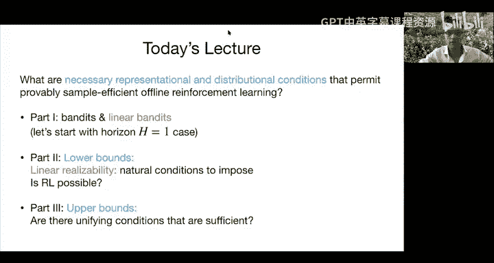

And as I mentioned。And Bos mentioned there， the slides are shared on the website。The slackla。

 the internet Sla， I'll put them on the website later okay on the internet slack yes。😊，And诶。Yeah。

 just to clarify， yeah， bandits is an equivalent right。

 bandits and reinforcement learning with age equals one is exactly the same thing， right？😊。

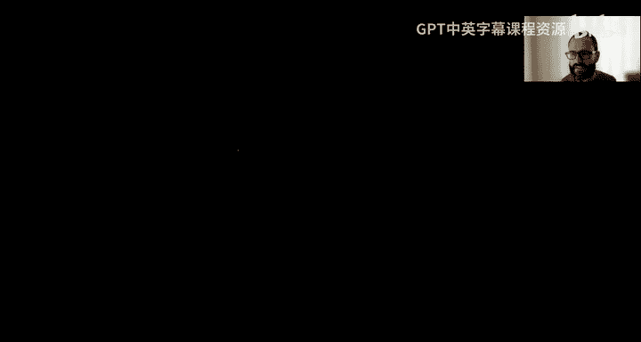

Yes。And it's still not the same as not the same as standard learning because you make a step and you learn the reward for the step that you made and then the entire world reset so you cannot go back to the state you were in and try what would have happened if you had made something else That's right just reset that immediately okay so why is this。

喂。

Okay。So we can get very change。O，那那那哋。Good so' setting the stage so you know we started two ofvis learning went to ourl basics now we're going to start with h equals one because。

You don't know the world， but you reset immediately。The classic paradigm for this is。Due to。

Lion Robbins， which is the。The famous multiarm bandit problem that you pull an arm like a slot machine。

 you get a payout， but you only learn about that slot machine when you pull the arm。

And there's been a ton of work in this setting with regards to Bayesian methods， frequentous methods。

 characterizing optimal rates。Okay， and this is a terrific algorithm or a set of algorithms in the the small action case so that it's experimental design So what do we do when the number of the number of。

Of arms is large or infinite。Okay， so let's think about dealing with the large action case so you know on the left we've got this this setting where we pull an arm。

 we get a payout okay on the right。We。You know think of like something more like zero order optimization or something that there's some underlying function。

 okay， and we're going to choose some x in our decision space。

 so in this particular picture our decision is a real number。Okay。

 and suppose what we'd like to do is our reward is going to be the function value。Okay。

 but we only get feedback about the function when we play X。Okay， so how do we actually， you know。

 what's a good decision making strategy because we have an uncountably infinite set of decisions。

 and you can think about generalization here is just trying to do well without explicitly depending on the infinite set of actions。

 and obviously we need assumptions here because if this is like unbounded discontinuous function if they're random function。

 we'll never possibly be able to do anything。Okay， so one of the most popular models here for handling this is this linear bandit model。

Due to Aan law。And it's widely used in scheduling problems， add many。

 many interactive learning settings when you have a large number of actions。Okay。

 let's look at this model for this particular example， the reward we get at time key。

 So we're going to， you know time key we're going to choose some decision X T。

 that could be a real number。 The reward is going to be。This is our observed reward。

 it's going to be the function value plus noise， okay。

 and the function value suppose it linear in some known features。Okay。

 so if I say some feature mapping， and we believe that the reward of reserve is linear in some unknown features。

Okay， and。you know， in this particular case， a hypothesis class could be the set of F。

 which could be some set of linear mappings， of functions in an aHS norm。Okay。

 and now we can say what's a good strategy here， but note we've put structural assumptions on this problem and the hope is that this will be easier because if I is low dimensional or maybe this some low RKHS complexity。

 maybe we can get low regret。Okay so let's look at a particular algorithm here。

 i'll show a picture of this in a moment， but the idea is you know optimism in the face of uncertainty i'll explain what I mean here。

 but we've seen a bunch of points in the past weve query things and think of this as。You know。

A mean estimate of the function。Okay， and this is something to do with our uncertainty of the function。

And we want to try decision points X， not just those which are uncertain because we don't care about choosing an uncertain point if we know。

 even though it's uncertain if we know it couldn't be the optimal， we could ignore it。

 so we're going to give ourselves a bonus to our mean to try to explore things which could be optimal。

Okay and that's this idea of optimism in the face of uncertainty I think a picture or a short video will make this。

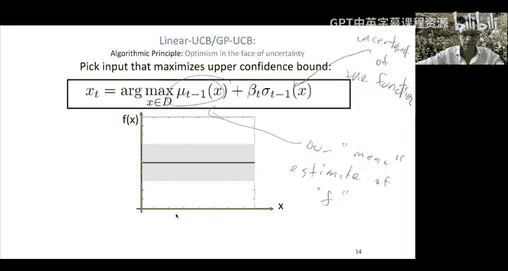

A little more information so's。Switch。To see a little video of this algorithm and then I will。嗯。

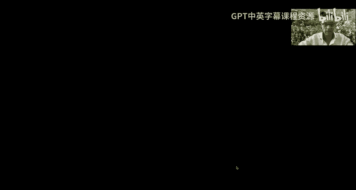

And then I' move back to our usually scheduled。PDf。

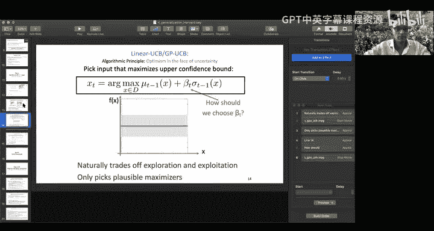

Every full screen can everyone see？Yes， yes， but we do have see this build order small window on the side。

 oh you do。Yeah，但是。

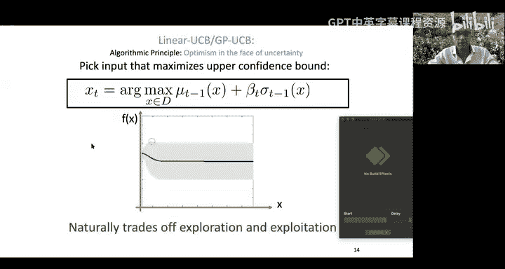

Doesn't matter。 It doesn't block anything， then I don't think youre seeing the video let me。啊。

Strange。

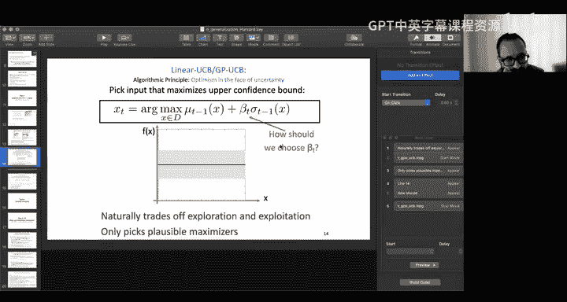

right now do you see a video now okay so what we're going to do is you know we're going to show how the algorithm is updating andm not being explicit how you update new but you can get a sense like you know we have some features by as we see more data we learn about the function and we try to keep track of confidence so let me just start play it。

So're picking these points， we're learning about the function and。You know。

 what we're trying to do is pick。Flausible candidates of where the optimal might be and there noise okay note that around here there's no point in querying you can see my mouse right？

😡，哎。Yeah， there's there's no point in querying around this region anyway。

 there's no there's no point in querying around。

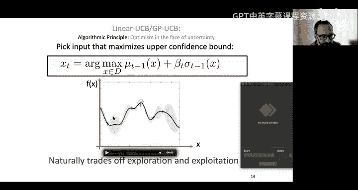

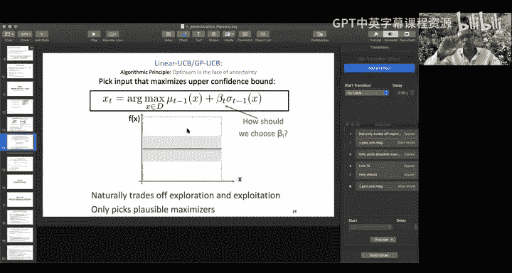

You know， this region is highly uncertain。But we eventually pick it， this is still highly uncertain。

 but why don't we bother querying it well at most we think the function value could be up here and we've already found something better。

😡，That's why this bonus aspect is nice。And it turns out this class of algorithms does give essentially an optimal regret。

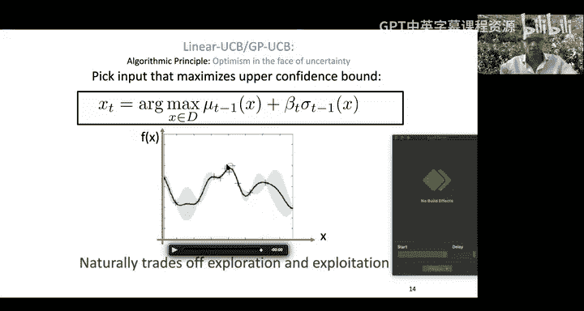

Let move back to。The PDFs。And。So basically the gray area was signified。

 the line was basically you expected the expected value and I guess the line was the ground roof。

 but the gray area was the expected value plus minus the the line was our best estimate of the ground truth and the gray area was our uncertainty animals okay。

And。So mu t minus1 is the current best estimate of the ground2 at the time t minus1 and sigma is。

Is some quantai or some deviation so exactly sigma is like a standard deviation。

That we have to estimate。

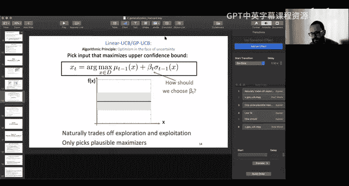

This again。Willian， I hope it answers your question and yeah people can feel free to unmute and ask more。

😊。

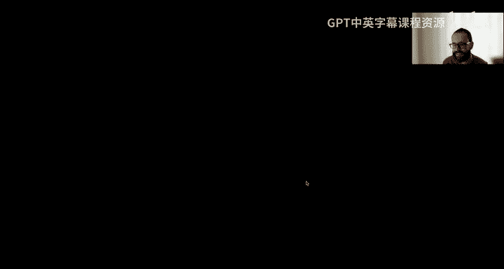

Now that work， okay。Great， we can see。We can see this picture。

Yes okay and there is a question of how you calculate the gray area but i'm guessing this is what you're going to show now I'll come up to this yeah how how we calculate the gray areas is is the right question i'll give you a theorem first in the infinite dimensional case but then we'll look at a very concrete algorithm so。

😊，Here we're actually looking at the regret so what the lefthand side is is the difference between you know this is the best we can possibly do over t rounds this is what we get with this linear UCB algorithm or you know this particular algorithm is GP UCB because's the Gaussian process version of this algorithm and the regret which is after T rounds how close are we to the best we're doing we're dropping at one over a root T that's going to zero and then we have this complexity measure of our class so。

Here we're in a setting where F lives in， say， some。Then you， you know。It's linear in Phi。

It's some ArchHS space， it could be infinite dimensionals。

Doesn't really matter in that this determines the complexity measure。

 which we'll see why we can view this as a。As a volumetric concept。

 but let's just do the finite dimensional case， so like suppose this phi is maybe linear x quadratics cubics and like some higheroid termss。

Okay， and suppose d is the dimension of Phi so so for a moment we were supposed we're in finite dimensions this phi is basically order the dimension。

Okay， so this regret bound in finite dimensions is order root D over T。You know， times。Yeah。

 there really should be like a beta T here。Okay， so it's kind of like order square D over T ton some kind of problem dependent constant。

Okay， and in the infinite dimensional case， you can think of this gamma T。

 which is known as the information gain， as some type of complexity measure as to how complicated the problem is。

Okay， but what's nice here is it allows you note this dimension has nothing to do with the number of actions。

This is some measure of the complexity class of our cyto function。

so this is appealing because now we can actually get low regret with an infinite set of action。

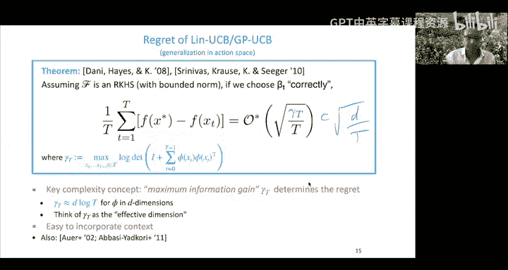

可身。So that's I'm going to。Go to the details in a moment。

So that's the second set of slides you showed the yeah， just the second set of slides。嗯。

呃I真 something。嗯。

Can we see。Yes， okay， great。

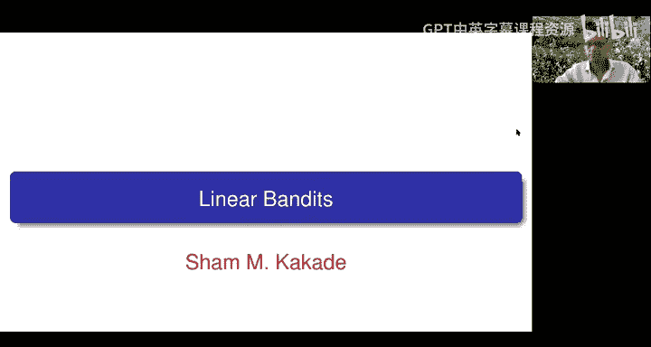

And I also look at the details of this。Setting。Okay， so let me just look at time。

 I think we can make。And my shirt but like。Maybe another hour and a half， I'll go through。

The linear bandit， and then we'll take a break， we'll come back for the lower and upper box。Okay。

 but。I think I at least want to highlight some of the technical machinery because。

It'll turn out that this technical machinery is actually relevant in RO。

But this is an important enough problem because it's one of the most widely used bandit algorithms that I think you you know。

 I think looking at some of the aspects of the proof will be a pretty high bank for us。

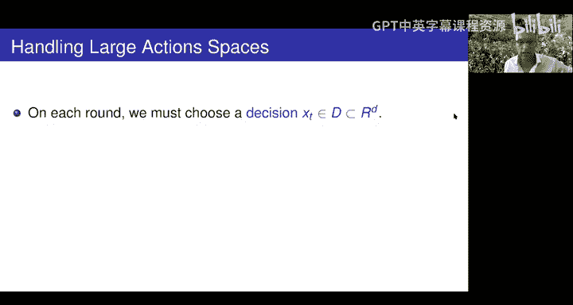

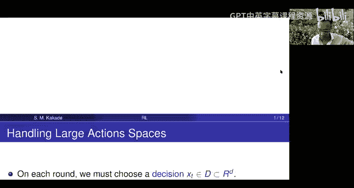

Okay， so the model now let's work in finite dimensions。入て。Here we can， you know。

 the previous setting， x really was phi of x。It was a fesurized version。

 but let's say our expected reward when we take decision X is just linear M。Okay。

 so there's some just notation changes， some new stars the waiting doctor there now。

Is the unknown weight vector。 let's say the expected was bounded between minus one and。Okay。

 and in that one dimensional setting， even though we chose x to be a scale of value。

 we were assuming that， you know。And that。This is what we saw in the example that wefuurized it and we thought our function value was linear and and feature events。

Okay， so。And we're going to have noise on it。Okay， so what we've observed is。You know， R of T is。

Musstar。x plus some noise82。I don't know why I read it that way， but。

We we choose X and we get a corrupted value okay， if there's no noise。

 look this problem's easy right because we just we just choose delinely independent x's。

 we solve the linear system， we know W your star then we play optimal。😡。

But the issue is what we're observing is corrupted with noise。Okay。

 and what we care about here is a cumulative regret， which is how much。We get。

 I guess there should be a factor of T here。This is how much we get。Compared to。

Well this is an expectation。An expectation this is what we get because we really get this plus noise okay。

 and we want to compare that to how do we just done the best thing in hisight。😡。

So extra is the best possible decision。Okay now let's specify this linear UCB algorithm。Okay。

 so we're going to use an estimate of the weight vector mu hat。

 which is you know what's our best guess of what happened in the past we're just going to use regression so we're going to use some regularized least squares regression that we see a bunch of data what's the best guess of a function that's equivalent to specifying what best guess of the weights okay so that's our mu hat is。

right， because we're just solving a least squareest problem where we're aing the decision we played to the observed reward with some penalty on the weight。

We're going to define sigma T to be basically the design matrix of the covariance matrix of the points weve played。

 and if you think about this， this is telling us something about our uncertainty because if this gets big in one direction。

 it means we played in x that we played xs that largely point in that direction and we should have a good idea of the function do。

Okay， so sigma T， if you think about it， that's going to determine how accurately we think we know mu hat is in certain direction。

And that's exactly what this gray region is going to be specified by。

Here we're thinking about our uncertainty of the entire function。

Because now our uncertainty is over muha。Okay， so we know that mu hat is close to the truth。Based on。

Our you know the shape of this design matrix where we played and some statistical constant。Okay， and。

Note the point wise， you know， and what this is going to do。Because this is going to imply。

Point was confidence intervals， meaning what we care about is muo hat。Of t dot x minus mu star。

Dot x right because when we're deciding to play x， what we care about is how different is what we think x value is from its true value。

Okay， so we have an uncertainty region of this function， your star。

 and that implies uncertainties at each point， which gives rise to those different bands in that picture。

Sham we don't know Mustar we don't know Mu star that's right， so even though we know Mu star。

 we know that our guest is close to Mu star by a certain amount。Okay， so。So in particular， okay。

 right。We can sorry， yeah， so sorry， I should really。

 let me just change this definition of all of you。嗯。Okay， support。Is going to be equal to。

Instead of all mu， okay， which are close to mu hat of T as measured by sorry， great question， yes。

 as measured by this new one。Okay， it turns out mu star is going to live in the set。

 but you know our uncertainty region is we have a set of mu which are close to our estimate and the set we think are plausible solutions are going to be those which are close to mu hat as measured by you know the sort of the number of x's we've seen in a certain direction。

 this is the right way to measure certainty。Okay we good。O对。Now， the algorithm。Just ignore。Typo。

I'll fix this。Before Bo is post the actual slides。是态度。喂。

 I think basically is's better T the smallest number that you can set it so that this is true that that you're guaranteed that newstar will be in the set。

😊，Yes so。Yeah that's right that's exactly right you just check if I have the right version here。

I see so something was cut off here let me just give you the linear UCb algorithm， which will be。

You need to add a slide here。Okay， so。嗯。My slide was cut off。Actually， maybe I didn't。

Do this in skim。

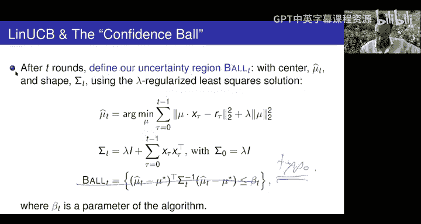

there we go， Okay， great。Now we see the。Yeah algorithm。Okay， so。Hello。You see things advancing now。

 are we stuck again？I mean I see the slide where Li UCB is in blue on the bottom data change no now it's white it's just okay white okay。

 so do you actually see。

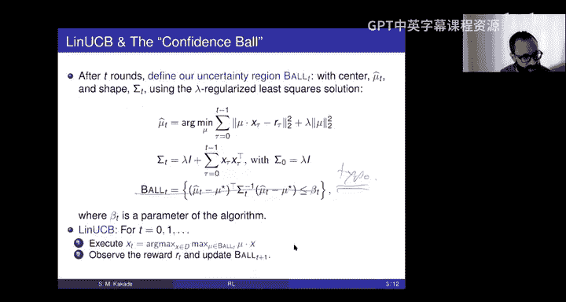

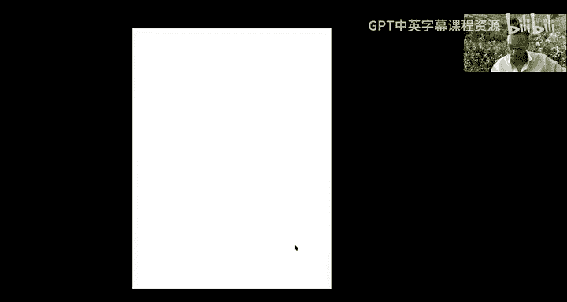

Do you see me highlighting this yes okay good so the algorithm now is just optimism Okay。

 so we know mu is in this set， so remember I said ballti was。

So basically this set By is what you do before as the gray area， right exactly。😊。

It's the set of mu such that this holds。Okay and it's exactly the gray area。

 but we turn into a pointwise gray area because for every X we check the uncertainty region of that x and pick the x that could plausibly give us the most value okay what's the intuition you know if we're correct great we've got the opt of value and if we're incorrect we've learned something and we should hopefully be able to shrink our uncertainty at that point。

Okay， and this is an idea that， you know， we obviously want to extend to RL too。

 but it's giving us a way to either we learn something or we're doing well and hopefully we'll learn fast enough to do well。

Okay， so our regret bound here is basically， you know， if you set the parameters correctly。

 the regret bound。Is。Or a dimension times squared of T。Okay， so roughly speaking。

 if you play for roughly d squared steps， you will start doing well。Okay，And that's because you know。

 and it's a noisy problem here， that's why we're going to have to play things multiple times。

Okay but this analysis and this is actually an minm optimal rate。

 so if we only assume the function value is bonded。Then。The， the optimal rate is。

Bas the optimal regret is linear in the dimension times square root of t so basically in order d squared number of steps。

 then it starts looking like we're close to the optimal value Okay so this is the underor less regret we divide by T to get the average regret。

Okay， that's the statement I'll briefly sketch out the。

The proof because it's actually going to be relevant later on。

But is the statement clear of the theorem？Any questions？

And I guess the reason we call it optimism is because we look at the upper bound rather than the low bound so right so yeah and we're trying to maximize here。

 yes。So yeah， we're trying to maximize here。That's why yeah， we call optimism because。诶。😊，You know。

 it's like what's the best possible scenario in the world？Like I'm playing these arms。You know。

 if I tried an arm once， then yeah I might not think it's all that great。

 but if I was optimistic I say how plausibly rewarding could this decision be that's why it's optimism and I go with the one that's sort of most plausibly rewarded okay and the hope is like if I'm right great I've got like a ridiculous amount of reward okay and if I'm incorrect I will learn in sort of just the right region in the space where I should be learned。

So another way to say it is you know you only stop playing an arm if you're like。

 say 90% confident that it's a dad， that it's definitely worth not worth playing。And yes。

 you pay some price of exploration when you do that， pull an arm you might pull an arm。

A few more times than you should， but you will not miss out on some great opportunity Yeah and the point is if you care about things in the long run。

 you have to do this because the overT steps， if you miss out on this opportunity。

 if the opportunity is rewarding enough， it means you genuinely have worse regret。诶。

So let's just get there was a question is this optimal dependence of the form d times square rootity yes so d times rootity is。

Optimal or basically for bounded rewards。You can even get rid of these geometric factors。

 but as long as the say the noise is bounded by one。

 which is what I'm assuming and just suppose that your expected reward is bounded between minus1 and1 D root T is optimal okay note this is actually slower than linear regression because linear regression you can learn out the function with O ofD samples whereas here we need or of d squared to get subline regression。

Okay， we need these squared samples before we're epsilon close to the right answer。

 so we really are paying something for our lack of information， you know。

 the fact that we have to choose things。Adapptively。But it is optimal the。

And there's a lower bound in this paper。Okay， so let's see， so given the time。

Let me just quickly sketch the proof because I do think you'll get a fair bit of a bang for buck and I think understanding that that will make your understanding of the upper bonds and RL much easier。

Okay， so there's really just two parts of the proof the first is just that we need some confidence analysis showing that Mu star always lives in this ball with high probability。

So that's one lemma， that actually really does require some new probabilistic analysis tools。

 basically like a self normalized mountaingi analysis。

Okay and the other part we want to show is that suppose for a moment that the confidence。

Clame health。That Mustar， like we didn't make an error that Mu star always lives in the region ball tea for all tea。

Okay， then what we want to show is that。Okay， and remember the setting of beta T， think of beta T。😡。

So beta T is basically like the dimension， it really does not strongly depend on the time。Okay， so。

The technical thing we're going to try to show and it actually has some interesting connections。

 it's kind of like an ellipsoid style of analysis okay。But what we're going to show is that you know。

 defined regret of T to be the instantaneous regret， okay， so it's the instantaneous expected regret。

Between you our expected value and。What we would have liked to have obtained。Okay。

 this technical second lemma is showing that the sum of the squares of the regrets。

 not the sum of the regrets， the sum of the squares of the regrets are basically growing only logarithmic in T because beta T is de log T and you know。

This one is Delected。Okay， if we could show both of these we're done。

 why because just crosy shortwartz， right we care about bonding the sum of the regrets by crchey Schwartz。

 this is less than root tea， kind to sum of the squs of the regrets。You know we plug in this phone。

 which is， you know beta t is D logg t， this term is deo T。

 we just plug this in we get this and then you get the claim down of D log T。Okay。

 so the two parts to show， and I'll just sketch the idea of the proof， which is confidence。

 which is this conference region is valid and the sum of the squares of the regretsbound it。

 assuming the confidence holds。Let me just decide how much time I want。

To spend I'll go ahead and just sketch things up。Okay， so。And I'll explain in words what's going on。

Okay， so now we're going to try to prove this。Some of squs of regrets。Okay， so this is our。

This quantity is， you can think of it as。Point wise。Confidence。Okay。

 so if we choose some mu in the set。ok诶。It' you sorry。Maybe this is true for every meal in the ball。

Exactly， actually， this is true for everyone new on the ball side， you're right， Phli。Okay。

 this is true for every mu in the ball， and we're assuming that Mut lives in the ball。

I think we want to prove that Vi star lives in the bottle with high probability or something。

 but let's go ahead and assume that for now。So this is going to be an assumption。

So we're later we're going to separate out the proof we're just going to assume it lives in the ball and get some geometric facts and then we can prove it lives in the ball okay so if it lives in the ball then this is true just essentially by the triangle inequality and the definition of the ball okay because。

嗯。Right this is really just groceryy shorts right what do you do you were trying to upper bound。

This quantity， we just plug in sigma t is sigma minus t crochet shortset。

 this term is beta t by definition and。This term is exactly this term。Okay， so。

So so this is really actually this is just true a period that for any this is this has nothing to do with Mustar。

 this is for any mu in the ball， this is sure just by trying。😡，And the definition of the ball。Okay。

 so that， you know， why is this relevant， this kind of tells you the size of this shaded region。😡。

This is exactly what this picture is doing it's the size of the shaded region and the size of that shaded region is up bonded by a function of what we've done in the past。

Okay， so what I actually had here， let me just erase it is。Is actually correct。

We didn't need the be on that。OkaySo we're good with this。D coin。

 this is literally just the size of the gray region just by definition of the ball。

 this is how much our point wise values could vary。Okay， so now what do we want to do。

 we want to relate the width of this ball to our regret because like look if this ball like if there's only one point in this ball and we contain new star then we're done。

 we have the right answer okay so basically the the size of this gray region tells us how much like how suboptimal we could be。

Okay， so。Our regret is the instantaneous subopality of what we chose。Okay。

 and this technical lemma says the regret we pay is basically this parameter root beta t times the width。

 okay， it's a min with one just because the the wordss are bonded by one。But basically， you know。

 you can think about this as the instantaneous regret is。Goughly squared root of beta T times wt。

Okay， why is this true， okay， now here we're explicitly utilizing that Mu star contains the ball。

So why is this true？Anyone。You can can unmute。And maybe maybe people missed from the previous level or。

It's like the statement of the previous the previous Lama。Is just saying that every new。

the amount of differences from for every X and for every mu， this is true。Okay。

 now we're specifically going to make a claim about the subopity of UCB， this algorithm。Okay。

 and the claim is that that's basically twice the previous line。

but what's the key addition we made to the previous wemma？The key addition is we。Assuming this。

And the reason this is true is basically optimism。Right because see， because we're optimistic。

 we can relate。How well we're doing to this way。So it's basically a short proof that because we're optimistic。

诶。😊，You know， this is。The best we could do。Okay， that's going to be lower than our optimistic value。

 so to some mute twiddle， which is like the optimistic mut twiddle for that Xt that's better than Mue star x。

😡，Okay， that's why we chose XD。Okay because that's exactly this optimistic algorithm。

 I see optimism lets us dominate， you know it says。

 you know what we think we could get is bigger than opt okay that's basically what optimism optimism gives us you know we're going to play XT and optimism says we think there's something plausible that has higher reward than opt。

😡，Okay， then once we have that， you just try and gl it again and you get your grid is basically the win。

Okay。So that's what this claim is in words。But let me。Now， why is this width nice？

Okay so remember what sigma T was， so sigma T roughly is like you know。

 some identity plus the sum of tall less than t of xt transse。

So why is this quantity nice because suppose we keep playing some direction， okay。

 what's going to happen to the this quantity WT like suppose we keep playing something that's very aligned with the E1 direction。

😡，Okay， what's going to start happening to WT？SoLet me just make sure that the statements here so WT is defined as xt sigma T inverse xt。

 so xt is what we play。So suppose in the， you know， it just so happens and then UC seeD keeps。

Tending to pick this X roughly in the E1 direction。Okay， so when we pick that X note。

 we're going to add it to Sigma T and we proceed。😡，Okay， so what's the behavior of WT in this case？

It gets really short along that direction。Exactly， like okay， so this is the intermediate answer。

 but what you're saying is sigma T is going to get large in that direction and sigma t inverse is going to get short in that direction。

Because we keep playing something in the E1 direction so sigma T kind of grows because that's like the number of times we're playing that direction okay。

 and the inverse means it's very small in that direction and that means if we play in X in that direction again。

 WT is very small。Okay， so this means。You know， all this is saying is like， look。

 if I play an XT where I've seen this direction often in the past， this WT will be small。Okay。

 now if you think about this， now we're in like geometry line。

 like can this really happen a lot because， you know， every time you place some XT。

This sigma T grows， which means WT should be shorter in that direction if you place something overlapping with it again。

Okay， and this is very much like。An ellipoid style of thing that we're kind of shrinking， you know。

 every time we regret， we have regret， we're actually learning something and something should be shrinking for us in the future。

ok。😊，So just give two curriculums to wrap things up。Okay， but again， note。

We're assuming this quantity that new star is in the ball for this to be true。

 so we'll have to handle that separately。😡，Okay so the first is just maybe it's wontwhile to just give kind people intuition because this is really what we've seen in the video。

 so basically。The point you kind of think of the width of the ball at this point XT and it's wide。

 if it's wide then you might have large regret， but then you also at least on the intuitive level。

You have now， because you query at this particular point。

 you should have decreased your uncertainty and basically Sham is now going to show us that this actually happens。

And what's tricky about this is， you know， it's， we want to try doing some kind of potential function argument because。

Like we don't know the shape of。 you know， the reasoning about the actual dynamics of this thing is a headache。

 but the way Baras put it is like， look， you know， if we tried some arm many times。

 we know we're less certain in that direction。Okay，But the point is， if we're uncertain。

 that's when we play regret。That's when we pay regret， but we learn something。Okay。

 so this is kind of trying to understand， you know， that last time I really shows us。When we。

 you know， how much regret we pay and now we get a sense of how fast we're learning。Okay。

 and this is really GMmetric。Because the first is just purely a technical dimma that the determinant of Sigma T is just。

 you know， we're going to do a volumetric argument that we want to see how fast sigma T can grow in its volume and we're going to relate that to the regret。

Okay， and sigma t， just a technical lemma is just a product of determinant at sigma zero。

 which is identity plus the sum of the you know one plus the sum of the squares of these widths why because we have the recursion。

 I mean this is just comm right， we have the recursion sigma t plus1 equals sigma t plus xt xt transpose。

This is just inequality with the half norms determinant of a times B is determinant of。诶。

Is it determinant a times determinant of B？Okay， and then just， you know。

Manipulating the sigma of the halfs， I can rearrange things and I get this VT or VT as this。

 and then I use the definition of WT。But this is just like going， this is straight up equality。

 this is like the sum of the volume of sigma t is just one plus WT squared， that's how it's growing。

Okay so this has you know nothing to do with anything we've done aside from definition straight up a geometric equality no but we do see some advantage of in a sense that we see that the bigger the WTs are then the determinant of sigma T grows and so the determinant of Sigma T inverse shrinks exactly right so that seem to be on the flavor of something we want to show that's exactly right right so in fact is kind of seeing the proof that we want to see as we're learning how much regret we pay and what we see is。

😊，You know sigma T inverse， right if we play something a lot。

 Sigma T inverse will become small in that direction and as this thing grows。

igma the volume of sigma T inverse is shrinking and this is how fast is shrinking。

And now we just use basically what we call now as the elliptical potential argument。

 which is how fast can this quantity grow？Okay， and in the worst case。

And that's where this information gain comes from too。And that's also the same question is。

 how fast can the inverse sigma T shrink？Okay， the speed at which this grows is actually just delog T。

Okay， and this really is a potential function argument in geometric and what this why this argument's nice is this actually says for any sequence。

Ofp points。The worst case growth of dysfunction is only logarithmic and T。

 but linear in the dimension。Okay， why do we have this well in a sense like there's so many proofs now that use this technique。

 but there's a sense in which this is what's going on with the ellipsoid algorithm。😡，Okay。

 so this is just basically AMGM on applied in a careful way to the previous quality so。

Define these sigmas to be the eigenvalues of sigma T。Okay， not quite sigma T， but this matrix。

 the sigma T is identity plus that。So these are the eigenvalues。

 we know that sum of the eigenvalues is equal to trace of xx transpose。

Which is less than the norm because trace of AB equals trace of B just by the。

The reordering property of the trace and the x's are going to be bonded by B。So。

The sum of the sigma eyes grows linearly in。And what we want tobound is。This。Is this quantity。

 which is equal to this quantity？With the quality， we have this because this is really just our。

You know。Thiss just the quality。From here。Okay， and right because I'm just rearranging the Xpss。

This by Anne GMm。So this is the arithtic mean is smaller than the geometric mean or the other way around。

One of the you。Geometric is smaller geometric is small okay。

 so this is the quality so I just put one over here one over here now I apply AMgm because the geometric is smaller so I get to put the sum on the the。

这个这勇。Cop， they get this wrong， I want the log on the inside。The type here。Okay。

 so the log is really on the inside。And while I were done because the sum of these sigma eyes， oh no。

 sorry， this is correct。Do I have this correct？This is a important enough analysis that you'll do many times。

嗯。Oh yeah yeah all right， this is great because the one everybody is， u yeah。

 this is great because I'm applying AMGM on this quantity。If I that quantity， I get an average。

And then I can say the average of the sigmas is T。Okay， so now we get this volume metric growth。听。

If we just kind of wanted to get some intuition。I'm just wondering like say suppose these are unit vectors and we just kind of want to get intuition。

 suppose Lada is one just for simplicity B is one so everything is unique and let's even ignore the I let's just say you want to add unit vectors。

😊，In a way to maximize in a way to maximize the volume on an intuitive level。

 what you want to do is to make them orthogonal so basically what you would have is you would have indeed dimensions you would have each vector would be you would have a cube where the edge size is t over B right so。

😊，T over D， exactly T over D because you would have you would add you have like detogonal directions to play with that would maximize your volume and you add the T over D in each directions。

😊，So the volume would be t over D to the power D exactly determinant would be the log of that which will be times log of T over d perfect yeah and that's exactly right so you get D log T over D the process says because the worst case when you have standard basis like in a sense the worst case when you your standard basis vectors is you just place。

You know， break up the way you play evenly and if you think about this what this corresponds to。

 the kind of worst case problem is where you kind of have to try all of the actions to get you know。

 roughly the same number of times to get a sense of what's going on。😡，Okay， and。That volume is。

 you know， that matrix after T steps looks like Q over D and the diagonals and that gives exactly this volume。

And this really is the heart of the ellipsoid dilemma too in optimization。

 it's a volumetric argument with determinants。So there's like a very close connection and in a sense like this isn't too surprising because you can view this as online linear program like one of the histories of this problem is like in Bobby Kleinberg's in a thesis was like look。

 suppose every day I want to drive from node A to B， but I only get end to end feedback on my graph。

Okay so I know the structure of the graph。😡，But I don't know the delays again。

 I just get end to end feedback。this is a banded problem， but my decisions are pats on a graph。Okay。

 and this is a linear bandit problem why because it's a linear program。Okay， and。诶。You know。

 and this kind of regret analysis is actually making connections to kind of an ellipsoid algorithm because we're kind of softly trying to figure out information about this underlying linear program for that。

Okay let's quickly wrap up because that's now we're basically done why because we want to bound let just for a moment。

 suppose that mu star is in the ball， we want to bond to sum of the squares of the regrets。

 give us sum of the squares of the regrets if we went back a few slides is less than beta T。😡。

Times the man of WT because that was just our withlemma。Okay， this is just。

Beta T is increasing the way we'll set the conference parameters increasing。

 I haven't told you how we set it yet， but once we move here we can upper bond this by the log of one plus this see this min is coming from the fact that a grid is bounded by one。

Okay， so these are just some algebraic manipulationmbulations。

 but the main point is we're relating the log of the regret。

 sorry the sum of the squares of the regret to the sum of the log of the one plus our width squares。

Okay， but this is great because now we just apply our geometric argument。

 see we've really related our cumulative sum of squares of regret to the growth of this sigma T。

 which is like the shrinking of the constant。Okay so how fast things think could grow is really determining the sum of the squares that their grass again if you remember like beta t was basically you know de t get improve that。

 but this is the heart of the proof that if we get just you know。Have a。

Set beta T correctly and the confidence held， the rest is geometric。

It's a very clean analysis and this is also why it works for infinite dimensions because this information gain is really just the worst case geometric growth of your hypothesis class。

Okay， so。I'm not going to go through the confidence analysis。

 I'm just going to point out that so there's an upcoming book and it's in the notes that this is not a trivia analysis。

 so the first analysis of this really understood how this is a self-normalized sum because we have the sigma T in loops right so there's effectively some kind of matrix andversion lema going on。

And there's a nice extract dilemma that shows you how to get at this confidence interval。

Basically based on what's called a self normalized sum， or why is it a self normalized sum because？

You know， just look at what this ball is， sorry about the。Re what this ball tea is。

The sigma T is coming from this regression estimate。you've got this inverse Xx transfers。

 so it's basically like we're constructing a Martinale and the aerostruct is a function of what we've seen in the past。

It's not like we're just measuring mu hat minus mu we're measuring mu hat minus mu under the norm of what we've seen in the past and that's why you can consider this like kind of a selfnormalized analysis because we' normalizing our air by how we have taken measurements okay and that concentration analysis is really very clean I mean even the original one was pretty clean with the matrix and version Lamma but this newer one has a nice trick a nice trick in it okay so that's how linear band analysis let's pop up a level to。

You know what we've shown and then。Come back to。Come back to our。Okay， so what we've shown is that。

 you know， like for this pats on a graph problem or say， you know。

 you can easily do something contextual here as well。

 but we could have a very large number of decisions， maybe like two to the D or something。

Get better of regret only depends on some kind of complexity notion in this case or a dimension to do well。

 we don't have to try every possible action to do well here because we can balance the gain in a clever way。

Okay， but we it's clear we had to exploit a certain linear structure in a problem to do better。

And you can definitely extend this to contextual bandits， but it is an notion of generalization。

 is because we can deal with many， many options without trying every single one。Okay。

 so now I would suggest we take like maybe a five minute break or so， I can take a few questions。

 you know， now if。And then we're going to turn to。What can we do in RL now because we have this negative result and now we've put structure on this linear banded problem and。

This is like the strawman model， like everyone uses it。

Can we use these ideas for RL okay and the next part we're going to look at is with regards to kind of lower bounds and you know I view this result I carbon now as one of the is really a breakthrough。

 I think in the the last year， I think this is one of the most important results in RL theory。

And we'll cover that， say， starting at 150。

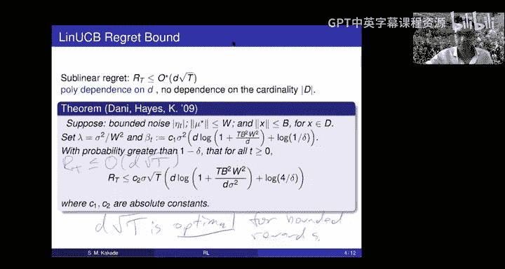

当才提个。So we can take a break until 150。And show me， if you want to take a break free free。

We I also get to thewin of water。I'll post the recording。Great， welcome back everyone break。😊。

We're going to move back to RL。So we have some intuition from bandits in one very particular case。

 but the interaction is very simple， there's no state。Well， there could be state。

 but immediately reset in a contextual set。Okay， and now let's try to get a sense of。

What types of conditions might be necessary to？To generalize an Rl。And呃。

The types of conditions we think of， not surprisingly。

 we think of having good linear basis functions， you know basis function some people call it in signalig processing that's old or features or representations。

 but suppose somehow we had。D functions， which are a function of S&A。

This is basically just like our linear bandit setting because a is like x and we could have had context。

Okay， so。You know，Or we have just a feature vector there。during the。

Some feature vector and R of the D。They and not surprisingly。

 this idea is very old like Shannon basically was talking about similar things for playing chess。

 which is you know we want to generalize， pick up patterns and reuse those patterns and the founders of D programming dominant and Dryfu。

 they kind of explicitly spoke about using basis functions when doing approximate dynamic programming and they say okay rather than trying to figure out Q everywhere。

 let's try to approximate the optimal cu。By saying it lives in the span of some set of features。

Okay and a very basic question here is what are these conditions our basis functions need to satisfy such that this sort of methodology could help us so for example。

 in the linear bandit setting we assumed that expected value of the reward given。We took， say。

 action 8。Was I'm changing the on the big here was。I think I might use Debbie here。

 but we assume this was linear and some features of A。

And we could have easily added some extra information like S， and this would work too。

 but there's no state。Okay， so we had this assumption。

Linea bandits is great like we can do all without explicit depending on the number of accidents。Okay。

 so now can we just take basically one of the oldest assumptions， see if that lets us。

Do reinforcement learning in a sample efficient manner。Okay。

 and what might be the most basic assumption is just that Q star is in the span of these phis I'll define that precisely。

 but this is what's often called it as a linear function approximation and the weakest and most natural assumption is we just say the optimal Q function is linearly realizable meaning Q star lies in the span of these features。

Okay let's define this and ask our question。And this is like， this is such a natural assumption。

So the assumption is follows it's like suppose we're given some feature now so for every state in action we have some representation in order think of this like whatever we train some neural network。

 we grab its top layer， hopefully it's low dimensional it's going to be a much lower dimension than the number of states and actions in the world。

😡，Okay， can this help us learn like in supervised learning we know good representations help we just build a linear classifier on it this is kind of the deep learning revolution that once we had these good features。

They just transfer and they do all kinds of wonderful things。Okay， so。

Arguably the most natural assumption here is linear realizability。It's a strong assumption。

 but we know we need some assumptions to move beyond this kind of agnostic。Viewpoint of RL。

 so we're going to assume for every state and action and time step。

There exists a set of weight vectors such that this Q star value， so when we write。H。

 this just means starting at time step。😡，This means starting at time step H and going to the end。

Okay， so this is really。I guess I should write this as。This is really equal to the sum。

 the expected value of the rewards。Under a policy。But we're starting at， I guess。

🎼So basically the optimal policy would be to take the action that maximizes Q0。

 then take the action that maximizes Q1 and so until you get to the star at， yeah。

 basically I running the sub star at state S is just the AGmax。Over the actions a of Q star H of S。

So this is this one step look ahead value， and it's looking ahead with the optimal V star。Okay。

 so if we knew this W star， we have the optimal policy because we just take the argms of this function。

Right because this is like， you know， taking the best thing that， you know。

 one step ahead gets me to the best state， taking into a account immediate reward。Okay。

 and note this is a small number of parameters， there is only D parameters and hopefully D is much of less。

Okay， and really just。You know， this is really a longstanding open question。

 something that like I talked to Bos about a bit last summer， I was working on it for a while。

 everyone had been thinking about it。And。😊，The first time you see this。

 many people think it's possible， I mean this is the same thing with Bo Forre us thinking about， oh。

 these are the candid algorithms like maybe you could， you know， what are you trying to do。

 you're trying to explore to pin down these parameters in some way ways。

Okay so and how many parameters do I need to pin pin down it's D of them and there's really a lot of structure in this problem。

Okay and let's just do one more viewpoint of this assumption as a linear program I'm not going to go in the details too much。

 but you can write a MDP as a linear program with a number of constraints that that's S&A you can write down these be and optimalalmity constraints。

诶。You know， with SA constraints and this particular assumption is something where you can write this LP is having D variables。

The weights and order SA constraints because that looks bad because we have a lot of constraints。

 but there's a ton of structure because there's an underlying environment here。Okay。

 so this isn't just some arbitrary LP， we know it corresponds to an MDP。

 we know a solution satisfies development of equations。

 and one way to think about this is we're trying to solve this problem with sampling access like if we knew the model the world we done。

 forget about computation but information theoretically we're done。Okay， but we're in the setting。

 remember this episodic setting， we start it as zero， we act for eight steps and we can repeat。Okay。

 and we're only trying to estimate D parameters in the world。And， if it's accurate enough。

 we've got an Epsilon accurate policy。So， you know， if you don't like this， just ignore it。

But the open problem。Well， the important question is。

 does there exist a simplification algorithm under this set？Okay， and this is relevant because。Why。

 because this will give us nature into the style of assumptions we need to make in ourL。

Because linear basis functions I go like this is just fundamental in approximation theory and in machine learning in many。

 many other settings and you know obviously we can't even do nonlinearar things unless we get linear data first so there is a question by Julian of where do we get or learn the feature map form and I guess this is kind of out of the model in this case。

 but you can imagine that we learn a neural and it could have some superfluous features right we don't have to know exactly this map as long as we know something that contains this feature and something else。

😊，Yeah， you know， like this is kind of the the thing。

 like how do you get a hypothesis class that's good？

You know these are these these noque your lunch theres there's no normative reason why you can get something that's good。

 but the hope is you can at least specify conditions what good means and we saw that in the linear bandit setting as well like how do you get those features well in practice they make features of like the addd in the query and they just you know out of product them and this is your contextual abandon feature so。

Here if you're in some visual domain， you're going to rip out the top layer of the neural network and add other stuff okay and how do you verify this obviously you can't this is clearly a very strong assumption。

 but we know we can't do things agnostic。Okay， and if this is true。

 then we could also ask future learning question。Okay， so。Good question。

 But let's just assume we' got it。Okay，Because that is like， you know， going back to the 50s。

Okay now I view this as really one of the most important results in both RL theory and ML theory because it really gets at why RL is hard even with it regards to function approximation。

 why the nature of studying it is just a lot more subtle， I'll mention two results here， and。

It's pretty depressing too。But it's helpful when we start turning to upper one。

 so the first result says look。呃。嗯。I guess the quantifier here is a reversed。

 but the point is we have an online algorithm。this is something that you know we start at some state。

 we do rollouts and we see data， we don't know the MDP and the algorithm takes us input P。

 so the algorithm knows the feature of mapping everywhere again we don't care about the computation time but the algorithm what we want is just the sample size。

 you know the number of interactions， the algorithm needs to take in the world to find something epsilon near optimal。

OkayAnd even if assumption one is satisfied， we still need at least。

Either two to the dimension or two to the horizon number of samples to find a policy which is like 0。

1 close to opt。OkaySo optimal value is going to be like a half or something and we're not going to be near to it。

Okay， so this is a lowerra bond and this is definitely disheartening。

 but it also starts revealing to us why or we need lots more complicated assumptions in ourL because the most basic one doesn't work。

OkayAnd's we can actually strengthen this even more in a way that actually has implications。

 I'll give you the implications for a moment。It's。The situation is even more challenging with regards to linear function of approximation。

We can try to say like what's the， you know， can we make this a little the problem easier and maybe then we can do it。

Again， if you think about like the linear bandda setting， what might make the problem easier if like。

 look。The best action is like much better than all the other actions。

 so the hope is like you'll quickly identify that and then you actually you don't just have an epsilon optimal action。

 you actually have the Og Max。😡，Okay， so。A stronger assumption is take a1 linear realizability。

 let's add to it a stronger assumption that not only do we have linear reizability。

 best at every state， the best action is substantially better than the second best act。Okay。

 so why is this nice because the idea is like you shouldn't really get confused with this stronger assumption because you can actually snap like once you're accurate enough。

 you can actually snap to the correct answer。And finite time。ok， and。

So this really is a much stronger assumption， and in fact。

 the construction here had exponentially small gaps。Okay。

 but it turns out even with this large gap condition and linear realizability。

 you still can't do RL efficiently in a sample efficient manner。Okay， and。

Just to give you a little sense as to why that second assumption is interesting is let's consider a slightly easier set。

Okay， so there's a notion in R， we talk about having access to a simulator or access to kind of a generative model。

Okay， so so simulator is a setting rather than starting it as zero， let's suppose we could give。

We can give the system any input S and A， we get a sample of S prime， the next state and the rewards。

 so it's a stochastic sample。Okay， so the point of a simulator is we can get samples anywhere in the world rather than just from the start state。

Okay， so think of this as like I can sample constraints wherever I want in my LP。Okay。

 so this is a much stronger sampling model。Okay， and in this case。

If you had assumption one and two and you had a simulator access， then you can do efficient。

 then you can basically learn W star accurately， why because you can kind of just work backwards and get the aG Max because you can kind of sample everywhere。

 I can start at the last stage， sample things kind of with aally work backwards。Okay。

 but you can see this paper， but it's not too hard to convince yourself that if you had a simulator and A1 and A2。

 like this gap thing。Uh， which is kind of like， you know。

 the linear programming approach where suppose you could sample constraints。

Where you can't compute the expectation exactly， but you can sample it。

Okay then you can actually find an Epsilon Opimum policy。Okay。

 but so what that is interesting for this latter assumption is is actually an exponential separation between having simulation access and online access。

Okay so the online RL world is you started it as zero， you do rollouts。

And you can't learn under the second setting。Yeah maybe for you know to understand the difference。

 you can think of the difference between when you're doing RL in say maybe a game environment or something like that where you could potentially jump into any point in the game and simulate that when you're doing RL in the real world where you cannot get to a place。

 especially if you're interacting with say humans or something like that， you're doing advertising。

 you cannot get to a place without actually doing the work and getting there。Right。

And Shamma I'm sure you told me once and I but I guess I forgot what do we know about a one plus simulator access Yeah good。

 so this is exactly right so this is not。Possible。With simulator access。So this is。Possible。

It simulateulator access。Yeah， so I was thinking about this a fair bit and I you know。

 was asking Boaz last summer about like both of these like so A1 is even with a simulator access。

 you can't do it。Okay， but A1 had exponentially small gaps。Okay， and with A2， it has larger gaps。

But you can't do our own with it and it turns out the construction for the second one is much cleaner so I'm going to sketch out the construction and there's some open problems here too。

Okay， we good。Okay that question so so if people understand that I mean just the general thing where we are is in in some sense that would be I mean。

In essence， we would have hoped that the negative of this toM would be the starting point。

 You would say， okay， what do we prove in our， Let's at least prove that if we。

If all the evaluations are linear， then if the expectedant reward in each state is just a linear function of the state or after some embedding the linear function of the state and the action。

 then that should be you know that should have been like the baby case right in the generalization the generalization for linear function so we would have thought that this would be the baby case this would be okay let's prove this that in this case we can do things we've only polynomial number of samples and then move on to bigger things and here it out that even in this baby case。

 the aal thing is very different than the real world。😊。

Perhaps this difference between simulator access， I don't know either I'm speculating。

 but perhaps this difference between the power of simulator access might mean why a lot of the most impressive for now。

 I think successes of our ElA actually in cases where we do have some kind of a simulator access。

 right？😊，I mean there yeah there's a lot of questions here about the simulateimulator access part of it is also just sample size reductions and things like that that you know but I think there's a very good question of like what's simulate as biased but this is one case where simulator access yeah makes life a lot easier but even case one being hard is pretty you know as Barra says like this really is the baby case and your question about how do we learn these features well like look even if you had them you can't do it what they want。

So， you know， then we're going to go we'll sketch the poop。

 but now we're going to ask like what does it take to do Rl efficiently。

 but now we at least know that。You know。It's like the cookies crumbling in all kinds of different ways。

 like we can't do it agnostically， now we can't do it with this。

 and there's a sense in which you know for a while it looked like a laundry list of assumptions where in which you could do RL。

 why is that the case， well it's you know my intuition is really because of this result that the baby case you can't do？

OkayAnd let's get a sense as to as to why because it's pretty delicate。

 but I think it has real implications as well to practice。对。😡，So。诶。Yes， I want to say。

RightBecause eventually we want to understand when you can do our because there certainly have been lots of successes。

 but the takeaways somehow is that these assumptions are going to have to be stronger about how the features interact with the world right see what's nice here is as long as your future is you know Q style lives in the span great you can add more features to it hopefully as you add more and more basis functions it approximates Q star better and better。

Okay， but let's see why this isn't enough and I'll give a proof sketch。

It really is missing a couple of things and it's going to be a sketch of the second theorem。

 which is actually much cleaner to understand。Okay， and。

You'll see why we can kind of view this as a leaking complete graph。

Okay I'll explain that in a moment， so M is going to be an integer think of M being as like Q to the。

ok。And roughly we can think of M as the number of states。

 the number of states and the number of action。Okay。

 so so the state space we're going to denote by one bar to M bar and M。The reason I use bar is。

Bar says it's the state associated with integer M。Okay。

 so it's just notation so and we're going to have one special state。Okay。

 so so there's really M plus one states。And the notation for skates are with a power over it。Again。

 and we're going to have this special state F， which is we're going to call that a terminal state。

Okay so now let's look at the actions this is why the bar notations helpful so a state i bar so i bar is you know。

😡，It's just something correspond to enter your eye。Okay。

 the set of feasible actions is going to be also one to M， but we're going to exclude I。Okay。

So actions are just denoted by the integer。😡，Okay， so the set of feasible actions we can do say at state five is everything in M aside from five。

Okay， and at F， basically all the actions are possible。

 we can throw out one to make them all m minus one。But the main point is。诶。You know， red。

 we can think about these nodes as being states。And we have this special state F at the red states。

 you know， if I'm at state three， I can do all actions in M aside from3。Okay， and。

Each MDP so so we have to construct a family to make a hard instance and this family is going to be indexed by special action A star and M okay we don't know which one that is i'll explain the behavior of this a star in a moment。

 but there is going to be and I haven't talked about the dynamics at all yet but you know we'll get to that in a moment。

Okay， so M is going to be very large like 2 to the D。

 so roughly there's going to be2 to the D states2 to the D actions and there's going to be one special action which indexes this MDP。

Okay， so they're really MDPs in this family， so there's two to the D possible MDPs。You know。

 what are you doing in a lower bound do you say here's that instance of problems the one you care about is one of them and now we're going to kind of need to show。

😡，That all of our assumptions are satisfied and the idea is we kind of can't figure out which MDP we're in and that's going to cause lots of regret。

So a question just about notation and such。Okay， let's。So now' just I'll give you a technical lemma。

 these aren't the features， but just by Johnson Lnden Strss。

You can set M to be something exponential in B， think of gamma， gamma is going to be a quota。Okay。

 so M' is going to be exponential in P and we can find M unit vectors that are you know constant orthogonal like they don't overlap too much so we can find basically two to the D unit vectors such that。

The distinct ones are overlapped by no more than a quarter。😡，So again，'s a quote。Okay。

 so it's like we know one of a good D and then this is just standard tail so there's a lot of vectors which are。

Almost orthogonal， but this is more like constant。I mean， this isn't like all that orthogonal。

 but they're less than a quarter。Okay， so these are not our features， but these vectors exist， okay。

 and we're going to associate these vectors with the integer M。Okay， so questions up to here。

I I'm just kind of spelling anything things out now we'll jump into the construction。Okay。

So let's start by looking at the transitions in this MD piece。

 now I'm going to define the transition。Okay， let me just。Let me just。四。By picture what the idea is。

Okay， so。嗯。So what I mean by。This here， as I really mean probability of。Next state。

Given say the current state。And taking some action aid。Okay。

 so suppose for a moment it is AI but a one， but it's a little bit confusing because it's not an action it's a state right it's just state thats the bar yeah so so but that notation yeah it's confusing but this notation is better because it's helpful to。

Alias the two， so bar means a state。Okay， so suppose we're in state。3。Okay。

 so suppose this is our current state and we take this special action A star。Okay。

 then we'll actually move to F。😡，Okay， so at any state。B。If we take the special action。

 we move to the terminal state now， you think of that as a good state and a star is like the golden action and F is the golden path so we want to move to F as quickly as possible if we take action A star。

Then we'll just move that。 and we're going to try to hide this action because there's like 2 to the D action。

Okay， so now let's look and see what happens if we're at Abar and we don't take this golden action A star。

Okay， so again， we're going to start it on any state。Okay， let's see what happens when， you know。

 we don't take a star。Okay， and we've excluded taking， you know。

 action A1 is not feasible at state A1 bar right if I'm at state five。

 I can't take action five because that's just the definition of the feasible action。Okay。

 and in words， what's going to happen is that there's a pretty good probability， you know。

 if we're at three and suppose we take action five。

 okay there's a pretty good chance for a move to state five。Okay， so what does this mean。

 this says if we're at A1， we take A2， there's a pretty good chance we're actually going to move to state A2 bar。

Okay， but there is a chance we'll actually just follow into that golden path below there's also a chance that we'll just。

We'll go to M。OkaySo so at any state A bar， you know， if we take action。

 say a2 will either move to the state A2 or we'll fall to F。Again， if we're at F， we stay now。

And that was just upper lower bound does probability。Okay， so just in words is， you know。

 whenever you take action A2， the next state is either going to be the corresponding state to that or F。

Again， that's why call this we call this a leaking complete graph because you can basically go anywhere you want。

 but there's a chance that you'll also drop out and go to this terminal path。Yeah， okay。

 so it's almost， u you know， it's basically connected。

 but it leaks when you move on it and it's leaking to。Okay， let's see what you know。

 just verify this as a valid probability district。Okay， so let's look at this quantity。Okay。

 remember the inner products are。You know， remember we said VI in a product VJ。Is bigger than it。

Remember， we said B kinephratic DJ is。Is bonded by a quarter。Okay， and。Our transition probability。

 this guy， right it's in one of these inner products， but you know this is for。I not equal to J。Okay。

 so so this thing， you know， it's also a gamma。So it's upper bounded by three gamma。

 which is three fourths， and it's lower bounded by one fourth。Okay， so this thing is you know。

 upper bounded by three fourths and lower bounded by one fourth so it's a valid probability distribution because the other guy is one minus that。

Okay， and that means。The chance it leaks is that every step。

 if you don't do this golden action A star， there's still a quarter chance you'll drop it。

the questions about the construction， at least the dynamics we still have to specify more for what's going on here。

And I'm kind of， you know， technically， I'm w my hands for。The state is Star bar。

But at the other states basically you know， you kind of want to take action a star if you do you'll immediately go to F if you don't take action A star you're just。

You know。If you don't take action ES star。There's a pretty good chance youll just go to the state you want to go to。

 you know， think of this as the states are marked， I say， hey， I want to go to this state。

 you'll go there with pretty good chance， but there's a quarterta chance you'll drop out to state now。

Okay， and actually you do want to get， we'll see， we'll specify the rewards in a moment。

 but you do want to get to F as quickly as possible。Because that's where the you know。

 that's where we're going to get the big reward。ItSo a question about their construction。

 it's valid by jail right because these probil are bonded by one， it's an MDP。系系。

But we should have to specify the rewards and the feature mapping。Okay。

So now let's specify the features。So this is where things become pretty subtle。

I mean it's clean this construction， so this is again we're going to show A1 and A2 hold。

 but a feature construction so again it's remember our notation this is a state。Okay。

 this is an action。Because so the first part is I look。

The future mapping for any action in F is just 0。Okay， so it's just a constant feature。

For other S and As， so again， so like if we're at state five， you know。

 the feasible actions are anything but five。Okay， our feature mapping is going to be。

The inner product between the corresponding vectors。plus your gamma。Times that okay。

 this is a vector in dimension D。Because M is2 to the D， V is dimension D。

 so this is a valid feature mapping of dimension D。Yeah， this is just a definition， but。And。It is。

 you know， it's a definition。But one important observation here is this feature mapping was constructed with no dependence on the Golden action A star。

😡，Okay， see when we did the dynamics。Note that。呃。There's a dependence on a star in the dynamics。

But this feature mapping。Okay， has no dependence on a star。

And that's going to be kind of important because the algorithm knows Phi。

 but Phi has been given to the algorithm in a way that does not depend on A star。

Yeah so this is really crucial because basically this is a query lower bound so we don't assume anything about computation so the algorithm is going to get the full description of phi and if phi leak what is a star then it would be game over Yes exactly like the whole thing these constructions are super difficult because you don't want to leak information but you have to satisfy constraints so we'll get to the constraints in a moment but you know at least this is the style of lower bounds that make life easy because what the algorithm is initially given as nothing to do with a star because you can be given phi before the adversary chooses a star。

😊，I guess general flavor of the construction， which again maybe you know it's very hard in some sense it's very hard to come up with。

😊，With an MDP where the reward functions， the valuation function will be linear so the way they do it they walk in the other way around so first they come up with the vectors and then they ensure that the probabilities and the rewards are set up so that it will be linear。

Yeah。And this is a pretty crazy you know i'm still trying to get intuition for it。

 but I think this this stronger one that we did is I think it's。

The most intuitive one that I know of。Okay， so the feature function does not depend on AS and now let's specify the rewards。

Okay， so。Maybe I'll go a little backwards here。Before H， so this is before the very end。

So if we're at F， we get no reward。Okay， so I said it's a golden path， but once we get to F。

 there's no reward anymore and we we stay enough right because remember you know。

 once we're in this blue chain， you just stay there， you get no more reward。Okay。

 so the words are going to be coming before we get to F， okay。

 now the words are going to be bonded between one and minus one。Okay。

 so the first observation is that。You know， the idea is when we take the Golden action A star。

 we want to have a lot of reward。Okay， so let's upper and lower bound this guy。Okay， so。

Suppose we're at some state， five or whatever， and we take the golden action。

And this is where're at this thing， this is before the very last step。Okay。

 so what is this upper bounded by？🎼So this dot product is max in absolute value at most gamma yeah。

 so's yeah that yeah， right because VIVj is most gamma which is three quarters。

So it's upper bonded by what。Three times gamma， Yeah3 gamma， and it's lower bonded by。

Yeah so it's between a quarter。And。Three quarters。Okay， so that's when we take the golden action。

Okay now let's look and see。The specification when。诶。And we don't take that the golden action。

 so you know now we're at state three and I say， hey， I want to move to state five。Okay。

 so you take action five， you know you can't take， if you're at state three。

 you can't take action three， but you say， hey， I want to go to state five。

 how much reward what do I get？Okay， let's see how much road we get Okay so so again this is the case that you know we're not at the golden action action this should be a two there action two is not。

So A2 is not a1 because A1 is not feasible。Okay， so what is this thing up bonded by？

This thing's upper bounded by。Right it。So this thing on the inside is between。

We said gamma and three gamma， right？so the thing on the inside is bonded between gamma and three gamma so this thing is bonded between。

Gmma squared。嗯。two gamma squared and so you're going to pay a price of at least gamma squared or something like that two gamma squared the negative reward of two gamma square yeah okay right so that way so basically for every step you didn't make a golden step you're going to pay a fine of at least my so this thing we want to right you're going to pay a fine。

At least minus two gamma squared。You could be paying even more， but the best case scenario。

 if you take the wrong one， you're going to be paying two gamMma squared， which is。嗯。

Yamma is a quarter， so this is what 16th minus and8。

So but that's the immediate reward we care about cumulative things， so if we take the right one。

 we're going to get at least a quarter。Possibly more， and if we take the wrong one， we pay a fine。

Okay， but once we hit the okay， we have to verify that that's the optimalimum policy because that's the immediate reward。

 but it turns out A star is going to be the optimal thing to do as well okay and that's you know not too hard to see。

Because we're paying these fines。 And then once we drop down to F。We get nothing in we。

OkayBut one subtle point now is this is。What we specified before the very end of the game so if we happen to be so。

At the very end of the game。嗯。Which is suppose we you know。

What's our reward at the very end of the game？Okay， well we know it has to be linear and phi。

 but we're going to set it to be phi times Va star。Okay， so let's check that this makes sense。

We said there's going to be no reward here because remember the feature mapping at F is zero。Okay。

 but。If you hit one of these states at the end。😡，呃。The weight vector is。

 you know the reward you get is the phi， it's basically you know the last reward you get is the phi of the state action pair times v of a star。

Okay， so what's another alarm bell that should go off when you see this equation？对吧。This thing。

 I'll just say this thing depends on a star。Meaning， see if you get to anywhere here。

The reward you're going to get depends on AA。Okay， so let's back up a moment and try to see where things depend on A star。

😡，Okay， so。If we happen to take a star great， I mean， if we happen to take A star。

 then the dynamics definitely depend on A star。If we don't take A star。

 the transitions do not depend on A star， they're defined in a way that has nothing to do with A star and an F we just absorb okay so this part。

 you know， when we take A star， that's you know some information is being leaked。Okay。

 and when we choose a star， information is also being leaked by the reward because the reward depends on a star here。

Okay， but if we don't take A star。Up until the very end。

 nothing's leaked because this is not a function of A star。

 but we have the caveat that at the very last stage。😡。

Everywhere here is leaking information around A star because here the feature vector is zero。

 but here。We're going to get some reward。Which is like， you know。

 minus a quarter to a quarter and that reward we get is going to depend on this hidden choice of A star。

So that's the construction。So， so shamp。So basically it is really absolutely crucial here that you have exponentially small probability to survive until the very last layer because this is phi of s comma a is not zero。

 then you learn a linear equation about VA star and then if you did it repeated D times you would learn D linear equations and you would learn VA star and then you'd also learn a star itself。

😊，So you basically， but you'll never get that far because you will。

Your probability of surviving not falling down to the blue line is exponentially small。

Exactly like Bo is exactly correct that the reason I highlighted that is Bo is saying。

 you know this leaking part of the construction is critical because we want to make sure we never hit those lost states because once we do。

 we've got some information。About Astar。Okay， and of course， we don't want to find it。

Okay so so this is the construction now of course maybe we could have thrown this thing away and just said oh the rewards is zero associateds or something。

 but the reason we need that is。We always need to have this linear realizability property。

Like if you start looking at this， it's such a strong condition that you're linearly reizable at every state。

 that's why。Uh， you need to， like it's very hard to get rid of this condition， you know。

 these dependencies on a star， but we want to kind of make all the things which could leak information be hard to do。

But let's keep Boris's point in mind because it's also critical we don't get to this region quickly。

But our leaking complete graph kind of has that property because we're falling out pretty fast。He so。

诶。Now let's just quickly verify linear realizability and gap。

 so the claim is that in this problem Q star of SA is always these for every H is always these features。

Times the。The feature vector associated with a star because this is pretty neat like the optimal weight vector is this V of a star which is constructed by jail。

😊，Okay， so that's just what it is， but it turns out that。

We can verify this and there's a gap of a quarter。sorryrry， 16 the gamma before。Okay， so。

So throughout this proof sketch， let's consider82 to be not the golden accent。Okay。

 so the first claim is that。So it's going to turn out that the optimum policy is to always take a start。

Okay， but let's first verify， forget about optimality。

The first claim is just fix the policy high to be a star。

You can claim that the value of this policy is just this。Okay。

 why you can just do backward induction。Okay， and it's easy to see this is true。At the last step。

But basically this is really by induction I'm not going to improve this。

 but you know you have the MDP， you have the feature mapping， if you fix the policy。

 it's actually easy to just use backward induction because the last stage this is true。

 why is it true at the last stage because you know， look how we define the reward at the last stage？

The reward at the last stage is just five times v of a star。Okay， so at the last stage。This is true。

AndWhere's this coming from this fire is just this？Right， because you know。Right this is P of essay。

啊 sorry。This is via an essay。And the weight is。V star， so when you multiply it。

 you get this quantity。😡，Does that make sense？So I'm not verifying it。

 but it should be clear that this quantity is equal to this quantity by the definition of five。😡。

Okay， in the last stage， this is trivially true because that's how， you know the very last stage。

 what is Q of H， it's just the immediate reward and the immediate reward by definition is phi times v of a star。

😡，Okay， and。And then you just verify this by induction because you know the transition。

 you add that in， but you can just use backward inductions to verify this。Okay。

 but I'll just write up， but just remember that Phi of。A bar1， a2。 remember how we define this。

 it was a v of a1 times v of a2。Plus， to gamma。Time is the vector v of A2。

So if I multiply that by the claim to weight， you get this expression。And then it turns out。

For the golden in action， this is the value。But again， this is backward induction。

This is cool just plugging。This。Into here， and then we do backward induction。

but to see the last stage is true。Okay， so suppose you believed this for a moment that this is the value of the policy Q pi。

Okay， now we can claim that pi is optimal why because look if you don't take a2 this quantity is upper bounded by three gamma squared why because this thing is at most gamma if。

😡，A2 is different from a star， this thing is a most three gamma， so for A2 not a star。

 the Q value is three gamma squared。Okay， but if you take a star， this guy kicks in， okay。

 this thing is at least gamma。Which is a quarter which is bigger than three gamma split。Okay。

 so this part， you know， is just induction。But now that we have CI。

 we can just directly look at this and say it's optimal。😡，Okay。

 so now we've satisfied linear realizability。Because we literally see that the optimal thing is to take the Omax over the immediate action and taking a star is optimal so pi taking the a star1 is always optimal that's linear realizability and the gap is the same argument what's the gap it's the difference between the value of the best action in the second best so that's you know taking a star versus another a we said we get at least gamma from。

Taking the best。And。The other guy taking the second best is three gamma squared and that's upper bounded by a quartertagam。

 so we've got a nice big gam。I gammo before， like a 16。Okay。

 so we have all the assumptions now and now we're going to see why we're basically done at this point because we verified。

That the value of taking a star has this parametric form。

That's actually easy because it is literally just backward induction right you know the hard part of these things is coming up with the construction。

 but this is like just straight up backward induction because you know us at if you go backward you're done that's an easy verification。

Now verifying optimality is easy because that's just Belman equations if it's if and only if you you're optimal if every action has larger Q value for that for some policy okay so now we've got optimality and the gap is basically the same argument。

😊，Okay， so now let's go through the information The group。And I think， you know。

 weve already hinted at it and Boa already has part of the picture。

Okay so we have an algorithm that knows fine。Okay， and we just want to make sure that。You know so。

There's a golden action which defines the MDPM of A star， and that's indexed by Astar。Okay。

 the algorithm that knows the feature is， but the features don't depend on AO。😡。

So in the algorithms given， the feature is nothing's been leak。😡。

So that's just laundry list of the places where we can leak information。Okay。

 so where is information read， well only if we take， you know， with regard to the dynamics。

 only if we take a star do we leak information？Okay， because。

But A star is this action that goes down here， but the problem is there's basically2 to the D other actions because we have basically like almost a complete graph。

Okay， so it's going to take you two to the these samples before the transitions leak information。

And another way to say it is I mean， if you want to look at the first time I mean。

 about information that you've if you've taken a start and you have already learned a star， yes， yes。

 basically exactly， it was the first time you're going to hit a star。

 take a star that's going to take you at least two to the D steps before you'll ever even play a star once。

At least from the transition， we have to go to the rewards。

 but if we if we were only looking at the transitions。Then it's going to take us that amount of time。

But that's only one place things could be leaked。Okay， let's look at the rewards。

 there are two places， the rewards information completely。Okay。

 so the first one is if we take a star at any state， then the reward also leaks information。

 but again， that's only when we take a star， which is the same case as the transition。

RightSo there's two to the deactions， but if we don't take。You know， before the end。

 if we don't take Astar， the rewards don't leak information。But if we take isstar， yeah。

 remember this other caveat that。If we don't hit the terminal state， meaning if we end up here。😡。

Then the reward also leaks information because the reward we get at the last stage in these states actually depends on V of a star。

 and we basically know V of a star because we know the future。😡，Okay。

 but because this is this leaking graph， there's a quarter chance at every step。

We're going to drop out of it。To the bottom， so the chance we ever hit this thing is exponentially small in eighth。

 so we also need order two to the eighth trajectories in order to hit a state。😡，Here。

 I think it doesn't matter much， but it's I think four thirds to the age not two to the age。

What's that I mean， it's four fers to the age not yeah， yeah。

 that's right that's right That's right That's right。

 It's really like eat or whatever to the age that's right so。Yeah， I think four third because it's。

 you know， probability probability three quarters to the， like four third to the age to the age。😊。

Yes， okay。So。Okay， but that's the you know this is basically the sketch but this part is like easy to make rigorous like this is the thing like once you have the instruction proving this thing is actually pretty straightforward because this is just the usual kind of leaking arguments and we're just saying you know。

Just the hitting time to get to one of these two places that could leak information and that's just。

We don't right that's just the min of 2 to the H and 2 to the D that's how many samples it takes you to discover a star。

Okay， and that really is approved。And， you know， there's a caveat that technically there's a state associated with AR。

 which we haven't handled carefully， but you know it's。If you start uniformly。

 you're never going to start at the state corresponding to the golden action。

 but the rigorous proof will tweak the future construction slightly to handle this one special state。

Right， because technically。There's a state corresponding to a bar and I haven't defined things quite carefully for that。

 but that is easily fixable like this really is the right intuition for the construction。Okay， and。呃。

You know， while this is resolved， I think this huge open problem and like this is subtle this is not a。

You know it's an easy， you it's proof that like once you see it， yeah it's easy to verify it。

 but getting the intuition is pretty tricky because it's a very strong constraint and in fact if you think about this for a bit。

 we still don't know how to prove this lower bond for the case when there's two action。

Here we're effectively using order 2 to the D using X to N D actions and X and D states。Okay。

 and you know， our conjecture is even with two actions， it's hard， it's still going to be， you know。

 a conjecture of the lower bond is min of Xpin a， Xpin D， Xpin H。

 but I have no idea how to modify this to deal with。A smaller number of actions。

Because the problem is。Once you take something suboptimal， you actually have to。

be worse off in your future needs to capture that and that somehow just leaks information every time I try to do the construction。

Okay， so。Given the time constraints， let me just highlight。

An idea for the upper bound when things were。But I think this was just a huge result first getting it down even with the general model。

 this construction is a bit simpler， but it really shows why， the baby case in R is not possible。

And I'm just going to highlight。Now the question is。

 how do we start thinking about positive results right because we've really nailed down this baby case as not being possible？

And you know， I've only got about eight minutes， but I think I can at least。Put the pieces together。

 you know， so what are we trying to go for， we're trying to get positive results in machine learning too。

Okay， because we want to build algorithms。We've already said， look agnostically we can do it。

 that one is straightforward。Unfortunately， the baby case， which is linear custar， we also can't do。

Okay， so now we can start saying， look， we need assumptions。

And like the last five years or so actually maybe 10 like there's just a laundry list of assumptions and people look at our are like oh why are there so many assumptions。

 this is kind of why because these two things are just not possible so it's starting to look like whenever we try to make assumptions maybe the cookies is crumbling in different kinds of ways okay so there's lots of different special cases where you make assumptions and you can prove something is possible under those stronger assumptions。

Thiss really just kind of a laundry list of different things。And as as the upper bonds are concerned。

 like all the structural commonalities between these assumptions。Okay。

 and there's a sense in which now we're starting to realize that the things that do make it possible aren't linearly realizable Q star。

Like we know we need stronger assumptions， but what's the nature of those assumptions？😡。

So I'll give you one simple special case motivated by the linear bandit problem。😡。

You know now we're going to come back to linear bandits and we're going to argue that there is a generalization of linear bandits that makes RL work。

 but it's a much much stronger assumption。这不这批事几年了。So this is a linear band model。

If it was the contextual abandon model， but this is again， E two put to one。

Let's look at an important structural property of linear bandits， which is about data reuse。

Because that's kind of my supervisorvis learning concept。Okay， so suppose the immediate reward。

 so S's random is our action， it's like a context around it。😡，A hypothesis class is just you know。

 the set of all ws， a pi F is greedy with respectate。Okay。

 so a key property in linear bandits is when we place some policy pi G， okay a linear bandit。

 you know， at some around we're going to play some decision procedure call that piG。

 even though that might be deterministic doesn't matter when we play piG。

The expected reward of the expected difference between another hypothesis F and our reward。

Is linear in。These features。Because we're playing action according to PG。

 but that gives us information about every other possible hypothesis。

RightLike that's what somehow this data we just thing right even though we play one direction。

 we're getting information about all other candidates because they overlapped in that。

That's what this equation is saying。So let me just give you the simplest version of something that does work and we can see why it's a much stronger assumption。

Okay， so the one condition that does give us generalization is what is known as linear bellman completeness。

Okay so now let's define a linear hypothesis class to basically be the same as before。

 I set of hypotheses are linear functions on some feature space。😊。

So this is just like the Q star hypothesis class， we have some known features。And。W。

 you F is just indexing the weight。Okay， so QF is this Vf is just the value associated with the greedy policy P。

Okay， now what is the completeness property？So T is the Bel and Do operator。

Maybe many of you might know what that is， but you can kind of guess what it is。

So there's two assumptions here， so assumption one is。A hypothesis class is linear。

Assumption two is completeness， you should really think about this closure。

 but if you back up a linear function in your class， you it's going to stay in your class。😡。

Okay so this is like literally like a value iteration kind of backup that you know you take the max or something and it stays in the class so this is the kind of assumption you might need for an algorithm like value iteration to work so sham the difference just make sure that understand so typically with linear linear is ability you know that this is only true for the optimal policy because the optimal policy is one where you backup you stay with the same thing but but it's not necessarily true for other policies and here every linear policy the backup is also linear exactly。

Yeah， so you kind of look at a backup where you take the Og max。And。

So T give your essay is basically the backup has to be linear and this is a strong condition because this says for every possible function in the class。

 the backup had better be linear。Okay， this is natural a value iteration。

 but this is like super strong why because like look。

 if you add a feature to it you can easily break this like then you can say you can add more features it's fine。

😡，But here if you add a feature that might add something to your hypothesis spread。

 that might break completeness because then you try to back that up， it's no longer in the class。😡。

Okay so this is a very strong condition and then you would also say like look what type of NDPs like what are features which satisfy this like this because it's something that holds for like the entire space of infinite functions and you're kind of pushing it through the dynamics so this really places some very strong conditions of how the representation interacts with the world。

Like， which is why that previous lowerre bond was so fundamental because that was very simple at a state。

 this thing imposes far more structure on what the types of features we need to have have happen。

Okay， and that's this backup property， but that has a very strong interplay with the dynamicss because someone is asking。

 you know， what do we do about？what do we do about feature learning here well here's one condition that we need for good features and it's much stronger than what we had before it's something about how the features interact with the dynamics。

Okay and you know just the simplest thing you might want is if you add a feature to your class。

 you don't break the assumption and you definitely do it which is but on the other hand。

 this is sufficient I'm not going to just jump to the end right now。

 but basically the similar style of data reuse property that you can look at the expected dominant error of one hypothesis when you roll in on the other and this kind of linearity thing basically says you can do data readers meaning that。

You know， when you play one policy， you can get information about。

All of the other policies in your class simultaneously like that's the key idea of supervising we do one thing we need to get information about all the other stuff。

And the way that happens looks a lot like the linear bandit setting。Okay。

 and I'm just going to just say a couple of things in words it turns out you can generalize this idea beyond linear completeness that that kind of laundry list of。

Cases。Essentially all have a very similar type of structural property that。

I iss like a generalization of linear completeness。That basically all of the cases we know how to do。

 there's a very strong sense in which。It basically ends up just looking like a linear band problem so that's what this sort of recent paper shows so you understood the linear band proof everything in RL is to a large extent structural assumptions for which the problem looks like a linear bandit problem when you get data reuse at some level that's a bit disappointing but the promising thing is it's actually a pretty rich class of models that share a certain structure it。

And what I like about this。Why it's satisfying is we know we need it like it just felt for a long time like why are we making these weird assumptions that are much stronger and now we see why it's true。

 but there is a bit of a unification that the cases we know how to do largely look like a linear bandit style of analysis and a certain type of optimism。

I'll just let you look at the slides for just given the time constraints。

 let me just bump up a level and you know。As we're doing machine learning in an interactive manner。

 we care about generalization， not just for these transfer questions。

 but just for getting reward in an interactive world and we're seeing that the way we think about this is just very different from superizing。

 but we've had like tremendous progress in figuring things out so we figured out this baby case of linearizability is just not sufficient。

Which is super important in telling us why we need much richer assumptions。

I highlighted the style of these richer assumptions， but to a large extent。

 they're rooted in the same ideas from linear band， but the way in which they apply you know。

It's sort of different what the features are in different cases。

 but there is some like unifying ideas here and there's even ideas where you can do future learning and the setting。

 which is what someone was asking about this is this foundation。And finally。

 I just want to point out then RL， you know supervised learning in a lot of cases it kind of words。

 you just run gradient intocent in your deep， it kind of works。Okay， but Rl， this is not the case。

 These issues。Like RL when you run algorithms they could go haywire with that representation and this is sometimes you know what Rich Sutton calls the deadad day triad。

 but it's not like RL is in a setting where these things work out of the box like these representational instabilities are huge and you know the slides I pointed to some examples in offline RL but you know this isn't a case where we do this theory and oh it doesn't matter like no no no。

 you start fuing with the representations algorithms just truly go haywire and this is something that empirical people you know they call it kind of the deadly triad trying to do a function of approximation exploration and backups together like Tiktoe out of three and it's kind of okay。

And you know a bunch of these ideas and this forthcoming book we'll be updating this over time。

 I don't have the lower bond any yet， but there's references here so thanks thanks very much apologies I went over a little and I'm happy to take a few questions。

Thank you。 Thank you， Sean。😊，And yeah， I mean， if you are you can stick around for a little bit。

 I mean， if students have questions。😊，I mean， of course。

 if people have run out of time and need to go， then they can go。

So is it the case in practice that you can for example， break RL often by adding representation？

Adding features or is it to that's a good question。😊，We're starting to explore this now。

 so Ruawing actually was one of the we chat with Ruawing last summer us。

 so he's been involved in some of this work。And we actually have been doing some experimental work more in。

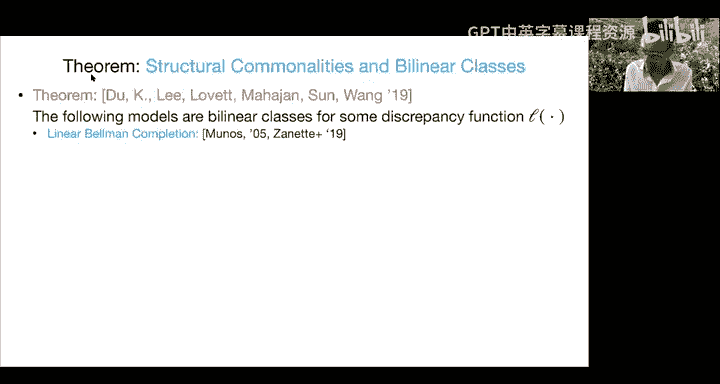

呃。Offline reinforcement learning。But。嗯。

That didn't work it can you see or you can't see this yes， yes so。you know。

 theres a question of like look， should we care about because like you know。

 to some extent we're asking this question someone ask like what constitutes a good representation from RL right like this is super fundamental you know。

 the entire area of deep learning is we want to learn features like what types of features do we need to learn to make RL stable？

Okay， and you know， Voas asked the question like， can you add a feature as a break？

That when we didn't do， I'm betting if you add some number of features you can make it。

 but here we did the experiments that。So offline ROL is something where rather doing explanation。

 suppose you have a bunch of data trained by some policy。You can get a similar lower bond there。

 I think I mentioned this for you boers last summer。

 but suppose you have a data set collected with coverage over your55 transfer。

So you kind of see all the directions in the Ps from your offline data set and to realize it。

Okay now the question is can you just evaluate a policy and this is like all the age because like these medical settings。

 we have a lot of offline data， can we just do evaluation on？Okay。

 and what we set up here is experiments where we trained a policy that was good。

We took the top level of a neural network。Which you would think of as that representation is good for。

Capturing the values of that policy。So these really are pretrained features for that policy。

 this is kind of all of the rage and deep learning you you know take your top layer on your network that's typically good so these represent this representation is definitely good for evaluating that policy。

Okay， now our offline data set is basically a mix of data from that policy。

And some like a random policy。Right， so we have a， you know， lots of data from。A policy。

 lots of data from like something random and our future was something trained for finding that good policy and now we just try to do some backup method and you get massive amplification even if it's like a factor of two random data mixed in。

And this is crazy because like regression is totally stable at every step。

 but the errors just keep blowing up because you get a little error from the first stage and it does not blow up additively。

 it's actually geometric and we see this。So somehow this is at least showing that， you know。

 we don't know if it's realizable exactly， but we do know that if we didn't corrupt it。

 the backups would defined fine with this represent。So I do want to stress that like。You know that。

And。The conditions we need。Just as a clear with experiment is like I'm basically doing backups with offline data and if I didn't mix other data and there's no interaction here so if I didn't and there's no learning here I'm just doing evaluation so if I didn't mix in any extra data this representation is fine empirical but you just add in like you know twice as much you know an equal amount of random data and everything explodes。

So this really is a case where I'd argue that sort of empirical realizability it's fine evaluating it。

 but a factor of two more youre terrorist and that， you know， that never happens in Supervisor。

Stuff like this。So at some level， this is pretty disheartening for offline RL because。

It's very hard to make it stable。But it also suggests。

these questions of future learning are very interesting here in ourL。And theyre very relevant。Yes。

Yeah， actually for three， it might be a good setting where it's not as if it doesn't really matter because like you say。

 it's not as if everything will broken。😊，Yeah， yeah， yeah。

That's right that's why I like these things because we you know。

 this offline lower bound and you know， there's a real question of like do these lower bounds say much of anything because like in。

 you know， the agnostic setting。You know， there's no interesting like the results for transfer learning。

They're super pessimistic but it doesn't matter like you take your top layer in your network and it's amazing right this is basically started the the deep learning craze you took these features and they were just great for every other problem。

Okay， but these are the pre trained teachers。They do not seem to satisfy the stronger conditions we might want for this work。

so yeah， so I think these lowerbons like one are very relevant because it's not like， you know。

 a lot of cases I don't think practice is working so much better than these things that are suggested by theory。

So。Yeah， I think both of these empirical papers are where the first one is a lower bound。

The offline paper， but the second one was basically experimental and if you just like read about the way people talk about some of these empirical challenges。

 you kind of see that yeah like，Things can blow up pretty badly in RL。

Sounds good any other questions or yeah excuse me Sean。

 thank you so much for coming today I just had a。Perhapss more of a basic question。

Could you go over briefly you know the difference between。🤢。

Online RL and when we have a simulator and what about having a simulator makes it so much easier in terms of the number of samples to find an optimal policy。

Okay， well。It's。I would say in the theory it's usually not the case that there's much of a difference so me go back to your question。

 so I think the question broadly is about the difference between having a simulator and not having a simulator。

 right？Yes， absolutely。Okay， so a simulator。Is just。You know， like if we're playing a game。

 we can start at any game。That's what it means， whereas not having a simulator means we have to start at state at zero every time。

Okay， usually like in a lot of the upper bound theory。

 it doesn't for the things I didn't talk too much about。

 but it doesn't make a difference that they're all a kind of poly equivalent so this is one of the few cases where you know this at least the second case。

嗯。Is different。And you know why I don't。Yeah。Part of it may be that you have a graph with a think that the random walk doesn't。

Doesn't mix because it gets right so so if you have if you have a graph if your state space is such that when where you random work with would mix and give you kind of a uniform distribution over the states then you you will not be have this problem Yeah exactly it's not even so like let's take a this example I get a so okay so there's two matter points here so I wouldn't necessarily say the simulator so in practice simulators are great because。

You know at least it gives us you know like maybe it is like exploration see but let's take it concretely in this example so why would what would break in this example for having a simulator actually let's just jump to our proof sketch but this is really a nice question so now we can look and see what breaks in our proof。

For having a simulator， let me just str to a approve scale。Okay， so。D back。

Okay so suppose we have a simulator。And we tried this construction。This one's fine。

Because features don't depend on Astar， have a simulator， nothing changes。

This one's fine because if you're a simulator， you still can't query the right action because I can go to any state I want。

 but I don't know which ones which action is a star so I'm still going to have to try things out。

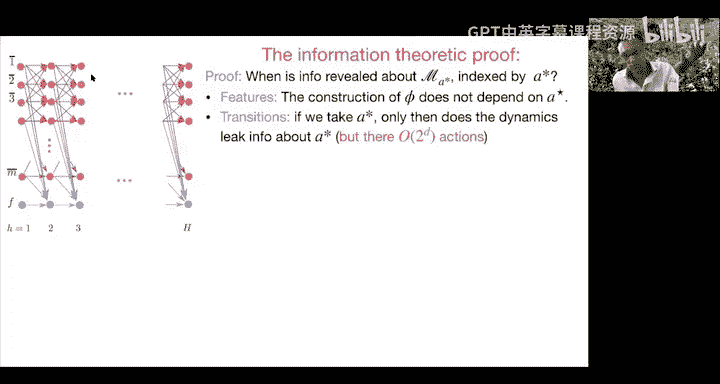

， let's like the reward condition， the first reward condition is fine too。

 because you know the thing that reveals information is taking action is on new reward。记笔。

The case that a simulator will help now is here we're always leaking to the very end。Okay。

 but if you had a simulator， what you would do is。You would。Take the last level。Okay。

 and now I'm just going to query the standard basis like I just take the roughly orthogonal directions in my feature space here。

 query those guys and now I learned the optimal policy at that last stage。Okay， and with an Ag Max。

 I've not only got an estimate of the optimal Q star， I actually know the Ag max。

like that part is critical， so simulator lets us jump to anywhere here where you can't get to that in by acting。

Okay， but note it's it's actually very subtle because now you can estimate Q hat gear。

But my claim is the algorithm of trying to back up our estimates will not work。

Because I've estimated the weight vector。but what we're going to do now。

 if we had to simulateulator to solve this problem is I don't use the estimates of the value。

 I actually know the aG max because with the gap， I truly have pinned down the optimal action。Okay。

 so then what I do is when I move backwards here。😡，I don't use my estimate。Of the value。

 I actually play， I get a fresh unbied sample by rolling out and playing the optimal policy。See， see。

 the algorithm is I go backward， but what I'm backing up is I'm not actually。

Estimating the value at the last stage， I'm actually figuring out the optimal policy itself and using that moving backwards。

And that's somehow critical because if that wasn't the case， like let's go back to。Our theorem。See。

 in this first one， just realizability alone， even with simulator access， we can't do it。

Because CC with simulator access， you could still say。

 hey I'm going to jump to the end I'm going to estimate Q hat the problem is。Using those estimates。

 backing them up will blow up。So see somehow the gap， there's two things going on。

 the gap is saying the gap in the simulator are allowing two things。

The simulator is saying I can estimate the Q had at the last stage。Okay。

 but the gap is actually saying you can get the a map。

Like it's somehow critical not to use the value estimate。

 but we get the value estimate the last age and with the gap， you know， once it's accurate enough。

 we snap to the Agonmax policy。Then it looks like just a linear regression problem again because I'm not backing up the values。

 but note without a gap。😡，You can't do that here and in fact。

 their result actually shows that even with a simulator， it's not possible with just a1。

But it's a bit more complicated。But either way， like， yeah， I mean。

 the question of like what simulators by you， I think is。I mean。

 I think this is a great question because I。Like MCTS and these go kind of things。

 it makes a big difference having a simulator and。In using it on the fly。

 so I don't think we have a good sense as to what the separation is。

 but this is at least one case where we see an exponential queryier complexity separation。

But you know， its very subtle。Cool， thank you so much。Thank you， Samm， you went above and beyond。So。

And yeah this this is super interesting and yeah really happy yeah you know I mean I mean I think there's just the final progress and you know I mean I have like more references and the slide and stuff like that and if anyone has ideas about the a equals to I mean this is a very hard problem but like you know someone just wants to do math the a equals two case I think would be nice。

😊，P that down which case the two action pieces like almost surely I'm betting the lower bound is min two to the a two to the As2 with any constant number of actions like right it's not about two right it's basically a constant or polynomial number of actions is get to get a lower bound that is exponential constant I suspect is fine。

Right now you really are using the fact that you have like an exponentially large set of actions。

 so I'm guessing that even if it's not just two actions if it's a there are two actions I'm betting two actions it might be possible or doable so there's a recent might it possible that by doable you mean it might be possible that there is actually an upper bound。

😊，It's plausible to me so so there is a result by people some of the similar people that if these star is linear and you have a generative model。

 then there's something。X been a， butpoly the rest。Oh， okay， so so this is pretty interesting。

 So this is why I really think the lower bound is。😊，So。The conjecture is that。

The lobon is really min of2 to the A，2 to the H，2 to the D。So that would be very， very nice to prove。

Yeah， I think this we。But we don't really know but。We do know this case is slightly different。

 but it's very closely related， so this is rather than Q stars linear V stars linear。

 note that that's subtle because if V star is linear you need a general model。To plan。

But they have a setting where V stars is linear and they have a general model and with two actions。

 basically it's you know the upper bound is two to the A， poly H and B。O。

So that's why I think this is the。You know， this is a reasonable conjector。For the lower bond。

And to some extent， like。I think it is helpful to just try to。

reveal the structure of what we need in some of these cases because their algorithm actually usually look at it's like some weird tensorory thing for how they get this with V star they write the Belllman equations in terms of some higher auto tensor basically and you know I it to something going Yeah not even linearized they actually write the constraints。

诶。In terms of。Yeah， I guess it's some kind of yeah yeah that's like you flatten it yeah you kind of yeah the tensor size is like two to the a kind of thing somehow。

 but it's it's a very strange。Yeah， there's definitely a lot of subtle points in that result。

So so even like in this kind of these baby cases， we don't quite have the like all of the the lower bonds or upper bonds。

And I think there's value in。And fitting them down。嗯哼。Cool yes thanks everyone bye。😊。

