# 因果强化学习讲座 ｜ Causal Rl p01 P01_因果强化学习——第1-2部分_ICML教程 -BV1nQZcBSEW7_p1-

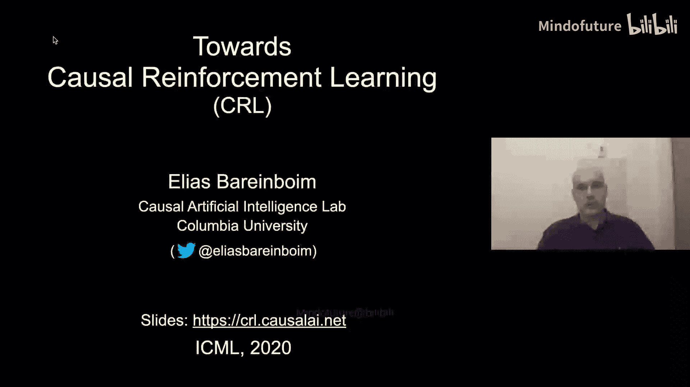

Hi folks， good afternoon and'm glad you be here online today。Thank you for coming。

Also thank you for the organizer Alessandra and Jerry for letting me speaking here today。

 my name is Eliliaas I'm part of the causalso AI Lab at Columbia University。

I'd like to first apologize for my voice， I'm a little bit sick。

But I think it would be everything will be fine today I'll be sharing what I have been thinking in the last years about causal reinforcement learning of this or CRL。

嗯。

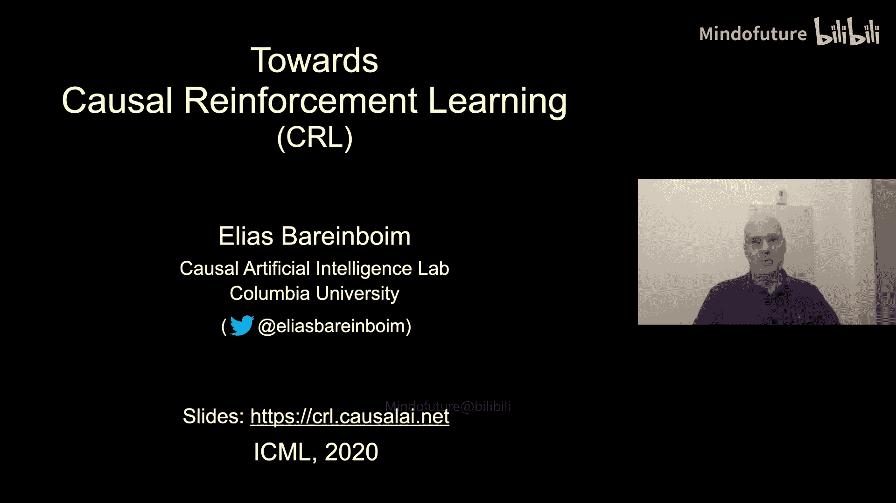

This is a huge effort in many fronts and there are many folks helping to realize this vision。

 this is joint work with the causalso AI Lab and many collaborators in particular I will discuss the work here today of the folks here at Taand Deline Howaan。

 Sanha John Z， Yuda， Andrew Delier and Thomas， and。

And I feel very happy and glad and lucky to be able to interact with this amazing team of collaborators to start。

 I would like to share a even broader picture。

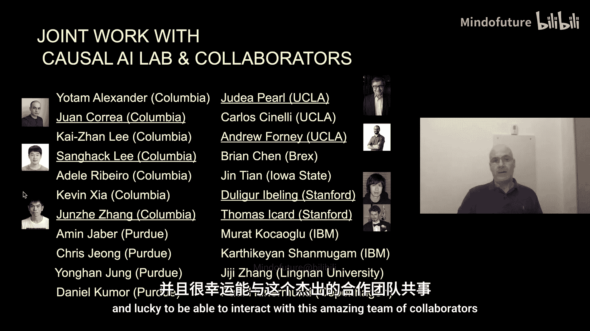

That is kind of from a 20，000 feet feel， which is the big picture I tried to realize in my lab in which causalRR is part and I think itll help to understand the way that I think。

 and if you're interested in joint effort or have questions or you want to exchange ideas about some of these topics。

 including causalRL obviously。Let me know since it is a really ambitious I believe picture and is a generational effort and my goal here is to convince you that those are important problems and offer you the opportunity to contribute but also to ask help。

Then I feel that the unique insight will here is quite simple in the lab or they are by powerful。

 namely that the reality can be decomposed in terms of causal mechanisms。

 which will call structural causal model， despite the fact that they are not always observables。

 and what is important about systems like that， that they exist a feature or they have a character is called autonomy or modularity。

 can find in many literature types of literatures like in philosophy economics and so on discussion about this feature。

 which will buy us a lot of power in general AI machine learning， the data science。

 we follow this picture that again， we follow this picture that reality exists。嗯。And it is modelular。

And modeling the sense of it can the compose as a collection of causal mechanisms。

 I'll try to make this concretes during the talk， the note that I put here the structure of DNA on purpose。

 this is what to。This was to convey the point that this is like it the blueprint of the underlying reality of the underlying system。

 I usually personal note here， but I usually joke a partially joke with you the pro that he discovered the structure of the DNA for intelligence or for AI and now we are trying to understand its consequence。

 pretty much in the same way that we have Watson and Creek 1953 in the nature of paper folks who are doing molecular biology before for dozens of years or hundreds and1 hundred as you say and so and。

And just no model mod biology since this discovery that is kind of an important framing about how to think about these issues and we are still trying to understand these issues today iss not that it was done 195 through as the beginning and I think the beginning starts with the structural causal model and pining as this collection of causal mechanism and thepining the reality from this view we have two sides of the coin or two sides of the structural model call as I use this name many times and I would define it first we like to explain it explain what's going on under line the system which is kind of the goal of science。

 we like to open nature as black box and explain how things work or how it could be understood in terms of more elementary and interpretable components there are books written。

About this topic in causal inference， this word has very special meaning and formal meaning。

 it comes under the different tasks and has the broad rubric such as effect identification and the composition。

 bias analysis and fairness， robustness and general's ability to cite a field。On the other hand。

 on the other side who can say Lee is I couldn't care less about science or explaining something I'm a pragmatist。

 I have my company to run， I want to improve the bottom line。

 I want to generate this better society here for my population if I'm a policymaker and I just want to decide improve something then this is the other perspective could in order number one and think about decision making the task here is how to learn how to intervene in a population or system using data that is never perfect match for this population machine learning this comes under the rubric of reinforcement learning as a sequential decision making center in the sciences you can have other names such as R mice control trial that is using the health sciences and so on。

For sure there there is some interaction between them， if you understand more about the system。

 usually this would mean that we can be more surgical， swift， precise or effort。

 I should say to bring about the change that we want to be social could be economical and so on。

 on the other hand， if you just if even if you have low understanding。

 but we have decision- making or interventional capability， we can interve in the system。

 we can shrink things up， shake things up， and if you' are careful about that about how deliberate you are。

 we can learn about the system。This is after all， even on the science side。

 this is how we do we are kind of isolate that careful way we can discuss how to do that but we isolate the system in some way such that we have this we will be able to discover something but thiss also through the idea of experiments now this is kind of more theoretical part。

 we can be trying to try to be more there's also the implications of that we are interesting about applications。

 education and software in terms of applications that are kind of two big big buckets I would say that are not not this is not a partition on the left side we have data science。

 were trying to do principle inferences from large data collections and what I mean by principle we would like to be able to stamp and this is stem saying scientific and we could discuss what scientific means in the context and on the other hand you have the problem of AI that we are trying to learn。

Piniples and tools for designing robust and adaptable learning systems。

This will be kind of the topic here today， we are focused on AI machine learning and in particular in the reinforce learning problem。

Today we'll going to talk about causeor in particular。

 then the first questions like what is causalor， and to answer these questions I would like to make two observations。

 first that reinforcement learning is quite awesome at handling simple complexity。

And also the credit assignment problem， given that you have this kind of delay you are that you take action now and something will just come up。

 have these kind of long time traories and the delay will come pretty late。

Very far from now then I think this is where it shines through and on the other hand we know that causal inference is pretty great or awesome as well in leveraging structural invariances across settings。

 conditions and environments， maybe there is a word missing here environments。嗯。

Then those are two disciplines that kind of evolved the independent， virtually independently。

 very clear interactions of。of cross development and the obvious question here is can we have the best of both worlds。

 I would be up front and say yes， given the I' enthusiastic about the topic and the question is how obviously and the solution is very simple。

As a simple equation， causal Rl is equal to C causal inference plus Rl enforcementment learning。

It sounds like a joke so supposedly， but that's the fact。

 more seriously what we are trying to do or our goal is to provide or to develop in reality。

 a cohesive framework that takes the advantages of the capabilities of both formalisms into account and I would say from first principles。

 we don't want you to have a hack here， or the best machine learning AI community here in the world。

 then from first principles， such data so as to allow us to develop the next generation of AI systems。

That's quite an ambitious go。For sure you have people in there is a whole spectrum here have been giving not exactly the talk but variations and about the particular tasks and we have the spectrum。

 but it oscillates between a lot of excitement saying， wow。

 that's pretty cool usually from the younger people and。And for our spectrum， but people are like。

 wow， once they understand， they say， wow， this is exactly what we need and how can you happen help and let's。

Let's try to realize this goal on the other hand we have the people that is more some type of resistance from both sides from the CI side and from the aL side some people can be more conservative。

 usually my experience because they are not understanding what the other person on the other side is saying it's obvious as well usually we get resistance as Max Plan says science progresses from funeral to funeral but I would say that the goal here of the tutorial is to try to bridge this gap and offer these common language that we can understand what are the challenges or what are the new challenges and what we are trying and accomplish then the outline here in order to realize this vision the outline of the talk will be I try to ground the equation that I get before and here is the outline I first to start to foundations of CRL of causal reinforceal learning I will give an introduction to structural causal models SCMs。

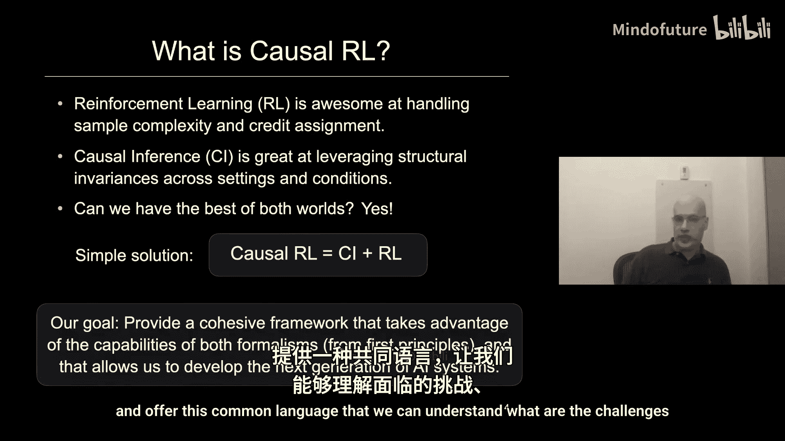

hierarchy， the PCH Ill explain what this means or the ladder of casation as it's called。

 and I'll ground how these things connect through a result called causal hierarchy theorem CHT。

Now a partial joke with the CLT， I think it plays a similar important central role to causal inferencefr those this is kind of basic fundamental material。

 then we will try to understand the current method of the CRL and CI through this lens through the CRL brands that were trying to develop。

Then this is the first part， it would be abstracted in some way but completely necessary in order to understand what are the new challenges and opportunities causalR of CRL。

 I would roughly try to do six immunos each， they asked me to do 0， 30 times four。

 I think it fits more natural or naturally， and they said it' totally fine。

 appreciate Alessander and Jerry， I would do 6060， approximately approximately。Now the goal here。

 one thing I'll say the goal is to introduce the main ideas， principles and tasks。

 as I said not focus on the implementation details。

The the as I mentioned just said having thinking about this issue for some time visit to different places my understanding is like people talking over each other then the ideas let's try to ground what are the the foundations what are the principles and what is really the task that were solving then the rest of follow it may take one month to months six months maybe one year as some of the theorems and papers or more that we're working but eventually to follow from these basic principles now for sure you can get the details or much more of details in the in these。

In these papers， this is kind of spread out throughout the literature since I started thinking around 1415 about this problem。

 there is a new CRL survey that is putting this idea together that is coming out soon。

 I'll make it available in this URL，cr。causeyI， but Matt the survey is not out。

 but maybe when you' are watching this video it will be out， but I will put his sources there。

Now let me start let's start from the RL side and that's evolve from there。

 I'll try to understand what is the subtlety， this is kind of textbook like definition of Ar。

There's a goal oriented learning how to maximize a numerical reward signal。

We are learning about from NY while interacting with an external environment。And it' adapted。

 there is nature that each actions is tailor from an evolving set of covariators with say features and the actions history。

 depending what you're observing now and how these things are changing and what we did in the past。

 we will be adaptly changing thingss the note here there is this components。

 we are learning from interactions， this I think is something important， there is the notion of go。

 we are trying to achieve something， there is the notion of environment。

 we have the external environment， then it means that we cut a line and there is something something that is not external and they needs to decide what to do。

It's a learning problem without the full specification of the system， we're not doing planning。

 but most of the many problems that I will talk here also。

 even if you're doing planning they will appear， but I will try to emphasize this other aspect today。

Now with this textbook definition is this is the textbook picture if you're teaching there are 101 in the first 10 minutes this is the kind of picture that you give or a variation of that you have the agent on the left side and the agent in reality something that is parameterized then you have this collection of parameter stta and on the right hand side you have the environment and very entire of the external environment and then it means that there is the agent now the agent is perceiving then there is this thing called the context of states some type of stimuli that comes in and then the agent do some type of processing and decides to do something and commits to this action it do the variable let's say x is equal to some value X and then the environment gives it back the are about what's the effect of the action。

 the environment is the one that is evaluating。Now now here just receives the feedback in the forms of rewards。

The agent's utility is defined as a reward function and the goal here is must to learn how to act so as to maximize some expected utility or expected rewards。

 the general idea of the year is like our unifying team that we have in AI that is we would like to develop rational agents and we have this link that's a classic result about rationality and maximizing expected utility。

Or maximize expectedancy rewards with their utilities。Now， that's good。🤧嗯No。嗯。

It's laid here at the moment， but。Oops。嗯。Now I was thinking about how to make the modelsest possible change in this textbook figure so that I could convey what I believe CRL is about and this is the picture that I could come up with。

In the left side now we have the agent oh sorry let's start to the right in the right side we have the environment。

 but the environment here is given by something called this structural causal model the environment is this collection of causal mechanism that they would define in one second in the left hand side we have the agent and the agent is this collection of parameter tapas but now we have the causal graph。

That would be defined as formally。And also in the picture。

 I usually think that I don't like the word， I think is overloaded。

 I think the best word here is like there are different types of interactions。

Perhaps they can passively being connected with the environment。

 as we say that it's observational through observations。

 it can be actively interacting through interventions。

 or it could be kind of doing some type of introspection or retrospection or using its imagine。

Imagination about this environment that's called counterfacts， which I will develop here soon。Now。

 just to make clear what I said， I would like to be as crisp as I can。

 the two cubes of which this is all what I said that I want to add to the picture。

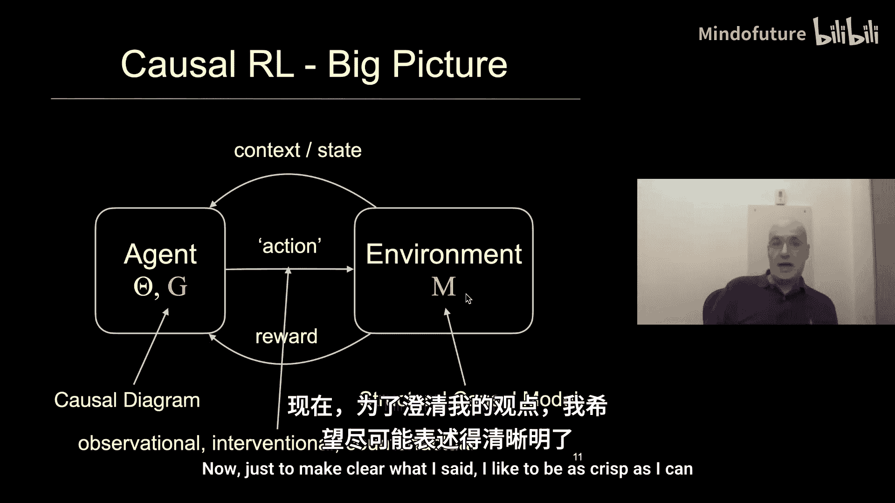

Number one， if you are trying to move Rl to CRL， number one。

 the environment and the agent will be tied tied through the pair SCM and causalsgraph G。

SEM in sign in the environmental site causal graph in the agent's mind。Number two。

 we define different types of actions of interactions which will try to avoid ambiguity that were given by this PCH by the pro causals hierarchy。

 that again， I would define formula one second， but that's at least the picture that I would like you to have so far。

 two things， two bullets， the pair SCM and graphra G and the other one is the PCH as mediating there about how these things interact。

Oh， I forgot about this one， let's define and understand number one that is the pairR M and G。

 number two， that is the P。

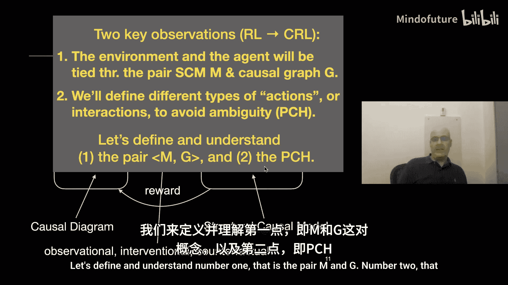

Now start with structural causal modern causal graphs， let's get into it。

I'd like to start with some kind of intuition behind what is a structural causal model that we are trying to represent a data generating model。

 there are different types of generative models of the environment or nature so on there are different types of generative models。

 this special one we talk on anyway with different semantics and so。

 but it's a process based approach， try to give an example。In the context of drug。

 assuming that we are trying to relate or to understand the relationship between drug。

 consumption or intake and headache。Now here we have the process based approach in which drug is a function。

 there is this mechanism that is given value to the drug。

 then this mechanism for subdi take as input the age of the person。

dependpend on the age group people taking drug in different ways that different propenss should take drug and also there is this variable you subd。

 you of un observed。And this is all other variables in the universe that generates direct variations to the variable drug that are not age。

Second mechanism， mechanism of the verbal headache。

Headache is a function of or gets its dialogue based on whether the person got the drug or not。

Depending on the age of the person。And you subage。What is U sub H。

 U sub H are all possible variabless in the universe that are not drug and age。😡。

Now there is also a graphic you could have a graphical counterpart of that。

 this is the graph that we have for simplicity here instead of drug headache and age。

 I'm calling XYz just make change little better start to attention from this specific name and on purpose here I don't pick an example in robotics or some other team because I'm trying to say that CRL is much more general than that。

 meaning we don't need to attach robotics even though there is awesome stuff going on including people that is thinking or doing causal stuff or starting to do causal stuff。

 but I would like to be less commito but。Soon these would be just high action， this would be outcome。

 and this would be a set of progress。Now what is the meaning of this here you have the start to having the processes that are related to this that are the causal mechanisms including in reality and here you have a causal graph。

 what is the causal graph， this is not a base map， this is not an MRF， this is not any other model。

 this is a causal graph， what is the meaning or the semantics of the causal graph。

 the arrows here if the variable participates in the Mac is not the other like oh H participates or gives values to headache through this F sub H。

 then you add the arrow from H to headache from Z2 Y。

If drug participates in the mechanism of headache， then you add thearrow from drug to headache。

If age participates in the mechanism of drug F subD， then error at propo Z2x thats this is a encoder。

 there' is some type of loss of information note here by the way one thing sorry one thing that they didn't say this F subD here could be a crazy function it could be a linear function that is very easy to think about or it could be a completely crazy one even the exhibit I don't know chaotic behaviors or it could be completely anything I'm not instantiated here in the slide I'm trying to leave it open to any possible function in the universe while here but it is instantiated in the particular problem while here we don't have clue of the function。

We kind of to have some type of coascent in here。Right now from a process that is going on through in this way。

 we can sample from it and we get what is a probability what data。

 let's say that we get a probability distribution P of z。

 there is some discussion that I skip about the P and the P hat。

 and I'm assuming Ill get back to that at some point。

 I believe we can sample from the process that is in the left side which gives rise to this observational distribution among the observables P of Z X and y。

Now we are here today today order and we can do statistics or some type of AI machine learning on top of that。

But you are here today because we are trying to understand about what the heck is causality and how this relates to interventions of to reinforcement learning now the idea of interventions is like what how the system will react when it undergoes some change。

And what's the change here， the changes like for example。

 we come from outside as an external agent or agent I should say。

 and we decides to change the models of Pari about how the drugs are being assigned and now we just make drugs equal to yes。

 then we decide to submit our population to have access to this drug。

 let's say this is by vaccine to the coronavirus。And this is the operation here。

 you are replacing or here the original mechanism with some other in this case is a constant yes。

 what happens when you do this intervention， the mechanism of the other variables。

 given that you just did the intervention drug remains invariant。

 that's where you start getting this autonomy or modularity。Now observation here。

 I'm just talking about the intervention yes， but this when you are running a randomized control study there is some kind of random coin there that is deciding the value of the drug。

 still it is not the same mechanism as people get the drug usually but is a different one is randomized but it' a different one it's not a constant but it' a different one than NA somebody。

 you can have more sophisticated policies as you would be interested that is a pi of age。

 depending on the age group。We decide site to give drug with a different likelihood。

 a different probability。Then that is different， let's say about how people are choosing by themselves the drug these F sub D。

 there is a different argument and so on， then there is some subtleties about when you have conditional policies。

 not for our discussion here， you can check this beautiful work by Hawaii with me about some of these subtleties and。

I think that's enough here， at least for the sake of argument。

 everything would be fine if I just put the ya here in order I can round things up。

Now there is also the graphical counterpart of this operation that is happening in the mechanism level。

 and here， as you can think， the Z is no longer the f sub D is no longer active than z is no longer affect x。

Then there is just a yes， there are kind this is where the arrow removal appears。

Here there is an alternative notation for that for the oh sorry for sure you can sample from a distribution like that if you're able to contrive a situation in the world in which you be like that。

Like the picture in the right side bar， now you can sample from this process and this gives rise to something called the experimental or the interventional distribution P P of z comma y given do x is equal to yes。

You also can have alternative notation that P of z sub x is equal S。

 y sub x is equal2 S I use these other type of counterfactuals and I' will mention later on。

 we will stick with the new notation for now。Now again， as I mentioned before， I alluded to before。

 usually we are talking about the drug would be in general any decision。

 the outcome would be Y would be any outcome that could be the Uward。

 and the z would be the set of features and I use these terms consistent with the notation that we have in causal inference。

嗯。Now challenge here is that which I will be back many times。

 usually you don't observe these mechanisms， sometimes you can observe the causal graph that is already disquicing and many times you cannot do the intervention。

Then usually we have data that is coming from the lefthand side and we are trying to do the inference in the righthand side as if we have done the intervention without doing it ass a classic then from saying the system passively we would like to make a statement as if you are doing the intervention in the system if you are able to do this type of very hard type of prediction of the effects of our interventions then you can be surgical and eventually you can avoid experimentation side effects it can be safer and so on。

😊，I'll come back to that again。Now let me just try to generalize this idea of interventions and equations or mechanisms describing some type of mechanics and they find a little bit more formal structural causal model。

 which is a topple with four components， V UF and P of U。

 the set V is the set of endogenous end or fromicide。

 endogenous variables or observable variables V1， V2 VM， in this case in the previous example。

 V1 could be D， the drug and V2 could be if you have had a or not， and V3 could be the age。

We also have the set U that is the set of X outside exous variables in the systems。

 U was unobserved and you have many of those。We have a collection of mechanisms F。

 big F that are functions determines the value of the endogenous variable variable。

 for each endogenous VI， you have this function FI that listens as follows you an metaphor in the book of Y but in general。

 that listens to the PAI， a set of observable variables called parents and the set of UI called exogenous variables。

So far as describing essentially the Newtonian physics or some kind of the feministic system。

The whenever decide site have a cut and you put some variables outside and you decide to analyze others like V。

 there is some uncertain about what's going on in the description outside the box outside the model that then there is a probabilitybabilities distribution P of view that we sprinkling there summarizing the kind of initial conditions of the state of the universe outside and this is what we have。

It turns out that systems like that。A Mior has axisomatic characterization thats as well understood in his work by Halpern in '98 and another work by Galles and Pel。

 Halpern's logician in。And Cornell is doing kind of awesome work and Dallas was you the student working in this particular problem。

 the more essentially any result that it derived today can be traced back to this one if you want to go to assembly called。

I'm more interested at least for now in the following observation。Once you have SCMM。

 a specific instantiate of this object， this implies this thing that we are calling the pro causals hierarchy or what is called the PCH usually causal hierarchy。

 I call pro causals hierarchy in honor of him。Now I would like to understand a little bit more or open up the box about the PCH for the sake of context。

 this is the main matter for the main topic， I would say of the book of Why， if you read。

 it was also called that the ladderder of causation。嗯。

I think as in chapter two if my memory is right， as I said we used to call in the lab。

 cause a hierarchy and this is different names， these will help to ground our discussion。

 don't forget the picture that we have before in which we have this I promise three building blocks the connection between G and M and talk abstractling give the math what they mean that G is coercating of M and now I also said that the point number two was about these different not actions but the different types of interactions。

 which is given by the PCH in which I would like to talk a little bit more if we haven't read the book。

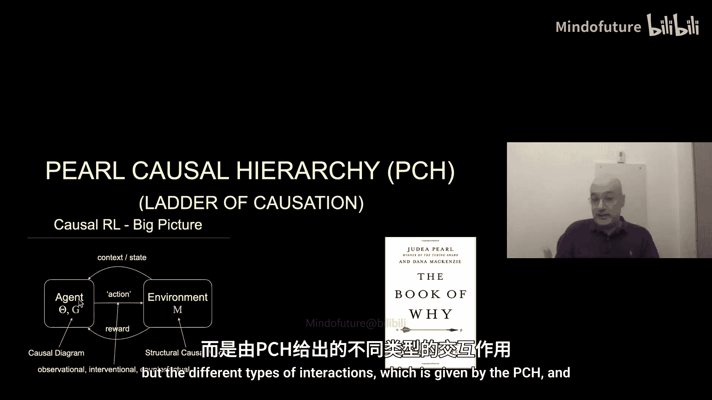

This is just a review， it would be okay if you haven't read the books or if you did read the book。

 that's fine that's great， I would try to review and ground in the way that I'm thinking about it that not exactly the same route。

It's mathematically the same and if you haven't read the book that's fine， you can read the book。

 it's kind of very good book， entertaining and good them。Nicely done。

 but it would be okay that I'll give you the basics here now what is this PClias that we're talking a lot。

 please tell me I'll describe this level typical a symbol typical activity， typical question example。

The first layer that we have is L1 that is called in the book is called rung。

 there is different rankgs， it's informal for the book we usually called layers。

The first layer is called associational L1， symbolically is described by words like P of y given access we have there is related to the activity of seeing。

 how would seeing X equal2 X might believe in the variable Y。

 what does a symptom tau as about the disease？If you want to find a counterpart in modern machine learning。

 this is related to study for many years in statistics and in other fields。

 but much or very successful in machine learning， this comes under the rubric of supervised or unsupervised learning there is many former a huge amount of theory about how to evaluate weight expressions like that of Y given x such as decision three。

 a long time based nets regression， hierarchical models， neural nets。

 challenge here why you have been studying this problem a long time。

 I get this question is like nowadays you operate with this Y given xs X is the set of features and why is the label for example。

 but this can be in the order of hundreds of thousand dimensions of millions even nowadays that I'm aware。

Then this is really really difficult， both in terms of computational or complexity and in terms of sample complexity because you don't have all the combinations then。

this is the reason this is such a challenging problem now on the other hand you have another layer that is called the interventional layer L2 symbolically youll write like that P of y given2 x。

Given that group serve C or context or state is related to the activity of doing if I do X。

 what if I take the aspirin， will my headache be cured？嗯。

That's nice in machine learning as you can hint， this is very related to the problem of reinforce learning that is why we are here today。

 there's different formalisms that can handle that and just list in some of them a causal- based NA。

 a CBN is called MEDP a maov decision process and there are others。

Now I have the third layer that is the counterfactual layer I will skip here the symbol for one second L3 is related to this activity on imagination。

 introspection， retrospection， why type of questions what if I had acted differently Why is zip the aspirin that cured my headache now I took let's say now let's try to pass here I took the aspirin that is X prime and now I'm cured and I'm wondering would I be sick that is why had I not taking the aspirin that is X then you have this counter the factual world in the factual world I did take it and I'm okay now Not really I'm also excuse me I'm a little bit sick but I'm okay now let's say X prime is took it took the drug and Y prime is。

I am okay， and I'm wondering what would have happened， had I not taken it？Then it's heavy load here。

 there is no counter part really in the machine learning literature。

 this is model and you can ask me questions even though there are claims here and there。

 but we can have a discussion but roughly there is not where I study the act there is huge amount of work in the CI field about that but still much more to be done。

 the formula isn't that to have for this kind of problems is a structural model。

Now I would like to make a note here about why is this a hierarchy and there hierarchies means that there is something about this is if you keep going up in the hierarchy。

 this is flipped， but if you go from L122L3， this is from the last detail from something this is a correlation between x and Y。

that we are trying to leverage here between the image that we are trying to pick up the signals with some outcome of some label to be more detailed about the counterfactual that is a very detailed description of the system it may sound a little I would say it may sound a little bit abstract for now stay with me don't be nervous that I use examples of layer three later on but I think we can get the feeling that this is kind of different task already about this collision of the world and this is very related to the problems of。

Blalaming responsibility， credit assignment， fairness， interpretability。

 all falls there in L3 is still not explored。In other words， I think you should study it。

 but in how it forms a hierarchy in this sense and I' would like to ground a little bit。

In terms of the amount of information that we have about the environment of the true environment。

 the true causal acrom， let try to expand the ground a little bit。

 given my expectation here that you understand roughly that those are different types of things and I would like to explain a little bit more discontainment that we have what we call the CHT as our partial joke as I think I already mentioned about the CLT which is a central element in the causal inference literature。

 it's believed to hold by the way I should mention historically for a long time by folks such as Uda Uda Pro himself。

 me one of the reasons very excited even came to the U us the causal result like that it was just proven in generality recently let me read given that SCMM impliesies the PCH and we can show that to defines or induces the PH we can show the follow result we CHD we very factual a back measure over some。

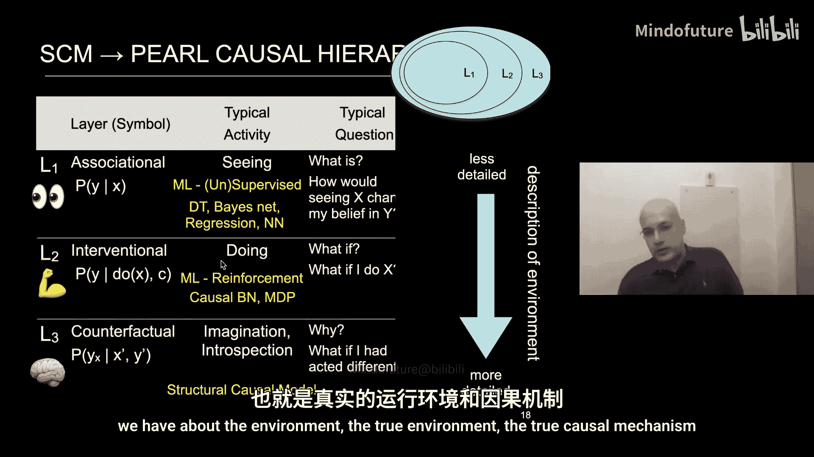

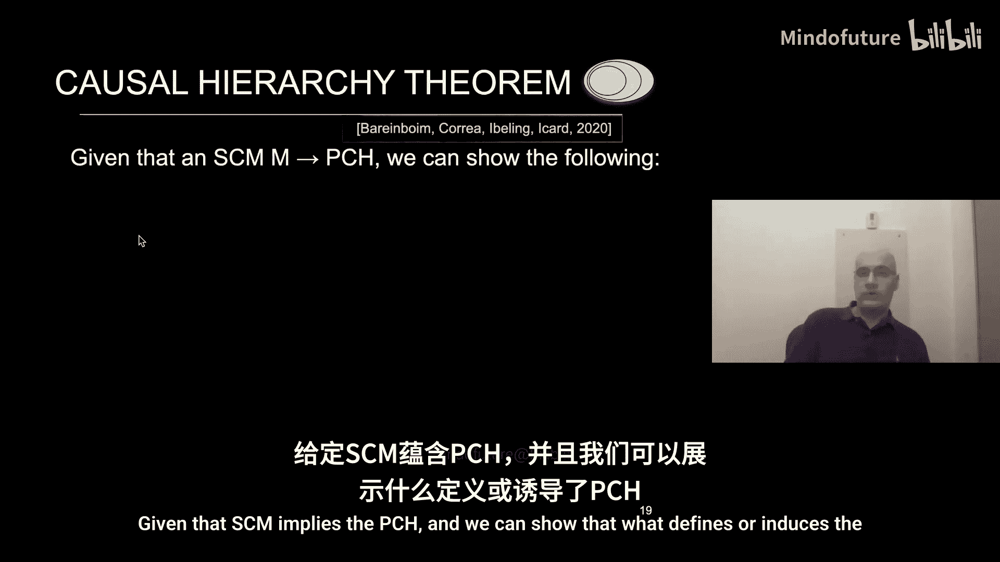

But technical conditions here over the SCMs， the subset in which any PC collapse I quoted here because I didn't define is measure zero。

Let me let me try to put with words in other words。

 for almost any SCM that you could get usually you don't know which one is your environment it is unobserved but for almost any SCM that you get the PC doesn't collapse in the sense that layers of the hierarchy remains distinct then you don't have this type of situation that maybe you do some the ideas like you have these notions of observations and notions of interventions it seems to be different if you read a book of wire if you think about that or about imagination as well。

 maybe in some world they could be the same we just don't know how to reduce one or the other。You。

In some way or saying no， it's not true， one is strictly more powerful than the other。

Then there is things that statements Dar way to say a statement about the world that L2 is making that L1 doesn't know about it or under it specifies。

Let me continue and throughout to ground Cor La here to answer questions at layer I about a certain type of interaction one needs knowledge from layer I or above。

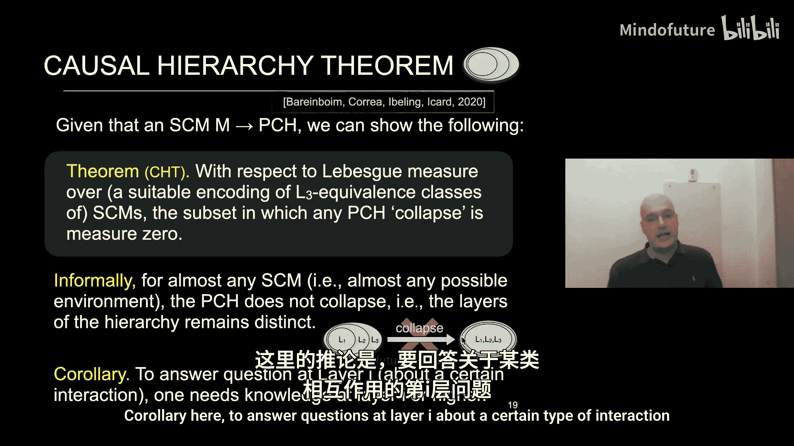

Let me try to understand try to connect here what we're saying I said the following each SCMM that is nicely shown here induces this hierarchy that is these different types of interaction。

 different notions in the world about observing about intervening and about thinking and so on now that's how good and nice and sounds beautiful then the question here is like why is this known trivial then why is causal inference known tri I can just compute everything from the SEM that I have one of the most common questions by the way that I get。

By the way it's very interesting thought or a dream， I would say， because in fact this is not true。

 things are not so easy， unfortunately exactly because as I wrote here in the title。

 CMs are almost never observable。Now even though this is important， even though there is a there。

 there is a collection of mechanism there， we don't fully observe it。

 we just observe some fragments eventually that is in the layers。Not all in general。

Now I should I have to say here， this is almost never， we almost as the title say here。

 S is almost never observable， for sure there is exceptions， such as in physics， in chemistry。

 sometimes in biology the various science in these fields is trying to learn about this mechanism then they are kind of zooming in in a very detailed level sometimes it takes 100 years or 250 to move from one era of physics to another。

 but in reality they are serious and and this is the kind of phenomena。

They are analyzing some type of phenomena that allows them to do that in some way。Yeah。

 it's enough for now， but I argue that most of the settings that we are interested in embedding AI and in which humans are involved it's practically impossible to get the description of ASIM。

The humans are in the loop is they are unpredictable。

 there is some kind of chaotic component there and essentially the problem。

 the complex phenomena is involved and there are social interactions and there are many other types of interactions that there is no way that we can isolate the system in some way that things are so clean then this is a first world sit in here we are acknowledging that we cannot get that this is important。

Point now what the do is then what are you talking I'm talking that supposed that to have an agent that is embedded in this environment and the agent keeps some time observing what's going on in the world then is's getting this layer one type of data through observations again this is similar to my picture before and'm just grounding with the PC the agent is getting observations and now the agents want to infer about what it should do in this system。

Now， is it possible to use the data from this layer one in order to make a statement about layer two now？

Unfortunately the answer is no， I put a bar there， why we just discussed this is the CHT CHT is saying that we cannot move across the layers because there is more information layer1 under the determines layer2。

 that's the tu。Then not possible now the question here is like。😡。

I say I mentioned there is given the unobservability of the ASEM。Together with the CHT。

 it seems that not if no inference is possible within the PCH。

 we cannot get any information here in the PC given that I cannot observe this guide and we have this CHT proved。

 then the question is what can you do， this is kind of strong negative result and the idea is like this is the very motivation why you like to study something thing about the SEM。

And these things is what we call this structural constraints。

 and that graph is nothing more than a collection of structural constraints。

There are different classes of graphs， I would say or different ways of eliciting of getting this one。

 I'll just list the common ones， the first one is use templates。

That is many times implic in the literature， but we have a moy arm bandit or we have an MDP or have a poDP。

 this is a template， even though people thinking algorithmically， if you learn open up the algorithm。

 you are able to extract the graph that is exactly the assumptions that they are making about the environment。

And have been popping out there papers here and there doing that but is a template we can do knowledge engineering that maybe you have some extra information about the environment。

 I don't know in economics people is able to elicit the instrumental variables then perhaps you can leverage you can leverage that it impose some type of constraints in the it is in code in some type of constraints about the underlying SCM for sure number choose more general than one because whatever other one is just is just that we would like to believe that the word conform is kind of cookie cutter cutter in some sense but manyhow then there is the third one that if you want to test or model or even if you want to launch from scratch if you want to build a baby baby actionsh that you want to keep involved and don't want to hard code the code there。

 this is called the causal discovery。The。In other words， that's kind of the motivation。

 let me try to put the pieces together because there are many conceptual blocks here that I mentioned。

 and I think it's good to summarize the environment or the mechanisms can be modeled as our ASM。

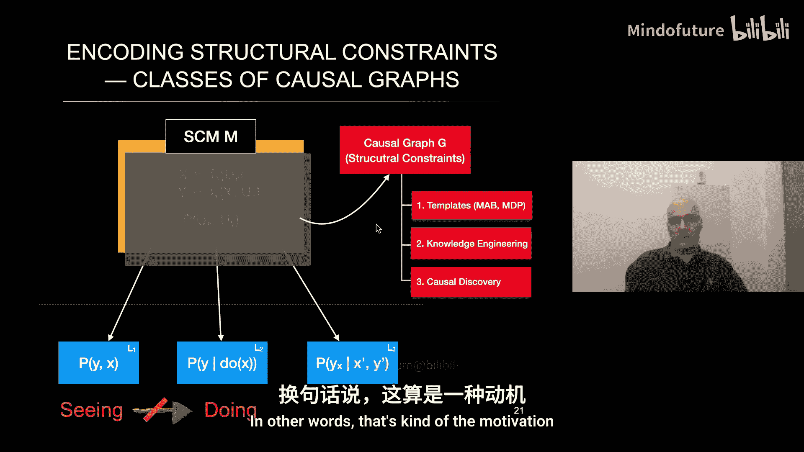

The SMM， that is the specific environment， essentially that throwing bad in your system is rarely observable。

Still， each SCMM can be probed through qualitatively different types of interactions or distributions。

 that is the PCH， observations， interventions and counterfactuals， and not only probe。

 but the types of interactions， but also modes of reasoning by the。

There is this way of interacting with nature， but now it comes the CHT that says that for almost NSEM lower layers。

 let's say layer LI under determines higher layers， layer L plus1。

Or above the limits are in some way constraints what an agent can infer based on the different types of interactions and data it has with the environment。

For concreteness， I already give this example from passively observing the environment that is out one type of data。

 it cannot infer how to act。From intervening the environment。

 all possible interventions and you doL2 kind of data。

 it can't infer how things would have been had she acted different。

 that is the altered type of statement。The and I'll just give you the example control that then the cause of roughq is a surrogate of this underlying system and in relative of the structuring variancees that I called the。

Casso graph is a surgate of the structuring virus that underline the system underlying M。嗯。Now okay。

 that's what I think we have the building blocks has promised we have the pair M and G that is including the relationship between the environment and the agent and now I have the PCH about how these guys interact or the types of modes of interactions that you could have still abstract。

 stay with me， now I would like to discuss。the connection or how this allows us to interpret the methods that we have today in ourL and inciI to what I'm calling the CRL lens。

 so the machinery that we are developing just now， now the goal here's the deal。

 the goal that we have is learn a policy。第。A policy pi is such that a sequence of actions when you apply this pi whatever argument。

 it will turns action x1 x2 xn that maximize some kind of reward e of y given do x of pi then I'm just saying here that the x。

 the way that you are picking the value of x。Is true pi pi is the one that determines that this is a notation that I'm using there are different notations and the argument here I'm living unspec。

 but it could be any type of argument we can get the argument C。

 you can the context you can get the argument pass and so on。Now。

 the current strategies that you found in the literature。

The first one and I will just give you the map and then I will detail them。

 I will give you three the online type of learning or electrical interventional learning。

 the ages performs experiments herself， the input of these systems is experiments on the form do X I Y I that goes to learn the Y given do X such that to electro evaluate that some kind of average over that。

嗯。😊，The second mode of learning， the agent learns from the other agent's actions。

Now one agent is experiment itself， the other agent is learning from the other actions。

 now we don't only have other experiments， but we have samples， samples in the form do X I Y I。

 we're still learning trying to learn the y given do X。The third one。

 agents observe other agents acting。And you like to learn out from there here the input are samples of X IYi note here that one to have samples and samples。

 but here we have XI and here we have doxiI。Here we have do X do X here we have experiments and samples now it's subtleto the most common questions about the number two。

 once thing that I should mention both of them are flying。

The subtle here that youre trying to convey is that here the key word is the agent is deliberate。

 we are learning from the other agent's action that was deliberate about how you decided to pick this variable toxiI this is why you were putting do still samples because you are not the one that experiment。

On the other hand， in the Du calculus， you have samples and you have Xi because you don't know the other key were the reasons that led the agent to pick this X。

Again I go one by one， but here the first one essentially we ignore ignore whatever it's there just do the intervention when we are trying to move from the actions of other agent to the action of me as an agent and the last one we are just asking whatever're just observing the person doing something that we have no idea if deliberate or not maybe just casually subconsciously even you have an example like that in some task later on and we are trying to learn how to act from that now I go one by one a little bit slowly。

The oh， this is just a bit of notation here that is doX do X to doX and CVv to the DX。

 let me try ground a little bit more online type of learning Find the X star is immediate once the Y given doX is learned。

Because we can kind of essentially a it challenge here is like why given due X can be estimated to randomized experiments or adaptive strategies。

 you can use our UCB you can use Thompson simply you can use whatever you to the site adaptedly。

 but that's the idea here of the online learning just to two examples that are prominent or you can do experiments oner。

 the positive here is like it is robust against unobserved confounders that is variables that are affecting more than one observable。

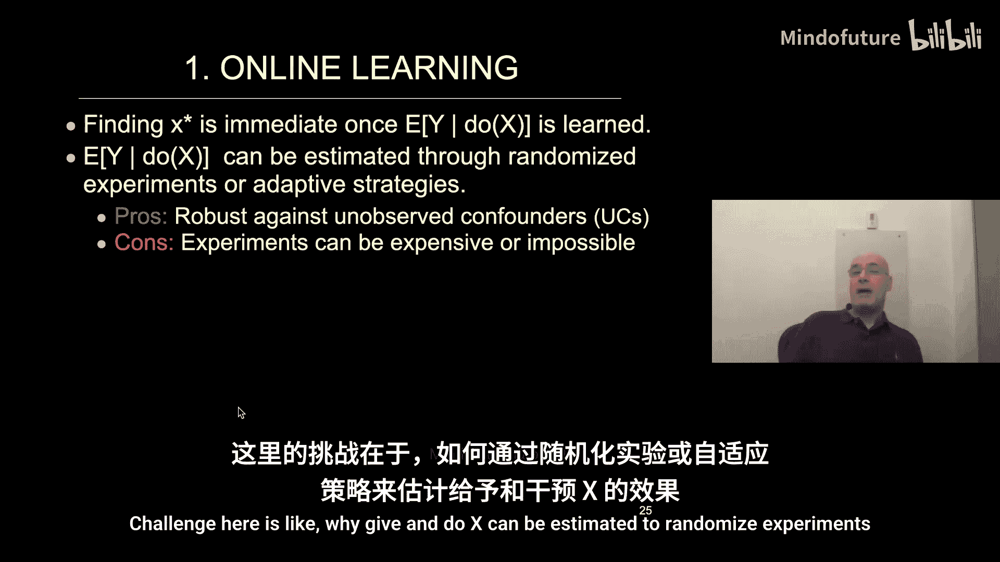

The negative experiments can be expensive or impossible to conduct or unethical。

 hard to do experimentation with human subjects or can lead to side effects or may lead to the。

To the destruction of society because can be harmed where I can be evil eventually。

 then all the times that you're doing these experiments online。

 this is what we're eventually getting。嗯。Here's the graph that you have to have the word preredomization of whatever is going on here。

 you have some kind of decision X， the outcome Y， and then you' have this anob circlefoer U that is both affecting x and Y would be any variable in the universe here。

And now we are saying that whatever I forgeting about whatever is in the world。

 I will submit this system to this policy supply that will pick up the value of x。😡。

And this is what online learning means， this starts as I alluded I think， but from Fssure to Bute。

 I think is one of the biggest insights of the previous century in the early 1900s about how to do that that opened up the whole。

I would say end of causal inference and force millenia as well。

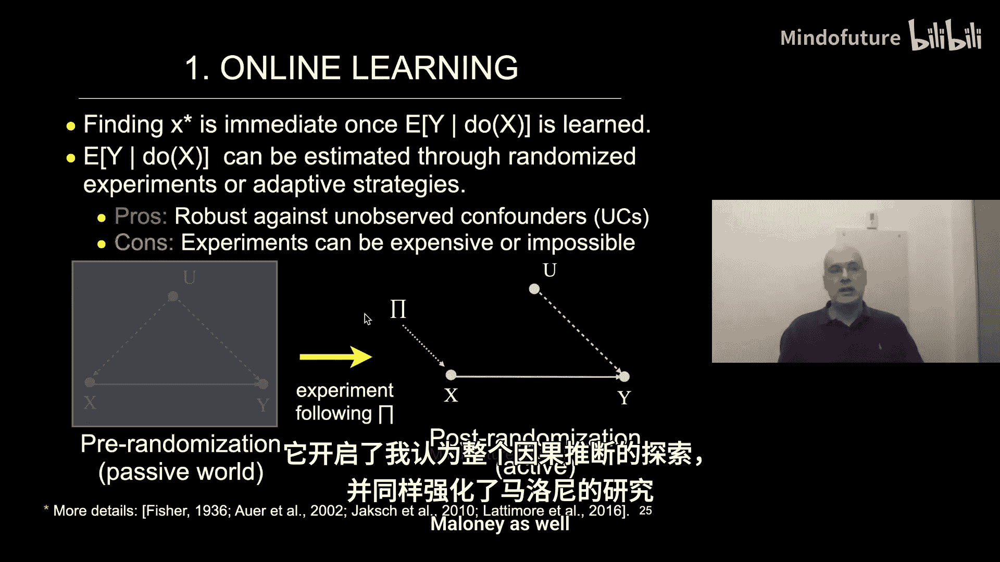

Without knowing or doing that explicitly now this is the picture。

 the other way that I like to think about the picture， I just copy what we have before。

 but now I like to think in terms of the data， whatever is going in the world before I want you to read ignore data。

 Ill just submit the word to these policy pie and I start getting samples that is this kind vertical lines here。

Now， which means that eventually when I'm sampling here and getting x that is determined by pi。

 Ill eventually be able to get some type of y given to x in relative average over y， but that's fine。

Then this is what is in the mind of the agent。嗯。Some kind of interesting results in the our paper IL this year。

 but I'll leave you to think about now I'll let make a note here about the covariate specific causal factor or the contextual setting or the stateful setting。

 the model that I just gave the kind of tau with x and Y and U can be augmented to accommodate a set of observed covaris。

 also known as context or states。The U will be the set of remaining unobservedfounderers， the U Cs。

 then you could have the origin you see that is my picture and now can get some of these U and pick up and put as being the C。

That's totally possible， the goal here will be somewhat analogous we are trying to learn a conditional policy。

 learn a pi of C so as to maximize the optimize based on the C specific causal of effect P of y given to X from a C。

Now why is this important first because usually we have context and usually you have states but also because it's very challenging。

 usually we have a high dimension of C that could be 1 million dimension we're talking about pixels or videos and so on here's an interesting connection that I like my animation here at Disney level P level。

 P maybe in that I'm available here in the market after this animation。This was a talk。

But this is kind of flaming hot now that is like given that we have the C that is super high dimension or even from the pixel level。

 we would like to have some type of function approximation or some kind of dimensional eyelet reduction to be able to pick the decision X to have this mapping from C or2 s to X。

 then deep learning or is just perfect for that and DRL is actually leveraging this connection。嗯。😊。

That's a point I'll be not talking about that here today I think it's pretty cool。

 I'll try to I'll be humble some people think that's not good and I say that but in the sense of why I'm not operating this level now if you're curious you can ask me later but here I'm trying to exhibit or just show these other dimensions of types of interactions then I want to isolate the issues then that's fine but it could be compounded in the usual way that we have been doing。

They are not so usual but it's fine the second model this is online learning now the second one is theyre off policy learning why given do X can be estimated through experiments conducted by other agents and different policies the positive here is that not no experiments need to be conducted which is kind of the dream because we don't want to kill society or two people or for society or have these negative effects sometimes it's not ethical to do experimentation for other reasons as well N is costly as well you do an experiment with It know a few hundred people and can cost maybe five million bucks or so this is the no need the that rely on two assumptions a one the same variables very randomized and it should the context need to match across that and let me show you the picture that this becomes clear note here that in the left side to have an agent that went online that's say and conducted and。

with this policy pi prime that is deciding the value of x again。

 you can put a context C exactly got the same， but speaking the value of x now you would like to speculate or to predict the effect of what would happen when you have this policy pi。

Now the assumption that I'm saying a1， same variables are in the scope of the pulse。

 then pi prime control x pi is control x as well， then that's cosher， that's fine。😡。

Now the context needs to be the same that is they need to match the C here is the same。

 the policy here at least C is equal to empty。Because it I average over the U and here C zip20。

 then that's fine。Then we can use a technique。Call IPW， for example， inverse probability weighting。

That allows us to move the data that we collect from the policy prime in order to compute what will happen with the policy pipe prime to get what will happen with policy prime and we made same example on top here I just want to ground with the picture that I usually like in terms of the data here have an agent that collecting many。

 many data points following this policy pi prime this is full of these vertical kind of lines and now we have another agent that don't want to go to the environment and just want to know can be the same agent another day once you to know what will be the effect of the policy Pi then the idea is like let's use this IW this is a formula here on one variation of how can you show that that you are kind of use the inverse of the probability of what you did to kind of discount the effect and you multiply by the new probability and then you can get whatever you have the effect of the new the P of Y doX。

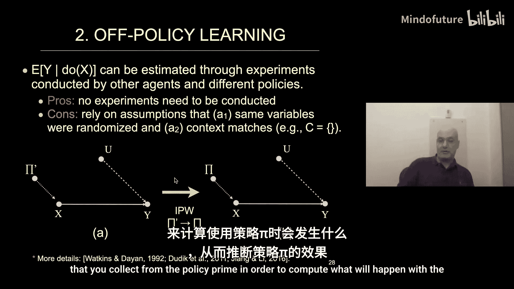

The why is this interesting and white people care about that。

 there are hundreds of papers written about that in nontri。

 the idea like whenever you' are in the contextual setting that you have this see here。

 again you have the dimensionality problem。And you can do more statistical。

 try to do double robustness and try to understand propens score and things like that。

 or you can do machine learning and try to do dimension auto reduction。

 but still there is a lot of challenges or it's very tricky in the sense that the variance may blow up it is an issue this is off policy still no matter complexity that's the summary of the picture。

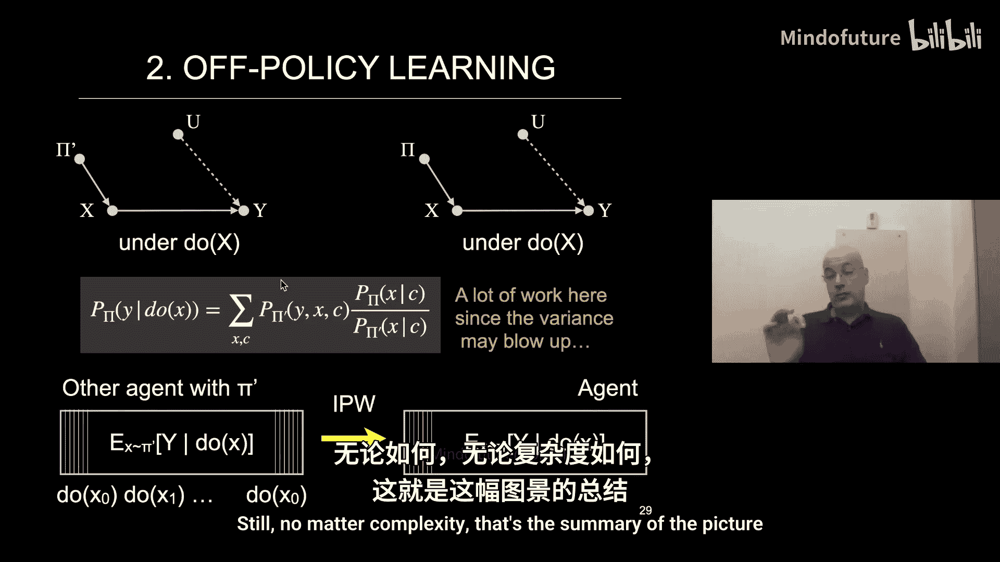

They are over the same action space。And the same context， they have the same perception。

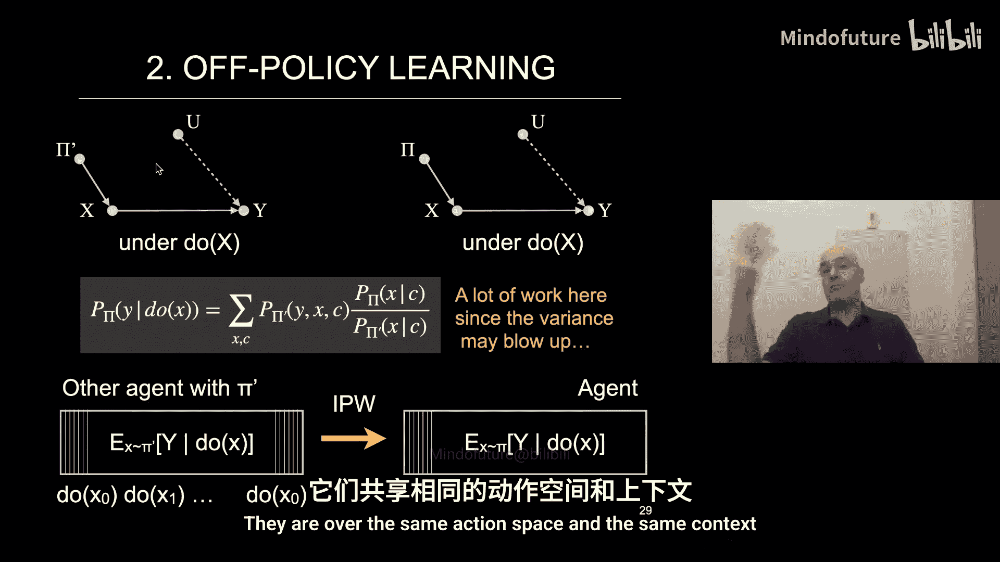

W which I think is very hard to hold， but I will come back in the second part on that no two agents。

 I really have this sentence or I don't know if I have this presentation in the second part。

 but no two agents are created equal， even to win robots， you let them evolve。

 they start having different sensors the appos changed a little bit。

 the way of the light of the way that they perceive the world and so on。

It's hard to hold but sometimes it holds us approximation we'll talk about that now we have the third modality here that is the gooddu cs learning why given du X can be estimated from non experimentali data also called the natural regime or the behavior regime the positive here is our estimation is feasible even when the context is known and the experimental variables not match in other words the of policy assumptions that we have before are violated。

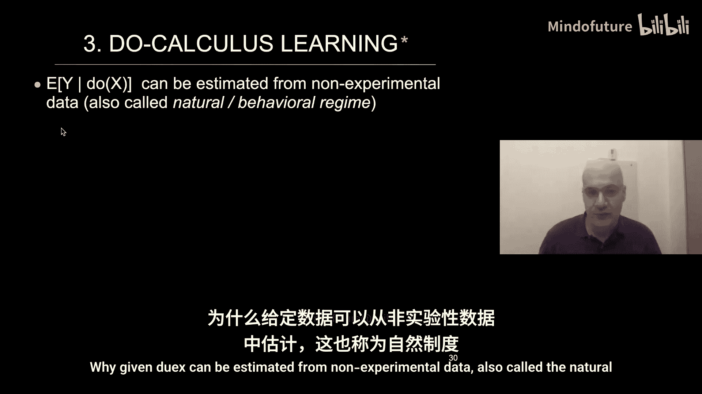

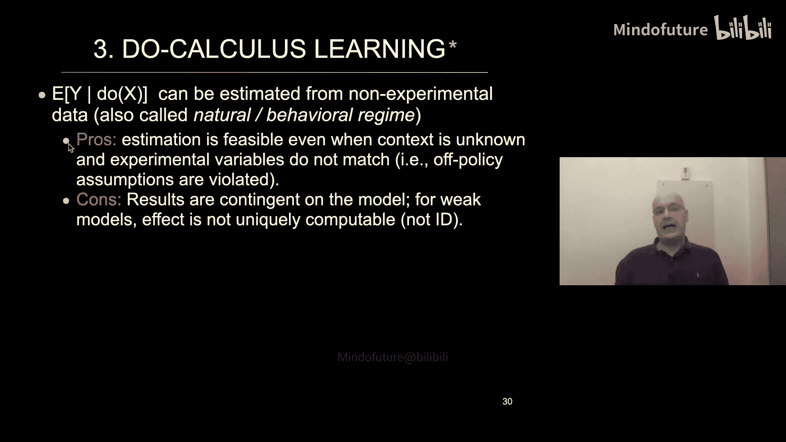

And you can ask me why I'm。Sely8 and two and three personal preference that I trying to distinguish the literature and having a better classification。

 again， both of them offline and do cs more generally because you take this type of assumptions as well。

 but focus in a different part of the problem when I started about what's the difference between our own。

 the focus is more about the inferences that are there。Let me continue sorry， parent this。嗯。😊。

The negative here is like the results are contingent on the model for a weak model's effect is not uniquely computable。

 it is not ID， possibly not ID now here is the model that we have you can have this period in the left side who can have the passive world that is how reality is going on note here that they use still affecting x and y but perhaps you have another additional knowledge that the mechanism there is a third variable Z and the f of z is listening to the variable x and the variable y is no longer listening to s x is not in the argument of y but Z is in the argument。

They don't have this type of chain there， and this is knowledge， this is structural knowledge。

 you don't know exactly what are the mechanisms， but this is creating some type of inference that could be leverageable。

Now you can do this do calculus inference and you would like in the mind of the agent to know what is the P of y given to x to follow this policy by here without doing the intervention。

 without doing the intervention。There's more details here， this is a well studied problem。

 at least in causal inferences this survey with me and Uda in the procedureing of the National Academy that I think is sure interested in the problem。

This is the picture that we have before now again thinking about this is before topologically or in terms of the invariances or the world that we want to talk about。

 this is in terms of the data I have plenty of data here collected observationally the of Z X and y we don't know if the guy did any intervention in this case I forgot to say in this case clearly the assumption from from the of policies violated。

 note here that the A1 is the same or you don't even know in reality。

 but a choose is violated because it's the same because we talking about the action X which is the same but A choose is violated because the first agent。

 the policy。The context of the policies is this variable U。

 why the second doesn't have access to the U because U is unobed for the agent us in reality。

 then there is a mismatch here that you already you can try as you want and for sure you can get numbers doing the evaluation with the IPW but the results are not true。

It's not the equal to effect of the policy now you can run this Ducalculus inference engine and you have this some type of mapping here。

 this is a F I should have added， this is a function over the P of Z X and Y that allows us to create the mapping。

These observations， there is some kind of more general results than that。

 even if you don't I have only observations but we have a combination of experiments。

 this is a paper with SunAC and Ju that I mentioned in the beginning but lucky this was the best paper in UAI last year the very nice fine piece of work but it's exactly about the generality about how to take data that is a different modalities in some way in terms of these interventions I will talk more later but let me go back to the summary here and I'm almost done with the first part more two minutes I think I talk at about three different modalities I talk about the online in which people is forgetting what's going on in the environment doesn't matter。

 Ill just go there， forget what is before， Ill just go there submit the work to the policy P pi is deciding the ver ofax or pi of C is deciding the verax and I keep doing that a lot and I was sampled from the system this is called the online line。

Now you have a the off policy method that here there is a policy that Ta was Zoo going that was pi prime that you have a du pi prime that was speaking the value of x。

 and you will actually understand how it would be the world if you do pi x。

The variable of axis picked by pi， and we have this idea about using the iPadW to flip things around and be able to compute it is contingent on the assumptions。

 A1 and H2 that we already said about having the same action space， the same actions randomized。

 and having the same context of the same perception， the two agents have to add the same perception。

Now I have the modality tree here， at least the basic version that you said that we have observations from the environment。

 we don't know， it was not， this is what I mean， it was not deliberate， how people picked the action。

 maybe or they observe even the U or the U was or they sitting on。Apologies。

 but we don't know even in the subconscious lab， or perhaps they ask the agent to the Bay fact by acts。

 but you don't observe the you。And you don't know the keyword that I said at the time。

 we don't know the reasons for the action X， there's no randomization there not controllability there and we will actually understand about what would be the effect when you control the question for us here is like do these strategies always work？

Do these factors exhaust all the possibilities， I think this is the questions more broadly。

 is learning in interactive systems essentially done？嗯。

And I'll just mention a quick eye because I think I'm seven minutes behind I don't even know what I said more but the the。

This view about easy learning in the interactive systems essentially done that is pictured here this means that all possible learning that we have in the world that are called about deep parallell whatever you fit in one of these buckets now I get a quote recently I was in the weekend the previous zone change view of someone very prominent entrepreneur and academic and a team with。

Access to billions of dollars and the person said the interview say are not mentioned for sure。

 but the person said oh。What do you need to solve AI or what's going on and the person said I don't know exactly what it means。

 but or how much time you take was a question， but what does it mean that a person said，" oh。

 what do you need to solve AI is to scale things up？

And if you keep doing that and maybe we spend a few more billion。

 hopefully this is the cold andm part of physics life perhaps many。

 many more billions but eventually get there now this is what I'm quite asking here is it done and you need a building like that with tons of PhDs in the best places and very well。

Well paid and we'll do more of the usual thing and then it'll be done because we'll befi one of these buckets。

 one of these buckets or is there something else， some other modalities for learning that eventually are needed and I think from the causal perspective will know that more it's needed and the question what is missing and this is what I would like to talk later what I will do is I will get the baby the simplest possible examples that I can get in each of these modalities and I'll show how things break up and how these are very important central tasks in what CRL should be we can discuss about how to scale this up and this is I think is very exciting and with the summary here what we we discuss so far I started with this RL picture and I said that the two bullets is like we have the environment that is modeled to the SCMM and we define that this is the object。

we have the agent that is model as a causal graph that is some type of model about the invariances of this environment。

 and now we have something that is the interaction between these two pieces and then the PCH gives us a way about layer1。

 layer2 and layer3 about thinking about this different types of interactions here I fit more prominent the two types of interactions that is layer2 type of interaction that is we just focus on layer two forget about layer1 and layer3 and keep doing experiments this is layer layer two type of data or we try to do some type of offline learning that in reality we are trying to use from layer one of the other agent and see if we can predict the effect of our intervention that is layer2。

that's what I've said now I would like to explore a little bit more and more even more more type of cross inference across the layers of the PCH what could be other modalologies。

 I think that's what I have so far and I will come back soon I'm available for a questions even though this is virtual I guess but I will be available I guess no I'm sure but I guess I will be available to answer questions thank you。

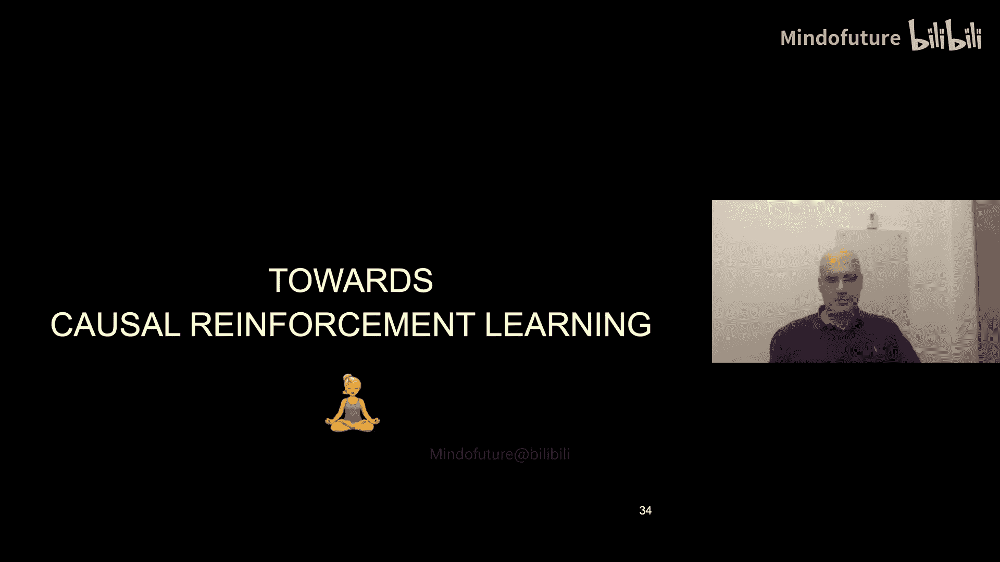