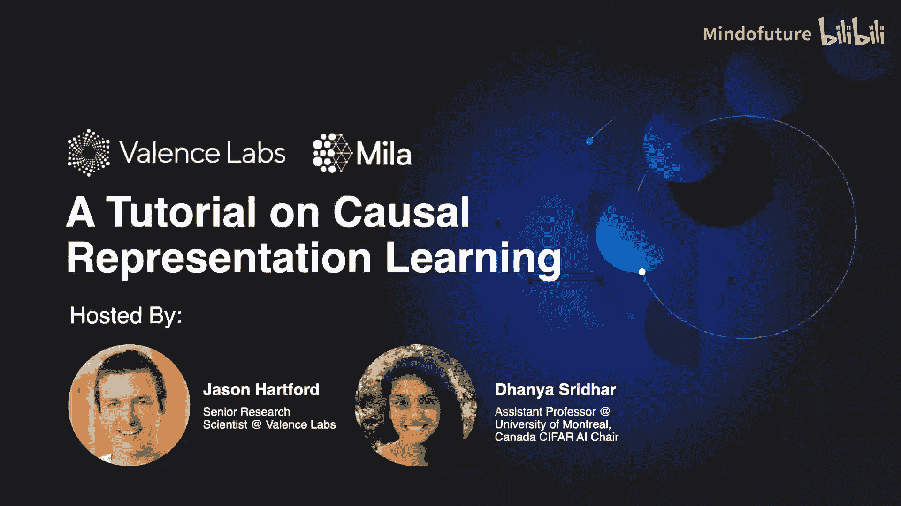
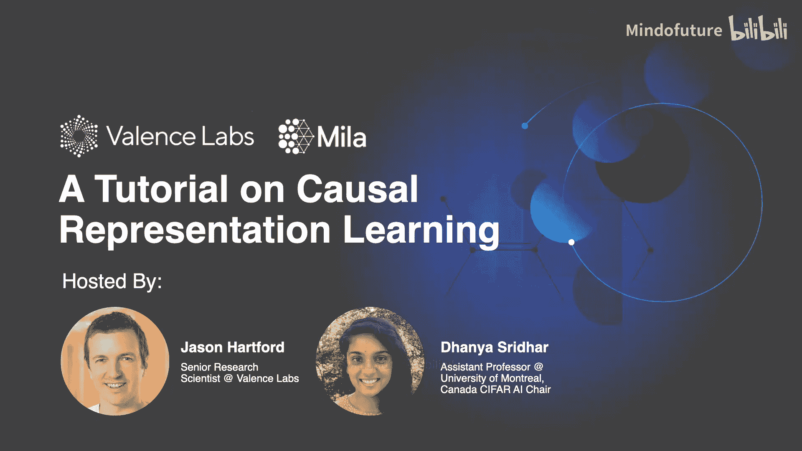
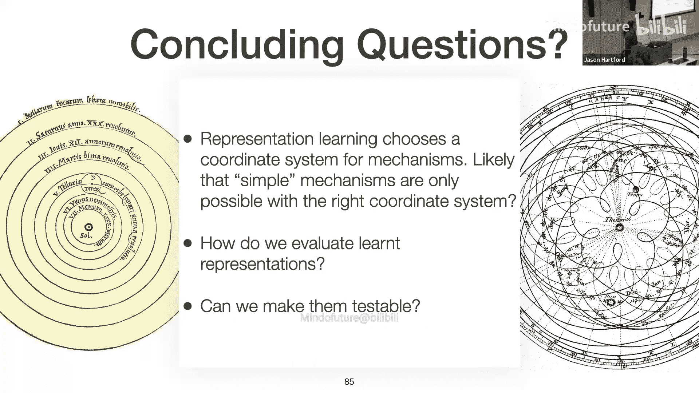

# 因果强化学习讲座 ｜ Causal Rl p02 P02_因果表征学习教程-Jason_Hartford_Dhanya_Sridhar -BV1nQZcBSEW7_p2-

All right hello everyone thank you so much for coming two days before actually I'm aware that everyone probably has a lot of you probably have other things on the mind so so I'm pretty pleased to such a great turnout I'm Jason I work at B Slabs here and I did by postdoc here at Mina and this is Da she's pro here at Mina and continued a lot more by causal inference。

😊，So yeah， we'll follow up in a bit。😊，Cool we yeah this is just for some some context this is a tutorial that we originally prepared for UAI that was a two hour tutorial we Tri to Millo has told us they're kicking us out of here。

😊，For any past， I think 12， so we try to chop it down to an our ish。Keep the questions coming。

 we've kind of structured at the important bits are at the beginning。

 so if we run out of time we can just discuss more at lunch so yeah。All right。

 so this is a talk about what I think is kind of the future of causal inference。

 obviously that's a controversial statement， but before we can talk about the future I think it's good to kind of start by thinking about we kind of how we got here and take a look backwards and so at the risk of gross oversimplification here's causality in one slide。

😊，For the first kind of for the last like 300 years。The first 250 years of causal inference history。

 it was kind of one tool in the causal inference toolbox and that was experimentation right so if you wanted to understand a world that was too complicated to kind of mathematically reason about so if you're not Newton who's reasoning about gravity just by pen and paper you have to understand the world through experimentation so for example James Lnd in the 1700s when he was hanging out in the English channel was able to show that Ctrus was useful for prefer exccurion sailors right and he did this by running an experiment John Snow whos sometimes regarded as the founder of modern epidemiology was able to show that cholera was caused by dirty water by removing a pump handle in Broad Street and soho in London。

 you actually go and see that pump still today it's kind of fun and so this kind of role of experimentation was central to causal inference and it was formalized in the early 1900s by Ronald Fisher in his book The designer。

Experments that was published in sort of early 1900s。

And kind of this was the way you understood the world right so if you wanted to do science。

 you wanted to do applied science， you ran experiments right？

And the limitations of this approach to understanding the world was kind of highlighted in the 1950s with the debate around smoking and cancer what wasn't controversial at the time was that smokers tended to get lung cancer and lung cancer patients tended to be smokers so there was a strong correlation between smoking and cancer but someone like Fisher who I think statistics would kind of prefer to forget if you wasn't such a giant in the field for many reasons that with vehemently opposed this to applying a causal interpretation to this association he pointed out kind of rightly that you couldn't just assume that because there was a strong correlation there wasn't some say genetic effect there was making you both more likely to become addicted to cigarettes and more likely to get cancer right so maybe there's some gene that sort of just makes you have a more addictive personality maybe that also leads you to get cancer via some other other pathway right？

And so he pointed out that we have to find a way of of doing this now he would have argued for doing a randomized controlled trial but that's obviously deeply unethical in a case like this。

 you kind of don't want to have a flip aco and say you smoking for the rest of your life and you're not and we're going to see sort of who dies that doesn't seem like the kind of thing that's going to pass any ethics board and even if even if it wasn't something so horrendous as that you know just for practical reasons smoking takes a really long time to show its effect and so you kind of want something where you can discover these effects more quickly and so that led to all the work in causal inference from observational data so through the work of people like Pel who we should all know as a Turing award here in computer science and then Don Ruuben in statistics or Jamie Robinson in epidemiology Rito Emms and Josh Angust in Econometrics so it's just sort of inter disciplinary field。

People working also understand how we get causal effects from observational data。

And that kind of expanded this toolkit to be a pretty rich set of tools that you can use for estimating causal effects。

And we can get some kind of idea of the impact of these tools by looking at economics and why economics。

 well economics has kind of a funny publishing culture， if you're from CS。

 they all want to publish in the same top five journals。

 no matter what subdiscipline of economics you're in。

 you care about these five journals and so you can get kind of a good idea of what the field cares about by just reading those five journals。

 and that's kind of what Bryce Martintina Huford did in 2019。

 where they made these word clouds of the titles of the 500 Mo cied articles from the AER。

 the journal of political economy and QJE， which are three of the top five journals。

 and you can see from the 50s to the 80s economics was a theorydn field。

 might sound strange if you're not in Econ but this was kind of how economics was done you sort of assume some model of behavior and then need to derive the implications。

😊，And then from the early 90s to through to today， you have this rise of evidence and what is meant by evidence in this context is typically evidence from either observational causal inference or far more recently some randomized control trials。

 okay so they're sort of using the tools of causal inference to understand human behavior rather than just arriving models on pen and paper。

😡，Okay。And this was celebrated in 2021 with the Nobel Prize that went to David Card。

 Josh Agererson Tokuo Invents and so sort of it's been this kind of revolution in economics and if you've ever interacted with an economist it really is it's kind of a very hard-headed field so to have such a dramatic shift is a really big effect right they sort of they tend to be slow moving and careful so changing the direction like this is a big field。

😊，Okay so causal inference transformed the economics and transform the other social sciences as well。

 economics is just the most obvious。And so I think it's worth asking kind of what's the next frontier for causal inference。

 And that's kind of what we're going to be talking about today。 But before we get to that。

 just a quick note on sort of， you know， why is it that applied scientists like causal inference。

 You know， what is it about causal inferences kind what does it let them do。嗯。😊，And so I think， you。

 sort of。The thing we have to observe is that when the systems that we study are complex right so we can't reason about them analytically。

 we sort of have to estimate the relationships between variables in our system with from data okay。😡。

And so this is true of epidemiology， it's true of the social sciences， biology。

 but the thing is we don't just want to sort of make a prediction。

 make we want to sort of estimate a relationship that some other scientists can test right so the key thing about causal effects kind of by definition is that if we do causal inference well。

 we test we can test an estimate from one data set on an estimate from another data and we don't have to assume that these data sets are exactly these distributions are the same just that we're looking at the same effect。

Now you take Daniel your's course if you want to understand this properly。

 there is you know we could do a whole course on how you do this well and there are obviously a lot of assumptions that need to happen。

 but this is kind of the underlying philosophy right we sort of how do we learn testable hypotheses from data right is really what causal inference is about。

😡，And all of this works if your assumptions hold and you you have enough data。

 but it assumes that we have access to that the variables that play a role in the system are known and they're mostly observed right so sometimes we can get away with some unobserved for things。

 but generally we need to observe kind of enough variables。😡，Okay。

And what we're going to be talking about today is a setting where instead of observing the system the variables directly we get sort of unstructured proxies for the variables。

 so as an example， I'm working in forcursion at the moment they collect images that look like this which are sort of images of cells under a microscope so that underlying variables that dictate the cell states are hidden from us all we see are the pixels in an image and we have to then try and say well what can we do with that and that's going to be a topic of today's。

😊，One more kind of slide of motivation， you know sort of the practical implications of this。

 I think I'm going to argue that you know like economics biology involves reasoning about the equilibrium of complex systems of interacting like complex interacting systems right so sort of has a similar structure to economics and we can observe biological systems in increasing detail right so sort of every year there are more there are more techniques that that us sort of view the cell in different interesting ways。

😊，So we can and we can collect this data at scale in a sort of automated fashion get fun videos like this of robots taking photos of cells but and we can also intervene so we have experimental ability so this is very nice from a causal inference perspective but the problem is is unlike the social sciences we often don't observe the variables directly so we're not sort of getting a nice data frame with labeled columns that each correspond to correspond to a variable instead we're going to get this kind of unstructured data we need to figure out how to do it。

😊，And so I think it's like bio is kind of ripe for making a big impact if we can get these tools right。

And more generally， I think thinking through like what would it take to build like an AI bench scientist is a good way of thinking this through what distinguishes this just from like a standard vision system is we needed a system that can kind of see in that maps from images to abstract variables and we want the same kind of property that we had with causal inference which is that these variables are kind of consistent across data sets right so so you know in causal inference I said I could learn the hypothesis that some other scientists could test。

I want a vision system that can tell me abstract variables that some other robot would infer as well you know just like if you and I look through a cell look at a microscope sorry look at a cell through a microscope。

 we kind of see the same things and we can talk about the same properties of the cell I want the sort vision system right but importantly I want to be able to do this from unlabeled data because kind of our definition these systems are poorly understood and we don't have access to sort of large amounts of image captioning from the internet we can't just rely on something I to to get restructured representations although I think thinking through those the relationships between those two things are interesting。

Okay。All right， so that takes us into the realm of causal representation learning。

 which is a term coined by Bernard Shokoff and a bunch of people at Mila。

 so Rosemaryrie Inuri and Yoo or Amila at the time they wrote this。😊，And。

And really it's sort of this nice review article that sort of coined this problem and although this problem has been studied in many times it sort of made these set these problems up okay and so what we're going to do today is we're going to start with a kind of detailed review of why this problem is hard in the first place right so what is it that goes wrong when you try and infer latent variables what is it that limits solve ability to just infer these abstract variables。

Then the second part is is we're going to sort of look at a bunch of examples is this has been a very active area of research。

 there will no doubt be a whole bunch of new papers submitted in two days time to IKA。

 you know so we're just going to give a sort of snapshot of some work that has been done。

 but I think we've chosen the papers we've chosen have been chosen to kind of because they capture commonly used techniques and so you can kind of get an idea of how people prove that these things are identifiable。

😊，And then we'll conclude with a set of open questions， things that still need a lot of work。Okay。

All right。😡，So just as a setup， I've said of alluded to this before。

 but just a little bit more formally。😡，Basically throughout this talk except in the open sections open question setting。

 we're going to be looking at systems that look like this。

 so we're going to assume that there are a set of latent variables that describe our system sort of that are underlying describe the underlying state of our system but that we observe X pointing them our screen so we observe know that set of latent variables and we observe X the image which is kind of rendered by some generative function G that maps from the latent to the observations right and the question we're going to be interested in is can we recover these latent variables from X。

😊，Okay。Does that make sense？And now to kind of make this a little bit easier to think about。

 it'll start with like a really simple toy problem which is like here I know the generator function G。

 it's just like the Pi game game engine I plug in positions for each each of these balls and like maybe a hue and so now I know the latent state exactly this is just a sort of simple version of the problem that we can pick through and we get images like this and I say。

 well can I recover the sort of 15 or so numbers that it took to render this image。😊。

That's the question you're be interested in。Okay。So first I'm going to show you why we can't and then we'll show where we can so so the sort of as a warm map let's look at non-identification in auto encoders which are kind of a canonical representation learning technique so let's start with an image that looks like we show before and let's say we had the perfect encoder right so let's say we had exactly what we want which is G inverse and that maps from X and recovers the original Zs that we wanted right so this is the thing that we wanted to get and maybe we just got exceptionally lucky and the random seed we picked happened to just give us that right and then from from that latent space we can map back to the image right so the latent space is just like XY coordinates for each ball and then some representation of the color。

😊，And the only constraint we're putting in on this auto encoder is that it learns the identity function right so our encoder G inverse composed with our deco to G is just the original observation okay。

Now the problem is。If I apply some arbitrary in virtual。😡。

Transformation to the stan space right so this is just some arbitrary chosen in virtual A。

And then I apply the inverse before applying the decoder。

Because a inverse a is just the identity function， kind of nothing has changed with respect to my constraints。

 I can still reconstruct perfectly， right？But now I've created a new encoder and a new decoder。

And it also satisfies my constraints and so I have kind of no way to tell these two things apart based on the loss right like the only thing I'm requiring is that I get perfect reconstruction。

😡，You give me these two encoders while they're both look equally good right and in fact Ive got you know unconably infiniteitive these right any any inverible map per a will give me another encoder right？

😊，Okay。Okay， so that was like so clearly like that's too little right so so just assuming just just requiring reconstruction is is not enough so let's look at like way over on the other extreme let's say let's just assume that that generatorrative function G is linear。

and then it's further require that our latent distribution be independent as well， okay。

 so this is like about as extreme as we can go in terms of distributional assumptions and constraints in the generatorative function okay。

😊，So then we have we have under these assumptions we have that sorry。😊。

Observations X are just some linear transformation， so G is now just a linear map of the latent Z。

 and then furthermore we're going to require that the latent distribution be the independent distribution。

 right？😊，And so in this case asking whether we can recover Z is equivalent to asking sort of the size of the solution set and anything in the solution set has to satisfy these two constraints right so it has to give us perfect reconstruction and Z I and ZJ have to be independent for IJ pairs right and so you know if the sets only contains a singleton then we're identified then we found then you know then we can say well we've got the sort of a procedure that gives us the thing we want which is the way of recovering the license from the observations but if not we're not identified and we have to sort。

😊，Be smarter， right？Okay， so as an example， you know。

 here's sort of here's a standardag Gaussian in the latent space and then the observations will look like this。

 so just like some linear amifier to the standardno Gaussian。😊，嗯。😊。

Okay so again let's go through exactly the same exercise we did with the auto encoder and start with the perfect encoder and then ask how we could transform it in order to create additional solutions right so so if we had the perfect encoder that would just be this inverse map that maps from observations so it would just be G inverse that sort of recovers the original latent said from the observations right。

😊，And。Now， the problem is if I apply a rotation matrix， just s fungonal rotation matrix。嗯。

I still because these Gaussians are rotation invariant I still satisfy this independence constraint right so these two distributions haveve now rotated this and these two distributions are the same so these two are equal in distribution because Gaussians are rotation invariant right so I've now constructed an additional solution that is a sort of rotated that has a rotated latent variable but I haven't violated my constraints I can still do perfect reconstruction because I can just do the inverse of the rotation before reconstructing right？

😊，And you know I can do this for any rotation and so again we have unconably infinite solutions to this problem。

😊，So that not kind of sad right so we've got to like we sort of now gone to the other extreme we we've assumed as much as possible and we're still kind of stuck right we still have infinitely many solutions and notice that these solutions are problematic right because they。

A rotated solution implies we no longer are sort of separating after the coordinates， right。

 so if these coordinates were like。If we're like position X position y。

 now my notion of position X and y is like an entangled notion。

 so it's a sort of linear combination of the two okay。😡，Um， okay。So， yeah。I have said everything。

So with Garciian license， we don't recover Z1 and Z2 instead we'll recover sort of some rotated version of Z1 and Z2 for some rotation matrix parameterized by theta。

😡，At this point， it's sort of worth pausing and just noticing that there's some ambiguity that's clearly。

😡，Unavoidable in this problem， right so so。If I relabel Z1 and Z2。

 there's no way I'm going to be able to know which kind of which is which right so if I flip the coordinates of Z1 and Z2 that sort of seems unavoidable and that's kind of okay right if I recover the latent variables but I flip write them down in a different order。

😡，Really you've got a set and so we're just imposing an arbitrary order so so peruting them shouldn't matter so so we're only going to ever ask for identifiability up to a permutation and similarly with scaling。

😡，I kind of am never going to know the units of measurement you use in your data generating process is nothing about the observations that tells me anything about that so it's just sort of a scaling factor on the latent variables is going to be something that we're also going to be okay with and so ideally what we'd want to do is recover each latent in such a way that it only depends on one coordinate right so up to a permutation and scaling right so we're going to get sort of some some estimate Z hat which is equal to some permutation matrix times some diagonal scaling of the original Z。

😊，So that's kind of what we would want and be satisfied with that。😡，All right。

Now let's say what happens if instead of using a sta Gaussian as a latent。

 let's use some other distribution as a latent and in particular what I've changed in this image is just changed the distribution of Z two from Gaussian to being a uniform between zero and three and so did one still Gaussian Z two is uniform so our observations now look like this。

😊，And we can sort of ask the same question if we had this G inverse where we'd recover the lant exactly。

 but now what happens if we apply different rotation matrices to this？Data generating process， right？

Now notice if I rotate this kind of 45 degrees and now violate the independence assumption that I had right these two Z1 in this kind of rotated space Z1 depends on Z2 or vice versa which is the correlation between these two and so I can kind of rule that solution out so that solution is no longer valid under my constraints that we have to have independent lant this solution's okay because I still have independence I've just flipped the coordinates so this is going to be correspond to a permutation and similarly if I'd scaled this in either direction it would be okay but you know these rotated solutions are rule out right and so what。

Pierre Corll showed in 1994 and the original paper on independent components analysis was that。😊。

If at most one of the latent is garsian， then independent components analysis is identified up to communication and scale。

Okay， so we've sort of sneakily been looking at ICA now。

 those are the ICA constraints you know that you've got a linear map and you're enforcing independence of the latent and as long as you prepare to assume that at most one of the latent is Gaussian。

 you get identification up to permutation and sckating。😊，是。Does that make sense？诶。Okay， so。😊。

So that's nice， we've got our first identification result but we've got it in an extremely constrained setting right it's like linear independent lant。

 we can do something and not goshian kind of how do we generalize。😊，So。

The first natural generalization that you'd want to relax is this linear mixing function assumption that seems like the most egregious assumption if we're thinking about wanting to work with kind of real data that has sort of real complex dependencies from the latent we want to relax both but we'll start by relaxing this linear function so instead instead of just a matrix here G。

 we're going to allow for some arbitrary injector function。😊，Okay， and actually as a starting point。

 we'll just say x she are the same size， but let's talk more about that for now。😊，嗯。

And so just as a sort of example of this here I'm saying I've got one coordinate controlling color of those ball and then I've got a second coordinate that's controlling exposition。

 I'm just going to say our data general only has two latent because it makes things easy to visualize。

 but yeah， we could obviously generalize that。😊，And what we want is some encoder that is able to recover position X and color up to some sort of okay transformations and we'll talk about what's okay and what's not。

 but the permutation and scaling would be an example of those。😡。

Okay so I promise this is the last time we're going to do this exercise but let's do this exercise one more time。

 which is where we start with the first the perfect encoder and then we look for transformations that it's thought satisfyfi our constraints right so our perfect encoder takes these images and maps to latent space that looks like this which happens to be the sort of true latent space so it places different colors along the first coordinates and it places positions along the second coordinates and I chose this latent distribution to be nice and kind of very obviously non- on Gaussian to make rotations very obviously easy to rule out so we don't need to worry about linear entanglement right so sort of rotations that entangle these two coordinates we can kind of rule out very easily because any rotations are kind of obvious spot in a distribution like this okay。

😊，嗯。But our encoder。😡，Is there non nonlinear function right so our encoder sorry。

Our encode is a linear function， so we have to ask the question well now I'm allowed to come up with non linear transformations a。

😊，Um， and can those entangle Z I and Zj in some weird way that sort of makes them no longer just。

Be a function of just the original latent variables， but a function of both。Right。😊，诶。

And at least to me it's not obvious right rotations are kind of natural but you know is there some arbitrary a that entangles these or not。

 I don't know， and so what we're going to do is we're going to construct such an a explicitly。

And this is from the proof of Locateello at all， but it's an idea that's lift date back also in the independent components and analysis literature。

😊，Okay， so。So I'm just going to kind of sequentially construct construct this a。

 so the first step we're going to do is we're going to apply。

The CDF of each of the respective distributions right so say one has a distribution and said two has a distribution。

 these are independent distributions so we just can。Coordinate wire apply their respective CDS。

 right？😡，And what happens when you take a distribution transform it with a CDf is you map to the 01 hypercun general square in this case。

 so that mapping takes us to the unit square。嗯。Then I'm going to apply the inverse CDF from a standard Gaussian right and this is just if you've ever seen sort of a course on an MCMC on how you had a sample from a Gausciher and take a uniform random variable apply the inverse CD and we get Gasians out right so this is something we can always do and so again these are sort of two coordinate wise transformations that we've done so at this point we haven't entangled anything we we've just kind of done a nonlinear transformation CDf then an inverse CD。

😊，On each coordinate， but now what we can do now that now it's a standardusian now we know we can do rotations right so I can rotate and I haven't changed the distribution。

😊，And then I can map do this whole process reverse and I can map that so I can apply now the CDf of a Gasian to get back to the units square and then I can apply the inverse CDf of the original distributions to get back to the distribution I had before right so like this is a particularly strong results it's not just saying I can entangle it's I can entangle and not change the underlying distribution。

😊，But now I've entangled these coordinates right so these coordinates are not independent anymore I've done this sort of weird transformation that I haven't changed the distribution。

 I still satisfy the independence constraints， but these variabless are not entangled。😡，Okay。

Does make sense。诶。Okay， and so just to kind of say that explicitly， you know。

 in the in the original coordinate frame original basis。

 I had that these two variables were independent。😊。

Now I've defined this kind of complicated map that defines a new Z tde 1 and a newZ to the2 right and these are a function of both variables because of that rotation matrix right so these two things are a function of both these have the same these two things are equal distribution so Z tilde and Z1 so Z and Z tilde have the same distribution but Z1 is a function of both variables and similarly for Z2 right and so maybe kind of more concretely you know if I want to if I wanted to say render an image where I just change the color without changing the position。

 I can't just kind of move along one coordinates I have to move along both if I'm using Z tilde as the coordinate rate right？

嗯。Okay。So these distribution assumptions can't tell which is the correct question。😊，not easy to to。

Interpreting so here's like picture of these two distributions is not that obvious what's moved to there but if you kind of squintted a little you can see the colors are now kind of I've kept the coloringconsistent and there's a sort of diagonalness to this transformation I don't have a good way of visualizing this I still need to work on that okay so independence is not enough that's kind of that's the end of negative results we've now switched gears to saying well what is。

😊，All right， okay。And so I guess kind of almost what should be obvious at this point is is。😡。

Just like causal inference is kind of sorry the causal representations can't be done without some assumptions right so just like you're going to do causal inference without assumptions we're not going to be able to do causal representation learning without assumptions at all。

all these constructions kind of should make that clear。

So instead we going we have to consider what could be safely assumed about the distribution that we were interested in。

 so sort of the data that we were interested in。And then maybe like how can the data generating process be perturbed by interventions that that tends to be a useful thing。

 we'll get to examples of that and also what can be observed。

 you know what it is about the system that can be observed。

And we've loosely categorized these the methods that we can look at as being。😡。

Kind of leveraging these four different ideas， you know this is not a formal categorization it's just sort of loose categorization so distributional assumptions on the license we've already seen an example of that in the ICA world changes in distribution tend to be very useful constraints on this mixing function we saw that in linear ICA which is like assuming linearity and then multiple views and sparsity is also being a sort of useful construct which we'll look ats towards the end。

😊，And then kind of what we're going to be doing is doing something like this like we start with like all invertible functions and we can say。

 well which subset of that all invertible functions induce some family latent distributions that I've assumed。

 for example， and then maybe we'll put additional constraints on the rendering function or the generation function and the hope is that when we apply all these constraints what we left with is something like a unique solution okay。

😊，and the first example of that is going to be known in the ICA。

 which uses distribution assumptions on the latent variables as well as changes in distribution。

 okay？😊，U。And so the first result in the space came from Apper Verronin and Hiishshi Moka from Europe of 2016。

😊，And it's a small modification from the non nonlinear ICA setting that we've looked at where we had that negative result instead of instead of assuming。

😊，嗯。We still have like independent la， but now we're gonna have conditioning independent la conditioned on the timet。

 Okay， so we just have， so we just now have multiple distributions in the X T instead of just having one distribution。

 But we're gonna have the same gener function for every distribution， right So。

 so so the same kind of rendering function or gene function that maps from late observationss is gonna is going say constant。

 okay。诶。For kind of mathematical convenience and actually to make this result go through。

 they're also going to assume an exponential family for the latent distribution and the other thing that that time contrast to learning does but this relaxed later is that this mixing function is just from RD to RD right so we don't have sort of a small number of lants in a big number of pixels we're mapping from the spaces of the same size。

😊，Okay。诶。And so kind of putting those together， you can think this is like taken from their paper we have some source signals that come from the exponential family and they use the example of like Gaussians with modulated variances right so these are sort of all zero mean Gaussians。

😊，When were in sort of time segment one we have you know this these variances and time segment two。

 we have these variances， time segment three， we have these variances。

 so each each of these this over here is indexing which latent variable we're looking at and then this is the observation we get so we get just some like arbitrary nomin nonlinear linear a mixing of these of these things so we observe this right and we need to recover these source signals。

And so algorithmically， it's kind of easy to describe what they do。😡。

Which is I take these observed signals。😡，It bucketed it up up into sort of little some arbitrary chosen。

 usually equal size bins。😊，And then they're trading a classifier to predict which one you're right this is actually probably very familiar like with a popularity of chip and these kinds of things this kind of approach of like。

😊，Tifying yourself versus others has become very popular， so maybe it's intuitive， but yeah。

 so we're just predicting segment labels from observed signals。😊，With some test like that。

And the thing that is really surprising that they showed。😡。

Is that the final hidden layer representation。Is equivalent up to an element wise function and a rotation。

 but we can get rid of that with ICA。😡，To the original， to the original segments。Okay。

And we're going to show why that at least to me， is not obvious at all。😡，U。So。If you。

 if you haven't seen this before， it's actually kind of a fun exercise to think about why this might be the case。

U。Okay， so assuming that the classifier is a universal appximator。😊，And the optimal。😡，Features。

 sorry。The auto features for the sort of final hidden layer is a linear function of this representation so sort of if you have universal approximation and then this is just the final hidden layer of a neural network we're taking the log so we can get rid of the activation and this just from standard results on multinmal classification。

 you have to deal with the fact that that there's a scale in determinancy so you have to divide by one of the classes so we're just going arbitrarily choose the first class divide through all of our sort of X privilege activations and then you get a sort of unique solution which is so you get the density ratios between class1 and class T right this is just standard results from what softm optimizes basically if you have antibiotic capacity。

😊，Right so。So。Log of the output is going to be the log difference in conditional denities。

By Bayes rule you can flip this round into talking about P of x given the class rather than the other way round right so this is just Bays rule directly。

 you'll notice that if we have a PX in both of these that we can get rid of that and so we can rewrite this as the log difference in the conditional density of the observations given the label。

😊，So the difference between these two things plus this difference in marginal for the labels and if we've chosen equal size bins these manage these。

 this is just going to be equal to zero because they're the same marginal distribution right so you can just kind of forget about this term on the end and we just have this log difference in conditional events。

😊，Okay。Okay， so this is what a classifier is going to give us。

And then on the other side the exponential family assumptions says that the conditional density of the latent variables has this form right so this is just from the definition of an exponential family。

 it's just some of the parameters in the sufficient statistics right so this just comes from the exponential family。

😊，Now one thing that's a little bit annoying is this is talking about the density of the latetntence not the density of the observations right and we've just derived an expression for the density of the observations so we want to have some way of relating the conditional density of the observations to the conditional density of the latent now if you're very familiar with change of variable formula if you were a normalizing closes is going to be the most boring next two slides but if you're not you've forgotten your calculus hopefully it be useful so what if the change of variable formula say it says have if we know that a random variable x is some function G of a random variable Z。

😊，We can ask， well what is the density of how does the density of Z relate to the density of X。

 right？And change your variable formula says， well， look， you can map back， take the inverse of G。😡。

And apply to get the density of x， or we can apply。😡。

We can do the sort of inverse map and evaluate the density of Z。

 but then we have to do a rescaling to deal with the fact that the density has to all normalized to integrate to one so we have this sort of annoying scaling factor that ensures that the normalization is still one。

😡，Okay， and sort of in pictures， let's say we've got， you know some uniform distribution。

 so beta 11 on the latent， our G function is just going to be quadratic。😊。

Then the forward map just looks like， sample from Z， apply G， get out a distribution on X。Um。

 and and so when were asking what is the probability that x is in is in this range， where we can say。

 well， if I sort of apply the inverse math， I can say， well， what？

How much mass from Z lands in this bucket basically that's essentially what you're doing with with the change variable formula and we can ask for this for for any particular x and one thing that's sort of useful for us is if we change the distribution of Z that obviously has observable implications for x this is particularly useful because we're going to keep G constant。

😊，accross different distributions and change the distribution of objectZ right so so the thing that we're sort of we're sort of fixing a G function a G mapping and then changing the distribution of latetnts and so that's sort of and that has obviously observable implications。

😊，I said。And in practice we're going to see samples of x so we can estimate this conditional density of x and then we can we can use that to back up sort of at least if we knew G we could use that to back up the distribution of Z maximum accurate I don't need sequence that okay so applying the change of variable formula we can sort of。

😊，We can then give an expression for P of x given given this conditional density right so this is literally just the change of variable formula from before。

 this is the conditional density of X given given a label。

This is what the change of variable formula say is it should be。😡，嗯。

Now we have an expression for this， that was what we derived two sides back from the classifier。U。

 and our expression for those looks like just this linear map of the hidden states plus a term that depends on plus the sort of。

First class and we can get an expression for that first class it's a little bit of algebra I'm going to skip that。

 but just there is an extra term there and then。😊，Plugging in the distributional assumptions we can get an expression for this as well right so on the previous slide we also had from the exponential family we had this expression over here for the late variables right and so now we have sort of equality between these two things。

😊，And basically at this point， it's a bunch of slightlyly annoying algebra to show that this hidden state。

It's just a linear function of these。Of these sufficient statistics， right？😊，Yeah。

And so that then tells you that you're linearly identified right so once you do the algebra you see that you' hitting the state is linearly related to the source signals that we cared about and then you can do ICA to deal with that linear now you've got sort of you've got two representations that are equivalent up to a linear transformation and ICA told us how to rotate and find because these things are independent we can rotate and find the the right coordinate system。

😊，Okay。Pause there because that was the most mathematically intense part of this whole talk， I think。

If that makes sense。Yep。Oh， so if you don't have。Great okay so the question for those online was like what happens we don't have this T conditioning variable like was splits in time so you can generalize that on the next slide to conditioning on some environment variable that changes that also changes the distribution so this was like one of the main observations in the subsequent followup work was like I just need something that is going to shift my latent I need something that I can condition on that shifts my latent around it doesn't have to be time but I do need to be have these sort of nonstation team and I just need enough of it that pins down the latent variable so something that haven't talked about which I probably should have actually I think it was on the previous slide is sufficient variable assumption is basically saying we kind of have enough variation that that we shift around all the latent variables and not just the subset of them so we have kind of full rank condition。

😊，嗯。U so。Yeah， so。There sort of two generalizations that you'd have is actually three if we conclude the environment very well thing the one is what about if we have noise in the input so this was a deterministic math previously we might have some noise in the output and then secondly the dimensionality of the latnt and the observations don't necessarily have to be the same right and so that that probably the best known work in the space is IVAE。

😊，which sort of these generalizations right so so it has the same conditional factorization as time contrastive learning so so again。

 but now are we conditioning on an environment variable so you've got sort of data from multiple environments and you're kind of free to choose what the environments are。

😊，That makes sense to gives you this clinical independence so that's， you know。

 that there's an off to that， right？Finding environments finding multiple environments give you conditional independence maintenanceence is not obvious。

 but that's what you need to do if you want to apply I。And。

And then we can get rid of this noise and the input is this trick that you can use do with with a further transform if the sort of scale of the noise is known you can speak to Seb who's probably some I don't know if he's in the audience he's got a nice work getting rid of that in his papers。

嗯。And the new idea in IVAE was so time and trust of learning actually used。😡。

I think mainly just because they were sort of excited about the fact that they had the first result at all。

 they just use exponential families with one sufficient statistics so it was like Gaussians were you just shifting around either the mean or the standard deviation in IVAE they make the observation that if you have multiple sufficient statistics then you get mutationation to scaling out of that and so there's a sort of new idea around that。

嗯。That I believe， is where we're pausing so we can take a。We have half an hour left。

 so let's take like maybe a four minute break while we flip over and then I took a bit long and then Daniel is going to take the rest。

😊，While we're kind of just getting settled back in。

 let me just remind us all of where we left off and summarize maybe the strategy for getting identification results in causal representation and learning that we've just seen and it's perhaps the seminal strategy in this space right and the idea was on one hand we used the idea of the exponential family to get some system in which the latent variables that we actually care about right。

Zed of。That would produce any given image or something。

We found a system in which we can make it linear in something and what we did was we used the exponential family assumptions to do that。

And moreover， we've seen other strategies that use either distributional assumptions in the latent like。

independence of all of the components or constraints on the mixing function itself like linearity to try to pin down the correct representation。

 right， the correct basis frame， rather。Good so so now what I'm going to talk about and I'll do this for a variety of other different strategies but there's going to be a core idea that shows up in all of these and it's around sparsity okay so instead of kind of making linear things linear are some new strategies going to be introduced some other parameters so that they are sparse with respect to the true representation。

😡，And then we're going to try to use sparsity as a penalty to try to pin down the correct representation as opposed to incorrect solutions。

So to motivate this， I'm going to start by settings that use multiple tasks or multiple labels to get that new set of parameters with which we can apply some sparsity。

So。To motivate this， let's consider an example where we have a gene expression and now we're not going to consider latentence that caused the gene expression。

 we're going to think about all of these latent variables that might mediate some disease phenotype of interest given gene expression measurements right so maybe we can think of proteins as being these。

Candidate latent variables in this context， sorry for that。And now we're going to ask。

 how might we construct a representation that recovers these latent variables。

 these protein levels which we can't measure up to some benign transformations， right？

So just like sort of Jason did before we can put on our deep learning hat right and we can say well what I might do is learn a feature extractor so I can fit whatever fancy neural network I want as a feature extractor and then on top of that I will learn a linear Mac to predict my outcome of interest my disease phenotype and then i'll take the。

Second to last layer of this neural network and treat that as my latent variables。

 my feature extractor will try to think of as our latent variables。So our question is going to be。

 is that enough does this constraint suffice？So。In the spirit of。

Model correct model specification we're just going to assume that the true model really is linear right so we have some phenotype or some algorithm of interest that really is a linear function of the latent protein levels。

So it's true that the。Feature extractor， which recovers the true zs。And the true linear mapping。

They minimize prediction error right so among all solutions that minimize prediction prediction error。

 our correct solution is part of the Minma。But we can construct many other solutions that also equally minimize prediction error。

 but which are not the correct solution， so as we were kind of seeing before。

 we can apply a rotation to the correct latent variables and our linear map can just learn to undo those rotations and now again we've constructed and other solution that satisfies our constraint but gives us a different coordinate system in which our latent variables no longer mean what they meant in the first system。

😡，So now we're going to try to。Use a different learning signal。

 but which is really inspired by this idea of having data from multiple environments right so Jason talked about in IVAE how they used multiple environments to get that conditional factor prior that we want on the latent variables now we're going to use multiple different outcomes。

Okay。😊，So。We're going to assume that we have this kind of model where in each environment。

The outcome variable of interest， its relationship with the protein levels or the lates changes slightly okay。

 so in each environment we have a different linear mapping from Z to Y and we can think of these as being w sub。

Okay。So the mechanisms are changing and we're going to put constraints on how they change and this will give rise to some interesting identification results once we use appropriate other constraints。

So what we're going to do is we're going to assume that。

These environments are going to be related to each other in a very specific way。

And I'm going to go through this quite slowly， so they're going to be related by a tree and this is how so。

If I want to think about the linear coefficients W1 for environment one。

The assumption that we make is that these coefficients are transformed based on the root nodes。

Causual mechanism。By adding this linear offset。😡，So another way to think about this is like to give a concrete example。

 maybe these environments represent different species from which you can gather some disease phenotype in each species。

 the disease phenotype， how it relates to the late variables mutates， it changes ever so slightly。

 but it changes in this very specific way where you look at your parent environment and you change based on a linear offset。

So to give one more example。If I were to consider one of the leaf nodes， right。

 environment number three， now we're going to go from the root node and now we get to add tool linear offsets in order to mutate our mechanism going from the root to environment number three。

Now， the core assumption in all of this is we're going to assume that these linear offsets。

 this mechanism by which。offset by which the mechanism evolves rather， is sparse。ok。😊。

And in particular， it's one sparse and the the way to think about this just in sort of plain English terms is that we imagine that。

😡，Going from species zero to species one， let's say。The behavior， the effect of a single。Protein。

Changes while every other。Coeicient that relates proteins and phenotypes stays exactly the same。

So we allow for the mechanism to change， but in a very sparse way between parent child environments。

So to summarize the parameters of the model now， we need to learn， of course， the root coefficients。

 the originator， the progenator coefficients， and we also have to learn all of these linear offsets。

 which we can collect together into a matrix that we call delta that correspond to the offsets along all of the arcs of this tree。

哎。So given that this is the model。What are we going to do and how are we going to get identification？

So now what we're going to do is we are going to simply minimize prediction error as we were doing before。

 so what I've written is just the sum of empirical risks in each environment， but now we also。

Apply an L zero penalty to that matrix delta， which contained all of the sparse offsets telling us how the mechanism evolves across environments。

So why does the L zero penalty help？So。To kind of give a picture。

 I want to kind of remind us that the feature extractor that we learn。

We are at risk of learning instead of the true solution， some rotation of that true solution， right？

Now， if we learn such a solution， let's just consider for ease。An environment and its risk。

An environment that is just a single step away from the room。Right， so for that， this is the optimal。

Prediction coefficients， right？So for an E that is just one step away from the river。

 this is the correct model。In order for the rotated solution to still be able to learn this correct model。

 we have to unrotate the solution right we have to apply first this matrix a inverse。😡。

But notice that one of the terms that we have is going to be this delta times averse。

Delta is supposed to be a sparse。vectorctor。But a inverse is going to be dense。Right。

 and so the trick here is to realize that。Because we're applying a penalty that asks for our deltas to all be as farrse as possible。

After we have， you know， we unrotate。The solution， the wrong solution。

It's not the deltas that we end up getting are unlikely to achieve a less spa solution than the original。

😡，Correct representation。And this is the trick that we're going to play。

We can with some other assumptions show more formally that indeed the solutions when you minimize these kinds of sparsity penalties。

😡，The solutions of the model recovers are generally going to。

Recover the true lant up to permutation and scaling。

So now now that we have this like idea on our heads that we've paged in now should be that we're going to try to find some other parameter that is sparse in the true representation。

 we can take this idea to， for example， multiple tasks。

 so instead of having you know the same disease phenotype but measured across different environments。

 we can have different outcomes of interest。😡，And so in a very recent paper。

This idea was extended to consider the situation where you have。Multiple different tasks。

 each with a sparse relationship to the underlying late variables。

So the way to think about this is that you have a bunch of differentop sorry。

 labels and each label is going to depend only on a ideally small subset of the latent factors。Okay。

That is to say that these per task。Cos are sparse。And we're going to play exactly the same trick where。

The。Alternate solutions， all these rotated representations。

 they can only solve this task with minimal prediction error if they learn to undo the rotation that was applied。

 but in general this new matrix， these new linear coefficients are not going to be as sparse as the true coefficients。

😡，So that's one of the tricks that we can leverage when we have access to either multiple views or multiple tasks。

 and we're willing to assume this sparse relationship between latent variables and tasks or sparse relationships between how mechanisms evolve across environments。

Okay。So I want to kind of encourage you to keep this idea of sparsity and how it's going to be useful in mind we'll come back to it again and again again。

 but for now I want to。😡，Dive a bit deeper into this idea that we can use mechanisms and。

Temporal data in order to constrain representations。

 and we can place assumptions on how our data generating process evolves over time。Okay。

So now we're going to assume sort of a hidden markup model。Where our latent state evolves over time。

 according to some transition function。For the rest of this talk。

 this transition function we're going to call mechanisms。And at each time point。

We're going to have this emission matrix right or a generative function that renders our observations given a set of latent parameters。

 latent configurations。So again， G， which is our generative function， stays the same across time。

 but the state of the la variables evolves across time。And what we would like to do is， of course。

Learn how to give in an observation。Map back and infer the set the latent vector that produced that observation。

I already said this， but just to kind of make this precise again。

 we're going to assume that the generative function stays the same across time and we're going to see how assumptions about the mechanisms。

Are an alternative way to get identification results。So one of the。Perhaps。

Early papers in this this that exploited this idea and developed this idea considers sparse mechanisms right so here's a little situation where you have a very simple you know three object system where you have a robot a ball in a tree and at time point t minus one the robot perhaps chose to kick the ball and in the next time point the ball's position has moved but of course it's obstructed in its path by the tree。

So we can think of maybe the latent variables of the system as being the tree's position。

 the balls position and the robot's position。Just keeping things very simple。We consider the。

Transition function， right， and we consider how past。Laynt states affect the future latent states。

And we may also allow ourselves to observe and then consider these action variables。

 which allow us to capture how other agents may interact with or intervene on the system and the key thing that we're going to assume here is that the relationships。

Between past and future are going to be sparse。So。Indeed。

 what we see in this graph representation of this mechanism or this transition function is that not every single variable at the previous time point affects every single variable the next time。

And。We're going to。Play a very similar trick to what we saw with IVAE where we're going to use the。

Variables from the previous states as conditioning variables。

 and we're going to assume conditional independence at a given time point。

To be able to exploit the same kinds of tricks with the conditionally factorial。

 exponential family prior that we were able to use for IVAE。And now this idea that the true solution。

Allows you to construct a sparse transition function。

 but alternate solutions may not right that gives rise to identifiability results with some additional assumptions and caveats of course so in particular。

You know， for this particular result， we have to assume that too roughly speaking。

 two variables don't share exactly the same causes from the previous time point and exactly the same effects like we don't want to have too much symmetry between the variables。

 but。Once we make that assumption， then the Sprsity gives rise to one more constraint that helps us pick the correct solution as opposed to a arbitrarily rotated solution。

Okay。So this idea of how mechanisms constrain this equivalence class of solutions that we are able to learn using representation learning criteria。

 this was formalized by in fact Jason and coauths a few years ago and the idea here is that。

As we've already seen。We have an encoder that encodes to the latent state at time T。And。

We have mechanisms that change the state of the latent variable in this case。

 we just have these offsets， right？And we decode。At the next time point and in addition to the reconstruction the identity constraint we've seen before。

 we can ask for this kind of temporal reconstruction right we can say that we want to learn a model that allows us to apply the mechanism。

To the encoded latent space and then decode and be able to reconstruct the observation at the next time point。

And now。What we're going to do to is we just we're just going to assume that the mechanism is known。

 right？There's a lot of results in this really nice paper for unknown mechanisms or hypothesis class of mechanisms。

 but if we assume that the mechanism is known，Then we're going to ask if we can play the same game of。

Applying some invertible transformation to the latent space。

 so warping the latent space changing the representation and。

Asking under what conditions can we learned alternative solutions by applying its inverse。And。

What this paper shows is that we can characterize this all these alternative solutions that create the non identifiability in the first place by considering what kinds of。

Equivariances do these mechanisms have right another way to say this is what are these transformations that we can apply that commute with the mechanism as well？

😡，And you know， intuitively， this will end up capturing a lot of the mechanisms， the sort of。

Transformations that Jason talked about like changing of units and permutations these are typically transformations that commute with a lot of mechanisms。

 but this gives a nice characterization that our。Non identifiability set I'm so sorry this is like totally in my face and apparently i'm a very like。

Articulate person。Our set of solutions， right？Our non identifiability is characterized in this particular setup by all of the equivaris of our mechanism。

😡，That seems really nice but。We can sort of ask， right？For a lot of。You know， interesting mechanisms。

 What are the equivaris， This is a nice characterization， but。

It would be nice to have kind of concrete examples of the kinds of results that we can get。

One thing that they show is they consider the case of aine mechanisms。So this is， you know。

 we assume that。The latent state is transformed by some linear transformation in an offset and you know the sort of interesting result。

 the cool result here is to show that if you constrain yourself to aine mechanisms。

 then you get the exact type of linear identifiability that we got in the time contrasted learning setting。

Where our latent representation will be identified up to some linear transformation so long as we satisfy some sufficient variability constraints so in this case we need to see D plus one different offsets。

就。It's not so surprising and the reason we wanted to kind of highlight this particular result is it reinforces the lesson that we already saw earlier of the strategy of。

 you know， make the latent variables， the true solution that you want linear in something。

And therefore， by imposing those constraints， willll actually be able to get a feature extractor rate or latent representation that also will be linear with respect to the true solution。

So this is not so surprising， but it's a nice way to see the same result in two different ways indeed this is again。

 this sort of follows the linear things linear strategy。O。

We talked about mechanism and mechanisms and changes over time。

 and I want to build on that idea by talking about。

Paired samples right using the idea of mechanisms and changes to get sort of many different views of the same observation under different perturbations of the system and we're back to kind of。

Exploiting sparsity， so I want to want you to kind of get back in your mind this idea that we're going to find。

😡，三。😊，Pameter in which the true representation will achieve some notion of sparsity and all incorrect solutions will not。

Okay， so in this case， what we're going to do is we're going to assume that。

We have some agency to intervene on the lants in a sparse way okay so like this。

 you know you have this controller here and we're imagining what the controller is going to do is you're going to manipulate some state of the system。

😡，And these manipulations are going to be ideally very， very sparse。

 so you'll change a single latent variable。😡，This does not mean that in observation space that the changes are going to be sparse。

 they may be dense in pixel space， for example， but they'll be sparse and late in space and we're going to get a series of sort of counterfactual samples almost for the same image we're going to get many different views of that image for example under different perturbations that are sparse so to kind of。

😡，Tie this all together with an example you've already seen we'll go back to the latent space where we have you know。

Just two simple latent variables， one that encodes for the x position of the ball and one that encodes for its color。

So what sparse perturbations mean are that。We're going to get a new image in which I've changed just a single axis in the latent space right so here I have changed the balls color。

In the next image， I may change just the ball's position。😡。

And now you know'll kind of artic or illustrate why sparsity and it's for the same reason we sort of saw before so now let's consider a rotated axis so you notice I relabeled the axes as just said one hat and well apparently I did said two hat and said two hat as a typo but。

The reason for this is to kind of articulate this point that Jason showed us earlier that in our rotated space。

 these coordinateds don't mean the same thing anymore as position and color。

 right they mean something quite different。Now。For the same points。

 in order to represent these changes that I showed you earlier。😡。

We're going to need to move in two axes in two dimensions。😡，Okay。

 so there's no way anymore to represent。😡，Those images。

Using the change to a single latent axis now I'm going to have to use these dense changes in order to represent。

😡，My evolving images。Right。Now， if I add this extra constraint now。

 when I learn representations to say that I want to model。You know。

 a picture and then the picture after transformation was applied using the sparsest possible change。

It's sort of not surprising that you end up recovering the true representation of the permutations and scaling under some extra assumptions about sort of having sufficient variability。

So by now like you see there's like a mantra that keeps repeating right there's always okay。

 under some assumption of sufficient variability， but you know you see add one more constraint and you get perut and scaling identifiability。

And the other sort of maybe then intuitive but really exciting result is that indeed then。

We can ask ourselves， okay， well， what if the ground truth changes weren't one sparse。

 what if they're two sparse or more generally case sparse？Then what we know is that。In some sense。

 then， there can be some sort of incorrect solutions。That can still represent two sparse changes。

 so of course you're not going to get now per mutation identifiability。

 but you may get identifiability up to blocks。😡，So you're not going to be able to rotate。

Or entangle all of the coordinates， but you may have blocks in which you can entangle the coordinates。

Okay， so I think we're going to run out of time， so let me try to just maybe get through one of the last strategies really quickly and this will be about not paired samples。

 but rather。Again， multiple distributions under which that are generated by doing interventions on the system。

😡，Okay， so keep in mind， we're not going to get like an image and then the image after a change。

 but we'll get now data from many different distributions that are unpaired。

 but each distribution comes by doing an intervention on some lane。And。This idea。

The first result is maybe is is sort of very intuitive right if we know that。

Each distribution is identified or indexed by a hard intervention and and a hard intervention means that we have taken a latent。

Value and set it to a constant。This is like saying I'm only going to get data sets or I'm only going to get images where the object is in position little X。

😡，So you'll get a whole bunch of images， but there's a fixed latent value along one of the axes。

Of course， like in that scenario。It's not surprising that actually you can pin down the latentnt opttopfer mutation so long as you're able to observe interventions on every single latent because these to hard interventions tell you how to fix your latent space such that you kind of know what one of the dimensions means。

Maybe the exciting part of this result in this paper is that they also show what to do when you can do hard interventions。

When you have changes， but these changes may make multiple latent variables change at the same time。

In that case， they exploit a different type of signature that distinguishes between a。

Correct solution and a rotator solution。And there's I should say there's caveats。

 there's some other assumptions that make it so that we can we only have to worry about rotations。

 but。We'll on we' not focus on that so much and this trick that they use is called independence of support。

Okay， so I just want to quickly say what this is， independence of support is kind of a cool new idea that's not independence of claims。

Okay。😊，We're looking for。These the support of these two different latent variables to be independent right。

 so we sort of want the support to look like a nice box。

And notice like you can have a non independent distribution and still get independence of support and that's the key thing here。

😡，The idea of like why does this help and that once we've seen this nice box it's maybe pretty intuitive。

 like you can't rotate boxes without you know， seeing seeing a change in signature and in this case。

 you can't rotate without losing this independence of support。Okay。

 so I think what I'm going to do is skip one of the last strategies， which is around sparse decoding。

 which puts more constraints on the mixing function。

 but puts you know no constraints on the distribution of the latents and does not require data from multiple distributions。

 you can read more about this in our paper on degenerative models via sparse decoding。😡。

And what I'm going to do is just kind of。Skip ahead to。The last slide。What did I do， Jason？Take it。

good， so let's kind of just conclude here we of course。

We skipped some of the open questions that we had written down that would kind of prompt some thinking on on this question of like have we done enough to build an AI scientist even even though we have all these strategies in our toolbox just like we had you know tools in our causal inferenceprints toolbox we now have tools in our causal representation learning toolbox but do we have everything to build an AI scientist and you know I think you know Jason and I sort of take the view that we don't there's many。

 many types of。Unobservable quantities that we believe we don't yet know how to mathematically kind of invert from the observed data that we get。

😡，But what I'd like to kind of， you know end on just to summarize this whole talk is like。

meanJason made the slide and I think he puts it really well。

Like this question of representation learning really is about choosing the right coordinate system。

Right like it's a question of。

You know， you get to from your observables。😡，Come up with some coordinate system that tells you。

 okay， each point in your observations can be generated by points in this coordinate system。😡。

But it's it's interpreting what the access of the system mean that's sort of the trick in causal representation learning right sometimes you know we'll only get certain kinds of causal effects or the ability to learn certain kinds of causal graphs only in the right coordinate system and and not in some others so in this case like you know I think in the right hand side that is the。

Earth centric view of the solar system， which you you can write down。

 you can totally like explain our observations that way。

 but you end up with a coordinate system that's very complicated right and it really will change all of the downstream observable implications thereafter。

😡，So I'd like to kind of just leave you with that thought and and kind of also say that like maybe at a very。

Large scale， what we're sort of interested in and I think where this field will progress and needs to go is understanding how to evaluate learned representations。

 how to trade off and consider different coordinate systems and understand what the different implications are。

 testable implications are of these different choices。

I'll end there and say thank you very much for patiently listening。

 even though we're so close to eyeCA， good luck with your submissions if you have them and I'll advertise just you know。

 in the winter I'll be teaching a course on causal inference and machine learning and。

This stuff will be in there at great lengths and so you can like learn much， much more about it then。

Okay， awesome， thank you， everyone。

