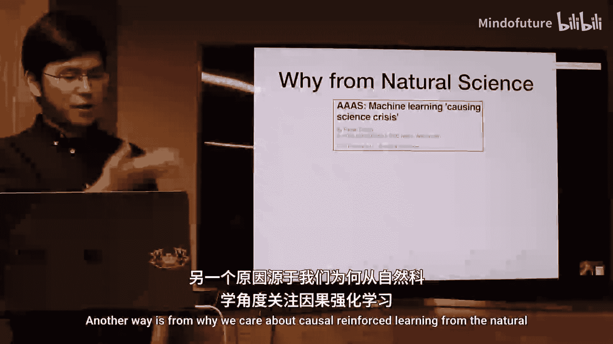
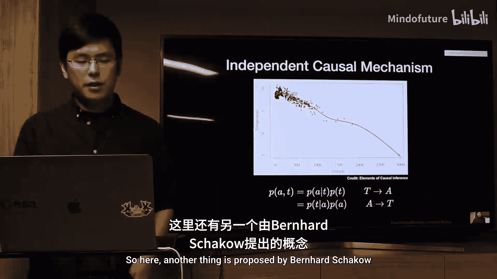

# 因果强化学习讲座 ｜ Causal Rl p03 P03_因果强化学习-吕超超 -BV1nQZcBSEW7_p3-

Yeah， thank you for the invitation and introduction。

 So I'm happy to give a talk about the course of reinforced learning and its relations to the other machine learning method and potentially numerous applications in the real world and。

The most importantly， I think called reinforced learning is the one way to implement artificial general intelligence and why I think in that way today is the answer。

 so how many people know reinforced learning。about the causal inference or causal causal of reasoning。

 something like that。Okay， so I think a few people know causal of reinforce learning， right？

So that's why I'm talking about that so the reason is so if you search called reinforceind learning in Google Book。

 you can find nothing about the terms， but you can search you know reinforceind learning and causal inference。

 you can see it catch more and more attentions in the recent years。And also if you search causality。

 you have a very long history in the literatures。 so in Judy Per's book say date the causality back to the the Bible time So in the book he quote some stories in the Bible So the when God asks did you eat from that tree。

 No， this is what Adam replies， so the woman whom you gave to be with me she handed the fruit from the treat and I ate and if just skiful the serpen deceived me and I ate so no the God just asked the question about the facts it's yes。

 no questions。 but Adam and Eve tried to explain something to avoid some punishment。

 So this is some concept， human madeade concept So have the long histories that's why I want to know combine reinforce learning and causal inference and that's the way to artificial intelligence。

 but before that。To do what is artificial general intelligence and what is the difference to the artificial intelligence。

 So I think in the past five years， the human。Aieved a lot of achievement in the AI and they did a lot of jobs and where the AI surssed the human performance。

 so from 2014， the AI surs the human investor recognition and 15 in image recognition and in 16 it's in goal and in the 18s in the some disease and recently they also surss the human in the pokes and even the star craft but this you know the AI is surpas the human in the different kind of task。

 but this is kind of maybe called AI， but it's not AGI So why because take example for the starcraft。

So。The marketers is a famous fighters for deep learning。

 so he proposed some point the why he think the Deep Mind Starcraft is not a GI。

 so you don't need with all the stuff the main idea here is it's harder to transfer the knowledge learned by the model to the other task The other thing is it needs much more data to train the model to achieve the human level and that's unfair to human because it's get a lot of data that the human can get in his whole life。

And you know， even in the recently， they claimed the AI can discover some physics laws and say。

 you know they have some overestimate title in the papers。And also， he， this is quite recent。

Papers about eclaim a new network and solve the 3D body problems。Hundred and billion times faster。

 But again， you know， Mars。It's against those titles。 We think this title is the over， and because。

Its these problems， it only can be solved in a very simple case with very strong assumptions。

 so it's hard to general to the normal case。So actually Marx and Laquin have quite famous debate on the AG say of course they have a lot of disagreement in a lot of respects but he have some agreement in the following seven points and one is things say model free reinforce learning it's not the answer yet I will talk about why it's not the answer yet and AI systems need the better inter forward models I actually in the machine learning community causal models maybe is the closest model to the physical models because physical model of course it's the best or perfect internal forward models。

 but machine learning model is most based on the statistics so it's hard to model the accurate relations between the data but causal models can go further on that way。

 Another point is a common sense reasoning。Actually。

 the causal model is world of the best way to can represent the common sense。

 So it's also a natural way to do some inference。So the further the Marx， you know。

 he have the book about some mind， he proposed some properties about AGI so you can review those properties。

 it's actually something about causality because causality involved a lot of concepts in in reinforce learning and in the machine learning communities actually so Marx。

 no he's proposed a lot of ideas about causality， but it's not used the term of the causality。

 it can use some robot or some inferenceance。And thequi also。

 you know to seeing something missing in the current machine learning systems。

 you can see this one it's a missing some the predictive model of the world through the observations and action。

 this is exactly what reinforces learning。Doess。So actually so reinforced learning so far is maybe the best model。

 best framework to do something learning because it's mimic the nature's learning because it's quite nature you observe something。

 do some actions and observe some effect about that and get some reward then to update your models。

 that's quite natures， it's about some trade off between the explore and explore for it。

But what's wrong with the kind of reinforce learning？So， this is。

I think many people have heard about this reinforcement never worked。

 no deep just helped a little and that's why this is the current situations about reinforced learning。

 right？No he only focuses on the problem he want to solve。

 he never care about anything to surround them， maybe it's quite dangerous。

 the only one to focus on the task or the simulation you want to solve so if it doesn't work。

 it can go deeper right but it go deeper it doesn't help a lot because you know even you have a perfect。

Approxiation for some of the models， you cannot solve the explorations and long term credit assignment because。

 you know。The space is continuous。 You can never visit all the space or all the state or all the actions。

 That's why you need to explore some structures in the huge maybe infinite space then exploit the structures to do more efficient learning。

Another thing reinforce learning had the fundamental flaw， that's why you know。So maybe after go。

 it it's a great project， but you can see it's maybe the hardest。

 easy problems because it has's easy to get a lot of data you can generate from the simulations Its also have deter and full observable state and easy to score so actually they only need some memories for that。

So but the problem is you know， between train most reinforcement systems starting from the scratch。

 thats you know， its quite it's not that data efficient because you can use in human knowledge about that also during the learning you can you know。

Based on the knowledge you learned from the previous data and saved a lot of space and memories to explore more efficiently。

So here so I think it's a quite a famous metaphorpher from Laon about reinforceind learning。

 he claimed reinforceind learning is cherry in the cake because he contains very little information compared to the supervised learning and self supervised learning because in the reinforce learning the only the information he want to get is the reward the reward is the most time it's just the human design world so it's hard to contain all the information about the task that's why he think reinforced learning is hard to work in the real world。

But why we talk about a lot of laws about reinforcement learning and why we should care about the code reinforcement learning。

 right？The first thing is that Rudy Per hits one of the establish of the causality right he said I think reinforced learning is kind of one way to explore causal inference but it's only limited to the interventions that means they only consider the intervention distributions in the model but the causal models can go beyond because they not only consider the interventional distributions but also can consider the counterfactual distributions that means they can predict what will happen if you didn't see the actions of the state。

 so it contained more a broader range of the distributions。And also， the Weha said。Something。

 you know， he asked the two questions about reinforced learning because reinforced learning so。

It's hard to work on the high dimensional data， but it's very easy to work on the lowdi data that's quite easy to understand right because lowdial data has a much smaller space。

 it's easy to do some exploration but human did in the opposite way because more high dimension data can give more information about the environment and human can extract the concept of the highle variables from the highdial data and can do more efficient learning So this is quite conflict in the reinforced learning and the other question is you know I think there is quite famous technical in reinforced learning it's called experience replay。

 that means every time you have to replay the data when you learn the models why you want to replay the data because you want to you know construct some IID data but。

The reinforcement learning problem is not IID data because it's generated from the sequence right always depends on the histories so in that way you lost a lot of information about that so why that's the reason current reinforced learning doesn't work yet so another way is reinforced learning is have some actions you can do some interventions that quite close to the do calculus in causal models so that's quite a natural way to compare to different models。

Another way iss from why we care about the cognitive reinforce learning from the natural science。

So nowadays it's quite reproduce some result from the paper not because they are cheating because they only can get the pattern from that data。

 it's hard to get the same pattern from the other data that means the data the patterns they learned is not quite general so maybe it's cannot reflect the nature of the data that's why he always learned the fl patterns so it's quite like the fix before the Einstein because the data is quite simple。

 it's easy to observe some rulesrs of the mechanisms from the data so they can do some experiments collect some data and derive some the and from the the can infer some property from that but after Einstein the data become more complicated。

 it's hard to infer some the from that so he do。They reverse the process。

 so they first define some properties then based on properties and develop some thes and using the experiment to verify the thes So this is two different way to see the physics actually causal the reinforced learning exactly covered two different ways so you can see the reinforce rain follow the blue arrows it's do the interventions get some you know informations and influence some properties and color inference is。

Based on assumptions about the data， then do some experiment to verify it。

 so it's quite a natural way to combine。Co inference and reinforce learning。

 another way you can see from the coals right so the human summarize rules and experience from the intervention with natures and then exploits this to improve their adaptations in the next exploration and what called the reinforce learning is exactly do the same thing that learned causal structures from the agent communicating with environment and optimize policy based on that actually when I wrote these matters I then I find a lot of words said by celebrities in the literatures the first thing。

From the Joho， he said our graphs of the world the way we mirror its the cultural structure。

 it' at mercy of the influential tools we have in the brain。

 so this exactly say we should know we should learn the cultural structure and summarize the rules from that then you can find the drum period that's one of the steps of the psychology and he said play is the answer to how anything new comes about that state about intervention and communicate with nature stuff and finally it's from the David Hume that's all。

Also one of the establishment of causality， he said all reasoning。

Concerning matters of facts seem to be founded on the relation of the cost and facts by means of that relation alone。

 we can go beyond the evidence of our memory and the sense that means we should using or exploit the causal structures to do some explorations。

So given on this， we can say you know causal reinforced learning is a combination of the two different fields。

 they have the two parts， one is from we can using causal inference to help。

Reinforcing learning help。More efficient to learn the policies。 On the other side。

 we can also use in reinforce learning to do some color discoveries。

 Disc features or structure from the data。 Actually。

 the causal inference have to also have two parts。 One is causal reasoning。

 It means given you the causal structures and in further different。Practice based on the structures。

 The thing iss more difficult。 It's about the causal on learning。

 So you know nothing about the structures。 you want to learn the structures from the data。

 So they have also have the very different problems like confounding。

 That's quite popular in color inference counterfeacts and reinforceforcing also based on state world action。

 something like that also on policy and of policy of policy is quite related to the causal inference because in that way。

 you cannot do the interventions in that case， counter hidden counter confounding will play important roles in of policy reinforce learning。

And so here is just a reinforced learning just recall some concepts。It's at some states。

 the agent do some actions and get some word from the environment。

 The actions also will cause environment change to be the next state。

The most important hypothesis is about the reward hypothesis。

 so that means all the tasks should be defined by the reward。

So this is the most common concept in reinforce learning。

 but I think this is also the weakest concept in reinforce learning because a lot of problems it caused by the weak year defined reward。

So then talk about some key concept about causalities where we use in our causal reinforce learning。

 So everyone knows the causalusation have a different。

The meaning from the associations right so he is quite a famous principle of the common sense proposed by Rihbach in 1991 first and so if we have two variables。

 they have some connections statistical dependence between them so then while the following causal concept must or X course y or y equal x or there be some hidden。

Variables cost both and causation have two obvious advantages。 Why is intervention， right。

 You can predict what happens if you。To some interventions on some variables。 The second one is。

 it can predict。Out comese the case where you never observe， that's counter offs， right？

So here another thing is proposed by Bonha Shakov， it's called you know it's quite close to the physical mechanism。

 it's called independent causal mechanism right so if we have two variables。

T and A T is the temperature A is the al。 You can model these to variables， right。

 You can two ways to factorize the。The two variables one is PA given T times P。

 That means we think temperature causes al。 The other way is P given A times PA。

 that means al causes temperature。RightYou have two different way to factorize the joint same joint distributions。

 but only the second way it makes sense， because if we factorize in this way。

 that means the P given a is independent of the PA。 That means you can change to another city。

 we can using a different distribution of the attitude。

 It doesn't matter about the physical mechanism P given a right So it still follow the physical mechanisms。

 So in' this way， so。If we want to do some transfer learning。

 it's much easier than the first way because you can direct transfer the maximum PD given A。

 it's never changed， it's never affected by your data。

 so that's why we should consider the causal mechanism in the federalizations。

So another quite popular way is considered confounders。

 this is I think it's a quite popular way it's kind stone examples。

 if only observed you know each categories of the patient with a different size of the stones right you can see treatment A is's always better than treatment B。

 but if observed in overall recoveries you will choose treatment B that's the con right because here the size of the stone is the confounders if the confounders if observed。

 you can just do some de calculus to integral all the confounders。

 you can get the consistent result but if the confounder is unobserved。

 that's always the problem right he always choose some example proposed by Alex in his block。

And here we a very simple case。 X， Y is observed。 Z is unobserved confounders。

 and Z and Y is one dimension data X is。M dimension data。

 So you can see this is the called structure model。 How they connect by each others。

 So we assume that the noise is a Gaussian。 So it's easy to write down the joint distribution like exist because we only know X Y is observed。

 So we just extract the。Covariance function matrix。Between S and the y can like this。

 So here on the right side， we have the primary how many parameters we have It's the M times M plus M plus1 parameters On the right side。

 we have the。We have the three M plus 3 parameters。 So when。M is larger than three。

Alex proposed the method can construct some solutions so they have construct the two different solutions but lead to the same covariance matrix。

 So in this case that means the parameters is not identifiable so you can't claim this is the causal model right because you have the multiple parameters can lead to the same joint distributions that's why the latent component is so difficult in causal reinforce learning and even in the causal inference。

So。The most important concepts in causal inference is the counterfacturs right here is example。

 so you have three variables and x in the encouragement and how homework。

 how much time you do the homework costs by your encouragement and your exam score it depends on your homework。

And the encouragement。 So here is the linear model。 just for the examples。

 So here we want to ask the question。 So you consider a student it's called Jo for him。

 we measured X Y H and Y。 So we observed the X H or Y， but we want to ask the following questions。

 So what will joy score have been if they doubled his study time， right， So this counter ofact means。

I want so I observed some results， but I want to go back through the history。

 so go back to the history at the previous time and previous situations。

 if I want to do another actions I want to observe what will happened if I do the different actions so here the thing the results is already happened。

 but I want to go back to the history so I want to if I double the study time what will happened in this case so in this case is quite simple because you know you can。

From the X HY can estimate the noise terms， the noise terms is you can so is the background information about that person or the situations about the that person。

 so based on the observations， we can estimate the situations at that time。

 then we can do some interventions。And the。Previous model and calculate these things。

 So that's what counters means。 you don't need to do。Ex。Do the actions in the real world。

 you just want to do some reasoning from the model based on the observed data。So there are three。

Identification problems in code models。 That's the huge difference from the machine learning models。

 So the first identification means because you want to。Calculate some interventional distributions。

 but you cannot。Do some interventions in the real world。

 so you have to reduce the intervention probabilities to the observational probabilities。

 then using the normal conditional distributions to calculate interventional distributions if you can do that that means this color reasoning it's identifiable the second one is you know when you do some color discoveries。

 you want to discover structure from the data so you want to prove。The parameters。

 the orientations of the structure can be uniquely determined from the data。 The third one is。

 if we like in the late variable model， you have to determine the parameter uniquely。

 That's the three kind of identification problems in causal input learning。 so。Good。

So this is how causal reinforced learning works and some key points and also it connect to a lot of machine learning concepts。

 So one is about you know you can relate causal reinforced learning to transfer learning。呃。

Why didn't play the video。This video is about know the agent can。Run in the different environment。

 Its from the deep mind。 say train agent and they can run in the different terrains。

 The best thing is， they。Feed the terrains as no feature to the models and learn that。

 But if we're using causal reinforced learning to do that job， it's quite easy because， you know。

 the terrain always changes of the environment so you can you can discover some robust features of the structures about the environment and just transfer the color structures and in that case。

 you don't need know the terrains in advance， then you can do the transfer learning。

The other one is in the matter learning。 So the matter learning means you not only train model can deal with one special task。

 you can train a model can deal with the family of the task。

 the the task always sample from the same distributions。

 So what kind of what kind of the features can be shared by the different。Task。

 that's the called structured。 That's the most robust features can share by task。

 If you can express some， no， the independent causal modules in the different task， it can different。

Directly， employees use modules in different tasks then can learn the weight very fast。

Another way is the same in the， in the matter reinforce learning。 So here for each environment。

 they also sample from the different distribution same distributions。 But how can we， you know。

 this is only the distributions， But if we the different environment share the same color structures。

 that's the。Broadest family of the distribution， because it's not not only contained the observational distribution。

 also contained intervention distribution and counterfactual distributions in that way。

 so the agent can cover。The broadest families of the distributions， so。

Ifs the multi agent reinforce learning， you also can use in causal reinforce learning。Here。

 there were a lot of challenges in my ageging reinforce and learning here。 I just highlight someone。

The first one is is a joint action space right， so when you have the multiple agents in the environment。

 the action space or action space will increase exponentially in that case， someone。

Though we have proved the conclusionly that the property of taking a gradient step in the correct direction decrease。

Exponentialally with the number of agents， that means when you have the more agents。

 it's almost impossible to go to the direct way， the correct way。So。So in this case。

 you should discover some structures between the state and actions and reduce the action space in that way you can do some more efficient reinforce learning。

And the other thing is about the game series actually the national equilibrium doesn't work in this case because national equilibrium only works in the non cooperation situations。

 but for the multiple agent reinforced learning it focuses on the cooperation situations so the one of the fundamental concepts in game theory it's called common knowledge of the rationality。

 that means you have to consider the different levels of the knowledge so that means。

It's not only do we both have to be rationals。On the first the second level of knowledge。

 it means I have to know you know I'm rationals right， but you still have to have the certain levels。

 That means I have to know， you know I know you know I'm rational right So this is kind of the related to the counter factories so is that way you have to imagine what will happen if we take a different action because you don't know any information about the other agents that's why you have to learn something。

 learn the structures from the data。Collect from the other agent。

 then do some counter off business to infer some intentions of the other agent。

 That will help a lot in your learning policy。So then I want to introduce some。

Potential applications in the ver areas。 One is you can use in color reasoning。

For the video predictions。Why no video works it works on the DVD。嗰啲。嚟你啊可以啊有啲先。

So here the first column is ground choose， the other columns is different models predict the videos。

 so in this model we only give four frames we want to predict the long term trajectory by the video right so because you know if we using statistical models is's only based on the pixel informations right pixel information always。

It's about you know consider the laboring informations， it's hard to do some long term predictionds。

 so you have to consider some color structures， you know。It's like a human death， right。It works。Yes。

 she see the trend from the Wg movies， right， It's only based on some paintings and。

Interplaylate and ex some plots between the paintings。 This is。It's done by the human artist。

 not of the machines。 So one of my dreams can generate some smooth movie like this can， you know。

 feel some plot between the different plots in the movies That only can do by the color structures because it's the long term global structures。

 It's not only based on the pixels。So， another applications is。In the robotics。

So here is some you know in the robotics you want to learn the policies right because of sometimes it cost a lot of money at times so you want to do some planning before do some actions if you do the planning so you have to it's quite similar to the video predictions you know have to predict some reasonable trajectories from the current state then before you take the actions you can estimate the risk of the different actions in the future then you can save the time for that so the basic idea is you can learn from the sequence of the structures then business structures and do some explorations in the simulations。

And for the self driving， you also can use in causal reinforce learning。 Here is。

Two different models in the。Model a have the two input。 One is the dashboard。

 It has some break indicators。 The other one is the window shes。 It's some。As things， so。

The model B has the only wind she as the input。 Both models only model B works because， you know。

If you can， if you take， if we can look at the model A， if you take the break， you know。

 the brake indicates it's on， then。It will cause you take the break again。

Then you will cost the indicator on again。 So in model A， the only action you can take is the break。

 So that means the kit can never move forward。 So that's because here， some structures。

 if we see x1 x2 is the wind she S N is just the break indicators So in the ground truth models there are no connection between this。

 but due to the hidden variables here， X N is not independent and A that's why they using deep learning or any statistical models we connecting some mapping between them。

 they will cause a lot of problems in that way。So。One big fear about is how to learn the structures and learn the。

And policies from the observational data， there a lot of applications in healthcare care。

 medicine and finance。 This is some models about。This is quite a general model。

 so here we only observed some X reward and actions。

 but in this model we assume we have two kinds of hidden confounders。

 one is time varying confounders， The other one is time invariing confounder That's why it's quite a general actually。

A lot of applications based on this model for safe for the driving， so。

If the ground truth the true state in the driving is the the environment state and here。

 the time environment。Confound， maybe it's the driver's ti this， right。

 If we want to learn the policy only depends on the environment state。 Its not depends on the。

 the page。 the driver's ti base。 That's why we want to remove the effect from the U and only keep the effect from Z。

 So in that case， we want to learn。The intervention the word function， not just observed。

Statistic reward functions。 So actually， in this way， we can prove that。Under some assumptions。

 so only in the intervention world you can learn optimal policies。

 so you can directly apply this model to different sequential data。

So you don't need to interact with the environment。

 It's only learned the model from the history data。So yeah。

 here's some conclusions about that about here's the big framework of causal reinforce learning is's always about the two parts。

 now， so most work focused on the first parts he want to use in some concepts from the causal inference to help。

Do something reinforce learning only a few work on the second part because it's more difficult because one reason is't lack a of the benchmark and simulations。

 it's hard to find some no。Ground truth for the data。 So it's not easy to evaluate the algorithms。

So about code， if one information you want to bring home is the color reinforce learning was born for the HGI。

So， final， I want to。Yeah， the B hard just upload some。Papers， single author papers to archive。

 So its give a very good summary about causal for machine learning。

 So he also talked about something connect to reinforced learning and the other field。And finally。

 I want to recommend some books about causality and the first three books。

All all written by Judy Pos， right， but in different levels， some to the public。

 some to the statisticians， some to the graduate student。

And the first one is from the CMU is the focus on conditional independence。

 this book is quite practical because it's quite easy to evaluate the conditional independence in the data。

The fifth。It's from the。Benha Grove is a。It's a good summary of his group's work。

 It' considered most folks on the color discovery into variables or multiple variables and。

It's also a good summary for his group in for the 10 years work and the second was about the causality in different fields。

 the first one from the physics introduced how in physics， how to see the causality。

This pop is about in the medicine books introduce some basic method to how to do some inference color inference in medicine。

 the third one is from psychology， how to see the color inference because different fields have the different definitions even for the basic concepts。

 it's not unified framework to deal with this topic。And the final one is some about physics。

 some ideas can help you discover， design some experiment and get some ideas to explore some stuff。

Yeah， that's it。

