# 因果强化学习讲座 ｜ Causal Rl p04 P04_因果强化学习——第2-2部分_ICML教程 -BV1nQZcBSEW7_p4-

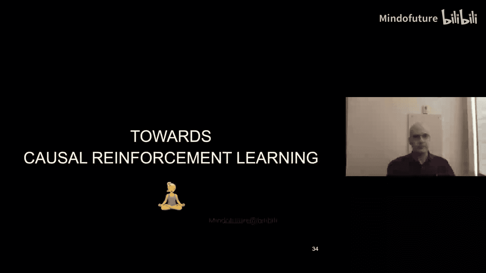

Hi guys， I hope you had a good chat during the break with the other version of me or myself。

 thanks for your patience for the ones who survived the first part let's start talking about the CRL itself。

 the moment I think is the most exciting part of the tutorial。

The ideas like CRL new challenges and learning opportunities。

 the idea will try to list some of the representative tasks that I visual for a CRL which I feel are kind of quite general new learning opportunities also which one of these tasks has a new component that is present I believe is present in the real world and hasn't been studied before。

 and I think this makes them appealing we use the language of causal inference of causality and the PCH。

 the CHT and in other words the model of the environment M as CMM and the graph to try to start understanding and then solving this tasks there are six tasks or six dimensions the first three I will try to spend my strategy here or the organization the outline is like I spend around 15 to 20 minutes in each of these three to give the idea。

The task and some idea of the solution。Posible solutions and then I will kind of make a brief summary one minute or two minutes of the other three tasks given that there is no time of talking about all of them the task one is what we call generalized policy learning so far we assume that the word was kind of cookie cutter and in the sense that they exactly match this true modal is the online learning and they offline meaning in three they offline that is of policy and they do calculus or causal calculus kind of learning that can be the soft do and mode of learning then well see in maybe two or three minutes that the first example where things don't work very well they get more involved and these matters alone cannot solve the problem then this is what we are calling。

GPL or generalized policy learning then Ill move to the second task that is when and where to intervene we also assume throughout the literature that interventions are always good if you can change something I should just do it I should just change it should just go to the system make the intervention here we will consider whether the best thing to do maybe just to allow the system to evolve naturally without touching it perhaps sometimes when you touch I kind of mess up with things we like to understand these conditions on the other hand if the interventions are necessary we will consider where to intervene in the system whereas can you be surgical and just change what we need here has this idea of refining the policy space that I would like to discuss everyone talks about policy I like to talk about the policy space and a little bit more about how I feel it or what do we feel about it I would say task free throughout the literature it's assume that the agent。

Has some type of automatalike behavior and do not do introspection and do not do counterfactuals here we consider and now in the agent with capability of doing counterfactual reasoning in a relatively general layer three。

 which will lead to a different type of optimization function， this is conceptually different。

 but we will try to make as close as possible to the task that we understand that is in layer1 layer2。

Then the problems that I'll talk less about the first ones called generous ability and robustness across environments。

 I just mentioned this problem that I worked for many years called the transportability and the the idea here is like suppose that we allow a robot or a system to interact in a particular environment。

 perform experiment and so on， like in the California desert that we have a rover that is able that is able to dig rocks and understand how to parade there。

 and now we send the rover to other place to other environment like Mars and you like the agent toop operate efficiently avoiding to do too much experimentation。

 given if it breaks things are whatever created there that is far from here and the questions like what are the anchors that allows ones to extrapolate across these different sectorings or across these different environments they are for sure causal as you know there this is structural environment。

you discuss about the modularity and we would like to understand this a little bit more in the problem of transportability。

 main topic of my PhD thesis that here is' present in reinforce learning in a substantive way。

 then the test number five，Is learning causal models by combining observations and experiments L1 RL2 data so far we assume that we're operating over a specific model of the environment can be these kind of templates as I mentioned can be a moium bandits or MDPs upon the piece or it can be crafted by hand instrumental variable。

 the found door or so on in reality will like to operate somewhat in between and don't commit so much the structure will actually be flexible and especially in reinforce learning that the agent already have the capability to interventions then it should try to leverage that and combine observations and interventions in order to build its own causal model I think it's very natural if you're considering to grow a baby einstein there a baby AI and the should be evolve in its causal model or equivalence class of causal models there are some subtle is there but there's some kind of very exciting new results here a huge literature thats in structural learning that was just learning。

About the how to learn from call observations， this recent piece of work is saying oh。

 world is much bigger and whenever an IL we are already doing the interventions then let's try to leverage that already have layer two capabilities。

Third task is about causal imitation learning， babies learn babies are as well learned by mimicking other humans or other babies。

 so this is kind of well known and this motivation to imitation learning literature。

 I think the di observation here in the causal arena that the learning in the nestrator can be different can have different causal models and it turns out that imitation is not necessarily what you want。

 or at least there are limits about when you should just be miitating other agent。

 and even even when the other agent is an expert。Then the question here will actually try to understand and the what conditions imitation is is safe and given that you don't observe the you the y variable of the expert。

 I think it's quite unique there are some kind of quite unique insights from the causal folks from the causal side and the task is quite cool now the let's get let's get into it let's start。

Talking about the tasks。I would like to talk about this generalized policy learning。

 this work with my PhD study Justin Jg。Online learning is usually undesirable due to financial technical or ethical constraints as we already discussed in general one wants to leverage data collected under the different conditions to speed up learning without having to learn from scratch on the other hand the conditions required by offline learning are not always satisfied in many practical real world settings in this task once you move or remove let may be positive here。

We move towards realistic learning scenarios where these mod has come together online and offline。

 including when the most traditional and provably necessary assumptions do not hold that's important this unnecessary necessary and provably necessary let me try to let's start with an example suppose consider this setting that we are trying to learn the input we have an input distribution that is P of X and y X is the action is the outcome or decision。

 Y is the outcome or the U word and we would like to learn a P of y given to x P of prime。

 y given to x this could be robotics that we trying to learn by demonstration when the teacher can observe a richer context than the student for example has more accurate sensors maybe an expert a baby robot is trying to learn with the older robot and the order may be having an infrared what the baby didn't develop this yet。

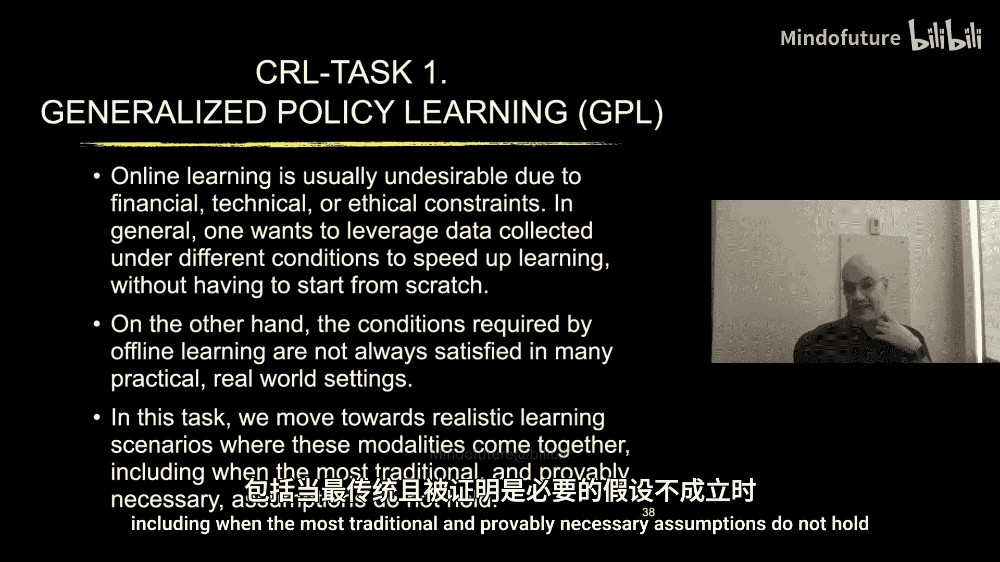

Or in the context of the medical optimal experimental design from observational data let's take for the example。

 given that we are able look some medical example here。

 in the as input that is coming from this data set P of x and y you have x that is the decision。

 y is the outcome and you have this exhaustion of set of U unobserved variables that is both affecting the X and is also affecting the Y this is coming from physician or a collection of physicians that is coming from for example。

 called Luma hospital。😊，You have， I don't know 1 million data points there a small number by the way you have much more you have 1 million data points p of x Y Now the task is right to learn what is the cause or effect of the drug in the outcome and for example the Fv or anyone that once you understand causal seriously will say oh what I want is the p of y to x or p of prime y to x I say I stick the pi just implicitly that is the one that is speaking the value of x we actually learn the P of y given to x and in some way like which means that is the graph that that is the pi here pointing to x。

This is the P Y given X and yeah that's the task that's the task Now what we just spend one hour a year hopefully it was okay for you guys or not not not a lot of suffering but I try to categorize and then one of the modalities that I claim to have in the literature is the off policy learning is one of the true offline methods that we have the off policy learning if you try to apply in this set and we have a violation of the H2 assumption if you don't recall we go back but a2 means here that a1 is okay a1 means that we are controlling the same variable here we trying to get the effect of x act the action and here or you have X as the action that is what the physicians aside and here are trying to control X the effect of X as well then a one check but a2 is the assumption that they are observing the world in the same way they have the same。

Contex C that while here， it is not the case， this doesn't hold。😡。

The physician can observe richer context， maybe the physician didn't take note in the EHR。

 the health record or maybe can be in the subconscious level as well or not get too much into that maybe in task3 but maybe the physician is just affected by the way the person is looking or what the prior beliefs that they have about this type of people that affects X and y whatever type is that then it's very common if they comes in or any serious policymaker decision make go say man there is confounding data there is confounding bias in this data。

 I cannot use it， I need to conduct experiment then whatever this this is a just formal justification for that in terms of the off policy here if you try to do the second off policy offline method that is the calculus believe me at least for now we can check it but also do calculus or the soft two calculus sigma calculus by one Coheya you say not possible to do the inference in this。

Then it seems to just toify this feeling that we need to go online。What else？Now my suggestion here。

 given that we have these one million data points and online is a small number here of experiments that we do maybe with 300 people and we spend。

 I don't know， maybe 5 million bucks， I also suggest the following。

 let's seek know that the physician and the FDA quote unquote physician quote unquote FDA the two agents。

 let's see ignore their differences and let's pretend。

That the physician and the FI exchangeable can be technical but as this for now here let's use informally that means that they are the same qualitatively the same causally and let's call this the NFTS not a leading title but a name but naFTS now in other words。

 the NFTS we will attempt to use the observational data as a prior you'll get this P of y given X here and we will try to see it or to use as a prior in some way location procedure。

😊，You do that better I should mention I'm using Ts Tommpson simply you can pick whatever method you want My goal is just get the simplest possible setting that I can disintend with the issue that I want to talk about you can put UCB you can put with nDps whatever method there and so on any method that is doing a location that's fine this will happen as well what's the smallest one I will get Ts that is the easy one to talk at least here and this flavor of the prior comes up naturally and I will get binary variables that is the most constrained setting if you have any type of discrete or any type of containers there is so many degrees of freedom you see in maybe four5 lights that will be even more likely that this problem is happening or obvious that will be happening I should say because here will happen all the time as well okay now but the plot doesn't look very good for sure you should so more perhaps there is some kind of nice behavior there but so far picture is not good this is the number of trials is cumulative。

G note here that the Oracle who is validating that is the environment SEM that I show in Monsatton。

Now， okay， but at least we have some kind of indication indication。

 some kind of gut picture is not going looking too like straight， it's like a flat or Canlinear。

 let's call this traditional TS means ior observational data。

That this is what we have when you throw away all this data。

 have this behavior that is kind of the expected one whenever we teach， I don't know。

 basic AI or undergrad AI， this is what we got。Textbook kind of setting now the the obvious questions here。

 what you should be asking or what I'm asking when I first found out is like。

 how could this be happening？It seems to go against all I understand when I put my sta hat to hear my statistician hat or machine learning hat is' like man。

 one of the basic aoms here is like more data is always good。Now， apparently the data is hurting。

If I had there， I'll be pulling the hair here， the butti of my hat。

 then there's a kind of uncomfortable situation apparently。

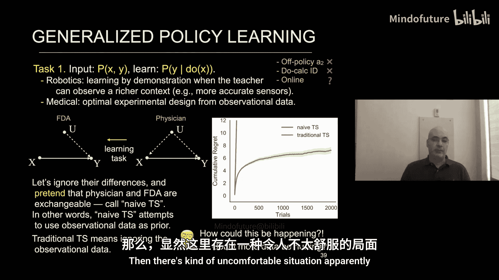

SoIn， I would like to try to open up this plot here to get a better idea of what's maybe going on inside the solve。

 the plot on the top you have the red the naive and on the bottom we have the traditional。

 let's try to parse it slowly here。😡，The truth here that is unknown by the agent that this is what the agent trying to learn is like the2X0。

 that is the solid hot line here is greater than the2X1 that is the dash line。

 why given2X0 is greater than2X1。This is don't know now in this data that is coming from the hospital y given x1 is greater than x0 and note here that as the prior that you have by the way。

 I am pluging here a number of rounds in the posterior here inside it's 9 to5 C confidence interval 95%。

Note here that the is the lines are switched flipped the dash here is the one that is the duX1 that is on top of the duX0 and based on what's going on here it seems that there's a lot of weight and is not pulling anything else then it's kind of stuck there in some way while the traditional one that is throwing away the data it started in 5050。

And then after I don't know， a little bit less than 500。

 we are already able to with high confidence this entangle these two guys here。

 the dux0 is better than the Dux1。Then after this time that you spend doing explorationation。

 we already can just exploit and everything is fine for sure the bar here。

 just a note this shade here， the uncertainty is much higher in the subatom arms as expected as usual。

Now， Ben， this is bad or I would like you in some way in the question like， why is TS。

 naive TS is doing so bad， I would actually touch to understandest effect of the prior。

and this is the effect I forgot the number here but I think it' like 1000 or 5000 samples that we have that you use as the prior here we have 250 20000 and so on we are going down note here that it's 250 it take around maybe 00 2000 rounds interactions and you kind of catch up with the blue one that is the traditional to be 5050 for sure you have less uncertainty here in the this subabmal suboptimal here the duX1 because you already pull it a lot in the beginning but still in some sense it's the hard to compare in some sense it took around 2000 rounds to have this sentence and then you can have the kind of behavior that you keep going this gets weaker and weaker 100 whatever after 500 you're already able to distinguish in some way and then whatever oops。

U and eventually， by the note here that if you keep doing that as this guy here is deteriorating to the blue one here that I make it shaded。

 but the one downstairs here。Which think I think with me that's unbelievable because our whole game is like let me try to get1 million data points from someone and then I can leverage or kind of warm up my learning and then I need you do less experimentation that's the dream or the goal not about the dream。

 the goal here what we are saying is that is these very samples that are hurting if you as yeah I think it's clear in some way which is now I would like to explain a little bit more about this behavior and introduce or start talking about the issues of non identifiability this is just the causal of graph that we have before。

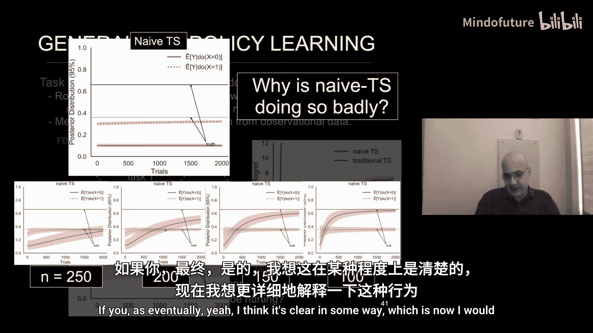

And this is the structural causal model that generated the previous plots or not parts one by one you can do at home now what we ended up doing and we all that because we are the system designer we're trying to understand the issue now this leads this guy here this asM that is an observed nature leads to this two different distributions here that is the L1 distribution that's observation and the L2 distribution that is the experimental。

This is just the behavior that what I will have before that this we already can see that the duX0 is larger than the2X1。

 this is what we know after running and this is what this implies are then it seems to be a better idea to the doX0 and you can see also the flip here that the Cx1 is larger than the Cx0 those are the number that you have0301。

😊，In practice， we don't observe this guy， we are playing the game。

 we are playing the game exactly because we don't have it。

If you'd have it whatever I go a few slides before you say if the do x maybe 20 do x is long。

 doing the optimization is trivial， I kind of agon this guy or do some computation on top some type of statistics or function of this distribution the whole challenge that we don't have this guy and the offers observation from the CHT is like this guy here the y given an x or the layer1 data under the term is layer2 data then you don't know what's going on in layer2 because there is more information in layer2。

UmNow this guy was bad when you knew about the thing。

 but now that you now that we don't and all what we observed is one。

 someone could sayhu X1 is looking quite good because zero3 versus zero1， shouldn't I just do it。

 do x1 this is a joke here， causal joke here now you guys know as much causal as I do then we are in the same team here of causal team。

 the joke， should I just do it？

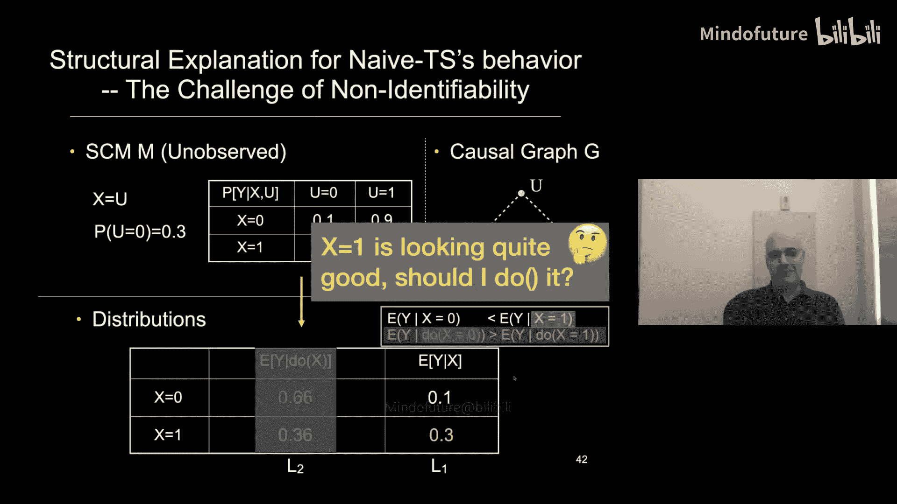

put the hand here now this literally important this is a joke。

 these leads to important important questions how do I know I know this pattern is not present in my data that we have this type of behavior that I just showed we don't know that's the challenge you never know。

Does this then imply that I should throw away all the data not collected by me， the agent。

 and always learn from scratch？😡，There is no hope in generality of running from a line。

 but for these other modes that are very constrained。

 the answer is hopefully not because the other conditions are very stringent。

 the agent tend you kind of twine agents and much more than that evolve in a similar way。

 Yeah any help let me。After all， is there any useful information in the observational data。

 and I would say yes， there is useful information and our goes to attraction listen how to leverage these L1 data or confounded data？

😊。

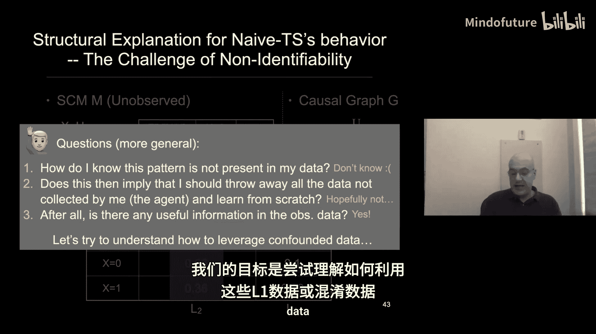

We will take a very simple approach， three step approach for the problem， step one。😡，Step one。

 we like to extract the causal information from the confounded observations。

 the solution that we take is doing bounding。You are not trying to do point identification that get the P of x Y and pretend that the sorry P of y x that's computed from that and pretend that this is the same we are trying to bound the y given to x result given observation coming from any distribution P of x and Y。

 the average effect is bounded， there is this kind of lower and upper bound here that is given by this expressions important feature notes in the expression that is those are functions of the observation distribution。

 there is just things about there is no do here。No layer true here。 That's good。

Now different flavors that you can find about the bounding and others。

 this is the ones that I like or whatever I think more and it seems to be more related linear program format sorry if you already have some result that is related to that。

 let me know linear program formulation not causal graphs that is not the one that I gave or in other words non parametricic。

 if you don't have any assumption about the F and the P of U you can have this approach here through Baian Pro or Jang and Barren Boyne playing with that in different types of graphs now incorpo of parametric knowledge。

 if you know a little bit about the F in some testings you could that is this nice paper by Natan that is also here in New York Natan Carllos in Zoo if you know something about the ASam about the functional of form or the U。

 you can get kind of tighter bounds。Then my original my suggestion in general is start from these ones if these ones work well that's good or if you feel that they cant work well。

 this is good， if they are very loose， then you can start seeing that what are the reasonable assumptions that you could use in order to speed up learning and you have other settings kind of more involved graphs that have come later。

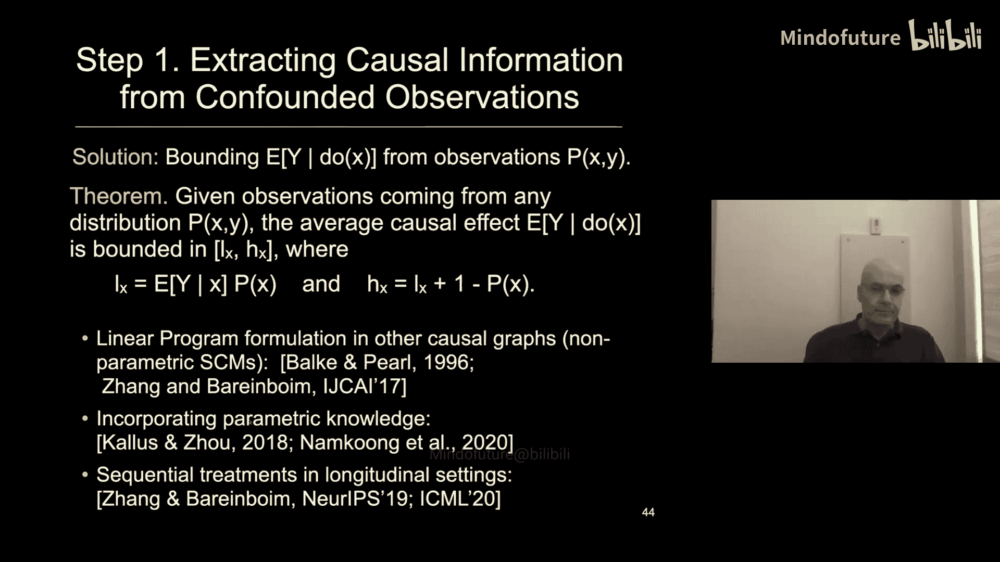

Second step， now we need to incorporate this causal bounds into the learning procedure here I'm picking the Thompson sampling because it's easy to explain there is the UCB version that is easier to prove some of the results and we can do in right other method or many other methods I'm highlighting the changes here。

 causal bounds that you have for input layer for each arm and now have some type of rejection sampling here to guarantee you are set that whatever we are sampling from the data is within the bound。

For sure nice project here now nice question What about if you have the bounces I'm assuming that you're sorry the bounces I'm assuming that you have tons of observational data What about if you don't have so much data we have some kind of finite samples of the observational now we can try to be more careful and put some kind of distribution there a little less strict that's a very good co problem I think is a natural consider this sampling buthow did here have a rejection sampling kind of thing now the third question is like what happens in practice in practice this works quite amazingly well the whole game here from the non-convergence that we have for using a bad way the data we go to let's throw away the data and cannot learn to anything to result that this is I can do with my closed eyes is very simple we can kind the point here I kind of chopping now you're discussing about speed of convergence we can kind of chop here a lot of this initial exploration that is the whole goal of the observational data then is in。

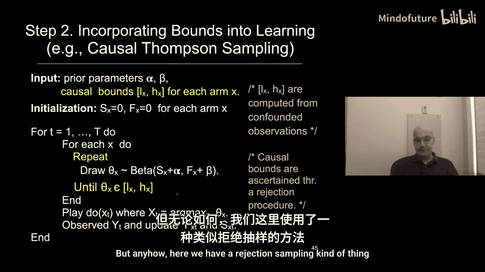

This is a very easy instance if 100， maybe 100 tiles here you already solve the problem。

Now third step in reality is like can you order of magnitude improvement can be achieved practice。

 the step three I should write separately here， can you prove that this translates to the grab bounds you can check the reference but that's the idea then first oh。

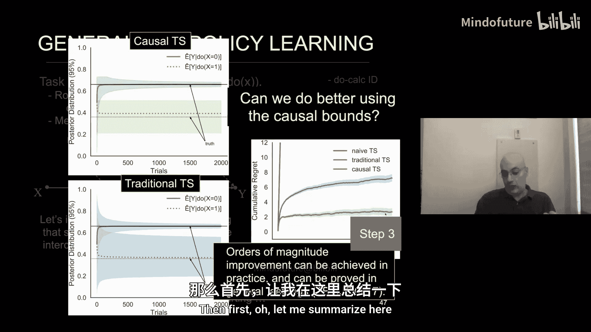

Let me summarize here， I think it's better。You have the causal graph here。

 I have many observation here recall that this is vertical lines means data points。

 we have tons of them，1 million data points， now we'll apply this GPL bounding and you and you cannot get point estimate then you need to go online。

And need to do some kind of exploration now you have this p pipe that is influenced that or is constructed based on this guy。

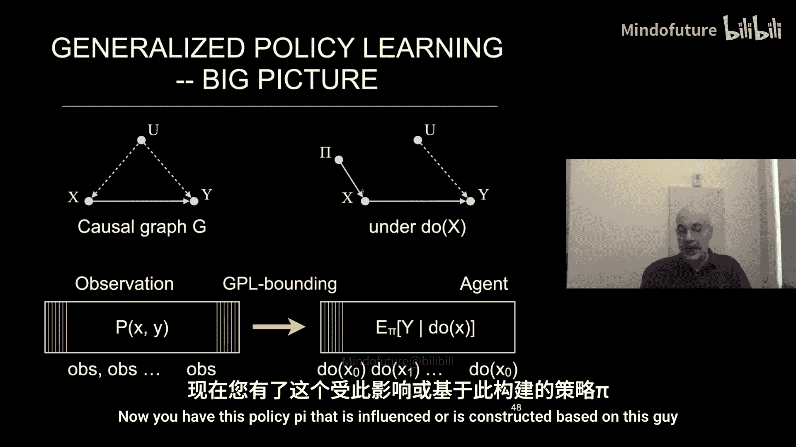

And then you go online and do that， then they step to do that template here of the task if the policy is identifiable from offline methods just return the optimal policy to the Dukecal close the coation of IPW and other estimation methods。

 otherwise we extract the causal of information from the observational data and compose the causal bounds based on the available structure assumptions can be assumptions on G or some of their work。

 our work can be assumptions on the half of the peer view。

And go antenna and so on now and then go online you get a flying plus online incorporate the causal bounds into the online allocation procedure and play and the testtaster。

 if you did it right， you can prove that these are reflect in the H breathth bounds。

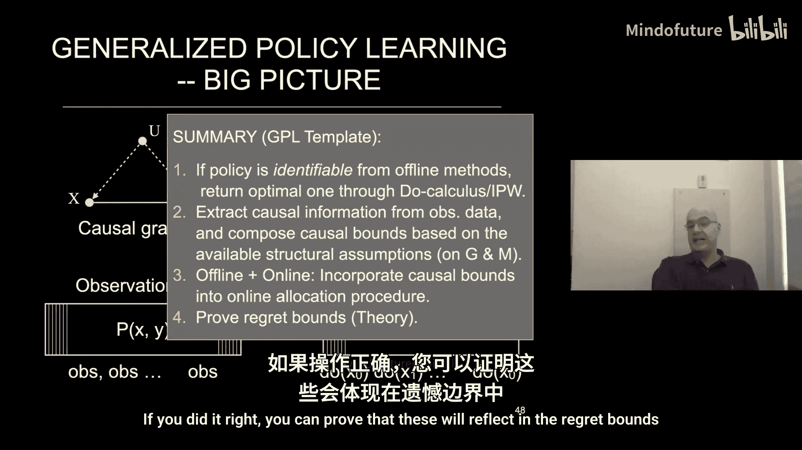

That's cool I'm kind of running out of time here for this task， but the the。

I would just like to talk quickly quickly about one new result there is this setting that is dynamic treatment regimes that is very pling the medical domain by Susan Murphy and so that has cool result that is we have this nature that is X1 x2 and so on and it's kind of more than MDDP because we have this latent variable here affecting everyone and it's also not exactly upon thep is more general in some sense but I will not get there you can read more about DTR in these references and others and the idea is like now we have this sequential aspect and same thing but now we have X Y and C where C is the context S1 x2 and so on and now we can do GPs you can do GPO bound in there any reality the results are pretty great is very technical gets technical proofs the results pretty great。

 this is randomized this is by Murphy solution that is essentially doing the fi sharing and randomization here or variation of fi sharing normalization here in this setting。

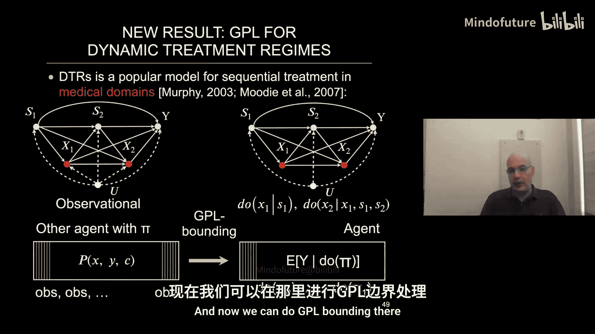

The sequential version of the dis optimizationization here we have our setting here。

 our kind of solution just exploiting the structural assumptions that is already in the DTR setting and this is one the green one is the one'oo observational data which is a piece of cake essential observation does the job just kind of a mutual cool result this is the reason the time'm sharing here。

This paper let you talk， or at least you call your attention or get your attention to check this out。

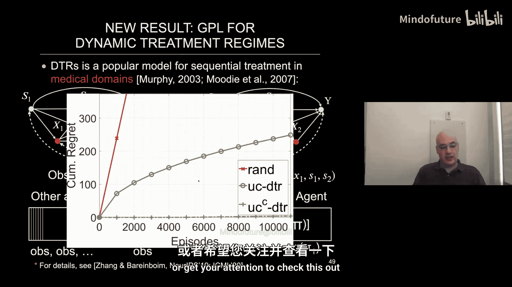

Okay。I want to move to task2 I'm slightly over。Slow here but I think it's okay the second task is when and where to intervene refining the policy space。

 this is work of San my Podoc or Podoc in my lab， the causal AI lab very nice work with him and he help a lot in the presentation the other parts here all over the place and thanks with SAC when and where to intervene in general。

 it's assumed to all the literature policy space such that actions are fixed a priorityi for example。

 have a sets act that have X1 x2 Xk and intervene is usually assumed to lead to positive outcomes usually assumed that interventions are good our goal here in this task is to understand when interventions are required or if they may lead to unintended consequences。

 consequences side effects maybe they are want to describe humanity。

 there issues of safety and so on， then this is the task the practical part of。

The task in the case interventions may be needed on the other hand and we would like to understand what should be changed in the underlying environment so as to bring about a desired set of affairs。

 maybe you should just touch x1 or intervene or shake the things up in X1 x3 and x7 instead of doing the intervention all levers。

 you told me that the K there is seven， you have the seven levers。

 maybe you shouldn't touch the other four。This is more related to the when。

 and this is related to the where。😊，Let me to ground here。

 let me try to understand give an example and understand what is the policy space。

 consider the graph bandit model acts as the decision why is the outcome and use this load though in the suent bar two in the first chapter second is the mean and the variance of the Gaussion or this is the kind of the parameterization of the reward。

 this is the bandit。Stick with it I would like to compare our goal here is to optimize the variable y or the reward want。

 keep it as high as possible perhaps this is some the health of the system of the wealth for the happiness and so on of the society and we are borrow line of the company and we are not a priority committed to intervene on any specific variable。

 we just want to keep the y high or intervening at all。

Now I would actually consider the following deviation from this setting with instead of two variables that bandits are working at least if you want to go online。

 let's get with three variables。And this is the model that we have Z affects the variable x and the in turn x affects y。

Then in structure the mechanism in this system， f of x is a function of z and u and y f of y is equal to x and u。

 and z is f of z of U sub z。Now this is the causal graph and the policy space here is this one I'm just kind of writing the combinations。

 the a intervention， not touching the system， allow it to naturally evolve and you can have intervention。

Excuse me， one option here is to x， the other option is do z。

 the other option is to x do z for whatever values you have。😡。

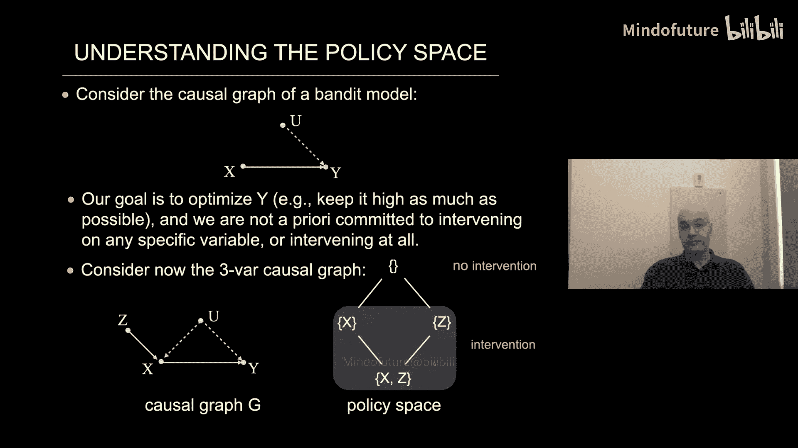

Now the relation here is some kind of one is the subset of the other。😡。

Some kind of transitive reduction there。Okay， now I would like to examine the following policy。

 one that I like to call the causal on sensitive strategy or policy that we ignore the cause of structure G。

 you take this variable z and x as a big variable and you'll be trying to search optimize based on this function here。

 the E of pi of y do xz do x is equal to small x z is equal to small z。

First observation here notes that the implicit causal graph in the agent's mind G prime。

 which follows from this standard optimization procedure is different than G but first this is the graph that is in the agent mind coming from this optimization here that we have Z and x。

 there is nothing pointing to that just the pi that is the the value of Z and x and this is changing y and there is this kind of load the parameterization of the hWt function here that is the U and this is different。

 this G prime is different than the2G that is in the environment。

I hope it's clear now the true causal model G and cause the constraints of the underlying environment that's another observation this graph here is the one that is involved or at least the mechanisms are following this topology here。

He gather off you applying and submitting it for this algorithm or using this function， observation。

😡，Now question here or naive question or not so naive。Despite why I cannot look myself。

 this is the tough finding about who coordin I like to be in person。

 but appreciate to be online and you guys be here。Because I move a lot and so on， moving my hands。

the reasonable question here is despite what is in their agent's mind or the optimizational function。

 it is through the case that it will be evaluated by the SMMM just repeat the point is then being oblivious。

To the pair G， okay， Eliah comma。Can't we just do more interventions， in other words， more do access。

 disease and things we eventually converge？😡。

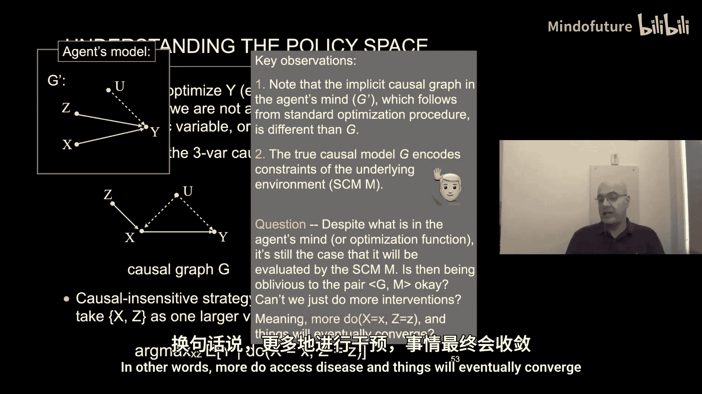

This is why I'm saying that is insensitive。 I would like to show that this is not the case historical comment this came from the maybe five years ago of four I was visiting many places including Uni Alberta that's very nice with me I have a good time there and this coming from a dinner hit to dinner about oh do you need causality or didn reinforce mal learning。

 how was related and so on and I was going back after this dinner to my hotel and then the following example would come out this is the example that came out and I took my one or two years until we could write the paper in generality but this is the example here。

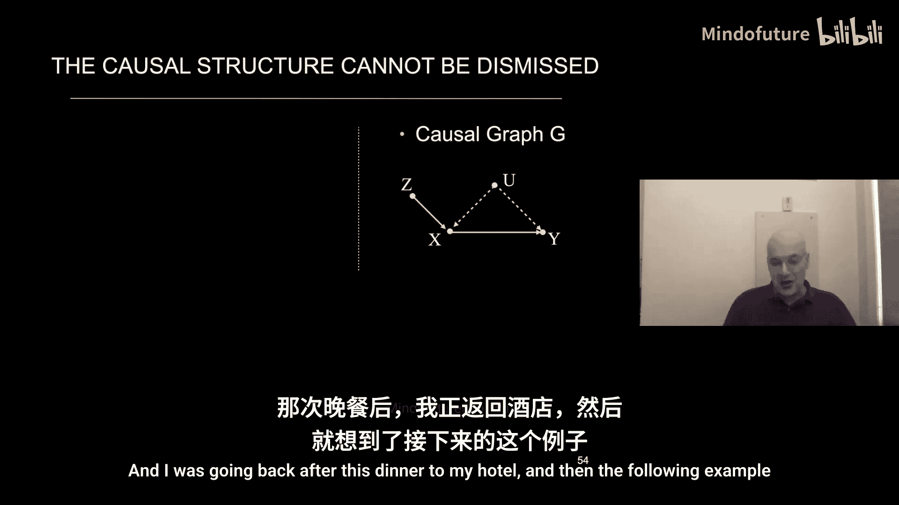

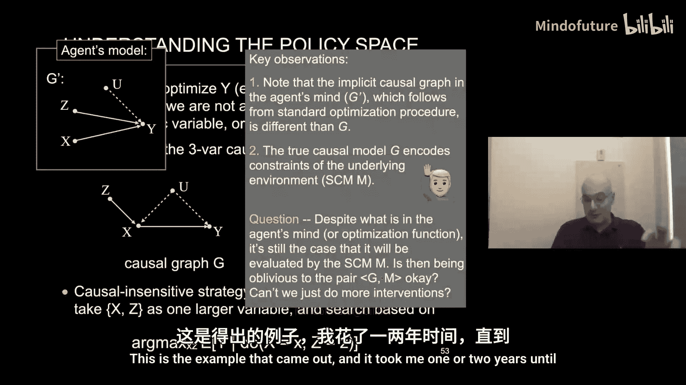

And I appreciate a lot the discussion， this is the causal graph now I'll show you a causal model。

this is exactly compatible with this graph here， let's bear with me z is equal to U Z。

 there is no parent just exhaust those variations。😡，X。

Is the f of x of this x F of x is listening to z and the u and y and it turns out to be equal to z plus u。

 z x or u not cube but I would say plus and y is x plus U。

And the probability distribution of u equal to1 turns out to be equal to probability of U z is equal to1 that is equal to half。

 Usually don't put the U Z by polyentthsesis， Usually don't put because it's just attacking one。

 You just put the confounders that affect more than one observables close polyesis。

 right now that's the parameterization。Now what's going on in this parameter first let's say evaluate the naive or the sorry the causal of insensitive policy that this first observation that the y given do xz turns out to be equal to y given do x I would defend that later in two minutes but the idea is that all the interventions that you do on x z is blocked from y because we are picking the value of x and this doesn't leak to y in this case but how do we evaluate that y is equal to x plus u let's say that we are doing p of y given do x is equal to1 then this is one plus u1 plus u is equal to not u you once to keep the value of y as high as possible in other words one then we need to u equal to0 because one plus0 is equal to1 and this will happen with probability half。

On the other same argument applies with the zero here if we have u is equal cou oh sorry x is equal choose0 y of be equalu u and the same thing you need to be co1。

 then this is half， then this large fraction of time。

 whatever intervention we do in the do X or do x， the maximum amount that you can get is 0。5。

Now I would like to contrast that with the intervention do Z。Oops。

I actually intervention with do z Now what happens you do z X is free to vary as it once or as it naturally goes。

 then0 have some value， x will be this value plus u y will be equal to z plus u。

 whatever value plus u just doing the replacement which turns out u plus u is 0。

 which turns out to be equal to z then then if you decide to do do z equal to1。

 E of y will be equal to 1。It it was an awesome dinner。 I'm very glad I was so happy with this one。

 not so happy with my own speed。 It take time， but to write the paper， but the the。😊。

Pservation here is that the causing sensitive strategy we call all at once because we've got everything that you can interview all lever that you can touch and we fix the value。

 you just keep varying the values。Will not pick up the do Z intervention and we will never converge and those are the plots here by the cumulative regret and the probability of picking the correct action now for the for the do Z there is a little bit of exploration here because we need to know what is the value of Z but it's easy the art once we never pick up the right answer now someone could come and say。

Okay， Les， but they。😊，ByBy the way I don't buy it my comp personally it doesn't matter。

 but personally I'll tell you that that's the strategy that we have strategy that we have by and large in the literature but after seeing that I get comments when you present the paper want to the rapes to the other conference people go oh okay if this is happening then let me do all the subset this is what we want to do since always then this is all all the subset。

😡，Which obviously will catch the DCC。You have the power set there and disease a part of the inter then this is the behavior now I don't buy it but whatever let's say that it' true that you could catch that now the question the productive question here is like can we do better than these two age strategies are kind of believable strategies in some way？

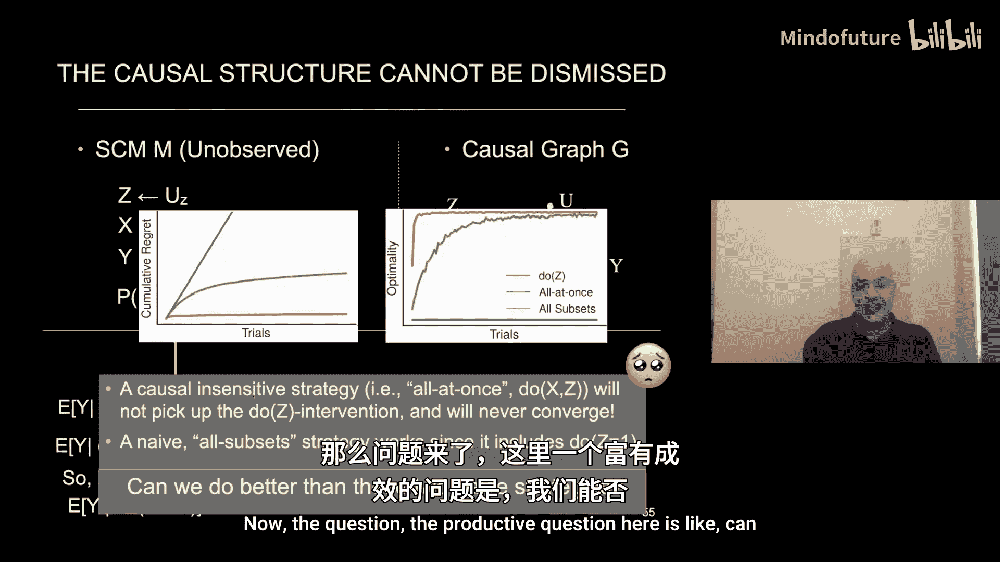

嗯。And so this yes just like to discuss here around policy space we have the graph。

 the policy space and now we have the intervention set for each element of this guy and in reality the actions is like intervention set empty you have the do empty that is the layer1 C L1 the du X is the duX0 doX1 quick note here I'm in the binary case this is already the most constrained set in the same as before if you give it more degrees of freedom we can show whatever you want this will happen in a more acute way but but and then you have whatever combinations we have for sure from from the。

😊，The original naive one， we have Chuhudan， now we have tritudan because we have the super set and all the super set and the assignments for this one that is here。

Now for sure Ill go with these motivations in the introduction of the paper if you read with Sanangag。

 we would like to study the properties of the policy space with respect to the topological constraints imposed by M and G that's the hard work here that have a lifting thanks to Sanangak property one that we have we are already alluded to this one that y given to x and z z which y given to x Now if you get the causal of co du cculus or the softdu calculus cut this means that this graph here is cut the incomingarrow to z and x z has nothing x has this arrow cut here and then z is separated from y z separated y given x。

Now， if that's true， we can prove that this will be true implication here that you prefer of plain do X to plain do X Z Z。

 there's no point in wasting samples or interactions trying the combinations that will be the same this leads us to the definition that is the first definition。

 the Q1 here in the second key but。m the building blocking the paper that is giving X G and Y， sorry。

Given G and y， a set of variabless x that observables that is not y is said to be a minimum intervention set if there is no proper subset x prime such that the y do x prime is equal to the y do x for the graph that is compatible for the SCM that is compatible with the graph。

Which is the let me show you Okay sorry we just have this mis column here it turns out that this do Xz that is the set that is x that has achieves the same maximum expected award then you can just cut this guy here in the policy space this is a refinement This is the example of the miss minimum intervention set Now second property that is very cool。

Now well actually to compare sorry， now well actually to compare the expected hard among the misses and let's consider the expectedard of the observation e of y and then you can write E of y y given c times p z in relative do expected value but also it turns out that this is the do Z here just because it will be used later now it turns out that this guy is bound later now this bounded upper bounded by the one that if you pick the best sentence the best value of z。

Now， given that this best is insensitive to the value of Z。

 you can pull out this guy out and then you have this y given do z star。

 which implies the E of y is less or equal to the E of y given do z star。😡。

Then the implication here is that plane2 Z should we prefer to play nothing this is a case that is for this particular graph。

 it always good deal to intervene if you allow the system to evolve naturally， it can be terrible。

That's the idea here there are examples that this is not the case。

 the best thing is just swallow out， but this is example that interventions are needed。

Now this leads whatteates us to the following definition， possibly optimal miss pos， as you call。

 given this pair G and y with the graph G and the outcome Y and let x be a miss x is set to be a possibly optimal miss if there exist at SCM this is going to find that exists is important IM conform to G such that the maximum that we can get here with this x is greater than the maximum that we can get for all other miss W。

Now this particular case here is the one that this is not the case because we just show the example that the doC dominates the Y。

No matter， no matter what they。For all possible seas。Then we could rule out。

 it turns out that how you prove that is another way。

 here are just showing that why or the no intervention， non intervene， it is not a promise。

 just for the sake of understanding。Now you can go through the paper。

 there is some nontrivial treatment here， you provide a complete Iif and only if characterization of the promise an algorithm that is capable of listing how the promise is given a causal graph now in our policy space here we are able to remove here and how this is no longer a contender。

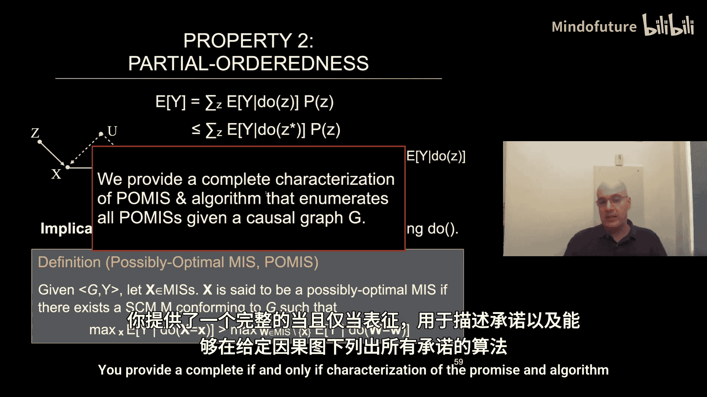

Note here also that I just removed this guy here now the two guys here in particular in this graph。

 both the du X and the do Z are contenders， which means that based on the topology the G that is in the agent's mind in the agent's say not in the environment it cannot do some big weight who desk now you need to go online and try both now we are at least for this particular case you need to try this four guys here we are already seen one case I just pick one instance that came from the dinner that is the one that the doz is better than du X because it is surprising one。

But it's easy to construct， there are SCMs or models of the environment that are some that access better than this why by the way。

 one quick note here。Why why this is not surprising the to x the do Z because our intuition is that why is the guy that is the best variable the best sorry the Uward variable that you want to keep it high now it is natural to think that in order to keep y height I would like to have more controllability over y then I would pick the variable that is closes y in this case x then if I can control x I'm able to control y if I keep going further from y。

😡，It seems that I lose control， maybe I will keep going so much that I go to the mom to the baby in the u on the mom and I was say perhaps I do intervention there and I have an effect about the salary of the student 24 years later。

😡，that's more difficult to see then you have this strong intuition that if I'm able to control the guy that discloses this is always best。

 it turns out that the naive strategy， the first naive the O at once do X Z turns out as we discussed to be equal to the do X。

 then it seems to be the case that。Or do this naive。

 but in the without I'm doing this swing that is the closest that is my intuition before the dinner Now after the dinner。

 I say， wow， man， there are cases that we need to go a little bit later later and do the do Z。

And I would be messing up if I touching the a here。

 I would like you to think about what went wrong in this example with the XR example when you do the intervention to see why I don't want touch the ax。

 what I would be making a mistake or messing up。😡，In order to get the intuition。

 but right now that's the context here， it turns out that format it is always they all at once。

And or getting closer to the variable is three macar systems if you don't have a U like that。

 a latent variable like that。😡，Is not true if we start having parts that of the system that you don't observe that is our belief here otherwise everything will be simple I can even use the offline method that we have before to solve the problem always then theres no even point in doing experimentation you can always exploit right now sorry this is one parenthesis let's come back here to the thing the observation the promise these arms here they share they are not independent then I go quickly here because I ended up getting the tangent but there is some connection between these arms that me escape here what it is here I just getting a more involved graph here that allows us to show what I want。

Suppose that you want to learn about the armC， this do C here。

 now it turns out that whenever you pull the doP， that is this guy here。

 we also can learn about the doC。😡，That's so cool or the non intervention here that allow to say。

 you can learn from whenever you do the intervention B。

 and already whenever you did the intervention C， you can learn about the non intervention。😡。

And that's cool and that's the idea I'm not getting into the details the point is there is some way of connecting these guys and there is an identification algorithm because Z square that is school for that I also skip these one is's just that we have samples I skip let me say t seconds here。

😊，The samples that were the number of samples for each of the arms， this is no arm。

 this is do B do C， they have different whatever we pull different numbers of times then there is different variances then we are trying to do some type of inverse of the variance given that we have more certainty in the guys that you pull more and those guys here are the formals that connect the arms that we like to average and the samples are not independent then there is some kind of nice way of connecting them we can incorporate in any type of online algorithm we just did in the basic one to show that this is the case that it works this is just the we don't even show the naive when the first naive that is all at once this is the brute force this is the mis this is the blue is the promise and the green is the one use the other arms that we are trying to get as much juice or being as sample efficient as possible this is just simulation some people like to see the simulation that's the task we have the causalsography are not using the data from a task one we could and now we are learning。

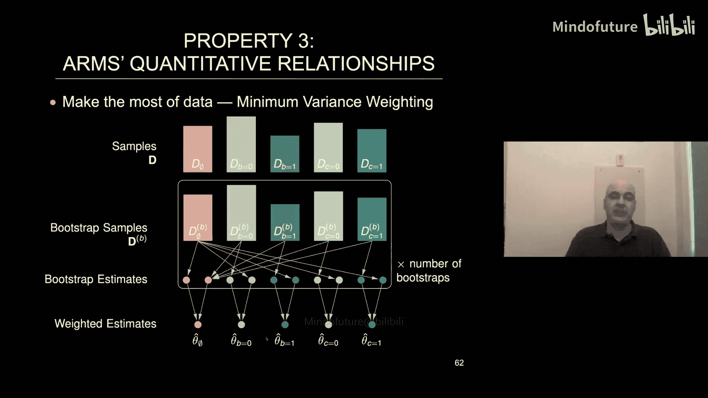

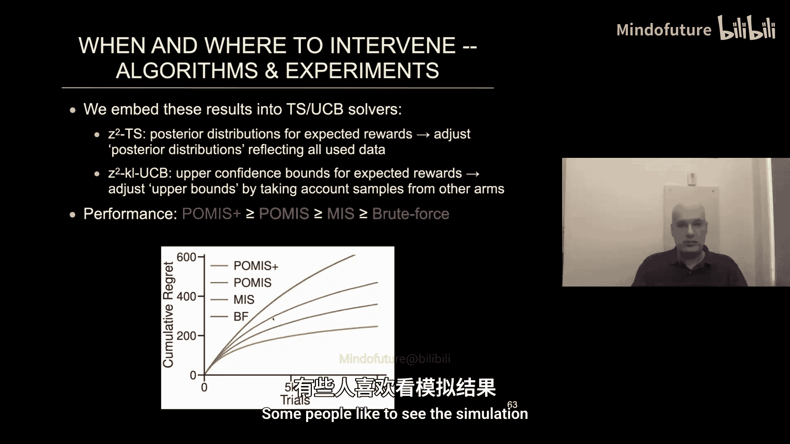

Tomies and the formulas that connect the arms， and then we want to use that while we are collecting the data。

Now， Omen。I would like just to mention quickly a new result that this。

 I think is so cool and exciting in addition to decide where to intervene， but I will do it fast。

In addition to deciding where to intervene， agents also need to decide where to look agents are bombarded with information and they need to be。

好 I see嗯。About careful about which places they they would be looking into then or selective oh they were the selective that I was looking for Now here we supposed that we have a causal graph that we have this context C Now both and C and x1 could be context then this is how kind of policy that if you consider that x1 is listening to C and x true is listen to x1 this is one policy another policy could be x1 we allow it to naturally vary no intervention x1 and x2 just listen to x to x2 just listen to C then you can have many policies like that about what you decide to C and where you decide to do then give this gives right to this policy space here if you're considering they do x2 x2 doesn't listen to n1 x true listen to C x2 listen to x1 and so on Now the nice thing about this piece of work that I think is not cool is that there is some kind of structure or there is some。

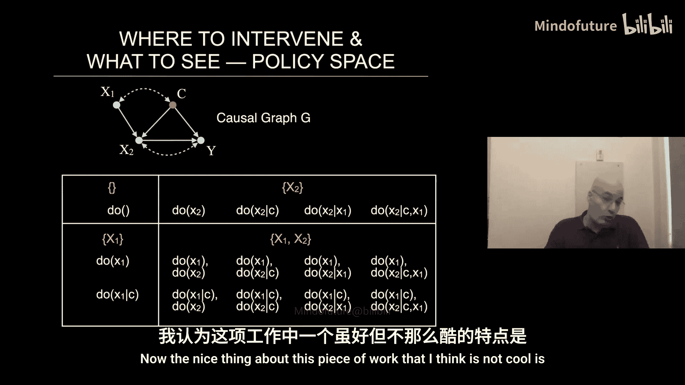

equivalence class in the in the policy space policy with the same maximum expected row can be clustered in an equivalence class now you can do filtering in the kind of similar way as the myth and the promise。

 you have the minimal policy among this you equivalence policies that is this guy highlighted here and you can have some type of partial order between the policies。

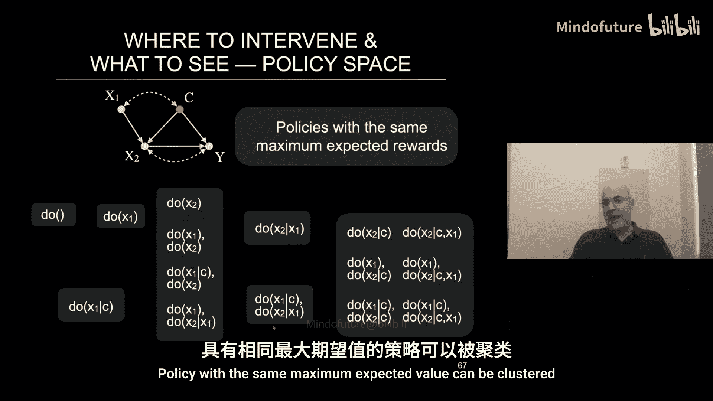

And how can identify the policy like the policy， possibly optimal policy among the minimal policies that are the ones that I look into last number of places then out of this 15 that's quite challenge you if the graph3 nodes we reduce that to true then if youre interested in the details this is the R63 take a look I think as a cool paper but you'll tell me。

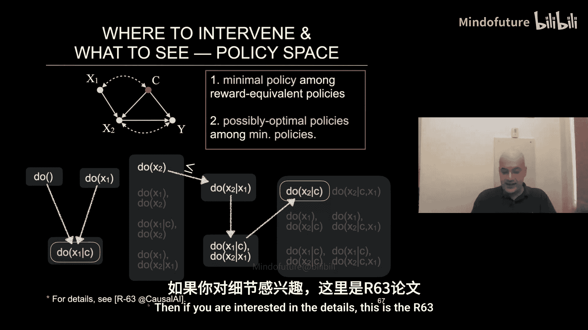

Let me get。嗯。Now I would like to talk about this task three。😡。

This is the counterfactual decision making this is work with my friend Andrew Forney and Uda pro chronologically this was the first task that appeared in CRL around 1415 and I think is。

An interesting one Id like you to think about that that we are going going into literature now the agentss usually act in a reflexive manner without considered the reasons or the causes for behaving in a particular way whenever this is the case。

 they can be exploited without never realizing it。This is general phenomena that in online learning。

 whenever the agents optimize based on the sharing randomization， what I mean is like in other words。

 they do distribution。Which includes all otherLC settings that the non causal causal are insensitive ignoring the causal structure。

And here this is Fisher in the sense that this is how it started the idea of doing the intervention。

 the system that we decide to flip the coin， now in the context of the crops。

 the yield of the crops and the pesticides of the farmers because of the confounding bias by fishingish around  I35 I believe that I read the history as being the precursors of that of Enment learning。

 and we have the paper by Robins in 52， 1952 with the stopping problem how many samples I need to be able to distinguish these things。

 we start then we have the UC Bureau of Lion Robins in '83 and then we go on for the modern literature and we have the MDP on the other side doing dynamic programming and so on'm connected with that online of leveragingveraging that。

But anyhow I could talk half an hour about history。

 the point being that you are using kind of L3 official and L L2 randomization。

 I go here to endow agents with the capability of performing counterfactual reasoning。

 taking their own intent into account， which leads to a more refined notion of the gra and a new optimization。

 L3 type of function。Coterfactual decision making， the question that we are trying to answer is how should one select the treatment x star to a particular unit U is equal to u so as to maximize the expected u word y here's the graph that we have we have the x we have the Y and you have the U now you're calling the unit U Now we are not interested in in the having the average effect y given to x that is the average over the U for all population I'm taking the unit we are trying to this particular U。

This person with this age， sex， sorry， age， gender。

 ethnicity and all the buckets that make the person individual。

A secondary question is what if you have observation or they L1 and al two data applications are many and robotics when the robots start having their own intent and what I mean by that is like as we we just decide sometimes we just want to do something and we don't even know the reason that we want to do this thing at the time I think in the near future robots we have this one。

 they don't know exactly' the input that they are making them to act in some way。

 then it's pretty much similar to the human being here in this situation is where counterfactuals emerge。

 but it's enough for now medical treatment that personalized medicine job training program to see that this particular individual。

 what's the effect of the retraining program to this person。Now in order to ground this discussion。

 I would like to talk about the greedity casino that is coming from this paper in the Ris 15。

 I'm thankful because reviewers allowed us to put an exotic example that I like a lot。

 there' was a lot of discussion at the time。😊，We ended up getting lucky， but the question is luck me。

 the work I think is good， luck in the sense that it is an interesting story that I'll tell you now。

😊，The goal to find a policy supply so as to minimize the comm grant。

 the casino hires a teamme of experts sociologists， psychologs。

 cognitive science to understand the behavior of the humans or the。

The customers in the casino floor and these customers， you pay 5 million bucks。

 these teams of experts， they go there after three months。

 they come back with two big conclusions to justify the money or saying in some way。

 you could have asked me the first one that the determined factor of the behavior of the humans in the casino floor is the drunkness level of the person。

 whether they are drunk or not given some threshold。

And the second bullet is like for this population， if they are drunk。

 usually they are attracted to more effusive things， things that are calling attention。

 like if there is a machine that is making noise noise and blinking。

 people that is drunk is attracted to that。And on the other hand。

 if the person is not drunk usually they're in the shy mode and they are avoid voiding they are going the machine that are not blinked or not making noise that's the conclusion of this study now we have this e or degree the casino that the ci average adapt the casino have two types of machine machine X0 and machine X1 you have the word y0 and y1 that is not winning and winning and now you have this unobsserved variable blinking machine if the machine is blinking or not blinking and both machine is gonna to be blinked or not there a different likelihoods and you also have the drunk and S levelvo if the person is drunk or not both of these guys don't remember remember the notation dashed here dashed arrows and by direct this is the U you unobserved is equal to B and D。

Now and observed for us， quick note here， there's a regulation in Nevada that says that the payout has to be at least 30% of the time casino whatever。

 that's the regulation。😊，The casino learn how the customers operate operate here。

 based on these things that came from the study， these conclusions from the study。

 and the side to say they to set， they payout structure as follows using machine learning。

 the casino have this two different types of machines like0 and X1 in the casino floor and the machines may be blinking or not blinking。

Now because they hire people here in the community。

 computer vision that were so great and the machines have a camera they take a picture of the ppo of the guys。

 of the guys of the ladies， or the fellows and get a diation of the ppo to to know if they are drunk or not as given some threshold。

😊，Then this is a simplified story by the you go to the paper but there is more refined versions of that now based on de you can know if they are drunk or not。

 if the machine is already blinking and the person is drug they will put a lower payout。😊。

If the machine is not blinking and the person is not drunk， they will have a lower payout as well。😡。

In other words， if the people is following whatever they discover。

 that is the natural predilections or the natural way the human subjects operate in the casino。

 people get screwed， this is a trap， this is why you call the grid the casino。

Now we don't know anything I just copy here the parameterization We don't know anything about that。

 this is the underlyingline SEM we arrive， This is around 1415， we go 40 pel。

 we go down the casino after the conference not doing to have a drinks and then we decide to do the phone at night we don't have anything better to do and we decide to do random sampling from the casino floor to try to understand what's going on in this game this type of machines now start to plot picking samples at random you pick this subject and you follow the subject with R I the unit and then you take note the guy play X1 machine type1 and you got not winning y1 you pick another guy at random they got x0 and he is not winning or and then you do that 10000 times you do a random sample we collect L1 type of data this is kind of the graph that you preserve we have no clue again sorry no clue about the P& D the only thing that you can see is the action that is the X。

And the outcome Y， lo and behold， you get this 10，000 data points from the data set D1 and this is where the statistics come the E of y given x is equal to zero is equal to x is equal to one of winning that is 15% of the time。

You say aha， we know that we are already suspicious here that something is wrong。😡。

Let's call the Nevada Game here Commission because we know that they need to pay the folks 30% of the time。

We already comes to speed with the level of service here in this casino and tower is not good it's something wrong here kind of shady then what we do is like we call this the inspector come in the second day of the conference and does the following and say we show the data do you want to demonstrate how did you collect this data fellows and we say oh we do a random sample or careful about being really random and then so on and they say oh you don't understand anything about experimental design let's be serious here and I would do a random ice control trial because I read fiser design of experiments I would do randomized control trial on the casino floor let's do like the FDA that is serious about causality lo and behold he he does do that and he ended up getting this data set randomization two step random sample flip the coin the coin is the pi here that decides we even talking the first part about the random you flip the coin the coin random ended up being one this is do x equal to one the coin ended up be zero this is do x equal to zero。

Lo and behold， we end up getting these statistics with 3，000 samples。He even comes to SSA guys。

 you don't know experimental design or anything because we collect the 10，000 data points。

 I already have good bars here and with 5，000 I already can get the answer and the casino Sc。

This is a capitalist business。 It's true that they are not giving oneme additional dime to the customers。

 but they are online and everything is fine don't bother us here in the Nevada Commission because we have more important fish do and they throw the data in our face and live in an abrupt way。

😊，That's you know， that's this far the way that I like this story now we a question for us here is like we're in the third day。

😊，Of the casino， we are study students on machine learning and now we have these two data sets。

And the question is like now we want to play the gameops。You want to play the game， but are we。

What should we do， should we operate as are we exchangechangeable Are you like the usual population that is in the casino and you should just go there and do whatever you want。

 you don't know that being the effects and what will happen are we exchangechangeable there's interesting puzzle here because now that you already seen this data these other guys didn't see the data because they didn't collect before then are we exchangechangeable there's an interesting puzzle here that is quite cool but I will skip now the point is like assume let's assume that it's exchange changegeable we be kind of experiencing this level of hire or your word if you just decide of flip coins you get this point three。

Then you say no， neither is quite good， I know more， I took my machine learning class。

 I use one of these I know that this is stateless， then I use one of the algorithms that I understand well and I'll do this exploration I identify which arm is good。

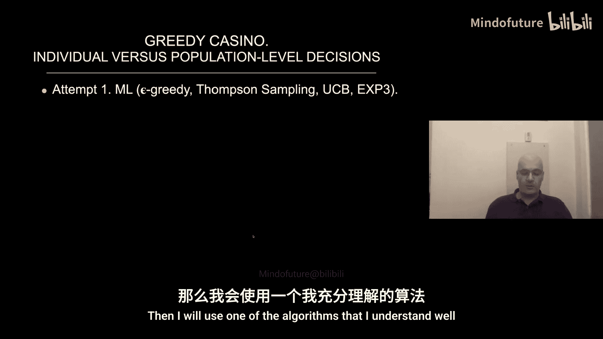

And this is what we get， that's the number of interactions。

 this is the probability of picking the correct actions， and this is the cumulative graph。

 orac co minus what we're doing while our core environment is the SEM。😊。

And this that I just showed before， and this is what we got essentially no learning。

 probably picking the correct actions 0。5。And you have some type of lineargra hair sounds pretty terrible and we are kind of disappointed because this is exactly the same as the coin flip of the guy that came in the second day。

 the inspector from the commission， and we thought that we are better than him。We said， wow。

 I'm a sample efficient， fiser is good that youre able to get the randomization。

 but we like more the Robbie's paper of 53 or the 82 that is doing this sample efficient thing。

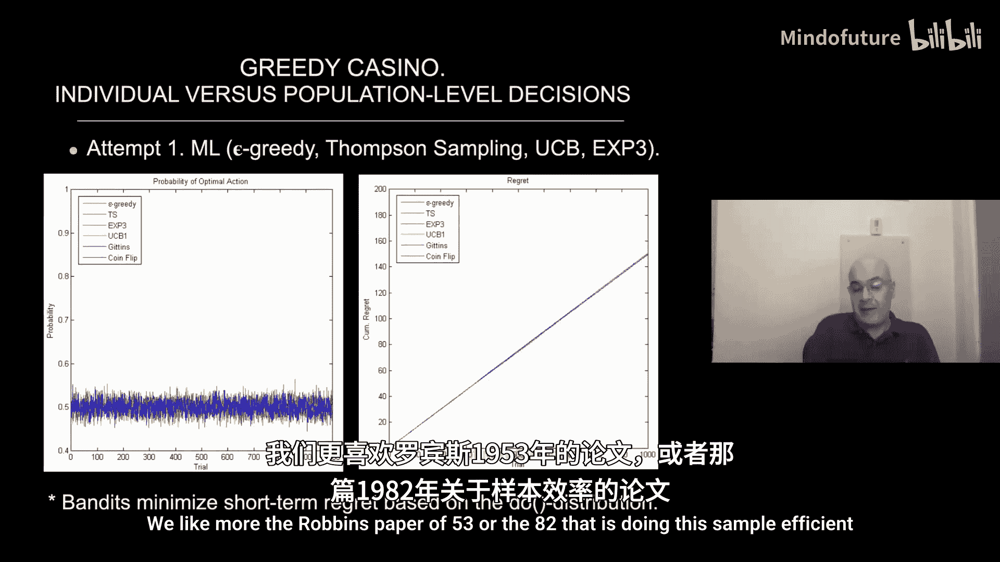

But the result a little bit disappointing the bend is minimize the major short term graph based on the do distribution that's the observation here now proposal we arriving in the fourth day and you will try to use our knowledge after having brainstorming and getting toxin causal inference let you say oh let's try to do L3 is something because we know that L3 we have in our gut that L3 is more detailed it's talking more about the SCM the layer2。

Now we have this RVC here that we call the Higrad decision criterion that we're trying to find a star that optimized this guy here。

 let me read this counterfactual sentence here， they say expected value of y had x being x1。

Given that axis is equal to zero。😡，Now， given that you play Mach X0， I would to already play Mach X0。

 I would actually to know what would be my outcome， why had I played Mach X1？😡。

This is known in the literature for many years， this quantityed at least how the effect of treated on the treated ETT as I don't no no counterfactual L3 has many counterfactual。

 this is one of the elements in the zoo。😡，Now this is in contrast to what were doing before that was y given do x that in reality can be written in layer3 notation y subax equal x。

😡，This L true quantity in L3 notation is also called the counterfactual but true weak because L2 well we will just call the doom veryhow just so to know that it is the same you just don't have this condition in here now observation that okay sounds good why you don't use that the problem is if general counterfactuals counterfactuals are difficult or impossible most time impossible to evaluate from data even if you have interventional capability except for some special conditions such as if the variables are binary if the back door condition holds andconfoundness and so on you can go to pro causal to 2000 pro 2000 chapter9 there is a discussion on that。

But what we know from causality that this is our tree， but it's hard to evaluate。

almost impossible now here comes the trick that is the main contribution of the paper is a concept one。

And operational。How could we evaluate expression like that。

 has this collision of world given that I play machine X0。

 what would be the fellow of Y had x being x1？😊，Now note here that the agent is about to play machine x0 is about to play machine x0。

 which means that the unknown function sub F sub x of BD。

 recall you have the U that in this case is BD blinkness and drunkness affecting the x could be1 million dimension。

 but there is this B U affecting x Now affecting means that x0 evaluatevalu have f of x of this particular instantiation of Bd that you don't observe in this case is about to play X0。

 this is the evaluation。Now we'll pause， interrupt the decision flow and wonder。

 I am about to play by X0， will I be better off going with my gut with my intuition x0 or should I go against it x1？

That's the first time that I can envision that the AI is saying I am about to do something。

 I want to do something and I don't know the reason this is the whole point。

One point this guys don't don't I want you to stay here in line but just you could do this comma context or state that you could just see because everything that the agent knows what's affecting it。

 this will take into account here they'll be exactly the same here there is this B and D and I claim that in human decision making and in the future AI decision making there is always this you that is also affecting the X and Y in the human is obvious this is the whole industry advertisement industry。

😡，On negotiation we are advertisement， I mean we are trying to create these correlations and make they trick the people to have this kind of feeling that and they will lead them to some decision without they knowing why they are doing something。

Here's exactly the same。 Now close parenthsesis， I can elaborate in the question。 Let's go back。

 Im about Im the agent I want to play machine next zero just one that's what I feel Now I stop my urge and I say。

 would I be better off going with my gut or should I go against it Now。

 if then this is step number two we do not interrupt。😡，And we allow x0 to be x being equal to x0。😡。

We are doing like the auto then coat unquote monkeys in the first day， the data set D1。

That people just， I want to play the machine， I'm going to play the machine。😡，Now if you do stop。

 you do interrupt and you make a equal to ran， and just flip the coin。

 we are kind of untangling this thing where removing the effect of you。

 then this gives rise to the do distribution， that's the Fer genius amazing big fan of the world there are some other but these open up the whole literature from the 3s。

😡，They that's good。Now， Fisher is saying， I don't wonder you。😡，We are saying something else。

 where saying you do interrupt， you do the x is equal to the R， but now you do R， you get x1。

 but you say， but I want you do x0。😡，Why， because they zero that everyone has information about the latent space that I don't have access to。

😡，Then this turns out， we can show that formally， but this turns out to be equal to exactly the meaning of this particular counterfactual y sub x1 given x0。

😡，And then that's what we are kind of pushing on say these should be the criterion now if we're a philosophical inclined or decision theoryist turns out that each of these one there is CDT。

 there is the CDT， those are different types of decision theory people like to say that CDT is better we have all kinds of paradox that sometimes CDT is better in reality is an interesting discussion even though CDT obviously is in general better。

 but on always RDT is exactly the combination of this shoe。Is the sweet spot？

We are combining both the joke here that I usually do use is like fier drug painin intended because it's using the drug constant randomized control。

 fier drug of doing the randomization to avoid the confounding bias here or the pesticides and the crops and the bias of the farmers。

 it was too strong because it completely removed the effect of the you the later。

whichch you want in some way that could be bad， but we want a little bit true and this is the meaning of the counter layer three layer three counterfactual then if you do that you get this kind of I just collapse here the previous one that was L true。

 you get the blue line that essentially we're able to converge as expected。

 eventually have this kind of nice behavior that we're able to learn what's the best policy。

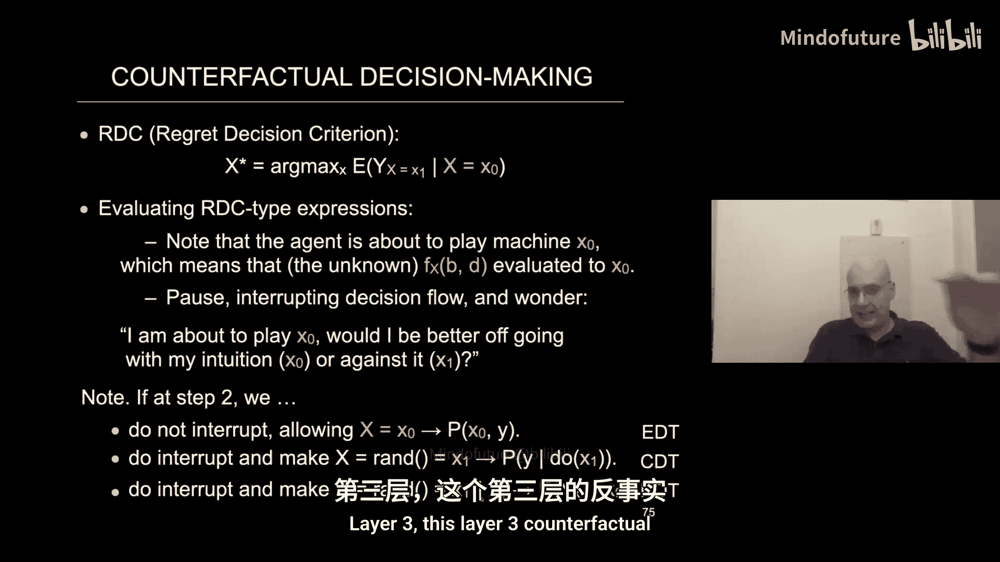

And you have also we could use data from the first day like the data set one from the people in the casino floor。

 we can get a bump here because the same as I said that that's true there is some kind of relationship between the arms then you can leverage and get a little bit of juice I like more from going from the red obviously from the red to the blue because I think at the time youda and I were kind of very surprised with having this type of counterfactual randomization in concert to fish air randomization but this is too cool and now once you have established the consistency of the procedure now the game is to put curves on top of this one here for sure you like to converge faster then you can do the same combining not only the data set the one that is observational but you can combine ob data set with two that is experimental the same way there is some kind of constraints there that allows us to put one curve on the top of the other。

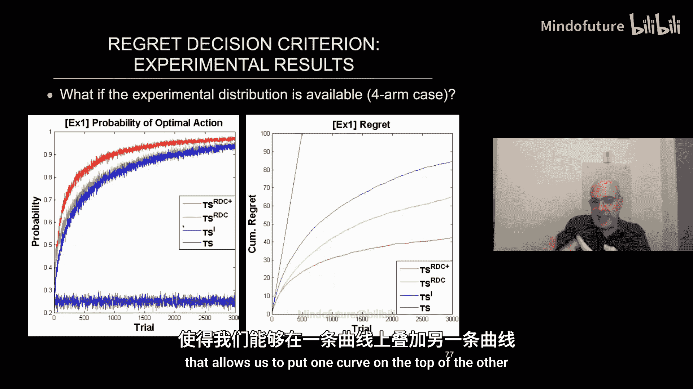

Now this is the task in reality to Canadian order the data or not， I just mentioned not。

 but the dimension here is like there is a new。😊，There is a new task。

 a new type of pi that take the X prime into account that this evaluation of the U。

 we detach the evaluation of the U from the action that you'll be committing under this counterfactual normalization。

 we still need the coin you just we need to be clever and understand what it means that then everyone now can do counterfactual normalmization。

嗯。😊。

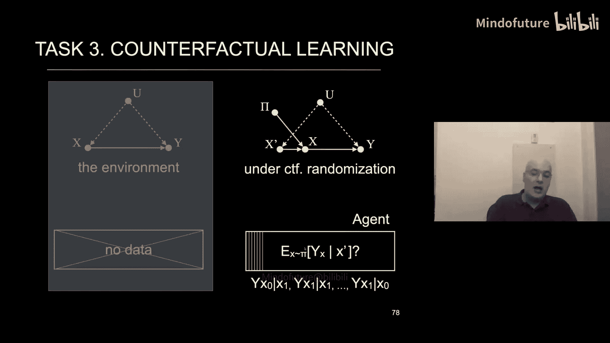

There's an interesting consequence here， I'm going really quick now as a new piece of work。

 application of human air collaboration， or the human is this one slide summary。

 can humans be left out of the loop， when do you need the human？

Now that's an interesting question a simple observation from the RDC from what to discuss here on the gra decision criteria。

 if the y sub x given x prime is equal to the y given x， y given to x。

 this means that the human intuition has no value。There's no information in the gut。

 then if that's the case， in other words， the human expert could be replaced without sacrificing the performance of the system。

At least in other words， at least in principle， fullomy autonomy can be achieved in the context that this holds here。

 then it's nice to have this condition in the paper。😡，In this paper you can go to 64 or 64。

 the contribution that is themaco property is L true layers L23 that helps us to establish whether the agent or the agent and that then in some type of environment can be autonomous or not there is a discussion about optimality of agent layer2 that is experimental interventional and counterfactual agent versus autonomy and for different types of environment I're trying to be general here in terms of what in the environments and we have kind of nice results in the sense theres an un surprise result but this is my last slide here and I'm going to the conclusion there is this nice result that the human if you compare the human that is read versus or deco coin or the layer true kind of randomization human is much worse then the coin Now usually before this criterion if the human is the human is worse than the machine itself it seems that the human can be kicked out。

But it is possible that the human is worse， but this equality here doesn't hold。

 which means that there is still information in the human。

 which is this spark line here that can be leveraged by the counterfactual agent and I think is a beautiful result and there are many refinements that I envision if you are interested and you are thinking but but I think it' an important task in the future about human AI very sober and solid work and there is also the question about if it's not autonomous can be semi-autonnomous that you have some type of budget to consult the human。

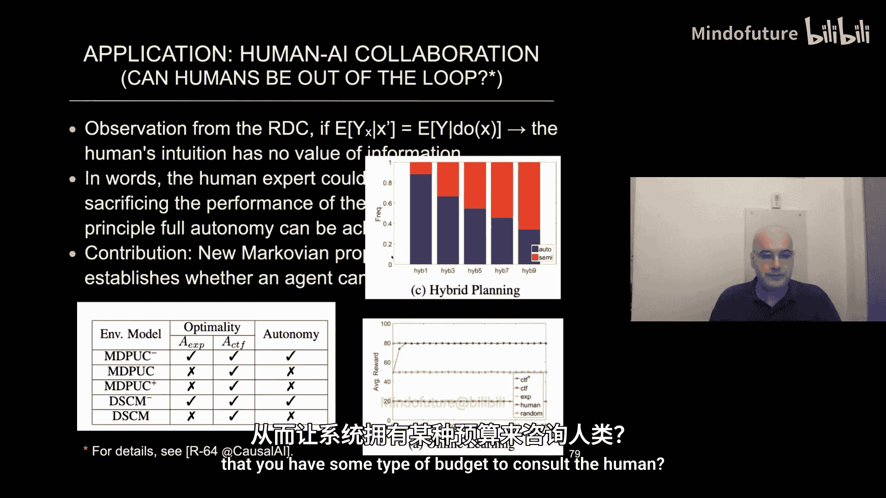

The that the human in the it has some kind of complementary capabilities that's who now I would like to have more two three slide or so wake up here if you're still with me thanks for subvising and for being so brave usually see that in class be a hero summary of RM or CRL capabilities the first one that we discuss first task like online learning is too costly and learning from scratch is usually impractical still the assumptions are offline learning are rather satisfied in practice seems hard situation they go here is to move towards more realistic learning scenarios where the two modalities come together and we'll like to extract as much as as much causing information as possible from the confounded data or more broadly from the imperfect data if you're in the data fusion kind of mood。

And using it in better in the most efficient way。Then you have the second task that is when and where to intervene agents usually have a fixed policy space。

 a fixed set of actions and intervene is usually assumed to be assume beneficial that is our typepo here I think this is state of affairs。

 this is our goal exc our goal here is to understand when interventions are needed and whenever this is the case。

 what should be changing the system in a more surgical way so as to bring about the desirable outcome。

😊，The third task is counterfactual decision making that is related to intentionality。

And feel will if you want to ask me your autonomy as well。

 the agents who only have autonomy they when they start to ask I about you do that。

 I don't know why what this is the emergency can ask Mitroconor Harri and many other cool stuff。

 but this is the key point but let me focus no tangents a。Imagine my students sometimes suffering。

My defense is a which topic。Agents act in a reflexive manner without considering the reasons or the causes forbehaving in a certain way。

 the goal here is to en agents with the capability of taking their own intent into account which will lead to a new notion of regret based on the counterfactual  normalization with implications throughout the third task that I didn't talk much just mention the beginning general ability or having a generalizable and robust decision making knowledge acquired by an agent is usually circumscribed to the domain where it was deployed。

Our goal is to the agents to extrapolate knowledge。

 making more robust and general reliable claims by leveraging the causal structuring variances that are shared across the environment。

😡，That cool work is my initial how it started even in the problem of transport a billion and how to leverage the structuring varianceances。

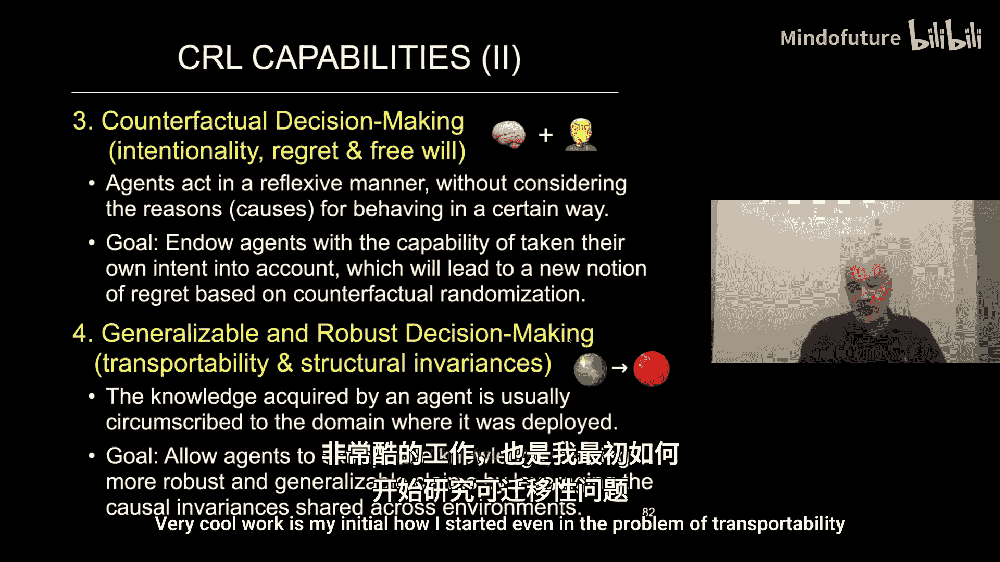

嗯。😊，The fifth problem or fifth dimension I would say learning causal models by combining observations and experiments Age have a fixed causal model constructed from the templates it could be a moti un banded could be on aov decision process it could be the instrumental variable and so on the front door。

 the back door and you have napkin and so on or from fixed background knowledge as we discussed now they goal here to allow the agents to systematically combine the observations in intervention that is already constructing sorry is already collecting to construct the equivalent class equivalentvalence class or eventually causal model by equivalentvalence class of causal models check the work by I mean Jabber as well is another one that I didn't ci here I think explicitly it's pretty cool about the equivalence class in causal models go through the causal AI Jabber JABER。

Causal imitation learning mimicking is one of the is one of the most common ways of learning whenever the demonstrators has a different causal model imitation may lead to disastrous side effects our go here is to understand the conditions so that imitation by behavioral coloning most common is valid and leads to faster learning otherwise which is the case that is not always the case introduce introduce more refine imitation modalities very cool new work。

 the causal imitation learning now just a cheat shoot here。

 if you're taking the exam I want to one page I wanted to see one page the tasks that whatever if you take what is kind of the take home message for each of these tasks when you are trying to connect the model M of the environment。

 the L1 L23， the policy and so on let me read one by one。

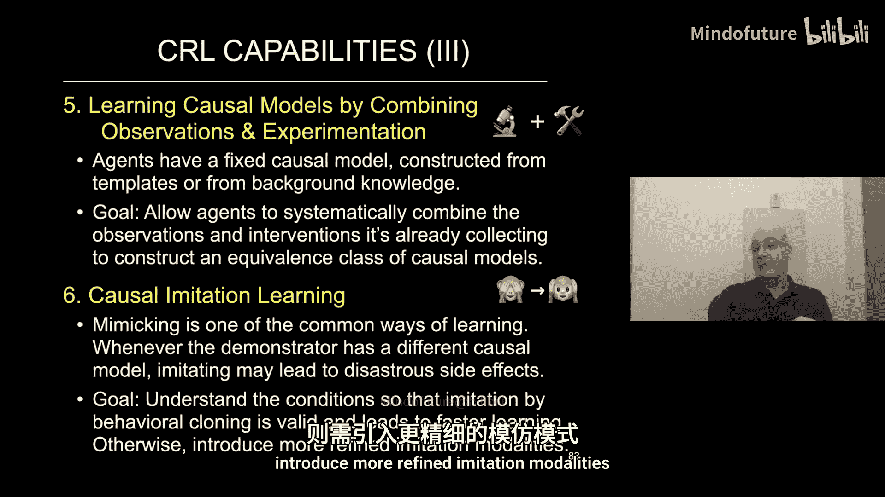

Generalizable policy learning， combining L one and all true interactions online and offline interactions should learn a policy。

Number two， when and where to intervene identify the subset of L true and optimize the policy space based on that this is the whole promise kind of business number three counterfactual decision making optimization function or should be based on the L three counterfactual and randomization not all through。

Helping hear about the A human AI collaboration， for example， is application， number four。

 generous ability and robustness， generalizing from the training environment that is a SMMM to a target environment M star。

They you have M is the California desertert， M star is Mars。Number five， learning the causal model。

 combining the capabilities L1 and L two interactions to learn a G of this underlying M。Number C。

 causal imitation learning， learn L2 policy based on the partially observable L1 data that is coming from the expert。

 given that you don't have access to the reward that his expert is getting。

I would say that this is the CRL dimensions that I can envision haven't seen contemplated and I think。

It's very cool， obviously， now let me conclude。

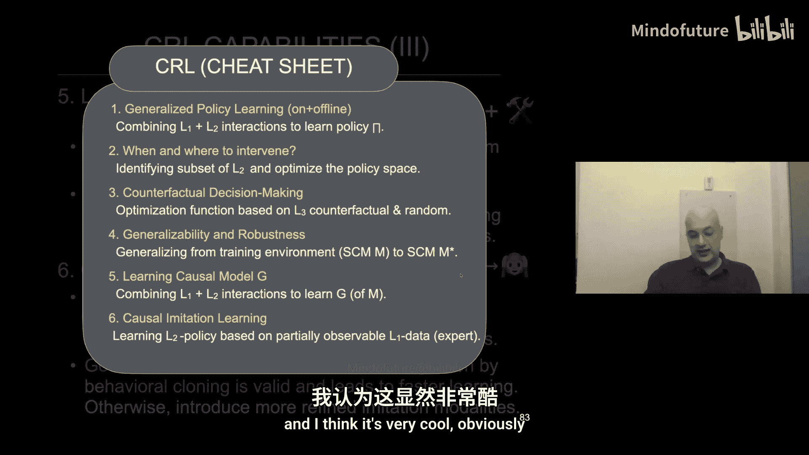

Calls on inference and enforcement learning are fundamentally interwined and novel learning opportunities emerge when disconnect connection is fully realized。

The structural inferences encoded in the causal graph with respect to the underlying SEM can be leveraged and combined with ourL allocation procedures leading to robust and efficient learning。

Still， if you want you win by there's winning by love and we by hate， this is like or this fear。

 if you read the Torah or the Tmud， I'd say， but still failure acknowledge。

 the distinct interference of the environment that is them almost always leads to the poor decision making。

嗯。CRL opens up a new family of learning problems that were neither acknowledged nor understood before。

 including the combination of online and offline learning， the GPL， when and where to intervene。

 counterfactual decision making， generates ability across environments。

 causal imitation learning and so on。The program here。

 the agenda that I have been pursuing and I would like you to help and to pursue as well as you can is the the we've actually developed a principle not high a principle framework for designing causal AI systems that are integrating this street observational experimental and counterfactual both data modes of reasoning and knowledge。

 everything here is not metaphorical， there's a counterpart in the language in the。

In the formal language and this I believe that leads to a very general most natural treatment to humanlike explainability and rational decision making these sources here both the slides the papers also and the survey coming soon maybe whenever you see this or watch this will be there point to your browser to the CR。

caoi。net thank you and also if you have any question here I will be happy sorry for going a little bit over time。

 maybe 10 minutes more or 15 but thank you for your presence or being patient and nice with me and I'll be glad to take questions and talk more。

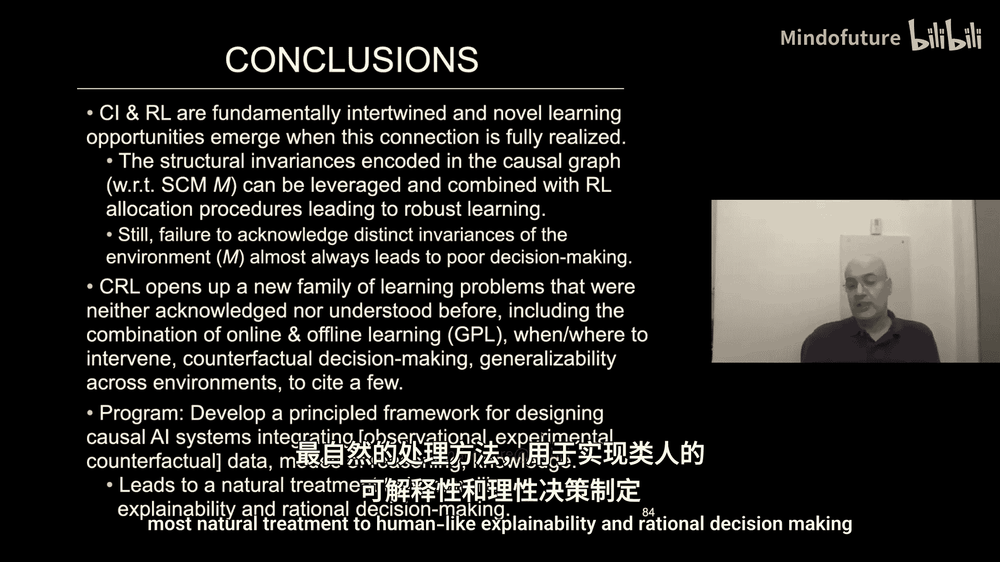

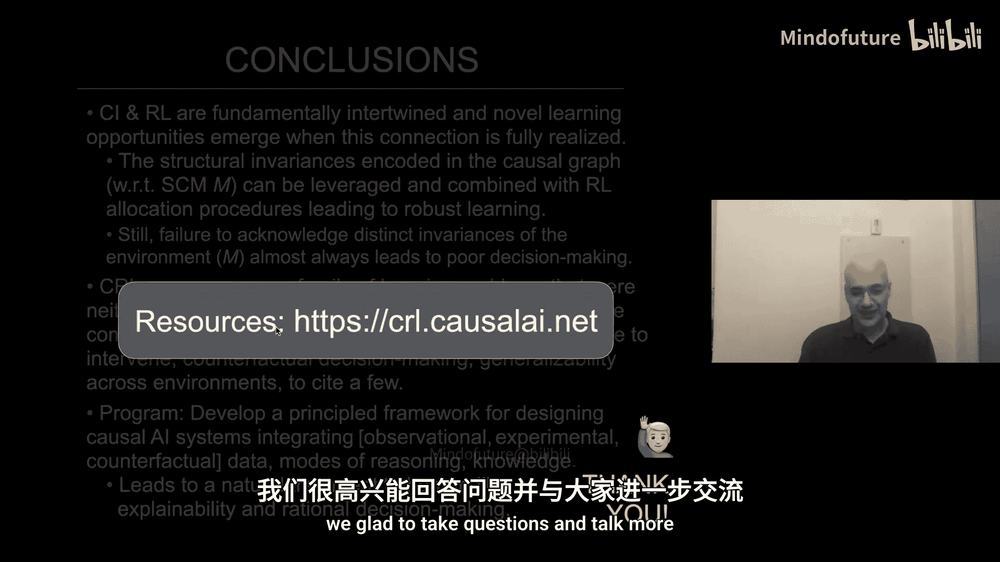

。