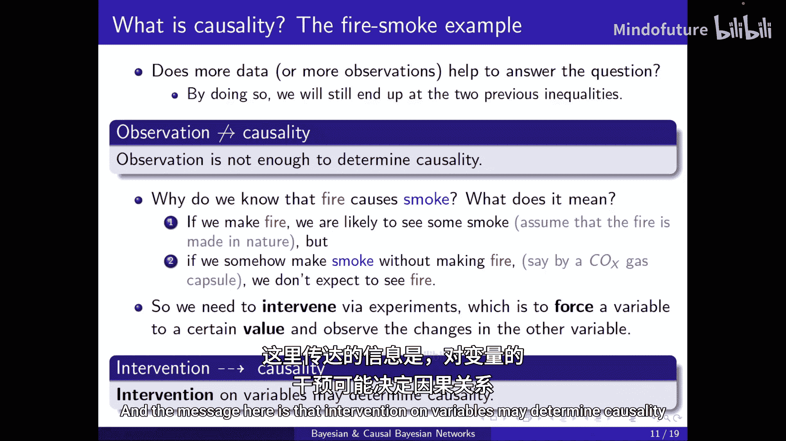
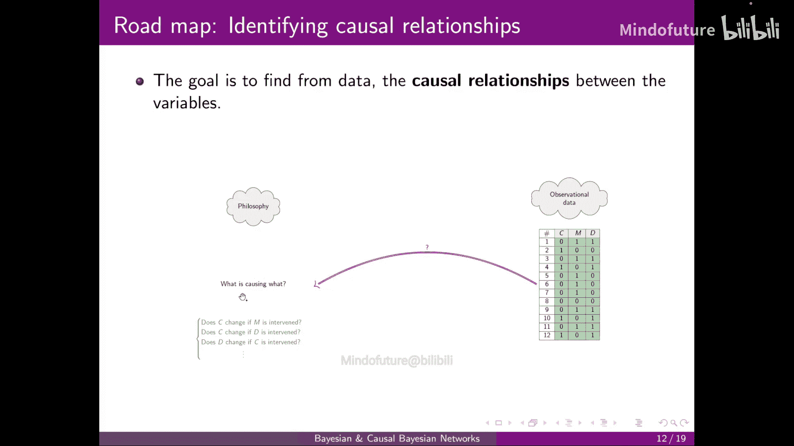
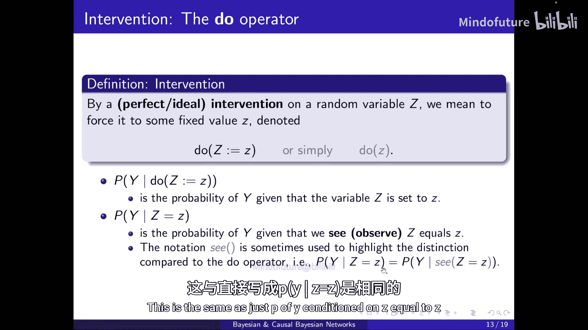
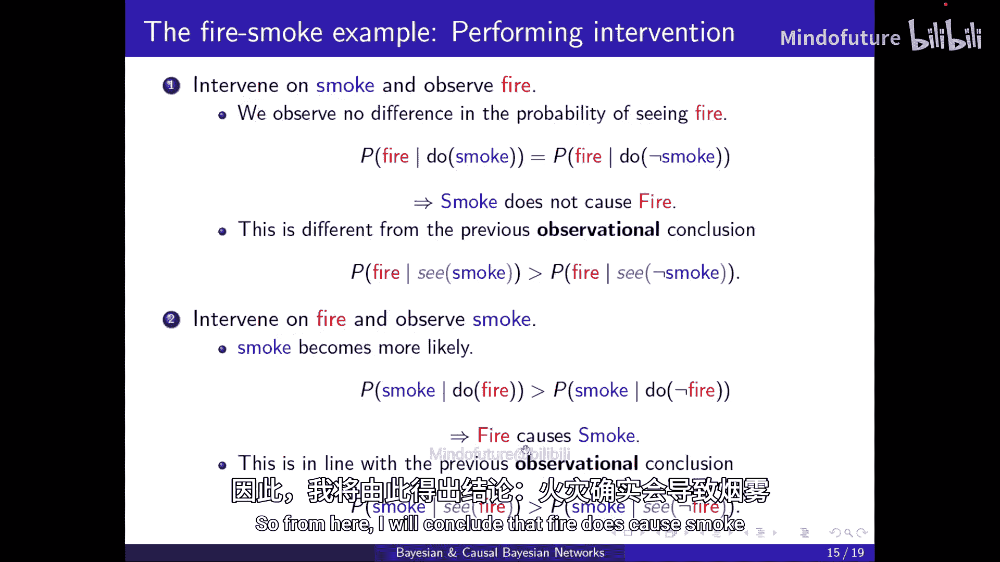
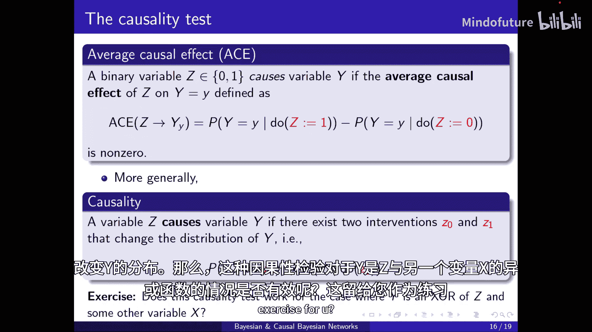
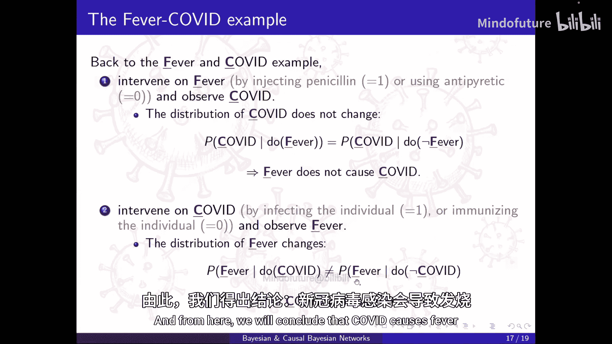
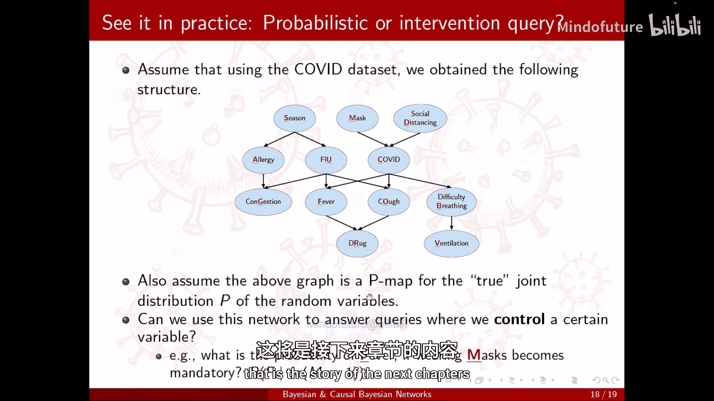
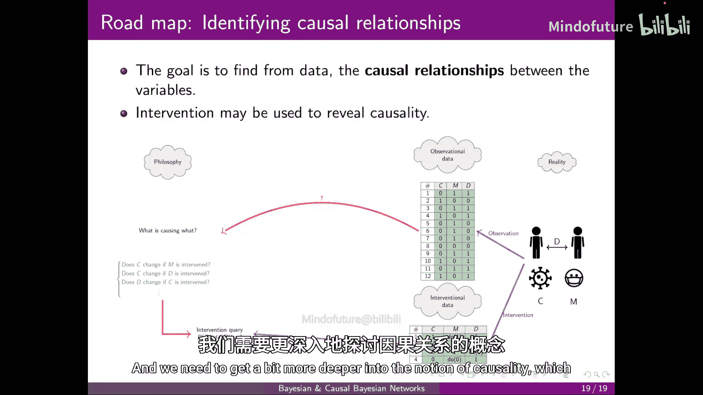

# 因果强化学习讲座 ｜ Causal Rl p18 P18_因果关系_2_干预 -BV1nQZcBSEW7_p18-

Hello and welcome to Section 2 intervention。I want to go through an example to explain some notions of causality。

The fire smoke example considered the binary variables， fire and smoke。

 indicating the existence of fire and smoke at a certain location。 Fire is observed by eye。

 and smoke is detected by a C X sensor。What can I get from observational data， Well。

 I will see that once smoke is observed compared to when it's not observed。

 the probability of fire is higher。Also。If I know that somewhere there is a fire。

 then it's more likely to also observe some smoke compared to when there is no fire。

So observing one will increase the probability of the other。And therefore。

 a statistical dependence or correlation between fire and smoke exists。

 so I cannot conclude that they are independent。But which one causes the other。

 Does it help if I make more observations or collect more data？ Well， no， because by doing so。

 we will still end up at the two previous inequalities。

In terms of the conditional probabilities and these inequalities。

 fire and smoke are kind of identical， and it's impossible to distinguish between them。

 how can I say which one is causing the other？In general。

 observation is insufficient to determine causality。Okay。

But then where is this piece of information coming from that fire is causing smoke？

 How do I know that？ And the key to the answer is experiment。If we make fire。

 we are likely to see smoke。 but if we somehow make smoke without making fire。

 say by a C X gas capsule， we don't expect to see fire。So we need to intervene via experiments。

 which is to force a variable to a certain value and then observe the changes in the other variable。

It is not just pure observation， I need to make changes， I need to intervene on the variables。

And the message here is that intervention on variables may determine causality。

Okay， so back to our roadmap， the goal was to get from data to causality。

And here we have observational data。 so far， what I said was a little bit elaboration on this kind of philosophical question of what is causing what。

Right now I'm saying that this may be interpreted as like does C change if M is intervened or does C change if D's intervene and so on？

So answering these questions may be considered as a way to answer this more general question。

Okay。So let me continue， I want to make things a little bit more mathematical。

We have this do operator。By a perfect ideal intervention on a random variable Z。

 we mean to force it to some fixed value Z， we already covered this， but here's the notation。

 do of Z equal to Z or simply do of Z。And we have this double period which indicates that it's forced to this value of。

So P of Y condition of do of Z。This is the probability of Y。

 given that the variable of Z is set to Z。P of y condition on Z equals to Z。

 which we had this in all the previous chapters， this is the probability of y。

 given that we see or observe Z equals to Z。You see the difference。Now。

 note that the notation C also is sometimes used to highlight that distinction between the two。

 so for example， we may write down P of Y condition on C or observing Z equal to Z。

 this is the same as just P of Y condition and Z equal to Z。

Okay back to the fire smoke example， when intervening on one variable we need to ensure that no other variables are intervened。

 so at a certain location we need to produce an omit smoke and then observe what happens with the fire variable and vice versa。

So to do smoke， note the notation here， capital smoke equal to true。

 I am simplifying it to do of the value of this， which is do of smoke with small letters。

 so to do smoke we can produce smoke by capsule of COX。

 but not but by fire because then Im also intervening on fire。Similarly to do not smoke。

 then I can prevent it， for example， by suction。And the same story with fire to do fire。

 we can produce it by ignition， but of course we should not produce COX gas at the same time and due of not fire。

 we should just prevent fire。Okay， so now what happens if I intervene on smoke and observe fire。

 I would expect the following to happen。 The probability of fire does not change whether I create smoke or prevent it。

 And again， by creating smoke， I am doing it without ignition without making fire。

And from here I can conclude that smoke does not cause fire。

Note that this is different from the previous observational conclusion where the probability of fire。

 if given that we see smoke， was greater than the probability of fire。

 given that we don't see any smoke。Okay。😔，Now， what happens if I intervene on fire and observe smoke？

 Well， then smoke becomes more likely if I make fire。Compared to when I prevent it。

 I would expect to see smoke in the first case with a higher probability。

And this is in line with the previous observational conclusion where instead of the do's I had Cs here。

 Okay， so from here， I will conclude that fire does cause smoke。 Okay。

 let's make things a little bit more formal， a binary variable Z causes variable Y if the average causal effect or AC C of Z and y is nonzero。

 what is AC C E， It's the difference in the probability of y conditioned on both when we intervene on both values of Z。

P of y condition on2 of z equal to 1 minus P of y condition and2 of z equal to 0。If this is nonze。

 then we say that there is a causal effect from z to y。More generally。

 a variable that causes variable y if there exists two interventions at0 and Z1 that change the distribution of y。

Okay。Now， does this causality test work for the case where y is an x or function of Z and some other variable x that is left as an exercise for you？

Back to the fever COVID example。What can we say here？ So if we intervene on fever。By preventing it。

 for example， or forcing it by some medication。呃。And then we observed Covid。 What will happen。 Well。

 the distribution of Covid will not change， okay。So fever does not cause COVID。

 but then if we do it the other way around， if we intervene on COVID by infecting an individual or immunizing the individual。

Then if we observe fever， we see that the distribution will change。

 Okay most likely more likely we will have a fever when we infect the individual with Covid。

And from here， we will conclude that Covid causes fever。

Back to the question in the previous section， we said we had that this。

Graph this directed acyclly graph for COVID， and we even assume that it's PMAP， then we ask。

 can we answer queries such as whether the person will have fever if wearing masks becomes mandatory？

Okay。😔，This question is not P of F condition on M from what we learn in this section。

 it is P of F condition on do of M equal to1。Okay， how can we answer this， Well。

 we saw that we can answer this by intervention， but from a graph。

 that is the story of the next chapters。 Now， back to our roadmap。

 the goal was to identify the causal relationships from data。

And we said that one way to interpret causality is via intervention from what we learn in this section。

 there is some reality， social licensing， COVD mask from this reality we can collect data by observation。

And we can also intervene and collect some data， which is referred to as interventional data。Now。

 these interventions， the interpretation of causality by intervention。

 we can write it down as a mathematically as an intervention query here of， for example。

 C condition on do。And by this interventional data， we can answer them。

 There is still a lot to cover here， like how how to get from here to there。

 and we need to get a bit more deeper into the notion of causality。

 which we will cover in the next section。

