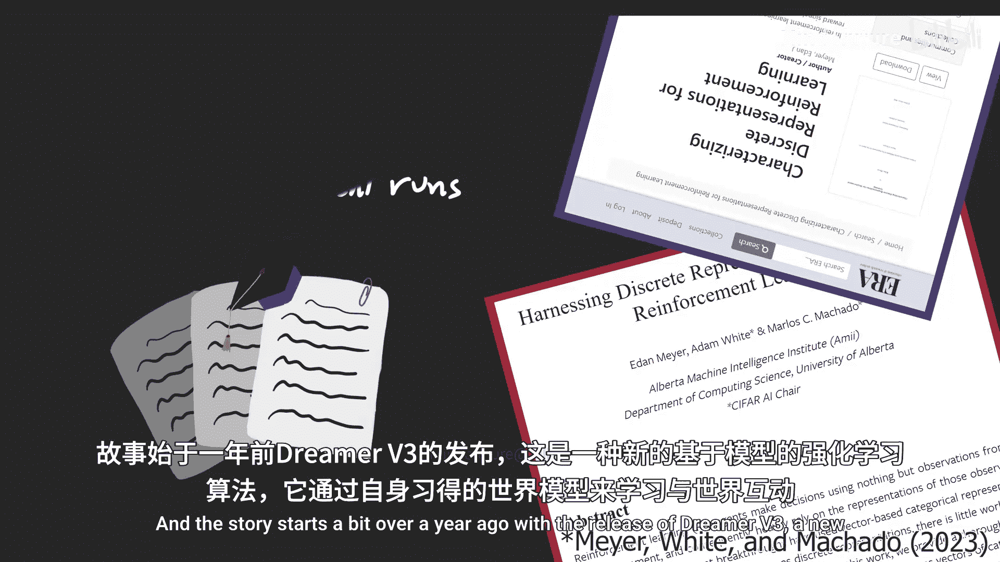
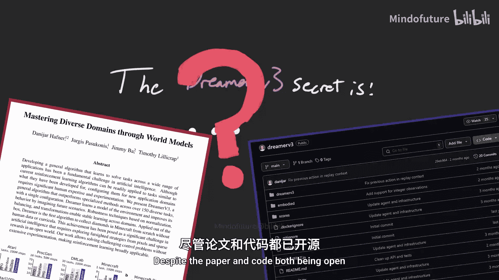
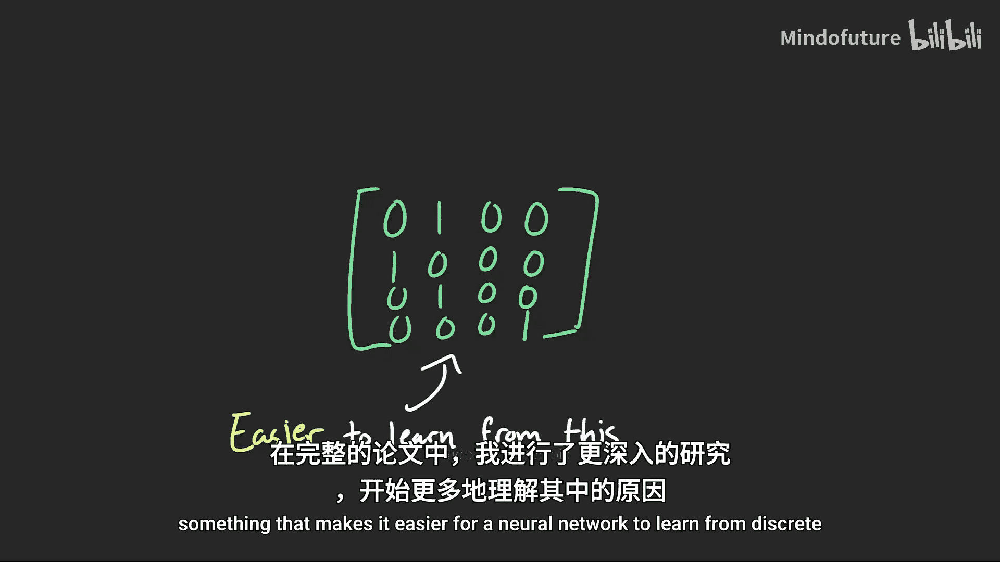
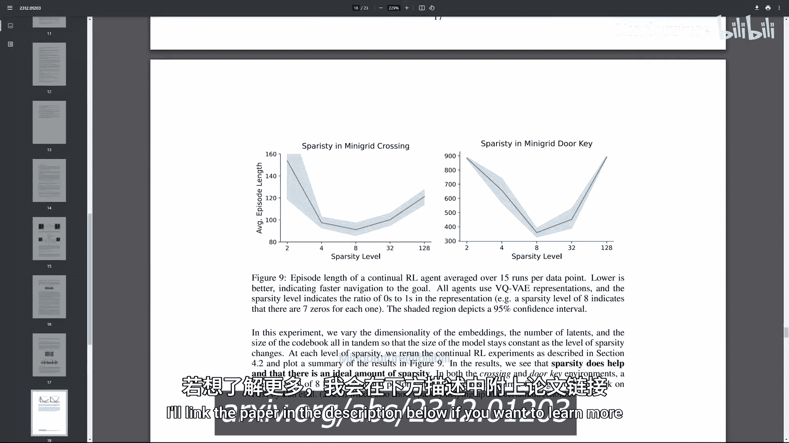

# 因果强化学习讲座 ｜ Causal Rl p19 P19_13分钟详解我两年的研究 -BV1nQZcBSEW7_p19-

I spent nearly the last two years of my life researching these two things。

 Representation learning is all about how we can turn real experiences。

 like attending the calculus class into numbers and specifically how we can turn them into numbers that actually means something to an artificial agent that needs to draw on that knowledge and modelbased Rl is about creating agents that can learn their own internal models of the world and then learn from their own imagination about what could happen after spending well over a year researching。

 publishing a paper and writing my thesis on the topic Now I can finally share what I learned and the story starts a bit over a year ago with the release of dreamer V3 a new modelbased Rl algorithm that learns to interact with the world in just that way through a model of the world that it itself is learned while Dreamer V3 was far from the first modelbased Rl algorithm。

 it was perhaps the first to work in so many environments with around 150 tested in total。

 Dreamer V3 performs astoundingly well in domains ranging from robotics to Minecraft and lots of。😊。

Doomains are areas where model based methods had really fallen flat in the past。

 So what was it that Dreamer V3 did that let it work where all these previous methods had failed。

 Well， even a year and a half later， it's actually still not so clear despite the paper and code both being open。

 Dreamer V3 did so many things different that you can't really point to one thing as being the secret sauce。

 One decision， however， stuck out to me as peculiar and it's how dreamer V3 represents the world What do I mean Well。

 when I say that model based Rl algorithms learn a model of the world。

 what they really learn is how to predict outcomes of their actions。 For example。

 a world model in Pacman may learn to answer questions like if I press the downkey。

 what do I expect to observe next here it would learn that going down would result in a game overscreen So going left or right would be a better option。

 Now， when making these predictions about the future。

 world models will often predict some compressed or partial version。

Of the future， rather than full raw observations。 and they do this because directly predicting high dimensional data like images can be computationally expensive。

 This is where representation learning comes in。 Most of the time these predictions will look something like this。

 Just a vector of continuous values that encode some meaning about the predicted future。

 So in this case， these numbers tell the agent something about the game overscreen。 Dreamer V3。

 however， uses what are called discrete representations。

 which differ quite a bit from continuous representations and look more like this。

 Notice that each of the rows only has a single one。

 So these matrix representations can be rewritten as vectors of discrete values。

 hence the name discrete representations。 And this， Well， it's weird。

 While a single continuous variable could take on practically any value be it 0 negative infinity 12。

4673。A single discrete variable in Dreamer V3 is limited to representing only one of 32 possible values。

 ensuresure if I want to be more precise， a continuous value on a computer cannot be any number。

 but it can still be one of 4。2 billion possible values， which is a bit more than 32。

 So why would you use discrete representations when continuous representations have the potential to hold so much more information。

 Well， there is actually no answer to this question。 And that is why this is a video about research。

 And this is where our exploration begins with a question of do discrete representations really help。

 And if so， how if thinking deeply about problems like this excites you。

 I think you're going to find these experiments very interesting and consider subscribing because you might find some of my other videos on research and AI to also be interesting。

 But back to the experiments， Dreamer V3 is a very complex system with many moving parts。

 which can make it really hard to get answers。 One of the。

Best strategies when faced with these massively complex systems is to break them down into pieces and then to look at each one of those pieces individually。

 and when we're looking at model based reinforcement learning。

 there are really two core components to consider the world model or model learning and the policy which maps observations to actions If we apply the question we had just a moment ago to these two separate areas we get questions we can actually start to explore First。

 how do discrete representations affect learning a world model and then how do they affect learning a policy。

 Let's start with the first question and look at world models to prepare our experiments will use a pixel based many great environment in this environment。

 the agent goal is to pick up the key。Unlock the door and then get to the goal marked by green。

 So this is made slightly more difficult by the fact that I occasionally force the agent to take random actions。

 So just memorizing a single path isn't enough to solve the problem。

If I simulate an agent with this behavior for 10，000 episodes， and average over those results。

 we get a visualization of what this agent's behavior looks like。This is about what we should expect。

 given the behavior I just described， and this will be our baseline or our ground truth。

 But of course， this is an experiment to test world models。

 So now let's make things interesting and learn a world model and here's the process to do that。

 First will collect a bunch of data from the environment just a bunch of sample transitions。

 and two we can use those observations to train in autoencoder。

 an autoencoder is a neural network that tries to reconstruct the input observation But the key is that the middle of the network has a bottleneck that is smaller than both the start and the end。

 so to accurately reconstruct the original observation。

 the network has to learn how to compress the observation while still retaining the things that are important to encode that observation So this autoencoder will give us latent states and these are the sort of compressed versions of observations that I mentioned earlier。

 which I'll denote with Z then three， taking a latent state and action as input we can learn a world model that predicts the next latent state。

 This gives us what's called a one step model。Or model that can predict one step into the future。

 but by simply reapplying the world model to our newly predicted state。

 we can predict arbitrarily far into the future Now if we go back to our baseline visualization。

 we can actually make a similar visualization using the world model will take an agent with the exact same policy so an agent that makes the same decisions but when the agent takes an action instead of interacting with the real environment well use the world model to predict the next state and when we do that we get this。

These imagined trajectories look similar to the ones from before at the beginning。

 but you'll notice that they slowly go off track the longer the environment runs as errors accumulate in the world models's predictions。

 And because of those accumulating errors， The agent never even gets past the door。

 So this is a world model with continuous representations。

 But what happens if we instead use discrete representations to do this。

 we just swap out our vanilla autoencoder with a vector quantized variational autoencoder quite the mouthful。

 but just V Q Ve for short。 This produces latent states， just like before。

 but it constrains these latent states to be discrete。

 And when we use a world model learned over these discrete representations。 We get this。😊，Now。

 immediately what you might notice is that this is much closer to the ground truth。

 Now the agent is picking up the key much faster。 it's actually able to open the door and get to the goal。

 despite using a world model with the same architecture in both cases。

 the world model learned over discrete representations is more accurate。However。

 the story does not just end here because this result。 it does raise another question。

 Why isn't the continuous model is accurate， And there are two possibilities for us to consider It could be that a。

 the discrete representations imbue the model with some capability that the continuous model inherently lackx。

 or could be B。 as I'm using fairly small world models here。

 the continuous world model may simply lack the capacity to learn everything about the environment。

 i。e the model might just be too small。 We can test this quite simply by increasing the capacity of both world models。

 essentially just adding more parameters， And here I'm plotting the results after doing just that。

 I have the size of the world model on the X axis， and the error of that world model on the y axis。

 which means lower is less error， which is of course better。 And at the start。

 we can see that the discrete world model is indeed performing better than the continuous world model just as we saw in the visualizations。

 but as the size of the world model increases。 we see。

that they both converge to about the same result， they both learn a near perfect world model。

 which tells us that the answer to our question is B a lack of modeling capacity。

 and this is still very interesting because it means that where there is not enough capacity to perfectly model the world。

 which is really every case in the real world or any interesting problem。

 then the discrete representations do work better。Okay， so we've got some results。

 but how should we interpret these results Well what they tell us is that learning from discrete representations。

 at least in this problem， allows for learning more of the world with less model capacity。

 It's an interesting conclusion and now we know a little bit about how discrete representations can affect learning a world model but what about learning a policy We already have a way of learning continuous and discrete representations。

 we can just repeat what we did in the learning representations for models section。

 So now we just need to learn a subscribe button on top of these representations。Sorry。

 I thought I'd try to slip a little subliminal messaging there。

 We need to learn a policy on top of these representations and we can do that as so at each step。

 the agent will get an observation from the environment。 that will be converted to a latent state。

 using a continuous or discrete encoder what we learned before and then using PPO。

 the agent will learn to map that latent state to an action that takes it closer to the goal。

 We can then compare both the continuous and discrete representation agents by comparing which gets to the goal faster。

 when we plot this， we see that both agents start off by taking around 1000 steps to get to the goal。

 not too good， but they both immediately start to improve。

 and they end up converging to the same optimal solution that takes around 20 steps on average to reach the goal。

 However， the policy learned with discrete representations。

 converges around two to three times faster。 and both of the methods significantly outperformed the baseline that learns from raw observations。

 So having either autoencoder representation significant。speedpeeds up learning。

 but the discrete representations do even a better job at that。 There is， however， a catch。

 because when you're really doing reinforcement learning in practice。

 you don't always have learned representations to begin with。

 You generally have to learn them at the same time as the policy as you go。 And if we do that。

 learn both the policy and the representations at the exact same time。

 We get plots that look like this where the discrete policy is falling significantly behind。

 And the reason this happens， is that the V Q Ve， which learns the discrete representations。

 learns slower than the vanilla autoender， which learns the continuous representations。

 So what does this mean， Are these discrete representations really useless if they take so long to learn。

Well， not necessarily。 And here's why we've been looking at all these experiments in minigrid where things are simple。

 The world is small， and it's totally possible to learn everything that could possibly happen。

 We've done this because this simplicity allows us to strip away all the confounding factors and focus on what we're really interested in。

 But， of course， I don't do ourL research because I'm excited about what we can do with minigrid。

 I work on ourL research because I'm excited about the more interesting and real problems。

 problems that are much bigger and more complex。 So much so that you'll never be able to experience everything or learn a perfect model of the world。

 In this regime because you can never learn everything。 The name of the game is adaptation。

 It's all about learning on the fly when you encounter something new。

 And this is the case where you need continual learning。

 And I propose that these discrete representations could be a great fit for continual learning。

 In the model learning experiments。 We saw discrete representations work better when。😊。

The model could not learn everything。 And while the discrete representations LED to slower initial learning in the policy learning experiments。

 faster learning and adaptation in the future has the potential to outweigh a slow initial learning period and to test this。

 we don't need to change much。 every so often， we can change the layout of the many grid environment like so。

 and the agent will be forced to adapt。 And when we do this and look at the learning curves after the initial representation period。

 we see this Each vertical that deadline denote where the environment changed。

 And as we see after each change， the policy learned over discrete representations consistently adapts faster than the one learned over continuous representations。

 So yes， it does take longer to learn these specific discrete representations。

 But once they are learned， they are quicker to adapt and they are quicker to learn from In both the model learning experiments and these policy learning experiments。

 there seems to be something really interesting happening。

 something that makes it easier for a neural network to learn from。

Discrete representations in the full paper， I go even deeper and start to understand a bit more about why this is the case。

 There are some really interesting findings， like the fact that not all discrete representations are created equally。

 and the fact that Sprsity and perhaps binary narrativerity play a big role in this。

 I'll link the paper in the description below if you want to learn more。

 If you found this intriguing， you can subscribe to get more research。

 AI stuff like this or you can follow me on Twitter where I post about my work， Either way。

 Thanks for watching。😊。

