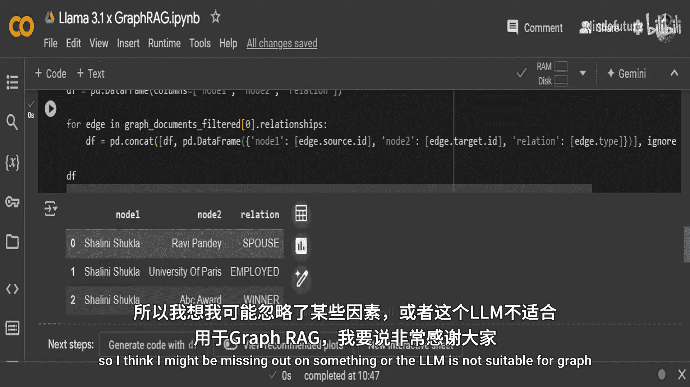
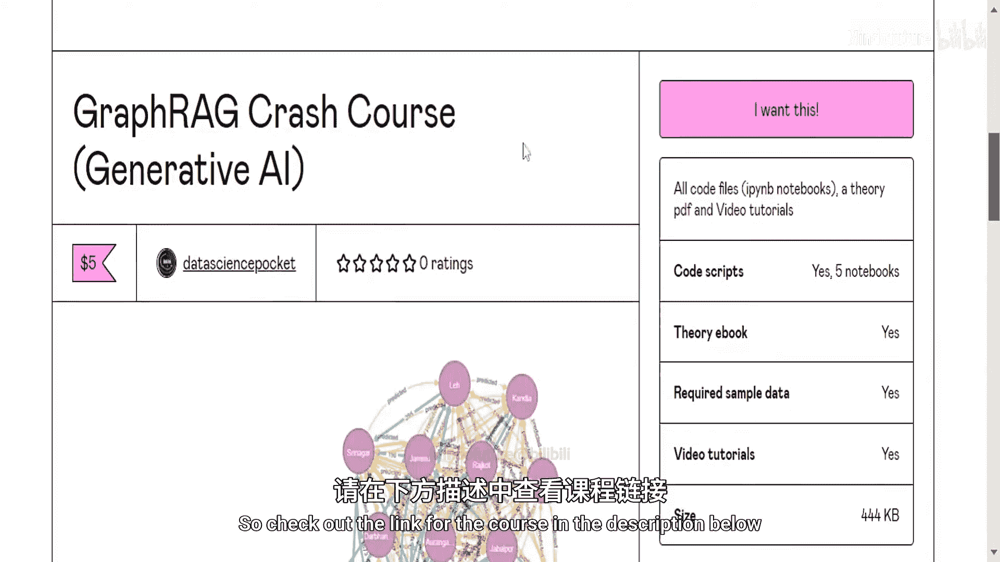

# 图Rag教程 ｜ Graphrag p08 P08_使用Llama 3.1实现GraphRAG -BV1hxZ9B7EYn_p8-

So hi everyone today we will be demonstrating how you can build a graph for rack system using Lama 3。

1 so basically in this tutorial we will be creating。

A graphra rack system using langcha and would be using the Lama 3。

18b model as an LLM so let's get started so first of all i am installing Lang experimental community the basic laang chain Lang chain core and Lang group so to get started you first need to create a Gro API key that Ive already covered in the previous video how you can do it so do check that out once done the rest of the code remains very similar what we have done in the previous section also。

On graph rack you need to import La LLM graph transformal graphq a chain network x entity graph etc。

 So first of all you need to create your。LM object using chat Gro。 So here into pass the。

Entity the idea of the model that is Lama 3。18b instant even the 70b model is free not the 405 v model but I just tested it out the performance for 8b model is comparatively better than 70b in this particular use case hence I am using 8b but you can check out the official growth page to how to use a 70b model as well。

And provide a grow APpe key here Once done， you will be providing a text。

Over which you wish to have the graph read create documents。

 create the Lm graph transformer object and call convert to graph documents I have already explained this that that is Im just running through it。

😊，Once you have created the knowledge graph， the knowledge graph gets created here。😊。

You need to add the knowledge graph into graph nodes as you can see I am adding the graph nodes into network X entity graph。

Once done you need to create a graph QN over the graph object that you have created so first of all you are creating a knowledge graph then a graph object and then third you are calling a graph QH。

😊，Once I will be showing you the results for the knowledge graph generated the results arent great because it is able to identify just three relationships so in the previous tutorial if you check I use a Gemini API by Google it was able to identify about 20 to 25 relationships so I think in that case Germanyi was better Lama 3。

1 but it is a 8b model even a 70b model didn't give me。😊。

Great results So I think that is this is the max I can get from the8 B or the 70b modelNonetheless the code is working results aren't great for the knowledge graph because if the knowledge graph is not great I think your retval Q chain will also won't be giving you the best answers。

😊，Nonetheless I asked it a question which is Char Sla from the context so it is able to wrap everything that was present in the knowledge graph rate but the knowledge graph created was quite poor I would say so not very happy with the performance of Lama 3。

18b model and even the 7tb model to be fnk because it was able to extract just one relationship so I think I might be missing out on something or the LLM is not suitable for graphra I would say thank you so much。

So hi everyone graphra rack Cr course is out now which includes all the codes a theory ebook and link to the video tutorials。

 so check out the link for the course in the description below。 Thank you。😊。

