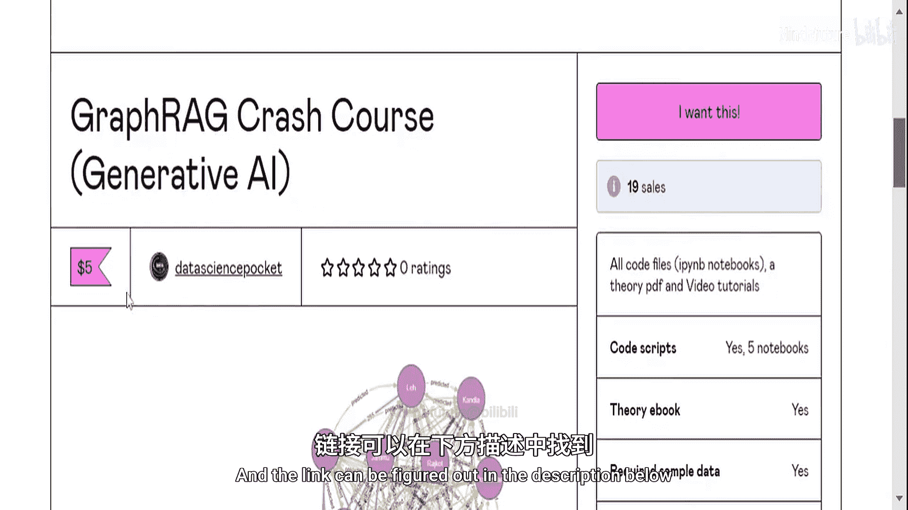
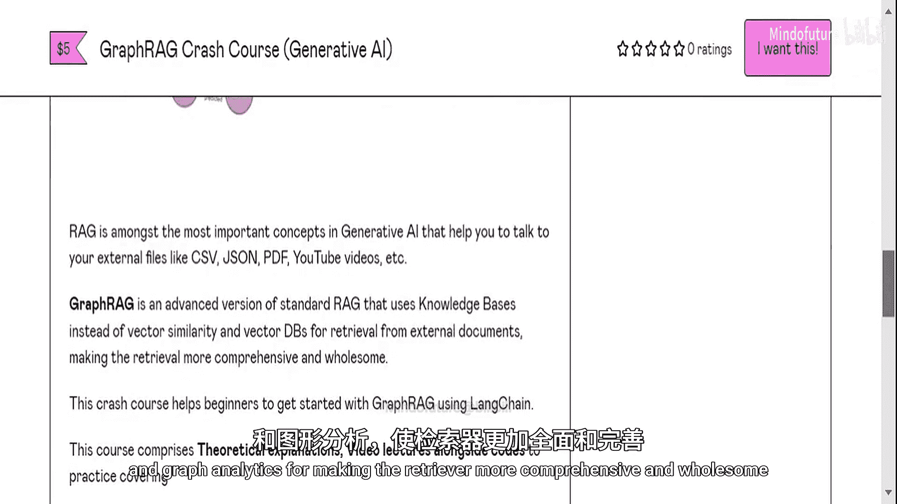
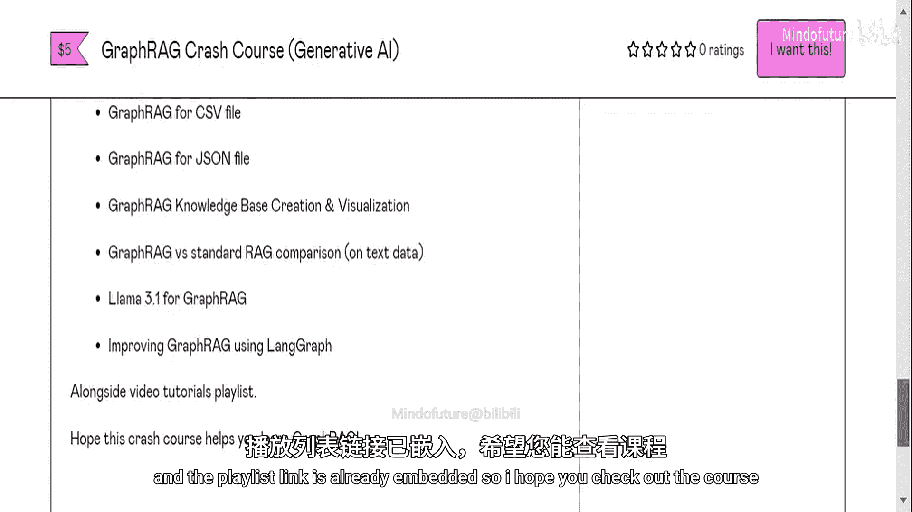

# 图Rag教程 ｜ Graphrag p12 P12_GraphRAG初学者速成课程 -BV1hxZ9B7EYn_p12-

So hi， everyone。Im glad to share that we have just launched graph rack Ra course for bigs in Geneative way。

And the link can be figured out in the description below so basically Ra is one of the most important concepts in generative way that helps you to talk to external files like CSV JN ps etc graphraph Ra is an advanced version of standard rank which uses knowledge base and instead of using vector similarity in vector Dvs it uses knowledge base and graph analytics for making the retriever more comprehensive and wholesome。

So， this particular course consists of three parts the first one being the theoretical explanation we do lectures and the last one being codes so in the theoretical part we have what is graph rank how a standard drag works。

 what is a knowledge graph issues its standard rank how does graph lag work example workflow and global search versus local search in graph rank。

Talking about the codes So if we won't be using any paid resources and we would be using everything using free APIs So the first tutorial is on graph rack using la chain then graph rack for CS3 file graph rack for Json file knowledge based creation and visualization。

Graph rank versus standard rack comparison over text dataset set Lama 3。

1 for graphra improving graphra using La graph so we won't be using any paid A in all these tutorials and all the codes are already executed for you to see the outputs alongside this the code explanation and the theoretical explanation are presented in video tutorials and the playlist link is already embedded so I hope you check out the codes and the link is in the description below Thank you。

