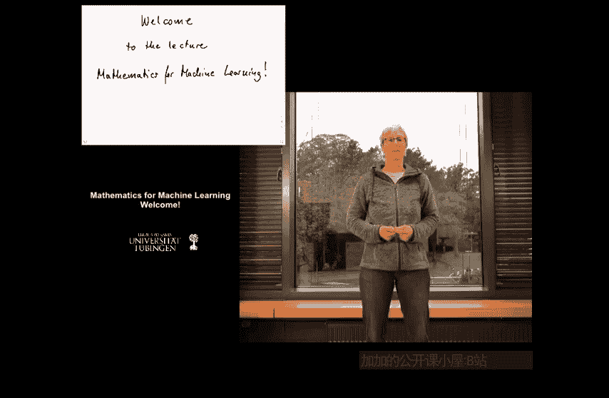
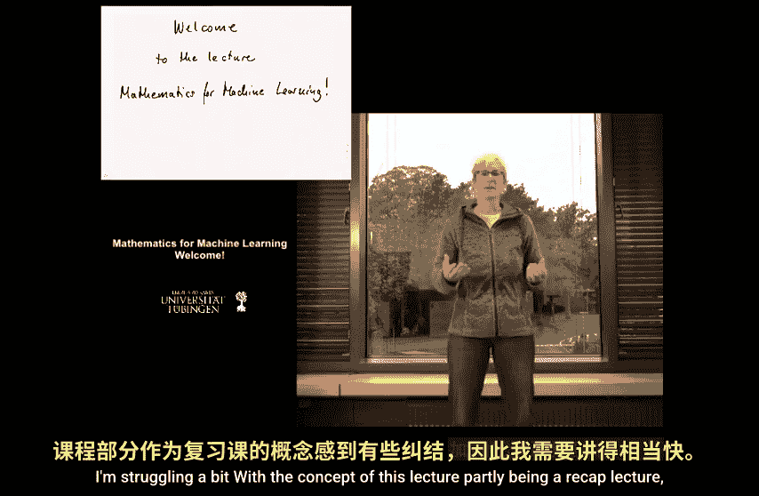

# 图宾根大学【中英⚡机器学习数学｜2020 Tübingen Mathematics for Machine Learning】 p01 P1 Welcome! -BV1VhbMzKEts_p1-

Good morning and welcome to the lecture Mathematics for Machine learning。😊。

My name is Rickki Lusbo and I am a professor for machine learning at the University of Tuingham。

 and I am going to teach this class in this term。COVID is still among us。

 so the lecture unfortunately has to take place online。

 I'm sad about this because what I like about teaching is typically interacting with you。

 seeing your faces， seeing your smile if you understand something of wrong if something goes wrong。

 and mean all these interactions at least in this way are not going to happen。However。

 we are going to offer inverted lectures and also tutorials in small groups which take place online。

 but still we hope to get a bit of interaction going to give you the possibility to ask questions and to make remarks and also to give us feedback on how this lecture is going to go。

The contents of this lecture are as the name says， mathematics for machine learning。

 so essentially this is a recapab lecture， much of the material is supposed to be known to most of you。

 so we are going to talk about linearya algebra about multivariate analysis， probability theory。

 statistics， snow merits， optimizations， all these aspects that you need to know if you really want to dive into machine learning and eventually if you want to be able to design your own machine learning algorithms and solve your own machine learning problems。

I'm struggling a bit with the concept of this lecture。

Partly being a week at lectures so I'm supposed to be pretty fast。

 I can't spend as much time as I would like to， on each of the individual topics but on the other hand I don't see your feedback so it's going to be a bit strange to try to figure out what is a good speed for the lecture。

 what is a good amount of examples or how many proofs should I present。

Please give me feedback if you think the lecture should be designed in a different way。

Last semester I've been recording the lectures outside in my garden unfortunately it's now winter for term so this won't be possible anymore so I've also been struggling with a setup that is indoors but still I like reasonably like the setup as much as you can like it if you need to take online videos and you will notice I've already recorded a couple of videos and some of the first videos I really not optimal the sound is too low or the illumination is wrong the background is too bright and I'm too dark or stuff like that so as I'm recording videos。

