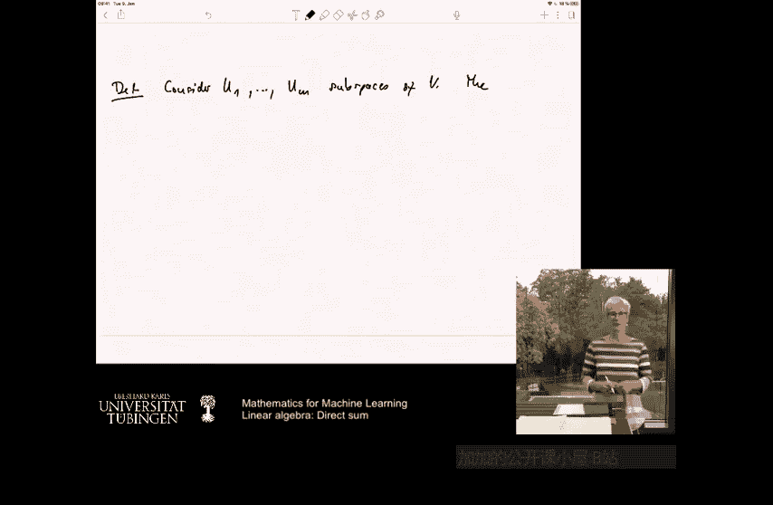
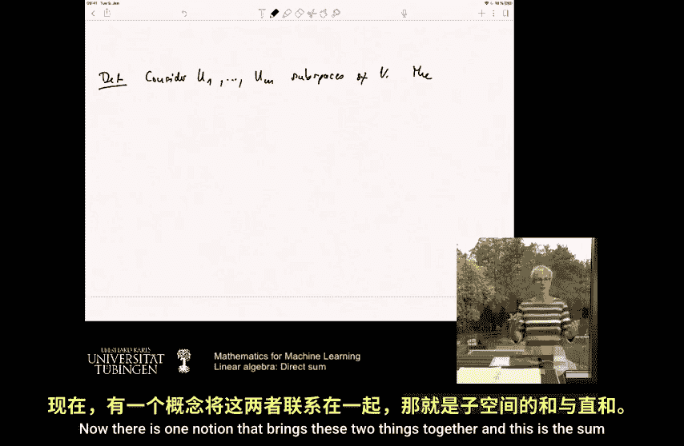
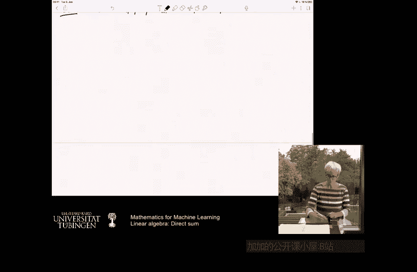
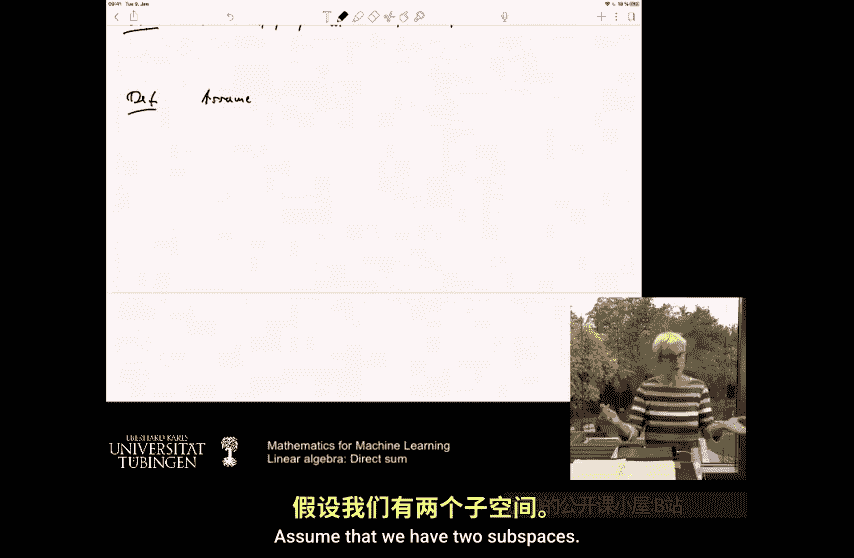
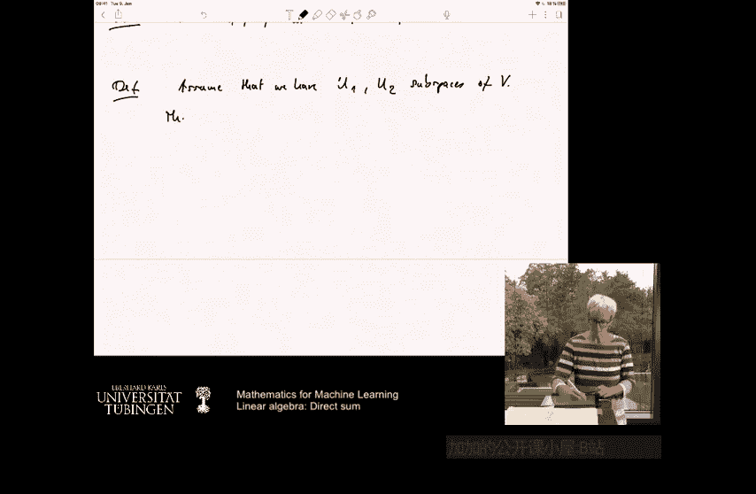
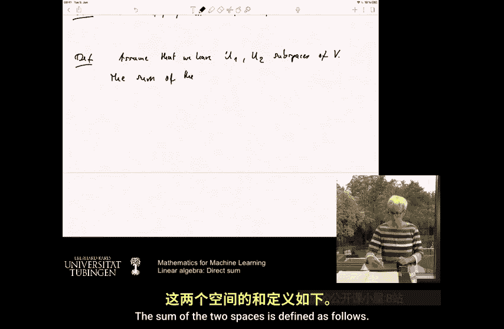
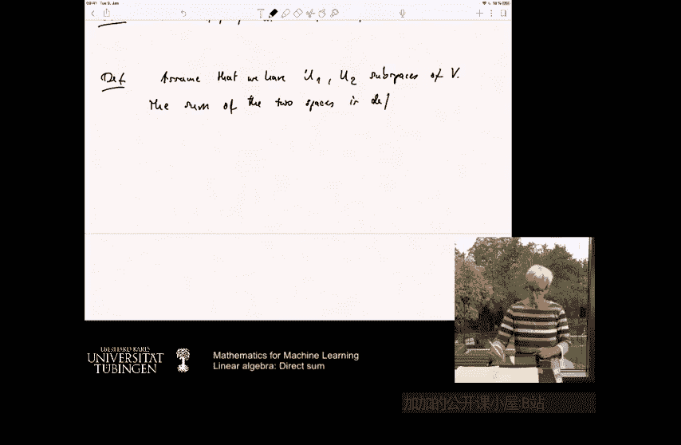
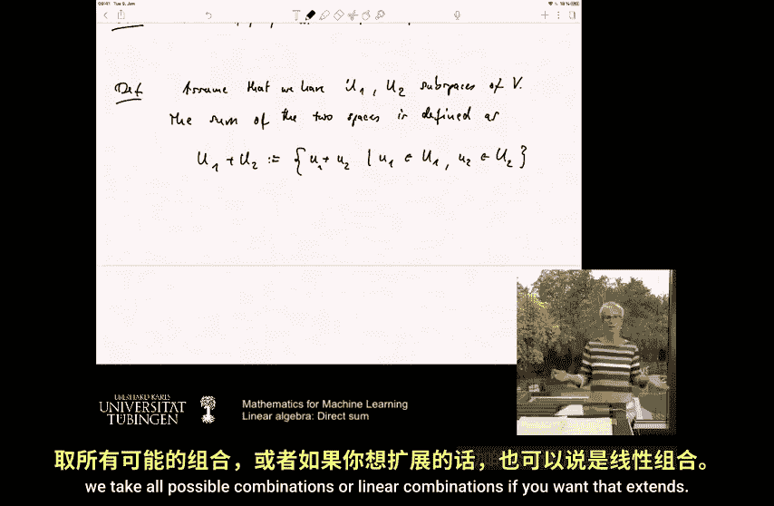

# 图宾根大学【中英⚡机器学习数学｜2020 Tübingen Mathematics for Machine Learning】 p04 P4 (A) Linear algebra 3： Direct sum -BV1VhbMzKEts_p4-

We have seen what a base is， and we have also seen what a subspace is。

Now， there is one notion that brings these two things together。

And this is the sum and the direct sum of subspaces。 Let me explain it。

So here's our definition。Assume。That we have two subspaces。

We have。You 1 and you 2。 there are subspaces。Of a vectorspace V。

 And now'll be first to find what the sum is。

The sun。Of the two spaces。

Is definedian as follows？

不知道。Is the。Find S。And we write this U 1 plus U 2， an normal plus sign between the two spaces。

 and this is definediant。

sorryrry。😔，Is defiant as the following set。U 1 plus U 2， where U1 is in the first space。

 and U 2 is in the second space。Okay， so this is simply we take all possible combinations or linear combinations if you want it extends。

And then we get a new space， and this is called the subspace。

You might consider that the thing we get is really a subspace。 It is not just a set。

 And if you don't see that right away， please sit down and try to prove it。 It's really easy。Now。

 in this definition， we did not exclude so far that you you wanted you two overlap， for example。

 but in many cases， we are more interested in spaces that do not overlap。 And ultimately。

 we want to say something like there is a space and its complement。And to be able to do that。

 we need to define what is a direct sum。So the sum that we have just seen。It's called a direct sum。

If each element in the sum can be written in exactly one way。If each element。In the sun。

Can be written。