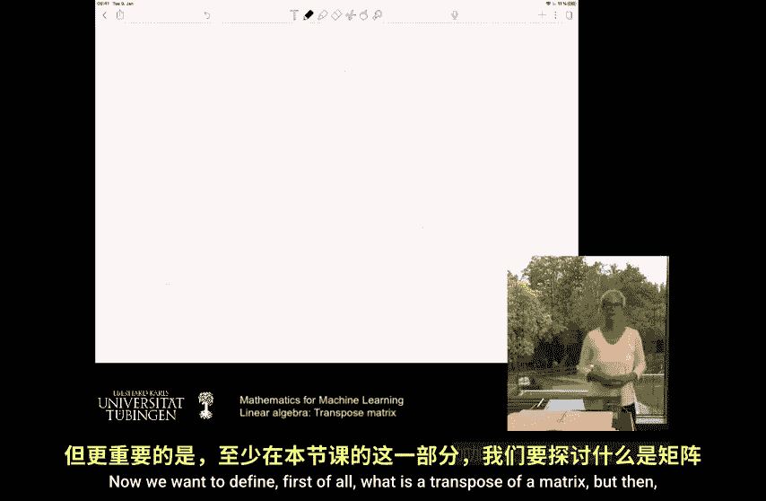
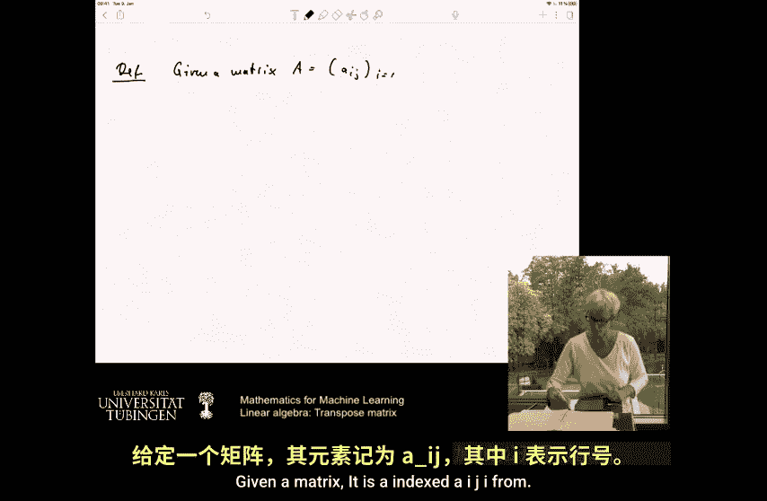
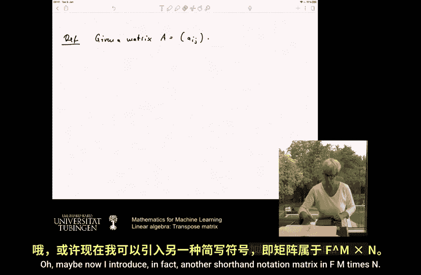
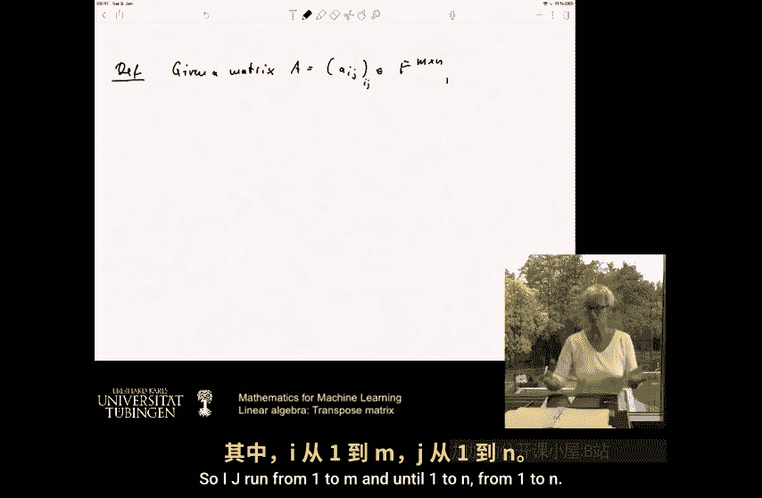
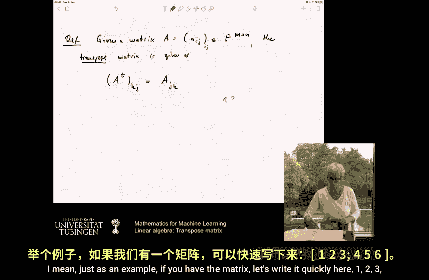

# 图宾根大学【中英⚡机器学习数学｜2020 Tübingen Mathematics for Machine Learning】 p08 P8 (A) Linear algebra 7： Transpose -BV1VhbMzKEts_p8-

Now we want to define first of all， what is a transpose of a matrix， but then more importantly。

 even at least in this part of the lecture， what is the inverse of a matrix。

 what is the inverse of a linear mapping and how are they two related to each other。

So let us start with the transpose， this is essentially a definition。For now。Given a matrix。嗯。

It is a indexed A I J， I from。

Oh， maybe now I introduce， in fact， another shorthandnotation。

Matrix in。F M times N。 So this is the space of all matrices of size M times N over the field F。

嗯。Now， the transpose。 So I J run from one to M and until one to n from one to n。

The transpose matrix。嗯。Is the matrix where we exchange the rows and the columns。Istimate is given S。

A transpose。嗯。At the index K， J。

It's the same as a at the index J K。I mean。Just as an example， if you have the matrix。

 let's write it quickly here，1，2，3，4，4，5，6。

This it doesn't。 in fact， it doesn't need to be a symmetric matrix。 Typically。

 we look at symmetric matrices， but not always， if this is a。Then a transpose is the matrix 3，6，2，5。

Sorry， I started from the wrong end。嗯。Is the matrix 1，4，2，5，3，6。

 So we flip the matrix at the diagramagon。Okay。嗯。The notation for transpose matrix。

 they exist various notations。 And unfortunately， I know that I'm never consistent in my notation。

