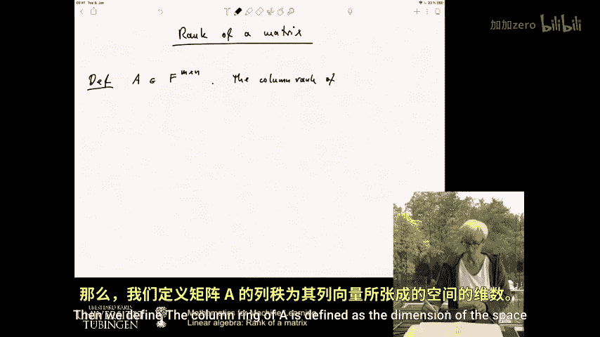
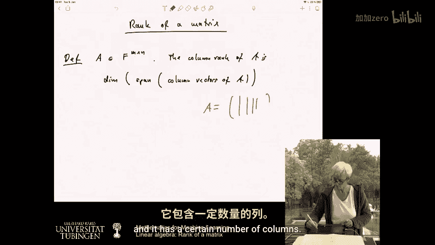

# 图宾根大学【中英⚡机器学习数学｜2020 Tübingen Mathematics for Machine Learning】 p10 P10 (A) Linear algebra 9： Rank of a matrix -BV1VhbMzKEts_p10-

Now I want to define one notion that is used a lot in linear algebra。

 but that's also really important in machine learning， the rank of a matrix。

In your later lectures on machine learning， you are going to notice that there exist many so called low rank matrix methods。

These methods typically try to fit a linear wall your data described in terms of a matrix。

But the matrix is supposed to have low rank and low rank ensures that the matrix isn't too powerful。

 It can't be expressed。 it can't。 It doesn't have too many parameters if you want so。

 That's the machine learning point of view。 But now， of course。

 we want to look at the mathematics point of view and simply define what is the rank of a matrix。

So the definition we now want to look at is as follows， consider a matrix A in F M times n。

 so observe this does not need to be a square matrix。Then we define the column ring。Of a。

Is defiant as the dimension？Of the space。That is spent by the columns。Colum vectors。Of a。

So maybe as a little illustration that I'm going to remove later onset。

 we have this matrix A and it has a certain number of columns。

Each of these columns is a vector。This vectorpenencer space and the corresponding space is a certain dimension。

And this is what we call the rank of a matrix。Now， of course， I define the color rank。

 you can easily define in the same way the row rank， that's obvious。Let's just write it down。嗯。

The role。Rk。嗯。Is defined accordingly。Corantingly。Where you simply replace the rows by columns so now instead instead looking at the column vector and the dimension of the space they spend。

 you now， look at the rows of your matrix， That's pretty obvious。

Now there's one really cool aspect about row rank and column rank。

