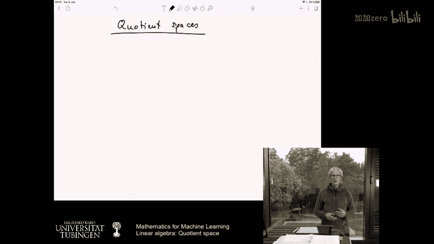

# 图宾根大学【中英⚡机器学习数学｜2020 Tübingen Mathematics for Machine Learning】 p11 P11 (A) Linear algebra 10： Quotient space; equivalence relation -BV1VhbMzKEts_p11-

Now I want to talk to you about quoottion spaces。This is a mathematical construction that is a bit involved。

 It takes a bit of time to really digest what's going on。

 but once you have digested it it is something pretty easy。

 A pot space has nothing to do with matrices in the first place。

 It is more construction that we often need in linear near algebra when we have certain subspaces we want to get rid of if you want to see。

And the way to introduce quotient spaces， there are many different ways。

 but the way I like most is takes a little detour。 We， first of all。

 he to have to explain what an equience relation is。 Let's simply get started。

So we start with a definition and we start to consider。AI。S， it can be anything。

 It's not a vector space， in general。And now we want to， first of all。

 define what is an equience relation on this。sorry。呃。A subset。R。Of the product space of S。Is called。

An equience relation。If the following holds an equivalent relation on S。If we have that for all X。

 Y and X， Y and Z in S， we have three properties。E1， what we need to have is reflexivity。

X comma x is in R。 maybe a bit of intuition for now already。 So this is a bit of a funny notation。

 but it's seeing mathematically the cleanest way to introduce it。X comma x， in our means。

 x is in relationship with itself。And maybe an example you might want to have in mind is friendships。

Say the relation between myself and my friend is what I'm currently talking about and we want to see whether it's an equivalence relation。

 so x comma y in R means x is like x is friend to y， for example。

So the first property we want to have is that everybody is in relation to himself or herself。

 X comma X is in R。This is called reflexivity。Relexi V。

