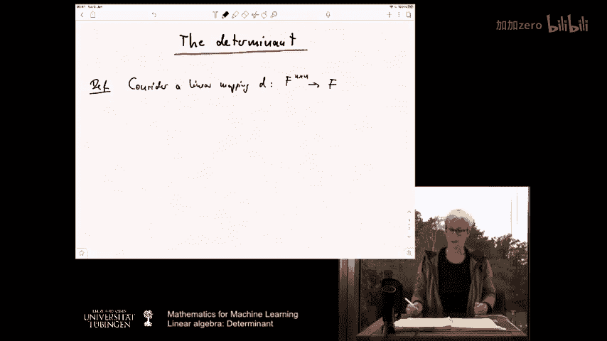
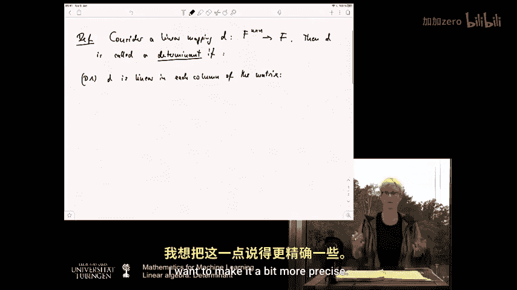

# 图宾根大学【中英⚡机器学习数学｜2020 Tübingen Mathematics for Machine Learning】 p12 P12 (A) Linear algebra 11： Determinant -BV1VhbMzKEts_p12-

Good morning。Today， I want to discuss the determinant。

The determinant is a really important object， both in India algebra。

 but for us maybe even more important in analysis or in optimization when we want to compute。

 say integrals or if you want to run gradient descent algorithms， very often the determinant。

 in this case of the derivative of the mapping is an object that is really important to study and that tells us many properties of what we're interested in。

So， let us get started。I took quite some time to really decide what is the best approach to introduce the determinant because it's such an abstract object。

 And my suggestion is I start with the abstract definition and with some important properties。

 but then I also give you later on the geometric intuition of the determinant。

 So let's start with the abstract definition。So we start with a definition。

 We now consider a linear mapping。And here it is called D。 It goes from F n times n to F。

 So D is going to be the determinant in the end。And the feed is of course， fixed。

And observe this goes from F N times n。 So it is for square matrices。😊。

And now we want to say which properties this mapping needs to have to be a determinant。

 So you say then。Do you。Is called。A determinant。If the following properties hold。And again。

 as very often， we have three particular properties that we need D1。

D is linear in each of the columns of the matrix。 Let me first write it down。 D is linear。In。

Its column。Of the matrix。Now what do I really mean by this， I want to make it a bit more precise。

So， let a。Be a matrix， O， sorry。