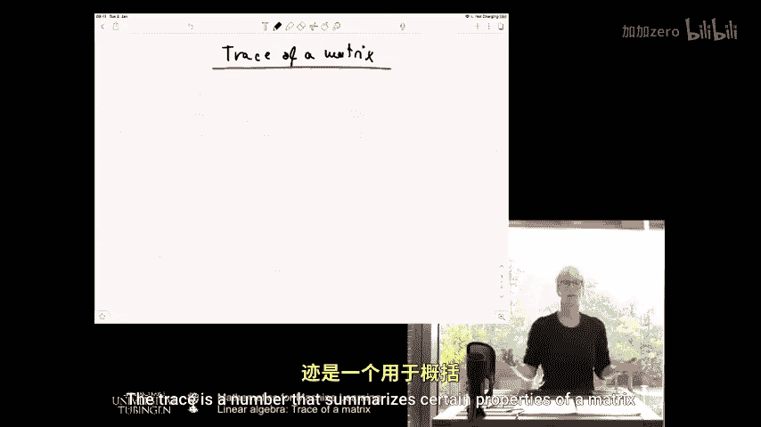
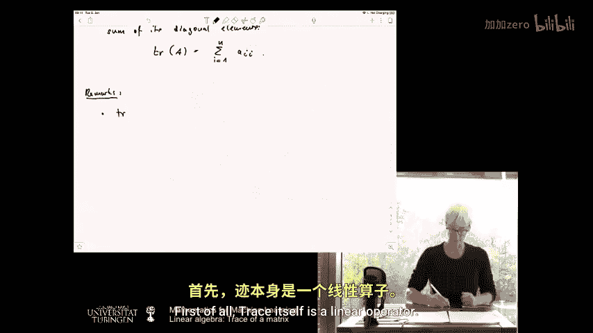

# 图宾根大学【中英⚡机器学习数学｜2020 Tübingen Mathematics for Machine Learning】 p15 P15 (A) Linear algebra 14： Trace of a matrix -BV1VhbMzKEts_p15-

Now we want to look at the traces of a matrix。The trace is a number that summarizes certain properties of a matrix。

 and it can be quite useful and is used in various places in machine learning。

Let us， as usual， start with a definition。The definition。The trace of a square matrix。

The traces of a square。Matrix。诶。An intense in matrix。

Oh I wroteR to the end times and you can also write through it with the complex numbers。

 so maybe I just make it more general。Over F n times N。Yes。The sum of its diagonal elements。

 some of its。They are gonell elements。And let me write it。 Trace of a。His。Some of I from one to N。

 AII。So you just sum the diagonal elements of the matrix。Now why is this an important object。

 maybe it becomes a bit clearer when we talk about when I give you a couple of remarks and properties？

Of this object。 first of all。Tra tracece itself is a linear operator。

If we consider it， for example， an operator on R in terms N to R。Is a linear operator。

And this is easy to see if you have the sum of two matrices。

 well the entries of the diagonal get sum together and that's the same as sum in and the same for scalar multiplication。

 so this is a linear operator。So in particular。We obviously have that the trace of a plus B。

It's the same as the trace of a。Plus， the trace of B。It's already a nice rule of thumb。

 Then another property that we can easily see is the trace of a product。

Of two matrices is independent of the order。