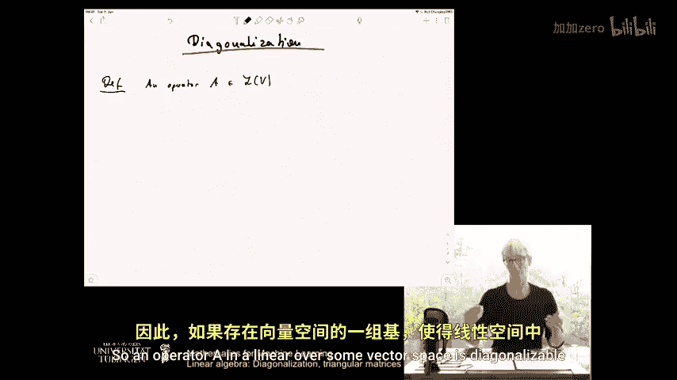
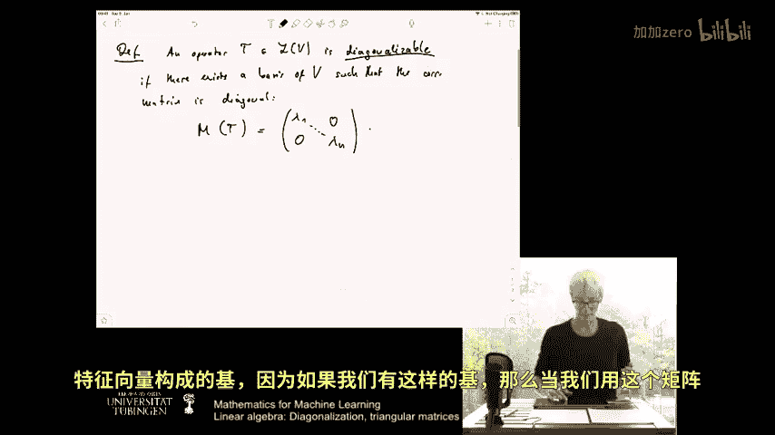
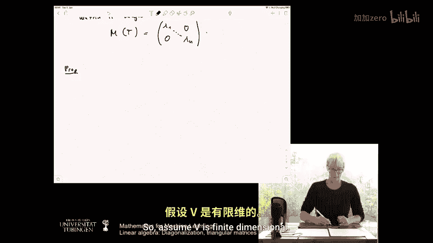
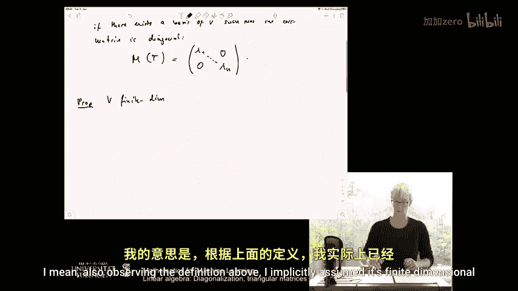
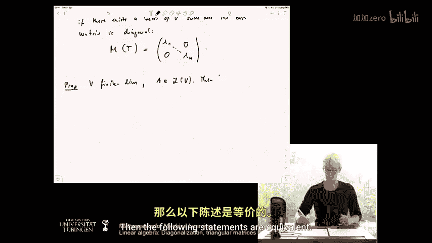

# 图宾根大学【中英⚡机器学习数学｜2020 Tübingen Mathematics for Machine Learning】 p16 P16 (A) Linear algebra 15： Diagonalization; triangular matrices -BV1VhbMzKEts_p16-

Now we slowly start moving more towards the essence regarding eigenvalue and eiging vectors and the important chapter on diagonalization let us start with a definition。

😊，So we say an operator is diagonalizable if there exists a basis of the vector space such that we can represent the operator in a diagonal form。

So， an operator。A。In a linear。

Over some vector space is。They啊 gonna来一首不。If there exists a basis。Of the vectorectar space。Such that。

The corresponding matrix。Is that I know？So， the matrix。

Maybe I should write the operator is T to make sure， like the。

A is typically used for a matrix and T for the operator， so the matrix of T。Has to form Lada 1。

 Lada n， diagonal matrix and 0 outside the diagonal。

So this means simply there exists a basis of eigenvectors because this basis like each like observe that if we have such a basis。

 then if we multiply this matrix with the first eigenvector。

 we simply get the first eigenvector back and so on， so such a matrix。

 such a basis is a basis of eigenvectors。

Let me give you a proposition that summarizes many of the properties that we have in such a case。

So assume V is finite dimensional。

I mean， also observing the definition above， I implicitly assumed it's finite dimensional because I wrote down a matrix representation with a finite matrix。

嗯。And assume that a is a linear mapping over this vector space。

 then the following statements are equivalent。

In statements。Are equivalent。