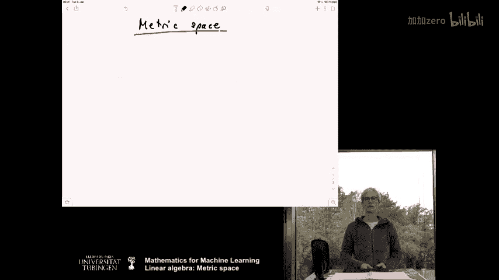
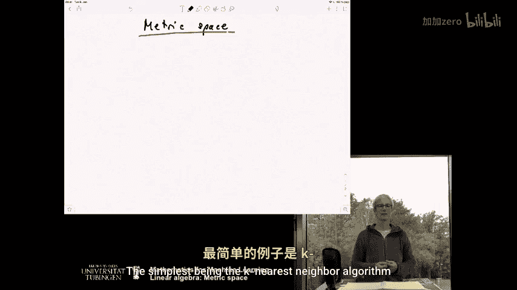

# 图宾根大学【中英⚡机器学习数学｜2020 Tübingen Mathematics for Machine Learning】 p17 P17 (A) Linear algebra 16： Metric spaces -BV1VhbMzKEts_p17-

Today， I want to discuss a metric space。This sounds a bit out of scope because we're currently linear algebra wrong。

 but eventually we want to introduce what is a norm and also what is a scalear product and very eventually what is a Hilbert space and for this we first of all need a couple of notions like a metric we need to know what does it mean if a metric space is complete and so on Also in machine learning there are various applications nearly every machine learning algorithm in the background somewhere uses a metric the simplest being the canous neighbor algorithm or the class of can neighbor algorithms which we can use for all different kinds of purposes。

So let's get us started with metric spaces。That's right down the definition。是的。First of all。

 we start with a set of objects。So let X。Be any set。ItCan be anything， Think about molecules， texts。

 images， whatever you might think about。And now I want to say。

 how does a function look like that lives on that space and this called a metric。So， a function。D。

That livess on x times x。 So it takes pairs of inputs of data points。And maps them to a real number。

Such a function is called a metric。If the following condition thought。嗯。We have for all U， V and W。

 which are in our space。We have a couple of properties。

 The first one is a metric is always a non negative number。

 We don't want to say a distance between two objects is minus5。

This somewhat doesn't really make sense。 at least it doesn't fit to our intuition。

 So this is something we do not want to have。 So we say the distance of X， Y。Is always larger than 0。

 at least if x and y are not the same。 So if we have two points which are distinct。

 then their distance should be something that is actually positive。

