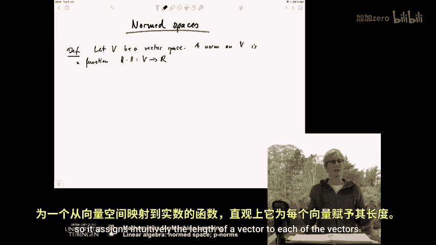

# 图宾根大学【中英⚡机器学习数学｜2020 Tübingen Mathematics for Machine Learning】 p18 P18 (A) Linear algebra 17： Normed spaces; p-norms -BV1VhbMzKEts_p18-

In the last lecture， we have seen a metric space， and now I want to introduce a norm space。

This already brings us back into linear algebra because in order to define a normal space。

 we need a vector space in the first place。Let us begin。So， we define。A normal space as follows。

Let V be a vector space。And how we define a function on the vector basis， this is a norm。A norm room。

On the vector space， or on B。Is a function。Typically， we denot it by。These two double barss。

 So you've seen this， you can completely the norm of a vector。

 And if I want to define it as a function， what we sometimes do is maybe I first write it down。

We write norm and adoptt in the middle of the norm。

 which means this is the place where the argument is supposed to go。

This is because we don't have a notation like F。 So we have this funny two bars at two sides of the expression。

 So we need to put a dot in the middle to say this is sort of we understand this as a function。

That goes from the vector space to the real number。

 So it assigns intuitively the length of a vector to each of the vectors。

 And now we need to have a certain number of properties such that。

Now， for all X， Y， sorry， in the vector space。And lambda in F。We have。The following conditions。

啊 true。So these are four conditions altogether。The first one is that if you take the norm of lambda times x。

This is supposed to be the absolute value of lambda times the norm of x。That's the the first。

Expression， so intuitively， it means if you take five times the vector。

 then the length of the vector should be five times the length of the original vector。

And this is called the Nor homogeneous。The second。