# 图宾根大学【中英⚡机器学习数学｜2020 Tübingen Mathematics for Machine Learning】 p24 P24 (A) Linear algebra 23： Orthogonal vectors and basis -BV1VhbMzKEts_p24-

In the last lecture we have introduced what our K product is and now we want to use it。

As I already said， the scalar product typically is used to measure angles in a vector space and in particular we want to use it to define when two vectors are ogonal to each other。

 let us get started。

So assume， we are in a vector space that has a scanar product， so a prehered space。

So SEM or consider。It's make it nice。Consider a prehued space。

Called we。

Two vectors in the space，2。

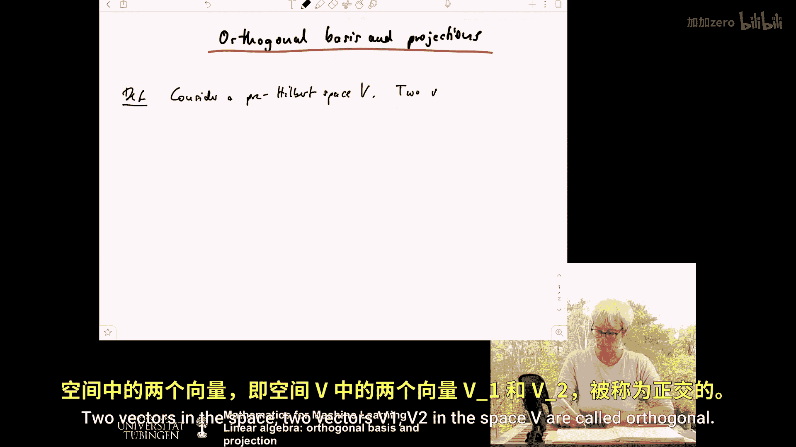

Vctors。V 1 V 2 in the space V。Are called。Or a soveir。

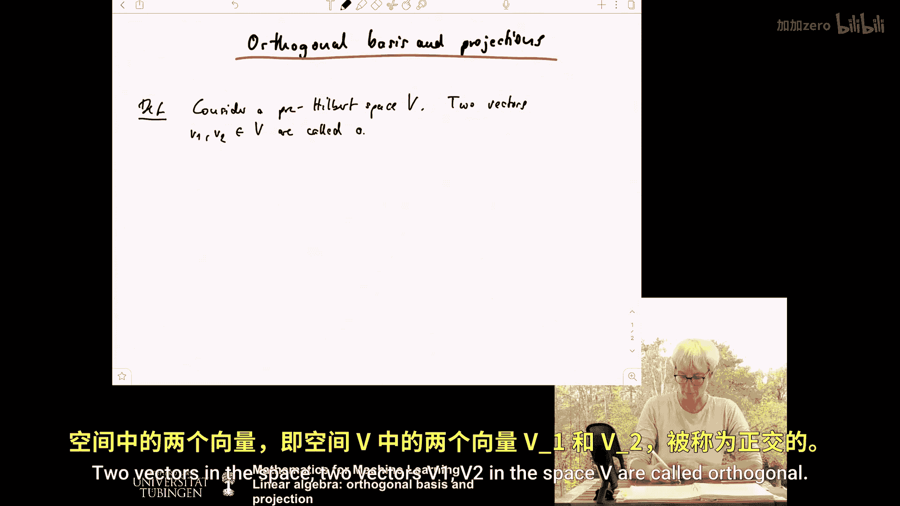

If the scatterar product between V1 and V2 is 0。

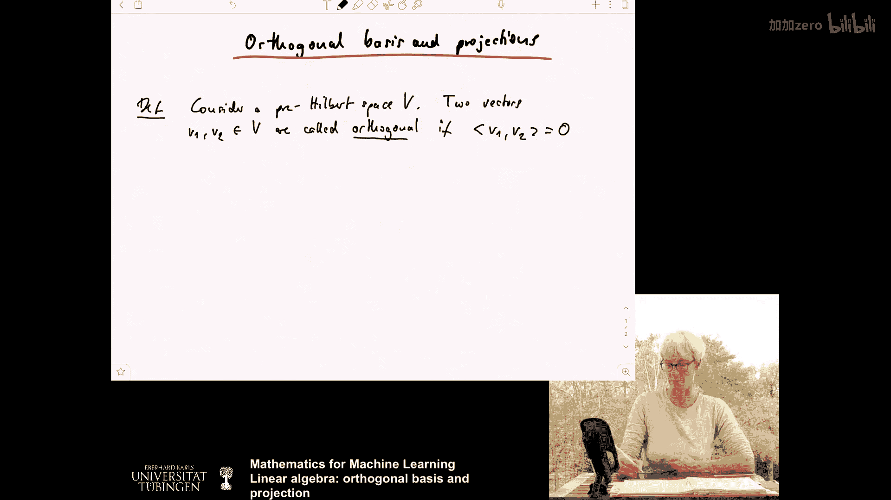

So this is the primary use of a scalar product。 when the scalar product between two vectors is0。

 we call the vectors orthogonal。

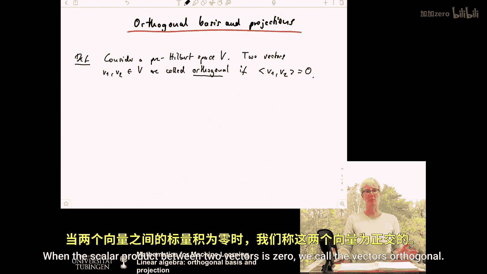

AndNotation is sometimes。Sometimes we write something like V1 or soonal 2 v 2。

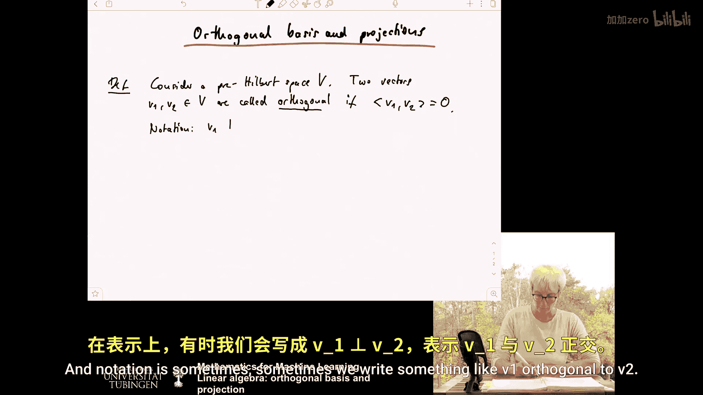

This is not a completely standard notation， but nearly standard， I think many people use it。

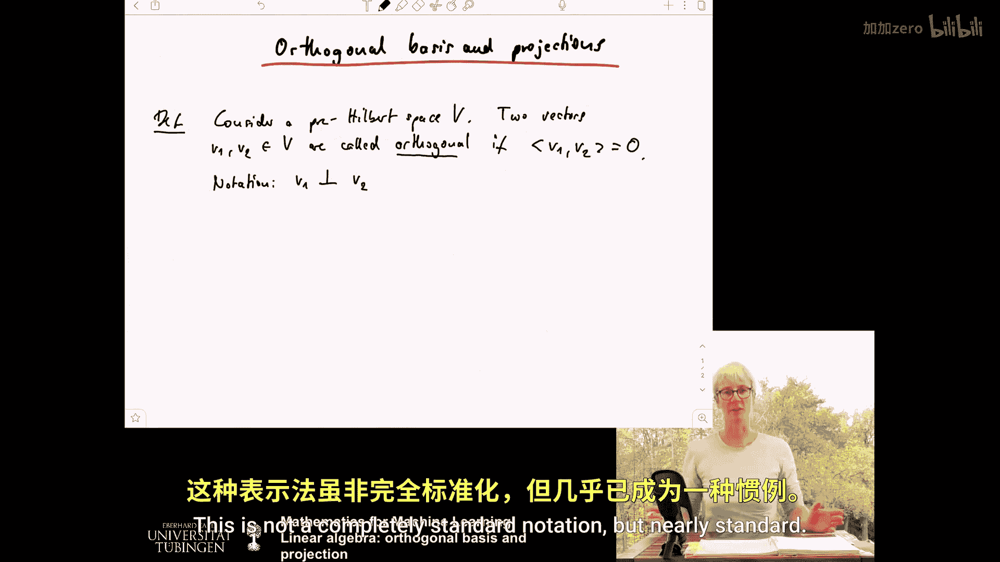

So now we know when two vectors are orthogonal， and next we can define when two sets of vectors are orthosogonal。

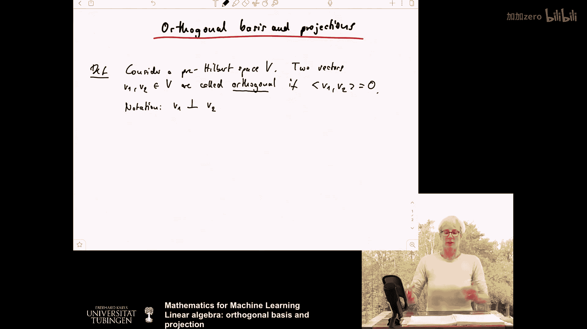

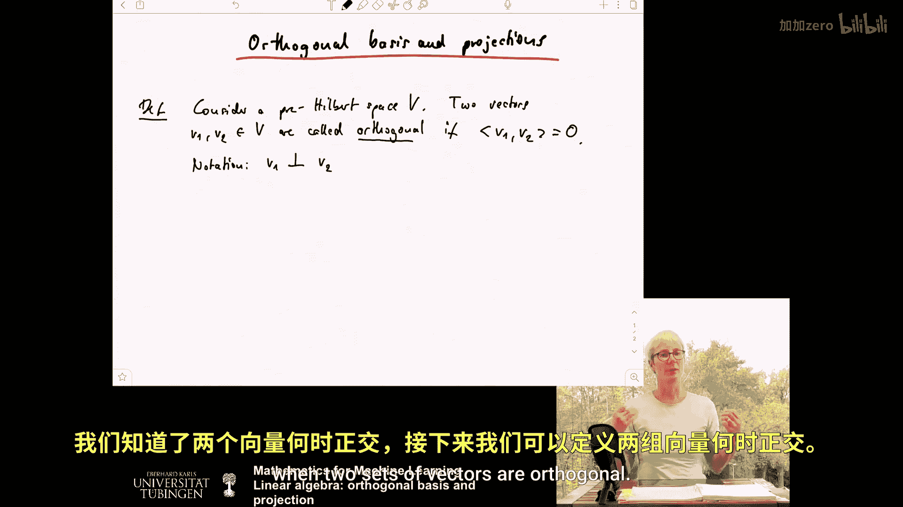

Two sets。V1， V2。 So these are subsets of vectors living in the vector space。

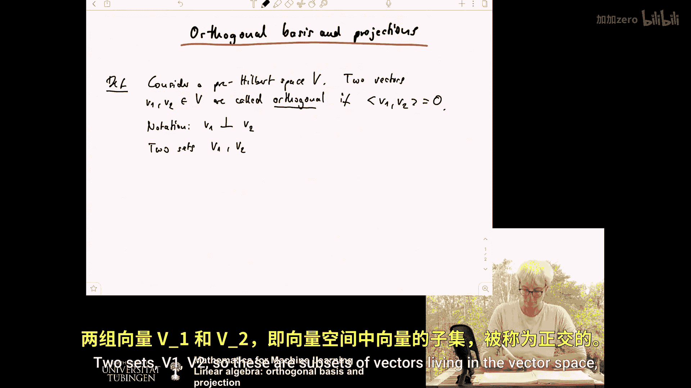

Are called orthogonal。

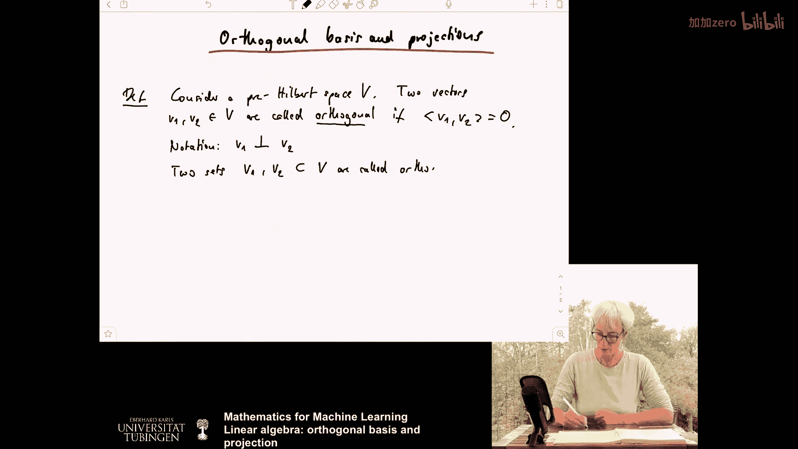

If all elements that we could pick are subal with respect to each other。

 So if for all V1 in V1 and for all V2 in V2， we have that the scalar product between V1 and V2 is 0。

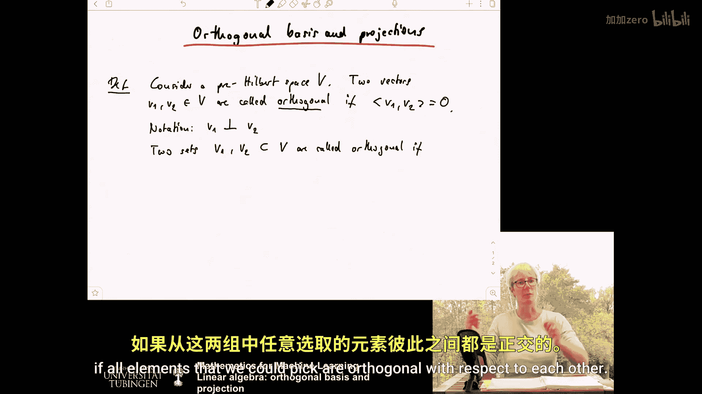

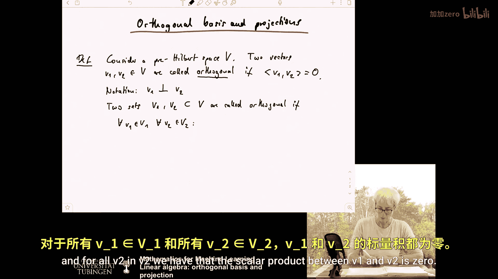

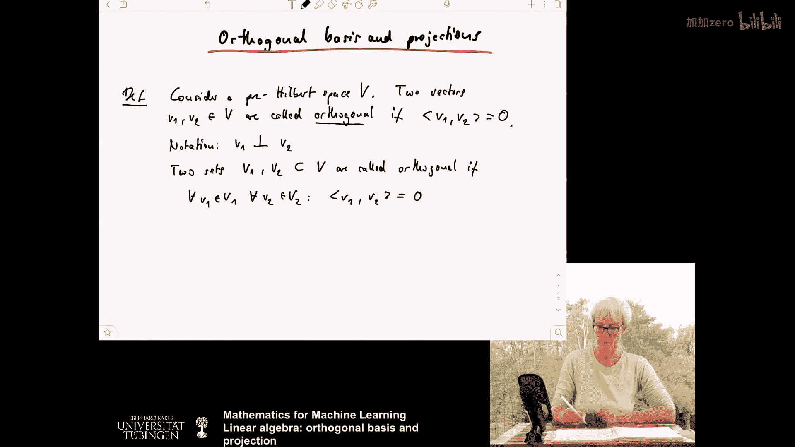

嗯。This is now when we call a set orthogonum typically this is in most cases。

 this is applied to subspaces， so we call to subspaces orthogonum if they satisfy these two this requirement。

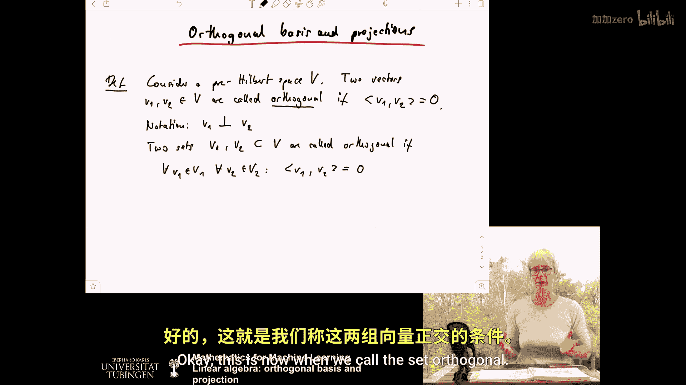

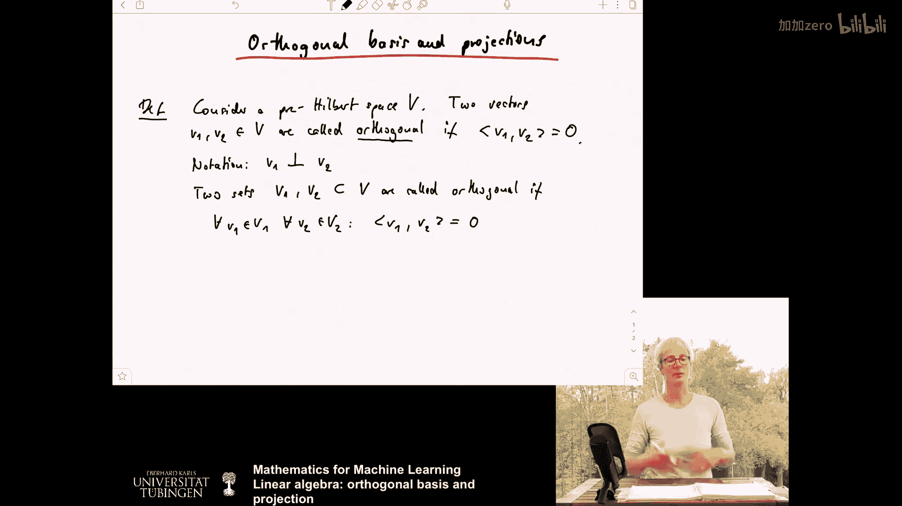

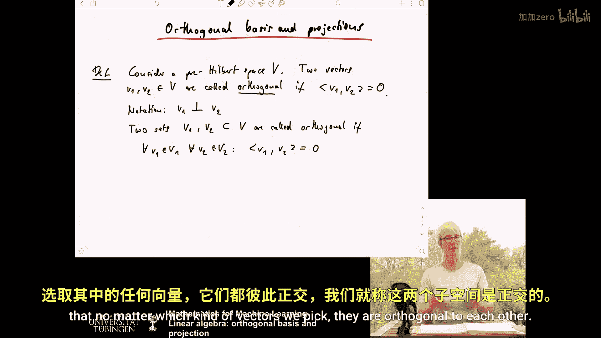